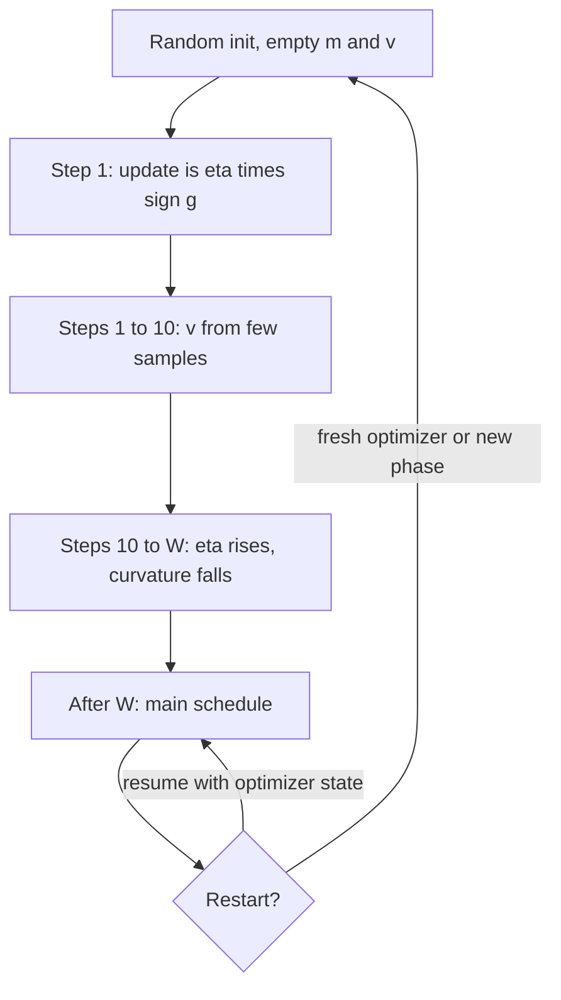

## TL;DR
Warmup ramps the learning rate from near zero to its peak over the first few hundred or thousand
optimizer steps, because early gradients are large and Adam's variance estimates rest on almost no data.
A short ramp is cheap and removes most early divergence.

## Why it exists
- **Nothing is calibrated at init.** Activations have whatever scale the init gave them, the loss is at
  its maximum, and the gradient is large and dominated by a few directions (fix the output bias, shrink
  everything). A full step moves far along a direction computed from a landscape that looks completely
  different one step later. Result: loss drops, spikes, then recovers slowly or produces NaNs.
- **Adam's early statistics are noise.** It divides each update by `√v̂`, a running average of squared
  gradients built from one sample after one step, ten after ten. A parameter whose few observed gradients
  happened to be small gets an update far too large. RAdam showed the effective step size has divergent
  variance in the first iterations; warmup keeps updates small until `v` can be trusted.
- **Post-LN amplifies it.** In the original Post-LN transformer the expected gradient norm nearest the
  output is large at init and does not shrink with depth, while Pre-LN scales roughly as `1/√L`, so a deep
  Post-LN model's first updates are disproportionately large near the output. The paper that analysed this
  showed Post-LN is unstable without warmup, while Pre-LN tolerates its absence.
- **Large batches need it.** A bigger batch justifies a bigger rate only once the model has left the
  chaotic initial region, so the ImageNet-in-one-hour recipe ramped linearly over the first five epochs
  instead of starting at the scaled peak.
- **A lower peak is the wrong fix.** It avoids the early blow-up, but the whole run trains too slowly and
  ends at a worse loss. Warmup separates the concerns: a conservative start and an aggressive middle.

## How it works
Warmup is a multiplier on the learning rate for the first `W` optimizer steps, then the main schedule
takes over:

```
η(t) = η_max × t / W           for t < W      (linear warmup)
η(t) = main_schedule(t)        for t ≥ W
```

- **Linear is standard.** Some recipes start from a small non-zero fraction instead of exactly zero, so
  the very first step still does something.
- **Counted in optimizer steps.** With gradient accumulation this matters: 500 warmup steps with
  accumulation 8 means 4,000 micro-batches.

### What it protects against, step by step
1. **Steps 1–10.** Adam's `m` and `v` are nearly empty. Bias correction fixes their *mean* but not their
   *variance*, so the per-parameter step `m̂/√v̂` can be wildly off for individual weights.
2. **Step one is the extreme.** After bias correction `m̂ = g` and `v̂ = g²`, so the update is
   `η · g/|g| = η · sign(g)`. Every parameter, including pure-noise ones, moves by the full rate in one
   batch's direction. At η = 1e-4 that is billions of weights shifted by 1e-4 at once; a tiny η keeps
   those mis-scaled updates harmless while `v` fills.
3. **Steps 10–W.** Gradients are still large and the surface is sharp. Weight norms, LayerNorm statistics
   and attention logit scales are settling; a rising η takes progressively larger steps as the curvature
   along the trajectory decreases.
4. **After W.** The model is in a smoother basin, moment estimates are reliable, and the main schedule
   (cosine, linear, WSD) governs.

### How long
There is no closed form. Practical ranges:

| Run | Typical warmup |
|---|---|
| Fine-tuning | a few percent of total steps, or a fixed 50–200 steps |
| Pre-training | on the order of a thousand to a few thousand steps (Llama 2 reports 2,000) |
| Small fine-tune, low peak | often very little |

- **Want longer:** larger peak learning rates, larger batches and Post-LN architectures.
- **Too short:** a loss spike or a sudden rise in gradient norm within the first few hundred steps.
- **Too long:** a flat early loss curve that only starts dropping when the ramp ends.

### Interaction with other stabilizers
Warmup, gradient clipping and Pre-LN attack the same early instability from different sides, which is why
modern recipes use all three. Removing one usually means asking more of the others.
- **Clipping** bounds the damage of any single bad step.
- **Pre-LN** keeps gradient magnitudes roughly uniform across depth.
- **Warmup** shrinks the step itself.
- **RAdam** builds the variance correction into the optimizer (it damps the adaptive step until `v` has
  enough samples), so some recipes run it with no explicit ramp. Most LLM recipes still pair AdamW with a
  plain linear warmup, because it is simpler to reason about and tune.

### Resuming and re-warming
- **Resume with intact optimizer state:** do *not* repeat warmup, because `v` is already populated.
  Restore the scheduler state so the learning rate continues where it left off.
- **New phase** (continued pre-training on new data, or fine-tuning from a base model): the optimizer
  state is fresh, so a new warmup is needed even though the weights are trained.

## Diagram
Follow one run from initialization: the ramp covers the window where Adam's statistics are unreliable,
and a resume skips it only when optimizer state comes back with the weights.



## Examples
### Sizing warmup from the real optimizer step count
A fine-tuning configuration where warmup is derived from the real number of optimizer steps, then checked
by printing the learning rate at the ends of the ramp. The scheduler comes from `transformers`; the
arithmetic most people get wrong is the step count.

```python
import torch
from transformers import get_cosine_schedule_with_warmup

n_examples, epochs = 20_000, 3
micro_batch, accum, n_gpus = 8, 4, 2
seq_per_opt_step = micro_batch * accum * n_gpus          # 64 sequences per optimizer step
opt_steps = epochs * (n_examples // seq_per_opt_step)    # 3 * 312 = 936 optimizer steps
warmup = int(0.05 * opt_steps)                           # 5% -> 46 steps

params = [torch.nn.Parameter(torch.zeros(4))]
opt = torch.optim.AdamW(params, lr=2e-5)
sched = get_cosine_schedule_with_warmup(opt, num_warmup_steps=warmup,
                                        num_training_steps=opt_steps)

seen = {}
for step in range(opt_steps):
    # for _ in range(accum): loss.backward()   # accumulate micro-batches
    opt.step(); opt.zero_grad(); sched.step()  # ONE scheduler step per optimizer step
    seen[step] = opt.param_groups[0]["lr"]

print(f"{seen[0]:.2e} {seen[warmup // 2]:.2e} {seen[warmup - 1]:.2e} {seen[opt_steps - 1]:.2e}")
# ~4.3e-07  ~1.0e-05  2.0e-05  ~0  -> ramp reaches the peak at step 45, then cosine decays
```

What goes wrong if `opt_steps` is computed from micro-batches (`epochs * n_examples // micro_batch` =
7,500):

| Quantity | Correct | From micro-batches |
|---|---|---|
| Planned schedule length | 936 | 7,500 |
| 5% warmup | 46 steps | 375 steps: 40% of the 936 steps that actually run |
| Decay progress when data runs out | 100% | (936 − 375)/(7,500 − 375), about 8% |
| Final learning rate | ~0 | still near peak, so the weights never get an anneal |

### Why clipping cannot replace warmup: Adam's first step by hand
Pure Python, no dependencies. It applies Adam's bias-corrected first update to a gradient with one huge,
one tiny (noise) and one large component, with and without clipping to norm 1.0.

```python
import math

def adam_first_step(g, lr=1e-4, b1=0.9, b2=0.999, eps=1e-8):
    m = [(1 - b1) * x for x in g]                 # m after one step
    v = [(1 - b2) * x * x for x in g]             # v after one step
    m_hat = [x / (1 - b1) for x in m]             # bias correction: m_hat = g
    v_hat = [x / (1 - b2) for x in v]             # v_hat = g^2
    return [-lr * mh / (math.sqrt(vh) + eps) for mh, vh in zip(m_hat, v_hat)]

def clip(g, max_norm=1.0):
    norm = math.sqrt(sum(x * x for x in g))
    return [x * min(1.0, max_norm / norm) for x in g], norm

grad = [3.0, -0.001, 9.0]                         # one large, one tiny (noise), one huge
clipped, norm = clip(grad)
print(f"grad norm {norm:.2f}, clipped to {math.sqrt(sum(x*x for x in clipped)):.2f}")
print("unclipped:", [f"{u:+.2e}" for u in adam_first_step(grad)])
print("clipped:  ", [f"{u:+.2e}" for u in adam_first_step(clipped)])
# grad norm 9.49, clipped to 1.00
# Both lines print -1.00e-04 +1.00e-04 -1.00e-04: step one is lr * sign(g),
# the tiny noisy gradient moves as far as the huge one, and clipping changes nothing.
```

Only a smaller `lr` on that first step shrinks the move, which is exactly what the warmup ramp does.

## Production patterns
- **Derive warmup from optimizer steps.** Compute steps as examples ÷ (micro-batch × accumulation ×
  GPUs) × epochs, then set `warmup_steps`, or a ratio of that count (the Trainer's `warmup_ratio`).
  Before launch, print the rate at step 0, `W` and the end; it should hit the peak exactly at `W`.
- **Log grad norm from step zero.** `torch.nn.utils.clip_grad_norm_` returns the pre-clip total norm, so
  log it every step. A healthy run shows the norm falling as the rate rises; a spike in the first few
  hundred steps means the ramp is too short.
- **Re-warm on every fresh optimizer.** Continued pre-training on new data or fine-tuning from a base
  model starts with empty `m` and `v`, so give it its own ramp. A true resume restores optimizer and
  scheduler state and skips it; alert if the logged rate drops at a resume step.
- **Short ramp for LoRA.** LoRA's `B` starts at zero and LoRA uses higher peak rates, so a 20–50 step ramp
  removes the first-steps loss jump. Watch grad norm over the first tens of steps.
- **Scale warmup with peak rate and batch.** When raising the peak learning rate or batch size, lengthen
  warmup as Goyal et al. did (a linear ramp over the first five epochs at large batch). Monitor early
  gradient-norm spikes after each change.

## Trade-offs
- **Safety vs productive steps.** A longer warmup is safer against early divergence but spends more of a
  short fine-tuning run below the productive rate; once the early gradient-norm spike is gone, extra ramp
  buys nothing, so the trade flips as soon as a shorter warmup shows a clean norm trace.
- **Higher peak vs noisy end.** Warmup lets you use a higher peak learning rate, reaching a given loss in
  fewer steps, but the higher peak then needs a proper decay phase or the run ends noisy.
- **Pre-LN and clipping vs zero warmup.** They reduce the *need* for warmup, so very short ramps work, but
  removing it entirely still risks polluting Adam's moment estimates with the first erratic gradients.
- **Skipping warmup on resume.** Correct when optimizer state is restored, wrong when it is not; the
  convenience of "just reload the weights" trades for a second unstable start.

## Pitfalls
- **Counting warmup in the wrong unit.** Setting `warmup_steps` as if steps were micro-batches or epochs.
  Symptom: a ramp that never finishes before the run ends, or one over after a single logging interval.
  Fix: derive it from the optimizer-step count and print the rate at `W` before launch.
- **Resuming without scheduler state.** Warmup restarts from zero at step 10,000; the loss curve shows a
  visible dip in progress for the next few hundred steps. Fix: save and restore the scheduler with the
  optimizer.
- **Blaming data for a step-50 spike.** It is usually a warmup problem. Check the gradient norm trace
  first, because it jumps before the loss does.
- **Reusing a pre-training warmup for fine-tuning.** Thousands of steps of ramp in a 500-step run means the
  model never reaches its intended learning rate.
- **LoRA at a high peak with no warmup.** `B` is zero-initialized, so on step one only `B` gets a gradient,
  and Adam's sign-like first step moves every element of `B` by the full rate in one batch's direction.
  Symptom: a loss jump or grad-norm spike in the first tens of steps; a 20–50 step ramp removes it.

## When to use
- **Use warmup** in essentially every run with an Adam-family optimizer, which is every run in modern AI
  engineering.
- **Fine-tuning:** default to a few percent of total optimizer steps and verify the step count.
- **Pre-training or large-batch training:** size it in the thousands of steps, and increase it when
  raising the peak learning rate or batch size.
- **Skip it** only in tiny experiments where divergence is cheap to notice and restart.
- **Measure:** log learning rate and gradient norm from step zero; a healthy run shows the norm falling as
  the rate rises.
- **Interviews:** the question is rarely "what is warmup" but "why does Adam need it". The answer is the
  variance of early second-moment estimates plus large, poorly conditioned initial gradients.

## Role lens
- **Engineer:** Computes warmup from the real optimizer step count, logs learning rate and grad norm from
  step zero, and reads early loss spikes as a warmup or clipping problem before blaming data.
- **Architect:** Sets the stability recipe for the organization's training stack (warmup length, clipping,
  Pre-LN) so that teams scaling batch or learning rate do not rediscover divergence independently.
- **FDE:** When a customer's fine-tuning job diverges on their own data, checks warmup and step accounting
  in their config first, since a mis-sized ramp is the most common cause and the cheapest fix.

## Check yourself
**Q:** A colleague argues that because the model uses Pre-LN and gradient clipping at 1.0, warmup is
redundant and they will fine-tune at a constant 1e-4 from step one. What do you expect to happen, and why?
**A:** Pre-LN removes the depth-dependent gradient blow-up and clipping bounds the raw gradient of any one batch,
but neither fixes Adam's early second-moment estimates. In the first steps `v` is estimated from one or
two gradients per parameter; on step one the update is literally `η · sign(g)`, so every parameter moves
by the full 1e-4 whatever its gradient size. Clipping cannot prevent that, because clipping rescales the
raw gradient and Adam's normalization divides the rescaling straight back out: a gradient clipped from
norm 10 to norm 1 produces the same first step as the unclipped one. Expect a loss that drops briefly and then spikes within the first hundred steps,
or a run that converges but to a worse final loss than the same recipe with a 50-step ramp. The cost of
warmup is a few percent of a short run, and the fix for any observed spike is cheaper up front than after
a wasted run.

## Interview questions
### Why do Adam-family optimizers need warmup when plain SGD often gets by without it?
- **Normalized steps:** Adam divides by `√v̂`, and early `v̂` comes from one or a few gradients, so
  per-parameter step sizes have huge variance until enough samples arrive.
- **Step one is sign descent:** after bias correction the first update is `η · sign(g)`, so every weight
  moves by the full rate regardless of how small or noisy its gradient was.
- **Warmup keeps η tiny** for exactly that window, then hands over to the main schedule.

### A fine-tune's loss spikes around step 50 and then recovers slowly. Walk me through the diagnosis.
- **Check the grad-norm trace first:** it jumps before the loss does, which points at optimization
  stability rather than a bad data shard.
- **Check step accounting:** confirm warmup was counted in optimizer steps and actually ran, and that the
  peak was reached when intended.
- **Fix:** lengthen the ramp (for example 50–200 steps for fine-tuning) or lower the peak, then rerun and
  compare the norm trace.

### When is it correct to skip warmup?
- **On a true resume:** if the checkpoint restores optimizer state, `v` is populated and the scheduler
  should continue from its saved step; repeating the ramp only slows the next few hundred steps.
- **Tiny experiments:** where divergence is cheap to notice and restart.
- **Not when only weights are reloaded:** a fresh optimizer needs a fresh ramp, even on trained weights.

### How long should warmup be for pre-training versus fine-tuning, and what tells you it is wrong?
- **Pre-training:** on the order of a thousand to a few thousand steps; Llama 2 reports 2,000.
- **Fine-tuning:** a few percent of total steps or a fixed 50–200 steps.
- **Too short:** loss or grad-norm spike in the first few hundred steps. **Too long:** a flat early loss
  curve that only starts falling when the ramp ends.

### Does RAdam make explicit warmup unnecessary?
- **It addresses the same cause:** RAdam damps the adaptive step until `v` has enough samples, so some
  recipes run it with no explicit ramp.
- **Why most LLM recipes still use AdamW plus linear warmup:** it is simpler to reason about and tune,
  and it also covers the large, poorly conditioned initial gradients.

## Quiz
### Q: Why does Adam specifically benefit from learning-rate warmup?
- [ ] Adam has no bias correction, so early updates are biased toward zero
- [x] Its per-parameter second-moment estimate is built from very few samples early on, so normalized step sizes have high variance until enough gradients have been seen
- [ ] Adam's momentum term is zero at the start, so updates are too small without warmup
- [ ] Adam requires the learning rate to be below the Lipschitz constant, which warmup estimates
> Bias correction fixes the mean of the moment estimates, not their variance; the early `v` is simply
> noisy. Warmup keeps the learning rate small while that estimate stabilizes.

### Q: A run with gradient accumulation of 8 is configured with 400 warmup steps and 10,000 micro-batches in total. How much of the run is warmup?
- [ ] 4%, because warmup is counted in micro-batches
- [x] 32%, because there are only 1,250 optimizer steps and warmup counts those
- [ ] 0.4%, because warmup counts tokens
- [ ] It depends on the number of GPUs
> Schedulers advance per optimizer step. 10,000 micro-batches at accumulation 8 is 1,250 optimizer steps,
> so 400 warmup steps is nearly a third of the run, far longer than intended.

### Q: You resume a crashed pre-training run from a checkpoint that includes optimizer state. Should warmup repeat?
- [ ] Yes, because the GPU memory state was lost
- [ ] Yes, warmup is always required after any restart
- [x] No; the second-moment estimates are already populated, so the scheduler should continue from its saved step
- [ ] Only if the learning rate at the crash point was above the warmup peak
> The purpose of warmup is to protect against unreliable early optimizer statistics and a random init.
> With optimizer state restored, neither applies, and repeating the ramp just slows the next few hundred steps.
