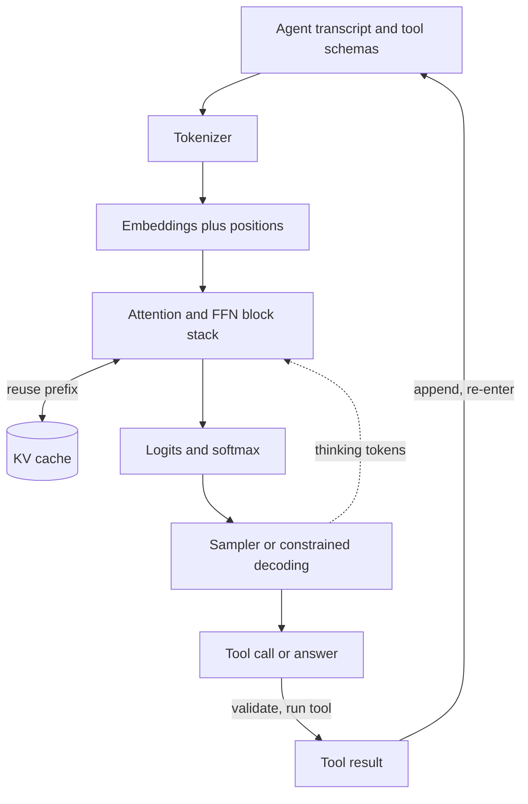

## Overview
This module opens up the large language model behind your agent and follows a token all the way
through it. Every agent step is one trip through this pipeline: the transcript is tokenized, embedded,
attended over, turned into logits and sampled into the next tool call or answer.

The early lessons show how text becomes ordered vectors. Tokenization and embeddings turn characters
into ids and ids into vectors, positional encoding stamps order onto them, and llm-architecture explains
why one causal decoder stack won over encoder–decoder designs.

The attention lessons sit at the centre of the transformer block. Self-attention is the only operation
that moves information between positions, multi-head attention runs several lookups in parallel, and
grouped-query attention and FlashAttention are the two fixes for attention's memory cost.

The serving half follows from the same shapes. The context window and the KV cache set how much a
request can hold and how many requests a GPU can serve. Logits and softmax are the raw output and its
normalisation, and sampling strategies and speculative decoding turn that output into text quickly and
predictably.

The final group covers the model as a whole. Mixture-of-experts and small language models are two
answers to the cost of parameters, scaling laws link size, data and compute, perplexity is the native
quality metric, hallucination follows from the training objective, and reasoning models move from bigger
weights to more inference compute.

- **What it gives an agent builder:** the reasons behind token bills, context-length failures, slow late
  steps in long loops, malformed tool calls, invented IDs and the cost of thinking tokens.
- **Core for agents (use directly):** tokenization, embeddings, context-window, kv-cache,
  sampling-strategies, hallucination, small-language-models, reasoning-models-test-time-compute.
- **Useful (when you fine-tune, self-host or operate agents):** logits, multi-head-attention,
  grouped-query-attention, positional-encoding, llm-architecture, flashattention, speculative-decoding,
  perplexity, mixture-of-experts.
- **Background (recognise and reason with):** attention-mechanism, softmax, self-attention, transformer,
  scaling-laws.
- **What you can build afterwards:** read a model config and derive parameters, FLOPs per token and
  KV-cache bytes; explain latency, cost and odd behaviours from first principles; choose decoding
  settings per agent step from that step's error model; and pick or reject a model for an agent
  deployment with numbers instead of benchmark tables.

It matters most for AI Engineers, and it is the shared vocabulary Architects and FDEs need to defend
model and hardware choices for the agents they ship.

## Why it matters
- **Engineer:** In every agent you build you will tune temperature and top-p per step, budget prompts and tool schemas with the real tokenizer, read logprobs, enable prefix caching and speculative decoding, and debug truncation, NaNs and repetition loops; each is only predictable once you know the logits-to-sampler path and what the KV cache holds.
- **Architect:** Concurrent agent sessions per GPU, cost per agent run and the dense-versus-MoE-versus-SLM decision for each agent role all follow from head counts, KV-cache bytes per token, active versus total parameters and the 2N-FLOPs-per-token rule, so capacity plans and model choices are arithmetic you can check rather than vendor claims.
- **FDE:** Customers running your agents ask why their language costs three times more tokens, why the agent invents facts or order IDs, whether their older GPUs can run long agent transcripts, and whether a small fine-tuned model can replace the API for narrow steps; you need first-principles answers and a quick measurement on their own data.

## Mental model
Hold one picture: text goes through a pipeline of tensors with fixed shapes, and every cost and
behaviour of your agent can be traced to one stage of it.

- **Tokenizer:** turns characters into ids, which sets the token bill for system prompt, tool schemas
  and every appended tool result.
- **Embeddings and positions:** embeddings turn ids into vectors, and positional encoding stamps order
  onto them.
- **Block stack:** identical blocks alternate attention (positions exchange information, cost n² in
  length, cache grows with length times KV heads) with a feed-forward network (each position transformed
  alone, cost tracks parameters).
- **Output:** the last hidden state becomes logits, softmax turns them into a distribution, and a
  sampler picks one token, which is appended and fed back.
- **Prefill versus decode:** prefill is the pipeline run once over the prompt and limited by compute;
  decode is the loop, limited by memory bandwidth. An agent repeats both on every step.
- **Debugging rule:** when something is slow, expensive or wrong, ask which stage and which shape is
  responsible: token count, sequence length, KV heads, active parameters, the logit vector or the sampler.
- **End of the loop:** hallucination and reasoning sit here. The objective rewards plausible
  continuations, and more loop iterations buy more compute.

The loop on the right is your agent: every tool result re-enters the pipeline, so transcript length
drives cost, the KV cache decides whether earlier steps are re-processed, and the sampler decides how
often a step goes wrong.

## Suggested order
1. tokenization — text must become token ids before anything else happens, and tokens are the unit of cost and context every agent step is billed in.
2. embeddings — turns token ids into the vectors the network computes on, and separates the LLM's embedding table from the embedding models behind RAG and memory.
3. context-window — the budget every agent request shares, constrained by attention cost, cache size and trained positions, and the reason transcripts need compaction.
4. softmax — the normalisation inside every attention head and at the output, needed before temperature, masking and sampling make sense.
5. logits — the raw per-vocabulary scores the stack outputs, where logit bias, constrained decoding for tool calls and logprobs act.
6. sampling-strategies — turns the softmaxed logits into tokens with greedy, beam, temperature, top-k, top-p and min-p, the cheapest lever on per-step error rates.
7. hallucination — explains fabrication from the objective, decoding and incentives, using logits, sampling and calibration, and why an agent's hallucination is a wrong action.
8. attention-mechanism — introduces the query, key and value lookup that every later attention topic refines.
9. self-attention — applies attention within one sequence, adds masking and the O(n²) cost that drives the serving topics.
10. kv-cache — makes decoding incremental and turns sequence length into GPU memory, the limit on concurrent agent sessions and the basis of prefix caching.
11. reasoning-models-test-time-compute — spends more decode tokens instead of more parameters, tying the cost of thinking agent steps back to the loop.
12. small-language-models — applies scaling and distillation results to narrow, cheap and private agent steps such as routing and extraction.
13. multi-head-attention — splits the width into parallel heads and introduces the head counts read from every model config.
14. grouped-query-attention — shrinks the KV cache by sharing key/value heads, which only lands after the cache formula.
15. positional-encoding — supplies the order signal self-attention lacks and explains RoPE and context extension for long transcripts.
16. transformer — assembles attention, the feed-forward network, residuals and normalisation into the block and derives 2N FLOPs per token.
17. llm-architecture — compares encoder, decoder and encoder–decoder stacks and explains why causal decoders dominate chat and agent models.
18. flashattention — removes the n² memory traffic with tiling and online softmax, building on self-attention and softmax.
19. speculative-decoding — uses idle compute during bandwidth-bound decode, relying on logits, sampling and the cache, and pays off on predictable tool-call JSON.
20. perplexity — the native fit metric computed from logits, needed before comparing models, quantisation and scale.
21. mixture-of-experts — separates active from total parameters, building on the FFN and on scaling arguments.
22. scaling-laws — links parameters, tokens and compute to loss, frames over-training and inference cost, and closes the model-selection picture.

## Capstone
### Brief
Use case: a support team runs a multilingual ticket-triage and reply-drafting agent on a frontier API
and wants to move it onto self-hosted open weights, on a node with two 48 GB GPUs.

The agent classifies each ticket, retrieves a knowledge-base article and drafts a grounded reply. You build the serving tier
for that agent and recommend a model and configuration with evidence.

Shortlist three open models: one dense mid-size model, one mixture-of-experts model and one small
language model of 8B parameters or fewer. Then work through these steps:

- From each model's config alone, derive parameter count, active parameters, FLOPs per token and
  KV-cache bytes per token, then compute the maximum concurrent requests at the agent's real prompt and
  output lengths.
- Measure tokens per character for each tokenizer on a sample of the customer's tickets in at least
  three languages.
- Serve at least two candidates with an inference engine such as vLLM or llama.cpp and measure
  throughput and time per output token at several concurrency levels, with and without prefix caching
  and speculative decoding.
- Compare a quantised build against the original with perplexity on held-out tickets.
- Run a small grid of sampling settings for the classification step and the drafting step, and measure
  hallucination on drafts as unsupported claims against the ticket and knowledge-base article.
- Test whether a reasoning mode or best-of-n voting improves the hardest triage cases enough to justify
  its token cost, and route only those cases to it.

### Deliverables
- A working triage-and-draft agent running against the self-hosted engine, with a routing rule that sends only the hardest triage cases to the reasoning or best-of-n tier.
- A config-derived capacity sheet (script or notebook) that computes parameters, active parameters, 2N FLOPs per token, KV-cache bytes per token and maximum concurrency at the target context for each candidate, checked against the engine's reported memory.
- A tokenizer cost table giving tokens per character and estimated monthly token volume per language for each candidate, measured on the customer's own ticket sample with each model's real tokenizer.
- A benchmark report of throughput, p50 and p95 time per output token and KV-cache utilisation across concurrency levels, with prefix caching and speculative decoding toggled, including the speculative acceptance rate.
- An evaluation set of 50+ labelled tickets with triage labels and reference facts, plus results for the sampling grid, the quantised-versus-original perplexity check, the unsupported-claim rate on drafts and the accuracy-versus-tokens curve for the reasoning or best-of-n escalation.
- A two-page recommendation naming the model, quantisation, decoding settings per agent step, context limit and routing rule, with cost per resolved ticket compared to the current API.

### Rubric
- Every capacity number traces to named config fields (`hidden_size`, `num_hidden_layers`, `num_key_value_heads`, `head_dim`, expert counts) through a written formula, and predicted KV-cache memory agrees with the engine's measurement within 15 percent.
- Benchmarks are run at production-like concurrency and prompt lengths, and the report explains each result with the right mechanism (bandwidth-bound decode, cache pressure, preemptions, low draft acceptance) rather than only listing numbers.
- Sampling settings differ between the triage and drafting steps and are justified by measured accuracy and format-failure rate from the grid, not copied defaults.
- Hallucination is reported as a claim-level unsupported rate on the labelled set with at least five traced examples, and the recommendation includes a concrete mitigation such as grounding, abstention or verification, with its measured effect.
- The escalation rule is backed by an accuracy-versus-tokens curve showing the chosen budget sits at the knee, and the recommendation states which tickets are routed to it and what that adds to cost per ticket.
- The agent processes the 50+ ticket set end to end on the self-hosted engine without parse failures in its tool or classification outputs, and the run's token usage matches the cost table.
