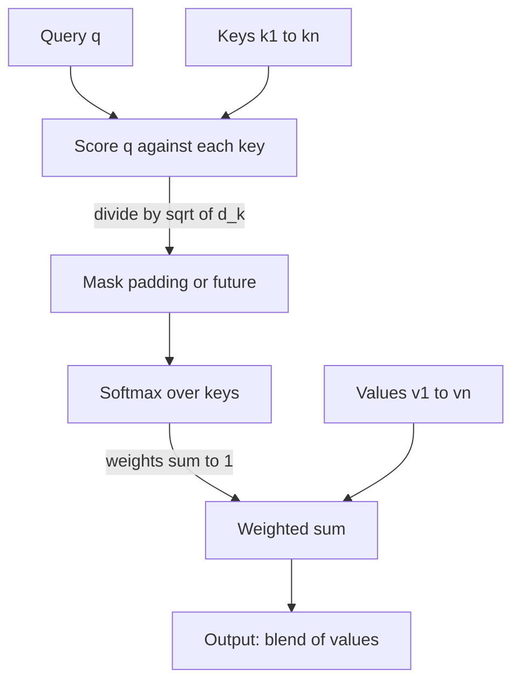

## TL;DR
Attention is a differentiable lookup: a query is scored against keys, a softmax turns scores into weights
summing to one, and the output is the weighted sum of values. It replaces one fixed-size summary with
learned, on-demand reads of the input.

## Why it exists
- **The fixed-vector bottleneck.** The 2014 sequence-to-sequence translators read the source sentence
  with an encoder RNN into a single final hidden state and generated the target from it. It worked for
  short sentences and degraded sharply with length, because a fifty-word sentence passed through the
  same few hundred numbers as a five-word one.
- **Needs change per step.** The decoder needed different parts of the source at different steps. A
  bigger vector does not help much, because a static summary written before decoding must anticipate
  every future need at once. Required capacity grows with (input position, output step) combinations,
  not with any fixed width.
- **Bahdanau's fix: look up, don't summarize.** Keep every encoder hidden state. At each step the decoder
  scores its current state against each one, normalizes the scores, and builds a context vector as the
  weighted sum. The weights, an alignment between output and input words, were learned with no alignment
  supervision, and quality on long sentences stopped collapsing.
- **Soft so gradients flow.** The general move replaces "summarize once, then read the summary" with
  "look up what you need, when you need it", made soft so it trains end to end.
- **A long lineage.** That single move is the ancestor of self-attention, cross-attention and, in hard
  top-k form, of vector retrieval.

## How it works
### Three roles
| Role | Question it answers | Analogy |
|---|---|---|
| **Query** | what am I looking for | the search term |
| **Key** | what each item advertises about itself | the database index entry |
| **Value** | what each item hands over if selected | the row the index points to |

- **Keys and values are separate** because the thing you match on need not be the thing you retrieve.
- **All three are learned.** In neural attention they are usually linear projections `W_Q`, `W_K`, `W_V`
  of hidden states, so the network learns what to match on and what to pass along.

### Score, normalize, mix
For one query **q** and keys **k₁…kₙ**:

```
score_i = f(q, k_i)
α       = softmax(score)              # α_i ≥ 0, Σ α_i = 1
output  = Σ_i α_i · v_i
```

The choice of *f* is the main design decision:

| Score function | Formula | Property |
|---|---|---|
| **Additive** (Bahdanau) | `vᵀ·tanh(W₁q + W₂k)` | a tiny MLP per (query, key) pair; expressive, but not one matmul over all keys |
| **Dot-product** (Luong) | `qᵀk`, or "general" `qᵀ·W·k` | all scores for a query from one matrix–vector product, all queries from one matrix–matrix product |
| **Scaled dot-product** (Vaswani) | `qᵀk / √d_k` | dot-product with variance restored to one |

- **The transformer uses the general form, factored.** `(x·W_Q)·(y·W_K)ᵀ = x·(W_Q·W_Kᵀ)·yᵀ` is the
  general form with W split into two thin matrices, so each head learns a similarity of rank at most d_k.
- **Dot-product maps onto GPUs**, because matrix–matrix products are exactly what GPUs do fastest.

### Why divide by √d_k
1. If components of **q** and **k** are roughly independent with zero mean and unit variance, `qᵀk` has
   variance d_k.
2. With d_k = 64 the scores have standard deviation 8.
3. Softmax of numbers spread that widely is nearly one-hot; its gradient is close to zero almost
   everywhere, so learning stalls.
4. Dividing by √d_k puts the scores back at unit variance.
5. Evidence: the original paper reports additive and dot-product attention performing similarly at small
   d_k and unscaled dot-product falling behind at larger d_k, which motivated the scaling.

### Why softmax
- **Positive weights summing to one**, so the output is a convex combination of values whose scale does
  not depend on how many keys there are (unlike dividing by the sum of raw scores).
- **Smooth everywhere**, so it trains.
- **Its exponential sharpens contrasts**, so the model can approximate a hard selection while remaining
  trainable.
- **Hard attention**, which samples one key, needs reinforcement-style gradient estimators and has
  largely been abandoned for language.

### Where the vectors come from decides the flavour
- **Cross-attention:** queries from one sequence, keys and values from another. The decoder-to-encoder
  attention in translation; also how vision-language models inject image features and how text
  conditions a diffusion model.
- **Self-attention:** queries, keys and values all from the same sequence, so each token builds its
  representation from its neighbours. This is the transformer's core and has its own lesson.

### Attention as a soft dictionary
- **A Python `dict`** looks up one exact key and returns one value.
- **Attention** looks up every key a little and returns a blend, which is what makes it differentiable.
- **A vector database** doing top-k dot-product search over stored embeddings is the hard, external,
  disk-backed version of the same operation.
- **Retrieval-augmented generation** is attention over documents the model's weights never saw.

### Cost
- **One query against *n* keys:** O(n·d) for scores plus O(n·d) for the weighted sum.
- **With *n* queries** (self-attention): O(n²·d).
- **The n×n score matrix** is the quantity that drives every later discussion of context length, memory
  and kernels.

## Diagram
Read it top to bottom: the query is scored against every key, softmax turns scores into weights, and the
output is a blend of all values, never a single pick.



## Examples
### Attention by hand, then why the scaling matters
A worked instance in NumPy, first with two-dimensional vectors you can check by hand, then a
demonstration of why the √d_k scaling matters.

```python
import numpy as np
np.random.seed(0)

def attention(q, K, V, scale=True):
    scores = K @ q                                     # one dot product per key
    if scale:
        scores = scores / np.sqrt(q.shape[-1])
    w = np.exp(scores - scores.max()); w /= w.sum()    # numerically stable softmax
    return w, w @ V

# Three memories; the query equals the first key, half-matches the third, is orthogonal to the second.
K = np.array([[1.0, 0.0], [0.0, 1.0], [0.7, 0.7]])
V = np.array([[10.0, 0.0], [0.0, 10.0], [5.0, 5.0]])
q = np.array([1.0, 0.0])
w, out = attention(q, K, V, scale=False)
print(np.round(w, 3), np.round(out, 2))
# scores 1.0, 0.0, 0.7 -> weights [0.474 0.174 0.351] -> output [6.5 3.5]
# mostly the first value, a third of the third, a little of the second: a blend, never a pick.

# With d_k = 64 and unit-variance vectors, raw scores have std ~8 and softmax is nearly saturated.
d, n = 64, 16
K, q, V = np.random.randn(n, d), np.random.randn(d), np.eye(n)
for s in (False, True):
    w, _ = attention(q, K, V, scale=s)
    entropy = -(w * np.log(w + 1e-12)).sum()
    print("scaled" if s else "raw   ", f"max weight {w.max():.3f}  entropy {entropy:.2f} (uniform = {np.log(n):.2f})")
# Typical result: raw max weight ~0.8, entropy well under 1 (uniform = 2.77) <- near one-hot, gradients vanish
#                 scaled max weight ~0.2, entropy ~2.4                       <- a distribution the model can sharpen
# Exact values depend on the draw; the gap in entropy is the point.
```

### Padding masks: the same input must give the same output
A batched implementation normalizes across keys and masks padded keys to `-inf`. Without the mask, the
output depends on how much padding the batch needed.

```python
import numpy as np

def masked_attention(Q, K, V, key_mask):
    """Q: [m, d], K, V: [n, d], key_mask: [n] with True for real tokens."""
    scores = Q @ K.T / np.sqrt(Q.shape[-1])                   # [m, n]
    scores = np.where(key_mask[None, :], scores, -np.inf)
    scores -= scores.max(axis=-1, keepdims=True)
    w = np.exp(scores); w /= w.sum(axis=-1, keepdims=True)   # normalize across KEYS (last axis)
    return w @ V

rng = np.random.default_rng(0)
K, V, Q = rng.normal(size=(3, 8)), rng.normal(size=(3, 8)), rng.normal(size=(2, 8))
out_alone = masked_attention(Q, K, V, np.ones(3, bool))

# Same 3 real tokens, padded to length 5 because a batch-mate is longer.
Kp, Vp = np.vstack([K, np.zeros((2, 8))]), np.vstack([V, np.zeros((2, 8))])
mask = np.array([True, True, True, False, False])
print(np.allclose(out_alone, masked_attention(Q, Kp, Vp, mask)))              # True
print(np.allclose(out_alone, masked_attention(Q, Kp, Vp, np.ones(5, bool))))  # False: padding leaked in
```

### Worked scenario: the n² cost of reading everything
Self-attention score count per head per layer grows with the square of input length (illustrative
arithmetic, one head, one layer):

| Input length *n* | Scores (n × n) | Growth vs 1k |
|---|---|---|
| 1,024 | about 1.05 million | 1× |
| 8,192 | about 67 million | 64× |
| 65,536 | about 4.3 billion | 4,096× |

This is the budget question behind "attend over the whole input or retrieve a short slice": at long
lengths a retriever that selects a few thousand tokens is the hard top-k version of the same lookup.

## Production patterns
- **Mask padding and causality explicitly.** Pass a boolean `attn_mask` (or `is_causal=True`) to
  `torch.nn.functional.scaled_dot_product_attention` and an `attention_mask` to Hugging Face models.
  Test that one input gives identical outputs alone and inside a padded batch; monitor for output drift
  across batch sizes.
- **Retrieve before you attend over huge inputs.** When documents exceed what you can afford to put in
  context, use top-k vector search to select passages, then let the model attend over those. Monitor
  retrieval recall on a labelled set and the context length per request.
- **Use fused attention kernels, not hand-rolled softmax.** Library kernels apply the √d_k scale,
  numerically stable softmax and masking for you. Monitor peak memory and step time as context grows.
- **Ground citations with hard retrieval.** When users need provenance, return the retrieved passages and
  their ids alongside the answer instead of reading attention weights. Monitor citation accuracy in
  evals.

## Trade-offs
- **Content-based lookup vs cost.** Lookup over the entire input costs time linear in the number of keys
  per query. Once every position is a query the cost is quadratic, and past tens of thousands of
  positions you move work to sparse attention or external retrieval.
- **Differentiable vs blurred.** Soft weights train end to end, but the output is always a blend. When
  several keys match, the result is blurred, so tasks that need exact provenance (citations) use hard
  top-k retrieval in front of the model.
- **Learned similarity vs interpretability.** Learned projections let the model decide what "similar"
  means, at the price of parameters and of attention maps that look like alignments but are not reliable
  explanations.
- **Additive vs dot-product.** Additive scoring is slightly more expressive; dot-product scoring maps onto
  a single matmul and therefore onto tensor cores, which is why it won once d_k was scaled.

## Pitfalls
- **Reading attention weights as feature importance.** Symptom: explanations that change with the random
  seed or disagree with gradient-based attribution for the same prediction.
- **Omitting the √d_k scaling** in a from-scratch implementation. Symptom: attention maps nearly one-hot
  from the first steps and a training loss that plateaus early.
- **Applying softmax along the wrong axis**, so weights sum to one across queries rather than across keys.
  Symptom: outputs whose magnitude changes with sequence length.
- **Forgetting to mask padding positions.** Symptom: the same input producing different outputs depending
  on how much padding its batch-mates needed.

## When to use
You rarely instantiate attention as a standalone primitive, but you meet the pattern constantly.
- **Where you meet it:** every transformer layer, cross-attention adapters that fuse modalities, and the
  retrieval layer of a RAG system, which is attention done externally with hard top-k.
- **Decide:** how to mask padding and future positions, and whether a task needs the model to attend over
  a long input or a retriever to select a short one.
- **Measure:** budget the n² cost for your context lengths before committing to "just put it all in the
  prompt".
- **Interviews:** explain query, key and value with an example, say why softmax and why √d_k, and
  distinguish self- from cross-attention. A strong answer connects the soft-dictionary view to vector
  search and says when each is the right tool.

## Role lens
- **Engineer:** Builds and debugs attention masks for padding and causality, and recognizes the
  wrong-axis and missing-scale bugs from their symptoms in training curves.
- **Architect:** Decides where lookup happens: inside the model's context window at quadratic cost, or
  in a retrieval layer that pre-selects what enters the window.
- **FDE:** Uses the dictionary analogy to explain to customers why "the model attends to your whole
  document" is a blend, not a citation, and why grounding needs a retrieval step.

## Check yourself
**Q:** Explain why scaled dot-product attention divides scores by √d_k, and what you would observe in
training if a from-scratch implementation forgot to do it.
**A:** A dot product of two d_k-dimensional vectors with independent, zero-mean, unit-variance components
has variance d_k, so its standard deviation grows with √d_k; at d_k = 64 raw scores spread with standard
deviation around 8. Softmax over values that far apart is almost one-hot, and in that regime its gradient
with respect to the inputs is near zero, so the weights stop moving and the layers below receive almost
no signal. Dividing by √d_k restores unit variance regardless of head size. Without it you would see
attention distributions that are sharply peaked from initialization, a loss that drops briefly then
plateaus, and performance that gets worse, not better, as you increase the head dimension.

## Interview questions
### Explain query, key and value with a concrete example, and why keys and values are separate.
- **Example:** in translation the decoder state is the query, each source word's encoder state is a key
  advertising what it is, and its value is the content handed over if selected.
- **Separate because** what you match on need not be what you retrieve, like a database index versus the
  row it points to; separate projections let the model learn each.

### Your batched inference returns different answers for the same prompt depending on batch size. What do you check?
- **Padding mask first.** If padded keys are not masked to negative infinity before softmax, the weights
  leak onto padding and the output depends on batch-mates' lengths.
- **Then the softmax axis.** Weights must sum to one across keys, not queries; a wrong axis makes
  magnitudes shift with sequence length.

### When would you use retrieval instead of putting the whole document in the context window?
- **When the input is far larger than you can afford.** Self-attention costs O(n²·d), so very long inputs
  get expensive; a retriever is the hard top-k version of the same lookup.
- **When you need provenance.** Soft attention blends matching keys and does not give reliable citations,
  so returning retrieved passages gives auditable grounding.

### Why did dot-product attention win over additive attention?
- **Hardware fit.** All scores for all queries come from one matrix–matrix product, which runs on tensor
  cores; additive scoring needs a small MLP per (query, key) pair.
- **Quality parity once scaled.** The original paper found them similar at small d_k, with unscaled
  dot-product falling behind at larger d_k, which the √d_k scaling fixed.

### How does a vector database relate to the attention mechanism?
- **Same operation, different form.** Attention softly weights every key; vector search takes the hard
  top-k by dot product over stored embeddings, externally and disk-backed.
- **So RAG is attention over documents the weights never saw**, with the retriever choosing what enters
  the context window and the model attending softly over that slice.

## Quiz
### Q: What does the softmax step provide that raw similarity scores do not?
- [ ] It makes attention run in linear time over the keys
- [x] Positive weights that sum to one, so the output is a convex combination independent of how many keys exist
- [ ] It removes the need for separate key and value projections
- [ ] It enforces that each position can only see earlier positions
> Softmax normalizes scores into a distribution, keeping the output's scale stable and the operation
> smooth and trainable. Causality comes from a mask, not from softmax, and the cost per query is
> unchanged by it.

### Q: In the cross-attention of an encoder–decoder translator, where do queries, keys and values come from?
- [ ] All three from the encoder outputs
- [ ] Queries from the encoder, keys and values from the decoder
- [x] Queries from the decoder state, keys and values from the encoder outputs
- [ ] All three from the decoder state
> The decoder asks, at each output step, which source positions are relevant; the source positions
> advertise themselves as keys and hand over their content as values. All-from-the-same-sequence would be
> self-attention.

### Q: Which problem did attention originally solve in neural machine translation?
- [ ] The quadratic cost of processing long sentences
- [x] The fixed-size context vector that forced the whole source sentence through one bottleneck
- [ ] The lack of positional information in the encoder
- [ ] The vanishing gradient inside a single LSTM cell
> Bahdanau et al. let the decoder look back at all encoder states instead of one summary vector, which
> fixed the collapse in quality on long sentences. Quadratic cost is a property attention introduced,
> not one it solved.
