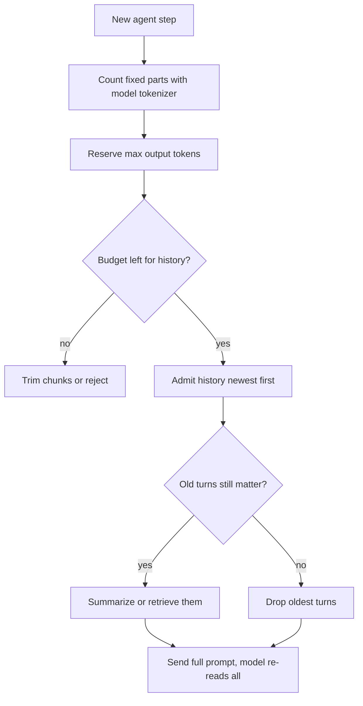

## TL;DR
The context window is your agent's entire working memory for one step: system prompt, tool schemas,
history, tool results, retrieved chunks and the answer share it. It is finite, so budgeting and compacting
it is core agent engineering.

## For agent builders
- **Why it matters for agents.** An agent loop appends a tool call and a tool result every step, so its
  context only grows. Without a budget and a compaction policy, latency and cost climb each step and the
  run eventually dies with a "context length exceeded" error, often mid-task.
- **Where it shows up in your stack.** The model's advertised window, the output cap (`max_tokens`),
  `max_model_len` in vLLM when self-hosting, provider prompt caching, and the token usage fields every API
  returns per call.
- **What you control.** What goes into each step's prompt (instructions, tool definitions, retrieved
  material, history, tool outputs), in what order, how large tool outputs are truncated or summarized,
  and when old turns are compacted.
- **What you can skip.** The details of RoPE scaling methods such as YaRN; remember that positions beyond
  the trained length degrade quality and that the effective window is shorter than the nominal one.

## Why it exists
- **Attention compute grows with length.** Every token is compared with every earlier token, so prefill
  compute has a term quadratic in length.
- **KV-cache memory grows with length.** Keys and values are stored for every position in every layer, so
  memory grows linearly and a single long request's cache can exceed the model's own weights.
- **Positions are trained up to a length.** Positional encodings are learned or tuned for training
  lengths; unseen positions degrade quality sharply unless the encoding is deliberately extended. So
  vendors publish a hard limit and engines enforce one (`max_model_len` in vLLM), because worst-case memory
  must be reserved in advance.
- **The model is stateless between calls.** "The chatbot remembers our conversation" is wrong in a way
  that matters: the client re-sends the entire transcript each turn and the model re-reads it. Agent
  memory is an illusion the application maintains, paid in tokens on every step.
- **And it ends abruptly.** At the window boundary the request is rejected or something is dropped.
  Deciding what to drop, summarize or retrieve is the problem the context window forces on every agent.

## How it works
### Accounting for one agent step
Every request must satisfy `input_tokens + max_output_tokens ≤ window`.

- **Input is everything after chat templating:** system prompt, each prior user and assistant turn, tool
  definitions, tool outputs, retrieved chunks, and the template's own role markers. In agents, tool
  schemas and tool outputs are often the largest items.
- **Output is often capped separately.** Many APIs cap output at a figure well below the window, so the
  practical limit on a long answer is the output cap, not the window.
- **Count with the model's own tokenizer.** The same text can differ in token count by tens of percent
  across tokenizers (more for non-English text and code), so budgets need the right one.
- **Hidden consumers count too.** Images and audio are converted to tokens. On reasoning models the hidden
  thinking tokens are generated into the same window and usually billed and capped as output, so a request
  for a short answer can still run out of room.
- **Edge behaviour differs.** Most APIs reject an over-long request outright; some truncate silently.

### What a full window costs
Take a GQA model such as Llama-3-8B (32 layers, 8 KV heads, head dimension 128, fp16):

```
KV per token = 2 × 32 × 8 × 128 × 2 bytes = 128 KiB
128k-token request ≈ 16 GiB of cache   (roughly the model's own fp16 weights)
```

- **Without GQA** (32 KV heads) the same request needs four times that.
- **Compute grows faster than memory.** Per layer, projections and MLP cost on the order of 24·d² FLOPs
  per token regardless of length, while attention scores and the weighted sum cost about 4·n·d for a
  token attending over *n* positions.
- **The crossover.** The attention term overtakes the rest once *n* exceeds roughly 6·d, around 25k tokens
  at d = 4,096 (a rule of thumb for orders of magnitude, not a measurement).
- **So** below that, long prompts cost roughly linearly; above it, every doubling costs more than double.
  A long-running agent crosses this line without anyone deciding it should.

### Why the limit sits where it does
| Constraint | What sets it |
|---|---|
| **Training length** | Models are pre-trained at some length, often extended by continued training at longer lengths with the rotary base frequency adjusted (RoPE scaling methods such as YaRN). The advertised window is where that extension was validated. |
| **Memory** | The engine must hold the KV cache for the longest allowed request, so operators may configure a smaller window than the model supports to fit more concurrent users. |
| **Compute and latency** | Prefill time grows faster than linearly in prompt length, so time-to-first-token on a window-filling prompt can be seconds, re-paid every turn unless the prefix is cached. |

- **Published windows keep growing:** from about 2k tokens (GPT-3 era) through 4k, 8k and 32k to 128k,
  200k and, for some models, a million or more.
- **Treat the exact figures as moving targets;** the mechanisms are not.

### Nominal versus effective window
- **Not all positions are equal.** A model accepting 128k tokens does not use them equally. Liu et al.
  (2023) showed retrieval-style accuracy is highest when the relevant passage sits at the start or end of
  the context, and drops in the middle. Needle-in-a-haystack tests probe the same thing.
- **The effective window** is the length over which the model reliably uses information. It is
  task-dependent, usually shorter than the nominal one, and must be measured for your task rather than
  read off a spec sheet.
- **For agents** this means an instruction from step 1 or a tool result from step 5 can be technically
  present at step 30 and still be ignored, because it now sits in the middle of a long transcript.

### Living within it
- **Sliding window:** drop the oldest turns. Simple, loses early instructions and facts.
- **Summarization / compaction:** replace old turns with a model-written summary. Keeps the gist, loses
  detail and costs a call. The usual choice for long agent runs.
- **Retrieval:** keep history or documents outside the prompt and pull in only what the current turn
  needs. The default for large corpora and for agent long-term memory; the `long-context-vs-rag` topic
  covers the trade.
- **Prompt caching:** does not enlarge the window, but makes a long shared prefix cheap to re-send by
  reusing its KV cache across requests, which changes the economics of a big system prompt and tool list.
- **Sliding-window attention** in the model itself (Mistral 7B v0.1 attends over a 4,096-token window per
  layer) bounds per-layer cost while deeper layers still propagate information further back. It is an
  architectural choice, not something you configure per request.

## Diagram
Each agent step rebuilds the whole prompt; fixed parts and the output reservation are paid first, and
history and tool results get whatever is left.



## Examples
### Token budgeter for a support assistant
An 8,192-token window. The fixed parts (system prompt, retrieved chunks, the new question) are paid first,
the output reservation is held back, and history is admitted newest-first until the budget runs out.
Count with the deployed model's tokenizer; `tiktoken` is used here only as a stand-in.

```python
import tiktoken

enc = tiktoken.get_encoding("cl100k_base")          # stand-in; use your model's tokenizer
count = lambda s: len(enc.encode(s))

WINDOW, MAX_OUT, TEMPLATE_OVERHEAD = 8_192, 800, 64  # overhead: role markers, illustrative

def fit_history(system, chunks, history, question):
    fixed = count(system) + sum(map(count, chunks)) + count(question) + TEMPLATE_OVERHEAD
    budget = WINDOW - MAX_OUT - fixed
    if budget < 0:
        raise ValueError(f"fixed parts exceed window by {-budget} tokens: trim chunks")
    kept = []
    for turn in reversed(history):                  # newest turns are worth the most
        n = count(turn)
        if n > budget:
            break
        kept.insert(0, turn); budget -= n
    return kept, budget

system = "You are a support assistant. " * 60                 # ~360 tokens
chunks = ["Policy section ... " * 120 for _ in range(6)]        # 6 chunks, ~360 tokens each
history = [f"turn {i}: " + "words " * 250 for i in range(20)]  # ~250 tokens per turn
kept, left = fit_history(system, chunks, history, "How do I get a refund?")
print(f"kept {len(kept)} of {len(history)} turns, {left} tokens spare")
# Roughly: fixed parts ~2,600 tokens, so ~4,800 remain for history and about 18 of the 20
# ~250-token turns survive. Dropping the oldest turns is the crude option; summarizing them is the
# usual upgrade, and it is what you would do before ever cutting the system prompt or chunks.
```

### Compacting an agent loop's tool outputs
A tool-calling loop that clips large tool results and compacts old turns once the transcript passes a
threshold. `summarize` is whatever cheap model call you use; token counts come from your tokenizer.

```python
MAX_TOOL_TOKENS = 1_500      # clip any single tool result to this (illustrative)
COMPACT_AT = 0.7             # compact when the transcript uses 70% of the input budget
KEEP_RECENT = 6              # messages kept verbatim after compaction

def add_tool_result(messages, call_id, text, count, store):
    if count(text) > MAX_TOOL_TOKENS:
        ref = store.put(text)                          # raw output kept outside the prompt
        text = text[: MAX_TOOL_TOKENS * 3] + f"\n[truncated, full result: {ref}]"
    messages.append({"role": "tool", "tool_call_id": call_id, "content": text})

def maybe_compact(system, messages, count, budget, summarize):
    used = count(system) + sum(count(m.get("content") or "") for m in messages)
    if used < COMPACT_AT * budget:
        return messages
    cut = len(messages) - KEEP_RECENT
    while cut > 0 and messages[cut]["role"] == "tool":   # never orphan a tool result from its call
        cut -= 1
    if cut <= 0:
        return messages
    old, recent = messages[:cut], messages[cut:]
    summary = summarize(old)                           # one call, one cache miss, at a boundary
    return [{"role": "user", "content": f"Summary of earlier steps:\n{summary}"}] + recent
```

The characters-per-token factor of 3 in the clip is a rough heuristic; clip by tokens if your tokenizer
is cheap to call. Keep the system prompt and tool definitions out of the compacted region.

Never split an assistant tool call from its tool result: most chat APIs reject a `tool` message whose
call is missing, which is why the cut point moves back past any tool messages.

### Worked scenario: a 30-step research agent on a 128k window
The agent starts with a 7k-token prefix (system prompt plus 15 tool schemas) and each step appends about
4k tokens (tool call plus a raw web-page result).

| Step | Input tokens, raw results | Input tokens, results clipped to 1.5k |
|---|---|---|
| 1 | 7k | 7k |
| 10 | 43k | 20.5k |
| 20 | 83k | 35.5k |
| 30 | 123k: the next step, plus output room, no longer fits | 50.5k |

- **Raw results** kill the run near step 30, and early findings sit mid-context where they are used least
  reliably by then.
- **Clipping alone** cuts growth to about a third; compaction at 70% of the budget then caps input per
  step for runs of any length (illustrative figures from the stated per-step sizes).

### What filling the window costs on Llama-3-8B
Pure Python using the two formulas above: KV memory per request, and the share of per-layer FLOPs spent
on attention for the last token (rule of thumb, d = 4,096).

```python
def kv_gib(tokens, layers=32, kv_heads=8, head_dim=128, bytes_per_el=2):
    return 2 * layers * kv_heads * head_dim * bytes_per_el * tokens / 2**30

def attention_share(n, d=4_096):
    return 4 * n * d / (24 * d * d + 4 * n * d)

for n in (8_192, 32_768, 131_072):
    print(f"{n:>7} tokens: KV {kv_gib(n):5.1f} GiB, attention share {attention_share(n):.0%}")
#    8192 tokens: KV   1.0 GiB, attention share 25%
#   32768 tokens: KV   4.0 GiB, attention share 57%
#  131072 tokens: KV  16.0 GiB, attention share 84%
```

| Request length | KV cache | Attention share of compute | Practical consequence |
|---|---|---|---|
| 8k | ~1 GiB | ~25% | dozens of such requests fit beside the weights on an 80 GB GPU |
| 32k | ~4 GiB | ~57% | attention now dominates; TTFT grows faster than length |
| 128k | ~16 GiB | ~84% | one request holds as much memory as the weights |

## Production patterns
- **Budget every agent step before you call.** Count each request with the deployed model's tokenizer,
  including template and tool-definition overhead, and trim or reject before the API call. Monitor
  "context length exceeded" errors and truncation events per route as first-class metrics.
- **Compact long agent runs.** Keep the last few turns verbatim, summarize older turns and large tool
  outputs, and store raw outputs outside the prompt for retrieval. Monitor input tokens per turn; it
  should plateau, not grow linearly.
- **Clip tool outputs at the tool boundary.** Each tool returns a bounded, structured result (top rows,
  key fields, a pointer to the full payload) rather than raw HTML or full logs. Monitor tool-result token
  size per tool; one noisy tool usually dominates.
- **Load only the tools a step needs.** With dozens of tools, schemas alone can cost thousands of tokens
  every step; shortlist tools per task and keep the shortlist stable within a run so the prefix still caches.
  Monitor tool-schema tokens per step and how often the needed tool was missing from the shortlist.
- **Size the engine window per deployment.** Set `max_model_len` in vLLM to the length the traffic
  actually uses and route long-document work to a separate deployment, so a few long requests cannot
  starve short chats. Monitor KV utilization and preemptions.
- **Size `max_tokens` from real answers.** Set it near the high percentiles of observed output length, not
  the cap, and alert on the rate of truncated finishes (`finish_reason` of `"length"` on OpenAI-style
  APIs, `stop_reason` of `"max_tokens"` on Anthropic's).
- **Cache the stable prefix.** Put the system prompt and tool definitions first and byte-identical, then
  enable prompt caching. Monitor cached input tokens (for example `cache_read_input_tokens` in Anthropic
  usage) and time to first token.
- **Measure the effective window on your data.** Plant known facts at the start, middle and end of
  realistic prompts at several lengths and score answers. Re-run when the model or prompt layout changes.

## Trade-offs
- **Bigger window vs retrieval.** A larger window lets you skip retrieval and paste everything in, but
  prefill latency and per-request cost grow with every token on every turn. Retrieval wins once the corpus
  no longer fits, changes too often to keep cached, or costs more to re-read than a retrieval miss costs.
- **Full history vs summary.** Keeping full history maximizes fidelity; summarizing cuts tokens and latency
  at the price of lost detail. The flip happens when old turns stop being referenced.
- **Compaction timing vs cache hits.** Compacting rewrites history, which invalidates the cached prefix
  from that point. Compact rarely and at a boundary rather than trimming a little every step.
- **Output reservation vs input room.** A large output budget protects long answers but shrinks the space
  for input; size it to the real distribution of answer lengths rather than the maximum.
- **Window vs concurrency.** Operators can shrink the engine's window to fit more concurrent users in GPU
  memory, trading per-request capability for throughput; raise it only when traffic actually uses it.

## Pitfalls
- **Wrong tokenizer or missing overhead.** Counting with the wrong tokenizer or forgetting template and
  tool-definition overhead. Symptom: intermittent "context length exceeded" errors on requests that looked
  within budget. Fix: count the fully templated prompt with the deployed model's tokenizer.
- **Assuming the model finds a fact anywhere.** In a 100k-token prompt, the symptom is answers that ignore
  material in the middle while the same material at the end works. Fix: put key material at the start or
  end, retrieve less but better, and measure by position.
- **Letting an agent loop append tool outputs forever.** Latency climbs turn by turn, cost per turn grows
  linearly, and the run eventually fails at the boundary. Fix: compact old turns and large tool outputs.
- **Truncating from the front.** Cutting the system prompt or a tool's schema changes behaviour abruptly
  mid-conversation with no error. Fix: pin the fixed parts and trim or summarize history instead.
- **Setting `max_tokens` far above real answer lengths.** Engines whose schedulers budget KV memory against
  a request's worst-case length then admit fewer concurrent requests even though answers are short. Fix:
  size the cap from observed output-length percentiles.
- **Forgetting hidden thinking tokens.** Reasoning models spend them from the same budget. Symptom: empty
  or cut-off answers with a "length" finish reason on hard prompts while easy ones work. Fix: reserve
  output room for thinking as well as the answer, and track truncated finishes per route.

## When to use
- **There is no opting out;** every request has a window. The decisions are how much of it to spend on
  instructions, tool definitions, examples, retrieved material, history, and on the answer.
- **Measure** the token distribution of real agent steps, the rate of truncation events, and task accuracy
  as a function of where key information sits in the prompt.
- **Watch for the RoPE-scaling trap.** Some model cards note that statically enabling a context-extension
  method for all requests can slightly degrade quality on short inputs, so enable it only on deployments
  that actually receive long prompts.
- **Prefer retrieval** when the corpus is large or changes, long context when a single document must be
  reasoned over as a whole, and compaction for long agent runs.
- **Day to day** the window appears as a budgeting function, a truncation policy and a cost line.
- **Interviews:** expect why windows are finite, what the KV cache has to do with it, whether a bigger
  window makes RAG unnecessary, and how you keep a long agent run inside it.

## Role lens
- **Engineer:** Writes the budgeting and truncation logic, counts tokens with the right tokenizer, and
  monitors truncation and context-exceeded errors as first-class metrics.
- **Architect:** Sets the context policy per workload, chooses between long-context and retrieval
  designs, and ties the window size to GPU memory and concurrency targets.
- **FDE:** Shows a customer why pasting their entire knowledge base into the prompt is slow and
  expensive, and measures effective context on their real documents.

## Check yourself
**Q:** A product manager argues that with a 200k-token window, the team can drop its RAG pipeline and
paste the whole product manual into every request. Make the engineering case for and against.
**A:** For: simpler system, no retrieval failures, and the model can cross-reference the whole manual.
Against: every request pays prefill over the full manual, so time-to-first-token and cost per turn rise
with manual size rather than with the question; effective use of information in the middle of a very
long prompt is measurably weaker than at the edges, so accuracy can fall even as the window is nominally
large; the KV cache for a 200k-token request is large enough to cut concurrency on a shared GPU or to
hit vendor rate limits. Prompt caching softens the cost if the manual is a stable prefix, but not the
attention-quality issue. The right test is accuracy, latency and cost on real questions with the manual
pasted versus retrieved, measured before the pipeline is deleted.

## Interview questions
### What actually sets the context window of a deployed model?
- **Training length:** the advertised window is where pre-training or RoPE-scaled continued training was
  validated; beyond it positions are unseen and quality degrades.
- **Memory:** the engine reserves KV cache for the longest allowed request, so an operator may configure a
  smaller window than the model supports.
- **Latency:** prefill grows faster than linearly with prompt length, which bounds what users will wait for.

### An agent's latency climbs every turn until it fails with a context error. How do you debug and fix it?
- **Confirm the cause.** Log input tokens per turn; linear growth with tool-output size means the loop
  appends raw tool results forever.
- **Fix the loop.** Summarize or truncate large tool outputs, keep only the last few turns verbatim, and
  store raw results outside the prompt for retrieval. Input tokens per turn should then plateau.

### Your agent follows an instruction early in a run but ignores it by step 25. Why, and what do you change?
- **Likely cause:** the instruction is still in the prompt but now sits in the middle of a long
  transcript, where models use information least reliably; or compaction dropped it.
- **Fix:** keep durable instructions in the pinned system prompt, restate the current goal near the end
  of each step's prompt, and check the compaction summary preserves constraints. Test by position.

### How much KV memory does a 128k-token request need on Llama-3-8B, and what does that imply?
- **Per token:** 2 × 32 layers × 8 KV heads × 128 × 2 bytes = 128 KiB.
- **Per request:** about 16 GiB, roughly the model's own fp16 weights, so a handful of such requests fill a
  GPU that could serve many short chats. Route long-document traffic separately.

### What is the difference between the nominal and the effective window, and how would you measure it?
- **Nominal** is what the API accepts; **effective** is the length over which the model reliably uses
  information, which is usually shorter and weakest in the middle of the prompt.
- **Measure** by planting known facts at different positions in realistic prompts of increasing length
  and scoring answers on your own task, not by trusting a needle test from a spec sheet.

### Why can setting `max_tokens` very high hurt throughput even when answers are short?
- **Some schedulers budget for the worst case.** They reserve KV memory for prompt plus maximum output, so
  an inflated cap means fewer requests admitted at once.
- **It also shrinks input room,** because input plus reserved output must fit the window. Size the cap
  from the observed answer-length distribution.

## Quiz
### Q: Which of these is NOT a reason the context window is finite?
- [ ] KV-cache memory grows with the number of positions
- [ ] Attention compute grows with sequence length
- [x] The tokenizer vocabulary has a fixed size
- [ ] Positional encodings are only trained up to a certain length
> Vocabulary size bounds how many distinct tokens exist, not how many positions a request may contain.
> Memory, compute and positional training length are the real constraints.

### Q: A chat assistant "forgets" instructions given early in a long session. What is the most likely mechanism?
- [ ] The model's weights were updated by the conversation
- [x] The application truncated or summarized early turns to fit the window, so the instructions are no longer in the prompt
- [ ] The KV cache was evicted by the GPU
- [ ] Temperature was too high
> The model has no state between calls; it only sees what the client re-sends. Once early turns are
> dropped to stay within the window, their content is gone for every later turn.

### Q: What does prompt caching change about a long shared system prompt?
- [ ] It raises the model's maximum context length
- [ ] It makes the model attend to the prompt more accurately
- [x] It reuses the prefix's KV cache across requests, cutting prefill cost and latency for that prefix
- [ ] It compresses the prompt into fewer tokens
> Caching stores the computed keys and values for a byte-identical prefix so later requests skip that
> prefill work. The window and the model's use of the content are unchanged.

## Use cases & projects
### Use cases
- **Long-running coding and research agents.** Tool outputs accumulate fastest here, so clipping and
  compaction decide whether a 50-step run finishes at all.
- **Support agents with RAG and history.** A per-step budget splits the window between policy chunks,
  conversation history and the answer, so neither crowds out the other.
- **Agents with large tool catalogs.** Tool schemas are paid on every step, so shortlisting tools frees
  room for the actual task.
- **Choosing long context vs retrieval.** Teams test whether pasting a whole document beats retrieving
  from it on accuracy, latency and cost before committing to either design.

### Mini project
**Add a context budget and compaction to a tool-calling agent (2-3 hours).**
- **Goal:** keep a 30-step agent run inside a fixed input budget without losing the task.
- **Steps:** build a loop with a search tool that returns long raw text; log input tokens per step; run 30
  steps and plot the growth; then add tool-result clipping and compaction at 70% of the budget with the
  last few messages kept verbatim; rerun the same task.
- **Done when:** you have two per-step token curves (linear vs plateau), the compacted run completes the
  task, and a short note lists what the summary had to preserve for the agent to finish.
