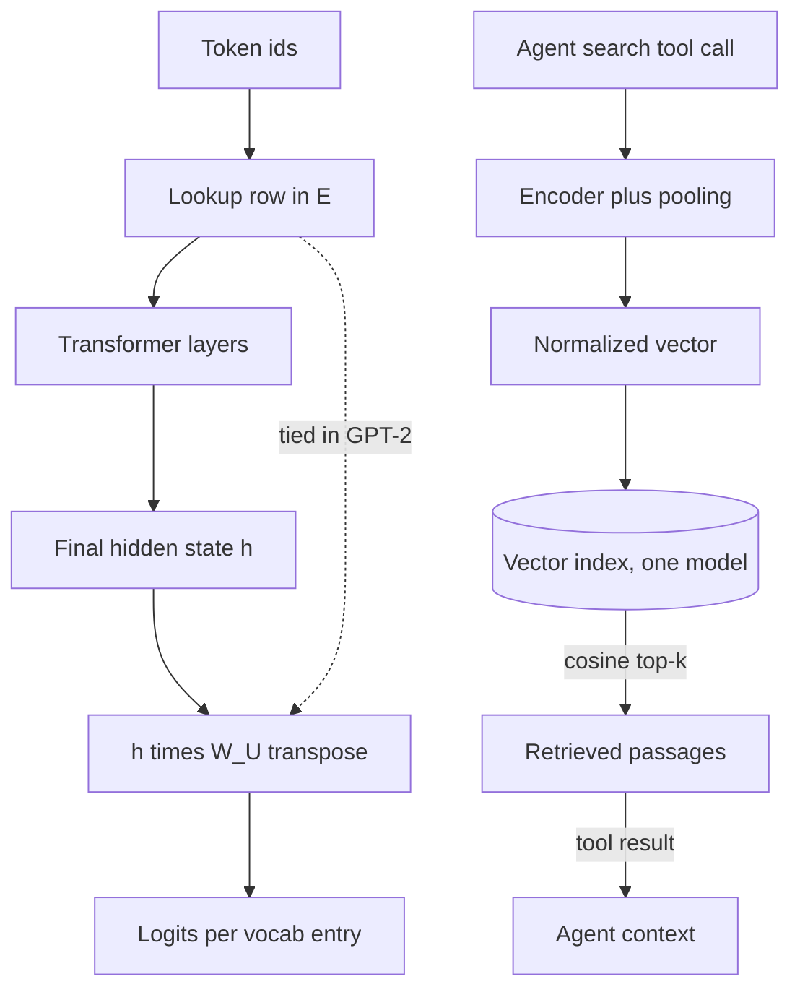

## TL;DR
An embedding is a learned dense vector standing in for a token or a text. Embedding *models* power an
agent's retrieval tool, long-term memory and tool selection: whatever the agent "remembers" or "looks up"
is found by vector distance.

## For agent builders
- **Why it matters for agents.** Every RAG step, memory recall and "pick the right tool from 200" lookup is
  a nearest-neighbour search over embeddings. If the vectors are wrong, the agent reasons perfectly over
  the wrong context and nothing errors.
- **Where it shows up in your stack.** The embedding model behind your vector store (pgvector, Qdrant and
  similar), the retriever object in agent frameworks, and the memory store an agent writes to between
  sessions. You never touch the LLM's own token embedding table directly.
- **What you control.** Which embedding model and version, dimension, normalization, chunk size, query
  and passage prefixes, and whether lexical search runs alongside. Each changes what the agent's search
  tool returns.
- **What you can skip.** Training an embedding model from scratch and the details of weight tying. Know
  that the table exists and what contrastive training buys; spend your time on retrieval evals.

## Why it exists
- **A transformer needs vectors, not strings.** It is a stack of matrix multiplications and cannot consume
  "cat". The obvious encoding is one-hot: a vector of length *V* (the vocabulary size, tens of thousands
  to over a hundred thousand entries) with a single 1.
- **One-hot is enormous and almost all zero.** The first layer would multiply a 100k-wide sparse vector
  on every token.
- **One-hot carries no similarity.** Every pair of one-hot vectors is equidistant and orthogonal, so
  "cat" is exactly as far from "kitten" as from "parliament". Every regularity would have to be relearned
  from scratch for every token.
- **A learned dense vector fixes both.** It is a few hundred to several thousand dimensions, trained by
  gradient descent on the task (next-token prediction). Tokens that behave similarly in context land in
  similar places, and that geometry is free information for every later layer.
- **Learning transfers between neighbours.** A gradient step from a sentence about "cat" moves a vector
  that sits near "kitten", so evidence about one token partly informs similar tokens instead of being
  locked in one orthogonal axis.
- **The same idea works one level up.** Comparing strings fails on paraphrase when you look for the most
  relevant document. Comparing learned vectors succeeds, because they were trained so that meaning, not
  spelling, determines distance.

## How it works
### Where embeddings sit in an agent
An agent meets embedding models in three places, all the same operation: embed a query, find nearest
vectors, put the matching text into context.

| Agent capability | What gets embedded | What the query is |
|---|---|---|
| **Retrieval tool (RAG)** | document chunks, at index time | the search string the agent writes in its tool call |
| **Long-term memory** | past facts, summaries, user preferences | the current task or turn |
| **Tool selection** | each tool's name and description | the user request, when there are too many tools to list them all |

- **The agent writes the query.** In a tool-calling loop the model decides the search string, so query
  quality depends on the prompt and tool description as much as on the embedder.
- **Results land in the context window.** Top-k chunks cost tokens on every later step, so k and chunk
  size are context-budget decisions, not only recall decisions.
- **The rest of this section explains why the geometry works**, starting with the LLM's own table (as
  background) and then the embedding models you actually deploy.

### Background: token embeddings inside an LLM
- **The table.** The model owns a matrix `E` of shape `[V, d_model]`. Looking up token id *i* means taking
  row *i*.
- **Lookup is a linear layer.** It equals `one_hot(i) · E`, with the multiplication skipped *because* all
  but one row would be multiplied by zero.
- **It is trained like any weight.** Each row is a trainable parameter updated by backpropagation through
  the whole network. Nothing about the geometry is hand-designed; it emerges because tokens that predict
  similar continuations receive similar gradients.

The table is a real fraction of the parameter budget:

| Model | Vocabulary × width | Embedding parameters |
|---|---|---|
| GPT-2 small | 50,257 × 768 | ≈ 38.6M of ~124M total |
| Llama-2-7B | 32,000 × 4,096 | ≈ 131M |
| Llama 3 (same width) | 128,256 × 4,096 | ≈ 525M |

- **Vocabulary size is a trade-off.** Larger vocabularies tokenize text into fewer tokens (cheaper
  context, better multilingual coverage) at the price of a bigger table. This is one of the trade-offs
  behind choosing a tokenizer.
- **Position comes separately.** Attention itself is permutation invariant, so the model must learn where
  each token is. Older models add a learned positional vector to the token embedding; most current models
  apply rotary position embeddings inside attention, so the input embedding carries only identity. The
  `positional-encoding` topic covers that choice.
- **Scaling.** The original transformer multiplied the looked-up vector by √d_model to put it on a scale
  comparable to the positional signal; some current models, Gemma among them, keep a similar scaling.

### Background: the unembedding and weight tying
1. **Project to the vocabulary.** The final hidden state `h` (dimension `d_model`) becomes a score per
   vocabulary entry: `logits = h · W_Uᵀ` with `W_U` of shape `[V, d_model]`.
2. **Same shape as `E`.** Some models (GPT-2 among them) **tie** them, using one matrix for both. Tying
   saves a full table of parameters and encourages consistency, *because* the vector used to recognize a
   token on the way in is the one used to predict it on the way out.
3. **Or untie.** Many larger models (Llama-2, for instance) untie them, trading parameters for
   flexibility.
4. **One mechanism, two ends.** Either way the model's output is a dot product between a hidden state and
   every token's output embedding, which is why embeddings and logits are two ends of one mechanism.

### Sentence and document embeddings (what your retriever uses)
- **Architecture.** An embedding *model* produces one vector for an entire input: usually a transformer
  encoder plus a pooling step (mean-pool the last hidden states, take a special first-token state, or take
  the last token for decoder-based embedders).
- **Pooling alone is not enough.** Raw hidden states of a language model trained only on next-token
  prediction make poor sentence vectors, because nothing in that objective asks the pooled vectors of two
  paraphrases to coincide.
- **So they are trained contrastively.** Given (query, relevant passage) pairs, pull each pair together
  and push the query away from the other passages in the batch (in-batch negatives, InfoNCE loss).

For a batch of *B* pairs with similarity `s(q, p) = cos(q, p)` and temperature τ:

```
L = − (1/B) Σ_i log [ exp(s(q_i, p_i)/τ) / Σ_j exp(s(q_i, p_j)/τ) ]
```

It is a *B*-way softmax classification: "which passage in this batch is mine?". That framing explains the
recipe:

| Ingredient | Why it is there |
|---|---|
| Bigger batches | more negatives per query, a harder and more informative task |
| **Hard negatives** (look relevant but are not, often mined with BM25 or an earlier model) | random in-batch negatives are too easy to teach fine distinctions |
| Small τ (for example 0.05) | sharpens the softmax so near-misses are penalized |

The objective directly optimizes the quantity you later query with, which is what makes cosine similarity
meaningful.

### Practical consequences of that training
- **Metric.** Vectors are compared with cosine similarity or dot product; with L2-normalized vectors these
  are identical, and most models expect normalization.
- **Dimension is a design choice.** From 384 (the `all-MiniLM-L6-v2` family) to 1,536 or 3,072 (OpenAI's
  `text-embedding-3` models).
- **Matryoshka truncation.** Matryoshka-trained models order information so the first *k* dimensions are
  usable on their own. You can truncate to save index memory, with a measured recall cost.
- **Asymmetric models.** Some prefix queries and passages differently (the E5 family uses `query:` and
  `passage:`), because a short question and a long document should not be embedded the same way even when
  they mean the same thing.
- **No cross-model comparison.** A vector is only comparable to vectors from the *same model and
  version*; re-embedding everything is mandatory when the model changes.

## Diagram
Inside the LLM, the same `[V, d_model]` shape appears at both ends; outside it, the agent's search tool
call is embedded by an embedding model, the index returns the nearest passages, and they go back into the
agent's context.



## Misconceptions
- **"An LLM already has embeddings, so pooling its hidden states gives good search vectors."** Next-token
  training never asks two paraphrases to land together, so pooled states cluster in a narrow band. Search
  needs a contrastively trained embedding model whose loss optimizes exactly the cosine you query with.
- **"After an embedder upgrade, re-embedding new documents is enough."** Each model has its own space;
  a new-model query sits at a meaningless distance from old-model vectors. Re-embed the whole corpus into
  a fresh index and cut over once recall@k holds.
- **"Cosine above 0.8 means relevant."** Score distributions differ by model, and some score unrelated
  pairs well above zero. A threshold is calibrated per model on labelled pairs, never copied.
- **"More dimensions means better retrieval."** Memory grows linearly (10M chunks: about 61 GB at 1,536
  versus 123 GB at 3,072 in float32) while recall gains shrink quickly. Pick the size with recall@k on
  your own queries.
- **"A good embedder will find exact codes like AX-4471."** Dense vectors encode meaning, not spelling,
  so rare identifiers blur. Run BM25 alongside vector search and fuse by rank.

## Examples
### Lookup, weight tying and paraphrase geometry
The first block shows that an LLM's embedding layer is a row lookup equal to a one-hot matmul, and that
GPT-2 ties its input and output embeddings. The second uses a contrastively trained encoder to show the
geometry that retrieval relies on: two paraphrases score far higher than an unrelated sentence.

```python
import torch
from transformers import AutoTokenizer, AutoModelForCausalLM
from sentence_transformers import SentenceTransformer

tok = AutoTokenizer.from_pretrained("gpt2")
lm = AutoModelForCausalLM.from_pretrained("gpt2").eval()
E = lm.get_input_embeddings().weight                   # [50257, 768] trainable table
ids = tok("The cat sat", return_tensors="pt").input_ids # [1, n_tokens]
x = E[ids]                                             # row lookup -> [1, n_tokens, 768]
onehot = torch.nn.functional.one_hot(ids, E.shape[0]).float()
assert torch.allclose(onehot @ E, x)                   # lookup == one-hot matmul
print(E.shape, x.shape)
# Weight tying: the output projection is the very same matrix.
print(lm.get_output_embeddings().weight.data_ptr() == E.data_ptr())   # True for GPT-2

st = SentenceTransformer("sentence-transformers/all-MiniLM-L6-v2")   # 384-dim encoder
sents = ["How do I reset my password?",
         "Steps to recover access to my account",
         "Best pizza places in Naples"]
v = st.encode(sents, normalize_embeddings=True)        # [3, 384], unit length
print((v @ v.T).round(2))     # cosine matrix: [0,1] clearly highest, [0,2] and [1,2] low
```

### Sizing the table and the vector index
Pure Python, no downloads: embedding-table parameters, and raw float32 index memory for a corpus at
different dimensions (index structures add overhead on top).

```python
def table_params(vocab, d_model):
    return vocab * d_model

for name, v, d in [("GPT-2 small", 50_257, 768), ("Llama-2-7B", 32_000, 4_096),
                   ("Llama 3", 128_256, 4_096)]:
    print(f"{name:12s} {table_params(v, d) / 1e6:6.1f}M embedding params")

def index_gb(n_vectors, dim, bytes_per_el=4):          # float32 vectors, no index overhead
    return n_vectors * dim * bytes_per_el / 1e9

for dim in (384, 1_536, 3_072):
    print(f"10M chunks x {dim:5d} dims = {index_gb(10_000_000, dim):6.2f} GB")
# GPT-2 small 38.6M, Llama-2-7B 131.1M, Llama 3 525.3M
# 384 -> 15.36 GB, 1536 -> 61.44 GB, 3072 -> 122.88 GB
```

| Choice for 10M chunks | Raw vector memory | What to check before adopting |
|---|---|---|
| 3,072 dims | ~123 GB | does recall@k beat 1,536 enough to pay 2× memory? |
| 1,536 dims | ~61 GB | baseline |
| Matryoshka truncation to 384 | ~15 GB | recall@k drop on your labelled set |

### Agent scenario: a search tool and tool selection from one embedder
The agent calls `search_docs` as a tool; the same embedder also shortlists which tools to expose when
the catalog is too big to put every schema in the prompt. The `min_score` value is illustrative and
must be calibrated per model (see Pitfalls).

```python
import numpy as np
from sentence_transformers import SentenceTransformer

MODEL_ID = "sentence-transformers/all-MiniLM-L6-v2"     # stored with every vector
st = SentenceTransformer(MODEL_ID)

docs = ["Reset a password from Settings > Security.",
        "Refunds are issued within 5 business days.",
        "Error AX-4471 means the license server is unreachable."]
doc_vecs = st.encode(docs, normalize_embeddings=True)

def search_docs(query: str, k: int = 3, min_score: float = 0.3) -> dict:
    """Tool the agent calls. Returns scores too, so traces show retrieval quality."""
    q = st.encode([query], normalize_embeddings=True)[0]
    scores = doc_vecs @ q                                # cosine, vectors are unit length
    top = np.argsort(-scores)[:k]
    hits = [{"text": docs[i], "score": round(float(scores[i]), 3)}
            for i in top if scores[i] >= min_score]
    return {"model": MODEL_ID, "hits": hits or "no relevant documents found"}

tools = {"search_docs": "Search the product help center for how-to and policy answers.",
         "create_ticket": "Open a support ticket for a human agent.",
         "get_invoice": "Fetch an invoice by id for the signed-in customer."}
tool_vecs = st.encode(list(tools.values()), normalize_embeddings=True)

def shortlist_tools(user_msg: str, n: int = 2) -> list[str]:
    s = tool_vecs @ st.encode([user_msg], normalize_embeddings=True)[0]
    return [list(tools)[i] for i in np.argsort(-s)[:n]]  # only these schemas go in the prompt

print(shortlist_tools("I was charged twice, where is my invoice?"))
print(search_docs("how long does a refund take"))
```

### Worked scenario: retrieved text is a context-budget line item
A support agent averages 6 searches per task. Each search result is appended to the transcript and
re-read on every later step (illustrative token counts).

| Setting | Tokens per search | Retrieved tokens per task |
|---|---|---|
| k = 5, 400-token chunks | 2,000 | 12,000 |
| k = 3, 300-token chunks | 900 | 5,400 |
| k = 3, plus reranker dropping hits below threshold | ~600 | ~3,600 |

Cutting k is only safe if recall@k on the agent's own queries holds; measure it before shipping.

## Production patterns
- **Evaluate retrieval on the agent's own queries.** Log the search strings the agent writes in its tool
  calls, label a sample, and compute recall@k on those, not only on human-written questions; agent queries
  are often terser and keyword-shaped. Monitor recall@k on that set per release of prompt or embedder.
- **Shortlist tools by embedding when the catalog is large.** Embed each tool's name and description,
  retrieve the top few per request, and put only those schemas in the prompt. Monitor how often the
  needed tool was missing from the shortlist (from traces where the agent said it lacked a tool).
- **Return scores and provenance from the search tool.** Include the score, source id and model id in
  each tool result so traces show weak retrievals, and so the agent can say "nothing relevant found"
  instead of answering from a poor hit. Monitor the share of searches returning no hit above threshold.
- **Store the model id with every vector.** When any index is written, save the embedding model name and
  version as metadata and keep one model per index. Monitor for mixed versions with a periodic count by
  model field; a non-zero second value means a partial migration.
- **Re-index blue/green behind an alias.** On a model upgrade, embed the full corpus into a fresh index,
  run recall@k on a labelled set that covers old documents, then switch the alias the application queries.
  Monitor backfill progress and recall@k before and after the switch.
- **Normalize once, at write time.** Pass `normalize_embeddings=True` (sentence-transformers) or L2-normalize
  yourself, and configure the index for inner product or cosine to match. Monitor that offline evaluation
  and production use the same metric.
- **Truncate dimensions only with a measured budget.** For Matryoshka-trained models, keep the first *k*
  dimensions (re-normalize after cutting) to shrink index memory. Gate the change on recall@k against the
  full-dimension baseline.
- **Chunk to the model's input limit.** Count tokens with the embedder's own tokenizer and split before
  embedding (sentence-transformers exposes `max_seq_length`). Monitor the share of chunks that would be
  truncated.
- **Add lexical search for exact tokens.** Run BM25 next to vector search and merge by rank (reciprocal
  rank fusion) for IDs, error codes and rare names. Monitor recall on a query slice of exact-match lookups.

## Trade-offs
- **Bigger vocabulary vs bigger table.** Fewer tokens per document and cheaper context, but a larger
  embedding table and more rarely-updated rows. It pays off when the corpus is multilingual or code-heavy.
- **Higher dimension vs index cost.** It stores finer distinctions but multiplies vector-index memory and
  search cost linearly. Recall gained per extra dimension shrinks quickly, so the bigger vector pays off
  only on large, diverse corpora; measure the break-even with recall@k, do not assume it.
- **Large vocabulary vs under-trained rows.** Rows for tokens rare in training get few gradient updates
  and stay near initialization. A vocabulary built on one corpus and trained on another can contain such
  tokens, which surface as bizarre outputs when a prompt contains them (the "glitch token" phenomenon).
- **Tying vs untying.** Tying saves parameters and helps small models; untying gives large models more
  capacity. The benefit flips as the table becomes a small fraction of total parameters.
- **General vs fine-tuned embedder.** A general-purpose model works out of the box. One fine-tuned on
  domain pairs improves retrieval on jargon-heavy corpora, at the cost of a training pipeline and
  re-indexing on every model change.

## Pitfalls
- **Trusting the agent's answer when retrieval was weak.** The model writes a fluent answer from whatever
  the search tool returned. Symptom: confident wrong answers whose traces show low-score hits. Fix: apply a
  calibrated threshold in the tool, return an explicit "no relevant documents" result, and tell the agent
  in the system prompt what to do then.
- **Embedding agent memory with a different model than the query path.** A memory written months ago with
  an older embedder silently stops being recalled. Fix: the same one-model-per-index rule applies to memory
  stores, with a re-embedding job when the model changes.
- **Mixing models or versions in one index.** Symptom: retrieval looks random for part of the corpus,
  exactly the part embedded with the other model. Fix: one model per index, model id stored per vector.
- **Using raw LLM hidden states as sentence vectors.** Including mean-pooled token embeddings. Symptom:
  similarity scores cluster in a narrow band and nearest neighbours are dominated by length and frequent
  words. Fix: use a contrastively trained embedding model.
- **Forgetting asymmetric prefixes.** Dropping the query/passage prefixes a model was trained with makes
  recall drop silently, often by a lot, with no error anywhere. Fix: apply the prefixes from the model
  card in one shared embedding function used by both indexing and querying.
- **Mixing cosine and dot product on unnormalized vectors.** Cosine in one place, dot product in another,
  and rankings disagree between offline evaluation and the production index. Fix: L2-normalize at write
  time, after which the two metrics give identical rankings.
- **Embedding chunks longer than the input limit.** The tail is truncated silently and content past the
  cut is never retrievable. Fix: count tokens with the embedder's tokenizer and split before embedding.
- **Copying a similarity threshold from another model.** "Treat cosine > 0.8 as relevant" does not
  transfer: score distributions differ by model and some put unrelated pairs well above zero. Symptom: a
  filter that passes everything or nothing. Fix: calibrate thresholds per model on labelled pairs.

## When to use
- **Token embeddings are not a choice.** Every LLM has them. You meet them when you count parameters,
  extend a vocabulary (new rows must be initialized and trained), or inspect why two tokens behave alike.
- **Use sentence embeddings when** the problem is "find things that mean the same as this" at scale:
  semantic search, RAG retrieval, deduplication, clustering, and classification with a light head on top.
- **In agents, use them for** the retrieval tool, long-term memory recall, and tool shortlisting once the
  tool catalog is too large to list in every prompt. A handful of tools needs no embedding step.
- **Avoid them when** exact lexical match matters (IDs, error codes, rare names); BM25 or hybrid search
  wins there.
- **Measure** with recall@k on a labelled set of query–passage pairs before and after any change of
  model, dimension or chunking.
- **Interviews:** explain the difference between the LLM's embedding table and an embedding model, why
  cosine similarity works for one and not the other, and what re-embedding costs when a model is upgraded.

## Role lens
- **Engineer:** Picks the embedding model, normalizes and stores vectors, versions them alongside the
  model name, and writes the recall@k evaluation that gates any swap.
- **Architect:** Owns the embedding contract across the platform: one model per index, dimension and
  storage budgets, and the re-indexing plan when a model is deprecated.
- **FDE:** Diagnoses "search returns nonsense" at a customer by checking model mismatch, missing
  prefixes and truncated chunks before touching the retrieval algorithm.

## Check yourself
**Q:** A team upgraded their embedding model, re-embedded new documents only, and now users report that
older documents never show up in search. Explain the mechanism and what you would do.
**A:** Vectors are only comparable within one model's learned space. The new model places new documents
in a geometry that has no relationship to the old model's, so a new-model query vector lands near new
documents and effectively at random distance from old ones; cosine scores between the spaces are
meaningless, not merely slightly off. The fix is a full re-embedding of the corpus with the new model
into a fresh index, cut over atomically once it is complete, with the model name and version stored
with every vector so the mismatch is detectable next time. While the backfill runs, either keep
querying the old index or run both and merge results per index, never across them; raw scores from
two models are on different scales, so merge by rank (for example reciprocal rank fusion) rather than by
score. A strong answer also mentions the evaluation that should have caught it: recall@k on a labelled
set covering old documents, run before the cutover.

## Interview questions
### What is the difference between an LLM's embedding table and an embedding model?
- **The table** is a `[V, d_model]` matrix inside the LLM, one row per token id, trained as a side effect
  of next-token prediction. It feeds the transformer, and its geometry is not meant for comparing texts.
- **An embedding model** maps a whole input to one vector and is trained contrastively, so cosine
  similarity between two outputs tracks meaning. That is why you use it, not pooled LLM states, for search.

### Why do batch size and hard negatives matter when training an embedding model?
- **InfoNCE is a B-way classification.** Each query must pick its passage out of the batch, so more
  passages per batch means more negatives and a harder, more informative task.
- **Random negatives are too easy.** Hard negatives mined with BM25 or an earlier model look relevant but
  are not, which forces the model to learn fine distinctions; a small temperature penalizes near-misses.

### Your support agent's search tool misses queries containing product codes like "AX-4471". How do you debug it?
- **Read the traces.** Check the exact search string the agent wrote in its tool call and what came back;
  sometimes the agent paraphrased the code away, which is a prompt or tool-description fix.
- **Check the slice first.** Build a small labelled set of exact-identifier queries and measure recall@k
  on it separately; dense vectors often blur rare strings because they encode meaning, not spelling.
- **Then fix the retrieval mix.** Add BM25 alongside vector search and fuse by rank, or route
  identifier-shaped queries to lexical search. Re-measure both the identifier slice and general queries.

### How would you decide between 384, 1,536 and 3,072 dimensions for a 10M-chunk corpus?
- **Cost is linear.** Raw float32 vectors take about 15, 61 and 123 GB, before index overhead, and search
  cost grows with dimension too.
- **Benefit is not.** Recall per extra dimension shrinks quickly, so compare recall@k on your own labelled
  pairs. With a Matryoshka model you can test truncation of one embedding run instead of re-embedding.

### Your agent has 150 tools and keeps picking the wrong one. How would embeddings help, and what would you measure?
- **Shortlist, then let the model choose.** Embed each tool's name and description, retrieve the top few
  for each request, and expose only those schemas; fewer, more relevant options are easier for the model
  and cost fewer prompt tokens.
- **Measure two things.** Shortlist recall (was the correct tool in the top few, from labelled traces) and
  end-to-end tool-choice accuracy. Rewrite vague tool descriptions first, since they are what gets embedded.

## Quiz
### Q: Why is an embedding lookup mathematically identical to a linear layer applied to a one-hot vector?
- [ ] Because the embedding table is initialized from the identity matrix
- [x] Because multiplying a one-hot vector by the table selects exactly one row, so the lookup just skips the zero multiplications
- [ ] Because embeddings are normalized to unit length after lookup
- [ ] Because both operations are followed by a softmax
> A one-hot vector has a single 1, so its product with the table is that one row. The lookup is an
> optimization that avoids a V-wide multiplication whose result is known in advance.

### Q: Why do contrastively trained embedding models produce useful cosine similarities when an LLM's pooled hidden states do not?
- [ ] Because embedding models use a larger vocabulary
- [ ] Because LLM hidden states are not normalized
- [x] Because the contrastive objective explicitly pulls paraphrase pairs together and pushes unrelated texts apart, while next-token prediction never asks for that
- [ ] Because embedding models have more layers
> Geometry follows the training objective. Next-token prediction shapes vectors for predicting the next
> token, not for comparing whole texts; contrastive training directly optimizes the distance you later
> query.

### Q: What does weight tying between the input embedding and the output projection buy?
- [ ] A larger context window
- [ ] Faster attention computation
- [x] Fewer parameters and a shared representation for recognizing and predicting each token
- [ ] Immunity to tokenizer changes
> Both matrices have shape [V, d_model], so sharing one saves a whole table and forces the same vector to
> serve on the way in and on the way out. It matters most when the table is a large fraction of the model.

## Use cases & projects
### Use cases
- **RAG retrieval for a support or docs agent.** Queries and chunks are embedded with the same model, and
  the agent's retrieval tool returns the nearest chunks by cosine similarity.
- **Long-term agent memory.** Past facts, decisions and user preferences are embedded and recalled by
  similarity when a new turn looks related, instead of replaying the whole history.
- **Tool and skill routing.** With dozens of tools, embedding the tool descriptions and shortlisting the
  closest few keeps the prompt small and the tool choice sharper.
- **Semantic caching and deduplication.** Near-duplicate questions or tool results are detected by
  embedding distance, so the agent can reuse an answer or skip a redundant retrieval.

### Mini project
**Build and measure an embedding-backed retrieval tool for an agent (2-3 hours).**
- **Goal:** give a small agent a `search_docs` tool backed by embeddings and measure whether it finds the
  right chunk.
- **Steps:** chunk 30-50 pages of documentation; embed the chunks with one embedding model and store the
  vectors with their model name; write 20 questions with a known correct chunk; expose top-k search as a
  tool; record recall@5 for the questions; then repeat with a second embedding model or a different chunk
  size.
- **Done when:** you have a recall@5 table for both runs, the agent answers at least a few questions using
  the tool, and you can say which change helped and why.
