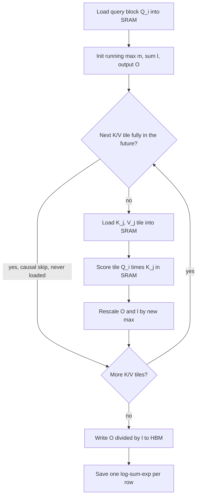

## TL;DR
FlashAttention computes exact attention without writing the n×n scores to GPU memory. It is why
self-hosted models can serve long agent transcripts and fine-tune on long agent traces; your job is to
make sure it is actually on.

## For agent builders
- **Why it matters for agents.** Agent transcripts and training traces run to tens of thousands of
  tokens. Without fused attention, the n² score matrix makes those lengths run out of memory or crawl;
  with it, memory grows linearly with transcript length.
- **Where it shows up in your stack.** `attn_implementation` when loading Hugging Face models for
  fine-tuning on agent traces, `F.scaled_dot_product_attention` in custom code, and the attention
  backends inside vLLM and SGLang when you serve agents yourself.
- **What you control.** Dtype (bf16 or fp16), mask form (`is_causal` rather than dense tensors), packing
  instead of padding, and GPU generation (Ampere or newer).
- **What you can skip.** The CUDA tiling details and IO-complexity proof. Keep "exact, memory-bound win,
  silent fallbacks exist, still quadratic in FLOPs". On hosted APIs this is the provider's concern.

## Why it exists
- **Standard attention round-trips through HBM.** It runs `S = Q·Kᵀ`, `P = softmax(S)`, `O = P·V` as
  separate kernels, so **S** is written to GPU memory, read back for softmax, **P** is written, then read
  again for the final matmul. For 32 heads at 8k tokens in fp16, **S** alone is about 4.3 GB per layer,
  written and re-read several times per forward pass and again in backward.
- **The FLOPs were never the problem.** Attention costs about 4·n²·d per layer and the two matmuls run on
  tensor cores. The trouble is everything between them.
- **The elementwise steps are memory-bound.** An A100 does on the order of 300 TFLOPs in fp16 but moves
  only about 1.5–2 TB/s from HBM, so an operation needs well over a hundred FLOPs per byte to be
  compute-bound. Softmax, masking and dropout do about one FLOP per byte.
- **So n² traffic set the time and n² memory set the length.** Models of that era trained at
  512–2,048 tokens, far short of a modern agent transcript.
- **Approximations missed the point.** Sparse patterns, low-rank projections and kernel feature maps
  reduce FLOPs but often not wall-clock time, because the memory traffic stayed, and they changed the
  model's behaviour. FlashAttention optimized the number of HBM reads and writes, as external-memory
  algorithms do, while leaving the math exact.

## How it works
### Background: the memory hierarchy the kernel is written for
| Memory | Size | Speed |
|---|---|---|
| HBM | tens of gigabytes | a few TB/s, slow relative to compute |
| On-chip SRAM (shared memory per streaming multiprocessor) | around 20 MB in total on an A100, in the paper's accounting | an order of magnitude faster |

**Kernel fusion** means doing as much work as possible on data while it sits in SRAM before writing
anything back.

### Tiling
1. Split queries into blocks of B_r rows and keys and values into blocks of B_c rows, sized so one block
   of each fits in SRAM.
2. For each query block, iterate over the key/value blocks: load K_j and V_j.
3. Compute the partial scores `S_ij = Q_i·K_jᵀ`, a B_r × B_c tile that lives in SRAM.
4. Fold it into the running output and move on. The full **S** and **P** never exist in HBM.

**The causal mask becomes a saving.** A K/V block lying entirely to the right of the query block is
skipped without being loaded, and only blocks on the diagonal need element-wise masking. Causal
attention does roughly half the work of the unmasked version.

### Online softmax
Softmax needs each row's maximum and the sum of exponentials over *all* n columns, unknown until the
last block. The trick, from Milakov and Gimelshein, keeps a running max *m* and running denominator *l*
per row and rescales when a new block raises the max:

```
m_new = max(m, rowmax(S_ij))
l_new = exp(m - m_new) · l + rowsum(exp(S_ij - m_new))
O_new = exp(m - m_new) · O + exp(S_ij - m_new) · V_j
```

- **Why the rescale works.** Everything accumulated so far was computed relative to the old max;
  multiplying by `exp(m − m_new)` re-expresses it relative to the new one.
- **Exact, not approximate.** After the last block, `O / l` is the exact softmax-weighted sum, a
  re-association of the same sum, so agent evals do not shift when you switch it on.
- **FlashAttention-2 defers the division** by *l* to the very end to cut non-matmul work.

### Backward pass by recomputation (fine-tuning)
- **Standard backward stores P**, n² per head, from the forward pass.
- **FlashAttention stores only O and one number per row**, the log-sum-exp `L = m + log l`, then
  recomputes tiles of **S** and **P** from **Q**, **K** and *L* on the fly inside SRAM.
- **More FLOPs, less time.** It costs roughly one more matmul's worth of FLOPs, yet is faster than the
  standard backward because recomputation is cheaper than reading n² values from HBM.
- **Same idea as gradient checkpointing**, applied at the kernel level; it is what lets you fine-tune on
  long multi-step agent trajectories.

### IO complexity
| Algorithm | HBM accesses |
|---|---|
| Standard | Θ(n·d + n²) |
| FlashAttention | Θ(n²·d² / M), with *M* the SRAM size |

For typical head dimensions (64–128) and SRAM sizes that is many times fewer, and measured speedups
follow the IO count rather than the FLOP count.

### Versions
| Version | What changed |
|---|---|
| FlashAttention (2022) | the algorithm above |
| FlashAttention-2 (2023) | parallelizes across the sequence dimension as well as batch and heads, so long sequences at small batch still fill the GPU; fewer non-matmul FLOPs; warp partitioning cuts shared-memory traffic; roughly doubled throughput over the first version |
| FlashAttention-3 (2024) | targets Hopper GPUs with asynchronous overlap of tensor-core matmuls and softmax; adds FP8 support |

Exact figures vary by shape and hardware, so measure on yours.

### Decode is a different problem
- **Too little parallel work.** FlashAttention-2 parallelizes over batch, heads and query blocks. At
  decode there is one query row per sequence, so at small batch there are too few units of work to
  occupy the GPU, while the cost is all in reading a long K/V cache.
- **Flash-Decoding splits the *key/value length*** across thread blocks instead, from the same authors.
  Each block computes a partial output with its own running max and log-sum-exp over its slice of the
  cache.
- **A final reduction combines them** with exactly the online-softmax rule above. The same algebra that
  lets one block stream over keys lets many blocks work on disjoint key ranges in parallel.
- **So serving engines ship decode-specific kernels**, which matters for agents because each step decodes
  a short tool call against a long cached transcript.

### Where you meet it
- **PyTorch:** `F.scaled_dot_product_attention` dispatches to a flash kernel when dtype, head dimension
  and mask allow, otherwise to a memory-efficient or plain math backend.
- **Hugging Face:** `attn_implementation="flash_attention_2"` or `"sdpa"`.
- **Serving engines:** vLLM and SGLang use FlashAttention-family or FlashInfer kernels. PagedAttention is
  FlashAttention-style tiling where K/V tiles are fetched through a block table instead of a contiguous
  buffer.

### What it does not do
- **Not sub-quadratic.** It is exact softmax attention, so FLOPs are still quadratic; it changes the
  constant and the memory, not the asymptotics.
- **Hardware and dtype limits.** FlashAttention-2 requires fp16 or bf16 inputs, head dimensions up to 256
  and Ampere or newer GPUs.
- **Mask limits.** It supports causal, sliding-window, variable-length (packed) sequences and ALiBi
  slopes, but not an arbitrary dense additive mask; such masks fall back to other backends.
- **FlexAttention fills the gap.** PyTorch's FlexAttention compiles custom mask patterns into fused
  kernels for cases FlashAttention does not cover.

## Diagram
The kernel's loop for one query block: K/V tiles stream through SRAM, the running max and sum are
rescaled each time, and only the final output goes back to HBM.



## Examples
### Naive attention against the flash backend on one GPU
Naive attention against the flash backend on one GPU, comparing peak memory, time and the outputs, at
8,192 tokens, a modest agent transcript.

- **Naive** allocates three ~4.3 GB tensors in sequence (scores, masked scores, probabilities), which are
  all live at once at the softmax.
- **Flash** adds only its output and one statistic per row, so its peak stays well under a gigabyte
  including the ~200 MB of inputs.

```python
import time, torch, torch.nn.functional as F
from torch.nn.attention import sdpa_kernel, SDPBackend          # PyTorch 2.3+

B, h, n, dk = 1, 32, 8192, 128
q, k, v = (torch.randn(B, h, n, dk, device="cuda", dtype=torch.float16) for _ in range(3))
future = torch.triu(torch.ones(n, n, device="cuda", dtype=torch.bool), 1)

def naive():
    s = (q @ k.transpose(-1, -2)) / dk ** 0.5             # [1, 32, 8192, 8192] fp16 -> ~4.3 GB in HBM
    p = s.masked_fill(future, float("-inf")).softmax(-1)  # another ~4.3 GB, read back for the matmul
    return p @ v

def flash():
    with sdpa_kernel(SDPBackend.FLASH_ATTENTION):          # raises if the flash kernel cannot be used
        return F.scaled_dot_product_attention(q, k, v, is_causal=True)

for name, fn in (("naive", naive), ("flash", flash)):
    torch.cuda.synchronize(); torch.cuda.reset_peak_memory_stats()
    fn(); torch.cuda.synchronize(); t = time.perf_counter()
    for _ in range(5):
        out = fn()
    torch.cuda.synchronize()
    print(f"{name}: {(time.perf_counter() - t) / 5 * 1e3:6.1f} ms/call  "
          f"peak {torch.cuda.max_memory_allocated() / 2**30:5.1f} GiB")

print(torch.allclose(naive(), flash(), atol=2e-3, rtol=2e-3))   # True: same result up to fp16 rounding
# Expect roughly 12 GiB peak for naive (3 x 4 GiB plus inputs) versus well under 1 GiB for flash, and flash several times faster;
# the exact numbers depend on the GPU. Passing an explicit attn_mask instead of is_causal would disable flash.
```

### Online softmax in NumPy: tiles give the exact answer
No GPU needed. One query block streams over K/V tiles of 16 rows with the running max and sum, and
matches the naive result exactly (up to float rounding).

```python
import numpy as np

def naive(Q, K, V):
    S = Q @ K.T / np.sqrt(Q.shape[1])
    P = np.exp(S - S.max(1, keepdims=True)); P /= P.sum(1, keepdims=True)
    return P @ V

def tiled(Q, K, V, Bc=16):
    """One query block, streaming K/V blocks with an online softmax (no n x n matrix)."""
    n, d = Q.shape
    m = np.full(n, -np.inf); l = np.zeros(n); O = np.zeros((n, V.shape[1]))
    for j in range(0, K.shape[0], Bc):
        S = Q @ K[j:j + Bc].T / np.sqrt(d)             # a small n x Bc tile
        m_new = np.maximum(m, S.max(1))
        scale = np.exp(m - m_new)                      # rescale what was accumulated so far
        p = np.exp(S - m_new[:, None])
        l = scale * l + p.sum(1)
        O = scale[:, None] * O + p @ V[j:j + Bc]
        m = m_new
    return O / l[:, None]                              # divide once at the end (FlashAttention-2)

rng = np.random.default_rng(0)
Q, K, V = (rng.normal(size=(64, 32)) for _ in range(3))
print(np.allclose(naive(Q, K, V), tiled(Q, K, V)))     # True: exact, just re-associated
```

### Agent scenario: fine-tuning on agent trajectories, padded versus packed
A team fine-tunes a model on recorded agent trajectories (tool calls plus results). One batch of 8 traces
has lengths 1k, 2k, 2k, 3k, 4k, 6k, 8k and 16k tokens (illustrative).

| Setup | Tokens processed | Real tokens | Waste |
|---|---|---|---|
| Padded to the longest trace | 8 × 16k = 128k | 42k | about 3× the needed work |
| Packed with variable-length flash attention | about 42k | 42k | near zero |
| Naive eager attention on the 16k trace | n² scores ≈ 4× those at 8k per layer | — | likely OOM before any waste matters |

- **Why the last row matters:** at 16k the score matrix per layer is four times the 4.3 GB of the 8k case,
  so eager attention cannot even hold one long trace on most cards.
- **Takeaway:** for agent-trace fine-tuning, flash attention plus packing decides whether long
  trajectories are trainable at all, and at what cost.

### Worked scenario: what the naive path moves per layer
32 heads, n = 8,192, fp16, on a GPU with about 2 TB/s of HBM bandwidth (illustrative arithmetic, not a
benchmark).

| Quantity | Value |
|---|---|
| Score matrix **S** per layer | 32 × 8192² × 2 bytes ≈ 4.3 GB |
| Naive traffic: write S, read S, write P, read P | ≈ 17 GB per layer per forward |
| Time for that traffic alone | ≈ 8.6 ms per layer, ≈ 275 ms across 32 layers |
| Q, K, V and O tensors | about 67 MB each |
| What FlashAttention writes to HBM | O plus one log-sum-exp per row; never S or P |

The naive time is spent moving bytes the matmuls could have consumed in SRAM, which is why the speedup
tracks IO, not FLOPs.

## Production patterns
- **Prove the fast path is active.** In tests, wrap attention in `sdpa_kernel(SDPBackend.FLASH_ATTENTION)`
  so a fallback raises. In staging, check that profiler kernel names contain flash and that peak memory
  grows linearly with sequence length.
- **Select the kernel explicitly for agent-trace fine-tuning.** Load with
  `attn_implementation="flash_attention_2"` (needs the flash-attn package) or `"sdpa"`, never `"eager"`,
  and keep `output_attentions` off. Monitor throughput and OOM counts per sequence-length bucket.
- **Pack sequences instead of padding.** Use variable-length attention (for example the flash-attn
  package's varlen interface) when training on agent trajectories, and a continuous-batching engine such
  as vLLM or SGLang when serving agents. Monitor GPU time per real token rather than per padded token.
- **Check the hardware before promising long agent context.** FlashAttention-2 needs Ampere or newer and
  FlashAttention-3 targets H100-class parts. On older cards, cap context or fall back to a
  memory-efficient backend. Track OOMs by GPU type.
- **Use FlexAttention for unusual masks.** When you need a custom pattern (document masks between packed
  traces, prefix-LM), express it as a FlexAttention mask function rather than a dense mask tensor, which
  would disable flash. Monitor step time against the plain causal kernel.

## Trade-offs
- **O(n) memory vs constraints.** Exact results with O(n) extra memory instead of O(n²), paid for with
  constraints on dtype (fp16/bf16), head dimension and GPU generation. The trade flips only when you
  genuinely need fp32 attention or a dense custom bias the kernel does not support.
- **Recomputation vs storage.** The backward pass recomputes probabilities rather than storing them:
  more FLOPs for less memory. At very short sequences, where the n² term is small anyway, the gain over a
  good fused baseline is modest.
- **Speed vs visibility.** The fused kernel never materializes attention weights, so interpretability
  and debugging that need the maps must run a separate, slow eager path.
- **Fits vs cheap.** It makes long agent contexts fit but not cheap: compute is still quadratic, so
  beyond roughly 100k tokens you still need windowing, sparsity, sequence parallelism or retrieval.

## Pitfalls
- **Believing the flash path is active when it silently fell back.** Causes: fp32 inputs, an odd head
  dimension or an explicit dense mask. Symptom: memory that scales with n² and no speedup. Force the
  backend with `sdpa_kernel` during testing so it fails loudly.
- **Passing an explicit causal mask tensor instead of `is_causal=True`.** Symptom: the same n² memory
  curve, because the kernel cannot use the fast path. Fix: pass `is_causal=True` (or the kernel's
  sliding-window parameter) and drop the mask tensor.
- **Comparing flash and eager outputs with fp32-level tolerances.** Symptom: spurious "mismatch" alarms
  caused by the different summation order under fp16 rounding. Fix: compare with fp16-level tolerances
  such as `atol=2e-3`, or against an fp32 reference.
- **Leaving `output_attentions=True` or an eager attention implementation in a production config.**
  Symptom: throughput that collapses and OOMs at lengths the model handled in testing, often only when a
  long agent session arrives. Fix: pin `attn_implementation` in the serving config and assert it at
  startup.
- **Padding batches to the longest sequence and running flash on dense tensors.** Symptom: GPU time that
  scales with the longest prompt or trace rather than the total number of real tokens. Use
  variable-length (packed) attention or a continuous-batching engine.

## When to use
Use it whenever it is available, which in practice means ensuring you have not accidentally disabled it.
- **Stay on the fast path:** inputs in bf16 or fp16, head dimensions in the supported set, masks as
  `is_causal` or sliding-window parameters rather than dense tensors, and sequences packed rather than
  padded.
- **Verify with a profiler** that attention kernels carry flash names and that peak memory grows linearly
  with sequence length.
- **Plan hardware:** FlashAttention-2 needs Ampere or newer and the Hopper-specific version needs
  H100-class parts, which affects whether a customer's older GPUs can run long-context agent workloads.
- **Skip worrying** when you only call hosted APIs; there it is the provider's job.
- **Interviews:** attention was memory-bound, tiling plus online softmax avoids the n² matrix,
  recomputation makes backward fit, and all of it is exact.

## Role lens
- **Engineer:** Keeps the model on the fast path (dtype, head_dim, mask form, packing) and checks kernel
  names and memory curves in the profiler rather than trusting a config flag.
- **Architect:** Sets maximum context and GPU generation knowing that long-context feasibility depends on
  these kernels existing for the target hardware, and decides when exact attention must give way to
  windowed or retrieval-based designs.
- **FDE:** Diagnoses a customer's out-of-memory at long prompts on V100 or T4 cards, where the flash
  kernels are unavailable, and explains the fp16 and hardware prerequisites.

## Check yourself
**Q:** At 2k context, attention is a small fraction of a transformer's total FLOPs, yet FlashAttention
delivered large end-to-end training speedups. Explain why.
**A:** FLOP share is the wrong lens for a memory-bound operation. Standard attention writes the n×n
scores to HBM, reads them for softmax, writes the probabilities, reads them again for the value matmul,
and repeats most of that in backward. Those elementwise passes do about one FLOP per byte moved, far
below the ratio a GPU needs to be compute-bound, so the streaming multiprocessors idle while waiting on
memory, and attention takes wall-clock time out of proportion to its arithmetic. Fusing the steps and
keeping the tiles in SRAM removes that traffic, and storing only O(n) state per head frees memory, which
lets you raise batch size or sequence length and improves utilization of the matmul-heavy layers too.
The speedup is a bandwidth saving, not a FLOP saving.

## Interview questions
### Is FlashAttention an approximation? Explain why or why not.
- **No, it is exact.** Online softmax keeps a running max and denominator per row and rescales earlier
  partial sums by `exp(m − m_new)`, so the final `O / l` is the same sum re-associated.
- **Differences versus eager are rounding only**, from a different summation order in fp16 or bf16, so
  compare with fp16-level tolerances.

### Your self-hosted agent server OOMs only when a long session arrives, though tests passed. How do you debug it?
- **Assume a silent fallback.** Check for fp32 inputs, an unsupported head dimension, an explicit dense
  mask instead of `is_causal=True`, `output_attentions=True`, or a pre-Ampere GPU.
- **Make it loud:** force `SDPBackend.FLASH_ATTENTION` in a test with a transcript at your maximum
  context, then confirm in the profiler that kernel names contain flash and the memory curve is linear.

### You are fine-tuning on agent trajectories from 1k to 16k tokens. How do you keep it affordable?
- **Flash attention on**, via `attn_implementation`, so a 16k trace does not materialize n² scores.
- **Pack, do not pad.** Padding a batch to its longest trace can triple the work; variable-length
  attention processes only real tokens.
- **Measure** GPU time per real token and peak memory per length bucket.

### Why does recomputing attention in the backward pass make it faster rather than slower?
- **The alternative is reading n² values from HBM**, which is bandwidth-bound and slow.
- **Recomputation from Q, K and one log-sum-exp per row** happens in SRAM on tensor cores; it adds about a
  matmul's worth of FLOPs but saves far more time in memory traffic.

### When does FlashAttention not solve your long-context agent problem?
- **When compute, not memory, is the wall.** FLOPs stay quadratic, so beyond roughly 100k tokens you
  still need windowing, sparsity, sequence parallelism or retrieval.
- **When the hardware or mask does not qualify**, such as T4 or V100 cards, fp32 requirements or dense
  custom biases, which fall back to slower backends.

### Why do serving engines use a different kernel for decode, such as Flash-Decoding?
- **Decode has one query row per sequence**, so parallelizing over batch, heads and query blocks leaves
  the GPU underused at small batch while it reads a long cache.
- **Flash-Decoding splits the key/value length** across thread blocks and merges partial results with the
  online-softmax rule, so many blocks read the cache in parallel.

## Quiz
### Q: FlashAttention is faster than standard attention mainly because it
- [ ] Computes fewer floating-point operations by approximating the softmax
- [x] Performs far fewer reads and writes to high-bandwidth memory by never materializing the n×n matrix
- [ ] Uses lower precision than the standard implementation
- [ ] Skips attention for positions far from the query
> The math is exact and the FLOPs are slightly higher because of recomputation; the win is IO. Tiling
> keeps score tiles in SRAM and avoids writing and re-reading the quadratic matrix.

### Q: What allows the softmax to be computed block by block without seeing a whole row first?
- [ ] Rows are sorted before processing so the maximum comes first
- [ ] Each block's softmax is computed independently and averaged
- [x] A running row maximum and running denominator are kept and earlier partial sums are rescaled when the maximum changes
- [ ] The softmax is replaced by a linear normalization
> Online softmax maintains m and l per row and multiplies accumulated terms by exp(m_old − m_new) when a
> new block raises the maximum, which reproduces the exact result after the last block.

### Q: What does the FlashAttention backward pass store instead of the n×n probability matrix?
- [ ] Nothing; it recomputes everything including the forward output
- [x] The forward output and one log-sum-exp value per row, recomputing probability tiles on the fly
- [ ] A compressed low-rank copy of the probability matrix
- [ ] Only the attention scores of the diagonal blocks
> Keeping O and the per-row log-sum-exp L is enough to regenerate any tile of P from Q and K inside
> SRAM, which costs some FLOPs but avoids storing and reading n² values from memory.

## Use cases & projects
### Use cases
- **Fine-tuning on long agent trajectories.** Flash attention plus packing makes 10k-plus-token traces
  trainable on one GPU without padding waste.
- **Self-hosting long-context agents.** Linear attention memory lets the serving engine hold long
  transcripts; a silent fallback shows up as OOMs on the longest sessions.
- **Hardware planning for customer deployments.** Older GPUs without flash kernels cap how long an agent's
  context can be.
- **Custom masks for packed traces.** FlexAttention keeps document masks between packed trajectories on a
  fused kernel.

### Mini project
**Make a long-context agent model fail loudly instead of silently (1-2 hours).**
- **Goal:** prove your agent model's attention stays on the fast path at its maximum transcript length.
- **Steps:** load a small open model in bf16 with `attn_implementation="sdpa"`; build prompts of 2k, 8k
  and 16k tokens from a recorded agent transcript; measure peak memory and latency per length; repeat with
  `"eager"`; add a test that runs one forward pass under `sdpa_kernel(SDPBackend.FLASH_ATTENTION)`.
- **Done when:** you have a table showing linear versus quadratic memory growth across the two settings,
  and the test fails when you switch the model to fp32.
