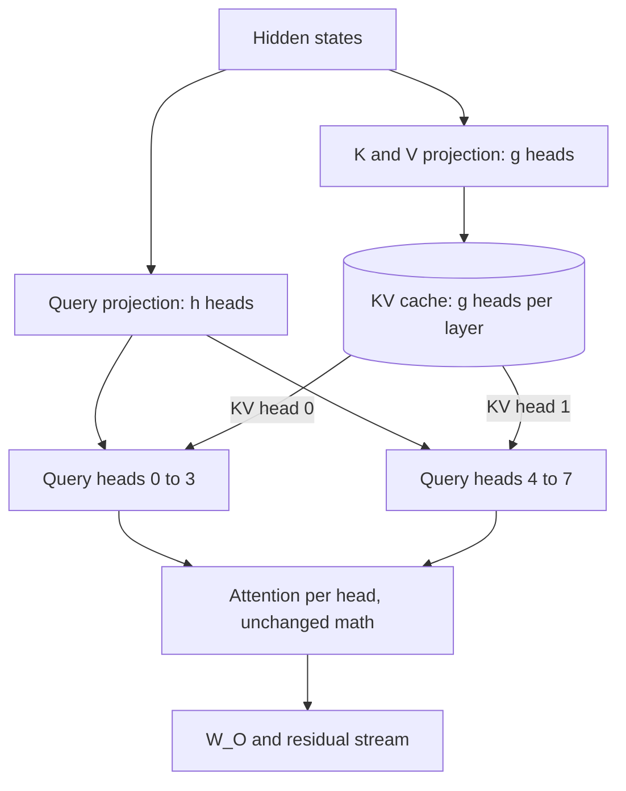

## TL;DR
GQA lets several query heads share one key/value head. Decode is bound by reading the KV cache, which
scales with KV heads, so going from 32 to 8 shrinks it fourfold at small quality cost; Llama 2 70B,
Llama 3 and Mistral adopted it.

## Why it exists
- **Decode time is bytes read.** Each decode step processes one new token per sequence. The arithmetic is
  tiny; the time goes into reading the weights and every cached key and value for every layer from
  high-bandwidth memory. Time per token ≈ bytes read ÷ bandwidth.
- **The cache dominates.** For a 7B-class model with full multi-head attention the cache costs about
  0.5 MB per token, so 64 concurrent 4k-token sequences hold ~128 GB of cache against ~14 GB of weights.
  The cache, not the model, sets both how many sequences fit and how fast each advances.
- **MQA went too far.** Shazeer's 2019 multi-query attention kept all query heads but one shared key head
  and value head, shrinking the cache by *h* (32× for a 32-head model). Quality drops measurably,
  training can be less stable, and an existing multi-head checkpoint cannot be converted without harm.
- **GQA is the middle.** Ainslie et al.: with *g* KV heads, each shared by h/g query heads, the cache
  shrinks by h/g. At g = 8 for a 64-head model, quality is close to full multi-head while speed is close
  to multi-query.
- **It targets redundancy.** Fewer layers cuts capacity everywhere; smaller head dimensions weaken every
  pattern; cache quantization is orthogonal and stacks on top. GQA shares the one factor that was mostly
  redundant, because neighbouring heads' key and value projections are similar enough to share.

## How it works
### The grouping
1. Take *h* query heads and *g* KV heads, with *h* divisible by *g*.
2. Shrink the key and value projections from `[d, h·d_k]` to `[d, g·d_k]`; the query projection and `W_O`
   are unchanged.
3. In the forward pass **K** and **V** come out as `[B, g, n, d_k]`, and query head *i* attends to KV head
   `i // (h/g)`.
4. The attention math per head is unchanged.

Two ways to implement step 3:
- **Expand:** repeat each KV head h/g times to `[B, h, n, d_k]` (the `repeat_kv` helper in Hugging Face).
- **Index:** fused kernels read the shared head directly without copying.

Parameter saving for Llama-3-8B (h = 32, g = 8, d_k = 128, d = 4096): the K and V projections hold 8.4M
parameters per layer instead of 33.6M, about 0.8B fewer across 32 layers than an all-MHA layout of the
same width.

### Cache arithmetic
Per token, the cache holds `2 × n_layers × g × d_k × bytes_per_element`. For 32 layers, d_k = 128 and
fp16:

```
MHA  g = 32 : 2 × 32 × 32 × 128 × 2 = 524,288 B = 512 KB per token
GQA  g = 8  : 2 × 32 ×  8 × 128 × 2 = 131,072 B = 128 KB per token
MQA  g = 1  : 2 × 32 ×  1 × 128 × 2 =  16,384 B =  16 KB per token
```

| Layout | 64 sequences × 8k tokens | Fits on one 80 GB card? |
|---|---|---|
| MHA (g = 32) | 256 GB | no, not even on three |
| GQA (g = 8) | 64 GB | yes, with room for weights |
| MQA (g = 1) | 8 GB | yes |

### Decode speed
- **Fewer bytes per step.** Bytes read ≈ weights + the cache of every sequence in the batch. At batch 64
  and 4k average length with an 8B fp16 model: ~16 GB of weights plus ~128 GB of MHA cache, against 16 +
  32 GB with GQA.
- **So up to ~3× decode throughput** before compute becomes the limit. Treat the factor as illustrative,
  since real engines overlap and batch differently.
- **Higher arithmetic intensity.** In decode attention every K/V vector loaded from HBM serves h/g query
  heads instead of one, so intensity rises by the group size. MHA decode attention does about one
  multiply-add per cached element loaded, which no GPU can feed from memory; GQA moves it partway toward
  the compute-bound regime.
- **Prefill is unaffected.** It is compute-bound, and the attention FLOPs are identical because the
  queries are not shared.

### Uptraining existing checkpoints
1. Take a multi-head checkpoint.
2. **Mean-pool** the key and value projection matrices of the heads in each group into one, because that
   preserves the group's average behaviour better than keeping one head or re-initializing.
3. Continue pre-training for about 5% of the original compute.

That is why GQA could be retrofitted onto already-trained models; newer families (Llama 3, Mistral)
simply train with it from the start.

### Interaction with tensor parallelism
- **Heads are the shard unit.** With g = 8 KV heads on 8 GPUs, each GPU holds one KV head and the four
  query heads that use it: ideal.
- **TP degree above g forces replication.** KV heads must be copied so each GPU has the one its query
  heads need, and the per-GPU cache saving shrinks accordingly.
- **Engines handle it**, but the capacity arithmetic changes.

### Beyond GQA
- **Multi-head latent attention** (DeepSeek-V2) projects keys and values into a low-rank latent per token
  and caches only that, reconstructing K and V on use. It reports a smaller cache than GQA at comparable
  or better quality, a vendor claim worth verifying per model.
- **Cache quantization** to 8-bit or 4-bit stacks multiplicatively with any head layout.
- **Sliding-window attention** bounds cache *length* rather than width.

## Diagram
Query heads are grouped onto shared KV heads, so only *g* KV heads are ever written to the cache and each
one loaded serves h/g queries.



## Examples
### Mapping query heads onto shared KV heads, and the cache table
The first half shows how query heads map onto shared KV heads with a `repeat_kv` expansion; the second
computes the cache table for the three layouts from a config.

```python
import torch
import torch.nn.functional as F

def repeat_kv(x, n_rep):                      # [B, g, n, dk] -> [B, g * n_rep, n, dk]
    B, g, n, dk = x.shape
    if n_rep == 1:
        return x
    return x[:, :, None].expand(B, g, n_rep, n, dk).reshape(B, g * n_rep, n, dk)

B, n, dk, h, g = 1, 5, 128, 32, 8
q = torch.randn(B, h, n, dk)
k, v = torch.randn(B, g, n, dk), torch.randn(B, g, n, dk)      # only 8 KV heads are ever cached
k_full, v_full = repeat_kv(k, h // g), repeat_kv(v, h // g)   # query head i uses KV head i // 4
out = F.scaled_dot_product_attention(q, k_full, v_full, is_causal=True)
print(out.shape, torch.equal(k_full[:, 0], k_full[:, 3]), torch.equal(k_full[:, 3], k_full[:, 4]))
# torch.Size([1, 32, 5, 128]) True False   -> heads 0..3 share KV head 0; head 4 starts group 1

def kv_bytes_per_token(layers, kv_heads, head_dim, dtype_bytes=2):
    return 2 * layers * kv_heads * head_dim * dtype_bytes

for name, kv_heads in (("MHA 32 kv heads", 32), ("GQA  8 kv heads", 8), ("MQA  1 kv head ", 1)):
    per_tok = kv_bytes_per_token(32, kv_heads, 128)
    print(f"{name}: {per_tok // 1024:4d} KB/token, {per_tok * 8192 * 64 / 2**30:6.0f} GiB for 64 x 8k")
# MHA 32 kv heads:  512 KB/token,    256 GiB for 64 x 8k
# GQA  8 kv heads:  128 KB/token,     64 GiB for 64 x 8k
# MQA  1 kv head :   16 KB/token,      8 GiB for 64 x 8k
```

### Reading the KV-head count from a real config
Capacity estimates must use KV heads. Older configs without the field are full MHA, so fall back to the
query-head count.

```python
from transformers import AutoConfig

cfg = AutoConfig.from_pretrained("meta-llama/Meta-Llama-3-8B")   # any causal LM id you can access
kv_heads = getattr(cfg, "num_key_value_heads", None) or cfg.num_attention_heads
head_dim = cfg.hidden_size // cfg.num_attention_heads
per_token = 2 * cfg.num_hidden_layers * kv_heads * head_dim * 2   # fp16 bytes
print(cfg.num_attention_heads, kv_heads, per_token // 1024, "KB/token")
# 32 8 128 KB/token
```

### Worked scenario: bytes per decode step at batch 64
An 8B fp16 model, 64 concurrent chats averaging 4k tokens, on a GPU with roughly 2 TB/s of memory
bandwidth (illustrative orders of magnitude, not a benchmark).

| Layout | Weights | Cache read per step | Total bytes | Bandwidth floor per step |
|---|---|---|---|---|
| MHA (32 KV heads) | ~16 GB | ~128 GB | ~144 GB | ~72 ms |
| GQA (8 KV heads) | ~16 GB | ~32 GB | ~48 GB | ~24 ms |

The MHA case also does not fit on one 80 GB card at all; GQA fits and runs each step about three times
faster. Time-to-first-token barely changes, because prefill is compute-bound.

## Production patterns
- **Plan capacity from `num_key_value_heads`.** Put the KV-head count, not the query-head count, into the
  cache estimator, then set the engine's context and concurrency limits (for example `max_model_len`
  and `max_num_seqs` in vLLM) from it. Monitor KV-cache utilization and preemptions.
- **Prefer GQA models for decode-heavy workloads.** For chat and agents, shortlist models by eval score,
  then by KV bytes per token. Measure tokens per second per GPU at the target batch, not single-stream
  latency, because that is where the saving appears.
- **Stack cache quantization on top.** Enable an FP8 KV cache (for example `kv_cache_dtype="fp8"` in vLLM)
  after running your eval set; it halves the cache again on any head layout. Monitor eval scores and
  resident sequences.
- **Align tensor parallelism with KV heads.** Keep the TP degree at or below *g* and dividing it, such as
  8 GPUs for g = 8. Monitor per-GPU cache memory when you add GPUs; if it does not shrink, KV heads are
  being replicated.
- **Use a GQA-aware attention path.** Let the engine's fused kernel index shared heads; in your own
  PyTorch code, recent versions of `F.scaled_dot_product_attention` accept `enable_gqa=True` instead of a
  materialized `repeat_kv`. Monitor prefill activation memory.

## Trade-offs
- **Cache and decode bytes vs quality.** Both drop by h/g for a small quality loss. The trade moves toward
  MQA when memory is the hard limit (edge devices, extreme batch) and back toward full MHA for small
  models at short context, where the cache was never the constraint.
- **Fewer K/V parameters vs unchanged attention FLOPs.** A little memory and prefill compute is saved,
  but attention FLOPs are unchanged because queries are not shared. GQA is nearly invisible in
  time-to-first-token and only shows in per-token decode latency and throughput.
- **Retrofit vs pick a GQA model.** Uptraining retrofits GQA onto a model you already have but costs
  around 5% of pre-training compute plus the data pipeline. For almost everyone the right move is to pick
  a model trained with GQA.
- **KV-head count vs hardware fit.** It sets the finest tensor-parallel split without replication, so
  g = 8 fits 8-GPU nodes neatly and awkwardly fits anything else.

## Pitfalls
- **Using `num_attention_heads` instead of `num_key_value_heads` in a capacity estimate.** Symptom: a
  cache budget four times too large, and a cluster sized or rejected on the wrong number.
- **Expecting GQA to cut time-to-first-token.** Symptom: an unchanged TTFT after switching models while
  only throughput and per-token latency improved.
- **Materializing `repeat_kv` copies in a custom attention path at prefill.** Symptom: transient
  activation memory as large as MHA even though the cache itself is small.
- **Converting an MHA checkpoint by slicing or averaging heads without uptraining.** Symptom: a sharp
  perplexity jump on the first evaluation that only continued pre-training (the paper's ~5% uptraining)
  recovers.
- **Tensor-parallel degree larger than the KV-head count.** Symptom: per-GPU cache memory that does not
  shrink as expected when you add GPUs.

## When to use
- **Choosing a model to serve:** at long context or high concurrency, read `num_key_value_heads` before
  the benchmark table and compute cache-per-token for your sequence lengths. Two models with equal
  quality on your evaluation can differ by four in how many users one GPU serves.
- **Prefer GQA** for chat and agent workloads where decode dominates; it matters less for short-prompt
  classification where prefill dominates.
- **Training or fine-tuning:** keep the layout the checkpoint was trained with.
- **Measure:** tokens per second per GPU at your target batch, not single-stream latency, because that is
  where the saving appears.
- **Interviews:** derive the cache formula, explain why decode speed follows bytes rather than FLOPs, and
  place MHA, GQA and MQA on that line.

## Role lens
- **Engineer:** Plugs `num_key_value_heads` into the cache estimator, sets batch and context limits in
  the serving engine from it, and checks that the kernel path indexes shared heads instead of copying.
- **Architect:** Decides model families and GPU counts with the KV-head count as a first-class input,
  since it fixes both cache capacity and how evenly the model shards.
- **FDE:** Shows a customer why the GQA model serves four times their concurrent users on the same
  hardware as the MHA model they benchmarked, with the per-token bytes as the evidence.

## Check yourself
**Q:** Two 7B-class models score identically on your evaluation. One uses full multi-head attention with
32 KV heads, the other GQA with 8. You serve 4k-token chats on one 80 GB GPU. Quantify the difference and
say what else you would check.
**A:** Both have 32 layers and head_dim 128, so the cache per token is 2 × 32 × 32 × 128 × 2 bytes
= 512 KB for MHA and 128 KB for GQA. A 4k chat costs 2 GB versus 0.5 GB. After ~14 GB of fp16 weights,
roughly 66 GB remain, so about 30 MHA chats fit against about 130 GQA chats, before fragmentation and
activations. Per decode step, bytes read drop from weights plus 2 GB per active chat to weights plus
0.5 GB, so at equal batch the GQA model generates tokens faster, and at equal memory it serves four times
the concurrency. I would also check that the two evaluations covered long-context behaviour, that the
serving engine actually uses a GQA-aware kernel, and that my tensor-parallel plan divides 8 KV heads
evenly.

## Interview questions
### What problem does GQA solve, and why share keys and values rather than queries?
- **Decode is bandwidth-bound on the KV cache**, which scales with the number of KV heads, so cutting KV
  heads cuts both memory and bytes read per step.
- **Queries are not cached.** Only the new token's query exists each step, so sharing queries would save
  nothing in memory and would cut attention capacity.

### After switching to a GQA model, TTFT did not improve but throughput did. Is something broken?
- **No, that is expected.** Prefill is compute-bound and attention FLOPs are unchanged, because every
  query head still attends.
- **The gain is in decode:** fewer cache bytes per step and higher arithmetic intensity, so per-token
  latency and batch throughput improve while time-to-first-token stays flat.

### When would you not convert an existing MHA model to GQA yourself?
- **Almost always.** Conversion needs mean-pooled K/V projections plus continued pre-training of about 5%
  of original compute, or quality drops sharply.
- **Pick a model trained with GQA instead**, unless you own the pre-training pipeline and the model is
  unique to you.

### How does the KV-head count constrain tensor parallelism?
- **Heads are the shard unit.** With g = 8 on 8 GPUs, each GPU holds one KV head and its four query heads.
- **Above g, KV heads are replicated**, so adding GPUs stops shrinking per-GPU cache memory; plan the TP
  degree to divide g.

### How many 4k-token chats fit on an 80 GB GPU for a 7B model with 32 versus 8 KV heads?
- **Per token:** 512 KB for MHA and 128 KB for GQA (32 layers, head_dim 128, fp16), so 2 GB versus
  0.5 GB per chat.
- **Capacity:** about 66 GB free after weights gives roughly 30 versus 130 chats, before fragmentation and
  activation headroom.

## Quiz
### Q: What does grouped-query attention primarily reduce?
- [ ] The number of query heads and therefore attention FLOPs
- [x] The number of key/value heads, and with them the KV cache size and bytes read per decode step
- [ ] The number of transformer layers needed for a given quality
- [ ] The size of the vocabulary embedding
> Queries stay at full head count; only keys and values are shared across groups. The win is memory and
> bandwidth during decoding, not arithmetic, which is why prefill speed is essentially unchanged.

### Q: Llama-3-8B has 32 query heads and 8 KV heads. How many query heads share each KV head?
- [ ] 1
- [ ] 2
- [x] 4
- [ ] 8
> Group size is 32 / 8 = 4: query heads 0–3 use KV head 0, 4–7 use KV head 1, and so on. The cache is
> therefore a quarter of what full multi-head attention would need.

### Q: Why does GQA give almost no improvement to time-to-first-token?
- [ ] Because the prompt is processed without attention
- [ ] Because the cache is only created after the first token
- [x] Because prefill is compute-bound and the attention FLOPs are unchanged when only K and V are shared
- [ ] Because the output projection dominates prefill time
> Prefill multiplies large matrices and is limited by arithmetic, not by reading the cache. Sharing K/V
> heads changes how many bytes decode must read per step, which is where GQA's gain appears.
