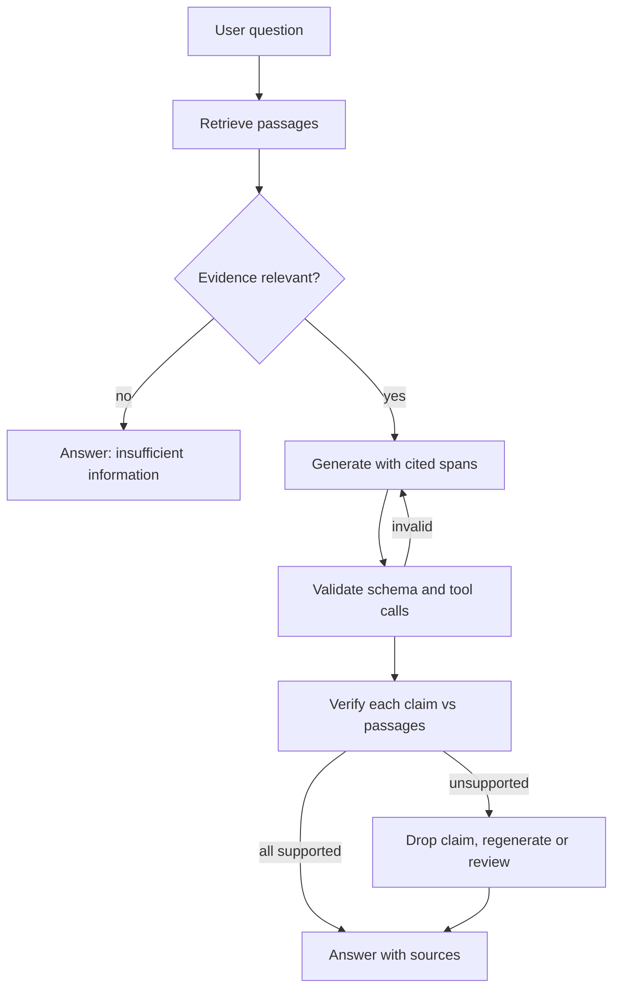

## TL;DR
Hallucination is fluent, confident output unsupported by the input or by reality. In agents it becomes
invented tools, arguments, IDs and results that compound over steps, so manage it as an error rate:
ground, validate, verify, and allow abstention.

## For agent builders
- **Why it matters for agents.** A chatbot's hallucination is a wrong sentence; an agent's is a wrong
  action. Invented tool names, made-up order IDs, fabricated "I already checked" claims and hallucinated
  facts written to memory all execute or persist, and every later step builds on them.
- **Where it shows up in your stack.** Tool-call validation against the live registry, RAG grounding and
  citation checks, memory writes, final-answer verification, and the faithfulness metrics in your agent
  evals and traces.
- **What you control.** Schemas and validation on every call, an abstention or "need more info" state,
  checks that IDs and facts came from tool results, verification before side-effecting actions, and
  temperature per step.
- **What you can skip.** The research taxonomy beyond intrinsic, extrinsic, factual and structural, and
  vendor-side training fixes. Your levers are architectural.

## Why it exists
- **The objective cannot tell known from unknown.** A next-token model learns p(next token | context).
  Nothing distinguishes "the capital of France is Paris", seen millions of times, from "the 2019 revenue of
  a small private company", seen once or never. The model must emit a token anyway, the distribution still
  peaks somewhere plausible, and the sampler emits it with the same fluency as a well-known fact.
- **Parametric knowledge is lossy compression.** Rare facts are stored weakly or not at all, with no
  explicit "not stored" signal. The signal is not wholly absent: pre-trained models are often reasonably
  calibrated on multiple-choice questions (Kadavath et al., 2022). But free-form generation never consults
  it before committing to a token, and post-training tends to degrade it.
- **Autoregression commits.** Once a wrong token is sampled, say a fabricated paper title, every later token
  is conditioned on it, and the strong prior for coherence makes the model elaborate rather than retract,
  so errors snowball.
- **Post-training rewards guessing.** Human raters and binary-graded benchmarks reward complete, confident
  answers and penalise hedging, so the policy learns a guess beats an abstention, like students on exams
  with no negative marking. The GPT-4 technical report showed calibration getting worse after RLHF.
- **The naive fixes fail.** More data shrinks the long tail but cannot close it. Temperature zero cuts
  variance, not bias: greedy decoding still takes the argmax of a wrong distribution. A "do not
  hallucinate" prompt helps only at the margin, since it creates no "I don't know" signal decoding acts on.
  Fine-tuning can teach some facts, but on knowledge the base model lacks it has been reported to increase
  hallucination elsewhere.

## How it works
### How it shows up in an agent loop
| Agent failure | Example | Cheapest guard |
|---|---|---|
| Invented tool or parameter | calls `issue_refund` when the tool is `refund` | validate name and arguments against the registry |
| Invented identifier | refunds order `A9999` that no tool ever returned | check IDs against values seen in tool results |
| Fabricated observation | "the test suite passed" without running it | require the claim to cite a tool result in the trace |
| Snowballing plan | a wrong fact at step 3 drives steps 4-10 | verify key facts before acting on them |
| Memory poisoning | a hallucinated preference is saved and recalled as truth | write to memory only facts with a source |

- **Errors compound.** If each step has an independent error rate p, a task of n steps succeeds with
  probability about (1 − p)ⁿ, so long agents need far lower per-step rates than chat (see the worked
  table under Examples).

### A taxonomy that determines the fix
| Type | What it is | Detect with | Reduce with |
|---|---|---|---|
| Faithfulness: *intrinsic* | output contradicts the given source, such as a summary that reverses a figure in the document | comparison against the source | grounding and verification |
| Faithfulness: *extrinsic* | output adds content the source neither states nor contradicts, such as an invented figure, which may or may not be true in the world | comparison against the source | grounding and verification |
| Factuality | output contradicts the world, such as a wrong date or an invented citation in a closed-book answer | external knowledge | retrieval, tools and abstention |
| Structural | invented tool names, parameters that do not exist, API functions never defined; common in agents and code generation | schema checks | schema validation, which eliminates it almost entirely |

- **The faithfulness split** into intrinsic and extrinsic comes from the NLG literature (Maynez et al.,
  Ji et al.).
- **The axes are different.** An extrinsic addition can be factually true, and a faithful summary of a
  wrong document is factually wrong.
- **Why it matters.** Each type has a different evaluation and a different mitigation, so a
  "hallucination rate" that mixes them is not actionable.

### Where in the pipeline it arises
1. **Knowledge.** The question is outside the training distribution or after the training cutoff.
2. **Retrieval.** In RAG the retriever returns irrelevant, partial, conflicting or stale passages, and a
   model instructed to answer bridges the gaps with its priors. A large share of "model hallucinations"
   reported for RAG products are retrieval failures.
3. **Decoding.** High temperature or top-p widens the tail; long generations accumulate risk; the most
   surprising tokens are usually the fabricated specifics, such as numbers, names and URLs.
4. **Prompt pressure.** "Always answer", "be definitive", role-play framing, and false-premise questions
   ("Why did X do Y?" when X never did) push the distribution toward fabrication.
5. **Sycophancy.** The user asserts something and the model agrees, because agreement was rewarded in
   preference tuning.

### Detection mechanisms
| Method | How | Cost and limits |
|---|---|---|
| Sampling consistency (SelfCheckGPT) | sample N answers; known facts are stable, fabrications vary | N× compute; misses confident, consistent errors |
| Semantic entropy | cluster samples by meaning, compute entropy over clusters | N× samples plus meaning checks (an NLI model); flags unreliable answers better than token-level entropy, because paraphrases of one answer no longer count as disagreement |
| Token-level signals | low log-probability on entity and number tokens | cheap flag, but miscalibrated after RLHF, so thresholds must be tuned per model |
| Claim-level verification | split the answer into atomic claims, check each against retrieved passages with an NLI model or LLM judge, report an unsupported-claim rate | one extraction call plus one call per claim, and the judge can err; the faithfulness metric in evals, most actionable because it names the claim that failed |
| Tool-based verification | run the code, call the API, look up the citation | cheapest and most reliable wherever a checker exists |

### Reduction mechanisms
The durable fix is architectural: supply evidence, verify outputs, and make abstention cheap.
- **Grounding.** Retrieve evidence, instruct the model to quote or cite spans, verify the citations after
  generation, and show the sources to the user.
- **Abstention paths.** Put an explicit "insufficient information" option in the output schema and score it
  as correct on unanswerable items in your evals, so neither prompt iteration nor fine-tuning trains it away.
- **Constrained outputs.** Enumerations, JSON schemas and tool-call validation against the real tool
  registry remove whole classes of structural hallucination.
- **Decoding.** Lower temperature for factual and extractive steps; keep sampling diversity for creative
  ones.
- **Verification loops.** Draft, generate verification questions, answer them independently, revise.
  Reasoning models perform a version of this inside their thinking trace.
- **Training-side.** Preference data that rewards calibrated abstention and penalises confident errors more
  than "I don't know". A vendor-level lever, but it tells you what to look for in model choice.
- **Product design.** Surface confidence and sources, make verification one click, keep a human in the
  loop for consequential outputs.

## Diagram
A grounded answer path with the three exits that keep hallucinations from reaching users: abstain on weak
evidence, repair invalid structure, and verify claims before answering. In an agent the same gates sit
on every step, before a tool call executes or a fact enters memory.



## Examples
### Agent scenario: block invented tools, arguments and IDs before they execute
Structural hallucination is the one you can almost eliminate: check every proposed call against the live
registry, its JSON Schema, and the identifiers that actually came back from tools in this run.

```python
from jsonschema import validate, ValidationError

TOOLS = {   # the live registry: name -> JSON Schema for the arguments
    "get_order": {"type": "object", "required": ["order_id"], "additionalProperties": False,
                  "properties": {"order_id": {"type": "string"}}},
    "refund": {"type": "object", "required": ["order_id", "amount"], "additionalProperties": False,
               "properties": {"order_id": {"type": "string"}, "amount": {"type": "number", "minimum": 0}}},
}

def check_call(call, seen_ids):
    """Return an error to reflect back to the model, or None if the call may run."""
    name, args = call.get("name"), call.get("arguments", {})
    if name not in TOOLS:                                    # invented tool name
        return f"unknown tool {name!r}; available: {sorted(TOOLS)}"
    try:
        validate(args, TOOLS[name])                          # invented or mistyped arguments
    except ValidationError as e:
        return f"invalid arguments for {name}: {e.message}"
    if "order_id" in args and args["order_id"] not in seen_ids:   # invented identifier
        return f"order_id {args['order_id']} never appeared in a tool result; look it up first"
    return None

seen = {"A1043"}                     # IDs that actually came back from tools in this run
for call in [{"name": "issue_refund", "arguments": {"order_id": "A1043", "amount": 20}},
             {"name": "refund", "arguments": {"order_id": "A1043", "amount": "20"}},
             {"name": "refund", "arguments": {"order_id": "A9999", "amount": 20}},
             {"name": "refund", "arguments": {"order_id": "A1043", "amount": 20}}]:
    print(check_call(call, seen))
# unknown tool 'issue_refund'; available: ['get_order', 'refund']
# invalid arguments for refund: '20' is not of type 'number'
# order_id A9999 never appeared in a tool result; look it up first
# None
```

- **Reflect, then cap.** Return the error string to the model as the tool result, allow one or two
  retries, then stop or escalate, so a confused model cannot loop forever.

### Worked scenario: why per-step error rates matter more for agents
Task success if every step must be right and steps fail independently at rate p (a simplification:
real errors are correlated, and some are recoverable).

| Per-step error rate | 1 step | 10 steps | 20 steps | 40 steps |
|---|---|---|---|---|
| 2% | 98% | 81.7% | 66.8% | 44.6% |
| 1% | 99% | 90.4% | 81.8% | 66.9% |
| 0.5% | 99.5% | 95.1% | 90.5% | 81.8% |

- **Reading.** A 2% rate that looks fine in chat fails a third of 20-step tasks. Validation that removes
  structural errors, plus verification of the few facts each action depends on, is how agent teams buy
  the lower rows.

### Claim-level faithfulness check for a RAG answer
- **Cost:** one call to extract claims plus one call per claim, so it runs as an offline eval on sampled
  traffic and as an online gate only for high-stakes categories.
- **Caveat:** the judge is itself a model and can be wrong in the same direction as the generator, so
  calibrate its verdicts against human labels before the rate goes on a dashboard.

```python
import json

def llm(prompt, temperature=0.0):
    """Call your model provider here and return the text."""
    raise NotImplementedError

def extract_claims(answer):
    out = llm("Split this answer into atomic factual claims. "
              f"Return a JSON list of strings.\n\nANSWER:\n{answer}")
    return json.loads(out)

def verify(claim, passages):
    ctx = "\n\n".join(f"[{i}] {p}" for i, p in enumerate(passages))
    out = llm("Decide whether the CLAIM is supported by the PASSAGES. Reply with JSON "
              '{"verdict": "supported" | "contradicted" | "not_found", "source": <index or null>}.\n\n'
              f"PASSAGES:\n{ctx}\n\nCLAIM: {claim}")
    return json.loads(out)

def faithfulness_report(answer, passages):
    claims = extract_claims(answer)
    verdicts = [verify(c, passages) for c in claims]
    unsupported = [(c, v["verdict"]) for c, v in zip(claims, verdicts) if v["verdict"] != "supported"]
    return {"claims": len(claims), "unsupported": unsupported,
            "unsupported_rate": len(unsupported) / max(1, len(claims))}

retrieved_passages = ["Refunds are issued within 14 days of a returned item being received."]
answer_text = "Refunds take 14 days and are paid to the original card."   # second claim is unsupported
report = faithfulness_report(answer_text, retrieved_passages)
# Expected: 2 claims; "paid to the original card" comes back not_found, so unsupported_rate = 0.5.
if report["unsupported_rate"] > 0:
    # Options: regenerate with the unsupported claims listed as "do not state",
    # return only the supported claims with their [source] indices, or route to review.
    ...
```

- **Free error analysis.** Unsupported claims that are "not_found" with weak retrieval scores point at the
  retriever; "contradicted" claims point at the generator.

### Semantic entropy on sampled answers
A runnable sketch of the detection idea for closed-book questions. Farquhar et al. decide "same meaning"
with bidirectional entailment from an NLI model; here a toy rule (same set of years) stands in for it.

```python
import math, re

def semantic_entropy(samples, same_meaning):
    clusters = []
    for s in samples:
        for c in clusters:
            if same_meaning(c[0], s):
                c.append(s)
                break
        else:
            clusters.append([s])
    n = len(samples)
    return sum(-(len(c) / n) * math.log(len(c) / n) for c in clusters)

years = lambda s: set(re.findall(r"\b\d{4}\b", s))
same_year = lambda a, b: years(a) == years(b)

known = ["Founded in 1998.", "1998", "It was founded in 1998", "In 1998.", "1998, in Ohio"]
guess = ["Founded in 1998.", "2003", "It was founded in 1987", "In 2003.", "2011"]
print(round(semantic_entropy(known, same_year), 2))   # 0.0: one meaning, likely known
print(round(semantic_entropy(guess, same_year), 2))   # 1.33: four meanings, flag or abstain
```

### Worked scenario: splitting a reported 10% rate
A customer says the assistant "hallucinates about 10% of the time". Labelling 200 failing answers gives a
breakdown like this (illustrative counts, the shape is typical):

| Root cause | Count | Share | Fix |
|---|---|---|---|
| Retrieval missed the answer passage | 110 | 55% | chunking, embeddings, missing documents |
| Question unanswerable from the corpus | 30 | 15% | abstention path, scored as correct |
| Extrinsic addition beyond the passage | 35 | 17.5% | quote-or-cite instruction, claim verification |
| Intrinsic contradiction of the passage | 15 | 7.5% | lower temperature on the answer step, verification |
| Citation attached to a passage that does not say it | 10 | 5% | post-hoc citation check |

- **Reading.** Most of the "model" problem is retrieval and missing abstention, which is why fixing
  retrieval first usually gives the largest drop.

## Production patterns
- **Ground agent claims in the trace.** Require completion claims ("tests pass", "email sent") and key
  facts in the final answer to reference a tool result ID from this run, and check it mechanically before
  replying. Apply the same rule to memory: store a fact only with the tool result or user message it came
  from. Monitor the share of answers and memory writes without a source.
- **Abstention as a schema state.** Add a status field such as `answered` or `insufficient_information` to
  the structured output, include unanswerable items in the eval set and score abstention on them as
  correct. Monitor abstention rate separately on answerable and unanswerable items, so over-refusal shows.
- **Log retrieval scores with every answer.** Store the top-k relevance scores and passage ids next to each
  response, and route answers whose best score is below a tuned threshold to abstention or review.
  Monitor the share of flagged failures with low retrieval scores to separate retriever from generator.
- **Mechanical citation checks.** Require quoted spans with source indices and verify after generation that
  each quote appears in the cited passage, a plain string match. Monitor the citation-mismatch rate per
  release.
- **Validate every tool call.** Check tool names against the live registry and arguments against the tool's
  JSON Schema (for example with the Python `jsonschema` package), reflect the validation error back to the
  model, and cap retries. Monitor invalid-call rate per tool.
- **Calibrate the judge before the dashboard.** Have SMEs label a sample, measure agreement between the
  LLM judge and humans, and only then publish an unsupported-claim rate. Re-check agreement when the judge
  model or prompt changes.
- **Tier verification by stakes.** Run claim-level verification online only for high-stakes categories and
  offline on sampled traffic for everything else. Track the latency and cost it adds per tier.

## Trade-offs
- **Verification per step vs agent latency.** Checking every fact before acting makes long agents
  reliable but adds calls to each step; verify only the facts a side-effecting action depends on, and
  verify everything only when actions are irreversible.
- **Grounding vs retrieval dependence.** Retrieval cuts factual hallucination sharply but moves the failure
  to retrieval quality; when the corpus lacks the answer, a model told to "answer from context" either
  abstains or bridges the gap, so a check is still needed.
- **Label-free detection vs cost and coverage.** Sampling-based detection is model-agnostic and needs no
  labels, but multiplies cost by N and only catches instability, not confident errors the model learned
  consistently from training data.
- **Low temperature vs diversity.** It reduces variance on factual tasks but does not fix a wrong argmax and
  hurts tasks that need diversity; the trade flips for brainstorming and creative generation.
- **Abstention vs over-refusal.** Rewarding abstention reduces confident errors, but overdone it produces a
  model that refuses or hedges on answerable questions; users punish both failures, so tune the abstention
  rate to your task's cost asymmetry.
- **Claim verification vs latency.** It gives precise, actionable numbers but adds latency and a second
  model that can be wrong; it earns its cost on high-stakes outputs and as an offline eval, rarely on every
  chat turn.

## Pitfalls
- **Trusting the agent's own report of what it did.** Symptom: final answers say "I verified the
  balance" or "tests pass" with no matching tool call in the trace. Fix: check completion claims against
  the trace before replying, and fail the eval case when they do not match.
- **Blaming the model for a retrieval failure.** Symptom: hallucinations cluster on questions whose top-k
  passages have low relevance scores or whose answers are not in the corpus at all. Fix: log retrieval
  scores and label whether the answer passage was retrieved before touching the prompt.
- **Reporting a rate from an uncalibrated LLM judge.** Symptom: a judge that shares the generator's priors
  and a dashboard reading 2% while SMEs find 15%. Fix: measure judge agreement on SME labels first.
- **Treating temperature 0 as "hallucination off".** Symptom: deterministic, repeatable fabrications that
  look like facts precisely because they are consistent. Fix: grounding and verification, not decoding.
- **Scoring "I don't know" as a failure in evals and demos.** Symptom: after a round of prompt or
  fine-tuning iteration, abstentions vanish and confident errors rise. Fix: score abstention as correct on
  unanswerable items.
- **Fine-tuning on unseen domain facts to "teach it the knowledge".** Symptom: a model that learned the
  format and a few facts and now fabricates fluently about the rest. Fix: supply the facts by retrieval.
- **Accepting a cited answer without checking the citation.** Symptom: real document titles attached to
  statements they do not contain, since citation hallucination survives retrieval. Fix: verify each quoted
  span appears in the cited passage.
- **Letting an agent invent tool names or arguments.** Symptom: "function not found" errors or calls with
  parameters that do not exist. Fix: validate every call against the live schema and reflect the error back.

## When to use
You do not choose whether hallucination applies; you choose how much to spend against it per use case.
- **Low-stakes creative or conversational features:** light measures, sources where available and a
  temperature appropriate to the task.
- **Extraction and summarisation:** ground every output in the input and measure faithfulness on a golden
  set.
- **Factual question answering:** retrieval with citations, an abstention path and offline claim-level
  verification.
- **Agents:** validate every tool call against the real schema and verify consequential actions before
  executing them.
- **Measure:** unsupported-claim rate, abstention rate on unanswerable items, calibration of confidence
  against correctness, and per-category error analysis.
- **Interviews:** explain the mechanism (objective, decoding, incentives), the faithfulness/factuality split
  and the intrinsic/extrinsic subdivision, three mitigations with their costs, and why temperature 0 is not
  a fix.

## Role lens
- **Engineer:** Builds the grounding pipeline, adds an "insufficient evidence" output path, validates tool
  calls against schemas, and ships a claim-level faithfulness eval that runs in CI.
- **Architect:** Sets the per-use-case hallucination budget and verification tier, decides where human review
  is mandatory, and makes abstention a first-class product state rather than an error.
- **FDE:** Runs error analysis with customer SMEs to separate retrieval failures from generation failures,
  and calibrates the judge on their labelled examples before any hallucination rate appears in a report.

## Check yourself
**Q:** A customer reports that your RAG assistant "hallucinates about 10% of the time" on their policy
documents. Walk through how you would diagnose and reduce it, and name one thing you would refuse to do.
**A:** First get the failing examples labelled and split them. Did retrieval return the passage containing
the answer? If not, it is a corpus or retrieval problem: chunking, embeddings, missing documents. If it did,
did the model contradict the passage (intrinsic) or add detail the passage does not support (extrinsic)?
Both are faithfulness failures with different fixes. Was the question
answerable at all, in which case abstention is the correct output and the eval must reward it? Then fix
retrieval first, since it is usually the largest share; require citations with quoted spans; add an
"insufficient information" path; lower the temperature on the answer step; add claim-level verification for
high-stakes categories; and calibrate the LLM judge against the SME labels before reporting any rate. I
would refuse to fine-tune the model on the policy documents as a knowledge fix, or to add "do not
hallucinate" to the prompt and call it done.

## Interview questions
### Why do language models hallucinate at all?
- **Objective:** next-token training rewards plausible continuations and has no "not stored" signal, so an
  unknown fact still yields a confident-looking peak.
- **Decoding:** autoregression commits to sampled tokens and the coherence prior elaborates on an early
  error instead of retracting it.
- **Incentives:** preference tuning and binary-graded benchmarks score guesses above abstentions, and
  calibration measurably worsens after RLHF.

### Your support agent refunded an order that does not exist. How do you stop this class of error?
- **Name the type:** a structural or identifier hallucination; the model produced a plausible ID instead of
  one returned by a lookup tool.
- **Guard mechanically:** validate tool names and arguments against the schema, and reject any ID that did
  not appear in a tool result this run, returning the error to the model.
- **Gate the action:** side-effecting tools such as refunds get a verification step or human approval, and
  the eval set gains cases that tempt the agent to guess an ID.

### Why is hallucination a bigger problem for a 20-step agent than for a chatbot?
- **Errors compound:** at a 2% independent per-step error rate, about two thirds of 20-step tasks
  succeed, versus 98% of single answers.
- **Errors act:** a wrong fact becomes a wrong tool call, a wrong memory or a wrong change, not just a
  wrong sentence.
- **Errors snowball:** later steps condition on earlier outputs, so one invented fact can steer the whole
  plan; verify the facts each action depends on.

### There are no source documents for a closed-book QA feature. How would you detect likely hallucinations?
- **Sample several answers** and measure agreement, or better, semantic entropy over meaning clusters, so
  paraphrases do not count as disagreement.
- **Act on it:** above a tuned threshold, abstain, add a caveat or route to retrieval or a tool.
- **Know the limits:** it costs N× compute and misses confident, consistent errors the model learned from
  training data.

### Your LLM judge reports a 2% hallucination rate but SMEs find 15%. What happened and what do you do?
- **Likely cause:** the judge shares the generator's priors, so it accepts the same plausible fabrications,
  and it was never calibrated against human labels.
- **Fix:** label a sample with SMEs, measure judge agreement, switch to claim-level verdicts against the
  retrieved passages, and tune the judge prompt or model until agreement is acceptable.
- **Then** report only the calibrated rate, split by failure type.

### Why might fine-tuning on a customer's documents make hallucination worse?
- **Fine-tuning teaches format faster than facts.** Training on knowledge the base model lacks has been
  reported to increase hallucination elsewhere.
- **The result** is a model that sounds like the domain and fabricates fluently about everything it did not
  memorise. Supply the documents through retrieval with citations instead.

## Quiz
### Q: Why does setting temperature to 0 not eliminate hallucination?
- [ ] Temperature only affects the first generated token
- [x] Greedy decoding still picks the most probable token from a distribution that may be wrong; it removes sampling variance, not the underlying knowledge gap
- [ ] Most APIs ignore the temperature parameter
- [ ] Temperature 0 disables retrieval
> Temperature rescales the distribution the sampler draws from. When the model does not know the answer,
> the peak of that distribution is already a fabrication, and taking the argmax reproduces it every time.
> That is why greedy decoding yields consistent, not correct, errors.

### Q: In a RAG system, which observation most strongly indicates that a reported "hallucination" is actually a retrieval failure?
- [ ] The answer is longer than usual
- [ ] The model was run at a low temperature
- [x] The retrieved passages do not contain the needed information, and the model's answer fills the gap with plausible detail
- [ ] The answer contradicts a passage that was retrieved
> If the evidence was never retrieved, no generator could have produced a grounded answer, so the fix is in
> chunking, embeddings or corpus coverage. Contradicting a retrieved passage is the opposite case, a
> faithfulness failure of the generator.

### Q: Why can post-training with human preferences or binary-graded benchmarks increase confident wrong answers?
- [ ] Reward models prefer short answers
- [x] Hedging and abstention are scored as failures, so the policy learns that a confident guess has higher expected reward than "I don't know"
- [ ] RLHF removes the model's access to its training data
- [ ] It raises the default sampling temperature
> When an abstention earns zero and a guess earns a reward whenever it happens to be right, the optimal
> policy guesses. Calibration measurably worsens under such training, which is why evals must give credit
> for correct abstention on unanswerable items.

## Use cases & projects
### Use cases
- **Tool-calling agents with side effects.** Refund, booking and ticketing agents validate every call and
  every identifier before anything executes.
- **RAG assistants and research agents.** Claim-level faithfulness checks and citation verification on
  answers built from retrieved passages.
- **Coding agents.** Running the code or tests is the verification; claims of success must match a real
  tool result.
- **Agent memory.** Only source-backed facts are written, so a single hallucination does not become a
  permanent "user preference".

### Mini project
**Hallucination guardrails for a small tool-calling agent (2-3 hours).**
- **Goal:** measure and cut structural and identifier hallucinations in a 3-tool support agent.
- **Steps:** build an agent with `get_order`, `refund` and `search_faq` over a fake order table; write 30
  tasks, including ones that mention non-existent orders or tempt guessing; run it once without guards and
  once with the `check_call` validator plus a trace check on completion claims; log every rejected call.
- **Done when:** a table compares invalid-call rate, invented-ID rate and task success with and without
  guards, and you can point to three traces where a guard stopped a wrong action.
