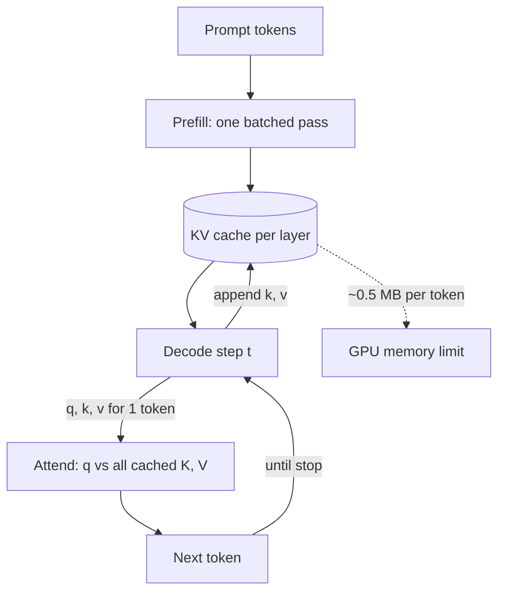

## TL;DR
Every agent step re-sends a growing transcript; the KV cache stores earlier tokens' keys and values so
the model projects each position once. It makes long agent loops affordable in compute but costly in GPU
memory, which caps how many agents a server runs.

## For agent builders
- **Why it matters for agents.** An agent's context only grows: system prompt, tool definitions, then
  every tool call and result appended step after step. The KV cache (and prefix caching on top of it)
  decides whether step 20 costs as little as step 1 or re-processes the whole transcript.
- **Where it shows up in your stack.** Provider prompt caching for hosted models, `enable_prefix_caching`
  in vLLM or RadixAttention in SGLang for self-hosted ones, and the concurrency limit of any GPU serving
  your agents.
- **What you control.** Keep the prefix stable (system prompt and tool schemas first, byte-identical),
  append instead of editing history, and compact old turns deliberately, because any edit invalidates
  the cache from that point on.
- **What you can skip.** The CUDA kernels behind attention. Know the bytes-per-token formula and the
  prefill/decode split; that is enough to size and debug agent serving.

## Why it exists
- **Generation is a loop.** Feed the prompt, get a token, append it, feed everything again. Without a
  cache, step *t* re-runs the full forward pass over all *t* tokens: 1 + 2 + … + n = O(n²)
  token-forward-passes.
- **That is very wasteful.** A 4,000-token answer costs eight million token-passes instead of four thousand.
- **The recomputed work is identical.** For the newest token only the query **q** is new. The keys
  **K** and values **V** of earlier positions depend only on earlier tokens and the weights. In a causal
  decoder position *i* cannot see *j > i*, so they never change. The cache memoizes them per layer.
- **"Just recompute, GPUs are fast" buys nothing.** The recomputed K and V are bit-for-bit what the
  previous step produced, so the extra FLOPs add no quality or flexibility.
- **What the cache does not remove.** Attention itself stays linear per step, because the new query reads
  all *t* cached keys, so total attention work is still quadratic. The cache removes re-running the
  projections and MLPs over old tokens, which is most of the FLOPs at ordinary lengths.

## How it works
### What is stored
- Each layer projects a token's hidden state into a key and a value: `k = x·W_K`, `v = x·W_V`.
- For position *i* these depend only on tokens ≤ *i*, so once computed they are stored and never
  recomputed.
- Each layer has its own W_K and W_V and its own hidden state, so there is no sharing across layers. The
  cache is a 4-D tensor `[layer, position, kv_head, head_dim]` for K, and the same for V.

### The two phases
1. **Prefill.** The whole prompt runs in one batched forward pass. It is compute-bound (large matrix
   multiplications) and fills the cache with K and V for every prompt position in every layer.
2. **Decode.** One new token per step: compute **q, k, v** for that token, append its **k** and **v**,
   then attend with `softmax(q·Kᵀ/√d)·V` over the cached K and V. One query row means the step is
   dominated by *reading* the cache and weights, not by arithmetic.

### Why decode is bandwidth-bound
| Quantity (7B model, fp16, batch 1) | Value |
|---|---|
| Arithmetic per token | ~2 FLOPs per parameter ≈ 14 GFLOP |
| Bytes read per token | every parameter once ≈ 14 GB |
| Intensity | about one FLOP per byte |
| A100-class GPU | ~300 TFLOP/s fp16, ~2 TB/s bandwidth, so ~150 FLOPs per byte available |
| Latency floor | 14 GB ÷ 2 TB/s ≈ 7 ms per token |

- At batch 1 the GPU uses well under 1% of its arithmetic (rough orders of magnitude, not a benchmark).
- So tokens/second per request barely improves with a faster GPU if its bandwidth is similar.
- Batching *B* requests reuses each weight read *B* times, so throughput rises almost linearly with batch
  size. That holds until each sequence's own K and V reads, every step, dominate the bytes moved.
- This bandwidth-bound regime is what batching and speculative decoding later exploit.

### How big it is
Per token, the cache holds one key and one value vector per layer per KV head:

```
bytes_per_token = 2 (K and V) × n_layers × n_kv_heads × head_dim × bytes_per_element
```

- Llama-2-7B-style model (32 layers, 32 heads, head_dim 128, fp16): 2 × 32 × 32 × 128 × 2 = 524,288 bytes
  ≈ 0.5 MB per token.
- A 4k-token sequence is ~2 GB; 32 concurrent such sequences need ~64 GB, the whole card.
- This arithmetic is behind the sentence "LLM serving is memory-bound".

### Shrinking it
Each lever attacks one factor of the formula, and each has a cost:
- **Fewer KV heads.** Multi-query attention shares one K/V head across all query heads. Grouped-query
  attention keeps a few (8 instead of 32 in Llama-3-8B, cutting the cache 4×); this is why GQA exists.
  MQA saves more but tends to cost more quality.
- **Compress what is stored.** Multi-head latent attention (DeepSeek-V2) caches a low-rank latent per
  token and rebuilds K and V from it, attacking `n_kv_heads × head_dim` directly.
- **Fewer bytes per element.** FP8 or INT8 caches halve memory relative to fp16.
- **Fewer positions.** Sliding-window attention caps how many past positions a layer keeps. Eviction
  schemes (keep the first "sink" tokens plus a recent window, or drop low-attention entries) bound the
  cache but are approximations that lose information exact attention would use.

### Interaction with batching
- Requests grow their caches at different rates and finish at different times, so naive contiguous
  allocation fragments GPU memory badly.
- PagedAttention (vLLM) stores the cache in fixed-size blocks behind a page table, like OS virtual memory.
  That packs many more sequences per GPU and lets requests share prompt prefixes.

## Diagram
Prefill fills the cache once; each decode step adds one K/V entry and reads all of them.



## Examples
### Decode loop with and without the cache
The cached version feeds only the new token each step and passes `past_key_values` back in.

```python
import torch, time
from transformers import AutoModelForCausalLM, AutoTokenizer

name = "Qwen/Qwen2.5-0.5B"          # any small causal LM
tok = AutoTokenizer.from_pretrained(name)
model = AutoModelForCausalLM.from_pretrained(name, torch_dtype=torch.float16).cuda().eval()
ids = tok("The KV cache exists because", return_tensors="pt").input_ids.cuda()

@torch.no_grad()
def generate(use_cache, steps=64):
    x, past = ids, None
    out = []
    for _ in range(steps):
        if use_cache:
            r = model(input_ids=x if past is None else x[:, -1:], past_key_values=past, use_cache=True)
            past = r.past_key_values              # grows by one position per step
        else:
            r = model(input_ids=x, use_cache=False)  # re-processes the whole prefix every step
        nxt = r.logits[:, -1].argmax(-1, keepdim=True)
        x = torch.cat([x, nxt], dim=1); out.append(nxt.item())
    return out

for flag in (False, True):
    torch.cuda.synchronize(); t = time.time(); generate(flag); torch.cuda.synchronize()
    print(f"use_cache={flag}: {time.time()-t:.2f}s")
# Expect the cached loop to be several times faster, with the gap widening as steps grows.
# Inspect size: layer-0 keys have shape [batch, n_kv_heads, seq_len, head_dim]. On recent Transformers
# `past` is a DynamicCache (past.layers[0].keys); older versions return tuples (past[0][0]).
```

### Capacity calculator for a serving plan
How many concurrent chats fit after the weights are loaded? Plug in the model's config.

```python
def kv_bytes_per_token(n_layers, n_kv_heads, head_dim, bytes_per_el=2):
    return 2 * n_layers * n_kv_heads * head_dim * bytes_per_el

def max_concurrent(gpu_gb, weights_gb, avg_tokens, overhead=0.9, **cfg):
    free = (gpu_gb - weights_gb) * overhead * 1e9      # keep ~10% for activations and fragmentation
    return int(free // (kv_bytes_per_token(**cfg) * avg_tokens))

mha = dict(n_layers=32, n_kv_heads=32, head_dim=128)   # Llama-2-7B style
gqa = dict(n_layers=32, n_kv_heads=8, head_dim=128)    # Llama-3-8B style
print(max_concurrent(80, 14, 6000, **mha))   # 18 chats at 6k tokens
print(max_concurrent(80, 16, 6000, **gqa))   # 73 chats: 4x fewer KV heads, 4x the capacity
```

### Worked scenario: why latency collapsed after raising the context limit
A team raised `max_model_len` from 8k to 32k on an 80 GB GPU running a 7B MHA model.

| Step | Effect |
|---|---|
| Typical chat grows from 3k to 12k tokens | cache per chat goes from ~1.5 GB to ~6 GB |
| Free memory after weights ≈ 60 GB | resident chats drop from ~40 to ~10 |
| Requests over capacity are preempted | queueing time and re-prefill appear in TTFT |
| Batch shrinks | weights are re-read for fewer tokens, so throughput per GPU falls |

The fix was not more compute: cap context per tier, move to a GQA model, and enable an FP8 cache.

### Worked scenario: a 20-step research agent
A coding agent starts with a 6k-token prefix (system prompt plus tool schemas) and appends ~1.5k tokens
per step (tool call plus result).

| Step | Context | Without prefix reuse | With an append-only transcript and prefix caching |
|---|---|---|---|
| 1 | 6k | prefill 6k | prefill 6k (cache written) |
| 10 | 19.5k | prefill 19.5k | prefill ~1.5k new tokens |
| 20 | 34.5k | prefill 34.5k | prefill ~1.5k new tokens |
| Total prefill over 20 steps | | ~405k tokens | ~34.5k tokens |

The cache also has to hold 34.5k tokens × ~0.5 MB ≈ 17 GB for one agent on a 7B MHA model, which is why
long-running agents need GQA models, FP8 caches or context compaction.

## Production patterns
- **Keep agent transcripts append-only.** Put stable content first (system prompt, tool schemas), append
  tool calls and results, and never rewrite earlier turns mid-run. Monitor cached-token share per agent
  step; it should climb toward the prefix length on every step after the first.
- **Compact on purpose, at a boundary.** When context nears the window, summarize old turns once into a
  new stable block and accept one cache miss, instead of trimming a little every step and missing the
  cache every time.
- **Size admission from cache math, not weights.** Compute bytes-per-token from the model config, then
  set `max_model_len` and `max_num_seqs` (vLLM) so the expected mix fits with ~10% headroom. Monitor KV
  utilization and preemption counts.
- **Enable prefix caching for shared prompts.** Keep system prompts and tool definitions byte-identical
  and first in the request, so engines like vLLM (`enable_prefix_caching`) and SGLang (RadixAttention)
  reuse their cache. Monitor prefix-cache hit rate and time to first token.
- **Quantize the cache before buying GPUs.** Turn on an FP8 KV cache (for example `kv_cache_dtype="fp8"`
  in vLLM), run your eval set, and accept it if quality holds. It roughly doubles resident sequences.
- **Cap context per product tier.** Long-document features get a separate deployment or a retrieval step,
  so a few 100k-token requests cannot evict every short chat. Alert on context-length p95 per route.
- **Prefer GQA models for high-concurrency serving.** When choosing between similar-quality models,
  fewer KV heads translate directly into more concurrent users per GPU.

## Trade-offs
- **Compute vs memory.** Each token is projected once instead of once per later step, but memory grows
  linearly with sequence length and concurrent requests. The binding constraint moves from FLOPs to VRAM
  and bandwidth.
- **Swap vs recompute on preemption.** When memory runs out, the engine swaps a request's cache to CPU or
  drops it and re-runs prefill later. Recompute wins for short sequences (prefill is fast, compute idle);
  swapping wins for long ones where re-prefill would cost seconds.
- **Long context vs cache size.** A 128k-token window is usable only because of GQA, quantized caches and
  paging, each costing some quality or engineering complexity.
- **Prefix caching vs flexibility.** It saves prefill for shared system prompts, but only when prefixes
  are byte-identical and the cache can stay resident between calls.
- **Cache quantization vs accuracy.** 8-bit (or 4-bit) halves memory and raises batch size, at a
  measurable but usually small accuracy cost that must be evaluated per model and task.

## Pitfalls
- **Sizing capacity from weights alone.** Symptom: out-of-memory errors or heavy preemption once traffic
  has long contexts. Fix: add the cache formula to the capacity model.
- **Expecting a faster GPU to speed decode proportionally.** Decode is bandwidth-bound, so tokens/second
  tracks memory bandwidth more than peak FLOPs. Compare GPUs on bandwidth.
- **Reusing a cache after editing history.** Cached keys carry their position (RoPE is applied to them)
  and every entry depends on all earlier content. Any change before position *i* invalidates everything
  from *i* onward. Symptom: garbled or off-topic output after a history edit. Fix: truncate the cache at
  the first changed position and re-prefill from there, or rebuild it.
- **Extrapolating single-request benchmarks.** With batching, every concurrent request's cache competes
  for the same memory bandwidth. Benchmark at the concurrency you will run.

## When to use
Every production inference engine uses a KV cache; your choices are about living within its budget.
- **Decide:** maximum context length, batch size and concurrency limits, prefix caching for shared system
  prompts, cache quantization, and GQA vs full multi-head attention for your hardware.
- **Reach for the formula when:** someone asks "how many concurrent users can this GPU serve" or "why did
  latency collapse when we raised the context limit".
- **Measure:** KV-cache utilization, preemption or swap counts, and time per output token as concurrency
  rises. A cache pinned near 100% with climbing preemptions means you are over-admitting, not
  under-provisioned on compute.
- **Interviews:** derive bytes-per-token and connect it to GQA, PagedAttention and the prefill/decode
  split; that is the expected depth for an AI engineer.

## Role lens
- **Engineer:** Sets `max_model_len`, batch limits and prefix-caching flags in vLLM or SGLang, and debugs
  OOMs by computing cache size rather than guessing.
- **Architect:** Owns the capacity model: context window policy, GPU selection and concurrency targets all
  follow from cache arithmetic and the prefill/decode cost split.
- **FDE:** Explains to a customer why their 100-page-document use case needs a different GPU tier or a
  retrieval step, using the per-token memory number as the argument.

## Check yourself
**Q:** A team serves a 32-layer, 32-head, head-dim-128 model in fp16 on an 80 GB GPU; weights take 14 GB.
They want 64 concurrent chats averaging 6k tokens. Does it fit, and what are their options if not?
**A:** Cache per token is 2 × 32 × 32 × 128 × 2 bytes ≈ 0.5 MB. Per chat at 6k tokens that is ~3 GB; 64
chats need ~192 GB, far beyond the ~66 GB left after weights. Options, in rough order of cost: cap
concurrency or context (about 20 chats fit); switch to a GQA model with 8 KV heads, cutting the cache 4×
so ~80 chats fit; quantize the cache to 8-bit for another 2×; use paged attention so memory is not lost to
fragmentation; add prefix caching if chats share a long system prompt; or shard across more GPUs. A strong
answer also notes decode is bandwidth-bound, so higher concurrency raises per-request latency.

## Interview questions
### Why does decode get faster with a KV cache but not much faster on a GPU with more FLOPs?
- **The cache removes recomputation.** Each past token's K and V are computed once, so a decode step only
  projects the newest token.
- **Decode is then bandwidth-bound.** Each step reads all weights and the whole cache for very little
  arithmetic, so tokens per second tracks memory bandwidth, not peak FLOPs.

### Walk me through sizing the KV cache for a model you are about to deploy.
- **Formula:** 2 × layers × KV heads × head dim × bytes per element, per token.
- **Multiply** by expected tokens per request and by concurrent requests.
- **Compare** with GPU memory left after weights, keeping about 10% headroom; that gives the concurrency
  limit to configure in the engine.

### What would you do if long-context traffic started causing preemptions?
- **Diagnose first:** KV utilization near 100% with rising preemption or swap counts means over-admission.
- **Then pick levers:** cap context per route, lower max concurrent sequences, enable an FP8 cache after an
  eval, move long-document work to a retrieval step or separate deployment, or choose a GQA model.

### When is it safe to reuse a cached prefix across requests?
- **Only for byte-identical prefixes.** Keys carry their position and depend on every earlier token.
- **So** put stable content (system prompt, tool definitions) first and variable content last, and never
  edit earlier conversation turns if you want cache hits.

### How do MQA, GQA and MLA differ in what they save?
- **MQA** shares one K/V head across all query heads: the biggest saving, often some quality cost.
- **GQA** shares each K/V head across a group (for example 8 KV heads instead of 32), a 4x saving.
- **MLA** caches a compressed latent per token and reconstructs K and V from it.

### Your agent's latency grows with every step even though each tool result is small. What do you check?
- **Is the prefix stable?** Timestamps, random IDs or reordered tool schemas at the top of the prompt
  break prefix reuse, so every step re-prefills the whole transcript.
- **Is history edited?** Rewriting or trimming earlier turns invalidates the cache from that position on.
- **Measure** cached versus uncached input tokens per step from the provider usage fields or engine
  metrics; the uncached count should stay near the size of the newest step.

## Quiz
### Q: Why does the KV cache store keys and values but not queries?
- [ ] Queries are too large to store efficiently
- [x] Only the newest token's query is needed at each step, while past keys and values are reused by every later token
- [ ] Queries are recomputed because they change after each layer's normalization
- [ ] Storing queries would break causal masking
> Attention for the new token needs its own query against all previous keys and values. Earlier queries
> were only needed when those tokens were generated, so caching them would be wasted memory.

### Q: Roughly how does KV-cache memory scale with sequence length and batch size?
- [ ] Constant in sequence length, linear in batch size
- [ ] Quadratic in sequence length, constant in batch size
- [x] Linear in sequence length and linear in batch size
- [ ] Logarithmic in both, because of paging
> Each token in each sequence adds one K and one V vector per layer, so memory is proportional to
> tokens × concurrent sequences. Paging reduces waste from fragmentation but not the total needed.

### Q: Which change reduces KV-cache size without changing sequence length or precision?
- [ ] Increasing the number of transformer layers
- [ ] Switching from RoPE to learned positional embeddings
- [x] Using grouped-query attention with fewer KV heads
- [ ] Enabling speculative decoding
> Cache size is proportional to the number of KV heads; GQA shares each K/V head across several query
> heads, so Llama-3-8B's 8 KV heads need a quarter of the cache of a 32-head layout. Speculative decoding
> changes compute per step, not cache per token.

## Use cases & projects
### Use cases
- **Long-running coding and research agents.** Prefix caching keeps the cost of step 30 close to step 1
  when the transcript is append-only.
- **Multi-tenant agent platforms.** KV-cache math sets how many concurrent agent sessions one GPU can host
  and when to add replicas.
- **Agents over large documents.** Deciding between a 100k-token context and a retrieval step is a KV-cache
  memory decision as much as a quality one.
- **Cost control on hosted APIs.** Provider prompt caching bills cached input tokens at a fraction of the
  normal rate, so a stable prefix directly cuts agent cost.

### Mini project
**Measure prefix caching in an agent loop (1-2 hours).**
- **Goal:** show how much a stable prefix saves across a 10-step tool-calling loop.
- **Steps:** build a tiny agent with two fake tools; run it twice, once with a stable system prompt and tool
  list, once with a timestamp injected at the top of the prompt; log input, cached-input and output tokens
  per step from the provider usage fields (or vLLM metrics when self-hosting). Make the stable prefix
  longer than the provider's minimum cacheable length (often around 1,024 tokens) and, on APIs that need
  it, mark the cache breakpoint explicitly, or nothing will be cached in either run.
- **Done when:** you have a per-step table and a chart showing cached tokens climbing in the stable run and
  staying near zero in the timestamped run, plus a one-paragraph explanation of why.
