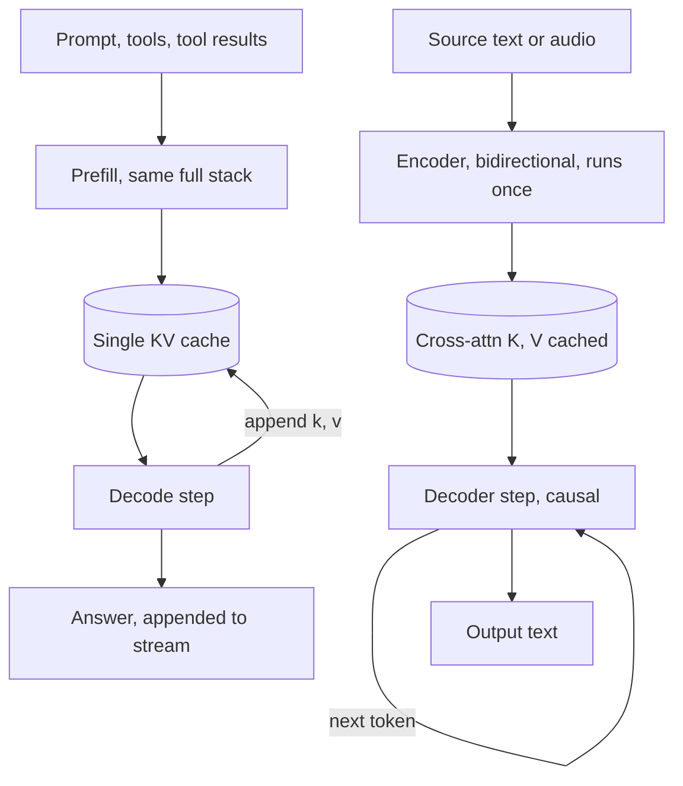

## TL;DR
Your agent's brain is a decoder-only model: prompt, tools, results and answer form one causal stream that
appends and reuses its cache. Encoder–decoders (speech-to-text) and encoders (embedders, rerankers) still
serve the agent's other components.

## For agent builders
- **Why it matters for agents.** A tool-calling loop is "append to one stream and keep going", which is
  exactly what decoder-only models do cheaply. Knowing why tells you what breaks the economics: editing
  history, re-encoding transcripts, or using the chat model for jobs an encoder does at a fraction of the cost.
- **Where it shows up in your stack.** The planner or chat LLM (decoder-only), the embedding model and
  reranker in the RAG step (encoder-only), and the speech-to-text front end of a voice agent
  (encoder–decoder such as Whisper). Each is a separate deployment with its own cost profile.
- **What you control.** Which family serves each component, prompt layout for a causal reader (task before
  and after long documents), and whether bulk scoring goes to the agent LLM or a cheap encoder.
- **What you can skip.** T5's span-corruption recipe and the zero-shot ablations in detail; remember the
  conclusion (one causal stack scaled best) and the cost rule of thumb.

## Why it exists
- **Seq2seq tasks have a shape.** Translation has a complete input you may read in any order, then an
  output produced left to right. The 2017 transformer mirrored it.
- **Two stacks for two jobs.** The encoder lets every source token attend to every other, in both
  directions, *because* understanding a sentence benefits from seeing its end. The decoder is masked so
  each output token sees only earlier output, *because* at inference later tokens do not exist yet.
  Cross-attention connects the two.
- **Question 1: which single objective yields the most general model from unlabelled text?** Next-token
  prediction over a causal stream turns
  every token into a training example, with no masking scheme or input/output split to design.
- **Question 2: how do you handle a conversation?** This turn's output is next turn's input. A two-stack
  model re-encodes the growing transcript every turn; a one-stack model appends tokens and keeps the cache.
- **Question 3: how does few-shot prompting work?** Examples and the request live in the same stream as
  the answer, so in-context learning falls out of the objective instead of needing a separate mechanism.
- **Decoder-only answered all three with less machinery**, and at scale that simplicity compounded.

## How it works
### The architecture map of an agent stack
| Agent component | Family | Why that family |
|---|---|---|
| Planner, chat and tool-calling model | decoder-only | multi-turn, open-ended, appends to one cached stream |
| Embedder for retrieval and memory | encoder-only (or a fine-tuned decoder with pooling) | produces a vector, no generation |
| Reranker after retrieval | encoder-only cross-encoder | scores a pair, no generation |
| Speech-to-text for voice agents | encoder–decoder | long fixed input, short output, encode once |

The rest of this section explains why each family fits its row.

### Three families
| Family | Examples | Attention | Trained by | Used for |
|---|---|---|---|---|
| Encoder-only | BERT and descendants | bidirectional | masking tokens and predicting them | classification, token tagging, embedding models, cross-encoder rerankers |
| Encoder–decoder | T5, BART, mT5, Whisper | bidirectional encoder, causal decoder plus cross-attention | T5: span corruption (hide spans of the input, generate them in the output) | translation, speech-to-text |
| Decoder-only | the GPT line, Llama, Mistral, essentially every frontier chat model | one causal stack | next-token prediction | chat, agents, tools, open-ended generation |

- **Encoder-only produces representations, not text.** The job is to *read* an input and score it. Some
  recent embedding models are fine-tuned decoder-only LLMs with last-token pooling; the family describes
  the attention pattern, not a fixed job.
- **Encoder–decoder cross-attention.** Every decoder layer adds a block whose queries come from the
  decoder state and whose keys and values come from the encoder's final output. Because that output never
  changes during generation, each layer's cross-attention K and V are projected once and cached for the
  whole decode, next to the ordinary self-attention cache, which grows with the output.
- **Decoder-only is one sequence.** Prompt, retrieved documents, tool results and the answer are a single
  token sequence. The only difference between "input" and "output" is which positions the loss was
  computed on.

### What the mask changes
- **Causal prompt tokens see only the past.** In a decoder-only model a prompt token at position *i*
  attends only to positions ≤ *i*, so the first word of a question is represented without seeing the rest.
- **An encoder sees everything at once.** Each token's representation can use the whole input. This is the
  standard argument that encoders "understand" input more richly per token.
- **Decoder-only compensates.** With depth and scale, and because later prompt positions see everything
  before them, by the end of the prompt the model has a complete picture.

### Where the compute goes
- **Encoder–decoder: encode once.** The encoder runs once per input and every decoding step reuses its
  outputs through cross-attention; the decoder's self-attention cache grows with the output only.
- **So you can pair a large encoder with a small decoder** when the input is long and the output short.
  Speech models like Whisper keep the design: the audio encoder is expensive and runs once, the text
  decoder is cheap and runs per token.
- **Decoder-only: one stack reads and writes.** The prompt runs through the same full stack as the answer
  (the prefill phase), populating one KV cache the answer extends. Prefill is fast in wall-clock terms
  because all prompt positions run in parallel, but in FLOPs per token "reading" costs the same full stack
  as "writing"; there is no smaller encoder to delegate it to.
- **The compensation.** Nothing is re-encoded when the conversation grows: the cache from turn one is still
  valid for turn two.

### Parameter counts mislead
- Each token passes through only one stack of an encoder–decoder.
- So a model with 2N parameters split evenly across encoder and decoder costs roughly the FLOPs per token
  of an N-parameter decoder-only model (Raffel et al. make this comparison when choosing T5's baseline).
- "T5-11B versus a 7B decoder" is therefore not an apples-to-apples cost comparison; compare FLOPs per
  token and memory, not headline size.

### Background: why decoder-only scaled better for general use
- **Objective density.** Every position in a causal stream contributes a loss term. Span-corruption and
  masked-LM objectives compute loss on a fraction of positions, so each document yields less signal.
- **Zero-shot behaviour.** Controlled comparisons (Wang et al., 2022) found causal decoder-only models
  trained with the plain language-modelling objective generalized best zero-shot after pre-training
  alone; encoder–decoders caught up only after additional multitask fine-tuning.
- **Serving.** One stack means one set of weights, one KV cache and one batching scheme. Prefix caching and
  multi-turn reuse are natural because history is just earlier tokens.
- **Unification.** Instruction following, tool calling and multi-document prompts all become "put it in
  the stream". A prefix-LM variant (bidirectional over the prompt, causal over the answer) is a hybrid that
  keeps one stack; some models used it, but it did not displace the plain causal design.

### What encoder–decoder still does better
- **Fixed input, short output, no multi-turn:** translation, summarization pipelines, speech-to-text, OCR
  post-correction.
- **Why:** the bidirectional encoder gives a better per-token view of the source, cross-attention gives a
  direct alignment between output and input, and the encoder cost is paid once.
- **Encoder-only remains the right tool** for embeddings and rerankers, where no generation happens.

## Diagram
Follow the two paths: the encoder output (for example a voice agent's audio) is computed once and read by
every decode step, while the decoder-only agent model extends a single causal stream of prompt, tool calls
and results with its one KV cache.



## Examples
### Two generation loops side by side
The T5 encoder runs once and its output is handed, unchanged, to every decoder step; the GPT-2 "input"
grows by one token per step, with no separate encoder at all. Outputs from these tiny base models will be
rough; the point is the data flow.

```python
import torch
from transformers import AutoTokenizer, AutoModelForSeq2SeqLM, AutoModelForCausalLM

# Encoder–decoder: two streams joined by cross-attention
t5_tok = AutoTokenizer.from_pretrained("google/flan-t5-small")
t5 = AutoModelForSeq2SeqLM.from_pretrained("google/flan-t5-small").eval()
src = t5_tok("Translate English to German: The cat sleeps.", return_tensors="pt")
with torch.no_grad():
    enc = t5.get_encoder()(**src)                        # bidirectional pass, done ONCE
    dec = torch.tensor([[t5.config.decoder_start_token_id]])
    for _ in range(8):
        out = t5(encoder_outputs=enc, attention_mask=src.attention_mask, decoder_input_ids=dec)
        dec = torch.cat([dec, out.logits[:, -1].argmax(-1, keepdim=True)], dim=1)
print(t5_tok.decode(dec[0], skip_special_tokens=True))

# Decoder-only: prompt and completion are one causal stream
g_tok = AutoTokenizer.from_pretrained("gpt2")
g = AutoModelForCausalLM.from_pretrained("gpt2").eval()
ids = g_tok("English: The cat sleeps. German:", return_tensors="pt").input_ids
with torch.no_grad():
    for _ in range(8):
        ids = torch.cat([ids, g(ids).logits[:, -1].argmax(-1, keepdim=True)], dim=1)
print(g_tok.decode(ids[0]))
# T5 re-reads a fixed encoding each step; GPT-2's "input" is the whole growing sequence.
# A production decoder-only loop would pass past_key_values instead of re-running the prefix.
```

### Back-of-envelope cost: read-heavy job vs multi-turn chat
Rule of thumb: a token costs about 2 FLOPs per parameter of each stack it passes through. The figures
below are illustrative orders of magnitude that ignore attention and cross-attention cost.

```python
def enc_dec_flops(in_tok, out_tok, enc_params, dec_params):
    return 2 * enc_params * in_tok + 2 * dec_params * out_tok

def dec_only_flops(in_tok, out_tok, params):
    return 2 * params * (in_tok + out_tok)

# Summarize a 3,000-token document into 100 tokens.
print(enc_dec_flops(3_000, 100, 1e9, 1e9) / 1e12, "TFLOP")   # 2B total, split evenly: 6.2
print(dec_only_flops(3_000, 100, 2e9) / 1e12, "TFLOP")       # 2B decoder-only: 12.4

# Ten chat turns, each adding 300 tokens of history.
reencoded = sum(300 * t for t in range(1, 11))   # encoder-decoder re-encodes the transcript
print(reencoded, "tokens encoded vs", 300 * 10, "prefilled once with a KV cache")  # 16500 vs 3000
```

| Workload | Encoder–decoder | Decoder-only | Better fit |
|---|---|---|---|
| 3,000 in, 100 out, one shot | ~6.2 TFLOP (2B split evenly) | ~12.4 TFLOP (2B) | encoder–decoder |
| 10 turns × 300 tokens | 16,500 tokens re-encoded | 3,000 tokens prefilled, cache reused | decoder-only |

### Agent scenario: a voice support agent, one family per component
A voice agent transcribes a 5-minute call, retrieves help articles, reranks them and runs a 12-step
tool-calling loop where each step appends ~800 tokens (tool call plus result). Token counts are
illustrative.

| Component | Family | Work per call | Note |
|---|---|---|---|
| Transcribe audio | encoder–decoder (Whisper-style) | audio encoded once | transcript stored as text |
| Embed query, search | encoder-only embedder | 1 short query per search | vectors precomputed for articles |
| Rerank 50 candidates | encoder-only cross-encoder | 50 pair scores | replaces 50 chat-model calls |
| 12-step agent loop | decoder-only | 12 × 800 = 9,600 new tokens prefilled | cache reused step to step |
| Same loop on an encoder–decoder | (counterfactual) | 800 × (1 + 2 + … + 12) = 62,400 tokens re-encoded | grows quadratically with steps |

The agent loop belongs on the decoder-only model; everything that only reads and scores goes to cheaper
encoders.

## Production patterns
- **Keep the agent loop on one decoder-only stream.** Append tool calls and results instead of rebuilding
  the prompt each step, so the cache from step one stays valid. Monitor cached versus uncached input
  tokens per agent step from provider usage fields or engine metrics.
- **Move read-only sub-tasks out of the agent model.** Relevance filtering, classification of tool
  results and PII detection run on encoder models called as tools or pipeline steps. Monitor agent-model
  tokens per task before and after.
- **Route by task shape, not by habit.** Send scoring, classification and reranking to an encoder with a
  head or a cross-encoder; keep the decoder-only model for dialogue and agents. Monitor cost per item and
  p95 latency per route.
- **Transcribe once, chat over text.** For audio workloads run an encoder–decoder ASR model such as
  Whisper once per file, store the transcript, and pass text to the chat model. Monitor transcription
  latency and chat prefill tokens per turn.
- **Load the right head class.** Use `AutoModelForCausalLM` for decoder-only, `AutoModelForSeq2SeqLM` for
  encoder–decoder, and an encoder with a task head for scoring. Confirm your serving engine supports the
  architecture before committing, since many LLM serving stacks are optimized for decoder-only models.
- **Lay out causal prompts deliberately.** Put stable instructions and tool definitions first (prefix
  caching reuses them), place the document, then restate the task after it. Monitor extraction recall on a
  labelled set when you change the layout.
- **Benchmark at your real length ratio.** Replay a sample of production input/output lengths through
  each candidate and compare cost per request and p95 latency, because the ratio decides, not headline
  parameter counts.

## Trade-offs
- **One stack vs encode once.** Decoder-only gives one stack, one cache and natural multi-turn reuse, but
  every prompt token costs a full-stack pass. Encoder–decoder pays encoding once and can decode with a
  smaller stack, which wins when inputs are long and outputs short.
- **Bidirectional vs causal reading.** An encoder sees the whole input per token; causal prompts see only
  the past. The gap matters for small models on reading-heavy tasks and shrinks as decoder-only models
  scale.
- **Dense objective vs left-to-right lock-in.** A single next-token objective is dense and label-free, but
  it bakes in left-to-right generation. Tasks that are naturally classification or scoring are served more
  cheaply by an encoder with a head.
- **Explicit alignment vs an extra block.** Cross-attention gives a source-to-output alignment (Whisper's
  word-level timestamps are derived from cross-attention weights), at the cost of a second attention block
  per layer. The advantage disappears when the "source" keeps changing, as in multi-turn use, because the
  alignment target is re-encoded every time it grows.

## Pitfalls
- **Using a chat model for bulk classification or reranking.** Cost per item is far higher than an encoder
  with a head, and latency budgets blow up at scale. Fix: route scoring to an encoder or cross-encoder,
  validated against the chat model's labels on a sample.
- **Assuming an encoder–decoder can "continue the conversation" cheaply.** The transcript is re-encoded
  every turn, so latency grows with history even for short replies. Fix: keep dialogue on a decoder-only
  model and use the encoder–decoder for one-shot transformations.
- **Treating the prompt as if it were read bidirectionally.** Instructions placed after a long document
  cannot influence how earlier tokens were represented. Symptom: extraction misses fields the task asked
  for, because the document was "read" before the model knew what to look for.
- **Trusting one placement rule.** Vendor guidance on placement differs (several recommend the question
  after long documents), so stating the task before the document and repeating it after is a common hedge;
  measure on your task.
- **Confusing the architecture family with the training recipe.** A decoder-only base model never
  instruction-tuned will happily continue your prompt instead of answering it. Fix: use the instruct or
  chat variant for question answering, and keep base models for completion or fine-tuning.

## When to use
- **Default to decoder-only** for anything conversational, agentic, tool-using or open-ended: it has the
  best-trained weights, and its serving stack (KV cache, prefix caching, continuous batching) is the most
  mature.
- **Choose encoder–decoder** for a fixed transformation of a known input with no dialogue (translation at
  volume, speech recognition, structured summarization) when the input is much longer than the output.
- **Choose encoder-only** when you need a score or a vector, not text: embeddings, rerankers, classifiers
  and PII detectors.
- **Measure** cost per request and p95 latency under your real input/output length ratio before deciding;
  the ratio is what decides.
- **Interviews:** draw the three families, explain what cross-attention connects, and argue why one causal
  stack won.

## Role lens
- **Engineer:** Picks `AutoModelForCausalLM` versus `AutoModelForSeq2SeqLM` versus an encoder with a
  head, and knows the generation loop and cache semantics differ between them.
- **Architect:** Decides the model family per workload in a system, keeping the expensive decoder-only
  model for dialogue and routing scoring and retrieval tasks to encoders.
- **FDE:** Explains to a customer why their translation or transcription pipeline should not be rebuilt
  on the chat model, and sizes the two differently.

## Check yourself
**Q:** A customer wants to transcribe call-centre audio and then let agents chat about each transcript.
Which architecture family fits each half, and why not one model for both?
**A:** Transcription is a fixed-input, read-heavy, write-light task with no dialogue: an encoder–decoder
such as Whisper runs its expensive audio encoder once and decodes text with a small decoder, which is
cheap per token and well aligned to the source. The chat half is multi-turn with growing history, tool
calls and open-ended answers, which is exactly what a decoder-only model handles by appending tokens and
reusing its KV cache. One model for both would either force the chat model to consume audio tokens it was
not trained on, or force the transcription model to re-encode the whole transcript plus conversation on
every turn. Two models, with the transcript passed as text, is cheaper and better at each job. If the
customer already uses a natively audio-capable chat model, the argument becomes one of cost: audio
typically consumes several times more tokens per second of speech than its transcript, and every chat
turn would pay prefill over it unless it is prefix-cached, so transcribing once is still usually cheaper.

## Interview questions
### Why did decoder-only models win over encoder–decoders for general-purpose LLMs?
- **Denser, simpler objective.** Next-token prediction makes every position a loss term on raw text, with
  no masking scheme or input/output split to design.
- **Everything is the stream.** Few-shot examples, tools, documents and chat history are just earlier
  tokens, so in-context learning and multi-turn reuse come for free.
- **Simpler serving.** One set of weights, one KV cache and one batching scheme, which made prefix caching
  and continuous batching natural.

### What exactly gets cached during encoder–decoder generation?
- **Two caches per decoder layer.** The cross-attention K and V are projected once from the fixed encoder
  output and reused for the whole decode.
- **Plus the usual self-attention cache.** It grows by one entry per generated token, like a decoder-only
  model's cache, but covers only the output, not the source.

### A team's RAG agent asks the chat model to rerank ten million query–document pairs a day and the bill exploded. What do you propose?
- **Diagnose the shape.** Reranking reads a pair and emits a score; there is no generation, so a full
  decoder pass per pair is wasted spend, and it also inflates the agent's latency per step.
- **Replace it.** Use a cross-encoder reranker or an encoder with a classification head, evaluated on a
  labelled sample against the chat model's rankings, and keep the chat model for the final answer only.

### Your agent's latency per step grows with conversation length even though replies are short. Which architecture facts do you check?
- **Is the stream append-only?** Decoder-only reuse depends on nothing earlier changing; rebuilt prompts,
  reordered tools or edited history force a full re-prefill every step.
- **Is any component re-encoding the transcript?** An encoder–decoder or a summarizer run over the whole
  history each turn grows cost with every step. Move it to a one-shot step or a cached prefix.
- **Measure** prefill tokens per step; it should track the newest step's size, not the transcript.

### How would you compare the cost of T5-11B with a 7B decoder-only model?
- **Not by headline size.** Each token passes through only one stack of an encoder–decoder, so an evenly
  split 2N-parameter model costs roughly the per-token FLOPs of an N-parameter decoder-only model.
- **So compute per token.** Weight the encoder and decoder by your input and output lengths, add memory for
  weights and caches, then confirm with a benchmark at your real length ratio.

### When would you not use a decoder-only model even though one is available?
- **Fixed input, short output, no dialogue.** Translation at volume or speech-to-text, where an
  encoder–decoder pays the expensive encoding once and decodes with a small stack.
- **No text output at all.** Embeddings, PII detection and classifiers, where an encoder-only model is
  far cheaper per item and easier to calibrate.

## Quiz
### Q: What does cross-attention in an encoder–decoder connect?
- [ ] Decoder queries to decoder keys from earlier layers
- [x] Decoder queries to the encoder's final keys and values
- [ ] Encoder queries to decoder keys and values
- [ ] Positional encodings to token embeddings
> Each decoder layer has a self-attention block over the output so far and a cross-attention block whose
> keys and values come from the encoder output, letting every generated token consult the full input.

### Q: Why is multi-turn chat cheaper in a decoder-only model than in an encoder–decoder?
- [ ] Decoder-only models have fewer parameters
- [ ] Encoder–decoders cannot use a KV cache
- [x] History is just earlier tokens in one stream, so the existing cache stays valid; an encoder–decoder must re-encode the growing transcript
- [ ] Decoder-only models skip attention over the prompt
> In a single causal stream, nothing before the new tokens changes, so cached keys and values are reused.
> An encoder–decoder treats the transcript as input, and input is re-encoded whenever it changes.

### Q: Which task is the weakest fit for a decoder-only chat model?
- [ ] Multi-step agent with tool calls
- [ ] Few-shot question answering
- [x] Scoring ten million query–document pairs for relevance
- [ ] Open-ended summarization in a conversation
> Scoring is a read-and-rate task with no generation; an encoder with a classification head, or a
> cross-encoder reranker, does it at a fraction of the cost per pair.

## Use cases & projects
### Use cases
- **Choosing models per agent component.** A decoder-only LLM plans and calls tools, an encoder embeds and
  reranks for RAG, and an encoder–decoder transcribes speech for a voice agent.
- **Offloading bulk scoring from the agent LLM.** Relevance filtering or classification over thousands of
  items goes to a cheap encoder, so the planner only sees the shortlist.
- **Prompt layout for a causal reader.** Because each token only sees what came before, agent teams state
  the task before long documents and restate it after them.
- **Costing long agent loops.** Decoder-only models append and reuse their cache, so an append-only
  transcript keeps per-step cost low; re-encoding the transcript each step would not.

### Mini project
**Split an agent's work across model families (1-2 hours).**
- **Goal:** show the cost and latency difference between scoring with the agent LLM and with an encoder.
- **Steps:** take 200 query-document pairs; score relevance once by prompting a decoder-only chat model and
  once with a cross-encoder reranker; log latency, tokens and agreement with a small set of hand labels;
  wire the cheaper option that still meets your accuracy bar in as the agent's filter step.
- **Done when:** you have a table of time, cost and accuracy for both approaches and a short note on which
  one the agent should use for this step and why.
