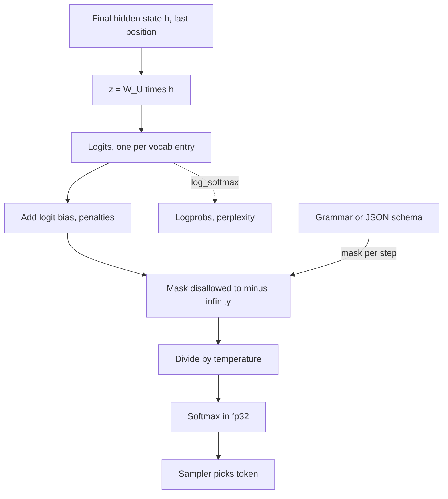

## TL;DR
Logits are the raw, unnormalized scores a model emits for every vocabulary entry before softmax. Every
no-retraining control (temperature, logit bias, bans, constrained decoding) edits this vector, and every
confidence measure (logprobs, perplexity) is read from it.

## Why it exists
- **A language model is a classifier over the vocabulary.** At every position it needs a score per class.
  The last layer is linear, and a linear map produces arbitrary reals, not numbers that are non-negative
  and sum to one.
- **The naive fixes train badly.** Clamping and rescaling kills gradients for every negative score;
  squared error against one-hot targets gives almost no gradient to a confidently wrong prediction.
- **So the jobs are separated.** The linear layer emits an unconstrained score (the logit), softmax
  normalizes, and cross-entropy is computed straight from the scores in a fused, numerically stable form.
  For target token *y*, `∂L/∂z = softmax(z) − onehot(y)`: each wrong token is pushed down by the
  probability it stole and the right one up by its shortfall, with no saturation.
- **Scores make inference controllable.** Probabilities are locked to the simplex; scores are not. Add a
  constant to a token's logit and its probability rises smoothly; set it to negative infinity and the
  token can never be sampled; divide all logits by a temperature to sharpen or flatten the distribution.
  Grammar-constrained decoding, JSON mode, stop sequences, repetition penalties and the API's `logit_bias`
  parameter all edit logits between the final layer and the sampler.
- **The name is older than deep learning.** A logit is a log-odds; in the multi-class case the logits are
  log-probabilities up to an additive constant.

## How it works
### Where they come from
1. **Unembed.** After the last transformer block, each position's hidden state `h` (a `d_model` vector)
   is multiplied by the unembedding matrix `W_U` of shape `[V, d_model]`: `z = W_U · h`, a vector of *V*
   scores.
2. **Training computes every position,** because the loss is computed everywhere.
3. **Decoding needs only the last position,** since the next token depends on nothing else, and engines
   compute just that row.
4. **Shapes.** An inference call returns `[batch, seq_len, vocab]`; you sample from `logits[:, -1, :]`.

### Relationship to probabilities
`p_i = exp(z_i) / Σ_j exp(z_j)`, so `log p_i = z_i − logsumexp(z)`. Two consequences are used daily:
- **Shift invariance.** Adding the same constant to every logit leaves the probabilities unchanged, so a
  logit's absolute value means nothing; only differences matter. Implementations subtract the maximum
  before exponentiating to avoid overflow.
- **Logprobs.** What an API returns under `logprobs` is `log_softmax(z)` for the chosen token and a few
  alternatives. A logprob of −0.05 means about 95% on that token; −2.3 means about 10%. Summing per-token
  logprobs gives the sequence log-likelihood; exponentiating the negative average gives perplexity.

### Editing logits
The sampler sees logits, not text, so steering is arithmetic:

| Edit | Operation | Effect |
|---|---|---|
| **Temperature** | divide the whole vector by *T* before softmax | sharpens (T < 1) or flattens (T > 1) |
| **Logit bias** | add a per-token offset *b* | multiplies that token's odds against every other by `e^b` |
| **Masking** | set disallowed tokens to −∞ | exactly zero probability |
| **Repetition / frequency penalties** | lower logits of tokens already in the context | less repetition |

- **Why bias multiplies odds.** Because `p_i / p_j = exp(z_i − z_j)`, a bias of *b* scales the odds by
  `e^b`: +1 is about 2.7×, +5 about 150×.
- **Worked numbers.** Logits `[2.0, 1.0, 0.1]` give probabilities `[0.66, 0.24, 0.10]`; a +1 bias on the
  third token gives `[0.56, 0.21, 0.23]`.
- **API range.** OpenAI's API accepts values from −100 to 100; at −100 the factor `e^−100` effectively
  bans a token, and a large positive value effectively forces it.
- **Constrained decoding** builds the mask each step from a grammar or JSON schema, which is why structured
  output can be guaranteed rather than merely requested.
- **Order matters.** The edits are not commutative; engines apply them in a fixed pipeline, and the
  `sampling-strategies` topic covers the consequences.

### Numerical care and interpretability
- **Softmax and cross-entropy in fp32.** Logits come out in the model's compute dtype, but `exp` of a
  half-precision score overflows easily and small probability differences vanish in 16-bit.
- **Some architectures bound the logits.** Gemma 2 applies a `tanh` soft cap to its final logits to keep
  training stable.
- **The logit lens.** Since `W_U` can be applied to *any* hidden state, applying it (after the final
  normalization layer) to intermediate layers shows what the model would predict if it stopped early. It
  is a standard interpretability tool and a reminder that logits are just a dot product between a
  residual-stream vector and each token's output embedding.

## Diagram
Every control knob sits between the unembedding and the sampler; logprobs are read off the same vector.
The order shown (penalties and bias, then masks, then temperature) is a common one; engines differ.



## Examples
### Reading and editing GPT-2's next-token logits
The script pulls the next-token logits, shows their range and shape, converts them to logprobs the way an
API does, demonstrates shift invariance, then does the two edits every serving stack performs: banning a
token and biasing another.

```python
import torch
from transformers import AutoTokenizer, AutoModelForCausalLM

tok = AutoTokenizer.from_pretrained("gpt2")
m = AutoModelForCausalLM.from_pretrained("gpt2").eval()
ids = tok("The capital of France is", return_tensors="pt").input_ids
with torch.no_grad():
    z = m(ids).logits[0, -1]                 # [50257]: one raw score per vocabulary entry
print(z.shape, round(z.min().item(), 1), round(z.max().item(), 1))   # unbounded reals

logp = torch.log_softmax(z.float(), -1)      # what APIs return as "logprobs"
top = torch.topk(logp, 5)
for lp, i in zip(top.values, top.indices):
    print(f"{tok.decode(i)!r:12} logit={z[i]:7.2f} logprob={lp:6.2f} p={lp.exp():.3f}")

# Shift invariance: a constant added to every logit changes nothing after softmax.
assert torch.allclose(torch.softmax(z + 123.0, -1), torch.softmax(z, -1), atol=1e-6)

# Steering happens here, before the sampler ever sees a probability.
z2 = z.clone()
z2[top.indices[0]] = float("-inf")           # ban the top token: probability exactly 0
z2[tok.encode(" Berlin")[0]] += 10.0         # logit bias: push an alternative up
print("after edits:", repr(tok.decode(torch.softmax(z2, -1).argmax())))
```

### What a logit bias does, in numbers
Pure Python, no model: apply biases to the third of three logits and watch the odds move by `e^b`.

```python
import math

def softmax(z):
    m = max(z)                                  # subtract the max: shift invariance, no overflow
    e = [math.exp(x - m) for x in z]
    return [x / sum(e) for x in e]

z = [2.0, 1.0, 0.1]
print("base", [round(p, 3) for p in softmax(z)])
for b in (1.0, 5.0, -100.0):
    p = softmax(z[:2] + [z[2] + b])
    print(f"bias {b:+6.1f}", [round(x, 3) for x in p])
# base          [0.659, 0.242, 0.099]
# bias   +1.0   [0.564, 0.207, 0.229]   odds of token 3 up ~2.7x
# bias   +5.0   [0.042, 0.016, 0.942]   odds up ~148x: effectively forced
# bias -100.0   [0.731, 0.269, 0.0]     effectively banned
```

| Bias on token 3 | p(token 3) | Use it for |
|---|---|---|
| 0 | 0.099 | baseline |
| +1 | 0.229 | a gentle nudge toward a preferred word |
| +5 | 0.942 | near-forcing one option |
| −100 | ~0 | banning a token (still finite, unlike a −∞ mask) |

## Production patterns
- **Enforce structure with constrained decoding.** When output must parse, use the provider's or engine's
  structured-output feature with a JSON schema (for example `response_format` with a JSON schema on
  OpenAI's API, or the guided or structured decoding option in vLLM). Monitor parse failures, which should
  be zero, and task accuracy, which can drop.
- **Classify over a fixed label set by masking.** Restrict sampling to the label tokens with a logits
  processor (a `LogitsProcessor` in Hugging Face Transformers), then read the label logprobs as a score.
  Monitor accuracy and calibration on a labelled set, not just format compliance.
- **Route on logprob confidence, after calibration.** Request `logprobs`, compute the minimum or mean token
  logprob over the answer span, and send low-confidence answers to review or retrieval. Pick the threshold
  on labelled data and monitor the filter's precision and recall.
- **Ban a word by banning all its token ids.** Tokenize every variant (leading space, capitalized, plural)
  with the deployed tokenizer and set each id's `logit_bias` to −100, or mask it. Monitor leakage with an
  output scan for the word.
- **Keep the loss math in fp32 and off the full tensor.** Cast with `logits.float()` before
  `log_softmax`, and in training compute cross-entropy in chunks of positions so the full
  `[seq_len, vocab]` tensor is never materialized. Monitor NaN losses and peak memory.

## Trade-offs
- **Logprobs vs exposure.** Returning logprobs gives callers calibration signals and cheap confidence
  filters, but exposes information about the model and adds payload, which is why vendors cap how many
  alternatives you get.
- **Logit bias vs fine-tune.** Bias is instant and needs no retraining; a fine-tune changes behaviour more
  robustly. Bias wins for a handful of tokens and loses when the desired change is semantic rather than
  lexical.
- **Hard masking vs content quality.** Masking guarantees format compliance with zero probability leakage,
  but a mask that excludes the token the model wanted can push it into low-probability continuations and
  hurt content.
- **Bigger vocabulary vs logits tensor size.** Finer-grained tokens, larger tensor: one 8,192-token
  training sequence with a 128,256-entry vocabulary produces about 1.05 billion logits, ~4.2 GB in fp32.
  So chunked or fused cross-entropy kernels that never materialize the full tensor matter as vocabularies
  and sequences grow. At decode time only the last row is computed, so the cost vanishes there.

## Pitfalls
- **Reading logits as probabilities.** Or comparing absolute values across prompts. Symptom: "confidence"
  numbers that make no sense, since only differences within one vector are meaningful. Fix: convert with
  `log_softmax` and compare logprobs.
- **Softmax or cross-entropy in fp16.** Symptom: NaN losses or probabilities that collapse to exactly 0
  and 1, especially for long sequences. Fix: cast to fp32 first.
- **Biasing only the first piece of a multi-token word.** Symptom: the model starts the word and then
  veers off. Fix: tokenize the full word and its variants, and bias or mask every piece.
- **Using top-1 logprob as a hallucination detector without calibration.** Instruction-tuned models are
  often confidently wrong, so high probability does not imply correctness. Fix: set thresholds on
  labelled data and pair them with grounding checks.
- **Copying token ids across tokenizers.** The token you bias must exist in the vocabulary of *this*
  tokenizer; an id copied from another model points at an unrelated token. Fix: derive ids at runtime
  from the deployed tokenizer.

## When to use
- **Use when** you need control or measurement prompting cannot give: forcing a classification into a fixed
  label set, guaranteeing JSON, banning a competitor's name, computing perplexity on an evaluation set, or
  scoring candidate answers by likelihood.
- **Avoid** logit edits to fix what is really a prompt or data problem, and do not over-read logprobs as
  truth signals without a calibration study.
- **Measure** the effect of any edit on task accuracy, not just on format compliance.
- **Interviews:** explain the path from hidden state to logits to softmax to sampler, why shift invariance
  makes masking with −∞ clean, and how constrained decoding plugs in.

## Role lens
- **Engineer:** Uses `logit_bias`, `logprobs` and logits processors in generation code, and knows to
  compute scores in fp32 and only for the last position.
- **Architect:** Decides whether structured output is enforced at the logit level or validated after
  the fact, and whether logprobs are exposed to downstream services.
- **FDE:** Uses per-token logprobs to show a customer where the model was unsure in a bad answer, and
  bans or biases tokens to meet a hard output constraint on site.

## Check yourself
**Q:** You need a model to answer only "yes" or "no". Compare doing it by prompt, by logit bias and by
hard masking, including what each guarantees and what can go wrong.
**A:** A prompt asks politely; most of the time it works, but nothing prevents "Yes, because..." or an
empty answer, so you need parsing and retries. Logit bias adds a large positive offset to the two tokens
and a negative one to others; it strongly favours them but is probabilistic, and you must bias the exact
token ids of this tokenizer, including leading-space variants. Hard masking sets every other logit to −∞
so only the two tokens have non-zero probability; the output is guaranteed, and you can read the two
logprobs as a calibrated-ish score. The risk with masking is that the model's preferred continuation was
something else, so the forced choice can be lower quality than a free answer followed by classification.
Any of the three should be evaluated on labelled data rather than trusted on format alone.

## Interview questions
### What are logits, and why does a model output them rather than probabilities?
- **Definition:** one unconstrained real score per vocabulary entry, `z = W_U · h`, which softmax turns into
  probabilities.
- **Why:** a linear layer cannot produce a simplex, and computing cross-entropy from scores gives the
  clean gradient `softmax(z) − onehot(y)`, which never saturates even when the model is badly wrong.

### How does constrained decoding guarantee valid JSON when prompting cannot?
- **It edits logits each step.** A grammar or schema state machine computes which tokens are legal next and
  sets every other logit to −∞, so invalid tokens have exactly zero probability.
- **The cost:** if the model wanted an illegal token, it is pushed into a lower-probability continuation,
  so measure content accuracy, not just parse rate.

### You set a logit bias of −100 on a competitor's name and it still appears in outputs. Why?
- **Tokenization.** The name probably splits into several tokens, or appears with a leading space or
  different capitalization, each a different id you did not bias.
- **Fix:** enumerate the variants with the deployed tokenizer, bias or mask every id, and scan outputs to
  confirm. Ids copied from another model's tokenizer point at unrelated tokens.

### A training run OOMs at the LM head after moving to a 128k vocabulary. What is happening?
- **The logits tensor is huge.** One 8,192-token sequence × 128,256 entries is about 1.05 billion logits,
  ~4.2 GB in fp32, before gradients and batch size.
- **Fix:** chunked or fused cross-entropy that never materializes the full tensor; decoding is unaffected
  because only the last row is computed.

### Would you use token logprobs to detect hallucinations?
- **Only as a calibrated signal.** Instruction-tuned models are often confidently wrong, so a high top-1
  logprob does not imply correctness.
- **If you do,** pick the aggregation (minimum or mean over the answer span) and threshold on labelled
  data, measure precision and recall, and combine it with retrieval grounding checks.

## Quiz
### Q: Why does adding the same constant to every logit leave the sampled distribution unchanged?
- [ ] Because logits are clipped to a fixed range before sampling
- [x] Because softmax divides each exponentiated logit by their sum, and the common factor cancels
- [ ] Because the model is trained with weight decay
- [ ] Because the tokenizer normalizes scores
> exp(z + c) = exp(c)·exp(z), so the constant multiplies numerator and denominator alike. Only
> differences between logits carry information, which is why absolute logit values are meaningless.

### Q: What does setting a token's logit to negative infinity achieve that a large negative bias does not?
- [ ] It removes the token from the vocabulary permanently
- [ ] It makes generation faster
- [x] Its probability becomes exactly zero, so it can never be sampled regardless of temperature
- [ ] It forces the model to pick the next-highest token deterministically
> A finite bias leaves a tiny but non-zero probability that temperature or long sampling runs can hit;
> −∞ becomes exactly 0 after softmax, which is what constrained decoding relies on.

### Q: An API returns a logprob of −0.69 for the chosen token. Roughly what probability did the model assign?
- [ ] About 69%
- [ ] About 7%
- [x] About 50%
- [ ] About 99%
> Probability is exp(logprob); exp(−0.69) ≈ 0.50. Logprobs are natural logs of probabilities, not
> percentages, and −0.69 is ln(0.5).
