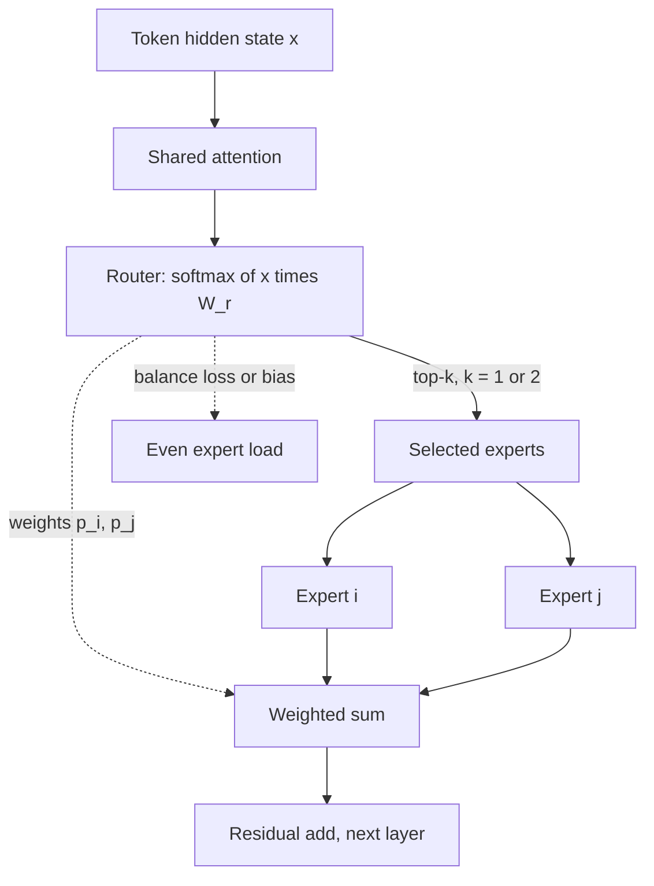

## TL;DR
Many open-weight models you might run an agent on are MoE: a router sends each token to a few expert
FFNs. Per-step speed tracks active parameters, but every expert must sit in memory, and the speed edge
shrinks as concurrent agent loops grow.

## For agent builders
- **Why it matters for agents.** Agents make many sequential model calls, so per-token decode speed
  multiplies by step count. An MoE gives near-large-model quality at small-model speed for a single loop,
  but GPU memory is sized by total parameters, not the active count on the datasheet.
- **Where it shows up in your stack.** Model cards that list "total" and "active" parameters (Mixtral,
  DeepSeek-V3), vLLM or SGLang flags for tensor and expert parallelism, and the GPU count your self-hosted
  agent tier needs.
- **What you control.** Which model backs which agent role, how many GPUs and which quantisation you deploy,
  and the concurrency you load-test at. You almost never train or re-route an MoE yourself.
- **What you can skip.** Balancing-loss maths, router z-loss and expert-choice routing, unless you
  fine-tune or continue pre-training an MoE. Know active versus total and the batch-size effect.

## Why it exists
- **Dense models pay for every parameter on every token.** Scaling laws say loss keeps falling as
  parameters grow, but FLOPs per token grow in lockstep. Doubling the model doubles training compute per
  token and doubles the weight bytes read on every decode step.
- **The FFN is the obvious target.** With the usual 4× expansion it holds roughly two thirds of the
  per-layer non-embedding parameters (8d² for the FFN versus 4d² for the Q, K, V and O projections), yet
  for any single token most of that capacity is irrelevant. The circuits for Python indentation are not
  needed while the model writes French prose.
- **"Make the dense FFN bigger" fails at inference too.** Decode is memory-bandwidth bound (see the KV
  cache lesson), so a model that reads twice the weights per token runs about twice as slowly at small
  batch, no matter how good the kernels are.
- **"Separate specialist models, one per request" fails too.** The useful choice is per token and per
  layer, not per request, and separate models cannot share the attention layers and embeddings that carry
  most of the general language ability.
- **Conditional computation resolves it.** Keep a large pool of parameters and let a learned router
  activate a small subset per token. Shazeer et al. made this trainable at scale in 2017; Switch Transformer
  routed to a single expert and showed better loss per training FLOP than dense models; Mixtral and
  DeepSeek-V3 made it the default for the largest open-weight systems.

## How it works
### What the agent builder needs from this section
- **Two numbers per model.** Total parameters set memory and GPU count; active parameters set per-token
  compute and, at low concurrency, decode speed for each agent step.
- **One curve.** As more agent loops share a server, the batch touches more experts until weight traffic
  approaches the dense total (see "The batch-size effect" below).
- **The rest is background** for when you fine-tune or debug an MoE: routing, load balancing, capacity.

### The layer
1. **Attention is unchanged** and shared by all tokens.
2. **The FFN becomes N experts** E₁ … E_N, each shaped like an ordinary FFN (or narrower).
3. **A router** is one linear map W_r from the hidden state **x** to N logits, turned into a distribution
   `p = softmax(x·W_r)`.
4. **The top-k experts are selected** and the output is a weighted sum of their outputs:

```
y = Σ_{i ∈ topk(p)}  p_i · E_i(x)        (the k weights usually renormalised to sum to 1)
```

| Model | Routing |
|---|---|
| Switch Transformer | k is 1 |
| Mixtral | k is 2, of 8 experts |
| DeepSeek-V3 | 8 of 256 small routed experts plus one always-on shared expert: fine-grained specialisation with a common pathway every token passes through |

### How routing behaves and learns
- **Per token and per layer.** The same token can go to expert 3 in layer 10 and expert 7 in layer 11,
  and adjacent tokens in a sentence usually take different paths.
- **Trained end to end** with the rest of the network.
- **Why outputs are scaled by p_i.** Top-k selection is not differentiable, so gradient reaches the router
  only through the p_i weights that multiply the chosen experts' outputs. Simply summing the outputs would
  give the router no learning signal.

### Active versus total parameters
Count Mixtral 8x7B: 8 experts per layer, top-2 routing.

| Quantity | Value | Why |
|---|---|---|
| Total parameters | about 47B, not 8 × 7 = 56B | attention, embeddings and norms are shared across experts |
| Active per token | roughly 13B | only 2 of the 8 FFNs run |
| Tracks the active figure | training FLOPs per token, weight bytes read per decode step at batch 1 | only active experts are computed and read |
| Quality | far better than a dense 13B | more capacity overall |

- **It is not free capacity.** At equal total parameters a dense model is generally stronger, because
  every one of its parameters sees every token.
- **An MoE sits between its active and total sizes.** Buying that position at active-size compute is the
  whole point of the architecture.

### Load balancing
Left alone, routers collapse: experts that are slightly better early receive more tokens, learn faster and
attract still more, until most experts are dead weight. Two mechanisms push load back toward even, and
two more keep routing stable and bounded:
- **Auxiliary load-balancing loss (Switch style).** For each expert multiply the fraction of tokens routed
  to it, f_i, by the mean router probability it received, P_i; sum over experts and scale by N. The sum is
  minimised when both are uniform, and because P_i is differentiable it pushes the router toward
  spreading tokens.
- **Bias-based balancing (DeepSeek-V3).** Add a per-expert bias to the scores used for top-k selection
  (not to the gating weights) and nudge it after each step: up for underloaded experts, down for
  overloaded ones. That avoids most of the quality penalty a strong auxiliary loss costs; only a very small
  sequence-level balance loss remains.
- **Router stability.** Router logits can grow until the softmax saturates and training diverges. ST-MoE
  (Zoph et al., 2022) added a small "router z-loss" that penalises large logits. Routers are commonly
  computed in fp32 even when the model runs in bf16, because tiny rounding differences flip top-k choices.
- **Expert capacity.** Each expert accepts at most `capacity_factor × tokens / N` tokens per batch.
  Overflow tokens are dropped from that expert (they pass through the residual connection only) or sent to
  their next choice. This exists because experts run as fixed-size batched matrix multiplications, often on
  different devices, and one overloaded expert would stall all the others.

### Routing variants
| Variant | How | Consequence |
|---|---|---|
| Token choice | each token picks its top-k experts | balance must be encouraged; used by open decoder LLMs |
| Noisy top-k (Shazeer et al.) | tunable noise added to router logits before top-k | rarely chosen experts still get sampled and can learn |
| Expert choice | each expert takes its top-scoring tokens from the batch up to a fixed capacity | balanced by construction, but a token can get zero or many experts, and its routing depends on other tokens in the batch |

- **Why decoders use token choice.** Batch dependence is awkward for autoregressive decoding, where the
  batch is a handful of unrelated requests.

### Why memory and parallelism change
- **Every expert must be resident,** because the next token might be routed anywhere. Mixtral 8x7B needs
  about 47B × 2 bytes ≈ 94 GB in fp16 for weights alone, more than one 80 GB card, even though it
  computes like a 13B model.
- **Expert parallelism.** At larger scale each layer's experts are spread across devices, and an
  all-to-all exchange moves each token's hidden state to the devices hosting its chosen experts and back.
- **That communication, twice per MoE layer,** is the dominant engineering cost of training and serving
  MoE models.

### The batch-size effect at inference
1. **At batch 1** a decode step reads only the k active experts per layer, so an MoE is far faster than a
   dense model of equal total size.
2. **As the batch grows,** different tokens pick different experts until every expert is touched on every
   step.
3. **Weight traffic then approaches the dense total,** and the advantage shifts from bandwidth to FLOPs.
4. **So capacity planning** for an MoE must be done at the concurrency you will actually run.

## Diagram
Follow one token through an MoE layer: shared attention, then the router picks top-k experts whose
outputs are mixed by their router probabilities.



## Misconceptions
- **"An MoE needs only as much GPU memory as its active parameters."** Any token can be routed to any
  expert, so all experts must be resident: Mixtral 8x7B needs about 94 GB of fp16 weights even though
  it computes like a roughly 13B model.
- **"8x7B means a 56B model."** Attention, embeddings and norms are shared, so the total is about 47B.
  Total governs memory; active (about 13B) governs per-token compute and batch-1 decode speed.
- **"An MoE decodes at small-model speed however many agent loops share it."** That holds near batch 1.
  As concurrent loops grow, the batch touches nearly every expert per step, so weight traffic approaches
  the dense total and the bandwidth edge mostly disappears.
- **"Each expert is a topic specialist you could prune."** Routing is per token and per layer and tracks
  token type and syntax far more than domain, so there is no "legal expert" to keep and no "code expert"
  to drop.
- **"The router just picks experts; their outputs are summed."** Outputs are weighted by router
  probabilities because top-k selection is not differentiable; those weights are the router's only
  gradient path, and without balancing it collapses onto a few experts.

## Examples
### A minimal top-k MoE layer with a Switch-style balancing loss
- **Sizes.** With `d_model=512, d_ff=2048` one FFN has 2 × 512 × 2048 ≈ 2.1M parameters; eight experts
  hold ≈ 16.8M in total, but each token runs through two, so ≈ 4.2M are active per token.
- **Expected output.** With f_i normalised to sum to 1, `aux` is about 1.0 when tokens and probability
  are spread evenly and rises toward N as routing concentrates on one expert. An untrained router is close
  to uniform, so printing it on random inputs should give a value near 1.

```python
import torch, torch.nn as nn, torch.nn.functional as F

class MoELayer(nn.Module):
    def __init__(self, d_model=512, d_ff=2048, n_experts=8, k=2):
        super().__init__()
        self.k, self.n = k, n_experts
        self.router = nn.Linear(d_model, n_experts, bias=False)
        self.experts = nn.ModuleList(
            nn.Sequential(nn.Linear(d_model, d_ff), nn.SiLU(), nn.Linear(d_ff, d_model))
            for _ in range(n_experts))

    def forward(self, x):                                  # x: [tokens, d_model]
        probs = self.router(x).softmax(-1)                 # [tokens, n_experts]
        topv, topi = probs.topk(self.k, dim=-1)            # [tokens, k]
        topv = topv / topv.sum(-1, keepdim=True)           # renormalise over the chosen k
        out = torch.zeros_like(x)
        for e in range(self.n):                            # one batched matmul per expert
            hit = (topi == e)                              # [tokens, k] bool
            rows = hit.any(-1).nonzero(as_tuple=True)[0]
            if rows.numel() == 0:
                continue
            w = (topv * hit)[rows].sum(-1, keepdim=True)   # router weight for expert e
            out[rows] += w * self.experts[e](x[rows])      # gradient reaches the router via w
        frac = F.one_hot(topi, self.n).float().sum(1).mean(0) / self.k   # f_i: share of routings per expert
        mean_p = probs.mean(0)                                  # P_i: mean router probability per expert
        aux = self.n * (frac * mean_p).sum()                    # balancing loss, add lambda * aux to LM loss
        return out, aux

layer = MoELayer()
y, aux = layer(torch.randn(4096, 512))
print(y.shape, round(aux.item(), 3))
print(sum(p.numel() for p in layer.experts.parameters()) / 1e6, "M expert params total")
```

- **Not production code.** Production kernels do not loop over experts in Python; they sort tokens by
  expert and run grouped matrix multiplications, which is why engines such as vLLM and SGLang ship fused
  MoE kernels.

### Worked scenario: how the batch erodes the MoE bandwidth advantage
How many of Mixtral's 8 experts per layer does one decode step touch? Assume each token picks 2 of 8
uniformly and independently. Real routing is skewed and correlated, so treat this as an illustrative upper
bound on spread, not a benchmark.

```python
from math import comb

def experts_touched(batch, n=8, k=2):
    p_miss = comb(n - 1, k) / comb(n, k)        # chance one token skips a given expert: 0.75
    return n * (1 - p_miss ** batch)

# Back out per-expert size from 47B total and 13B active: 6 experts' worth = 34B
expert_b, shared_b = (47 - 13) / 6, 13 - 2 * (47 - 13) / 6   # ~5.7B per expert, ~1.7B shared
for b in (1, 4, 8, 16):
    t = experts_touched(b)
    gb = (shared_b + t * expert_b) * 2           # fp16 weight bytes read per step
    print(f"batch {b:>2}: {t:.1f} experts/layer, ~{gb:.0f} GB weights read")
```

| Concurrent sequences | Experts touched per layer | fp16 weights read per step |
|---|---|---|
| 1 | 2.0 | ~26 GB (the 13B active figure) |
| 4 | 5.5 | ~65 GB |
| 8 | 7.2 | ~85 GB |
| 16 | 7.9 | ~93 GB (nearly the 94 GB dense total) |

- **Reading.** By a batch of about 8 the step reads most of the model, so the comparison with a dense
  model shifts from bandwidth to FLOPs, where the MoE still does only active-size arithmetic per token.

### Agent scenario: one coding agent versus a shared agent platform
A team self-hosts Mixtral 8x7B in fp16 on two 80 GB GPUs for a 20-step agent that emits ~300 tokens per
step (6,000 decode tokens per task). Latency floors below assume a conservative ~2 TB/s of usable
bandwidth and ignore KV-cache reads: illustrative orders of magnitude, not a benchmark.

| Deployment | Agent loops in flight | Weights read per step | Floor per token | Decode floor per 20-step task |
|---|---|---|---|---|
| Developer's private agent | 1 | ~26 GB | ~13 ms | ~78 s |
| Team platform | 16 | ~93 GB | ~47 ms | ~280 s, shared by 16 loops |

- **Reading.** For one loop the MoE behaves like a 13B model; at 16 loops each step costs about what a
  dense 47B model would, though aggregate throughput is still far higher than serving 16 loops one at a time.
- **Decision.** Benchmark at the platform's real concurrency before promising "13B-speed" agents, and put
  latency-sensitive single-user agents on their own replica if the platform is busy.

## Production patterns
- **Pick agent models on your agent eval, not the parameter count.** Run candidate MoE and dense models
  through the same tool-calling eval (valid calls, task success, steps per task) and compare cost per
  successful task at your concurrency. Monitor tool-call validity per model version after every upgrade.
- **Size memory from total parameters.** Before promising hardware, compute weights as total parameters ×
  bytes per weight, add the KV cache at target concurrency, and keep headroom. For Mixtral in fp16 that
  means two 80 GB GPUs, for example `--tensor-parallel-size 2` in vLLM. Monitor peak GPU memory and
  preemptions under load.
- **Use an engine with fused MoE kernels and expert parallelism.** Serve with vLLM or SGLang rather than a
  plain PyTorch loop; on multi-GPU nodes try expert parallelism (vLLM has an `--enable-expert-parallel`
  option) and compare it with tensor parallelism. Monitor tokens per second and interconnect utilisation.
- **Benchmark at production concurrency.** Load-test at the batch sizes you will really run, not batch 1,
  because weight traffic per step rises until all experts are read. For agents, load-test with realistic
  concurrent loops and track p95 wall-clock per task, plus time per output token and throughput.
- **Quantise weights to fit fewer cards.** 8-bit roughly halves the 94 GB fp16 footprint and 4-bit
  roughly quarters it. Accept only after running your own eval set, and keep room for the KV cache.
- **Watch the router when fine-tuning.** Log expert-utilisation histograms per layer, keep the balancing
  loss on (Hugging Face Mixtral exposes `output_router_logits` and `router_aux_loss_coef`), or freeze the
  router weights on small datasets. Alert on a few hot experts and many near zero.

## Trade-offs
- **Fast single agent vs busy shared platform.** One agent loop gets near-large-model quality at
  active-size speed, but as many loops share the server the per-step cost climbs toward a dense model of
  total size; it flips once concurrency touches every expert.
- **Quality per training FLOP vs weight memory.** Capacity grows without proportional compute, but memory
  grows with total parameters. When a single GPU's VRAM is the binding constraint, a dense model with the
  same memory footprint can be the better choice.
- **Fast small-batch decode vs concurrency.** Decode at small batch beats a dense model of equal total size
  because only k experts are read per layer, but the gain shrinks as concurrency rises and every expert is
  touched on every step.
- **Expert parallelism vs communication.** Total parameters can exceed any one device, at the cost of an
  all-to-all exchange in every MoE layer; on slow interconnects that communication can cancel the compute
  savings.
- **Capacity vs fine-tuning stability.** Fine-tuning an MoE on a small dataset is reported to be less
  stable than a dense model, because the router can drift and overfit. Freezing the router or using more
  data helps, but frequent per-customer fine-tunes are simpler with dense models.
- **Fine-grained experts vs kernel overhead.** Many narrow experts plus a shared expert (the DeepSeek
  design) specialise more finely than a few wide ones, but produce more small matrix multiplications and
  more routing overhead, which GPUs handle efficiently only with fused kernels.

## Pitfalls
- **Promising agent latency from a single-user demo.** Symptom: the agent felt fast in the pilot, then each
  task takes several times longer once a team shares the server. Fix: load-test with the real number of
  concurrent agent loops and quote per-task p95.
- **Sizing serving hardware from active parameters.** Symptom: an out-of-memory error at model load,
  because all experts must be resident regardless of how few run per token. Fix: size from total.
- **Reading "8x7B" as a 56B model.** Benchmarking it against dense 56B models is wrong too: shared attention
  makes it about 47B total and 13B active, and the two numbers answer different questions. Fix: quote both
  and say which one each comparison uses.
- **Expecting human-interpretable specialists.** "The code expert" and "the legal expert" do not exist: the
  Mixtral authors found routing correlates with token type and syntax far more than with topic, so you
  cannot prune "the experts you don't need" by domain. Fix: keep every expert loaded.
- **Setting the capacity factor too low to save memory.** Symptom: quality degrades on inputs with an
  unusual token mix (code in a chat model, a rare language), because overflow tokens are silently dropped.
  Fix: log the dropped-token rate and raise the factor or route overflow to the next choice.
- **Router collapse during training or continued pre-training.** Symptom: an expert-utilisation histogram
  with a few hot experts and many near zero, plus a loss plateau the parameter count does not explain.
  Fix: restore the balancing loss or bias and add a router z-loss.
- **Extrapolating batch-1 throughput to production.** Weight traffic per step rises with batch until all
  experts are read, so the dense-versus-MoE comparison can invert. Fix: benchmark at real concurrency.

## When to use
You rarely decide to train an MoE; you decide whether to deploy one behind your agents.
- **Use for agents when:** a self-hosted agent needs top open-weight quality for planning and tool calls,
  and step latency matters more than squeezing onto one card.
- **Use when:** you need top-tier quality from open weights, you have a multi-GPU node or enough host
  memory, and your traffic leaves a bandwidth advantage at the batch sizes you run.
- **Prefer dense when:** you are on a single card, you fine-tune often on small data, or your serving stack
  lacks fused MoE kernels and expert-parallel support (a homegrown PyTorch loop will be slow).
- **Measure:** tokens per second at your real concurrency, peak memory including the KV cache, and quality
  on your own eval set rather than the model card.
- **Interviews:** expect "why is Mixtral 47B and not 56B", "what do active versus total parameters
  govern", "why is load balancing needed and how does it work", and "when can an MoE be slower than a dense
  model".

## Role lens
- **Engineer:** Reads the model card for total and active parameters, picks an engine with fused MoE
  kernels, and verifies memory from weights plus KV cache before promising a GPU count.
- **Architect:** Chooses between MoE and dense for the open-weight tier from VRAM, interconnect, concurrency
  profile and fine-tuning frequency, and writes the batch-size effect into the capacity plan.
- **FDE:** Explains to a customer why the "13B-speed" model on the datasheet still needs two 80 GB GPUs in
  their data centre, and why single-user latency numbers will not hold under shared load.

## Check yourself
**Q:** A customer wants to self-host a hypothetical open MoE listed as "about 140B total, 17B active" on
their existing single 80 GB GPU because "it runs like a 17B model". What do you tell them, and what would
change your answer?
**A:** Active parameters describe compute and bandwidth per token, not memory. All 140B parameters must be
resident because any token can be routed to any expert, so fp16 weights alone are about 280 GB, and even
4-bit quantisation (roughly 70 GB) leaves almost no room for the KV cache on an 80 GB card. Their options
are a multi-GPU node with expert or tensor parallelism, aggressive quantisation plus expert offloading to
CPU memory with a large latency penalty, or a dense model in the 13–30B range that fits the card. The speed
claim also holds only at low concurrency; as batch grows, every expert is read each step. I would change the
recommendation if they have a multi-GPU box with fast interconnect, or if their concurrency is near one and
they accept quantised weights.

## Interview questions
### You self-host an MoE for an internal agent platform. Pilots felt fast, production tasks are slow. What happened?
- **The batch-size effect.** One pilot user meant each decode step read only the active experts; many
  concurrent agent loops touch every expert, so weight traffic per step approaches the dense total.
- **Agents amplify it.** A 20-step task pays the slower per-token cost on every step, so per-task latency
  grows far more than a single chat would.
- **Fix:** load-test at real loop counts, add replicas or a dedicated low-latency replica, and quote p95
  per task rather than batch-1 tokens per second.

### How would you choose between an MoE and a dense model to back a tool-calling agent?
- **Start from the eval.** Run both on your agent tasks and score tool-call validity, task success and
  steps per task; parameter counts do not predict tool use.
- **Then the hardware.** Size memory from total parameters plus the KV cache for long agent transcripts,
  and check whether one card is enough for the dense option.
- **Then cost per successful task** at the concurrency you will run, since the MoE speed edge depends on it.

### Why is Mixtral 8x7B about 47B parameters rather than 56B, and what do the active and total counts each govern?
- **Shared parts are counted once.** Only the FFNs are replicated into 8 experts; attention, embeddings
  and norms are shared, so the total is about 47B, not 8 × 7.
- **Total governs memory.** Every expert must be resident because any token may route anywhere, so fp16
  weights are about 94 GB.
- **Active governs compute.** With top-2 routing roughly 13B parameters run per token, which sets training
  FLOPs per token and weight bytes read per decode step at batch 1.

### Your continued pre-training run on an MoE plateaus early. How do you check for router collapse, and how do you fix it?
- **Look at routing, not just loss.** Plot per-layer expert-utilisation histograms; a few hot experts and
  many near zero means early winners attracted most tokens and the rest stopped learning.
- **Fix the balance.** Restore or raise the auxiliary load-balancing loss, or use DeepSeek-style
  per-expert selection biases that are nudged toward uniform load.
- **Check stability too.** Add a router z-loss against saturating logits and compute the router in fp32,
  because rounding in bf16 flips top-k choices.

### When can an MoE be slower or more expensive to serve than a dense model?
- **At high concurrency.** Once the batch touches every expert, each step reads close to the full weight
  set, so the bandwidth advantage over a dense model of equal total size disappears.
- **On weak interconnects.** Expert parallelism adds an all-to-all exchange twice per MoE layer, which can
  cancel the compute savings.
- **Without fused kernels or on one card.** A Python loop over experts is slow, and a dense model that fits
  the same VRAM may beat an MoE squeezed in by heavy quantisation.

### What does the capacity factor control, and what happens if you set it too low?
- **It caps tokens per expert** at `capacity_factor × tokens / N` per batch, because experts run as
  fixed-size batched matrix multiplications and one overloaded expert would stall the rest.
- **Too low drops tokens.** Overflow tokens skip that expert and pass through the residual connection only,
  so quality quietly degrades on unusual token mixes such as code in a chat model or a rare language.

## Quiz
### Q: Why does an MoE layer multiply each chosen expert's output by its router probability instead of simply summing the chosen outputs?
- [ ] To keep the output magnitude equal to that of a dense FFN
- [x] Because top-k selection is not differentiable, so the multiplication is the only path through which the router receives gradient
- [ ] To penalise experts that receive too many tokens in a batch
- [ ] Because experts have different hidden sizes and must be rescaled
> The hard top-k choice has no gradient. Scaling each expert's output by its softmax probability makes
> the router's parameters part of the differentiable graph, so it can learn which expert helps. Load
> balancing is handled separately by the auxiliary loss or bias terms, not by this scaling.

### Q: Mixtral 8x7B has about 47B parameters but computes like a roughly 13B model. Which statement about serving it is correct?
- [ ] It fits wherever a 13B fp16 model fits, since only 13B parameters are used per token
- [ ] Its KV cache is eight times larger than that of a 13B dense model
- [x] All 47B parameters must be in memory, but at small batch each decode step reads only the two active experts per layer
- [ ] It needs memory for 56B parameters because there are eight 7B experts
> Memory is set by total parameters because routing can pick any expert; compute and weight traffic per
> token at low batch are set by the active parameters. The total is 47B rather than 56B because attention
> and embeddings are shared, and the KV cache depends on attention shape, which the experts do not change.

### Q: What failure does the load-balancing auxiliary loss prevent during training, and what is the observable symptom without it?
- [ ] Vanishing gradients; the symptom is a loss that never decreases
- [x] Router collapse onto a few experts; the symptom is a skewed expert-utilisation histogram and a loss plateau despite the parameter count
- [ ] Overfitting of the attention layers; the symptom is a train/validation gap
- [ ] Token dropping from capacity overflow; the symptom is NaN losses
> Without a balancing term, early winners attract more tokens and the rest of the experts stop learning,
> so the model behaves like a much smaller dense network. Capacity overflow is a related but separate
> mechanism handled by the capacity factor, and it drops tokens rather than producing NaNs.

## Use cases & projects
### Use cases
- **Self-hosted agents with data-residency rules.** Teams that cannot call a hosted API pick an open MoE to
  get frontier-adjacent planning and tool use on their own GPUs.
- **Capacity planning for an agent platform.** Total parameters set the GPU count; the batch-size curve
  sets how many concurrent agent loops each replica can carry within the per-task latency budget.
- **Model upgrades behind an agent.** Swapping a dense model for an MoE (or back) is decided by the agent
  eval plus a load test, not by the headline parameter count.
- **Choosing a model per agent role.** A large MoE for the planner and a small dense model for cheap
  sub-steps such as summarising tool output.

### Mini project
**Measure the MoE batch-size effect on an agent loop (2-3 hours).**
- **Goal:** show how per-task latency of a multi-step agent changes as concurrent loops grow on an MoE
  versus a dense model of similar active size.
- **Steps:** serve a small open MoE and a dense model with vLLM (for example OLMoE-1B-7B, about 1B active
  and 7B total, against a dense 1-2B model; with no GPU, model the effect with the `experts_touched` script
  above); write a 10-step agent with two fake tools; run 1, 4, 8 and 16 loops concurrently and
  log time per step and per task.
- **Done when:** you have a table of p50 and p95 per-task latency by concurrency for both models, and a
  short note stating at what loop count the MoE stops looking like its active size.
