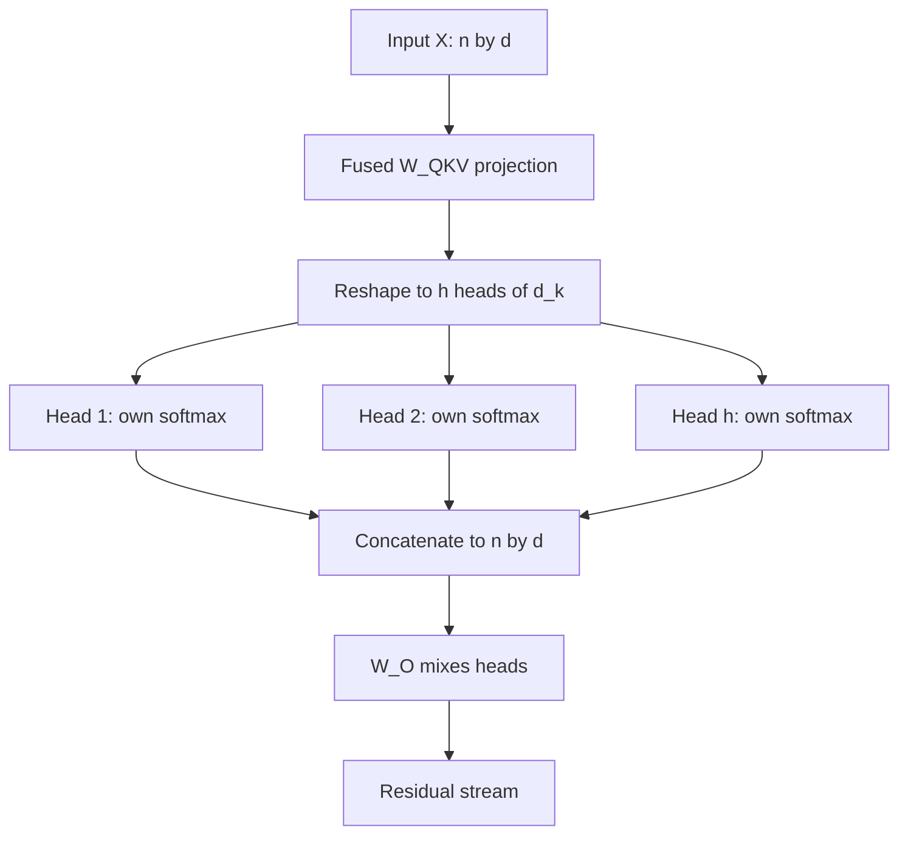

## TL;DR
Multi-head attention runs *h* attentions in parallel, each in a d_model / h subspace, and concatenates
them, so a position can look in *h* places for *h* reasons. Parameters and FLOPs match one wide head;
attention-probability memory and the sharding unit scale with *h*.

## Why it exists
- **One softmax, one weighting.** A single head gives each query position one probability distribution
  over the sequence and one blended output.
- **Positions need several relations at once.** For the verb in "The keys that the engineer lost were on
  the table", the layer wants "keys" for number agreement, "engineer" for who did the losing and "table"
  for where things ended up. One softmax serving all three averages them into a blur.
- **One space, one similarity.** A dot product in a single d_model-dimensional space tests one notion of
  similarity. "Is this the subject of my clause" and "is this the token right before me" want different
  subspaces.
- **The naive fixes fail.** More layers, each picking one relation, serializes parallel work and deepens
  the network. Widening d_k does not help at all, because one softmax still yields one weighting.
- **The 2017 answer.** Project into *h* = 8 subspaces of 64 dimensions, attend independently in each,
  concatenate the eight 64-dimensional outputs back to 512, and mix with an output projection.

Why it costs nothing extra, and why it is still a trade-off:
- **Same cost.** Each head's score computation costs n²·d_k and h·d_k = d_model, so the total matches a
  single full-width head.
- **The ablation.** One head at the same budget was measurably worse, and quality dropped again with too
  many heads: the split is a trade-off rather than "more is better". The design has survived unchanged in
  its essentials.

## How it works
### Shapes
1. From input **X** `[n, d]`, head *i* uses its own slices of the projections:
   `Q_i = X·W_Q^i`, `K_i = X·W_K^i`, `V_i = X·W_V^i`, each `[n, d_k]`.
2. Each head computes `head_i = softmax(Q_i·K_iᵀ / √d_k)·V_i`.
3. Outputs are concatenated into `[n, h·d_k]` and multiplied by `W_O` of shape `[h·d_k, d]`.

In code the per-head matrices are not separate:
- **One fused `W_QKV`** of shape `[d, 3d]` is applied.
- **One reshape** from `[B, n, 3d]` to `[B, 3, h, n, d_k]`.
- **One batched matmul** over the head axis does all heads in one kernel. The heads are a *view* of one
  big matmul, not eight small modules.

### Typical sizes
| Model | d_k |
|---|---|
| 2017 paper | 64 |
| Llama-2-7B (4096 / 32), Llama-3-8B, most current open models | 128 |

- **Kernels bound the choice.** Fused attention kernels support a bounded set of head dimensions
  (FlashAttention-2 goes up to 256) and are most heavily exercised and tuned at 64 and 128.
- **So designers choose d_k first** and derive *h* from it.

### Why the output projection
- **Concatenation only lays outputs side by side.** Without `W_O`, head *i* could write only into
  dimensions `i·d_k … (i+1)·d_k` of the residual stream, tying each head to a fixed slot forever.
- **`W_O` lets heads combine** and land anywhere in the stream, and it is where a head's contribution can
  be scaled up or down.

### Parameter and FLOP accounting
What does *not* change with *h*:
- **Parameters.** `W_Q`, `W_K`, `W_V` and `W_O` are each `d × d`, giving 4d² per layer regardless of *h*.
- **Score FLOPs.** h × 2·n²·d_k = 2·n²·d, independent of *h*.

What *does* change with *h*:
- **Attention-probability memory.** The materialized `[B, h, n, n]` tensor grows linearly with *h*. At
  h = 32, n = 8,192, fp16 it is about 4.3 GB per layer per sequence, which is why fused kernels that never
  materialize it matter.
- **Per-head rank.** Each head's `Q_i·K_iᵀ` is `[n, n]` but has rank at most d_k (the low-rank bottleneck
  Bhojanapalli et al. analyse), so more, thinner heads means each expresses less intricate patterns.
- **KV cache, only via KV heads.** Per token per layer it is 2·(number of KV heads)·d_k, which equals 2d
  for full multi-head attention and shrinks only when KV heads are shared, the subject of grouped-query
  attention.

### What heads learn
- **Specialists.** Previous-token heads, heads that track syntactic roles, heads that attend to
  delimiters or the first token as a sink, and induction heads that find an earlier copy of the current
  token and attend to what followed it.
- **Redundancy.** Michel et al. showed that a large fraction of heads in trained translation and BERT
  models can be removed at test time with little loss.
- **Consequence.** That redundancy is part of why sharing keys and values across heads (GQA) costs so
  little quality.

### Choosing h and d_k
- **More heads** means more distinct relations per layer.
- **Smaller d_k** means lower-rank score matrices, so sharper patterns become harder to express.
- **Kernel constraint:** d_k should be a value the attention kernels are tuned for.
- **Sharding constraint:** *h* should be divisible by the tensor-parallel degree, because heads are the
  natural unit to shard across GPUs with no communication inside the attention block.

## Diagram
One fused projection is viewed as *h* heads; each head runs its own softmax in parallel, and `W_O` mixes
the concatenated results back into the residual stream.



## Examples
### A multi-head attention module where h changes only the attention shape
A complete multi-head attention module. The loop at the bottom shows that changing *h* from 1 to 64 leaves
the parameter count at exactly 4·512² = 1,048,576 and changes only the shape of the attention tensor.

```python
import torch, torch.nn as nn

class MHA(nn.Module):
    def __init__(self, d, h):
        super().__init__()
        assert d % h == 0
        self.h, self.dk = h, d // h
        self.qkv = nn.Linear(d, 3 * d, bias=False)      # W_Q | W_K | W_V fused into one matmul
        self.o = nn.Linear(d, d, bias=False)            # W_O: lets heads mix and land anywhere

    def forward(self, x, causal=True):                  # x: [B, n, d]
        B, n, d = x.shape
        q, k, v = self.qkv(x).chunk(3, dim=-1)          # each [B, n, d]
        split = lambda t: t.view(B, n, self.h, self.dk).transpose(1, 2)   # -> [B, h, n, dk]
        q, k, v = split(q), split(k), split(v)
        scores = q @ k.transpose(-2, -1) / self.dk ** 0.5                  # [B, h, n, n]
        if causal:
            future = torch.triu(torch.ones(n, n, dtype=torch.bool), 1)
            scores = scores.masked_fill(future, float("-inf"))
        attn = scores.softmax(-1)                                          # one distribution per head
        out = (attn @ v).transpose(1, 2).reshape(B, n, d)                  # concat heads
        return self.o(out), attn

x = torch.randn(2, 10, 512)
for h in (1, 8, 64):
    m = MHA(512, h)
    y, attn = m(x)
    print(f"h={h:2d} head_dim={512 // h:3d} params={sum(p.numel() for p in m.parameters()):,} "
          f"attn={tuple(attn.shape)} out={tuple(y.shape)}")
# h= 1 head_dim=512 params=1,048,576 attn=(2, 1, 10, 10) out=(2, 10, 512)
# h= 8 head_dim= 64 params=1,048,576 attn=(2, 8, 10, 10) out=(2, 10, 512)
# h=64 head_dim=  8 params=1,048,576 attn=(2, 64, 10, 10) out=(2, 10, 512)
```

### Reading head counts off a config
Pure Python: from layers, query heads, KV heads and head_dim, get the KV cache per token and which
tensor-parallel degrees (up to 8 GPUs) split the query heads evenly.

```python
def head_plan(layers, n_heads, n_kv_heads, head_dim, bytes_per_el=2):
    kv_per_token = 2 * layers * n_kv_heads * head_dim * bytes_per_el
    tp_ok = [t for t in range(1, n_heads + 1) if n_heads % t == 0 and t <= 8]
    return kv_per_token, tp_ok

cfgs = {"Llama-2-7B (MHA)": (32, 32, 32, 128), "Llama-3-8B (GQA)": (32, 32, 8, 128)}
for name, cfg in cfgs.items():
    kv, tp = head_plan(*cfg)
    print(f"{name}: KV {kv/2**20:.3f} MiB/token, query heads split evenly on TP={tp}")
print("6 GPUs?", 32 % 6 == 0)   # False: 32 heads do not divide across 6 GPUs
# Llama-2-7B (MHA): KV 0.500 MiB/token, query heads split evenly on TP=[1, 2, 4, 8]
# Llama-3-8B (GQA): KV 0.125 MiB/token, query heads split evenly on TP=[1, 2, 4, 8]
```

### Worked incident: throughput collapsed after a head-dimension change
A team trained a small model with a custom head dimension above 256 to "give each head more room".

| Step | Finding |
|---|---|
| Symptom | much lower throughput and attention memory growing with n² at long context |
| Cause | the fused kernels do not support that head dimension, so attention silently fell back to the math path |
| Confirm | force the flash backend in a test; it now fails loudly instead of falling back |
| Fix | return to d_k = 128 and raise *h* instead; parameters and FLOPs are unchanged |

## Production patterns
- **Pick head_dim from the kernels.** Keep d_k at 64 or 128 and derive *h*, so FlashAttention-class
  kernels apply. In a test, restrict PyTorch's backend with `torch.nn.attention.sdpa_kernel` to the flash
  backend so an unsupported shape fails loudly. Monitor attention memory against context length.
- **Choose the tensor-parallel degree from head counts.** The number of query heads should divide by the
  TP degree; KV heads either divide too or the engine must replicate them. Check this before buying or
  allocating a node, and monitor per-GPU memory balance.
- **Size the cache from KV heads, not query heads.** Read `num_key_value_heads` and `head_dim` from the
  config; full MHA has as many KV heads as query heads. Monitor KV-cache utilization in the serving
  engine.
- **Unit-test the reshape.** Compare one head's output with a single-head computation on that slice of
  the projections, and compare the whole module with `F.scaled_dot_product_attention`. Run it in CI on
  every attention change.

## Trade-offs
- **More relations vs per-head rank.** More heads give more parallel relations per layer, but each head's
  score matrix has rank at most d_k. Past a point extra heads buy diversity at the price of per-head
  expressiveness (the 2017 ablation saw quality fall at 32 heads of width 16); most current models settle
  at d_k = 128.
- **Same FLOPs vs bigger attention tensor.** Same FLOPs and parameters as a single wide head, yet the
  attention-probability tensor is *h* times larger. Harmless with fused kernels, a memory wall without.
- **Easy sharding vs layout constraints.** Heads shard across GPUs with no communication inside
  attention, which makes tensor parallelism simple, but *h* (and the number of KV heads) must divide by
  the parallel degree, which constrains hardware layouts.
- **Redundancy vs wasted compute.** Redundant heads make the model robust to pruning and to KV sharing,
  but mean some attention compute at inference is doing little useful work.

## Pitfalls
- **Reshaping without the transpose.** Going from `[B, n, h·d_k]` straight to `[B, h, n, d_k]` makes heads
  mix positions instead of channels. Symptom: a model that trains without error but learns slowly and
  produces incoherent output.
- **An unsupported head dimension.** Above 256, or not a multiple of 8 for PyTorch's flash backend.
  Symptom: a silent fall-back to the math path, attention memory that grows with n² and much lower
  throughput. Force the backend in a test to make it fail loudly.
- **Leaving out `W_O`, or applying it per head.** The symptom is subtle, usually that adding heads stops
  helping because they cannot combine. Fix: one `[h·d_k, d]` projection applied after concatenation.
- **Explaining a prediction with one head's attention map.** Symptom: contradictory stories from
  different heads and layers for the same output. Fix: test a head's role by ablating it and measuring
  the change.

## When to use
Multi-head attention is a given inside any transformer; what you decide is the split.
- **Reading a config:** `num_attention_heads`, `num_key_value_heads` and `head_dim` tell you the KV cache
  per token, the shard granularity for tensor parallelism and whether fast kernels apply.
- **Designing or fine-tuning a small model:** keep d_k at a kernel-friendly size and choose *h* from that
  rather than the other way round.
- **Debugging from scratch:** test with h = 1 first, then confirm the reshape by checking that the
  per-head output for a given head matches a single-head computation on that slice.
- **Interviews:** explain why several heads beat one wide head at equal cost, what `W_O` is for, and which
  quantities do and do not change with *h*.

## Role lens
- **Engineer:** Gets the view/transpose right, keeps head_dim kernel-friendly, and reads head counts
  off a config to size caches and pick a tensor-parallel degree.
- **Architect:** Treats head layout as a hardware constraint: the number of query and KV heads bounds
  how a model can be sharded across the GPUs the team actually owns.
- **FDE:** Explains why a customer's chosen model cannot be split evenly across their 6-GPU node and
  what the options are, using head counts as the argument.

## Check yourself
**Q:** You change a 4,096-wide attention layer from 8 heads to 32 heads. State what happens to the
parameter count, the FLOPs, the attention memory and the per-head expressiveness, and why.
**A:** Parameters stay at 4d² ≈ 67M because W_Q, W_K, W_V and W_O remain d×d; the heads are slices of
the same matrices. FLOPs stay the same because h × 2·n²·d_k = 2·n²·d regardless of the split. The
materialized attention tensor `[B, h, n, n]` grows four times, from 8 to 32 n×n maps, which matters if
you use a kernel that writes it to memory and is irrelevant with FlashAttention. Each head's d_k drops
from 512 to 128, so each head's score matrix is capped at rank 128 instead of 512 and each pattern is
individually less expressive, but there are four times as many of them. The KV cache per token is 2d either way for full multi-head attention; it
only shrinks if you reduce KV heads through GQA, which the question did not do.

## Interview questions
### Why do several heads beat one head of the same total width?
- **One softmax gives one weighting per position.** A wide single head still blends every relation into
  one distribution, so agreement, coreference and locality get averaged together.
- **h heads give h independent weightings** in different subspaces at the same parameter and FLOP cost,
  because h·d_k = d_model.

### Your from-scratch MHA trains without errors but learns slowly and outputs incoherent text. What do you check?
- **The reshape and transpose.** Viewing `[B, n, h·d_k]` directly as `[B, h, n, d_k]` mixes positions
  into heads; it must be view to `[B, n, h, d_k]`, then transpose.
- **Then test it:** run with h = 1, compare one head against a single-head computation on its slice, and
  compare the module with the fused kernel.

### When would you not increase the number of heads?
- **When d_k would drop below what patterns need.** Each head's score matrix has rank at most d_k; the
  2017 ablation saw quality fall at 32 heads of width 16.
- **When kernels or sharding object.** Head dimensions outside the kernels' supported set fall back to
  slow paths, and *h* must still divide by the tensor-parallel degree.

### A customer wants to serve a 32-head model on a 6-GPU node with tensor parallelism. What do you tell them?
- **32 heads do not split evenly across 6 GPUs**, and heads are the unit tensor parallelism shards
  attention by.
- **Options:** run TP on 4 GPUs and use the rest for another replica or pipeline stage, pick a model
  whose head counts fit, or use data-parallel replicas instead.

### How much KV cache does a 4,096-token sequence need on Llama-2-7B versus Llama-3-8B, and why do they differ?
- **Formula:** 2 (K and V) × layers × KV heads × head_dim × bytes. Both have 32 layers, 32 query heads
  and head_dim 128 in fp16.
- **Llama-2-7B (full MHA, 32 KV heads):** 0.5 MiB per token, so about 2 GiB for 4,096 tokens.
- **Llama-3-8B (GQA, 8 KV heads):** 0.125 MiB per token, about 0.5 GiB, four times less. The query-head
  count is the same; only the KV heads changed, which is why you size caches from
  `num_key_value_heads`.

## Quiz
### Q: Why does multi-head attention cost roughly the same as a single head of width d_model?
- [ ] Because heads share their key and value projections
- [x] Because each head works in d_model / h dimensions, so h heads together do the work of one full-width head
- [ ] Because only one head is active for each token
- [ ] Because the softmax is computed once and shared across heads
> Splitting the width across heads keeps the projection matrices d×d and the score FLOPs at 2·n²·d.
> Sharing K/V projections across heads is grouped-query attention, a separate idea.

### Q: What is the role of the output projection W_O?
- [ ] It normalizes the attention weights so each row sums to one
- [ ] It applies the causal mask to the concatenated heads
- [x] It mixes information across heads and maps the concatenation back into the residual stream
- [ ] It reduces the KV cache by compressing the heads
> Concatenation alone pins each head to a fixed slice of the output; W_O lets heads combine and place
> their contribution anywhere. Masking and normalization happen inside each head before concatenation.

### Q: Which quantity grows when you increase the number of heads at fixed d_model?
- [ ] The number of parameters in the attention layer
- [ ] The FLOPs of the Q/K/V projections
- [x] The size of the materialized attention-probability tensor [B, h, n, n]
- [ ] The KV cache per token for full multi-head attention
> Parameters and projection FLOPs depend only on d_model, and the full-MHA KV cache per token is 2d per
> layer. The n×n probability map is produced once per head, so its memory scales with h.
