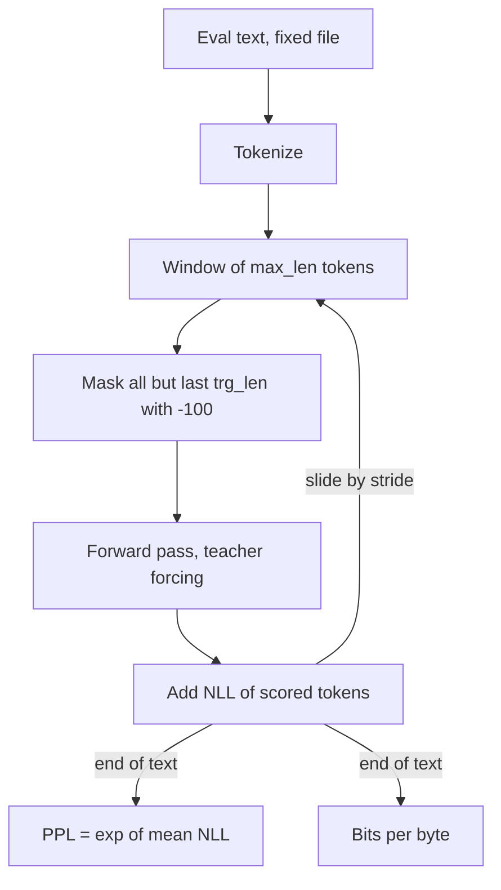

## TL;DR
Perplexity is `exp(mean of −log p(token))`, lower is better. Agent builders use it as a cheap gate when
quantising or fine-tuning the agent's model and as a token-level confidence signal, never as proof the
agent completes tasks.

## For agent builders
- **Why it matters for agents.** When you quantise, prune or fine-tune the model behind an agent (for
  example on agent traces), perplexity on a fixed text is the fastest regression check, and token
  log-probabilities on a tool call are a cheap confidence signal for escalation.
- **Where it shows up in your stack.** Fine-tuning loss curves (log-perplexity), `llama-perplexity` in
  llama.cpp, the logprobs option many model APIs and engines expose, and contamination checks in evals.
- **What you control.** The fixed eval text, window and stride you check into the repo, the threshold
  that blocks a quantised build, and whether low-logprob tool calls are retried or escalated.
- **What you can skip.** Compression theory and the history of the metric. Know why it is not comparable
  across tokenizers and why it says nothing about tool use, instruction following or facts.

## Why it exists
- **The raw score is unusable.** The probability a model gives a held-out corpus is a product of thousands
  of probabilities, astronomically small, and it shrinks with text length.
- **Each transformation fixes one problem.** Taking the log turns the product into a sum, dividing by token
  count removes length dependence, and negating gives the cross-entropy loss the model was trained on.
  Exponentiating that loss gives perplexity.
- **It is interpretable.** A loss of 2.0 nats is a perplexity of e² ≈ 7.4: at each step the model is as
  uncertain as if choosing uniformly among 7.4 options. That is why the metric outlived the
  speech-recognition systems it was invented for.
- **Accuracy cannot replace it, because many continuations are valid.** A model that assigns 30% to the
  actual next token and spreads the rest over sensible alternatives beats one that assigns 31% and then
  garbage; accuracy cannot tell them apart. Perplexity scores the whole distribution.
- **It is dense, cheap and label-free.** It is differentiable (the training loss in disguise) and any text
  is an evaluation set. At pre-training scale it is the only such signal: benchmarks are expensive, noisy
  and arrive late, while perplexity is computed on every batch.

## How it works
### Where it enters an agent workflow
| Agent task | Perplexity or logprobs role | Decides on its own? |
|---|---|---|
| Quantising the agent's self-hosted model | regression gate before agent evals | no, agent evals decide |
| Fine-tuning on agent traces | held-out loss shows over- or under-fitting | no, tool-call accuracy decides |
| Escalating an uncertain tool call or label | mean token logprob of the output | only with a threshold tuned on data |
| Screening documents for a RAG corpus | outliers under a reference model | flags for review |
| Trusting a benchmark for model choice | contamination probe | signal, not proof |

### Definition
For a token sequence x₁ … x_T under a model p:

```
PPL = exp( −(1/T) · Σ_t log p(x_t | x_<t) )
```

| Unit or value | Meaning |
|---|---|
| Cross-entropy H in nats | PPL = e^H |
| H in bits | PPL = 2^H |
| Perplexity 1 | every token predicted with certainty |
| Perplexity equal to vocabulary size | uniform guessing |

### Computing it (teacher forcing)
1. **Feed the real text** through the model.
2. **Take the logits at every position** and apply softmax.
3. **Read off the probability of the token that actually came next.**
4. **One forward pass yields all T probabilities.** No sampling is involved, so temperature plays no role
   unless you deliberately rescale the logits.

### Why it has a floor
- **Decomposition:** `H(P, Q) = H(P) + KL(P ‖ Q)`, where P is the true distribution of the text and Q is
  the model.
- **H(P) is irreducible:** the inherent unpredictability of the text, which no model can remove. KL is the
  model's excess surprise.
- **Consequences.** Perplexity can never fall below e^H(P); the gap between two models on the same text is
  a difference in KL; and gains get harder near the floor. This is the irreducible term E in scaling-law
  fits.
- **It is a compression rate.** With arithmetic coding, a model at 1.0 bits per byte could store the text
  in about one bit per byte, which is why "language modelling is compression" is literal, not a metaphor.

### Reading the number
- **A few surprising tokens dominate.** Perplexity is a geometric mean of inverse probabilities. Four tokens
  each predicted at 0.5 give exactly 2; change one to 0.01 and it jumps to about 5.3.
- **Rare tokens outweigh easy ones.** A rare proper noun, a typo or an unknowable number contributes far
  more than hundreds of easy function words.
- **Double-edged sensitivity.** Useful for detecting distribution shift, a nuisance when comparing two
  similar models, so always evaluate on enough text that the estimate is stable.
- **Orders of magnitude (illustrative, not targets).** Modern models on clean English prose sit in the
  single digits to low teens depending on tokenizer and domain; code is lower; random strings far higher.

### Why the tokenizer matters
- **Per-token loss depends on how much text each token carries.** A larger vocabulary produces longer
  tokens: each is harder to predict, so per-token loss rises, but there are fewer of them, so total loss on
  the document can be identical.
- **So different tokenizers cannot be compared on per-token perplexity.**
- **Tokenizer-independent alternatives:** bits per byte (total negative log-likelihood in bits divided by
  the UTF-8 byte count) or bits per character. Older literature also reports per-word perplexity, which is
  different again.
- **Always ask which unit a perplexity is per.**

### Context length and striding
- **Context changes the score.** Token t conditions on everything before it, so a 1,024-token window sees
  less context than 8,192 and scores worse on the same text.
- **Non-overlapping chunks are cheap but pessimistic,** because the first tokens of every chunk have almost
  no context.
- **The standard recipe is a sliding window:** move the window forward by `stride` tokens, feed the whole
  window, and score only the last `stride` tokens.
- **Smaller stride** gives each token more context at the cost of more forward passes.
- **Report window and stride** with every number.

### What it does not measure
- **Assistant quality.** Instruction-tuned and RLHF models are optimised to produce preferred responses,
  not to model web text, so their perplexity on raw text often rises while usefulness improves. Low
  perplexity does not mean a good assistant.
- **Factuality:** a fluent false sentence can have low perplexity.
- **Generation quality:** the perplexity of a model's own samples under itself is low by construction.

### What it is used for in practice
1. **Training.** The loss curve is log-perplexity; plateaus, spikes and divergence show up there first.
2. **Quantisation and pruning.** Measure perplexity on a fixed text (WikiText-2 is the common choice in
   llama.cpp-style tooling) before and after. A small rise is the usual price of 8-bit or 4-bit weights; a
   large rise means the compression damaged the model, and task evals will confirm it later.
3. **Long-context checks.** Perplexity as a function of position: if it climbs past the training length,
   the model is not using the extended window.
4. **Data work.** Filter documents whose perplexity under a reference model is far outside the normal
   range, flag anomalous or adversarial prompts, and check contamination: a suspiciously low perplexity on
   a benchmark's test set suggests the model has seen it.
5. **Likelihood scoring.** Many multiple-choice benchmarks compare the (length-normalised) log-probability
   of each answer option given the question, which is perplexity restricted to the answer tokens.
   Normalisation matters: unnormalised sums favour short options.
6. **Domain fit.** Among candidate base models, the lowest bits per byte on a sample of your corpus is a
   reasonable first filter before expensive task evals.

## Diagram
Sliding-window evaluation: each window feeds full context, but only its newest tokens are scored, so
every token is counted once with as much context as the window allows.



## Examples
### Agent scenario: gate a tool call on its own perplexity
Many APIs and serving engines can return per-token log-probabilities. Perplexity over just the generated
tool call, plus its least confident token, is a cheap signal for "execute" versus "escalate".

```python
import math

def call_perplexity(token_logprobs):
    """Perplexity of one generated tool call from its per-token log-probabilities (nats)."""
    return math.exp(-sum(token_logprobs) / len(token_logprobs))

def decide(token_logprobs, max_ppl=1.5, min_token_p=0.2):
    ppl = call_perplexity(token_logprobs)
    worst = math.exp(min(token_logprobs))           # least confident single token
    if ppl > max_ppl or worst < min_token_p:        # placeholder thresholds: tune on labelled traces
        return f"escalate (ppl={ppl:.2f}, worst token p={worst:.2f})"
    return f"execute  (ppl={ppl:.2f}, worst token p={worst:.2f})"

# Logprobs for the tokens of '{"tool": "refund", "order_id": "A1043", "amount": 120}' (illustrative)
confident = [-0.01, -0.02, -0.05, -0.01, -0.03, -0.02, -0.10, -0.04, -0.02, -0.08]
shaky     = [-0.01, -0.02, -0.05, -0.01, -0.03, -0.02, -2.30, -0.04, -0.02, -1.90]
print(decide(confident))   # execute  (ppl=1.04, worst token p=0.90)
print(decide(shaky))       # escalate (ppl=1.55, worst token p=0.10)
```

- **Why the worst token matters.** Perplexity averages, so a single uncertain argument value (an order ID,
  an amount) can hide in a long call; checking the minimum token probability catches it.
- **Limit.** Confidence is not correctness: a model can be confidently wrong, and RLHF-tuned models are
  often poorly calibrated. Tune thresholds on labelled traces and keep schema and business-rule checks.

### Sliding-window perplexity with Hugging Face Transformers
Each window of `max_len` tokens is fed to the model, but only the final `trg_len` tokens are scored;
earlier tokens are masked with `-100` so they serve as context only. The script also reports bits per
byte, which is comparable across tokenizers.

```python
import math, torch
from transformers import AutoModelForCausalLM, AutoTokenizer

name = "Qwen/Qwen2.5-0.5B"                              # any causal LM
tok = AutoTokenizer.from_pretrained(name)
model = AutoModelForCausalLM.from_pretrained(name, torch_dtype=torch.float16).cuda().eval()

text = open("eval.txt", encoding="utf-8").read()
ids = tok(text, return_tensors="pt").input_ids.cuda()    # [1, T]
T, max_len, stride = ids.size(1), 2048, 512
nll_sum, n_scored, prev_end = 0.0, 0, 0

with torch.no_grad():
    for begin in range(0, T, stride):
        end = min(begin + max_len, T)
        trg_len = end - prev_end                         # tokens not yet scored
        window = ids[:, begin:end]
        labels = window.clone()
        labels[:, :-trg_len] = -100                      # context only; HF shifts labels internally
        out = model(window, labels=labels)               # out.loss = mean NLL over scored tokens
        nll_sum += out.loss.item() * trg_len             # first token of the first window is a tiny approximation
        n_scored += trg_len
        prev_end = end
        if end == T:
            break

ppl = math.exp(nll_sum / n_scored)
bits_per_byte = nll_sum / math.log(2) / len(text.encode("utf-8"))
print(f"tokens={n_scored} window={max_len} stride={stride} ppl={ppl:.2f} bpb={bits_per_byte:.3f}")
```

- **Within one model:** run it before and after quantising with the same `eval.txt`, window and stride,
  and the difference is a meaningful regression signal.
- **Across tokenizers:** only the `bpb` line is comparable.

### Worked numbers: outliers, units and tokenizers
Pure Python, no model needed: how one bad token moves perplexity, nats versus bits, and why bits per byte
survives a tokenizer change.

```python
import math

def ppl(probs):
    return math.exp(-sum(math.log(p) for p in probs) / len(probs))

print(ppl([0.5] * 4))                    # 2.0
print(ppl([0.5, 0.5, 0.5, 0.01]))        # ~5.32: one surprising token dominates
print(math.exp(2.0), 2 ** 2.0)           # loss 2.0 in nats -> 7.39, in bits -> 4

doc_bytes, doc_nll = 1_000, 600.0        # same document, same total NLL in nats (illustrative)
for name, n_tokens in [("32k vocab", 300), ("128k vocab", 200)]:
    per_tok = doc_nll / n_tokens
    print(f"{name}: ppl={math.exp(per_tok):.1f}  bpb={doc_nll / math.log(2) / doc_bytes:.3f}")
```

| Tokenizer | Tokens for the document | Per-token loss | Perplexity | Bits per byte |
|---|---|---|---|---|
| 32k vocab | 300 | 2.0 nats | 7.4 | 0.866 |
| 128k vocab | 200 | 3.0 nats | 20.1 | 0.866 |

- **Same model quality, different perplexity.** Both assign the document identical probability; only the
  per-token denominator changed. Bits per byte is identical.

## Production patterns
- **Two-stage gate for the agent's model.** When you quantise or fine-tune the self-hosted model behind
  an agent, run the perplexity check first because it takes minutes, then the agent eval (tool-call
  validity, task success). Block on either; never ship on perplexity alone.
- **Watch held-out loss when fine-tuning on agent traces.** Keep a held-out split of traces and track its
  loss next to tool-call accuracy per checkpoint; held-out loss rising while training loss falls means the
  run is memorising traces.
- **Logprob-based escalation for risky tool calls.** For actions with side effects, compute call
  perplexity and minimum token probability, route low-confidence calls to a stronger model or a human, and
  monitor escalation rate and the error rate of executed calls.
- **Perplexity gate for quantisation and pruning.** Check a fixed eval file, window and stride into the
  repository and run them before and after every compression change; llama.cpp ships a `llama-perplexity`
  tool for GGUF models. Put the delta in the pull request next to task evals, and block on a rise far
  beyond what similar 8-bit or 4-bit builds showed.
- **Reference-model data filtering.** Score each document under a small reference model trained on clean
  text and drop documents far outside the normal range at either end. Monitor the share removed per source
  so a filter change does not silently delete a domain.
- **Contamination probe.** Compare a model's perplexity on a benchmark's test set with its perplexity on
  freshly written text of the same style; a suspiciously low score on the test set suggests it was in
  training data. Run it before trusting a public benchmark result.

## Trade-offs
- **Free confidence signal vs calibration.** Token logprobs cost nothing extra to collect and catch many
  shaky tool calls, but tuned chat models can be confidently wrong; it pays only when thresholds are fitted
  on labelled agent traces.
- **Dense and cheap vs blind to quality.** A label-free signal at any scale, but blind to correctness,
  helpfulness and safety; it flips to task metrics the moment you leave pre-training.
- **Checkpoint comparability vs tokenizer lock-in.** Comparable across checkpoints of one model and
  tokenizer, not across vocabularies; bits per byte restores comparability at the cost of the intuitive
  "number of choices" reading.
- **Shift detection vs noise.** Sensitivity to a few high-surprise tokens makes it a good detector of
  distribution shift and a noisy judge of small quality differences; average over enough text and report
  the evaluation size.
- **Fair number vs compute.** Sliding-window evaluation gives the fairest number but costs up to
  `window / stride` times more forward passes than chunking; chunking is cheap but systematically
  pessimistic.

## Pitfalls
- **Shipping a quantised agent model on perplexity alone.** Symptom: perplexity barely moved, yet tool-call
  JSON breaks more often or arguments drift. Fix: always follow the perplexity gate with the agent eval,
  with a separate check on structured outputs.
- **Treating low perplexity as a correct tool call.** Symptom: confident calls with the wrong ID or amount
  get executed. Fix: keep schema and business-rule validation regardless of confidence.
- **Comparing per-token perplexity across tokenizers.** Symptom: a model with a 32k vocabulary "beats" one
  with 128k on the same text purely because its tokens are shorter. Fix: bits per byte.
- **Reporting without dataset, tokenizer, window and stride.** Symptom: numbers nobody can reproduce, which
  drift by double-digit percentages between evaluations. Fix: check the recipe into the repository.
- **Using perplexity to choose a chat model.** Symptom: a base model "wins" and then cannot follow
  instructions. Fix: choose on task evals and preference.
- **Evaluating on text that was in the training set.** Symptom: an implausibly low number that does not
  predict generalisation, which is the contamination test seen from the other side. Fix: evaluate on text
  written after the training cutoff.
- **Mixing nats and bits.** Symptom: a "loss of 2.0" reported as perplexity 4 (2²) rather than 7.39 (e²),
  or the reverse. Fix: exponentiate in the base the loss was measured in, and label the unit.
- **Scoring padding tokens or forgetting the one-position label shift.** Symptom: a perplexity near 1
  (padding predicted perfectly) or an absurdly high one. Fix: set padding labels to `-100` and let the
  library shift labels.

## When to use
- **Use in agent work for:** a fast regression gate before agent evals when the model changes, held-out
  loss during fine-tuning on traces, and logprob confidence for escalating risky tool calls.
- **Use when** the question is "how well does this model fit this distribution of text": pre-training and
  continued pre-training, checking a quantised or pruned model against the original, choosing a base model
  for domain adaptation, and detecting shifted or anomalous inputs.
- **Do not use** as the acceptance metric for a product feature; use task accuracy, faithfulness and human
  preference there.
- **Measure** with a fixed recipe, dataset, tokenizer, window and stride, checked into the repository so
  every number is reproducible.
- **Interviews:** derive it from cross-entropy, explain why it is not comparable across tokenizers, why RLHF
  models score worse on it, and name two production uses beyond training curves.

## Role lens
- **Engineer:** Runs a fixed perplexity script on a standard text before and after quantisation and puts the
  delta in the pull request next to the task evals.
- **Architect:** Sets the rule that perplexity is a gate for model-level changes such as quantisation,
  pruning and continued pre-training, but never a substitute for task-level acceptance criteria.
- **FDE:** Uses bits per byte on a sample of the customer's documents to show whether a candidate open model
  "speaks their language" before investing in a full evaluation.

## Check yourself
**Q:** Two open models report WikiText perplexities of 5.2 and 6.8. A colleague says the first is clearly
better for your legal-contract summarisation product. What is wrong with that reasoning, and what would you
do instead?
**A:** Three things. The numbers are comparable only if the tokenizers, window and stride match, and a
larger vocabulary mechanically raises per-token perplexity. WikiText is encyclopaedia prose, not contracts,
so fit to the actual domain is unmeasured. And summarisation quality depends on instruction-following and
faithfulness, which perplexity does not capture; an RLHF model can have worse perplexity and better
summaries. Instead, compute bits per byte on a sample of the firm's contracts as a quick domain-fit filter,
then run a task evaluation with faithfulness, coverage and human preference on one or two hundred
summaries. Bring perplexity back later only as a regression check when quantising the chosen model.

## Interview questions
### What is perplexity, and why is it preferred over next-token accuracy for language models?
- **Definition:** the exponential of mean per-token cross-entropy, read as the effective number of equally
  likely choices the model faces per token.
- **Why not accuracy:** many continuations are valid, and accuracy ignores how probability is spread over
  the alternatives; perplexity scores the whole distribution.
- **Bonus:** it is the training loss in disguise, so it is differentiable, label-free and available on
  every batch.

### After 4-bit quantisation, perplexity on your fixed eval file rose. How do you decide whether to ship?
- **Confirm the comparison is fair:** same eval file, tokenizer, window and stride before and after.
- **Judge the size:** a small rise is the usual price of 4-bit weights; a large rise means the compression
  damaged the model.
- **Then run task evals,** with special attention to JSON validity and other fragile outputs, because
  perplexity is a gate for model-level changes, not the acceptance criterion.

### You fine-tuned your agent's model on 5,000 tool-use traces. Held-out loss improved. Is it ready?
- **Not yet.** Lower loss means the model fits the trace distribution better, not that it calls tools
  correctly or finishes tasks.
- **Run the agent eval:** tool-call validity, argument accuracy, task success and steps per task on
  held-out tasks, plus a regression set of general instructions.
- **Check for memorisation:** held-out loss should be measured on traces from tasks the model never saw.

### How could you use token log-probabilities to make an agent safer?
- **Score each generated tool call:** perplexity over its tokens plus the least confident token, which
  catches a single shaky argument value.
- **Route by risk:** execute confident read-only calls, escalate low-confidence calls with side effects
  to a stronger model or a human.
- **Caveat:** calibration varies by model, so fit thresholds on labelled traces and keep schema checks.

### How would you use perplexity to test whether a model has seen a benchmark's test set?
- **Compare two texts of the same style:** the benchmark test items and freshly written items the model
  cannot have seen.
- **A much lower perplexity on the test items** suggests memorisation, so benchmark scores overstate
  generalisation.
- **Caveat:** rare or easy wording also shifts perplexity, so treat it as a signal to investigate, not proof.

### Why does a model's perplexity on web text get worse after RLHF, and should you worry?
- **RLHF moves the output distribution on purpose,** toward preferred responses and away from modelling raw
  web text, so fit to that text worsens.
- **Not a defect.** Judge the assistant with task accuracy, faithfulness and preference metrics; perplexity
  on web text does not measure what it is meant to do.

## Quiz
### Q: A model's average cross-entropy on a test set is 1.5 nats per token. What is its perplexity, and what does that number mean?
- [ ] 1.5; the model is 1.5 times better than chance
- [ ] 2^1.5 ≈ 2.8; the model needs 2.8 bits per token
- [x] e^1.5 ≈ 4.5; on average the model is as uncertain as choosing uniformly among about 4.5 tokens
- [ ] 1/1.5 ≈ 0.67; the average probability of the correct token
> Perplexity is the exponential of the cross-entropy in the same base. With a loss in nats that is e^1.5
> ≈ 4.5. The 2^1.5 option is the right formula for a loss measured in bits, which is the classic unit
> confusion, and the others are not transformations of the loss at all.

### Q: Why can you not directly compare per-token perplexity between a model with a 32k-token vocabulary and one with a 128k vocabulary?
- [ ] Larger vocabularies make the softmax numerically unstable
- [x] Tokens carry different amounts of text, so per-token loss differs even when the two models assign identical probability to the document; compare bits per byte instead
- [ ] The 128k model always has lower perplexity because it has more parameters
- [ ] Perplexity is only defined for byte-level tokenizers
> Total log-probability of a document is tokenizer-independent, but dividing it by a different token count
> gives a different per-token average. Normalising by bytes or characters removes the tokenizer from the
> comparison.

### Q: After RLHF, a model's perplexity on raw web text increased while users rate its answers higher. What is the best interpretation?
- [ ] The RLHF run damaged the model and should be rolled back
- [ ] Perplexity was computed incorrectly
- [x] Perplexity measures fit to the web-text distribution, which RLHF deliberately moves the model away from toward preferred responses; use task and preference metrics for the chat model
- [ ] Users are wrong; perplexity is the ground truth
> Preference tuning changes the output distribution on purpose, so fit to raw text getting worse is
> expected and not a defect. The right evaluation for an assistant is the task it is meant to perform, which
> perplexity on web text does not measure.

## Use cases & projects
### Use cases
- **Quantising a self-hosted agent model.** A perplexity delta on a fixed file is the first gate before
  the slower agent eval.
- **Fine-tuning on agent traces.** Held-out loss per checkpoint shows when a run starts memorising traces.
- **Confidence-based escalation.** Token logprobs on a tool call decide whether a side-effecting action runs
  or goes to a stronger model or a human.
- **Curating a RAG corpus.** Documents with extreme perplexity under a reference model are flagged as
  boilerplate, garbage or a different language.

### Mini project
**Logprob confidence gate for a tool-calling agent (2-3 hours).**
- **Goal:** test whether tool-call perplexity predicts wrong tool calls well enough to drive escalation.
- **Steps:** run a small model with logprobs enabled (a local engine or an API that returns them) on 50
  tool-calling tasks with known correct calls; record call perplexity and minimum token probability per
  call; label each call right or wrong; sweep thresholds.
- **Done when:** you have a table of escalation rate versus error rate among executed calls, a chosen
  threshold, and a note on how many wrong calls were confident anyway.
