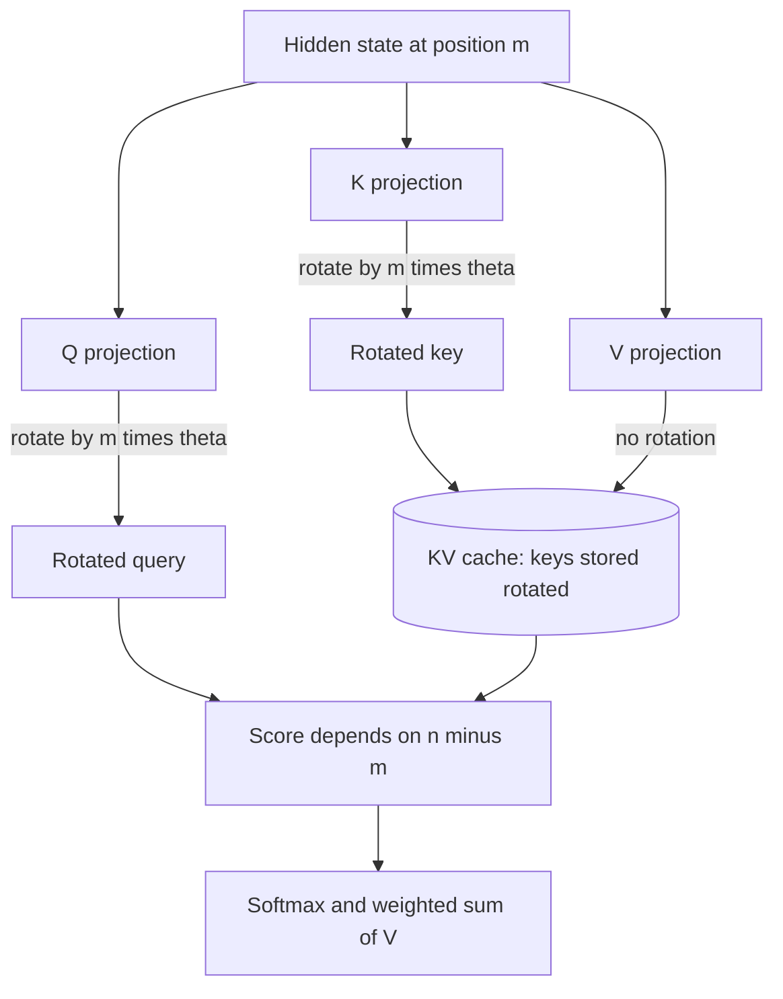

## TL;DR
RoPE gives transformers word order by rotating queries and keys by position. For agent builders it sets
how long a transcript the model handles reliably: past the trained angles, quality falls off a cliff,
whatever the config says.

## For agent builders
- **Why it matters for agents.** Agent transcripts keep growing. When a self-hosted model runs past the
  length its RoPE angles were trained or extended for, it does not error; it starts repeating itself or
  emitting malformed tool calls.
- **Where it shows up in your stack.** `rope_theta`, `rope_scaling` and `max_position_embeddings` in
  `config.json`, the engine's maximum model length, and the context window advertised by hosted APIs
  (already extended by the vendor).
- **What you control.** The context cap per agent route, when to compact or retrieve instead of growing
  the transcript, and whether you enable only vendor-documented scaling.
- **What you can skip.** The rotation algebra and checkpoint-porting details, unless you convert weights
  or write kernels. Keep "max context is a property of the trained angles, not a config field".

## Why it exists
- **Attention is order-blind.** Without position information, "dog bites man" and "man bites dog" give
  identical per-token outputs; permuting the input permutes the output and nothing else. An agent could
  not tell which tool result came last.
- **A good scheme must do four things at once:** make every position distinguishable; let the model learn
  *relative* offsets, because most linguistic structure is local (adjective before noun, matching
  brackets, the previous token); degrade gracefully past trained lengths; and be cheap and compatible
  with caching keys and values.
- **Earlier schemes each missed something** (table below): additive signals get mixed into content,
  learned tables hard-cap context, relative biases complicate the kernel and still extrapolate poorly.
- **RoPE encodes absolute position as a rotation** of queries and keys, so `qₘ·kₙ` depends only on
  `n − m` and the contents. No parameters, only a cheap elementwise rotation, any attention kernel, and
  cached keys stay valid as the sequence grows.
- **ALiBi is the main alternative.** It adds a fixed distance penalty to the scores; it extrapolates
  better out of the box but imposes a recency prior that can hurt long-range retrieval. The open-model
  ecosystem converged on RoPE.

| Scheme | How | Strength | Weakness |
|---|---|---|---|
| Sinusoidal (original transformer) | fixed vectors added to embeddings | a shift by *k* positions is a linear function of the sinusoids, so offsets are learnable in principle | added once at the input, mixed into values and content; the model must disentangle it |
| Learned table (GPT-2, BERT) | one vector per position | simple and strong at trained lengths | hard-caps context at the table size; rarely seen positions undertrained |
| Relative bias (Shaw et al., T5) | learned bias per offset added to scores | better inductive bias | buckets offsets, adds a term to the kernel, still extrapolates poorly |
| RoPE | rotate q and k by position | relative, parameter-free, cache-friendly | extrapolates poorly past trained length |
| ALiBi | fixed distance penalty on scores | extrapolates out of the box | recency prior |

## How it works
### Background: the rotation
1. Split the head dimension *d* into d/2 pairs.
2. Give pair *i* a frequency `θ_i = base^(−2i/d)`, with base = 10,000 in the original paper and Llama 2,
   and 500,000 in Llama 3.
3. At position *m*, rotate each pair by the angle `m·θ_i`:

```
[x, y] -> [x·cos(mθ_i) − y·sin(mθ_i),  x·sin(mθ_i) + y·cos(mθ_i)]
```

4. Apply it to queries and keys, **not** to values.

Why it works:
- **The dot product becomes relative.** A 2-D rotation matrix satisfies `R_mᵀ·R_n = R_(n−m)`, so
  `(R_m q)·(R_n k) = q·R_(n−m) k`. The absolute positions cancel; only the offset and the contents remain.
- **Values are left alone** because they carry content summed into the output. Rotating them would
  scramble what is retrieved by where it sits; positions should only influence *who attends to whom*.

### Frequencies and what they encode
| Pair | Behaviour (d = 128) | Role |
|---|---|---|
| Pair 0 | one radian per token, wraps every ~6 tokens | very local order |
| Slowest pair, base 10,000 | about 27° across 4,096 tokens; full rotation every ~54,000 tokens | near-absolute, long-range channel |
| Slowest pair, base 500,000 | full turn needs about 2.5 million tokens | more pairs stay inside the arc seen in training at long range |

- **Raising the base** to 500,000 leaves pair 0 at one radian per token and slows every other pair,
  increasingly so toward the slow end.
- **The spread lets dimensions specialize** in different ranges, the same geometric schedule the
  sinusoidal encoding used additively.
- **A mild recency preference.** The RoPE paper shows the inner product between a fixed query and key
  decays with distance on average.

### Implementation
Two equivalent layouts exist:

| Layout | Pairs | Where |
|---|---|---|
| Interleaved | `(2i, 2i+1)` | the paper and Meta's reference Llama code (which multiplies complex numbers) |
| Rotate-half | dimension *i* with *i + d/2*, computed as `q·cos + rotate_half(q)·sin` | the Hugging Face Llama implementation |

- **They differ by a permutation baked into trained `W_Q` and `W_K`**, so converting checkpoints between
  layouts requires permuting those weights. The official conversion script does exactly that; forgetting
  it is a classic porting bug.
- **Tables:** cos/sin `[max_len, d/2]` are precomputed, usually in fp32.
- **Order:** apply after the Q/K projections and before the score matmul. Rotating the hidden state
  *before* `W_Q` and `W_K` puts the projections between the two rotations and destroys the
  `R_mᵀ·R_n = R_(n−m)` cancellation.
- **Partial rotation.** Some families rotate only a fraction of each head's dimensions
  (`partial_rotary_factor` or `rotary_pct` in configs) and leave the rest position-free, so check the
  config rather than assuming the whole head is rotated.

### Interaction with the KV cache (agent transcripts)
- **Rotate once, at insertion.** Each key is rotated by its own absolute position when cached, and each
  query by its position at query time. The relative property emerges in the dot product, so nothing in
  the cache needs re-rotation as the agent appends steps.
- **Front eviction keeps old angles.** Evicting from the front of a sliding-window cache leaves the
  survivors at their original absolute angles; streaming schemes re-assign positions inside the cache
  for this reason.
- **Edits invalidate.** Changing anything before position *i* invalidates every cached key from *i*
  onward, which is why agents should append to history rather than rewrite it.

### Context extension
Past the training length, the low-frequency pairs reach angles the model never saw, attention patterns
break and perplexity rises sharply soon after the limit.

| Method | What it does | Cost |
|---|---|---|
| Position interpolation (Chen et al.) | rescales positions by `L_train / L_new` so all angles stay in the trained range, then fine-tunes briefly | squeezes high-frequency pairs, costing resolution between adjacent tokens |
| NTK-aware scaling | raises the base: stretches low frequencies a lot, high ones little | a heuristic; still benefits from tuning |
| YaRN | per-frequency treatment (high frequencies untouched, low ones interpolated) plus a temperature on the logits | needs fewer fine-tuning tokens, more knobs |
| Llama 3.1 | frequency-dependent scaling of this family on an 8k-trained base | reaches 128k context |

The common lesson: "max context" is a property of the trained angles, not of a config field. And a
window the model accepts is not the same as a window your agent uses well; evaluate at your lengths.

### ALiBi, briefly
- **Mechanism:** adds `−slope_h·(i − j)` to the score of query *i* and key *j ≤ i*, with per-head slopes
  forming a geometric series.
- **Profile:** no parameters, decent extrapolation, used by BLOOM and MPT; its recency bias is the trade.

## Diagram
Where the rotation sits in one attention layer: after the projections, on queries and keys only, with
keys cached already rotated by their own positions.



## Examples
### RoPE in NumPy: the relative property and why extrapolation fails
A minimal RoPE in NumPy that demonstrates the relative property numerically and shows why extension
beyond the trained length needs care.

```python
import numpy as np

def rope(x, pos, base=10000.0):
    """Rotate x (even length d) to position pos: pair (2i, 2i+1) turns by pos * theta_i."""
    d = x.shape[-1]
    theta = base ** (-np.arange(0, d, 2) / d)       # d/2 frequencies from 1 down to ~1/base
    ang = pos * theta
    cos, sin = np.cos(ang), np.sin(ang)
    x1, x2 = x[0::2], x[1::2]
    out = np.empty_like(x)
    out[0::2] = x1 * cos - x2 * sin
    out[1::2] = x1 * sin + x2 * cos
    return out

rng = np.random.default_rng(0)
d = 128
q, k = rng.standard_normal(d), rng.standard_normal(d)

# Same offset (3 apart), different absolute positions -> identical attention score.
print(round(rope(q, 5) @ rope(k, 2), 6), round(rope(q, 1005) @ rope(k, 1002), 6))
# Different offsets -> different scores although q and k never changed.
print(round(rope(q, 5) @ rope(k, 4), 6), round(rope(q, 5) @ rope(k, 0), 6))

# Why extrapolation fails: the slowest pair barely moves inside a 4k window ...
theta_min = 10000 ** (-(d - 2) / d)
print(f"slowest pair: {np.degrees(4096 * theta_min):.1f} degrees over 4096 tokens, "
      f"full turn every {2 * np.pi / theta_min:,.0f} tokens")
# ... so positions past the trained length put those pairs at angles the model has never seen.
# Position interpolation: rope(x, pos * L_train / L_new) keeps every pair inside its trained range.
```

### Agent scenario: a context guard for a self-hosted agent
The agent loop checks the transcript length before every model call and compacts when it nears the
length your evals passed at, instead of trusting whatever the engine accepts. The model id and limits are
placeholders.

```python
from transformers import AutoConfig, AutoTokenizer

MODEL = "your-org/your-agent-model"                  # placeholder id
cfg, tok = AutoConfig.from_pretrained(MODEL), AutoTokenizer.from_pretrained(MODEL)
print("rope_theta", getattr(cfg, "rope_theta", None),
      "rope_scaling", getattr(cfg, "rope_scaling", None),
      "max_position_embeddings", cfg.max_position_embeddings)

EVALUATED_LIMIT = 32_768     # longest length your agent evals passed at, not the config value
RESERVE = 2_048              # room for the next tool call and answer

def needs_compaction(messages):
    n = len(tok.apply_chat_template(messages, tokenize=True))
    return n > EVALUATED_LIMIT - RESERVE, n

# in the loop: if needs_compaction(history)[0]: replace old tool results with summaries
```

### Worked scenario: stretching a 4k model to 8k
Angles for d = 128, base 10,000, trained at 4,096 tokens, served at 8,192 (computed with the formulas
above):

| Setting | Slowest pair at position 8,191 | Trained range | Adjacent-token step, fastest pair |
|---|---|---|---|
| No scaling | 54.2° | up to 27.1° | 1.00 rad |
| Position interpolation (factor 2) | 27.1° | up to 27.1° | 0.50 rad |

- **No scaling** pushes slow pairs to angles never seen in training, so attention breaks right after
  4k; an agent at step 15 starts looping or emitting broken JSON.
- **Interpolation** keeps every angle in range but halves local resolution, which the short fine-tune
  recovers.

### Correct position ids for a left-padded batch
Positions must come from the attention mask, not from the padded index, or shorter prompts get shifted
angles. This mirrors what Hugging Face generation does internally.

```python
import torch

attention_mask = torch.tensor([[0, 0, 1, 1, 1],      # short prompt, left-padded
                               [1, 1, 1, 1, 1]])     # longest prompt
position_ids = attention_mask.long().cumsum(-1) - 1  # real tokens count from 0
position_ids.masked_fill_(attention_mask == 0, 1)    # pad slots get a dummy id; they are masked anyway
print(position_ids)
# tensor([[1, 1, 0, 1, 2],
#         [0, 1, 2, 3, 4]])
# During decode, the next position is the cache length per sequence, not the step counter.
```

## Production patterns
- **Cap agent context at the evaluated length.** Set the engine's maximum model length and the agent's
  compaction threshold from the length your agent evals passed at, not from the config. Alert when
  context-length p95 approaches that limit.
- **Read the angles before trusting max context.** Check `rope_theta`, `rope_scaling` and
  `max_position_embeddings` in `config.json` and the model card's trained length. Treat any context above
  the trained or officially extended length as unsupported until evaluated.
- **Enable vendor-documented scaling only.** When a model family documents YaRN for longer inputs, add the
  `rope_scaling` block it specifies (type, factor and original length) to the config or the engine's
  override. Monitor short-context eval scores too, since static scaling can cost quality on short inputs.
- **Evaluate extension at the target length with agent tasks.** Run needle-in-a-haystack, real
  long-document tasks and long multi-step agent runs at the lengths you will serve, not just perplexity.
  Track tool-call validity and loop rate by context bucket.
- **Test ported checkpoints for layout bugs.** After converting weights between interleaved and
  rotate-half code, compare perplexity on known text with the source implementation; a value in the
  hundreds means the Q/K permutation was skipped. Run it in CI for every conversion.
- **Derive position ids from mask and cache length.** For left-padded batches use the cumulative-sum
  pattern above, and keep cos/sin tables in fp32. Test that one prompt gives identical output alone and in
  a batch.

## Trade-offs
- **RoPE vs ALiBi.** RoPE gives relative attention with zero parameters and a cache that never needs
  re-rotation, but extrapolates poorly past the trained length. If you need length generalization with no
  fine-tuning, ALiBi's fixed penalty behaves better out of the box.
- **Extend context vs compact or retrieve.** RoPE scaling lets an agent keep more raw history, but needs a
  fine-tune or a vendor-extended model and evals at length. Compaction and retrieval keep the transcript
  in the well-trained range at the risk of dropping a detail.
- **Learned absolute tables vs growth.** Simple and strong at trained lengths, with a hard cap on context.
  Reasonable for fixed-length encoders; wrong for anything that must grow.
- **Larger base vs mid-range resolution.** A larger base (500,000 versus 10,000) improves long-context
  behaviour by slowing the middle and low frequencies, at the cost of fewer pairs that distinguish
  offsets in the hundreds-to-thousands range. Whether that costs short-context quality depends on model
  and data, and vendors tune it empirically.
- **Interpolation vs YaRN.** Position interpolation is simple and robust after a short fine-tune but
  blurs local resolution; YaRN preserves high frequencies and needs fewer tokens but has more knobs to get
  wrong.

## Pitfalls
- **Letting an agent run past the trained length.** Symptom: late-step repetition loops, malformed tool
  calls or forgotten instructions, with no exception raised. Fix: a context guard at the evaluated limit
  that compacts or hands off to retrieval.
- **Running past `max_position_embeddings` with no scaling.** Symptom: output that degenerates into
  repetition or nonsense right after the trained length, with no exception raised. Fix: cap the engine's
  max length at the trained or officially extended length.
- **Mixing the interleaved and rotate-half layouts** when loading ported weights. Symptom: correct shapes,
  no errors, perplexity in the hundreds. Fix: permute the `W_Q` and `W_K` rows as the official conversion
  script does, then re-check perplexity against the source.
- **Feeding wrong position ids:** restarting at 0 on each decode step, or counting pad tokens in a
  left-padded batch. Symptom: output fine for the longest prompt but degraded for shorter ones, or quality
  that drops right after the first generated token. Positions must come from the attention mask and the
  cache length.
- **Computing the cos/sin tables in bf16 or fp16 for large positions.** Symptom: slowly degrading quality
  at high positions caused by rounding of large angles. Keep the frequency computation in fp32.
- **Setting `rope_scaling` in a serving config without the fine-tuning the method assumes.** Symptom:
  degraded short-context quality and only partial recovery at long context. Fix: use only the scaling the
  vendor documents for that checkpoint, or fine-tune for it, and evaluate at short and long lengths.

## When to use
You choose a positional scheme indirectly by choosing a model, but you meet it directly in these places:
- **Reading a config:** `rope_theta` and `rope_scaling` tell you what context the model really supports.
- **Setting agent context policy:** the compaction threshold and engine max length come from evaluated
  lengths, not advertised ones.
- **Context-extension projects:** interpolation or YaRN plus a fine-tune, evaluated at the target length
  with needle-in-haystack and real tasks, not just perplexity.
- **Debugging ported checkpoints or custom kernels**, where the rotation layout matters.
- **Measure** quality at the lengths you will actually serve, because the loss past the trained length is
  a cliff, not a slope.
- **Interviews:** derive the relative property from rotation composition, explain why only queries and
  keys are rotated, and describe why extrapolation fails and how interpolation fixes it.

## Role lens
- **Engineer:** Sets `rope_scaling` correctly when serving extended context, verifies the rotation
  layout when converting weights, and tests at target lengths before shipping.
- **Architect:** Decides whether to buy long context through RoPE scaling plus fine-tuning or through
  retrieval, knowing that the trained length, not the config, bounds reliable behaviour.
- **FDE:** Answers a customer's "can we just raise max tokens to 64k?" by explaining trained angles
  versus config fields and proposing an evaluated extension or a retrieval design.

## Check yourself
**Q:** Explain how RoPE encodes absolute position yet produces relative attention, and why a model trained
at 4k tokens degrades sharply at 8k if nothing is changed.
**A:** Each query and key is rotated, pair of dimensions by pair, through an angle equal to its absolute
position times a per-pair frequency. Because rotations compose, the dot product between a query rotated
by *m* and a key rotated by *n* equals the dot product between the original query and the key rotated by
*n − m*; the absolute positions cancel and only the offset and contents remain. Values are not rotated so
retrieved content is unaffected. During training at 4k, the low-frequency pairs only ever sweep a small
arc, so the model's weights are tuned to scores produced within that arc. At positions 4k–8k those pairs
enter angles never seen, the scores they contribute are effectively random, attention patterns break and
perplexity climbs. Position interpolation rescales positions so 8k maps into
the trained arc, then a short fine-tune restores quality.

## Interview questions
### Why does RoPE rotate queries and keys but not values?
- **Position should decide who attends to whom**, which is the q·k score; rotating both makes that score
  depend only on the offset n − m.
- **Values carry content** that is summed into the output; rotating them would make the retrieved content
  depend on where it sat, which is not what attention should return.

### Your self-hosted agent works for short tasks but loops or emits broken tool calls on long ones. What do you check?
- **Context length versus trained angles.** Compare transcript length at the failing step with the model's
  trained or officially extended length and any `rope_scaling` in the config.
- **Then position handling:** position ids from mask and cache length, not a step counter.
- **Fix** with a context guard at the evaluated limit, compaction of old tool results, or a model extended
  and evaluated for that length.

### A customer asks to raise their agent's max tokens from 8k to 64k by editing the config. What do you say?
- **The trained angles bound reliable behaviour**, not the config field; past the trained length slow
  pairs hit unseen angles and quality falls off a cliff.
- **Options:** use a model trained or officially extended to that length, apply interpolation or YaRN with
  the fine-tune it assumes and evaluate at 64k, or use retrieval to keep inputs short.

### A ported Llama checkpoint loads cleanly but has perplexity in the hundreds. What do you suspect?
- **A rotation-layout mismatch.** Interleaved and rotate-half layouts differ by a permutation baked into
  `W_Q` and `W_K`; converting without permuting those weights breaks every score.
- **Also check** `rope_theta`, partial rotary settings and whether RoPE is applied after the projections,
  then compare perplexity with the source implementation on the same text.

### When would you prefer ALiBi over RoPE?
- **When you need length extrapolation with no fine-tuning**, since ALiBi's fixed distance penalty
  degrades more gracefully past the trained length.
- **Not when long-range retrieval matters**, because its built-in recency bias can suppress attention to
  distant but relevant tokens.

### What does raising rope_theta from 10,000 to 500,000 change, in numbers?
- **Pair 0 is unchanged** at one radian per token; every slower pair turns more slowly.
- **The slowest pair (d = 128)** goes from a full turn every ~54,000 tokens to about 2.5 million, so more
  pairs stay inside angles seen in training at long range, at some cost in mid-range offset resolution.

## Quiz
### Q: In RoPE, which tensors are rotated?
- [ ] Queries, keys and values
- [x] Queries and keys only
- [ ] The token embeddings before the first layer
- [ ] The attention probabilities after the softmax
> Rotating queries and keys makes their dot product depend on relative position. Values are left alone
> because they carry content that is summed into the output, and positions should affect only who
> attends to whom.

### Q: After RoPE, the attention score between a query at position m and a key at position n depends on
- [ ] m and n separately, as with learned absolute embeddings
- [x] The offset n − m and the content of the two vectors
- [ ] Only the content, with no positional influence
- [ ] The absolute position of the key alone
> Rotation matrices compose, so R_mᵀ·R_n = R_(n−m) and the absolute positions cancel inside the dot
> product. Learned absolute tables, by contrast, give the model separate vectors for m and n.

### Q: Position interpolation extends a RoPE model's context by
- [ ] Adding new learned position vectors for the extra positions
- [ ] Increasing the head dimension so more frequencies are available
- [x] Scaling positions down so all rotation angles stay within the range seen in training, then fine-tuning briefly
- [ ] Removing the positional signal for tokens beyond the trained length
> Beyond the trained length the slow frequencies reach unseen angles. Compressing positions keeps every
> pair inside its trained arc, at the cost of finer-grained local resolution, which a short fine-tune
> largely recovers.

## Use cases & projects
### Use cases
- **Setting context caps for long-running agents.** The trained or extended length, confirmed by evals,
  sets the compaction threshold and the engine's max length.
- **Choosing a self-hosted model for long transcripts.** `rope_theta` and `rope_scaling` reveal whether a
  model was built for 8k or 128k before you benchmark it.
- **Debugging late-step agent failures.** Loops and broken tool calls after a length threshold point to
  positions past the trained range.
- **Deciding extend versus retrieve.** Extension needs a fine-tune and evals; retrieval keeps inputs in
  the well-trained range.

### Mini project
**Find your agent model's reliable context length (2-3 hours).**
- **Goal:** measure where a self-hosted model's agent behaviour degrades as the transcript grows, and set
  a guard there.
- **Steps:** read `rope_theta`, `rope_scaling` and `max_position_embeddings`; build synthetic agent
  transcripts at 25%, 50%, 100% and 125% of that length with a fact planted early; ask the model to make a
  tool call that needs the fact; record tool-call validity and fact recall per length.
- **Done when:** you have a table of validity and recall by length, a chosen evaluated limit, and the
  context guard from the example wired into a small agent loop.
