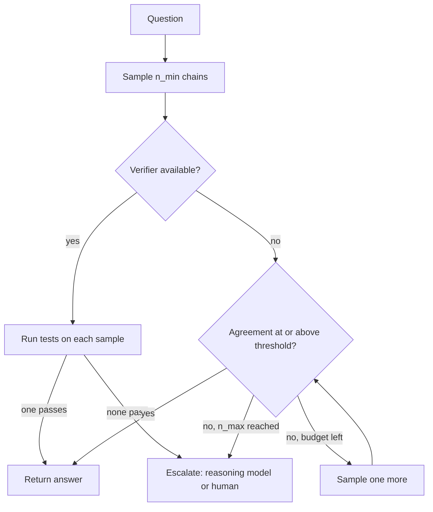

## TL;DR
Test-time compute buys accuracy with more inference: longer thinking, several attempts with a vote or
verifier, or search. For agents it is a per-step budget: spend it on planning and hard decisions, not on
every tool call.

## For agent builders
- **Why it matters for agents.** Agents plan, choose tools and recover from errors, which is exactly the
  multi-step work reasoning helps with. But thinking tokens are billed, delay the first answer token and
  fill the transcript, and an agent pays that on every step it is enabled.
- **Where it shows up in your stack.** Thinking-budget or effort settings on the model API (for example
  `budget_tokens` or `reasoning_effort`), rules for passing thinking blocks back with tool results,
  best-of-N with tests in coding agents, and pass^k in agent evals.
- **What you control.** Which agent steps think and how much, whether you sample several attempts and
  pick with a verifier, how old traces are kept out of history, and when to escalate to a reasoning tier.
- **What you can skip.** GRPO maths and the R1 training stages, unless you train reasoners. Keep "tokens
  are compute", the four strategies, and pass@k versus pass^k.

## Why it exists
- **Compute per token is fixed.** A decoder-only transformer spends L layers, one pass, on every token.
  Whether it completes "2 + 2 =" or "the smallest prime factor of 8,633 is", the depth is identical, so
  problems needing more sequential steps than the layer stack can compose get a guess.
- **Chain of thought adds passes.** Wei et al. (2022) showed that writing intermediate steps lets the model
  use its own output as working memory, turning one hard prediction into many easy ones. Each emitted token
  is another forward pass, so a longer trace is literally more compute spent on the problem.
- **It became a scaling axis.** Self-consistency (Wang et al., 2022) majority-votes several chains;
  accuracy rises because wrong paths disagree while correct ones converge. Coverage, the chance at least one
  of N samples is correct, rises roughly log-linearly in N over a wide range, so anything that recognises a
  correct answer, from a unit test to a reward model, can harvest it.
- **It can beat a bigger model.** Snell et al. showed in 2024 that for a fixed compute budget, spending it
  at inference can beat a larger model, with the best allocation depending on question difficulty. A bigger
  base model is expensive to pre-train and still does fixed compute per token, so it does not remove the
  constraint.
- **Prompted reasoning is shallow, so it is trained.** Prompted chains imitate reasoning from pre-training
  data, rarely backtrack and do not know when to stop. Reasoning models (OpenAI's o-series, DeepSeek-R1, the
  extended-thinking modes of Anthropic and Google models) use RL on checkable maths, code and logic.
  Rewarding the correct final answer is enough to learn exploring, self-verification and self-correction;
  the DeepSeek-R1 report describes these emerging without demonstration.

## How it works
### Where test-time compute pays off in an agent
| Agent step | Spend extra compute? | Strategy |
|---|---|---|
| Initial plan or task decomposition | yes | reasoning mode with a moderate budget |
| Choosing among many tools with subtle differences | often | reasoning, or a cheap model with escalation |
| Writing code or a patch | yes, if tests exist | parallel best-of-N selected by the tests |
| Recovering after a failed tool call | yes | sequential revision with the error in context |
| Parsing a tool result or formatting the answer | no | fast model, low temperature |

### Tokens as computation
- **Each generated token costs a forward pass,** about 2N FLOPs plus attention over the growing context, and
  its result is written into the context where later steps read it through attention.
- **A 2,000-token thinking trace** is therefore 2,000 sequential passes of extra computation with an
  explicit scratchpad.
- **Serial depth comes from the token dimension, not the layer dimension,** which is why chain of thought
  provably extends what a fixed-depth transformer can compute.
- **The exchange rate is explicit:** cost and latency grow linearly with trace length, and the trace
  occupies context and KV-cache memory.

### Four strategies for spending inference compute
| Strategy | How | Best when |
|---|---|---|
| 1. Sequential | one path, more steps: longer chain of thought, self-critique, revision loops | easy questions where the first attempt is nearly right |
| 2. Parallel | N independent samples at temperature above zero, aggregated by majority vote on the final answer (needs a canonical answer) or by a verifier or reward model choosing the best (best-of-N) | hard questions needing diverse attempts |
| 3. Search | expand solutions step by step, score partial solutions with a process reward model, keep the best (beam or tree search over steps) | hard problems where whole samples rarely contain a fully correct path |
| 4. Trained reasoning | the model internalises the first three in one long trace through RL | you control a budget rather than orchestrating samples |

- **Difficulty decides.** Snell et al. found sequential revision wins on easy questions and parallel
  sampling and search on hard ones; a difficulty-aware policy that picks per question was reported to be
  several times (more than 4×) more compute-efficient than a best-of-N baseline.

### Verifiers
- **Outcome vs process reward models.** Outcome reward models score only the final answer; process reward
  models score each step, and Lightman et al. found step-level supervision more reliable for maths.
- **Use a ground-truth checker wherever one exists,** such as unit tests, a calculator or a symbolic solver:
  it is exact and free.
- **That is why maths and code improved most.** The reward there is verifiable, so RL has something clean to
  optimise.
- **Voting needs discrete answers.** For free-form outputs you fall back to an LLM judge or pairwise
  comparison, which brings its own error rate.

### How a reasoning model is trained, in outline
1. **Start from a strong pre-trained model** and run RL on problems with checkable answers.
2. **GRPO (DeepSeek-R1).** Sample a group of responses per prompt (say 16), score each with rule-based
   rewards for a correct final answer and the required format, and give each an advantage equal to its
   reward minus the group mean, divided by the group's standard deviation.
3. **The policy is pushed** toward above-average responses and away from below-average ones.

- **Why the group baseline matters.** PPO needs a learned value network as large as the policy to estimate
  "how good was this state". GRPO replaces it with the other samples for the same prompt, which removes a
  policy-sized model from memory and avoids training a critic on long, sparse-reward traces.
- **Why rule-based rewards.** A learned scorer can be gamed over long RL runs, while "does the answer equal
  42" or "do the tests pass" cannot.

| Stage | What happened |
|---|---|
| R1-Zero | RL directly on the base model; trace length grew as the policy found checking its work raised reward, but traces mixed languages and were hard to read |
| R1 cold start | a small supervised stage on curated long-reasoning examples before RL |
| R1 later stages | supervised fine-tuning on rejection-sampled traces plus general data, then a final RL stage covering general helpfulness as well as reasoning |
| Distillation | fine-tuning smaller models on the big reasoner's traces gives small models that reason far better than their size suggests, with gains concentrated on the distilled domains |

### What you control at inference
- **A thinking budget or effort level,** under vendor-specific names.
- **Trace visibility:** whether it is returned, hidden or summarised.
- **Your own parallel sampling:** temperature and N, plus stopping rules such as an agreement threshold.
- **Budget forcing (open weights).** Cap thinking by inserting the end-of-thinking marker, or extend it by
  suppressing that marker and appending a word such as "Wait" (the s1 work). Crude but direct for tracing
  an accuracy-versus-tokens curve.
- **Costs to remember:** thinking tokens are billed as output tokens, the whole trace precedes the first
  answer token, and the trace competes with your prompt for context.

### Limits
- **Overthinking.** On easy questions long traces add cost without accuracy and can even hurt; some models
  loop in very long traces.
- **Faithfulness.** The visible trace is not guaranteed to reflect the factors that actually drove the
  answer (Turpin et al., 2023); it is not an audit log.
- **Domain.** Gains concentrate where answers are verifiable; on open-ended writing or questions
  bottlenecked by knowledge rather than reasoning, retrieval helps more than thinking.
- **Variance.** Results fluctuate between runs more than single-shot answers, so evaluate with several runs
  and report pass@k or pass^k, not one number.

| Metric | Meaning | Right when |
|---|---|---|
| pass@k | probability at least one of k attempts succeeds | a verifier will pick the winner |
| pass^k | probability all k attempts succeed | a user or agent gets one shot each time and must be reliable |

## Diagram
Difficulty-aware allocation in practice: sample cheaply, stop when paths agree or a verifier passes, and
escalate only the questions that stay contested.



## Misconceptions
- **"Chain of thought is just the model explaining itself."** Each generated token is another forward
  pass whose result later steps read, so a longer trace is literally more serial computation, not
  narration of an answer already computed.
- **"Turn reasoning on for the whole agent and it gets smarter everywhere."** Gains concentrate on
  planning, recovery and verifiable steps; on parsing or formatting, long traces add cost and can hurt.
  In the 15-step example, thinking on every step costs about 3.7× the output tokens of planner-only.
- **"The thinking trace is an audit log of why the agent acted."** Visible traces are not guaranteed to
  reflect the factors that drove the answer, so log tool calls, inputs and verifier results as the
  record instead.
- **"More samples always help."** Majority voting needs discrete answers and wrong paths that scatter;
  if the model is consistently wrong, more samples agree on the wrong value. Without a verifier,
  coverage does not turn into accuracy.
- **"A high pass@k means the agent is reliable."** pass@k counts at least one success and fits
  best-of-N with a checker. An agent that gets one shot needs pass^k: 7 of 10 runs succeeding gives
  pass@5 of 1.00 but pass^5 of only 0.08.

## Examples
### Self-consistency with early stopping and an escalation signal
- **Why voting helps.** If a single chain is right 70% of the time and wrong chains scatter across
  different values, a majority of five is right well above 70%. With independent samples and a binary
  outcome the figure is about 84%, and scattered wrong answers make it better.
- **Agreement doubles as confidence.** High agreement stops spending early; low agreement routes the
  question to a stronger model or a human, a practical version of difficulty-aware allocation.

```python
import collections, re

def llm(prompt, temperature=0.7):
    """Call your model provider here and return the text."""
    raise NotImplementedError

def solve(question, n_max=8, n_min=3, stop_agreement=0.8):
    prompt = f"{question}\nReason step by step, then finish with a line 'ANSWER: <value>'."
    votes, spent = collections.Counter(), 0
    for i in range(1, n_max + 1):
        out = llm(prompt)
        spent += len(out.split())                       # proxy; use the provider's token count in practice
        m = re.search(r"ANSWER:\s*(.+)", out)
        if m:
            votes[m.group(1).strip().rstrip(".")] += 1   # normalise the answer string before voting
        if i >= n_min and votes:
            best, count = votes.most_common(1)[0]
            if count / i >= stop_agreement:              # paths converged: stop spending
                return {"answer": best, "agreement": count / i, "samples": i, "tokens": spent}
    best, count = votes.most_common(1)[0] if votes else (None, 0)
    return {"answer": best, "agreement": count / n_max, "samples": n_max, "tokens": spent,
            "escalate": count / n_max < 0.5}             # low agreement: route to a stronger model or review

print(solve("A train leaves at 09:40 and arrives at 13:05. How many minutes is the journey?"))
# Correct: 205 (3 h 25 min). A common slip is 275 (4 h 35 min, subtracting the minutes the wrong way
# round). If, say, 3 of the first 3 samples say 205, agreement is 1.0 and the loop stops after 3 calls;
# a 2-vs-1 split (0.67) keeps sampling, which is where the extra compute goes.
```

- **Prefer a verifier when one exists.** Run the unit tests on each sampled patch and return the first that
  passes, which turns coverage directly into accuracy.

### Agent scenario: thinking on every step versus planner-only
A 15-step agent: 3 planning or recovery steps and 12 routine tool steps. Each step emits ~200 answer
tokens; thinking adds ~2,000 tokens where enabled. Decode speed is an illustrative 50 tokens/s.

| Policy | Output tokens per task | Decode time per task | Extra context if traces stay in history |
|---|---|---|---|
| Thinking on all 15 steps | 15 × 2,200 = 33,000 | ~660 s | up to 30,000 tokens by the last step |
| Thinking on the 3 planning steps | 3 × 2,200 + 12 × 200 = 9,000 | ~180 s | up to 6,000 tokens |

- **Reading.** Planner-only thinking cuts output tokens about 3.7×. Run both policies on the agent eval: if
  task success is the same, the extra 24,000 tokens per task bought nothing.
- **Context.** Dropping earlier traces from history (where the API allows it) keeps the transcript and the
  KV cache from growing by the trace length every step.

### pass@k, pass^k and the GRPO advantage, in numbers
Runnable, pure Python. The pass@k form is the standard unbiased estimator from n runs with c successes;
pass^k is computed the same way for "all k succeed".

```python
from math import comb
from statistics import mean, pstdev

def pass_at_k(n, c, k):      # at least one of k succeeds
    return 1 - comb(n - c, k) / comb(n, k)

def pass_hat_k(n, c, k):     # all k succeed
    return comb(c, k) / comb(n, k)

n, c = 10, 7                 # 10 runs of one task, 7 succeeded
for k in (1, 3, 5):
    print(f"k={k}: pass@k={pass_at_k(n, c, k):.2f}  pass^k={pass_hat_k(n, c, k):.2f}")

rewards = [1] * 4 + [0] * 12                   # group of 16 samples, 4 correct
mu, sd = mean(rewards), pstdev(rewards)
print([round((r - mu) / sd, 2) for r in (1, 0)])   # advantage of a correct and a wrong sample
```

| k | pass@k | pass^k | Reading |
|---|---|---|---|
| 1 | 0.70 | 0.70 | identical for one attempt |
| 3 | 0.99 | 0.29 | a verifier almost always finds a winner; three clean runs in a row are unlikely |
| 5 | 1.00 | 0.08 | great for best-of-5 with tests, poor for an agent that must succeed every time |

- **GRPO advantages for that group:** a correct sample gets about +1.73 and a wrong one about −0.58, so the
  rare correct answers are pushed up hard. Implementations differ in details such as the standard
  deviation estimator.

## Production patterns
- **Think per agent step, not per agent.** Enable reasoning (or a larger budget) on planning, tool
  selection among many similar tools and error recovery, and keep routine parsing and formatting steps on
  a fast setting. Log thinking tokens and latency per step type, and compare task success against
  all-steps thinking on the agent eval.
- **Difficulty-aware routing.** Send traffic to a fast model first and escalate on low agreement, a failed
  verifier or a failed schema check, as in `solve` above. Monitor escalation rate, cost per solved task and
  p95 latency per tier.
- **Set the thinking budget per route, not globally.** Use the vendor's knob, for example `budget_tokens`
  in Anthropic extended thinking or `reasoning_effort` on OpenAI reasoning models, and pick the knee of the
  accuracy-versus-tokens curve measured on each route's eval set. Leave `max_tokens` room for both the
  trace and the answer.
- **Verifier-gated best-of-N for code.** Sample N patches in parallel, run the test suite on each, and
  return the first that passes. Monitor pass@1 against pass@N and track flaky or missing tests, because
  weak tests let wrong patches through.
- **Account for thinking tokens explicitly.** Log thinking and answer tokens separately in cost dashboards,
  and keep earlier traces out of agent history unless the API requires them (Anthropic, for example,
  needs the thinking block passed back with tool results inside the same turn), so they do not fill the
  context window.
- **Evaluate with repeated runs.** Run each eval item several times and report pass@k for verifier-backed
  flows and pass^k for one-shot user-facing flows, with means over seeds rather than a single run.
- **Keep prompts plain for reasoning models.** Drop chain-of-thought instructions and reasoning few-shots
  that several vendors advise against, and A/B the plain prompt against the old one on the eval set.

## Trade-offs
- **Smarter steps vs slower agents.** Thinking improves planning and recovery, but its cost and latency
  repeat on every enabled step of a long loop; it pays on the few decisive steps and rarely on routine
  tool calls.
- **Accuracy vs cost and latency.** Accuracy on verifiable multi-step tasks rises with inference budget, but
  cost and latency rise linearly with tokens; the trade flips when the task is easy, high-volume or
  latency-bound, where a fine-tuned small model wins.
- **Parallel vs sequential.** Parallel sampling keeps latency near one sample but multiplies cost by N;
  sequential long traces can need fewer total tokens for the same gain on some problems, but the latency is
  the bill.
- **Verifier selection vs majority vote.** A verifier extracts far more from N samples than a vote, but
  needs a verifier: with tests or solvers it is nearly free, with an LLM judge you have added error and cost.
- **Reasoning models vs plain tasks.** Large out-of-the-box gains on maths, code and planning, but traces
  are billed and consume context, and on extraction or classification they add cost with little gain.
- **Distilled small reasoners vs teacher quirks.** Much of the capability cheaply, but they inherit the
  teacher's trace style and tendency to overthink, and gains are strongest on the distilled domains.

## Pitfalls
- **Turning reasoning on for every request.** Symptom: cost per request rises several-fold and p95 latency
  explodes with no measurable quality change on the simple tasks that dominate traffic. Fix: enable it per
  route where the eval shows a gain.
- **Treating the thinking trace as an explanation.** Symptom: a trace that reads soundly while the answer
  was driven by a bias the trace never mentions. Fix: audit inputs, outputs and decisions directly.
- **Majority-voting free-text answers.** Symptom: near-zero agreement because no two strings match. Fix:
  normalise the answer or use a judge.
- **Evaluating with a single run.** Symptom: swings of several points between runs of the "same" eval.
  Fix: report means over several seeds or pass^k.
- **Forgetting the trace in context budgeting.** Symptom: truncated answers or length errors deep in agent
  loops as thinking tokens fill the window. Fix: budget context for trace plus answer and drop old traces.
- **Loading a reasoning model's prompt with chain-of-thought instructions and reasoning few-shots.**
  Several vendors advise against it because it can degrade results. Fix: keep the prompt plain and let the
  model think.
- **Assuming the budget knob is linear in quality.** Symptom: paying for 4× the tokens and getting the
  accuracy of 2× because nobody measured the accuracy-versus-tokens curve on the real task. Fix: measure
  the curve per route and set the budget at the knee.

## When to use
- **Use in agents for:** planning, decomposition, choosing among similar tools, recovering from a failed
  call, and code steps where tests can select among samples.
- **Use when** the task has multi-step structure and a checkable, or at least judgeable, answer: maths, code
  generation and debugging, planning inside agents, complex data transformations, and hard classifications
  where a rationale changes the verdict.
- **Measure** the accuracy-versus-tokens curve on your own eval at several budgets and sample counts, pick
  the knee, and add difficulty-aware routing: a cheap model first, escalation on low agreement or a failed
  verifier.
- **Avoid for** latency-bound chat, simple extraction, or questions bottlenecked by knowledge, where
  retrieval wins.
- **Interviews:** explain why extra tokens are extra compute, contrast parallel and sequential strategies and
  when each wins, sketch how R1-style RL works, and raise the faithfulness caveat unprompted.

## Role lens
- **Engineer:** Implements thinking budgets, sampling with early stopping and verifier gates, tracks thinking
  tokens in cost dashboards, and keeps traces out of the next prompt unless they are needed.
- **Architect:** Decides which tasks earn a reasoning tier, defines routing between fast and reasoning models
  by difficulty signals, and sets latency and cost budgets per tier.
- **FDE:** Shows a customer the accuracy-versus-cost curve on their own hard cases, so the choice between a
  bigger model, a reasoning mode and more samples is made with their numbers rather than a benchmark.

## Check yourself
**Q:** A team's coding agent solves 60% of tasks with a standard model. They can switch to a reasoning
model at roughly five times the token cost, sample the standard model five times and pick with the test
suite, or fine-tune. How do you reason about the choice?
**A:** Start from the verifier: they have unit tests, so best-of-five with the suite as selector is cheap
and exact, coverage rises steeply with N, the five samples parallelise so latency stays near one attempt,
and the cost is similar to the reasoning model's. Its weakness is incomplete tests, which let wrong patches
pass. The reasoning model likely raises single-shot accuracy and helps most on tasks needing long-horizon
planning, where sampling rarely finds a complete solution, and where tests are weak. The pragmatic design is
to combine them: standard model first with test-based selection, escalation to the reasoning model on
tasks that fail. Fine-tuning helps only if failures are stylistic or convention-related and there is data.
Decide on pass@1, pass@5 and cost per solved task measured on their task set.

## Interview questions
### What is test-time compute, and what are the main ways to spend it?
- **Definition:** extra inference computation per query to get a better answer, which works because each
  generated token is another forward pass with a scratchpad.
- **Ways:** sequential (longer chains, revision), parallel (N samples with a vote or verifier), search over
  partial solutions scored by a process reward model, or a trained reasoning model with a budget knob.
- **Which wins:** sequential revision on easy questions, parallel and search on hard ones, per Snell et al.

### When would you report pass@k and when pass^k?
- **pass@k** when a verifier picks the winner, such as tests choosing among k patches; it measures whether
  any attempt succeeds.
- **pass^k** when a user or agent gets one shot each time and must be reliable; it measures whether all k
  attempts succeed.
- **They diverge fast:** 7 successes in 10 runs gives pass@5 of 1.00 but pass^5 of about 0.08.

### Your agent got more accurate with a reasoning model but each task now takes four times as long. What do you change?
- **Find the decisive steps:** log success and thinking tokens per step type; usually planning and error
  recovery carry the gain.
- **Think only there:** keep routine tool steps on a fast setting or a fast model, and measure task
  success against the all-steps baseline.
- **Trim the rest:** drop old traces from history where the API allows, and set budgets per step at the
  knee of the accuracy-versus-tokens curve.

### How would you use test-time compute in a coding agent that has a test suite?
- **Parallel best-of-N:** sample several patches and run the tests on each; the first that passes wins,
  turning coverage into accuracy at near single-attempt latency.
- **Escalate the misses:** tasks where no sample passes go to a reasoning model or a human.
- **Guard the verifier:** weak or flaky tests let wrong patches through, so track pass@1 against pass@N and
  review test coverage.

### After enabling a reasoning mode for all traffic, cost rose fivefold with no quality gain. How do you fix it?
- **Segment the traffic:** most requests are probably simple extraction or chat, where long traces add cost
  and latency without accuracy.
- **Route by difficulty:** fast model first, reasoning tier only on low agreement, failed verifiers or
  task types that showed gains on the eval.
- **Tune the budget:** measure accuracy against thinking tokens per route and set the budget at the knee,
  since quality is not linear in budget.

### Can you use a reasoning model's thinking trace as an audit log for its decisions?
- **No.** The visible trace is not guaranteed to reflect the factors that drove the answer (Turpin et al.,
  2023), so it can read soundly while a bias it never mentions drove the verdict.
- **Instead** log inputs, outputs, tool calls and verifier results, and evaluate decisions for bias
  directly.

## Quiz
### Q: Why does writing out intermediate steps let a transformer solve problems it fails on when asked for the answer directly?
- [ ] The steps are copied from similar problems in the training data
- [x] Each generated token is another forward pass, so the trace adds sequential computation and an external working memory beyond the fixed per-token depth
- [ ] It lowers the effective sampling temperature
- [ ] Intermediate steps reduce the size of the KV cache
> A forward pass has fixed depth, so multi-step problems need more passes. Emitting tokens provides them,
> and attention lets later steps read earlier results. The trace grows the KV cache rather than shrinking
> it, and temperature is unchanged.

### Q: When does parallel sampling with majority vote fail to help, even with many samples?
- [ ] When the problem is a maths word problem
- [ ] When the temperature is above zero
- [x] When the model's errors are systematic, so wrong paths converge on the same wrong answer, or when answers are free text that cannot be matched
- [ ] When the model is a reasoning model
> Voting works because independent wrong paths disagree while correct ones agree. A shared misconception
> breaks that assumption, and free-text answers break the matching step; a verifier or a judge is needed in
> both cases.

### Q: Which claim about a reasoning model's thinking trace is correct?
- [ ] It is a faithful record of the computation and can serve as an audit log
- [x] It is billed as output tokens, consumes context, and may not reflect the factors that actually drove the answer
- [ ] It is free because it is discarded before the answer is produced
- [ ] Longer traces always improve accuracy
> Traces are generated tokens with all the usual costs, and research on chain-of-thought faithfulness shows
> they can omit the real reasons behind an answer. Longer is not always better; on easy tasks it adds cost
> and can reduce accuracy.

## Use cases & projects
### Use cases
- **Planner steps in multi-step agents.** A reasoning setting on the decomposition step, a fast setting on
  the tool calls that follow.
- **Coding agents with tests.** Best-of-N patches selected by the test suite, escalating unsolved tasks to
  a reasoning tier.
- **Difficulty-aware routing.** A fast model answers first; low agreement or a failed verifier escalates
  to a reasoning model.
- **Agent evals.** Reporting pass^k for agents that must succeed every time, and pass@k where a verifier
  picks the winner.

### Mini project
**Find the right thinking budget per agent step (2-3 hours).**
- **Goal:** show where reasoning helps a small agent and where it only adds cost.
- **Steps:** build a 5-step agent (plan, two tool calls, check, answer) on 30 tasks with checkable answers;
  run it with thinking off, on for the plan step only, and on for all steps, three runs each; log task
  success, thinking tokens and wall-clock per step.
- **Done when:** a table shows task success (mean and pass^3), tokens and latency per policy, and you can
  name the cheapest policy whose success is within run-to-run noise of the best (about one task in 30).
