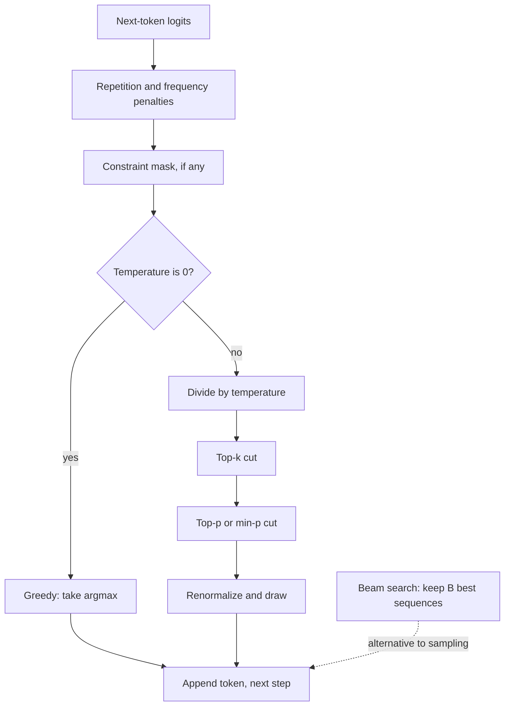

## TL;DR
Sampling settings decide how each next token is picked, and an agent pays for them on every step. Run
tool calls and extraction near temperature 0, sample with top-p only where variety helps, and never treat
temperature 0 as reproducible.

## For agent builders
- **Why it matters for agents.** An agent makes many model calls per task, so small per-step error rates
  compound: a 1% chance of a malformed or wrong tool call per step leaves only about 82% of 20-step runs
  clean. Sampling settings are one of the cheapest levers on that rate.
- **Where it shows up in your stack.** The `temperature`, `top_p`, `n` and penalty parameters on every
  chat or tool-calling request; `SamplingParams` in vLLM; `model.generate(...)` arguments in Hugging Face
  Transformers when self-hosting.
- **What you control.** A sampling profile per agent step (planner, tool-argument filling, final answer,
  drafting), whether to sample several candidates and vote or verify, and how your eval and replay
  harness treats non-determinism.
- **What you can skip.** Beam search internals, unless your agent includes translation or transcription;
  it is rarely used for chat or tool calling.

## Why it exists
- **The model outputs a distribution, not a token.** A 100k-entry distribution has a long tail of
  individually unlikely tokens, and something must collapse it to one choice. Every obvious way fails
  somewhere.
- **Greedy is locally best, globally not.** Picking the argmax each step is deterministic and cheap, but a
  sequence of locally best tokens is not the best sequence. Greedy text falls into repetition loops: once a
  phrase appears, repeating it becomes the most likely continuation, which makes repeating it again even
  more likely.
- **Beam search finds the bland answer.** Keeping the *B* best partial sequences fixes local-versus-global,
  yet Holtzman et al. (2020) showed the highest-likelihood open-ended continuations are exactly the bland,
  repetitive ones. Human text is consistently *less* likely than beam output, because people say
  surprising things.
- **Pure sampling derails.** The tail holds a few percent of mass per step, and small risks compound. If
  2% sits on tokens that do not fit (an illustrative figure), a 300-token answer avoids all of them with
  probability 0.98³⁰⁰ ≈ 0.2%. Once a derailment is in the context, the model conditions on it and degrades,
  and in an agent the derailed text may be a tool argument that gets executed.
- **So reshaping and truncation exist.** Temperature, top-k and top-p keep sampling's diversity while
  cutting off the tail that causes incoherence.

## How it works
### Reshaping: temperature
- **Mechanism.** Logits `z` are divided by *T* before softmax. `T < 1` sharpens toward the top token,
  `T > 1` flattens, and `T = 0` is treated as greedy by every engine rather than as a division.
- **Ranking is unchanged.** Because temperature rescales all logits, it changes only how much mass the
  leaders hold.
- **The most used knob.** Near 0 for extraction, classification, code and tool arguments, where
  consistency matters; around 0.7–1.0 for drafting and brainstorming.

### Truncating: top-k, top-p and min-p
| Method | Keeps | Strength | Weakness |
|---|---|---|---|
| **Top-k** | the *k* highest-probability tokens, then renormalizes | simple and bounded | blind to shape: when the model is certain, 40 candidates include junk; among 200 reasonable words, 40 is too few |
| **Top-p (nucleus)** | the smallest set whose cumulative mass reaches *p*, then renormalizes | adapts: a peaked distribution yields one or two tokens, a flat one many | can admit many tokens on very flat distributions |
| **Min-p** | tokens with `p_i ≥ min_p · p_max` | adapts and scales with the leader, so it behaves well at high temperature | supported in vLLM and llama.cpp among others, not everywhere |

- **Why nucleus became the default over top-k:** its candidate set adapts to the model's confidence.
- **It is a pipeline.** Engines typically apply temperature first, then top-k, then top-p. Order matters
  because truncation after temperature sees a reshaped distribution.
- **Penalties come earlier.** Repetition, frequency and presence penalties sit earlier in the same pipeline
  and lower the logits of tokens that already appeared.

### Searching: greedy versus beam
**Why greedy is not optimal, in numbers.** The first step offers A at 0.5 and B at 0.4. The best
continuation after A has probability 0.3; after B, 0.9.

| Path | Sequence probability |
|---|---|
| Greedy commits to A | 0.5 × 0.3 = 0.15 |
| Keep both prefixes alive, take B | 0.4 × 0.9 = 0.36 |

A locally weaker token can open a far more likely sequence. Greedy is beam search with `B = 1`.

1. **Expand** each of *B* partial sequences by the vocabulary.
2. **Score** all candidates by cumulative log-probability.
3. **Keep** the best *B*, and repeat until each beam ends.
4. **Apply a length penalty,** usually, because longer sequences accumulate more negative log-prob and
   would otherwise lose unfairly.

- **Cost.** *B* sequences' worth of compute per step (one batched pass) and *B* KV caches.
- **No clean streaming,** because the winning beam is only known at the end.
- **Right tool** when there is a single correct target and the metric rewards likelihood: machine
  translation, speech recognition, grammar correction. For chat, tool calling and creative generation it
  is rarely used.

### Determinism, and what it means for agent replay
- **`T = 0` fixes the choice, not the logits.** Batched kernels, different batch compositions and
  non-associative floating-point reductions can change low-order bits; when two tokens are nearly tied the
  argmax flips.
- **A seed** makes sampling reproducible under the same conditions, not across hardware or engine versions.
- **So** treat "temperature 0" as "much more stable", not "reproducible". One flipped token early in an
  agent run (a different tool chosen) can send the whole trajectory elsewhere; replay harnesses record
  model outputs rather than expecting to regenerate them.

### Interactions worth knowing
- **Constrained decoding** (JSON schemas, grammars) masks logits *before* sampling, so it composes with any
  strategy and is the usual way to make tool calls parse.
- **Some reasoning-oriented APIs fix the temperature** and reject the parameter, because their training
  assumed a particular sampling regime.
- **Change temperature *or* top-p, not both.** Vendor documentation generally advises this because their
  effects overlap and tuning both obscures which one moved the result.

## Diagram
One decode step: penalties and temperature reshape the logits, truncation cuts the tail, then the
strategy decides how the next token is chosen. An agent runs this for every token of every step.



## Examples
### A sampler with the usual pipeline
A compact sampler that applies temperature, top-k and top-p in the usual order, run against a toy
seven-token distribution so the effect of each setting is visible:
- **`top_p = 0.9`:** the nucleus is tokens 0–4 (cumulative mass 0.93 is the first to reach 0.9).
- **`top_k = 3`:** keeps tokens 0–2.
- **Adding `temperature = 0.5`:** sharpens the distribution so the same `top_p` nucleus shrinks to tokens
  0–1.

```python
import torch

def sample_next(logits, temperature=1.0, top_k=0, top_p=1.0, generator=None):
    """logits: [vocab]. Order matches common engines: temperature, then top-k, then top-p."""
    if temperature == 0:                                   # "T = 0" means greedy, not a division
        return int(logits.argmax())
    z = logits.float() / temperature
    if top_k > 0:
        kth = torch.topk(z, top_k).values[-1]
        z = z.masked_fill(z < kth, float("-inf"))          # drop everything below the k-th score
    if top_p < 1.0:
        sz, idx = torch.sort(z, descending=True)
        p = torch.softmax(sz, -1)
        before = p.cumsum(-1) - p                          # mass strictly ahead of each token
        sz = sz.masked_fill(before >= top_p, float("-inf"))  # keep the smallest set reaching top_p
        z = torch.full_like(z, float("-inf")).scatter(0, idx, sz)
    probs = torch.softmax(z, -1)                           # renormalize over the survivors
    return int(torch.multinomial(probs, 1, generator=generator))

probs = torch.tensor([0.50, 0.20, 0.10, 0.08, 0.05, 0.04, 0.03])
logits = probs.log()
g = torch.Generator().manual_seed(0)
for cfg in [dict(temperature=0), dict(top_k=3), dict(top_p=0.9),
            dict(temperature=0.5, top_p=0.9), dict(temperature=1.5)]:
    draws = [sample_next(logits, generator=g, **cfg) for _ in range(2000)]
    print(f"{cfg}: tokens seen = {sorted(set(draws))}")
```

### Agent scenario: per-step sampling profiles
Different steps of one agent want different settings. Keep them in config next to the model version so
evals and replays know exactly what ran.

```python
# One profile per agent step; values are common starting points to tune on your eval set.
PROFILES = {
    "plan":        {"temperature": 0.3},                    # some exploration, still focused
    "tool_args":   {"temperature": 0.0},                    # plus schema-constrained output
    "final_answer":{"temperature": 0.2},
    "draft_ideas": {"temperature": 0.8, "top_p": 0.9, "n": 3},
}

def call(client, model, step, messages, **extra):
    params = PROFILES[step]
    resp = client.chat.completions.create(model=model, messages=messages, **params, **extra)
    log_step(step=step, model=model, params=params)          # record what ran, for replay and evals
    return resp
```

`log_step` stands for your tracing call. The `n` parameter is offered by some APIs and engines, not all;
where it is missing, issue several requests.

### Worked scenario: compounding error over a 20-step agent run
Assume each step independently has some chance of a malformed or wrong tool call (illustrative rates).

| Per-step failure rate | Clean 20-step runs | What usually gets you there |
|---|---|---|
| 2% | 0.98²⁰ ≈ 67% | free sampling at temperature 1 |
| 1% | 0.99²⁰ ≈ 82% | low temperature, no schema |
| 0.5% | 0.995²⁰ ≈ 90% | temperature 0 plus validation and retry |
| 0.1% | 0.999²⁰ ≈ 98% | schema-constrained tool calls at temperature 0 |

Per-step reliability that looks fine in a single-call eval becomes a large failure rate across a run,
which is why agent evals score whole trajectories.

### Why the tail matters: compounding per-step risk
Pure Python: the chance that a long answer never draws a misfit token, for a few illustrative per-step
tail masses. This is the arithmetic behind truncation.

```python
for tail in (0.005, 0.01, 0.02):
    for length in (50, 300):
        clean = (1 - tail) ** length
        print(f"tail {tail:.1%} per step, {length:3d} tokens: {clean:6.1%} chance of no misfit")
# tail 0.5%: 50 tokens 77.8%, 300 tokens 22.2%
# tail 1.0%: 50 tokens 60.5%, 300 tokens  4.9%
# tail 2.0%: 50 tokens 36.4%, 300 tokens  0.2%
```

| Per-step misfit mass (illustrative) | 50-token answer clean | 300-token answer clean |
|---|---|---|
| 0.5% | ~78% | ~22% |
| 1% | ~60% | ~5% |
| 2% | ~36% | ~0.2% |

Long outputs are where untruncated sampling fails, which is why top-p or min-p matters more as answers
grow.

## Production patterns
- **Pin a sampling profile per agent step.** Store temperature, top-p and penalties in config next to the
  model version, for example `temperature=0` for extraction and tool arguments and
  `temperature=0.8, top_p=0.9` for drafting. Monitor format-failure rate and re-run the eval whenever the
  model or profile changes.
- **Sample n and select for reasoning steps.** When a verifier or majority vote exists, request several
  samples (vLLM's `SamplingParams(n=5, temperature=0.8)`, or the API's `n` parameter where offered) and
  pick by vote or verifier (tests for a coding agent). Monitor accuracy gain against the linear increase
  in output tokens.
- **Record outputs for replay, do not regenerate them.** Log sampling parameters, engine version and the
  model's actual outputs per agent step, so a failed run can be replayed exactly with tools stubbed.
  Monitor how often re-running a trace diverges.
- **Test outputs semantically, not byte-for-byte.** Even at `T = 0`, assert on parsed fields, chosen
  tools or similarity rather than exact strings. Monitor golden-test flakiness after engine upgrades.
- **Penalize repetition only on free text.** Enable a mild frequency or presence penalty on prose
  endpoints and keep it off where constrained decoding produces JSON. Monitor a repetition metric, such as
  the share of repeated n-grams, per endpoint.
- **Use beam search only for likelihood-scored tasks.** For translation or grammar correction with Hugging
  Face, `model.generate(..., num_beams=4, length_penalty=1.0)`. Monitor the task metric and latency,
  since beams block streaming.
- **Tune one knob at a time over a grid.** Sweep temperature with top-p fixed (or the reverse) on a
  labelled set and choose by task accuracy and format-failure rate, not by values copied from another model.

## Trade-offs
- **Low temperature vs diversity.** It buys consistency and higher per-token accuracy on single-answer
  tasks but costs diversity; the trade flips when the task rewards variety, such as multiple candidates or
  an agent that must try a different approach after a failure.
- **Top-p vs top-k.** Top-p adapts the candidate set to the model's confidence; top-k gives a hard bound.
  Top-k is safer when a flat distribution must never admit hundreds of options.
- **Beam search vs cost and streaming.** It raises likelihood and translation-style accuracy, but
  multiplies compute and memory by the beam width and blocks streaming. It loses for open-ended text,
  where likelihood is the wrong objective.
- **Many samples vs tokens.** Sampling several diverse answers and voting or reranking improves accuracy
  on reasoning tasks, at a linear cost in tokens that only pays off when a verifier or majority signal
  exists.

## Pitfalls
- **Expecting identical outputs at temperature 0.** Across runs or deployments, the symptom is flaky golden
  tests or agent replays that diverge on near-tied tokens after an engine or batch-size change. Fix:
  assert on parsed fields or semantic similarity, not exact strings, and replay recorded outputs.
- **Greedy or beam for long free-form generation.** Symptom: paragraphs that repeat a sentence or phrase
  verbatim, sometimes indefinitely until the token limit. Fix: sample with top-p or min-p truncation.
- **Raising temperature to "make the model more creative" on extraction or code.** Symptom: more malformed
  output and invented fields, which evaluation then attributes to the prompt. Fix: keep these endpoints
  near 0 and change the prompt or data instead.
- **One temperature for every agent step.** A single high value makes tool arguments flaky; a single zero
  makes retries repeat the same failed action. Fix: per-step profiles, and vary the prompt or raise
  temperature only on retry.
- **Tuning temperature and top-p simultaneously.** Results move but it is unclear which knob did it, and
  settings copied between models behave differently because logit scales differ. Fix: sweep one knob per
  model on a labelled set.
- **A strong repetition penalty on structured output.** Symptom: JSON that avoids repeating a required key
  or closing bracket because the token was penalized. Fix: turn penalties off on structured endpoints.

## When to use
- **One right answer and a downstream parser (tool calls, extraction):** temperature at or near 0,
  optionally with constrained decoding, and keep top-p at its default.
- **Drafting, ideation or candidates for a reranker:** temperature 0.7–1.0 with top-p around 0.9, or min-p
  if the engine offers it.
- **Translation or transcription scored by likelihood-correlated metrics:** beam search with a modest width
  and a length penalty.
- **Measure** task accuracy and format-failure rate across a small grid rather than copying numbers from a
  blog; the same temperature means different things for different models.
- **Interviews:** day to day the strategy is a few request parameters; expect to explain why greedy
  repeats, why nucleus beat top-k, why beam search is wrong for chat, and how you set sampling per agent step.

## Role lens
- **Engineer:** Sets temperature, top-p and penalties per endpoint, pins them in config alongside the
  model version, and tests format-failure rate when either changes.
- **Architect:** Defines sampling policy per workload class, from deterministic-leaning extraction to
  diverse candidate generation, and how determinism claims are communicated to customers.
- **FDE:** Diagnoses a customer's "the model is inconsistent" or "it keeps repeating itself" by reading
  the sampling parameters before touching the prompt.

## Check yourself
**Q:** A team generating product descriptions complains that greedy decoding repeats phrases, but when
they switched to plain sampling at temperature 1 the text occasionally became nonsensical. What would you
recommend and why does each failure happen?
**A:** Greedy repeats because repetition is self-reinforcing under the model: once a phrase appears,
repeating it is the single most likely continuation, and taking the argmax every step never escapes.
Plain sampling fixes that but draws from the full tail, where a few percent of mass per step sits on
tokens that make no sense in context; over a long description one of them is eventually drawn, and the
model then conditions on its own mistake. The fix is to keep sampling but truncate the tail: top-p
around 0.9 (or min-p) so the candidate set adapts to confidence, temperature around 0.7–0.8 to favour
the leaders without flattening, and a mild frequency penalty if repeats persist. Validate with a
repetition metric and a human spot-check across a small parameter grid rather than one setting.

## Interview questions
### Compare top-k, top-p and min-p. Which would you default to and why?
- **Top-k** keeps a fixed number of tokens, which is blind to how confident the model is at each step.
- **Top-p** keeps the smallest set reaching a cumulative mass, so it shrinks when the model is sure and
  grows when it is not; that adaptivity made it the default.
- **Min-p** keeps tokens above a fraction of the leader's probability and holds up better at high
  temperature, so prefer it where the engine supports it.

### Show why greedy decoding is not the same as finding the most likely sequence.
- **Counterexample:** step one offers A at 0.5 and B at 0.4; the best continuation after A is 0.3, after B
  0.9. Greedy ends at 0.15, while B then its continuation reaches 0.36.
- **Beam search** keeps several prefixes alive to catch such cases, at *B* times the compute and KV memory.

### How would you set sampling parameters across the steps of a tool-calling agent?
- **Cold for structure.** Tool selection and arguments at or near temperature 0 with schema-constrained
  output, because errors compound across steps (1% per step leaves about 82% of 20-step runs clean).
- **Warmer only where variety pays,** such as drafting or generating candidates for a verifier, and vary
  the prompt or temperature on retries so the agent does not repeat the same failed call.

### Golden tests at temperature 0 started failing after an inference engine upgrade. How do you respond?
- **Expect it.** Kernel and batching changes alter low-order bits of the logits, and near-tied tokens flip
  their argmax, so byte-exact outputs were never guaranteed.
- **Fix the tests.** Assert on parsed fields or semantic similarity, log sampling parameters and engine
  version per request, and re-baseline only after the eval suite confirms accuracy held.

### When would you choose beam search in production, and what does it cost?
- **Choose it** when there is one correct target and the metric tracks likelihood: translation, speech
  recognition, grammar correction, with a modest width and a length penalty.
- **Cost:** *B* times the per-step compute and *B* KV caches, and no clean streaming because the winner is
  known only at the end. Avoid it for chat, where likelihood favours bland text.

### Sampling five answers and majority-voting improved your agent's accuracy. When is that worth it?
- **When a selection signal exists.** Majority vote on short final answers or a verifier such as tests or
  a checker model; without one, extra samples add cost and no accuracy.
- **Do the maths.** Output tokens rise roughly fivefold, so compare the accuracy gain with the cost per
  request and latency budget, and consider sampling more only on low-confidence requests.

## Quiz
### Q: Why did nucleus (top-p) sampling largely replace top-k as the default truncation method?
- [ ] It is cheaper to compute than top-k
- [x] Its candidate set adapts to the shape of the distribution, keeping few tokens when the model is confident and many when it is not
- [ ] It guarantees deterministic output
- [ ] It removes the need for temperature
> A fixed k admits junk when the model is sure and excludes good options when it is unsure. A
> cumulative-mass threshold sizes the set to the model's confidence at each step.

### Q: Why is beam search a poor choice for open-ended chat responses?
- [ ] It cannot be combined with a KV cache
- [ ] It only works with encoder–decoder models
- [x] It maximizes sequence likelihood, and for open-ended text the most likely continuations are bland and repetitive
- [ ] It ignores the system prompt
> Human text is less likely than beam output under the model because it is surprising. Beam search finds
> high-likelihood text, which is what you want in translation and exactly what you do not want in chat.

### Q: With temperature set to 0, why can two identical requests still produce different outputs?
- [ ] The engine ignores temperature 0 and samples anyway
- [x] Floating-point reductions and batch composition can change logits slightly, flipping near-tied argmax choices
- [ ] The tokenizer is non-deterministic
- [ ] Top-p is still applied randomly
> Argmax is deterministic given the logits, but the logits themselves vary at the low-order bits with
> kernel choice and batching; when two tokens are almost tied, that is enough to change the winner.

## Use cases & projects
### Use cases
- **Reliable tool-calling agents.** Cold sampling plus schema constraints keeps per-step failure low
  enough that long runs finish.
- **Coding agents with tests.** Several samples at moderate temperature, filtered by running the tests,
  beat a single greedy attempt when a verifier exists.
- **Agent evals and replay.** Knowing temperature 0 is not reproducible shapes how teams record traces
  and assert on outcomes.
- **Creative or ideation agents.** Higher temperature with top-p or min-p truncation gives variety
  without derailing long drafts.

### Mini project
**Measure sampling settings on a tool-calling agent (2-3 hours).**
- **Goal:** find the sampling profile that maximizes clean whole-run completion for a small agent.
- **Steps:** build an agent with three tools and 20 tasks that each need 3-6 tool calls; run every task 5
  times at temperature 0, 0.5 and 1.0, with and without schema-constrained tool calls; log per-step
  parse failures, wrong-tool choices and whole-run success.
- **Done when:** you have a table of per-step failure rate and run success for each setting, the observed
  run success roughly matches per-step reliability compounded over the run, and you can name the profile
  you would ship.
