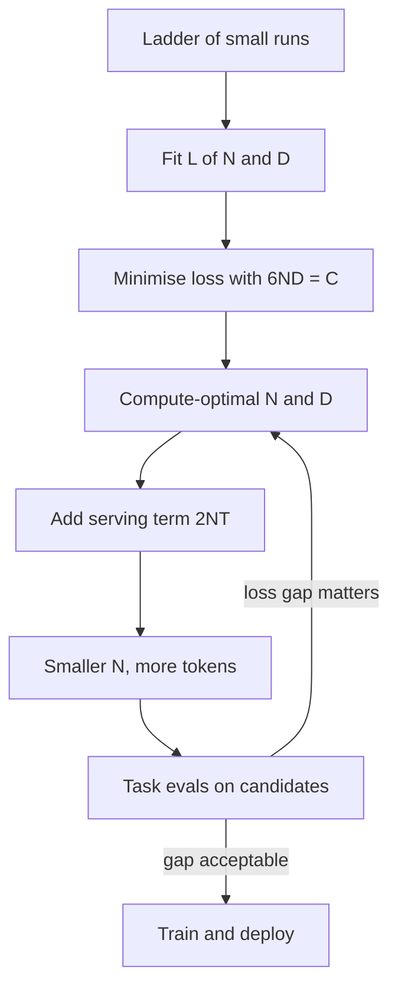

## TL;DR
Scaling laws predict pre-training loss from parameters N, tokens D and compute C. For agent builders they
explain why small over-trained models are strong, why agent calls cost about 2N FLOPs per token, and why
benchmarks do not predict agent success.

## For agent builders
- **Why it matters for agents.** An agent multiplies per-token cost by many calls and long transcripts,
  so the 2N-FLOPs-per-token rule is how you compare candidate models on cost per task. The laws also explain
  why a recent 8B can replace an older 70B for some agent steps.
- **Where it shows up in your stack.** Model cards (parameters, training tokens), model-selection and
  cost spreadsheets, and the "bigger model or more reasoning effort" decision for hard agent steps.
- **What you control.** Which model size backs each agent role, and whether you buy accuracy with a bigger
  model, more test-time compute or better retrieval. You do not fit scaling laws yourself.
- **What you can skip.** The fitting methods, the published constants and the Kaplan-versus-Chinchilla
  history beyond one sentence. Keep 6ND, 2N per token, tokens per parameter, and "loss is smooth, task
  metrics are not".

## Why it exists
- **Frontier runs are too expensive to guess.** A frontier run is on the order of 10²⁵ FLOPs (illustrative)
  and months of accelerator time, so you cannot grid-search the design. Deciding size and training length
  used to be craft.
- **Extrapolation replaces guessing.** Train a ladder of small models spanning several orders of magnitude
  of compute, fit a curve, and read off the best configuration for the budget you actually have.
- **Kaplan (2020) licensed "just scale it".** Loss is a clean power law in N, D and C across many orders of
  magnitude, and depth versus width matters far less than scale. But the fit said grow parameters much
  faster than data, which produced under-trained giants such as Gopher (280B parameters on about 300B
  tokens).
- **Chinchilla (2022) corrected the split.** Hoffmann et al. matched the learning-rate schedule to each
  run's length and found compute-optimal training scales N and D roughly equally, about 20 tokens per
  parameter. Chinchilla, 70B parameters on 1.4T tokens, beat Gopher at the same training compute. Nothing
  about the architecture changed; the budget split did.
- **"Bigger is always better" fails twice.** At a fixed budget it wastes compute on parameters that never
  see enough data. And every parameter is paid for again on every token served, which for a popular model
  is far more compute than training.

## How it works
### What you use as an agent builder
1. **Cost per agent task.** Every processed token (prompt and generated) costs about 2N FLOPs, so an agent
   step over a 30k-token transcript on a 70B model costs about 9× the same step on an 8B.
2. **Model-card sanity check.** Tokens per parameter tells you whether a model is under-trained (about 1),
   compute-optimal (about 20) or over-trained for cheap serving (hundreds to thousands).
3. **Do not extrapolate task success.** Loss falls smoothly with scale; agent success is a thresholded
   metric (the task finished or it did not), so it can jump. Measure it on your own agent eval.
4. **Three levers, not one.** A larger base model, more test-time compute per hard step, or better context
   (retrieval, tools). Price each on your eval.

The subsections below are background for reading model cards and vendor claims.

### Background: the compute identity
| Pass | Cost |
|---|---|
| Forward | about 2N FLOPs per token (one multiply-add per parameter) |
| Backward | about twice the forward |
| Training total | approximately `C = 6 N D` FLOPs |
| Inference | about 2N FLOPs per generated token, plus attention, which is small unless contexts are very long |

This identity is the bridge between the training-side and serving-side arguments below.

### Background: the loss fit
Chinchilla's parametric form is

```
L(N, D) = E + A / N^α + B / D^β
```

| Term | Meaning |
|---|---|
| E | irreducible entropy of the text under the tokenizer |
| A/N^α | approximation error from finite capacity |
| B/D^β | estimation error from finite data |

- **Published constants:** E ≈ 1.69, A ≈ 406.4, B ≈ 410.7, α ≈ 0.34 and β ≈ 0.28, for their data and
  tokenizer. The constants do not transfer to other setups; the shape does.
- **The optimal split.** Minimising L subject to 6ND = C gives N_opt ∝ C^a and D_opt ∝ C^b with
  a = β/(α+β) and b = α/(α+β).
- **Why the ratio is constant.** When a ≈ b ≈ 0.5, N and D grow in lockstep as compute grows, so the
  compute-optimal tokens-per-parameter ratio is a constant rather than a function of budget.
- **This fit leans to data.** With the constants above a ≈ 0.45, so it favours data slightly more; the
  other two methods gave close to 0.5 each.

### Background: three ways to fit it
Hoffmann et al. used three methods and got the same answer; the agreement is what made it convincing.
1. **Fix N, vary training length,** and take the lower envelope of the curves.
2. **IsoFLOP curves:** at fixed C, vary N and find the loss-minimising size.
3. **Fit the parametric form directly.**

Method matters. Kaplan's different exponents came partly from:
- **One learning-rate schedule regardless of run length,** which penalises long runs.
- **Counting parameters without embeddings,** which distorts the small-model end of the ladder.

If you fit your own law, tune the schedule per run and state what you count.

### Background: inference-aware over-training
- **Compute-optimal means "cheapest training for a given loss".** It ignores serving.
- **Lifetime compute** for a model that generates T tokens over its life is roughly `6ND + 2NT`.
- **When T is much larger than D,** true for any widely used model, shrinking N and raising D at the same
  training budget raises the first term only slightly and cuts the second in proportion.
- **That is why** Llama 3 8B was trained on more than 15T tokens, close to 2,000 tokens per parameter, and
  why strong small models exist at all. The loss curve flattens past the optimum but does not stop
  improving.

### Background: what the laws do and do not predict
- **They predict** pre-training loss, equivalently perplexity, on held-out text.
- **Not downstream accuracy directly.** Thresholded metrics (exact match, pass/fail) can jump abruptly
  while loss falls smoothly: the "emergent abilities" phenomenon. Schaeffer et al. argued much of the
  discontinuity comes from the metric, since smoother measures such as the probability assigned to the
  correct answer improve gradually.
- **They assume a fixed data distribution.** Filtered or synthetic data shifts the constants, and repeated
  data behaves like fresh data for only a few epochs before returns diminish sharply (Muennighoff et al.).
- **MoE changes what N means,** since active and total parameters scale loss and cost differently.
- **Reasoning models added a third lever.** For some tasks, more inference compute per query buys more
  accuracy than a larger base model; see the test-time compute lesson.

## Diagram
How a team turns a scaling law into a model-size decision: fit on cheap runs, optimise for training,
then bend the answer toward serving cost and check it on task evals.



## Examples
### Agent scenario: 2N FLOPs per token, applied to a 12-step agent
The serving side of the compute identity, applied to an agent: a 6k-token prefix, ~1.5k tokens appended
per step, 300 generated tokens per step. It ignores attention cost, which grows with context.

```python
def agent_tokens(steps=12, prefix=6_000, per_step=1_500, out=300, prefix_cache=False):
    """Tokens the model processes for one agent task (prompt tokens plus generated tokens)."""
    total = 0
    for s in range(steps):
        context = prefix + per_step * s              # transcript grows every step
        new = context if (s == 0 or not prefix_cache) else per_step
        total += new + out
    return total

for cache in (False, True):
    t = agent_tokens(prefix_cache=cache)
    for name, n in [("8B", 8e9), ("70B", 70e9)]:
        flops = 2 * n * t                            # about 2N FLOPs per processed token
        print(f"cache={cache!s:5} {name:>3}: {t:>7,} tokens/task  {flops:.1e} FLOPs/task  "
              f"{flops * 1e6:.1e} FLOPs per million tasks")
```

| Setup | Tokens per task | 8B FLOPs per task | 70B FLOPs per task |
|---|---|---|---|
| Re-process the transcript every step | 174,600 | 2.8 × 10¹⁵ | 2.4 × 10¹⁶ |
| Append-only with prefix caching | 26,100 | 4.2 × 10¹⁴ | 3.7 × 10¹⁵ |

- **Reading.** Model size scales cost linearly (70B is ~9× the 8B); transcript handling scales it by ~7×.
  Both levers matter as much as each other, and only an agent eval can say whether the 8B finishes enough
  tasks.
- **At a million tasks a month** the gap between the worst and best row is about 2.4 × 10²² versus
  4.2 × 10²⁰ FLOPs, roughly 57×.

### Three ways to spend a 10²⁴ FLOP budget
Take a 10²⁴ FLOP training budget and a model that will serve 10¹³ tokens over its life (both
illustrative). Use Chinchilla's published fit as a stand-in for the curve, and compare the
20-tokens-per-parameter rule, the minimum of the fitted curve, and a model 10× smaller than the rule.

```python
import math

E, A, B, alpha, beta = 1.69, 406.4, 410.7, 0.34, 0.28   # Chinchilla's published fit; setup-specific

def loss(N, D):
    return E + A / N**alpha + B / D**beta

C = 1e24                                     # training budget in FLOPs (illustrative)
T = 1e13                                     # tokens served over the model's life (illustrative)
tokens_for = lambda N: C / (6 * N)           # spend the whole budget: 6 N D = C

N_rule = math.sqrt(C / (6 * 20))             # the "20 tokens per parameter" rule
N_fit = min((10 ** (9 + i / 100) for i in range(300)),
            key=lambda N: loss(N, tokens_for(N)))   # argmin of the fitted curve itself
N_small = N_rule / 10                        # deliberately over-trained

for tag, N in [("20:1 rule", N_rule), ("fit argmin", N_fit), ("over-trained", N_small)]:
    D = tokens_for(N)
    print(f"{tag:12s} N={N/1e9:5.1f}B  D={D/1e12:5.1f}T  D/N={D/N:6.0f}  loss={loss(N, D):.3f}  "
          f"lifetime={6*N*D + 2*N*T:.2e} FLOPs")
# 20:1 rule    N= 91.3B  D=  1.8T  D/N=    20  loss=1.918  lifetime=2.83e+24 FLOPs
# fit argmin   N= 41.7B  D=  4.0T  D/N=    96  loss=1.911  lifetime=1.83e+24 FLOPs
# over-trained N=  9.1B  D= 18.3T  D/N=  2000  loss=1.936  lifetime=1.18e+24 FLOPs
```

Three lessons sit in those rows:
1. **Over-training is cheap in loss.** The 9B model is only about 0.02–0.025 nats worse than either
   alternative yet costs 10× less per served token, so its lifetime compute is less than half the 20:1
   model's.
2. **The loss surface is flat near its minimum.** Models spanning a 10× range of N land within a few
   hundredths of a nat, which is why the budget split can be bent toward inference economics at little
   cost.
3. **The published constants and rule disagree.** Minimising this fit puts the optimum near 96 tokens per
   parameter, not 20. The paper's other two methods gave the roughly 20:1 split, and a later replication
   (Besiroglu et al., 2024) argued the published constants were poorly fitted. Trust the shape, not the
   constants to the second decimal place.

The decision then moves to a question the law cannot answer: does 0.02 nats of loss matter on the tasks
you care about? That is measured with task evals, not predicted.

### Worked scenario: sanity-checking model cards
Tokens per parameter is a quick proxy for how well-trained a model is. All figures come from this lesson.

```python
def tokens_per_param(params_b, tokens_b):
    return tokens_b / params_b

for name, n, d in [("Gopher", 280, 300), ("Chinchilla", 70, 1_400),
                   ("vendor 7B", 7, 2_000), ("Llama 3 8B", 8, 15_000),
                   ("claim: 70B on 100B", 70, 100)]:
    print(f"{name:20s} {tokens_per_param(n, d):7.1f} tokens/param  "
          f"train C = {6 * n * 1e9 * d * 1e9:.1e} FLOPs")
```

| Model | Tokens per parameter | Reading |
|---|---|---|
| Gopher, 280B on 300B | about 1 | badly under-trained |
| Chinchilla, 70B on 1.4T | 20 | compute-optimal; about 5.9 × 10²³ FLOPs by 6ND, similar to Gopher's |
| Vendor 7B on 2T | about 286 | about 14× past the 140B-token optimum, deliberately |
| Llama 3 8B on 15T+ | close to 2,000 | heavily over-trained for cheap serving |
| "70B on 100B tokens" | about 1.4 | badly under-trained; be sceptical of its quality |

## Production patterns
- **Compare agent models on cost per successful task.** Estimate tokens per task from traces, multiply by
  price or 2N FLOPs, and divide by the task success rate on your agent eval. Re-run it whenever a newer,
  smaller over-trained model ships, because those often close the gap on narrow steps.
- **Read tokens per parameter before shortlisting.** A model card that implies about 1 token per parameter
  is a weak candidate for any agent role; heavily over-trained small models are the usual picks for cheap
  sub-steps. Confirm on your eval, not the card.
- **Run a ladder before committing a big budget.** Train rungs spanning several orders of magnitude of
  compute, give each its own learning-rate schedule decayed to its own length, and state whether
  embeddings are counted. Hold out the largest rung and check the fit predicts its loss before trusting
  the extrapolation.
- **Choose deployable models by lifetime cost.** Write `6ND + 2NT` with your forecast of served tokens T
  and compare candidates on it, not on training cost. Re-run the estimate when traffic forecasts change,
  since T decides how far to over-train.
- **Budget epochs for data-constrained training.** For continued pre-training on a fixed corpus, count
  repeated epochs separately from fresh tokens and stop at a few repeats, where Muennighoff et al. saw
  returns fall off. Monitor held-out loss on unseen data, not training loss.
- **Track smooth metrics next to thresholded ones.** Log the probability assigned to the correct answer, or
  per-token loss on the eval set, alongside exact match across checkpoints and model sizes, so capability
  growth is visible before a pass/fail metric jumps.
- **Price test-time compute against a bigger model.** For hard, low-volume queries, compare accuracy per
  dollar of a reasoning mode against an upgrade of the base model on your own eval set.

## Trade-offs
- **Bigger agent model vs better context.** A larger model raises capability on every step and every
  token, while retrieval, tools and a tidy transcript raise it only where needed; for knowledge-bound agent
  failures better context usually wins, for planning failures a bigger model may.
- **Compute-optimal vs over-trained.** Compute-optimal minimises training cost per unit of loss, but yields
  a large model that is expensive to serve; it flips to over-training once lifetime served tokens exceed a
  few multiples of the training tokens.
- **Cheap extrapolation vs reliability.** Extrapolating from small runs is cheap and reliable for loss, but
  reliability degrades when you change the data mix, tokenizer or architecture, or extrapolate many orders
  of magnitude past the fitted range.
- **Data quality vs compute.** Better data shifts the whole curve down, often more cheaply than extra
  compute, but the shift cannot be measured without training ladder models on the new data.
- **Test-time compute vs a better base model.** It improves hard-task accuracy without retraining, but is
  paid per query forever; it wins for low-volume hard queries and loses for high-volume easy ones.

## Pitfalls
- **Predicting agent success from a leaderboard trend.** Symptom: a model one size up is expected to fix
  your agent and does not, or a smaller one is rejected without testing. Fix: task success is thresholded,
  so measure it on your own agent eval for each candidate.
- **Treating 20 tokens per parameter as a law of nature.** It is a fit for Chinchilla's data and objective;
  the ratio for a model you will deploy is set by inference economics, often in the hundreds or thousands.
  Fix: pick the ratio from lifetime cost, `6ND + 2NT`.
- **Expecting downstream accuracy to follow the smooth loss curve.** Symptom: a benchmark flat near zero
  across several scales and then jumping, leading either to "emergence" claims or to abandoning a
  capability one scale too early. Fix: track a smooth metric such as correct-answer probability as well.
- **Counting parameters inconsistently.** With or without embeddings, or active versus total for MoE.
  Symptom: fits that disagree with published ones by a large factor, especially at the small end. Fix:
  state the counting rule and apply it to every rung.
- **One learning-rate schedule for runs of every length.** Symptom: long runs look worse than they are,
  biasing the fit toward bigger models, which is a large part of the Kaplan/Chinchilla discrepancy. Fix:
  decay each run's schedule to its own length.
- **Counting repeated epochs as fresh tokens.** Beyond a few repetitions returns fall off sharply, so the D
  in your formula is not the D the model effectively saw. Fix: count unique tokens and epochs separately.

## When to use
Most practitioners never fit a scaling law; they use its implications.
- **Agent builders:** estimate cost per agent task from 2N per processed token, shortlist models by tokens
  per parameter, and settle the choice on an agent eval.
- **Choose which model to deploy:** a heavily over-trained 8B can match a compute-optimal 20B.
- **Estimate inference cost** from 2N FLOPs per token.
- **Sanity-check claims:** "70B parameters trained on 100B tokens" means badly under-trained.
- **Frame bigger model versus more test-time compute.**
- **Continued pre-training or large fine-tunes:** the data-constrained results tell you how many epochs are
  worth running. Training from scratch: run a ladder and fit before committing the budget.
- **Interviews:** derive 6ND, explain why Chinchilla overturned Kaplan, and why Llama-style models are
  trained far past the compute-optimal point.

## Role lens
- **Engineer:** Uses 2N FLOPs per token and bytes per decode step to estimate cost and latency of candidate
  models, and reads tokens-per-parameter off a model card as a quick proxy for how well-trained it is.
- **Architect:** Frames model-size decisions as lifetime cost, training plus inference, and decides where a
  reasoning mode substitutes for a larger base model within the portfolio.
- **FDE:** Turns a customer's "bigger is better" instinct into a measured accuracy-versus-cost curve on their
  task, and explains why a well-trained small model can beat an older large one.

## Check yourself
**Q:** Your company has a fixed training budget and a product that will serve a very high token volume for
years. A colleague proposes training the Chinchilla-optimal model size. What do you push back on, and how
do you quantify it?
**A:** Chinchilla optimality minimises training compute for a target loss and ignores serving. Write
lifetime cost as 6ND + 2NT where T is tokens served; when T is far larger than D the inference term dominates,
so it is worth shrinking N and raising D at the same training budget and accepting a slightly higher loss.
Quantify it with a fitted L(N, D): at 10²⁴ FLOPs the 20:1 rule gives about 90B parameters on 1.8T
tokens, while a 9B model on 18T tokens is roughly 0.02 nats worse yet 10× cheaper per served token, because
the loss surface is flat near its optimum. Then check
whether that loss gap shows up on the downstream evals that matter, note that over-training has diminishing
returns, and confirm you can actually source 18T tokens without heavy repetition.

## Interview questions
### Derive the 6ND training cost and explain how it connects to serving cost.
- **Forward pass:** about one multiply-add per parameter per token, so 2N FLOPs per token.
- **Backward pass:** about twice the forward, so training is about 6N per token and `C = 6 N D` overall.
- **Serving:** each generated token costs about 2N, so a model serving T tokens adds 2NT. For popular models
  T dwarfs D, which is why parameter count drives lifetime cost.

### Why did Chinchilla's recommendation differ so much from Kaplan's?
- **Learning-rate schedules.** Kaplan used one schedule regardless of run length, which made long runs look
  worse and pushed the fit toward bigger models trained on less data.
- **Parameter counting.** Excluding embeddings distorted the small-model end of the ladder.
- **Result:** with schedules matched to run length, three methods agreed that N and D should scale roughly
  equally, about 20 tokens per parameter.

### A benchmark sits near zero for three model sizes, then jumps at the fourth. Is that emergence?
- **Maybe the metric, not the model.** Thresholded metrics such as exact match can jump while loss falls
  smoothly; Schaeffer et al. showed smoother measures often improve gradually.
- **How to check:** plot the probability assigned to the correct answer, or per-token loss on the task,
  across the same sizes. A smooth trend means the capability was building all along.
- **Why it matters:** it changes whether you predict the next scale's behaviour or abandon a capability one
  scale too early.

### Your agent fails 30% of tasks on an 8B model. Do you move to a 70B?
- **Classify the failures first.** Missing facts point to retrieval, wrong tool arguments to schemas or
  validation, and bad multi-step plans to model capability.
- **Price the upgrade.** At about 2N FLOPs per processed token, the 70B costs roughly 9× per task; compare
  cost per successful task, not cost per call.
- **Test the alternatives** on the same agent eval: the larger model for the planner only, more test-time
  compute on hard steps, or better context.

### How would you use scaling-law reasoning to estimate what a new agent feature will cost?
- **Tokens per task from traces:** prompt plus generated tokens for every step, including the growing
  transcript.
- **Multiply by 2N** for self-hosted FLOPs (or by the provider's per-token prices) and by expected task
  volume.
- **Then adjust** for prefix caching and per-step model choice, and validate against a week of real
  usage.

## Quiz
### Q: Why did Chinchilla (70B parameters, 1.4T tokens) outperform Gopher (280B parameters, 300B tokens) at similar training compute?
- [ ] It used a better tokenizer
- [x] Gopher was under-trained: at fixed compute, loss is minimised by scaling parameters and tokens roughly equally, about 20 tokens per parameter
- [ ] Larger models overfit on web text
- [ ] It used mixture-of-experts layers
> Both runs spent similar compute, but Gopher put it into parameters that saw barely one token each.
> Rebalancing toward data at the same budget lowers loss; neither tokenizer nor architecture was the lever.

### Q: A vendor's 7B model was trained on 2T tokens. Roughly how far is that from Chinchilla-optimal, and why might it be deliberate?
- [ ] At the optimum; 7B × 300 ≈ 2T
- [ ] Under-trained; a 7B model needs about 7T tokens to be optimal
- [x] About 14× past the roughly 140B-token optimum; serving cost scales with parameters, so a smaller over-trained model is cheaper over its lifetime
- [ ] Over-training is a mistake because loss stops improving after 20 tokens per parameter
> Chinchilla-optimal for 7B is about 7B × 20 = 140B tokens, so 2T is roughly 14× more. Loss keeps falling
> past the optimum, and since inference FLOPs are about 2N per token, a smaller model that will serve
> trillions of tokens repays the extra training many times over.

### Q: Which quantity do scaling laws predict most reliably?
- [ ] Accuracy on a multiple-choice benchmark
- [x] Held-out pre-training loss, that is cross-entropy per token
- [ ] Hallucination rate
- [ ] Instruction-following quality after RLHF
> The laws are fits of pre-training loss against N, D and C. Thresholded task metrics can jump
> discontinuously as loss falls smoothly, and post-training quality depends on data and reward signals the
> laws do not model.

## Use cases & projects
### Use cases
- **Model selection for an agent role.** Shortlisting candidates by size and tokens per parameter before
  running them through the agent eval.
- **Cost forecasting for a new agent feature.** Turning traced tokens per task and 2N FLOPs per token into
  a monthly compute or API budget.
- **Bigger model or more reasoning.** Deciding whether a hard agent step gets a larger model, a reasoning
  mode or better retrieval, priced on the same eval.
- **Reading vendor claims.** Spotting an under-trained model or an emergence claim that is really a
  thresholded metric.

### Mini project
**Cost-per-successful-task model for an agent (1-2 hours).**
- **Goal:** decide between a small and a large model for a tool-calling agent using numbers, not
  parameter counts.
- **Steps:** run a 5-step agent on 30 tasks with two model sizes; log prompt and generated tokens per step;
  compute tokens per task, estimated FLOPs (2N per token) or API cost, and task success rate; extrapolate
  to 100k tasks a month with and without prefix caching.
- **Done when:** a one-page table shows cost per task, success rate and cost per successful task for both
  models, plus a recommendation and the failure types that drove it.
