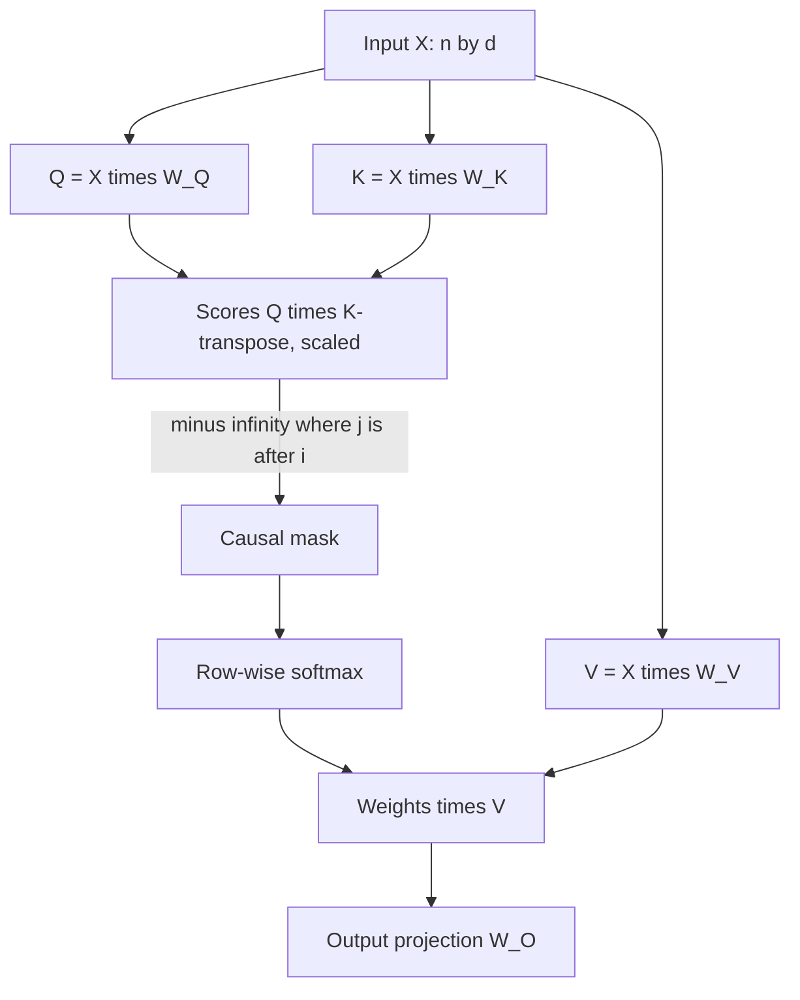

## TL;DR
Self-attention draws queries, keys and values from one sequence, so each token builds its representation
from the tokens it may see. It is the only cross-position operation, one matmul over all positions, and
O(n²): the root of context limits and FlashAttention.

## Why it exists
- **Meaning depends on neighbours.** "bank" next to "river" and "bank" next to "account" need different
  representations.
- **Older layers pay for distance.** A recurrent network reads left to right and accumulates a state,
  which is sequential and leaks information over distance. A convolution sees a fixed window and needs
  many stacked layers before distant tokens interact.
- **One step, any distance.** Self-attention computes a context-dependent representation from all
  positions in a single step. When sequence length *n* is smaller than model width *d*, as for the
  sentence-length inputs of 2017, it is also cheaper per layer than recurrence.
- **Content-based routing.** Which token influences which is decided by the data through learned
  similarity, not a fixed topology. The same layer can "look at the previous token", "find the matching
  bracket" or "find the earlier occurrence of this name", which let one architecture serve prose, code,
  protein sequences and audio tokens without redesign.
- **Nothing is free.** The n×n interaction is paid for in compute and memory, and the layer has no notion
  of order unless you give it one.

The transformer paper compared layer types on three axes:

| Layer | Compute per layer | Sequential operations | Longest path between positions |
|---|---|---|---|
| Self-attention | O(n²·d) | O(1) | O(1) |
| Recurrent | O(n·d²) | O(n) | O(n) |
| Dilated convolution | — | — | O(log n) |

## How it works
### Projections
From layer input **X** of shape `[n, d]`, three learned projections produce `Q = X·W_Q`, `K = X·W_K`,
`V = X·W_V`.
- **Separate matrices** because a token's roles as asker, advertiser and content are different.
- **Using X for all three fails twice.** The score matrix `X·Xᵀ` would be symmetric (i would want j
  exactly as much as j wants i, which "adjective → its noun" relations are not). And for vectors of
  similar norm each token would match itself most strongly, so the layer would mostly return each token
  unchanged.
- **Separate W_Q and W_K** make the score an asymmetric, learned relation.

### Scores, mask, mix
1. Compute `S = Q·Kᵀ / √d_k`, an `[n, n]` matrix; entry (i, j) says how much position *i* wants to read
   from position *j*.
2. For a decoder, apply a **causal mask**: `S[i, j] = −∞` for every *j > i*.
3. Softmax each row, then multiply the values: `A = softmax(S)·V`.

Why the mask is built this way:
- **−∞ before softmax, not zeros after.** `exp(−∞) = 0` exactly and the remaining weights renormalize over
  the allowed positions. Zeroing after softmax would leave rows that no longer sum to one.
- **Causal at all** because training predicts every next token in one pass with teacher forcing. If
  position *i* could see *i+1*, the task would be trivial in training and impossible at inference, when
  *i+1* does not exist yet.
- **Encoders drop it.** BERT-style models let every token see every other.
- **Padding uses the same mechanism:** −∞ on padded key positions.

### Shapes and FLOPs for one layer
Counting a matmul of `[m, k]·[k, p]` as 2·m·k·p FLOPs:

| Part | FLOPs |
|---|---|
| Four projections (Q, K, V and output) | 8·n·d² |
| `Q·Kᵀ` | 2·n²·d |
| `A·V` | 2·n²·d |
| Attention core total | 4·n²·d |
| Core ÷ projections | n/(2d) |

- **For d = 4096:** at n = 4k the ratio is 0.5, so the linear layers dominate; at 32k it is 4 and at 128k
  it is 16, so the quadratic term dominates.
- **Memory follows the same shape.** The score matrix is n×n per head. With 32 heads at n = 8,192 in fp16
  that is 32 × 8192² × 2 bytes ≈ 4.3 GB per layer per sequence if ever materialized, the problem
  FlashAttention removes.

### Permutation equivariance
- **The layer treats input as a set.** With no positional signal, permuting the rows of **X** permutes the
  output rows identically. That is why positional encodings exist.
- **A causal mask leaks some order**, since each token can tell roughly how many tokens precede it, and
  decoders trained with no explicit positions do learn something usable.
- **But production models add an explicit scheme** nearly always (a few recent families drop it in some
  layers).

### What happens at inference
- **Earlier K and V never change** under the causal mask, so they are cached.
- **Decode has one query row.** Work per step is `[1, d]·[d, n]` per head, O(n·d) rather than O(n²·d),
  bound by reading the cache from memory rather than by arithmetic.
- **Prefill vs decode.** Prefill (the whole prompt at once) is the compute-bound n² case; decode is the
  bandwidth-bound linear case. That split is the backbone of serving economics.

### Patterns that emerge
- **Recurring head types:** previous-token heads, heads that attend to delimiters, and induction heads
  that find an earlier occurrence of the current token and copy what followed it, a mechanism behind
  in-context learning.
- **Attention sinks.** Many heads dump most of their weight on the first token: softmax must put its mass
  somewhere, and a constant, content-free position is a convenient no-op.
- **Why it matters:** evicting the first tokens from a sliding-window cache breaks those heads, which is
  why streaming schemes keep them.

## Diagram
One layer of causal self-attention: the same input X feeds all three projections, the mask hides the
future before softmax, and the output projection writes back into the residual stream.



## Examples
### Causal self-attention by hand, checked against the fused kernel
Causal self-attention written out with explicit shapes, then checked against PyTorch's fused kernel.
The explicit version is what you should be able to write on a whiteboard; the fused one is what runs in
production.

```python
import torch, torch.nn.functional as F
torch.manual_seed(0)
B, n, d, h = 2, 6, 64, 4            # batch, tokens, model width, heads
dk = d // h
x = torch.randn(B, n, d)
Wq, Wk, Wv, Wo = (torch.randn(d, d) / d ** 0.5 for _ in range(4))

def heads(t):                       # [B, n, d] -> [B, h, n, dk]
    return t.view(B, n, h, dk).transpose(1, 2)

q, k, v = heads(x @ Wq), heads(x @ Wk), heads(x @ Wv)
S = q @ k.transpose(-1, -2) / dk ** 0.5                     # [B, h, n, n] raw scores
future = torch.triu(torch.ones(n, n, dtype=torch.bool), diagonal=1)
S = S.masked_fill(future, float("-inf"))                    # j > i is invisible to i
A = S.softmax(dim=-1)                                       # each row sums to 1 over j <= i
print(A[0, 0].round(decimals=2))                            # lower-triangular weight matrix
out = (A @ v).transpose(1, 2).reshape(B, n, d) @ Wo         # merge heads, output projection

ref = F.scaled_dot_product_attention(q, k, v, is_causal=True)
ref = ref.transpose(1, 2).reshape(B, n, d) @ Wo
print(torch.allclose(out, ref, atol=1e-4))                  # True: same math, fused kernel
print(S.shape, "scores per head are n x n ->", n * n, "entries; at n=8192 that is", 8192 ** 2)
```

### Where the FLOPs and memory go as context grows
Pure Python for a d = 4096, 32-head layer: the core-to-projection ratio and the size of the score
matrix a naive kernel would materialize.

```python
d, heads = 4096, 32
for n in (2_048, 8_192, 32_768, 131_072):
    proj = 8 * n * d * d                     # Q, K, V, output projections
    core = 4 * n * n * d                     # Q·Kᵀ plus A·V
    scores_gb = heads * n * n * 2 / 1e9      # fp16 n×n scores, if materialized
    print(f"n={n:>7}: core/proj = {core/proj:5.2f}   scores {scores_gb:8.1f} GB per layer")
# n=   2048: core/proj =  0.25   scores      0.3 GB per layer
# n=   8192: core/proj =  1.00   scores      4.3 GB per layer
# n=  32768: core/proj =  4.00   scores     68.7 GB per layer
# n= 131072: core/proj = 16.00   scores   1099.5 GB per layer
```

### Worked incident: short prompts in a batch returned junk
A team batched prompts of different lengths for a decoder-only model and saw only the longest prompt
answer correctly.

| Step | Finding |
|---|---|
| Symptom | shorter prompts produce junk; the longest one is fine |
| Cause | right padding put pad tokens between each prompt and its generated tokens |
| Fix | left padding plus an attention mask, so every prompt ends at the last position |
| Check | the same prompt gives the same greedy output alone and inside a batch |

```python
tok.padding_side = "left"                 # Hugging Face tokenizer, decoder-only generation
if tok.pad_token is None:                 # many causal-LM tokenizers ship without one
    tok.pad_token = tok.eos_token
batch = tok(prompts, return_tensors="pt", padding=True)
out = model.generate(**batch, max_new_tokens=64)   # passes attention_mask with the ids
```

## Production patterns
- **Left-pad for decoder-only generation.** Set `tokenizer.padding_side = "left"` and always pass the
  `attention_mask`. Add a regression test that one prompt gives identical greedy output alone and in a
  mixed-length batch.
- **Profile attention share at real lengths before optimizing.** Use the PyTorch profiler on traffic
  shaped like production; at short context the linear layers dominate and attention kernels will not
  help. Track the attention share of step time per context bucket.
- **Never materialize the n×n scores.** Use `F.scaled_dot_product_attention` or an engine with fused
  kernels so memory stays linear in n. Monitor peak memory against context length; quadratic growth
  means a naive path is still in use.
- **Keep sink tokens when windowing the cache.** If you evict old positions for streaming, retain the
  first few tokens plus a recent window, as attention-sink schemes do. Monitor quality on long sessions
  versus full attention.
- **Guard against fully masked rows.** Make sure every query row has at least one visible key, or replace
  NaN rows explicitly. Alert on NaN losses or outputs and log the batch that produced them.

## Trade-offs
- **Short paths and parallelism vs O(n²).** O(1) path length and full parallelism across positions, paid
  for with O(n²) compute and memory. The balance flips against dense attention when n is many times d,
  when sliding windows, sparse patterns or retrieval take over part of the job.
- **Content routing vs no locality prior.** Routing adapts to any structure in the data but brings no
  built-in locality bias, so small-data regimes favour architectures with stronger priors and large-data
  regimes favour attention.
- **Bidirectional vs causal.** Bidirectional self-attention gives richer per-token representations;
  causal self-attention gives up the right context in exchange for generation and a reusable KV cache.
- **Exact recall vs linear cost.** Exact softmax attention can retrieve a single specific earlier token
  (copying, induction). Linear attention and state-space models cut cost to O(n) but compress history
  into a fixed state and give up some of that precise recall.

## Pitfalls
- **Masking with zeros after softmax, or masking the wrong triangle.** Tokens see the future. Symptom: a
  training loss that falls suspiciously close to zero, followed by nonsense at inference. Fix: mask logits
  with −∞ where j > i before softmax, and assert the weights above the diagonal are zero.
- **Right-padding a decoder-only batch during generation.** Pad tokens land after the prompt. Symptom:
  shorter prompts in a batch produce junk while the longest one is fine. Fix: left padding with an
  attention mask.
- **A fully masked row.** Every key −∞, as with an all-padding query row, makes softmax return NaN.
  Symptom: NaN losses that appear only on certain batches. Fix: guarantee each query row at least one
  visible key, or zero out fully masked rows explicitly.
- **Costing attention with only one term.** Using only the quadratic or only the linear term gives a
  capacity plan that is right at one context length and wrong by multiples at another. Fix: cost both
  8·n·d² and 4·n²·d at every context length you serve.

## When to use
Self-attention is not optional in a transformer, so the real decisions are around it.
- **Decide:** how long a context you can afford, encoder (bidirectional) or decoder (causal) for a task,
  how to pad and mask batches correctly, and which kernel serves it.
- **Measure:** the share of attention time in your profiles at your actual sequence lengths before
  optimizing anything; at short context the linear layers dominate and attention kernels will not help.
- **Interviews:** derive the O(n²·d) cost and the n/(2d) crossover, explain why the mask uses −∞ before
  softmax, state why positions must be added explicitly, and show how the KV cache and the
  prefill/decode split follow from causality.

## Role lens
- **Engineer:** Writes and debugs the masking and padding logic, chooses left padding for generation,
  and profiles whether attention or the MLP dominates at the team's real sequence lengths.
- **Architect:** Sets context-length policy from the n/(2d) crossover and the memory curve, and decides
  where retrieval must shrink inputs instead of paying quadratic attention.
- **FDE:** Diagnoses a customer's "it works for short inputs and breaks for long ones" by checking
  context limits, padding direction and attention memory on their hardware.

## Check yourself
**Q:** A model with hidden size 4,096 processes an 8k-token prompt. In the attention layer, do the
Q/K/V/output projections or the score computation dominate FLOPs, and how does that change at 128k?
**A:** Projections cost 8·n·d² and the attention core (QKᵀ plus AV) costs 4·n²·d, so their ratio is
n/(2d). At n = 8,192 and d = 4,096 the ratio is 1: the two halves are equal, and together with the MLP
(which is larger than the projections) the linear layers still dominate the layer as a whole. At
n = 131,072 the ratio is 16, so the quadratic core is sixteen times the projections and dwarfs the MLP
too; the layer is now attention-dominated. The practical consequences follow: at 8k, kernel choices for
matmuls and quantizing weights matter most; at 128k, attention kernels, memory for the n×n scores (never
materializing them) and possibly sparse or windowed attention are what determine cost and feasibility.

## Interview questions
### Why does self-attention use separate W_Q and W_K instead of scoring X against itself?
- **X·Xᵀ is symmetric**, so i would attend to j exactly as much as j to i, which asymmetric relations such
  as adjective to noun are not.
- **Self-match dominates.** For vectors of similar norm each token scores itself highest, so the layer
  would mostly copy its input; separate projections make the relation learned and asymmetric.

### Your training loss drops almost to zero but generation is nonsense. What is the likely bug?
- **A leaking causal mask.** Zeroing weights after softmax or masking the wrong triangle lets position i
  see i+1, making next-token prediction trivial in training.
- **Confirm it** by checking that the attention weights above the diagonal are exactly zero, and that the
  mask is −∞ on logits before softmax.

### Why is decode bandwidth-bound while prefill is compute-bound?
- **Prefill** processes the whole prompt: n queries against n keys, large matrix multiplications, the
  O(n²·d) case.
- **Decode** has one new query row, `[1, d]·[d, n]` per head, O(n·d), so each step mostly reads cached
  keys, values and weights from memory with little arithmetic per byte.

### When would you choose a linear-attention or state-space model over softmax self-attention?
- **When context is very long and cost dominates**, because they run in O(n) instead of O(n²).
- **But not when exact recall matters.** They compress history into a fixed state and give up some of the
  precise copying and induction that softmax attention does well.

### At d = 4096 and 32 heads, how big is the score matrix at 8k context, and why does it matter?
- **Arithmetic:** 32 × 8192² × 2 bytes ≈ 4.3 GB per layer per sequence in fp16, if materialized.
- **Consequence:** naive kernels run out of memory fast as n grows, which is why FlashAttention computes
  the same result in tiles without ever storing the n×n matrix.

## Quiz
### Q: Why is the causal mask applied as −∞ before the softmax instead of zeroing weights after it?
- [ ] Because −∞ is faster to compute on GPUs than multiplying by zero
- [x] Because exp(−∞) is exactly 0 and the remaining weights renormalize to sum to one over allowed positions
- [ ] Because softmax cannot accept zeros as inputs
- [ ] Because zeroing after softmax would leak information from earlier positions
> Zeroing after softmax leaves rows whose weights no longer sum to one, scaling outputs by how much was
> masked. Masking the logits lets softmax redistribute probability over the visible positions only.

### Q: Which property of self-attention makes an explicit positional encoding necessary?
- [ ] Its quadratic cost in sequence length
- [ ] The use of separate key and value projections
- [x] Permutation equivariance: without positions, reordering the input only reorders the output
- [ ] The fact that softmax weights sum to one
> Self-attention treats its input as a set; "dog bites man" and "man bites dog" would yield the same
> per-token outputs. Positional encodings break that symmetry so order can influence attention.

### Q: Per the original transformer analysis, when is self-attention cheaper per layer than a recurrent layer?
- [x] When sequence length n is smaller than the representation width d
- [ ] When sequence length n is larger than the representation width d
- [ ] Always, regardless of n and d
- [ ] Never; it is chosen only for parallelism
> Self-attention costs O(n²·d) per layer and recurrence O(n·d²), so attention is cheaper when n < d.
> At long contexts recurrence is cheaper in FLOPs, and attention is kept for its path length and
> parallelism.
