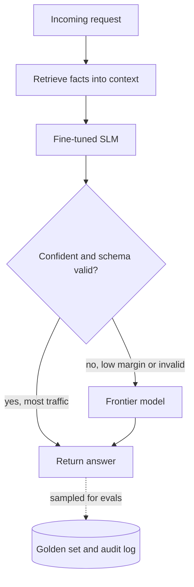

## TL;DR
An SLM is a roughly 0.5–10B-parameter model (no fixed boundary) that runs on one consumer GPU, a CPU or
a phone. Over-training, distillation and curated data make it strong on narrow tasks, trading
knowledge and reasoning for speed, cost and privacy.

## Why it exists
- **Most production requests are narrow.** A ticket classifier, entity extractor, query rewriter or PII
  redactor needs one skill executed millions of times at low latency and cost, not encyclopaedic knowledge.
- **Inference cost scales with parameters.** Every decode step reads every active weight, so a 70B model
  moves about 20× the bytes of a 3.5B model for the same output token, and prefill FLOPs scale the same way.
- **Small models got much better.** Chinchilla showed earlier small models were badly under-trained, and
  Llama showed loss keeps falling far past the compute-optimal token count. Distillation and synthetic
  "textbook" data (the Phi line) or teacher-generated corpora give far more signal per token than raw web
  text.
- **Deployment constraints are real.** On-device assistants, air-gapped networks, data-residency rules and
  offline operation cannot call a hosted frontier API.
- **The naive alternatives fail.** "Just prompt the big model" fails on cost, time-to-first-token,
  availability and privacy. "Just quantise the big model" buys roughly 4× in memory, not the 20× that
  separates a 70B from a 3B, and still needs a server GPU. A well-trained small model, fed facts through
  retrieval and fine-tuned to the task, actually fits.

## How it works
### What "small" changes architecturally
- **Same decoder-only transformer,** with fewer layers, a smaller hidden size, and almost always
  grouped-query attention.
- **The embedding matrix becomes a big share.** A 128k vocabulary with a 2,048-dimensional hidden state is
  about 262M parameters, roughly a fifth of a 1.2B model. So input and output embeddings are usually tied
  (one shared matrix) to avoid paying twice.
- **Depth is kept where possible.** MobileLLM reported that deep-and-thin layouts beat shallow-and-wide
  ones at sub-billion scale, because reasoning-like composition benefits from more sequential layers.

### Training recipe
- **Over-training.** Chinchilla-optimal is about 20 training tokens per parameter. Llama 3 8B was trained
  on more than 15 trillion tokens, close to 2,000 tokens per parameter. The loss curve flattens but keeps
  improving, and since serving cost per token is about 2N FLOPs, a smaller N that will serve trillions of
  tokens justifies the extra training. Inference dominates a popular model's lifetime cost, so the extra
  training compute is repaid many times over.
- **Data quality.** With few parameters every one must earn its place, so small models lean on heavily
  filtered web data, code, and synthetic or curated educational text.
- **Distillation.** The student matches the teacher's full probability distribution (a KL term against
  teacher logits), which carries information about which wrong answers are nearly right. Or it trains on
  teacher-generated outputs (sequence-level distillation). Reasoning distillation fine-tunes a small model
  on long chain-of-thought traces from a reasoning model and transfers a surprising share of the capability.
- **Pruning from a larger model.** Remove whole layers, attention heads or FFN channels from a trained
  larger model, chosen by an importance score on calibration data, then recover quality with a short
  distillation run against the original. Sheared-LLaMA and NVIDIA's Minitron used this route because the
  starting weights already encode much of what the small model must learn, so far fewer training tokens are
  needed than training the same size from random initialisation.
- **Post-training.** The same supervised fine-tuning and preference tuning as large models, with less
  headroom: a small model follows complex, multi-constraint instructions less reliably.

### What is lost, and why
Parameters are memory. Long-tail facts live in FFN weights, so fewer and smaller FFNs mean fewer facts,
stored less reliably.

| Weakness | Compensation (architectural, not model-level) |
|---|---|
| Hallucinates more on factual recall | supply the facts (retrieval) |
| Degrades faster on multi-step composition | supply the computation (tools) |
| More sensitive to prompt wording | narrow the job (fine-tuning) |
| Loses more quality under aggressive quantisation | put a larger model behind a router for the cases that need it |

### The inference arithmetic
- **Weights cost `params × bytes_per_param`.** A 3B model is 6 GB in bf16, 3 GB in int8, and about 2 GB
  at 4-bit once scales are included.
- **Decode is bandwidth-bound,** so single-stream tokens per second is roughly memory bandwidth divided by
  bytes read per step.

| Device (illustrative orders of magnitude) | Bandwidth | 2 GB model, single stream |
|---|---|---|
| Laptop GPU | a few hundred GB/s | moves the weights over 100 times a second, so 100+ tokens/s is plausible |
| Phone | tens of GB/s | tens of tokens/s |
| Server GPU | several TB/s | weights almost free per request; KV cache and batching become the limits |

- **So both claims hold, for different reasons:** "runs on a phone" and "cheap on a server".

### Specialist versus generalist
A fine-tuned 1–8B model routinely matches or beats a zero-shot frontier model on a narrow task when three
conditions hold:
1. **The task is well defined.**
2. **You have thousands of labelled examples.**
3. **Production inputs look like the training data.**

It does not when the task is open-ended, needs novel reasoning, or depends on world knowledge the
fine-tuning set and the prompt do not contain.

## Diagram
The cascade most SLM deployments end up with: the small model handles the bulk, and low-confidence or
invalid outputs escalate to a frontier model.



## Examples
### Cost model and escalation rule for a ticket classifier
A support organisation receives 2 million tickets a month, classifies each into 40 queues and extracts
three fields. All prices and rates are illustrative placeholders to show the shape of the calculation, not
quotes.

```python
tickets = 2_000_000
in_tok, out_tok = 700, 60                       # per ticket
api_in, api_out = 3.0, 15.0                     # placeholder $ per million tokens
gpu_hour = 1.0                                  # placeholder $ per GPU-hour, one 24 GB card

api = tickets * (in_tok * api_in + out_tok * api_out) / 1e6
slm = 730 * gpu_hour                            # one card running all month
print(f"API ${api:,.0f}/mo, SLM ${slm:,.0f}/mo, {api / slm:.1f}x cheaper")
print(f"avg load {tickets / (30 * 86_400):.2f} tickets/s")

def route(probs, schema_ok, margin=0.2):
    """Escalate when the top-two class gap is small or the output fails validation."""
    top2 = sorted(probs, reverse=True)[:2]
    return "slm" if schema_ok and top2[0] - top2[1] >= margin else "frontier"

print(route([0.81, 0.10, 0.09], schema_ok=True))   # slm
print(route([0.45, 0.40, 0.15], schema_ok=True))   # frontier
```

- **Margin threshold.** The `0.2` value is a placeholder; set it on held-out data so the tickets kept on
  the SLM meet the accuracy target.

### Worked scenario: frontier API versus fine-tuned 3B
Each ticket is about 700 input tokens and 60 output tokens, so the monthly volume is 1.4B input and 120M
output tokens.

| | Frontier API path | SLM path |
|---|---|---|
| Model | hosted frontier model | 3B instruct model, LoRA fine-tune on 8,000 labelled tickets (a few GPU-hours) |
| Serving | API calls | bf16 (6 GB of weights) on one 24 GB GPU, batches of 32–64 fit easily because sequences are short and the KV cache small |
| Monthly cost | $3 per million input + $15 per million output = $4,200 + $1,800 = $6,000 | about $730 at $1 per GPU-hour, roughly 8× cheaper |
| Latency | multi-second per ticket | sub-second |
| Data | tickets leave the company's network | no data egress |

- **Load fits easily.** Average load is 2M / (30 × 86,400 s) ≈ 0.8 tickets per second, with bursts an
  order of magnitude higher, well inside what one card handles with continuous batching.
- **Decide on the golden set, not the invoice.** Run both models on 1,000 held-out tickets. Ship the SLM if
  it is within the accuracy tolerance the business accepts and its errors are not concentrated in the
  expensive queues.
- **Route the remainder.** Low-confidence cases (a small logit margin between the top two classes, or a
  schema-validation failure) go to the frontier model. In practice that is a minority of traffic, so the
  blended cost stays close to the SLM figure while the quality ceiling is preserved.

### Logit distillation loss
The classic soft-target loss: the student matches the teacher's temperature-softened distribution, scaled
by T² so gradients keep their size as T changes.

```python
import torch.nn.functional as F

def distill_loss(student_logits, teacher_logits, labels, T=2.0, alpha=0.5):
    soft = F.kl_div(F.log_softmax(student_logits / T, -1),
                    F.softmax(teacher_logits / T, -1),
                    reduction="batchmean") * (T * T)
    hard = F.cross_entropy(student_logits, labels)
    return alpha * soft + (1 - alpha) * hard
```

## Production patterns
- **Cascade with confidence escalation.** Serve the SLM first and escalate on a small top-two class
  probability margin or a failed schema check, as in the `route` function above. Tune the threshold on held-out data and
  monitor the escalation rate, accuracy on SLM-kept traffic, and blended cost per task.
- **Per-task LoRA with an eval gate.** Fine-tune adapters with Hugging Face PEFT (`LoraConfig` with a rank
  such as 16) on thousands of labelled examples, version each adapter, and block release unless it beats
  the current one on the golden set. Monitor drift between production inputs and training data.
- **Batch on servers, quantise at the edge.** On servers use continuous batching in vLLM and raise
  `--max-num-seqs` so each weight read serves many requests. On devices ship a 4-bit GGUF build for
  llama.cpp. Re-run JSON-validity and multilingual evals after every quantisation step.
- **Retrieval for facts, SLM for form.** Put the source text in the prompt and ask the SLM to extract,
  classify or format, never to recall. Monitor groundedness by checking extracted values appear in the
  source.
- **Keep prompts short.** Fine-tune the instructions into the weights instead of carrying a long system
  prompt, and cap retrieved context. Track prefill latency and accuracy by input length.

## Trade-offs
- **Cost and latency vs breadth.** Both fall roughly in proportion to parameter count, but factual breadth
  and multi-step reasoning fall too; the trade flips the moment the task needs knowledge not supplied in
  context.
- **Cheap fine-tuning vs pipeline burden.** Fine-tuning per task or per customer fits on a single GPU, but
  every fine-tune is a model to version, evaluate and redeploy, whereas prompting a frontier model has no
  such pipeline.
- **Privacy vs predictability.** On-device or air-gapped deployment gives privacy and offline operation,
  but hardware fragmentation and quantisation variance make quality less predictable than on a controlled
  server fleet.
- **Over-training vs training compute.** Small models get better per parameter but cost more training
  compute per parameter; it pays only at high inference volume, which is why model vendors, not
  application teams, absorb that cost.
- **Cascade savings vs routing risk.** A router or cascade captures most of the savings while keeping a
  frontier-quality ceiling, but a miscalibrated router sends hard cases to the small model and nobody
  notices until an audit.

## Pitfalls
- **Judging an SLM with zero-shot prompts written for a frontier model.** Symptom: "it fails" on tasks it
  would handle after a few-shot prompt or a small fine-tune, and a premature conclusion that SLMs are
  useless. Fix: evaluate after few-shot prompting or a small fine-tune.
- **Asking an SLM for facts from its weights.** Symptom: confident fabrication of dates, citations and API
  names. Fix: give it the source text and let it extract.
- **Comparing on a public benchmark that may be in the training data.** Symptom: a benchmark score far
  above the in-house eval on your own data. Fix: choose between candidates on your own golden set.
- **Quantising to 4-bit and skipping re-evaluation.** Symptom: subtle regressions in JSON validity and
  multilingual output, because small models lose more under quantisation than large ones. Fix: re-run
  those evals on every quantised build.
- **Serving single-stream on a server GPU.** Symptom: a 3B model whose cost per token rivals a well-batched
  30B model, because the card is bandwidth-bound and mostly idle at batch 1 while the larger model amortises
  each weight read over dozens of requests. Fix: continuous batching at real concurrency.
- **Front-loading a 6k-token system prompt plus retrieved context.** Symptom: slow prefill and answers that
  ignore the middle of the context, since small models degrade faster with long inputs. Fix: fine-tune the
  instructions in and cap retrieved context.

## When to use
- **Use when:** the task is narrow and high-volume, the inputs carry the facts the answer needs, latency or
  cost budgets are tight, data cannot leave a device or network, or you have labelled data to fine-tune on.
- **Avoid as the only model for:** open-ended assistance, novel reasoning, or knowledge-heavy question
  answering without retrieval.
- **Measure:** task accuracy on your golden set against a frontier baseline, calibration of its confidence
  signal for routing, p95 latency at target concurrency, and cost per successful task.
- **Day to day and interviews:** "can we move this step off the API", and "when would you fine-tune a 3B
  model instead of prompting a frontier model, and how would you know it worked".
- **Related:** the architecture decision is covered in system-design/slm-vs-llm-trade-offs, and the
  capability transfer in training-adaptation/knowledge-distillation.

## Role lens
- **Engineer:** Fine-tunes a 1–8B model with LoRA on task data, quantises and serves it with vLLM or
  llama.cpp, and wires logit-margin escalation to a larger model for low-confidence cases.
- **Architect:** Owns the model portfolio: which pipeline steps run on SLMs, where the cascade boundary sits,
  and how per-task fine-tunes are versioned and gated by evals before release.
- **FDE:** Finds the customer's high-volume narrow workloads, proves an SLM on their data with a side-by-side
  eval, and handles the on-prem or edge constraints that made a hosted API unusable.

## Check yourself
**Q:** A bank wants to classify documents and extract fields on-prem across 5 million pages a month and
says "we will just run the biggest open model we can fit". How would you argue for an SLM, and what would
make you concede?
**A:** Frame it as cost per correct extraction and throughput, not model size. The task is narrow, the
inputs contain the answers, and the bank already has labelled outputs from its back office, so a fine-tuned
3–8B model at int8 on one or two GPUs can process 5 million pages with headroom and sub-second latency,
while a 70B model on the same hardware runs at a fraction of the throughput with no accuracy advantage on
in-distribution forms. Propose a golden set built with their SMEs, fine-tune, compare both on it, and route
low-confidence or schema-invalid outputs to the larger model. I would concede if the eval shows a material
accuracy gap, if the documents are heterogeneous free text that needs world knowledge, or if volume is low
enough that the big model is affordable anyway.

## Interview questions
### Why do small models usually tie their input and output embeddings?
- **The vocabulary is a big share of the budget.** A 128k vocabulary with a 2,048-dimensional hidden state
  is about 262M parameters, roughly a fifth of a 1.2B model.
- **Tying shares one matrix** for input and output, so the model does not pay that cost twice and spends
  the saving on depth, which MobileLLM found matters more at sub-billion scale.

### Why not just quantise a 70B model instead of using a 3B one?
- **Quantisation buys about 4×,** from bf16 to 4-bit, while the gap between 70B and 3B is about 20× in
  bytes read per token.
- **So the 70B still needs a server GPU** and still reads far more weight per decode step, whereas a 3B at
  4-bit is about 2 GB and runs on a laptop or phone.
- **Quality is the open question,** settled on your golden set, not by parameter count.

### A 3B model on an H100-class server costs as much per token as a 30B deployment. What is wrong?
- **Likely single-stream serving.** Decode is bandwidth-bound, so at batch 1 the card reads the weights
  for one token per step and sits mostly idle.
- **Fix:** turn on continuous batching and raise concurrency so each weight read serves dozens of requests,
  then re-measure cost per token and p95 latency at target load.

### When would you refuse to replace a frontier model with a fine-tuned SLM?
- **Open-ended or knowledge-heavy tasks** such as research assistance, where breadth of world knowledge and
  multi-step synthesis are exactly what shrinks with parameter count.
- **No labelled data or shifting inputs,** because the specialist advantage needs thousands of examples and
  production inputs that resemble them.
- **Low volume,** where the frontier bill is small and a fine-tune pipeline costs more to own than it saves.

### Why do vendors train small models far past the Chinchilla-optimal token count?
- **Chinchilla-optimal is about 20 tokens per parameter,** but loss keeps falling well beyond it; Llama 3 8B
  saw more than 15 trillion tokens, close to 2,000 per parameter.
- **Inference dominates lifetime cost.** Serving costs about 2N FLOPs per token, so a smaller N that will
  serve trillions of tokens repays the extra training compute many times over.

## Quiz
### Q: Why can a 3B model trained on 10 trillion tokens outperform an older 7B model trained on 1 trillion, even though both are "small"?
- [ ] Because the 3B model has a larger vocabulary
- [x] Because loss keeps falling far past the compute-optimal token count, and vendors now over-train small models since inference, not training, dominates lifetime cost
- [ ] Because smaller models have less capacity to overfit
- [ ] Because quantisation works better on 3B models
> Chinchilla-optimal is about 20 tokens per parameter, but the curve keeps improving beyond it. A 7B model
> on 1T tokens is near-optimal and under-trained by modern standards; a 3B on 10T tokens has absorbed far
> more data per parameter, and its lower serving cost is what pays for that training.

### Q: A team fine-tunes a 1B model to answer medication-dosage questions from memory and sees frequent confident errors. What is the most likely diagnosis?
- [ ] The learning rate was too high
- [ ] The model needs a longer context window
- [x] Parametric knowledge is what shrinks first with size; the facts should be supplied through retrieval, with the small model doing extraction and formatting
- [ ] 1B models cannot be fine-tuned
> Small models have few weights in which to store long-tail facts, so recall from memory is their weakest
> mode. Putting the dosage tables in context turns the task into extraction, which a 1B model does well.
> Hyperparameters and context length do not create knowledge that is not there.

### Q: Which workload is the weakest fit for a small language model?
- [ ] High-volume ticket classification with 20,000 labelled examples
- [ ] On-device dictation cleanup with no network access
- [x] Open-ended research assistance that depends on broad world knowledge and multi-step synthesis
- [ ] Query rewriting in front of a search index
> The first, second and fourth are narrow, in-distribution tasks where the needed information is in the
> input. Open-ended research needs breadth of knowledge and long chains of reasoning, which are exactly
> the capabilities that shrink fastest with parameter count.
