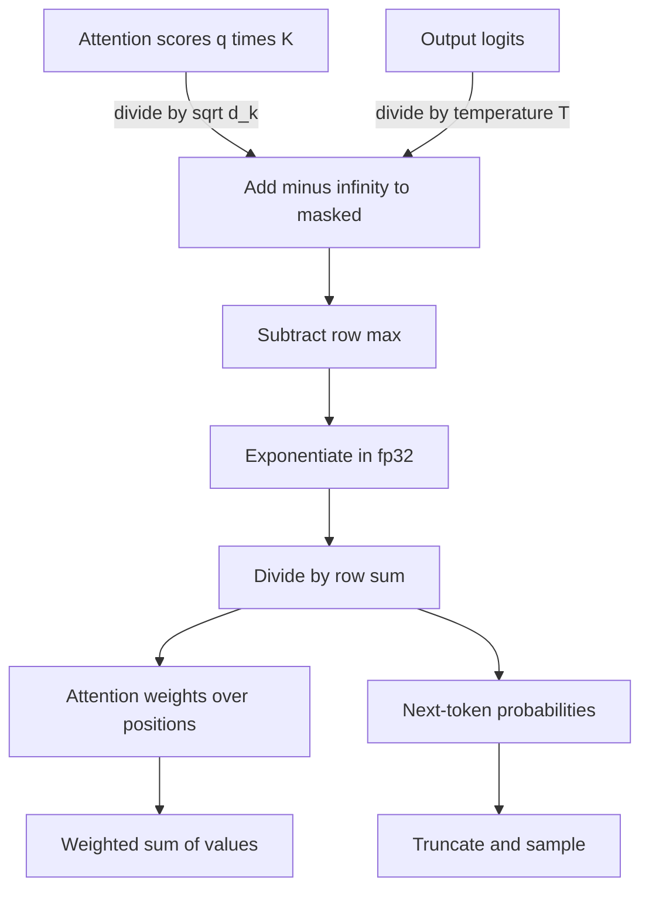

## TL;DR
Softmax turns scores into probabilities, sharpened or flattened by temperature *T*. For agent builders it
explains what the temperature setting does, why a router's "confidence" needs calibration, and why
evicting a long agent session's first tokens breaks it.

## For agent builders
- **Why it matters for agents.** The `temperature` you set on every agent call is a softmax parameter:
  low values make tool calls and extractions consistent, high values add variety. Any probability you read
  (logprobs on a routing step, a classifier score used as a guardrail) is a softmax output, not a
  calibrated correctness estimate.
- **Where it shows up in your stack.** The `temperature` request parameter, `logprobs` on hosted APIs,
  classifier heads in guardrail and routing models, and attention kernels inside the serving engine.
- **What you control.** Temperature per agent step (planner vs tool-argument filling vs creative
  drafting), whether probabilities are calibrated before thresholds use them, and softmax versus sigmoids
  when training a multi-label classifier for the agent.
- **What you can skip.** Deriving the Jacobian and the online-softmax recurrence; recognise that
  FlashAttention relies on the latter and that NaNs from softmax are a precision or masking bug.

## Why it exists
- **Argmax cannot be learned through.** It is piecewise constant: a tiny change in scores does nothing or
  flips the answer, so the gradient is zero almost everywhere and nothing reaches the scores not chosen.
- **Dividing by the sum fails too.** Scores can be negative, the result is not a distribution, and the map
  does nothing to sharpen or soften preferences.
- **Exponentiating first fixes both.** `exp` is positive, so normalized values are a valid distribution
  for any real input; smooth, so every score gets a gradient; monotone, so ranking is preserved. It is the
  "soft" argmax: a growing gap approaches one-hot, converging scores approach uniform.
- **The training signal is clean.** Paired with cross-entropy, the gradient with respect to the logits is
  simply `p − y`, prediction minus target.
- **It has a principled reading.** Among all distributions with a given expected score it has maximum
  entropy, the same form as the Boltzmann distribution in physics, which is where "temperature" comes from.

## How it works
### What the agent builder uses
- **Temperature is the knob you touch.** Dividing logits by `T < 1` widens gaps and sharpens the
  distribution; `T > 1` flattens it. As `T → 0` softmax becomes argmax (greedy); as `T → ∞` it
  becomes uniform. That is why tool-calling and extraction steps usually run at low temperature.
- **Probabilities never reach zero.** Only a `−∞` logit gives an exact zero, so unlikely tokens are always
  possible at temperature above zero. Over thousands of agent steps, a rare bad token in a tool argument
  will eventually be sampled unless you truncate (top-k, top-p) or constrain.
- **Probabilities are not correctness.** A routing step that reports 0.95 may be right far less often than
  95% of the time. Fit a temperature on labelled agent decisions before you threshold on it.
- **Sums to one forces attention sinks.** Models park unused attention on the first tokens, so KV eviction
  schemes for long agent sessions must keep them.

### Background: the function and its properties
For scores `z` and temperature `T > 0`:

```
p_i = exp(z_i / T) / Σ_j exp(z_j / T)
log p_i = z_i / T − logsumexp(z / T)
```

- **Shift invariance.** `softmax(z + c) = softmax(z)` for any constant *c*, because `exp(c)` factors out
  of numerator and denominator. Implementations subtract `max(z)` before exponentiating *because* the
  result is identical and the largest exponent becomes `exp(0) = 1`, so nothing overflows.
- **Strictly positive.** Every output is greater than zero for finite inputs. Only `−∞` produces an exact
  zero, which is how masks and token bans work.
- **Sums to one.** Mass removed from one entry must go somewhere. This is a constraint, not a feature, and
  it has consequences in attention (below).
- **Gradient.** `∂p_i/∂z_j = p_i(δ_ij − p_j)`. With cross-entropy against a one-hot target the combined
  gradient is `p − y`.
- **Two classes.** With `K = 2`, softmax reduces to the sigmoid of the score difference; the logistic
  function is the special case.

### Background: at the output layer
- **Next-token distribution.** The vocabulary softmax converts the last position's logits into a
  distribution over tens of thousands of entries.
- **A long tail.** Every entry stays positive, so there are many individually tiny but collectively
  significant probabilities. Sampling from the full distribution eventually draws one, which is why top-k
  and top-p truncation exist.
- **The softmax bottleneck.** Log-probabilities are a linear function of a `d_model`-dimensional hidden
  state (up to the normalizer), so the matrix of log-probabilities across many contexts has rank at most
  about `d_model`. Yang et al. (2018) named this; a large `d_model` keeps it from biting in practice, but
  it is why the output layer is not a fully general distribution.
- **Temperature here is a user-facing knob;** temperature inside attention is not.

### Background: inside attention
1. **Weights over positions.** Each head computes `softmax(q·Kᵀ / √d_k)`, weights that sum to one across
   the positions the query may see.
2. **`√d_k` is a fixed temperature.** Dot products of *d_k*-dimensional vectors grow in magnitude with
   *d_k*; without the scale the softmax would saturate early in training, giving near-one-hot weights and
   vanishing gradients.
3. **Causal masking** adds `−∞` to future positions before the softmax, so they get exactly zero weight.
4. **Attention sinks.** Weights must sum to one even when no position is relevant, so models learn to dump
   excess attention onto an uninformative position, usually the first token. Streaming methods that evict
   old tokens must keep these **sink tokens** or quality collapses.

### Background: computing it efficiently
A naive softmax over a long row needs the whole row in memory to find the max and the sum. The online
formulation keeps a running maximum *m* and a running sum *s* and updates both in one pass:

```
for each score x:   m_new = max(m, x)
                    s     = s · exp(m − m_new) + exp(x − m_new)
                    m     = m_new
softmax(x_i) = exp(x_i − m) / s
```

- **Exact, not approximate.** When a larger maximum arrives, the factor `exp(m − m_new)` converts
  everything summed so far to the new reference point.
- **Tile-friendly.** It can be accumulated in tiles that never leave fast on-chip memory, and the same
  rescaling applies to a partial weighted sum of value vectors.
- **That trick is the heart of FlashAttention:** exact attention without materializing the full `n × n`
  score matrix, which is part of why long agent contexts are feasible at all.

## Diagram
Both uses share one recipe (scale, mask with minus infinity, subtract the max, exponentiate, normalize);
only the scores and what consumes the probabilities differ. The temperature you set enters on the logits
path.



## Examples
### Stable softmax and temperature
The code shows a stable softmax with temperature on a three-way score vector and prints how entropy moves
with *T*; the numbers are worked out below so you can check them by hand. The last two lines show the
overflow the max-subtraction trick prevents.

```python
import numpy as np

def softmax(z, T=1.0):
    z = np.asarray(z, dtype=np.float64) / T
    z = z - z.max()                      # shift invariance: same result, no overflow
    e = np.exp(z)
    return e / e.sum()

z = [2.0, 1.0, 0.1]
for T in (1.0, 0.5, 2.0):
    p = softmax(z, T)
    H = -(p * np.log(p)).sum()
    print(f"T={T}: p={p.round(3)} entropy={H:.2f} nats")

big = np.array([1000.0, 0.0], dtype=np.float32)
print(np.exp(big) / np.exp(big).sum())   # overflow: inf/inf -> nan in the first slot
print(softmax(big))                      # [1. 0.]
```

Worked by hand (entropy printed by the script, in nats; the uniform maximum for three options is 1.10):

| T | Scaled scores | Exponentials | Sum | p | Entropy |
|---|---|---|---|---|---|
| `T = 1` | `[2.0, 1.0, 0.1]` | `exp(2.0) = 7.389`, `exp(1.0) = 2.718`, `exp(0.1) = 1.105` | `11.213` | `p ≈ [0.659, 0.242, 0.099]` | 0.85 |
| `T = 0.5` | `[4, 2, 0.2]` | `[54.598, 7.389, 1.221]` | `63.209` | `p ≈ [0.864, 0.117, 0.019]` | 0.45 |
| `T = 2` | `[1, 0.5, 0.05]` | `[2.718, 1.649, 1.051]` | `5.418` | `p ≈ [0.502, 0.304, 0.194]` | 1.03 |

- **At `T = 0.5`** the leader gained and the tail shrank by a factor of five.
- **At `T = 2`** the distribution is close to uniform.
- **Same ranking in all three cases;** only the confidence changed.

### Agent scenario: calibrating a router's confidence before gating on it
An agent's routing step outputs scores over three tools, and low-confidence decisions escalate to a
stronger model. Fit one temperature on labelled routing decisions so that "0.9" means roughly 90%.

```python
import numpy as np

def softmax(z, T):
    z = z / T
    z = z - z.max(axis=1, keepdims=True)
    e = np.exp(z)
    return e / e.sum(axis=1, keepdims=True)

def nll(z, y, T):
    p = softmax(z, T)
    return -np.log(p[np.arange(len(y)), y] + 1e-12).mean()

def fit_temperature(z, y):                       # z: [n, k] router scores, y: true tool index
    grid = np.linspace(0.25, 5.0, 96)
    return grid[np.argmin([nll(z, y, T) for T in grid])]

# load router scores and labels from your agent's logged, hand-labelled decisions
# T = fit_temperature(z_val, y_val)
# conf = softmax(z_live, T).max(axis=1); escalate = conf < threshold
```

Temperature scaling never changes which tool wins (ranking is preserved); it only changes how confident
the score claims to be, which is exactly what an escalation threshold depends on. The grid range is
illustrative.

### Online softmax equals the two-pass version
Pure Python, the one-pass running-max update from above checked against the ordinary max-then-sum
version on 10,000 random scores.

```python
import math, random

def two_pass(xs):
    m = max(xs)
    s = sum(math.exp(x - m) for x in xs)
    return [math.exp(x - m) / s for x in xs]

def online(xs):
    m, s = float("-inf"), 0.0
    for x in xs:                                  # one pass: running max and rescaled sum
        m_new = max(m, x)
        s = s * math.exp(m - m_new) + math.exp(x - m_new)
        m = m_new
    return [math.exp(x - m) / s for x in xs]

random.seed(0)
xs = [random.uniform(-20, 20) for _ in range(10_000)]
err = max(abs(a - b) for a, b in zip(two_pass(xs), online(xs)))
print(f"max abs difference: {err:.1e}")          # zero or float-rounding level
print(online([1000.0, 0.0]))                     # [1.0, 0.0]: no overflow either
```

## Production patterns
- **Set temperature per agent step.** Run tool selection, argument filling and extraction at low
  temperature for consistency, and reserve higher values for drafting or brainstorming steps. Monitor
  tool-call validity and run-to-run variance on a fixed eval set when you change it.
- **Calibrate before exposing or gating on probabilities.** If an agent thresholds softmax confidence
  (routing, guardrails, "ask the user" decisions), fit a single temperature on a held-out labelled set
  (temperature scaling) and track expected calibration error over time.
- **Use sigmoids for multi-label outputs.** When labels are not mutually exclusive (a request can need
  both search and calendar), train independent sigmoids (for example `torch.nn.BCEWithLogitsLoss`) instead
  of a softmax. Monitor per-label precision and recall.
- **Keep sink tokens when evicting KV.** Any streaming or sliding-cache scheme for long agent sessions
  should pin the first few tokens in the cache along with the recent window. Monitor quality on long
  sessions against a full-cache baseline.
- **Normalize in fp32.** When fine-tuning or self-hosting, cast before normalizing
  (`torch.softmax(x.float(), dim=-1)`) or compute losses on fp32 logits, even when the model runs in bf16
  or fp16. Monitor NaN and inf counters on losses and sampled probabilities.
- **Use fused attention kernels.** Call `torch.nn.functional.scaled_dot_product_attention` or a
  FlashAttention build instead of hand-writing `softmax(q @ k.T / sqrt(d))`, so the online softmax, the
  scale and masking are handled for you. Monitor peak memory and step time at long sequence lengths.
- **Mask before, and guard empty rows.** Add `−∞` (or the dtype's most negative value, `torch.finfo(dtype).min`)
  before the softmax, and zero the output of rows where every key is masked. Monitor NaNs specifically in
  padded batches.

## Trade-offs
- **Clean gradients vs no hard zero.** Smooth normalization gives gradients everywhere, but it can never
  express a hard zero, so sampling must be truncated externally and attention must park unused mass
  somewhere.
- **Low vs high temperature.** Lower temperature raises consistency and accuracy on tasks with one right
  answer, such as tool arguments; higher raises diversity. The right value flips with whether the task
  rewards variety.
- **Exact row vs online tiles.** The plain softmax needs the whole row, which is memory-heavy for long
  attention rows; the online version is exact and tile-friendly at the cost of extra rescaling work per
  tile.
- **Fixed `√d_k` vs learned sharpness.** Scaling by `√d_k` stabilizes attention at initialization, but it
  is a fixed temperature; heads that need very sharp or very flat attention must learn to grow or shrink
  their query and key norms.

## Pitfalls
- **Treating "99% probability" as 99% correctness.** Softmax outputs are scores shaped by training;
  calibration must be measured rather than assumed. Symptom: an agent's confidence gate lets through
  wrong tool choices. Fix: measure calibration error on labelled data and apply temperature scaling.
- **Exponentiating in half precision or without subtracting the max.** Symptom: NaN or inf probabilities
  on long or confident rows, often only on some batches. Fix: subtract the row max and normalize in fp32.
- **Masking after the softmax.** Multiplying probabilities by zero instead of adding `−∞` before leaves rows
  that no longer sum to one. The sibling bug, masking with a large finite negative such as −1e4 that
  underflows to nothing in fp16, shows up as attention leaking to masked positions. Fix: add the mask
  before the softmax, using `−∞` or the dtype's own minimum.
- **A fully masked row.** For example a padding query whose every key is masked: the row is all `−∞`,
  softmax computes `0/0`, and NaNs appear only in batches with padding. Kernels guard this case
  explicitly, and hand-written attention must too.
- **Evicting the first tokens of a long context.** To save KV memory; attention that used to land on the
  sink is redistributed and output quality degrades sharply. Fix: pin the first few tokens in the cache.
- **Mixing up the two temperatures.** Reusing an output-layer temperature inside attention or vice versa;
  they are separate knobs with separate meanings.

## When to use
- **You inherit it, not choose it:** at two places in every transformer and in nearly every classifier.
- **What you choose:** the temperature at the output for each agent step, the truncation rules layered on
  top, the precision the normalization runs in, and multi-class (softmax) versus multi-label (independent
  sigmoids, because labels are not mutually exclusive).
- **Measure** calibration if you intend to read probabilities as confidence.
- **Day to day** it shows up when debugging NaNs, tuning sampling, and reasoning about why attention
  behaves as it does.
- **Interviews:** derive the gradient with cross-entropy, explain the max-subtraction trick, say why
  attention scores are scaled by `√d_k`, and explain why agent confidence gates need calibration.

## Role lens
- **Engineer:** Sets temperature per endpoint, computes softmax and losses in fp32, and masks with `−∞`
  before normalization rather than zeroing afterwards.
- **Architect:** Decides whether a classification problem is mutually exclusive (softmax) or multi-label
  (sigmoids), and whether exposed probabilities are calibrated enough for downstream policy.
- **FDE:** Explains to a customer why temperature 0.2 made their extraction consistent and why the
  "confidence" column still needs a calibration check on their data.

## Check yourself
**Q:** Why are attention scores divided by the square root of the key dimension before the softmax, and
what would you expect to see in training if that scale were removed?
**A:** A dot product of two *d_k*-dimensional vectors with roughly unit-variance components has variance
proportional to *d_k*, so with `d_k = 128` raw scores are about eleven times larger in spread than with
`d_k = 1`. Softmax of large-magnitude inputs is nearly one-hot, and in that regime its gradient
`p_i(δ_ij − p_j)` is close to zero for every entry, so the query and key projections receive almost no
learning signal. Dividing by `√d_k` restores unit variance, keeping the softmax in its responsive range
at initialization. Without it you would expect attention maps that collapse to single positions early,
slow or stalled loss decrease, and sensitivity to initialization, which is exactly the instability the
scale was introduced to prevent.

## Interview questions
### Why is softmax paired with cross-entropy, and what is the resulting gradient?
- **The combined gradient is `p − y`,** prediction minus one-hot target, because the log in cross-entropy
  cancels the exp in softmax.
- **Why it matters:** the signal is proportional to the error and never saturates when the model is
  confidently wrong, unlike squared error on probabilities. Frameworks fuse the two for numerical stability.

### Your agent escalates to a human when the router's top probability is below 0.8, yet wrong tool calls still slip through. What is going on?
- **The scores are not calibrated.** Softmax outputs reflect training, not accuracy, so many wrong
  decisions carry 0.9 or more.
- **Fix:** log routing decisions with labels, fit a temperature on them, re-pick the threshold from the
  calibrated scores, and track the gate's precision and recall over time.

### How would you set temperature across the steps of a tool-calling agent?
- **Low for structure.** Tool selection, argument filling and extraction need consistency, so run them at
  or near zero, where softmax approaches argmax.
- **Higher only where variety helps,** such as drafting alternatives; evaluate any change on a fixed task
  set, since the tail never reaches zero and rare bad tokens accumulate over many steps.

### Your training run shows NaN losses, but only on batches that contain padding. What do you check?
- **Fully masked rows.** A padding query whose every key is masked gives an all `−∞` row and `0/0` in the
  softmax.
- **Mask style and precision.** Check that masks are added before the softmax, that fp16 is not
  underflowing a finite mask value, and that normalization runs in fp32. Guard empty rows or use a fused
  kernel that does.

### When would you use independent sigmoids instead of a softmax?
- **When labels are not mutually exclusive.** A support ticket can be both "billing" and "urgent"; softmax
  forces the probabilities to compete and sum to one.
- **Softmax remains right** for exactly one class per input, such as next-token prediction, where the
  sum-to-one constraint is the truth.

### What happens numerically when you lower temperature from 1 to 0.5 on logits [2.0, 1.0, 0.1]?
- **Gaps double.** The scaled scores become [4, 2, 0.2], so probabilities move from about
  [0.659, 0.242, 0.099] to [0.864, 0.117, 0.019].
- **Entropy roughly halves** (0.85 to 0.45 nats) and the tail shrinks by a factor of five, while the
  ranking is unchanged.

## Quiz
### Q: Why do implementations subtract the maximum score before exponentiating?
- [ ] To make the output sum to one
- [x] Because the result is identical by shift invariance and the largest exponent becomes exp(0), preventing overflow
- [ ] To apply the temperature
- [ ] To zero out masked positions
> Softmax is unchanged by adding a constant to all inputs, so subtracting the max costs nothing in
> accuracy and bounds every exponent at or below 1, which keeps the sum finite in fp32 or fp16.

### Q: What happens to the next-token distribution as temperature approaches zero?
- [ ] It becomes uniform over the vocabulary
- [ ] It becomes undefined because of division by zero
- [x] It concentrates all mass on the highest-logit token, equivalent to greedy decoding
- [ ] It removes tokens below a probability threshold
> Dividing by a tiny T widens the gaps between scores without bound, so the top entry dominates the sum
> and the rest vanish. Engines special-case T = 0 as argmax rather than dividing.

### Q: Why do attention sinks arise in trained transformers?
- [ ] Because the first token has a special embedding
- [ ] Because rotary position encoding gives position zero a distinctive rotation
- [x] Because attention weights must sum to one even when no position is relevant, so the model learns to dump excess mass onto a convenient token
- [ ] Because of weight decay
> The normalization constraint forces every query to allocate its full weight somewhere. Early tokens
> are visible to all later positions, so they become the default place to park attention mass.

## Use cases & projects
### Use cases
- **Choosing temperature per agent step.** Teams run planners and tool-argument steps cold and drafting
  steps warmer, because softmax temperature trades consistency for variety.
- **Confidence gates and escalation.** Router or guardrail probabilities decide when an agent asks the
  user or hands off, and only work after calibration.
- **Multi-label intent detection.** A request needing several tools at once is modelled with sigmoids, not
  a softmax that forces tools to compete.
- **Long-session serving.** Attention sinks explain why streaming KV schemes for long agent sessions pin
  the first tokens.

### Mini project
**Calibrate an agent's routing confidence (1-2 hours).**
- **Goal:** make a router's probabilities mean what they say before an escalation gate uses them.
- **Steps:** collect 100 routing decisions with scores over three or four tools and hand-labelled correct
  tools; plot a reliability diagram (confidence bins vs accuracy); fit a temperature with the example
  code on half the data; re-plot on the other half; choose an escalation threshold.
- **Done when:** you have before and after reliability plots, the calibration error dropped on held-out
  data, and the chosen threshold comes with its expected escalation rate and accuracy.
