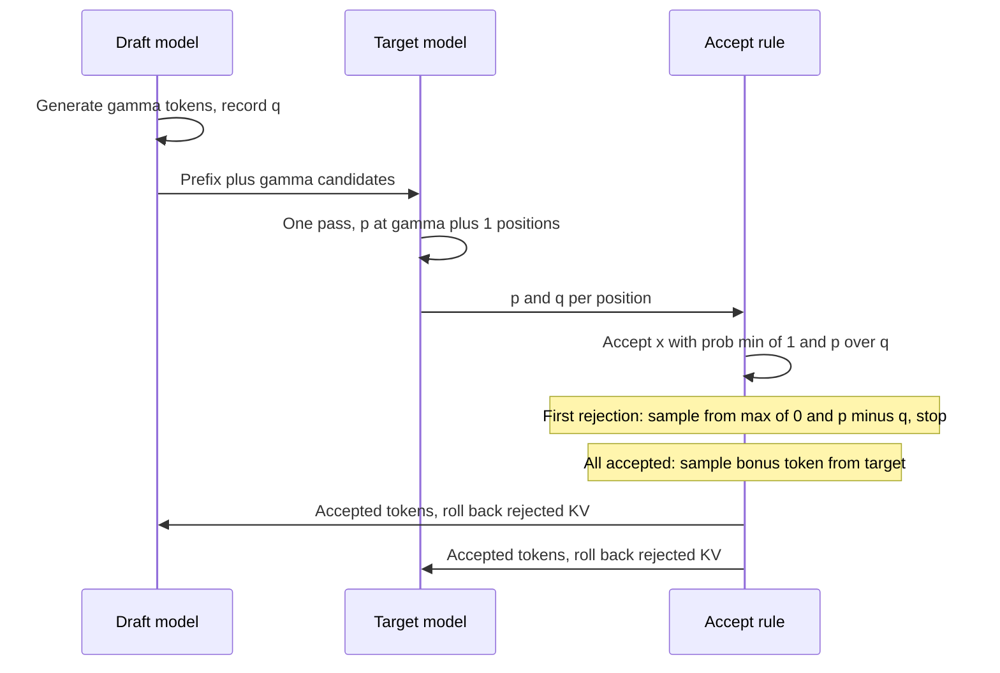

## TL;DR
Speculative decoding lets a cheap draft guess several tokens that the large model verifies in one pass,
with outputs provably unchanged. For self-hosted agents it cuts per-step latency on predictable output
(tool-call JSON, code edits, quoting RAG context) at low concurrency.

## For agent builders
- **Why it matters for agents.** An agent makes many sequential model calls, and each waits on decode, so
  time per output token multiplies across the run. Tool-call JSON, code edits and answers that quote
  retrieved text are predictable, which is exactly where drafts are accepted most often.
- **Where it shows up in your stack.** The speculative decoding settings of a self-hosted engine (vLLM's
  draft-model and n-gram modes, a configurable number of speculative tokens), `assistant_model` and
  `prompt_lookup_num_tokens` in Hugging Face `generate`. Hosted APIs may use it internally without
  exposing a setting; OpenAI's Predicted Outputs (the `prediction` request parameter) is a related hosted
  option for edits where most of the output is known in advance.
- **What you control.** Whether to enable it per serving pool, which drafter (n-gram lookup, a small
  same-family model, trained heads), and how many tokens to speculate, all measured at real concurrency.
- **What you can skip.** The full rejection-sampling proof; remember that the lossless rule keeps outputs
  exactly the target's, so your agent evals do not need re-baselining for quality, only latency.

## Why it exists
- **Decode is bandwidth-bound.** The large model produces one token per forward pass, and that pass is
  dominated by moving weights (and the KV cache) from GPU memory into the compute units, not by
  arithmetic.
- **A second token in the same pass is nearly free.** The weights are read once either way, so the
  compute for another row costs little until the batch grows large enough to become compute-bound.
  Single-request latency has a bandwidth floor, and a GPU with more FLOPs does little.
- **The autoregressive dependency blocks the obvious use.** Token *t+1* is unknown until token *t* is
  chosen, so you cannot simply ask for two tokens at once. "Use a smaller model" trades quality for speed,
  which is usually unacceptable for an agent's planner.
- **You only need to guess, not know.** If something cheap proposes a continuation, the large model scores
  every proposed position in one pass, because given a candidate prefix its distributions at all positions
  are computed in parallel, exactly as in prefill.
- **Asymmetric payoff.** Guess right and you advance several tokens for the price of one pass; guess wrong
  and you lose only the cheap draft work.

## How it works
### The loop
1. **Draft.** A small model (or a cheaper heuristic) generates γ candidate tokens autoregressively from
   the current prefix, recording its probability `q(x)` for each. γ is typically a handful.
2. **Verify.** The target model runs one forward pass over `prefix + γ candidates`. Because a causal
   model computes a distribution at every position in parallel, this yields the target's `p(·)` at all
   γ draft positions plus one more after the last candidate, with the cost profile of a short prefill.
3. **Accept or reject, left to right.** Accept each candidate *x* with probability `min(1, p(x) / q(x))`.
   On the first rejection, sample a replacement from the residual distribution `normalize(max(0, p − q))`
   and stop. If all γ are accepted, sample one bonus token from the target at the extra position.
4. **Roll back.** KV-cache entries for rejected positions, in both models, are discarded; the accepted
   tokens are appended and the loop repeats.

### Background: why the output is exactly the target's
- **It is rejection sampling.** Where the draft puts too little mass on a token (`q < p`), it is always
  accepted when drafted and the shortfall is made up by the residual on rejections. Where it puts too much
  (`q > p`), it is accepted only a fraction `p/q` of the time.
- **Summed over cases,** the probability of emitting each token equals `p(x)` exactly, which makes the
  method lossless rather than an approximation.
- **The one-line proof.** The chance a drafted token is accepted is
  `α = Σ_x q(x)·min(1, p(x)/q(x)) = Σ_x min(p(x), q(x))`, and the residual's normalizer is
  `Σ_x max(0, p(x) − q(x)) = 1 − α`, the rejection probability. So

```
P(emit x) = q(x)·min(1, p(x)/q(x)) + (1 − α) · max(0, p(x) − q(x)) / (1 − α)
          = min(p(x), q(x)) + max(0, p(x) − q(x)) = p(x)
```

- **Expected acceptance falls out of the same algebra:** `α = Σ min(p, q) = 1 − TV(p, q)`, one minus the
  total-variation distance. Acceptance measures how much the drafter's distribution overlaps the
  target's, not whether its single top guess is right.
- **Under greedy decoding** the rule collapses to "accept while the draft matches the target's argmax",
  the easiest version to reason about, and the usual case for tool-calling steps run at temperature 0.

### What the speedup depends on
Let α be the probability a draft token is accepted. Treating each position as an independent trial, the
expected tokens per target pass is `(1 − α^(γ+1)) / (1 − α)`:

| α | γ | Tokens per target pass |
|---|---|---|
| α = 0.8 | 5 | about 3.7 |
| α = 0.5 | 5 | about 2 |

The wall-clock gain divides that by the cycle's relative cost (γ draft steps plus one slightly longer
target pass). With *c* the cost of one draft step relative to one target pass, treating verification as
one target pass:

```
speedup ≈ (1 − α^(γ+1)) / ((1 − α) · (γ·c + 1))
```

- **Both conditions are needed.** The draft must be much cheaper than the target *and* agree with it
  often; either alone is not enough.
- **Agreement depends on the text.** Highest on predictable text such as code, boilerplate, structured
  output (tool calls) and anything that copies from the prompt; lowest on creative text at high
  temperature.
- **γ has an optimum.** Raising γ lifts the ceiling but lowers average acceptance of later positions, and
  past a point the extra verification compute costs more than it saves.

### Where the draft comes from
| Drafter | How it works | Strengths and costs |
|---|---|---|
| **Separate small model** | same tokenizer (so draft ids mean the same to the target), usually same family, an order of magnitude or more smaller | flexible, reusable across a family; extra weights and cache |
| **N-gram or prompt lookup** | propose the continuation that followed the same recent tokens earlier in the context | no second model, near-zero cost; strong on RAG answers that quote sources and code edits that reproduce input, weak elsewhere |
| **Extra heads (Medusa)** | heads on the last hidden state predict offsets +2, +3, ...; candidates verified as a tree in one pass | drafting rides on the target's own pass through small extra heads, no second model; heads trained per target |
| **Feature-level head (EAGLE)** | a light autoregressive module predicts the next hidden state, not the next token | reuses the target's representations for higher acceptance |

- **Check the acceptance mode.** Medusa also offers a relaxed "typical acceptance" rule that trades
  exactness for higher acceptance; only the rejection-sampling rule above is lossless, so check which mode
  a deployment uses before claiming identical outputs.
- **Agents favour prompt lookup.** Agent contexts are full of text the output will copy: file contents a
  coding agent edits, retrieved passages, earlier tool results. N-gram drafting exploits that for free.

### Why it stops helping
- **High concurrency removes the idle compute.** The server already feeds the GPU many tokens per pass, so
  verifying γ extra tokens per request costs real compute and can lower total throughput.
- **So it is a latency tool** for workloads with few concurrent requests, or a throughput tool only while
  the batch is still bandwidth-bound. Many concurrent agents on one GPU look like a batch workload.
- **Tune it by measurement.** Engines such as vLLM expose draft-model and n-gram modes with a configurable
  number of speculative tokens; find the setting by measuring tokens/second per request and per GPU at the
  real batch size.

## Diagram
One speculation cycle: a cheap draft proposes γ tokens, one target pass scores them all, and the accept
rule decides how many survive.



## Examples
### Illustrative cost model: when speculation pays
Every number here is invented for the arithmetic, not a benchmark. A target pass takes 25 ms, a draft
pass 2 ms, γ = 5, and verification is slightly longer than a single-token pass, say 27 ms. A cycle costs
5 × 2 + 27 = 37 ms.

| Acceptance | Tokens per cycle | ms per token | vs 25 ms baseline |
|---|---|---|---|
| α = 0.8 | `(1 − 0.8⁶) / 0.2 ≈ 3.69` | about 10 | a 2.5× gain |
| α = 0.5 | about 1.97 | 18.8 | a 1.3× gain |
| α = 0.3 | about 1.43 | 25.9 | *slower* than not speculating |
| α = 0.8, draft costs 8 ms instead of 2 | 3.69 | 67 / 3.69 ≈ 18 | gain mostly gone |

Acceptance rate and draft cost are the two numbers to measure before enabling it. The same model as a
pure-Python calculator:

```python
def ms_per_token(alpha, gamma, draft_ms, verify_ms):
    tokens = (1 - alpha ** (gamma + 1)) / (1 - alpha)   # expected tokens per cycle
    return (gamma * draft_ms + verify_ms) / tokens

BASE = 25.0                                             # target ms per token, no speculation
for alpha, draft_ms in [(0.8, 2), (0.5, 2), (0.3, 2), (0.8, 8)]:
    t = ms_per_token(alpha, 5, draft_ms, 27)
    print(f"alpha={alpha} draft={draft_ms}ms: {t:5.1f} ms/token, speedup {BASE / t:.2f}x")
# alpha=0.8 draft=2ms:  10.0 ms/token, speedup 2.49x
# alpha=0.5 draft=2ms:  18.8 ms/token, speedup 1.33x
# alpha=0.3 draft=2ms:  25.9 ms/token, speedup 0.96x
# alpha=0.8 draft=8ms:  18.2 ms/token, speedup 1.38x
```

### Worked scenario: a self-hosted coding agent
A coding agent runs 15 sequential steps on a low-concurrency pool; each step emits about 300 output
tokens (a tool call carrying a code edit). Same illustrative costs as above.

| Setup | ms per token | Decode time per step | Decode time per 15-step run |
|---|---|---|---|
| No speculation | 25 | 7.5 s | 112.5 s |
| Drafter, α = 0.5 (novel code) | 18.8 | ~5.6 s | ~84.6 s |
| Prompt lookup or drafter, α = 0.8 (edits copying the file) | ~10 | ~3.0 s | ~45 s |

- **Same output, faster run.** The lossless rule means the agent's trajectory and eval scores are
  unchanged at temperature 0; only wall-clock time moves. In practice the verify pass uses a different
  kernel shape, so in fp16 or bf16 a near-tied token can occasionally flip, exactly as with any batching
  change.
- **Measure acceptance per step type.** Tool-call JSON and edits tend to sit near the top row; free-text
  reasoning sits lower.

### A runnable verification step
Toy distributions that exercise the accept, reject and bonus paths, checking measured tokens per pass
against the formula.

```python
import torch

def speculative_step(p_target, q_draft, draft_tokens, g=None):
    """p_target: [gamma+1, V] target probs at each verified position (ONE target pass);
    q_draft: [gamma, V] draft probs; draft_tokens: [gamma]. Returns the emitted tokens,
    which are distributed exactly as if sampled from the target alone."""
    out = []
    for i, x in enumerate(draft_tokens):
        p, q = p_target[i], q_draft[i]
        if torch.rand((), generator=g) < min(1.0, (p[x] / q[x]).item()):
            out.append(int(x))                                 # accept the draft token
        else:
            resid = torch.clamp(p - q, min=0)                  # residual corrects the distribution
            out.append(int(torch.multinomial(resid / resid.sum(), 1, generator=g)))
            return out                                         # stop at the first rejection
    out.append(int(torch.multinomial(p_target[-1], 1, generator=g)))  # all accepted: bonus token
    return out

V, gamma = 50, 5
g = torch.Generator().manual_seed(0)
target = torch.softmax(2 * torch.randn(V, generator=g), -1)
draft = torch.softmax(target.log() + 0.5 * torch.randn(V, generator=g), -1)  # similar, not identical
lengths = []
for _ in range(2000):
    toks = torch.multinomial(draft, gamma, replacement=True, generator=g)
    lengths.append(len(speculative_step(target.expand(gamma + 1, V), draft.expand(gamma, V), toks, g)))
alpha = torch.minimum(target, draft).sum().item()                   # = 1 - TV(target, draft)
print(f"alpha={alpha:.2f} predicted={(1 - alpha**(gamma + 1)) / (1 - alpha):.2f}",
      "measured:", sum(lengths) / len(lengths))   # agree within sampling noise on this i.i.d. toy
# A stationary toy: real positions have different distributions, but the accept/reject logic is identical.
```

## Production patterns
- **Try prompt lookup first on copy-heavy agent routes.** For RAG answers that quote sources or coding
  agents that rewrite files, use n-gram drafting: no second model to host. In Hugging Face Transformers,
  `generate(..., prompt_lookup_num_tokens=10)`; in vLLM, its n-gram speculative method. Monitor acceptance
  rate and time per output token.
- **Use assisted generation with a same-family drafter.** In Hugging Face, `model.generate(...,
  assistant_model=draft)` with a much smaller model sharing the tokenizer; in vLLM, its draft-model
  speculative mode with a set number of speculative tokens. Monitor acceptance, draft memory and p95 time
  per output token.
- **Split latency and throughput pools.** Enable speculation on low-concurrency interactive pools (chat,
  coding, sequential agents) and leave high-batch pools, such as offline agent evals or bulk jobs, without
  it. Monitor per-GPU tokens/second in each pool, since that is what speculation can lower.
- **Tune γ at production concurrency.** Sweep the number of speculative tokens (for example 2 to 6)
  under replayed real agent traffic and pick the best p50/p95 time per output token that does not cut
  per-GPU throughput. Re-tune when the batch size or model changes.
- **Gate on output equivalence.** With greedy decoding and the lossless rule, outputs should match the
  non-speculative path; diff a sample of agent steps after enabling it, and confirm the acceptance mode
  (strict vs typical) before promising identical outputs.

## Trade-offs
- **Fewer target passes vs draft overhead.** Single-request latency drops, but the draft's weights and KV
  cache take GPU memory and its passes take time. The gain flips negative when acceptance is low or the
  draft is not much cheaper than the target.
- **Lossless vs fastest.** The rejection rule is lossless by construction; simply trusting the draft would
  be faster but changes outputs. The guarantee costs residual-sampling bookkeeping and cache rollback.
- **Separate drafter vs attached heads.** A separate draft model is flexible and reusable across a family;
  attached heads (Medusa, EAGLE) avoid a second model and achieve higher acceptance, at the cost of
  training heads per target model.
- **Larger γ vs wasted verification.** It raises best-case tokens per pass but spends more verification on
  positions increasingly likely to be rejected; the optimum shifts lower as batch size grows.
- **Draft memory vs agent concurrency.** A draft model's weights and cache take GPU memory that could hold
  more agents' KV caches; prompt lookup avoids that cost.

## Pitfalls
- **Enabling it on a heavily batched server.** Throughput falls: verification tokens compete for compute
  that was no longer idle, so per-GPU tokens/second drops even as a lone request speeds up. Fix: enable it
  only on low-concurrency pools, measured at real batch size.
- **A draft model with a different tokenizer.** Symptom: near-zero acceptance or outright errors, because
  draft token ids do not mean the same thing to the target. Fix: use a drafter from the same family with
  the identical tokenizer.
- **Benchmarking on greedy code completion only.** Assuming the speedup holds for creative writing at
  temperature 1; acceptance falls with entropy and the gain shrinks or inverts. Fix: measure acceptance
  per route at each route's real sampling settings.
- **Forgetting to roll back rejected KV entries.** Symptom: corrupted continuations that reference text
  the model never emitted. Fix: truncate both caches to the last accepted position every cycle.
- **Treating a reported speedup as a property of the method.** It belongs to the draft–target pair and the
  workload; the same engine setting can help one customer and hurt another. Fix: benchmark on the
  customer's own prompts before promising a number.

## When to use
- **Use when** per-request latency (time per output token) matters more than aggregate throughput:
  interactive assistants, coding tools, agents making many sequential calls, or any deployment with few
  concurrent requests per GPU.
- **Expect the most** from predictable outputs: code, structured data and tool calls, RAG answers that
  quote context, and templated text; n-gram drafting is nearly free to try there.
- **Avoid or measure carefully** when the server runs large batches or outputs are high-entropy.
- **Measure** acceptance rate, tokens per target pass, p50/p95 time per output token and per-GPU
  throughput before and after, at production concurrency.
- **Interviews:** the memory-bandwidth argument, the accept/reject rule and why it is lossless, the
  expected-tokens formula, and the conditions under which the technique backfires.

## Role lens
- **Engineer:** Enables draft-model or n-gram speculation in the serving engine, tunes γ, and reads
  acceptance-rate metrics to decide whether it is paying off.
- **Architect:** Decides where speculation belongs in the fleet: latency-sensitive, low-concurrency
  pools get it, high-throughput batch pools do not, and the draft model becomes a managed artifact.
- **FDE:** Demonstrates the latency gain on a customer's own prompts and warns when their workload's
  acceptance rate makes it a loss rather than a win.

## Check yourself
**Q:** A team enabled speculative decoding with a small draft model and saw a large speedup in their
single-user demo, then deployed it to a shared endpoint and total throughput fell. Explain both results
and what you would change.
**A:** In the demo the batch size was one, so each target pass was memory-bandwidth bound and the
arithmetic units were idle; verifying γ draft tokens per pass used that free compute, and with a good
acceptance rate they got several tokens per target pass. On the shared endpoint the engine already
batches many requests, so the GPU is close to compute-bound; the extra γ verification tokens per
request now consume real compute, and the draft model's passes and memory add further cost, so
aggregate tokens per second drops even though a lone request would still be faster. I would measure
acceptance rate and per-GPU throughput at production concurrency, lower γ or switch to a cheaper
drafter such as n-gram lookup, and most likely restrict speculation to a latency-sensitive pool with
low concurrency while leaving the high-throughput pool without it.

## Interview questions
### Why is speculative decoding lossless, unlike just using a smaller model?
- **Rejection sampling.** Each draft token is accepted with probability `min(1, p/q)`, and on rejection a
  replacement comes from the residual `max(0, p − q)`; together the emitted token is distributed exactly
  as `p(x)`.
- **So the draft only affects speed.** A bad drafter lowers acceptance and wastes work, but never changes
  what the target would have produced.

### With α = 0.8 and γ = 5, how many tokens per target pass do you expect, and what speedup?
- **Tokens:** `(1 − 0.8⁶) / 0.2 ≈ 3.69` per cycle.
- **Speedup depends on draft cost.** With 2 ms draft steps and a 27 ms verify pass against a 25 ms
  baseline, about 10 ms per token, roughly 2.5×; with 8 ms draft steps it falls to about 1.4×.

### Your self-hosted coding agent spends most of each run waiting on decode. Would speculative decoding help?
- **Probably, if concurrency is low.** Agent steps are sequential and their output (tool-call JSON, edits
  that copy file contents) is predictable, so acceptance is high and per-step latency falls.
- **Check first:** start with prompt lookup, measure acceptance per step type and p95 time per output
  token, and confirm per-GPU throughput holds at the pool's real number of concurrent agents.

### Acceptance is only 20% after you enable a draft model. What do you check?
- **Tokenizer and prompt format.** The drafter must share the tokenizer and see the same chat template, or
  its token ids and context differ from the target's.
- **Workload and settings.** High temperature or creative routes lower overlap; compare acceptance by route,
  try a closer same-family drafter, n-gram lookup on copy-heavy routes, or a smaller γ.

### Your agent platform serves RAG answers, code edits and open chat. How do you choose drafters?
- **N-gram lookup** costs almost nothing and shines when outputs copy the prompt (RAG quotes, code
  edits), but helps little on novel text.
- **A draft model** works across tasks without training, at the cost of extra memory and a shared-tokenizer
  constraint.
- **Medusa or EAGLE heads** usually reach higher acceptance with no second model, but must be trained per
  target, and some Medusa modes are not lossless.

### How would you pick γ for a production deployment?
- **Sweep it under real load.** Replay production traffic at real concurrency for several values and
  measure p50/p95 time per output token and per-GPU throughput.
- **Expect a moving optimum.** Later positions are accepted less often, and verification compute is less
  idle as batches grow, so the best γ falls with concurrency and must be re-tuned.

## Quiz
### Q: Why can the target model verify several draft tokens for roughly the cost of generating one?
- [ ] The draft tokens are already in the KV cache
- [x] Decode is memory-bandwidth bound, so the weights are read once per pass and scoring extra positions in that pass is nearly free until compute saturates
- [ ] The target model skips its attention layers during verification
- [ ] Verification only runs the last transformer layer
> A causal model computes distributions at every input position in parallel. When the pass is dominated
> by reading weights rather than arithmetic, adding a few positions barely changes its duration.

### Q: What does the accept-with-probability min(1, p/q) rule guarantee?
- [ ] That at least one draft token is always accepted
- [ ] That the draft model's output distribution is used when it is confident
- [x] That the emitted tokens follow exactly the target model's distribution, making speculation lossless
- [ ] That greedy decoding is always used for verification
> Combined with sampling from the residual max(0, p − q) on rejection, the rule is rejection sampling
> from the target distribution using the draft as a proposal, so outputs match the target exactly.

### Q: Under which condition is speculative decoding most likely to slow a server down?
- [ ] Low temperature on code completion
- [ ] A draft model from the same family as the target
- [x] High concurrency where each target pass is already compute-bound
- [ ] Prompts that quote long passages from retrieved documents
> Speculation converts idle compute into extra tokens. When batching has already saturated compute,
> the verification tokens and draft passes cost real time and total throughput can fall.

## Use cases & projects
### Use cases
- **Self-hosted coding agents.** Edits that reproduce most of a file are ideal for prompt lookup, cutting
  per-step latency without changing the edit.
- **RAG answer steps.** Answers that quote retrieved passages give n-gram drafting high acceptance.
- **Interactive agent pools.** Low-concurrency pools serving users who wait on each step get speculation;
  batch pools for evals and offline jobs do not.
- **Tool-call heavy loops.** Structured JSON with repeated keys and tool names is predictable, so drafts
  are accepted often at temperature 0.

### Mini project
**Measure speculative decoding on agent-shaped output (2-3 hours).**
- **Goal:** find out how much prompt lookup speeds up an agent's code-edit and tool-call steps.
- **Steps:** collect 30 prompts from an agent's logs or write them (file-rewrite edits, tool-call JSON,
  free-text reasoning); with a small open model in Hugging Face, time `generate` greedily with and without
  `prompt_lookup_num_tokens`; confirm outputs are identical; compute ms per output token per step type.
- **Done when:** you have a table of speedup per step type, a check that every output matched the
  baseline (any mismatch traced to a near-tied token, not a bug), and a recommendation for which agent
  steps or pools should enable it.
