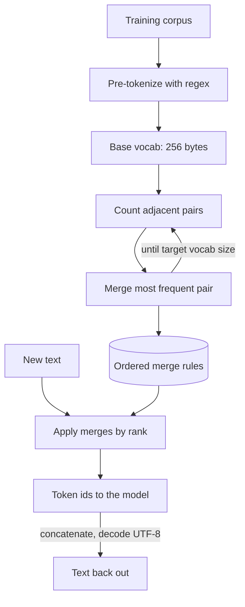

## TL;DR
A tokenizer turns text into integer ids. BPE repeatedly merges the most common adjacent pair, so common
words become one token and rare words split. SentencePiece trains BPE or unigram on raw text. Tokens set
cost, context and many odd behaviours.

## Why it exists
- **A model needs a fixed, finite symbol set:** an embedding row for each and a softmax over all of them
  at every step. Three ways to define the symbols were tried, and two fail.
- **Characters or bytes are too long.** A tiny vocabulary (256 for bytes) and nothing is ever unknown, but
  English text becomes roughly four times longer than with a subword tokenizer. That multiplies
  attention cost and forces the model to learn spelling before meaning; each token carries very little
  information.
- **Whole words are unbounded.** Short, meaningful sequences, but every typo, URL, identifier, number and
  new coinage is a new word, the embedding table explodes, and anything unseen at inference becomes an
  `<unk>` token. Morphologically rich languages such as Finnish or Turkish break it even on ordinary text.
- **Subwords are the compromise.** Frequent words stay whole, rare words split into frequent pieces, and a
  byte or character fallback guarantees any input can be encoded. Sennrich et al. adapted Gage's 1994
  byte-pair compression algorithm to neural translation for exactly the rare-word problem; byte-level BPE
  in GPT-2 removed the last unknown-token case.
- **What it buys.** A bounded vocabulary (tens of thousands to a few hundred thousand entries), short
  sequences, and fixed, affordable embedding and output layers. Everything about cost and context in
  practice is downstream of this choice.

## How it works
### BPE training
1. **Pre-tokenize.** Split the text into chunks with a regular expression, typically at spaces,
   punctuation and digit runs, so merges never cross a word boundary. GPT-2's pattern attaches the
   leading space to the word, which is why `" hello"` and `"hello"` are different tokens; GPT-4-era
   tokenizers split digit runs into groups of at most three.
2. **Start from a base vocabulary.** Every character in the corpus, or all 256 byte values for byte-level
   BPE, so any string can be represented from the start.
3. **Count adjacent pairs** of symbols across the corpus, weighted by frequency, and **merge the most
   frequent pair** into a new symbol. Record the merge as a rule.
4. **Repeat** until the vocabulary reaches the target size.

| Tokenizer | Vocabulary size |
|---|---|
| GPT-2 | 50,257 |
| Llama 2 | 32,000 |
| GPT-4's `cl100k_base` | roughly 100k |
| Llama 3 | 128,256 |

**Why greedy frequency works:** it is a compression objective. Each merge removes the most occurrences of
a pair, so the corpus shrinks fastest in token count. It is cheap, deterministic and good enough that
nothing has displaced it at scale.

### BPE encoding
1. Pre-tokenize the new string and start each chunk as bytes or characters.
2. Repeatedly apply the merge with the lowest rank (earliest learned) that matches, until none applies.
3. Map the resulting symbols to ids.
4. Decoding is concatenation; with byte-level BPE the bytes are then decoded as UTF-8.

### SentencePiece
SentencePiece (Kudo and Richardson) is a library and model format rather than a single algorithm. It
differs from GPT-style BPE in how it sees text:
- **Raw Unicode stream, whitespace as a symbol.** Whitespace is a normal character (the `▁` symbol,
  U+2581), so no language-specific pre-tokenizer is needed, and it works unchanged for Chinese, Japanese
  or Thai, which have no spaces.
- **Lossless with respect to the *normalized* text.** Join the pieces and replace `▁` with a space.
- **Normalization.** NFKC-based by default, which folds full-width characters and ligatures, so
  `decode(encode(x))` can differ from `x`.
- **`byte_fallback`** lets unknown characters decompose into bytes.
- **One self-contained model file**, so there is no separate regex to keep in sync. It trains either BPE
  or the unigram model.
- **Who uses it.** Llama 1 and 2, T5 and Mistral used SentencePiece models; Llama 3 moved to a
  tiktoken-style byte-level BPE with a larger vocabulary for better multilingual efficiency.

### The unigram model
Unigram tokenization (Kudo, 2018), SentencePiece's default, works in the opposite direction from BPE:
1. Start from a large candidate vocabulary of frequent substrings and assign each a probability.
2. Tokenize a string as its most probable segmentation, assuming tokens are independent (found with the
   Viterbi algorithm).
3. Iteratively remove the tokens whose removal hurts corpus likelihood least until the vocabulary reaches
   its target size.

- **Probabilistic, so it can sample.** Alternative segmentations during training act as data augmentation
  (subword regularization), and its pieces tend to align more with morphology.
- **WordPiece (BERT) is a BPE variant.** It picks merges by likelihood gain rather than raw count (a pair
  scores high when it occurs together more often than its parts' frequencies predict), marks
  word-internal pieces with `##`, and encodes by greedy longest-match from the left rather than by
  replaying merges.

### Consequences you will meet
- **Cost and context are counted in tokens.** English prose runs around four characters or three
  quarters of a word per token with OpenAI-style tokenizers; code, numbers and non-Latin scripts cost
  more per character, often several times more (an order of magnitude figure that varies by tokenizer
  and language). Vocabularies were enlarged in part to fix this.
- **Numbers.** Llama 2 splits every digit into its own token; GPT-4-era tokenizers group up to three.
  Arithmetic behaviour and number formatting sensitivity follow from this.
- **Spaces and case.** A prompt ending in a trailing space pushes the next token off the distribution
  the model saw, because the space would normally be attached to the following word.
- **Character-level tasks fail.** Counting letters, reversing strings or spelling rules are hard because
  the model never sees characters, only chunks.
- **Glitch tokens.** Tokens that exist in the vocabulary but barely appeared in training produce erratic
  behaviour; the "SolidGoldMagikarp" family in GPT-2/3 vocabularies is the known example.
- **The tokenizer is part of the model.** Fine-tuning must use the same tokenizer, special tokens and
  chat template; adding tokens means resizing and initializing embeddings; constrained decoding and
  grammars operate on token boundaries, not characters.

## Diagram
The training loop learns an ordered merge list once; encoding replays those merges on new text, and
decoding is concatenation back to bytes and UTF-8.



## Examples
### A BPE trainer and encoder in about thirty lines
A complete, runnable BPE trainer and encoder in about thirty lines. The corpus is tiny so you can trace
the merges by hand; the mechanism is identical to what produced GPT-2's 50k merges.

```python
from collections import Counter

corpus = "low low low lower lower lowest newer newer newest wider widest".split()
words = Counter(tuple(w) + ("</w>",) for w in corpus)      # symbols per word, with end-of-word marker

def pair_stats(words):
    stats = Counter()
    for sym, freq in words.items():
        for a, b in zip(sym, sym[1:]):
            stats[(a, b)] += freq
    return stats

def apply_merge(seq, pair):
    out, i = [], 0
    while i < len(seq):
        if i < len(seq) - 1 and (seq[i], seq[i + 1]) == pair:
            out.append(pair[0] + pair[1]); i += 2
        else:
            out.append(seq[i]); i += 1
    return out

merges = []
for step in range(8):                                        # vocab = base symbols + 8 merges
    stats = pair_stats(words)
    best = max(stats, key=stats.get)                         # most frequent adjacent pair
    merges.append(best)
    words = Counter({tuple(apply_merge(list(s), best)): f for s, f in words.items()})
    print(step, best, stats[best])
# 0 ('l','o') 6 | 1 ('lo','w') 6 | 2 ('e','r') 5 | 3 ('er','</w>') 5 | 4 ('low','</w>') 3 | ...

def encode(word):                                            # apply merges in learned order
    seq = list(word) + ["</w>"]
    for pair in merges:
        seq = apply_merge(seq, pair)
    return seq

print(encode("lowest"), encode("slowest"))
# ['low', 'est</w>'] ['s', 'low', 'est</w>']  <- unseen "slowest" still encodes, no <unk>
```

For real counting use the model's own tokenizer: `tiktoken.get_encoding("cl100k_base").encode(text)`
for OpenAI models, `AutoTokenizer.from_pretrained(name)(text).input_ids` for open models.

### Streaming without replacement characters
Byte-level tokens can end mid-character, so decoding each token on its own leaks `U+FFFD` into streamed
text. An incremental UTF-8 decoder buffers the incomplete bytes; this runs with the standard library.

```python
import codecs

# Byte-level tokens can end in the middle of a UTF-8 character: "café 日本" split as a stream might be.
pieces = [b"caf", b"\xc3", b"\xa9 \xe6\x97", b"\xa5\xe6\x9c\xac"]

naive = "".join(p.decode("utf-8", errors="replace") for p in pieces)
print(chr(0xFFFD) in naive)                  # True: U+FFFD replacement characters leak into the stream

dec = codecs.getincrementaldecoder("utf-8")()    # buffers incomplete bytes between chunks
streamed = "".join(dec.decode(p) for p in pieces) + dec.decode(b"", final=True)
print(streamed == "café 日本", streamed)          # True café 日本
```

### Worked scenario: a chunker tuned on English truncates other content
A RAG pipeline sized chunks at 2,048 characters, assuming about four characters per token, to stay under
a 512-token embedding limit. The per-language ratios below are illustrative, not measured.

| Content | Characters per token (illustrative) | Tokens in a 2,048-character chunk | Result |
|---|---|---|---|
| English prose | ~4 | ~512 | fits |
| Source code | ~3 | ~680 | last quarter silently truncated |
| A script the tokenizer handles poorly | ~1.5 | ~1,365 | most of the chunk never embedded |

The fix: chunk by counting tokens with the embedding model's own tokenizer, then measure retrieval
recall per language.

## Production patterns
- **Count tokens with the serving model's tokenizer.** Use `tiktoken` for OpenAI models and the model's
  `AutoTokenizer` for open models, applied to the fully rendered chat template, before every call. Log
  estimated versus billed or reported token counts and alert on drift.
- **Measure tokens per character per language before choosing a model.** Run a sample of the real corpus
  through each candidate tokenizer and put the ratio into the cost model alongside eval scores. Monitor
  cost per conversation by language after launch.
- **Chunk by tokens, not characters.** Split documents using the embedding model's tokenizer and its
  maximum input length. Monitor the share of chunks at or over the limit.
- **Render prompts with the model's chat template.** Use `tokenizer.apply_chat_template` so special
  tokens match training, and keep the same template for fine-tuning and serving. Monitor stop-token
  rates and runaway generations.
- **Stream by decoding the accumulated text.** Decode the ids generated so far and emit only the new
  suffix, or buffer incomplete UTF-8 bytes as above. Alert on replacement characters in streamed output.

## Trade-offs
- **Larger vocabulary vs bigger layers.** Fewer tokens per text means lower cost, longer effective
  context and faster generation, but a bigger embedding and output layer (128k × 4096 in fp16 is about
  1 GB per untied matrix) and rarer tokens that are undertrained. It pays off when the workload is
  multilingual or code-heavy.
- **Byte-level BPE vs character-level SentencePiece.** Byte-level BPE encodes anything and never emits
  unknown tokens, but scripts whose merges were underrepresented fall apart into byte fragments.
  Character-level SentencePiece with byte fallback handles CJK more gracefully at the cost of
  normalization decisions.
- **Greedy BPE vs probabilistic unigram.** BPE is greedy and deterministic; unigram supports subword
  regularization and tends toward morphological pieces, which helps most when training a tokenizer and
  model from scratch on limited data.
- **Aggressive pre-tokenization vs token counts.** Splitting digits and isolating punctuation makes
  behaviour on numbers and code more consistent but raises token counts on numeric or structured text.

## Pitfalls
- **Counting tokens with the wrong tokenizer**, such as `cl100k_base` for a Llama model. Symptom:
  context-overflow errors or silently truncated prompts in production although the estimate said they fit.
- **Ending a prompt with a trailing space or stitching completions at a non-token boundary.** Symptom: a
  first generated token that starts mid-word, doubles a space or is otherwise odd.
- **Chunking documents by a fixed characters-per-token ratio.** Symptom: code or non-English chunks that
  exceed the embedding model's limit and get truncated without error.
- **Resizing the vocabulary for new special tokens without initializing the new rows sensibly.** Symptom:
  a loss spike in the first steps of fine-tuning.
- **Asking the model for character-level work** (letter counts, exact string reversal, regex-like
  validation). Symptom: confident, inconsistent answers that no prompt reliably fixes.
- **Streaming output by decoding each token id on its own.** A multi-byte UTF-8 character (accented
  letters, CJK, emoji) can span two byte-level tokens, so the symptom is `U+FFFD` replacement characters
  in streamed text that disappear when the full response is decoded at once. Buffer incomplete bytes.
- **Mismatched chat-template special tokens between training and serving.** Symptom: a fine-tuned model
  that ignores its system prompt or never emits a stop token.

## When to use
You do not choose a tokenizer per request, but it shapes several decisions you do make.
- **Selecting a model for a market:** measure tokens per character on a sample of your real corpus across
  candidate tokenizers; the ratio can differ by multiples between languages and drives cost and latency
  directly.
- **Budgeting and chunking:** use the model's own tokenizer, never a character heuristic.
- **Training a new tokenizer:** only when also training a model from scratch on a domain whose symbols
  existing vocabularies handle badly, such as DNA, logs or a new programming language.
- **Interviews:** walk through the merge loop, contrast byte-level BPE with SentencePiece and unigram, and
  explain from tokenization why a model miscounts letters or why Hindi costs more than English.

## Role lens
- **Engineer:** Counts tokens with the correct tokenizer before every call, handles chat-template special
  tokens exactly, and tokenizes before chunking rather than after.
- **Architect:** Builds the cost model per language and content type from measured tokens per character,
  and weighs tokenizer efficiency alongside benchmark scores when choosing a model.
- **FDE:** Explains to a customer in Japan or India why bills and latency per character exceed the
  English pilot, and why a chunker tuned on English truncates their documents.

## Check yourself
**Q:** A customer's Hindi support assistant costs about three times more per conversation than the
English pilot on the same model, with the same number of turns. Explain the mechanism and what you would
do about it.
**A:** The model's tokenizer learned its merges from a corpus dominated by English, so English words map
to one or two tokens while Devanagari text falls apart into many short pieces or, with byte-level BPE,
into byte fragments; the same message costs several times more tokens, and cost, latency and context
consumption all scale with tokens. I would first measure tokens per character on a sample of real Hindi
conversations across the candidate tokenizers to quantify the ratio. Then I would evaluate a model whose
vocabulary was built with multilingual data, such as one with a larger vocabulary, since fewer tokens
per message cuts cost and leaves more room in the context window; check that quality holds on their
tasks; and revisit the chunking and context budgets, which were tuned on English token counts and are
probably truncating Hindi content.

## Interview questions
### Walk me through how BPE builds its vocabulary and encodes a word it never saw.
- **Training:** pre-tokenize, start from 256 bytes or the corpus characters, then repeatedly merge the
  most frequent adjacent pair into a new symbol, recording each merge, until the target size.
- **Encoding:** replay the merges in learned order on the new word's bytes; an unseen word such as
  "slowest" still splits into known pieces, so there is no `<unk>`.

### Prompts that "fit" by your estimate are overflowing the context in production. What do you check?
- **Which tokenizer did the estimate use?** Counting with `cl100k_base` for a Llama model, or counting raw
  text instead of the rendered chat template, undercounts.
- **Then content mix:** code and non-English text cost more tokens per character, so a characters-based
  heuristic breaks on exactly those requests.

### When would a bigger vocabulary not be worth it?
- **For small models or narrow English workloads.** A 128k × 4096 fp16 matrix is about 1 GB per untied
  copy, a large share of a small model, and rare tokens stay undertrained.
- **It pays off for multilingual or code-heavy traffic**, where fewer tokens per text cuts cost, latency
  and context use.

### How do BPE, unigram and WordPiece differ?
- **BPE** grows bottom-up by greedy frequency merges and encodes by replaying merges.
- **Unigram** prunes a large candidate vocabulary by likelihood, segments with Viterbi and can sample
  segmentations (subword regularization).
- **WordPiece** picks merges by likelihood gain, marks word-internal pieces with `##` and encodes by
  greedy longest-match.

### Streamed responses show replacement characters that vanish in the final text. Why?
- **Byte-level tokens can split a multi-byte UTF-8 character**, so decoding each token on its own yields
  `U+FFFD` for the incomplete bytes.
- **Fix:** buffer incomplete bytes with an incremental decoder, or decode the accumulated ids and emit
  only the new suffix.

## Quiz
### Q: What does BPE do at each step of training?
- [ ] Removes the least likely token from a large initial vocabulary
- [x] Merges the most frequent adjacent pair of symbols in the pre-tokenized corpus into a new symbol
- [ ] Splits the longest word in the corpus into two halves
- [ ] Assigns a probability to every substring and keeps the top-k
> BPE grows a vocabulary bottom-up by greedy frequency merges. Pruning a large vocabulary by likelihood is
> the unigram model, which SentencePiece also implements and which runs in the opposite direction.

### Q: What distinguishes SentencePiece from a GPT-style BPE tokenizer?
- [ ] It can only produce character-level tokens
- [ ] It requires a language-specific word splitter before training
- [x] It treats raw text, including whitespace, as a stream of symbols and trains BPE or unigram models without a pre-tokenizer
- [ ] It cannot be used for languages that use spaces
> SentencePiece encodes whitespace as the ▁ symbol and segments the raw Unicode stream directly, which is
> why it works for Japanese or Thai without a word splitter and decodes losslessly.

### Q: Why do LLMs make mistakes counting the letters in a word?
- [ ] Because the softmax cannot represent small integers
- [ ] Because attention cannot look at more than one token at a time
- [x] Because the model sees subword tokens, not characters, so the letters inside a token are not individually visible
- [ ] Because the tokenizer removes repeated letters
> A word like "strawberry" arrives as a few chunks whose internal spelling is only indirectly learned.
> Character-level questions ask the model to recover information the tokenizer collapsed.
