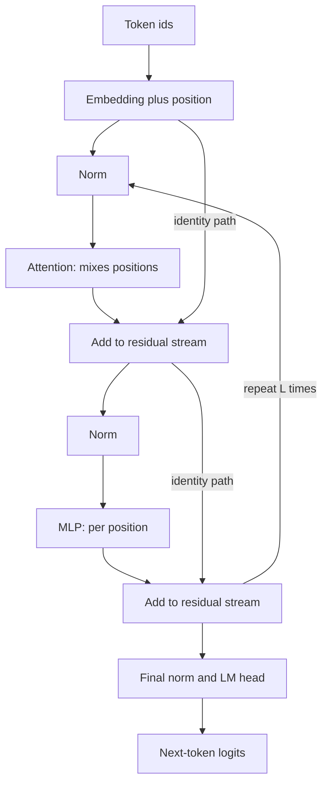

## TL;DR
The model behind every agent is a decoder-only transformer: one causal stream where system prompt, tool
schemas, tool results and output are all just tokens. Knowing the block lets you predict what longer
agent transcripts cost and why.

## For agent builders
- **Why it matters for agents.** Your agent's whole state lives in one left-to-right token stream. Every
  tool result you append is attended to by every later token, so transcript length, not step count,
  drives cost and latency.
- **Where it shows up in your stack.** The model's `config.json` when self-hosting, the
  `attn_implementation` setting in Hugging Face Transformers, input-token pricing on hosted APIs, and the
  choice between a small encoder classifier and an LLM call for a router or guardrail step.
- **What you control.** Which layout and size each agent step uses (a big decoder for planning, a small
  encoder for classification or embeddings), how long the transcript grows, and whether you can estimate
  cost per run before launch.
- **What you can skip.** Interpretability details and the exact norm and initialisation recipes. Keep the
  two sub-layers, the 2N rule and the attention-score term; that is what you use day to day.

## Why it exists
- **Recurrence is sequential.** Before 2017 sequence models were recurrent. An LSTM reads token *t* only
  after finishing token *t−1*, so a 1,000-token document is 1,000 dependent steps. You cannot parallelize
  across positions inside a sequence, so GPUs sit mostly idle and wall-clock time grows with length.
- **Long-range signal decays.** Information from position 1 reaches position 1,000 only by surviving 999
  updates of a fixed-size hidden vector. Gradients through that path shrink, so long-range dependencies
  are learned badly or not at all.
- **Earlier fixes solved only half.** Attention bolted onto RNNs for translation let the decoder look back
  at every encoder state instead of one summary vector, but the recurrent backbone kept the first problem.
  Convolutions (ByteNet, ConvS2S) parallelize, yet connecting positions *n* apart needs O(n/k) stacked
  layers of kernel width *k*, or O(log n) with dilation, so distance still costs depth.
- **The bet: attention does all the mixing.** Drop recurrence and convolution, so every position in a
  layer is computed at once and any two positions are one layer apart. The price is attention cost that
  grows with the square of sequence length and no built-in sense of order, which positional encodings
  must supply.
- **Why the bet paid off.** The binding constraint on quality turned out to be how much data and compute
  you can push through training, and a matmul-parallel architecture scales that far better than a
  sequential one. For agents it also means a tool result from step 1 is one attention hop from step 20.

## How it works
### Background: the block
Token ids go through an embedding table to give an `[n, d_model]` matrix, with position information
added or injected into attention. Then *L* identical blocks run in sequence, each with two sub-layers:

1. **Attention sub-layer.** Every position builds a query, scores it against the keys of all positions it
   may see, and takes the softmax-weighted sum of their values. This is the *only* place where tokens
   exchange information. Multi-head attention runs several of these in parallel in different subspaces.
2. **Feed-forward sub-layer (MLP).** Applied to every position independently with the same weights:
   `FFN(x) = W₂·act(W₁·x)`, inner width about 4×d_model (roughly 2.7× for a gated SwiGLU with three
   matrices, as in Llama).

Why the MLP is needed:
- **Attention can route but not compute.** Its only nonlinearity is the softmax over scores, and its
  output is a weighted average of linearly projected values. It blends information but cannot compute a
  new feature of a single token.
- **The MLP does that work.** Per-position computation, and most of the parameters, live there; it holds
  roughly two thirds of a layer's weights.

### Background: residuals and normalization
Each sub-layer is wrapped as `x = x + SubLayer(Norm(x))`.

| Choice | What it is | Because |
|---|---|---|
| Residual connection | add the sub-layer output back to its input | gives gradients an identity path through 30–100 layers |
| Residual stream | a width-d_model vector each sub-layer reads and writes a small update into | the useful mental picture of the whole stack |
| Post-norm (original paper) | normalize *after* the addition | puts a norm on the main path, fragile when deep |
| Pre-norm (GPT-2 and nearly everything since) | normalize *before* the sub-layer | keeps the identity path clean, trains deep stacks without delicate warmup schedules |
| RMSNorm (Llama-style) | LayerNorm without mean-centering | cheaper and works as well |

### Background: data flow with shapes
For one sequence of *n* tokens:
1. ids `[n]` → embedding `[n, d]`.
2. *L* blocks, each mapping `[n, d]` to `[n, d]`. Attention internally builds `[h, n, n]` scores; the MLP
   briefly widens to `[n, d_ff]`.
3. Final norm `[n, d]` → LM head `[n, V]`.

Because every block preserves the shape, depth is just a loop, and every block reads and writes the same
residual stream.

### Background: the head
- **Logits.** After the last block: a final norm, then a linear map from d_model to vocabulary size (the
  LM head, often weight-tied to the input embedding). A softmax turns logits into a next-token
  distribution. Tool-call JSON, structured outputs and plain text are all sampled from this one head.
- **Dense training signal.** Training predicts token *t+1* at every position *t* in the same forward pass
  under a causal mask, so one pass over a 4k-token sequence yields 4k training signals. That density of
  signal per FLOP is a large part of why the architecture scales.

### Three layouts, and which agent step uses which
| Layout | Attention | Good for | Limitation | Agent use |
|---|---|---|---|---|
| **Encoder–decoder** (original, T5) | bidirectional encoder; causal decoder plus cross-attention into the encoder output | translation, where input and output are distinct sequences | two stacks to scale | rare; some summarization or translation tools |
| **Encoder-only** (BERT) | bidirectional, every token sees every other | classification and embeddings | cannot generate text autoregressively | retrieval embeddings, rerankers, intent routers, guardrail classifiers |
| **Decoder-only** (GPT, Llama, most chat models) | one causal stack | generation, general-purpose LLMs | sees only left context | the planner and tool caller itself |

Decoder-only won for LLMs because:
- **One component to scale**, trained on raw unlabeled text with one objective.
- **Prompt and completion share one stream**, so any task becomes conditioning. This is why an agent can
  be "just a prompt plus a transcript": tool schemas and results are conditioning text.
- **Causality enables the KV cache** at inference, which is what makes append-only agent transcripts cheap.

### Where parameters and FLOPs go
Per layer with hidden size *d*: the four attention projections cost 4d² parameters; a 4× MLP costs 8d²;
a SwiGLU MLP costs 3·d·d_ff.

| Llama-2-7B (d = 4096, L = 32, d_ff = 11008, vocab 32,000) | Parameters |
|---|---|
| Attention per layer | 67.1M |
| MLP per layer | 135.3M |
| All layers | 202.4M × 32 = 6.48B |
| Two untied embedding matrices | 131M each |
| Total | ≈ 6.74B |

- **Forward compute ≈ 2 FLOPs per parameter per token**, because each weight takes part in one
  multiply-accumulate.
- **Plus an attention-score term** of roughly 4·n·d per layer per token (QKᵀ and AV against *n* earlier
  positions).
- **Crossover.** Against a standard block's 12d² weights, that is 24d² versus 4·n·d. The attention term
  reaches a sixth of the weight FLOPs at n = d and equals them at n ≈ 6d, about 24k tokens for d = 4096.
- **Rules of thumb.** Inference ≈ 2N FLOPs per token; training ≈ 6N per token (forward plus a backward
  that costs about twice the forward). These let you estimate cost before touching a GPU.

### What this means for an agent run
- **Cost scales with transcript tokens.** Each step's new tokens cost about 2N each, plus an attention
  term that grows with how far into the transcript they sit. Late steps in a long run are dearer per token.
- **Order is causal.** A token sees only what came before it, so instructions placed after a long tool
  result are read with that result in view, while the result was encoded without them.
- **Nothing is remembered between calls.** The weights are fixed; the stream is the only memory. Anything
  the agent must know at step 20 has to be in the transcript, retrieved, or summarised into it.

### Background: what the pieces learn
- **Attention heads route.** Interpretability work finds heads that attend to the previous token, or find
  an earlier occurrence of the current token and copy what followed it.
- **MLPs store associations.** MLP layers act like key–value memories storing factual and lexical
  associations.
- **Caveat.** Treat this as a useful picture, not a complete theory.

## Diagram
Follow one residual stream through a pre-norm block: attention is the only box that mixes positions (it
is where a tool result reaches later tokens), and both sub-layers add their output back into the stream.



## Examples
### Worked scenario: compute for a 10-step agent on a self-hosted 7B model
An agent on Llama-2-7B (N ≈ 6.74B, d = 4096, L = 32) starts with a 4,000-token prefix (system prompt and
tool schemas). Each step emits ~200 tokens and appends a ~2,000-token tool result. Illustrative totals
from the 2N rule plus the 4·n·d attention term:

| Step | Context at start | Recompute whole transcript | Append-only with prefix caching |
|---|---|---|---|
| 1 | 4,000 | ~61 TFLOP | ~61 TFLOP |
| 5 | 12,800 | ~220 TFLOP | ~43 TFLOP |
| 10 | 23,800 | ~475 TFLOP | ~56 TFLOP |
| Total, 10 steps | | ~2.5 PFLOP | ~0.47 PFLOP |

- **The 2N-only estimate undercounts.** For the cached run it predicts ~0.32 PFLOP, so the attention term
  adds roughly half again at these lengths.
- **The lesson.** Keep transcripts append-only and short; per-step cost rises with position even when
  each step adds the same number of tokens.

### Estimate an agent run's compute from the model config
Pure Python, no GPU: the same arithmetic as the table, so you can price an agent design before launch.

```python
def params(d, L, d_ff, vocab, gated=True, tied=False):
    attn = 4 * d * d                                  # Wq, Wk, Wv, Wo (no GQA)
    mlp = (3 if gated else 2) * d * d_ff              # SwiGLU has three matrices
    return L * (attn + mlp) + vocab * d * (1 if tied else 2)

def span_flops(start, end, N, d, L):                  # tokens at positions start..end-1
    n = end - start
    return 2 * N * n + L * 4 * d * (start + end - 1) * n / 2   # 2N plus attention-score term

def agent_run(steps, prefix, result_toks, out_toks, cached=True, d=4096, L=32, d_ff=11008, vocab=32000):
    N, total = params(d, L, d_ff, vocab), 0.0
    for k in range(steps):
        ctx = prefix + k * (result_toks + out_toks)
        new = prefix if k == 0 else result_toks
        total += span_flops(ctx - new if cached else 0, ctx, N, d, L)   # prefill
        total += span_flops(ctx, ctx + out_toks, N, d, L)               # decode
    return total

for cached in (False, True):
    print(f"cached={cached}: {agent_run(10, 4000, 2000, 200, cached)/1e15:.2f} PFLOP")
# cached=False: 2.53 PFLOP
# cached=True: 0.47 PFLOP
```

### A minimal decoder-only transformer in PyTorch
A minimal pre-norm decoder-only transformer. The block is the whole architecture; the rest is
embedding, stacking and the tied LM head. `nn.RMSNorm` needs PyTorch 2.4+; swap in `nn.LayerNorm` otherwise.

```python
import torch, torch.nn as nn, torch.nn.functional as F

class Block(nn.Module):
    def __init__(self, d=512, n_heads=8, d_ff=2048):
        super().__init__()
        self.h, self.dk = n_heads, d // n_heads
        self.n1, self.n2 = nn.RMSNorm(d), nn.RMSNorm(d)
        self.qkv, self.o = nn.Linear(d, 3 * d, bias=False), nn.Linear(d, d, bias=False)
        self.up, self.down = nn.Linear(d, d_ff, bias=False), nn.Linear(d_ff, d, bias=False)

    def forward(self, x):                                   # x: [B, n, d]
        B, n, d = x.shape
        q, k, v = self.qkv(self.n1(x)).split(d, dim=-1)
        q, k, v = (t.view(B, n, self.h, self.dk).transpose(1, 2) for t in (q, k, v))  # [B, h, n, dk]
        a = F.scaled_dot_product_attention(q, k, v, is_causal=True)
        x = x + self.o(a.transpose(1, 2).reshape(B, n, d))  # residual 1: tokens have now mixed
        return x + self.down(F.gelu(self.up(self.n2(x))))   # residual 2: per-position transform

class TinyLM(nn.Module):
    def __init__(self, vocab=32000, d=512, L=6, max_len=1024):
        super().__init__()
        self.emb, self.pos = nn.Embedding(vocab, d), nn.Embedding(max_len, d)
        self.blocks = nn.ModuleList(Block(d) for _ in range(L))
        self.norm, self.head = nn.RMSNorm(d), nn.Linear(d, vocab, bias=False)
        self.head.weight = self.emb.weight                  # weight tying: one matrix, two jobs

    def forward(self, ids):                                 # ids: [B, n] -> logits [B, n, vocab]
        x = self.emb(ids) + self.pos(torch.arange(ids.shape[1], device=ids.device))
        for b in self.blocks:
            x = b(x)
        return self.head(self.norm(x))

m = TinyLM(); ids = torch.randint(0, 32000, (2, 128))
print(m(ids).shape, f"{sum(p.numel() for p in m.parameters())/1e6:.1f}M params")
# torch.Size([2, 128, 32000]) 35.8M params  (16.4M of them are the shared embedding)
```

### Worked scenario: a cost model that broke at long context
A team priced a 7B summarization route at 2N FLOPs per token, validated at 2k context, then launched
64k-token documents.

| Context | Attention-score term vs 2N | What the 2N-only model predicted |
|---|---|---|
| 2k | about +8% | close enough |
| 8k | about +31% | noticeably low |
| 32k | about +124% | less than half the real compute |
| 64k | about +249% | badly wrong |

The fix was adding the 4·n·d per-layer term to the cost model and routing very long documents through
chunked summarization instead of one giant prompt. A research agent that stuffs whole documents into its
transcript hits the same wall.

## Production patterns
- **Price an agent design before building it.** Multiply expected steps by tokens appended per step, add
  the prefix, and run the 2N plus 4·n·d estimate (or provider input and output token prices for hosted
  models). Monitor real tokens per run against the estimate; drift means the agent loops or tool results
  bloat.
- **Compute cost from `config.json` before deploying.** Read `hidden_size`, `num_hidden_layers`,
  `intermediate_size`, `num_attention_heads` and `num_key_value_heads`, then derive parameters, 2N
  FLOPs per token and weight memory. Monitor measured tokens per second against the estimate; a large gap
  points at kernels or batching.
- **Use a small encoder where an LLM call is overkill.** For routing, guardrail classification or
  embeddings, a fine-tuned encoder-only model sees the whole input both ways and is far cheaper per
  request. Monitor accuracy against the LLM baseline on the same eval set.
- **Smoke-test every converted or newly loaded checkpoint.** Load through the model's own class (for
  example `AutoModelForCausalLM.from_pretrained`, which reads the architecture from the config), then
  check perplexity or a fixed eval on known text, plus a few tool-calling traces. Fluent garbage is the
  symptom of a wrong variant.
- **Use fused attention kernels.** Call `F.scaled_dot_product_attention` in your own code, or set
  `attn_implementation="sdpa"` (or `"flash_attention_2"` if installed) in Hugging Face Transformers.
  Monitor peak memory and step time at your real context lengths.
- **Price long-context routes separately.** Add the attention-score term per route and cap context length
  where the per-token cost would exceed the budget. Alert on context-length p95 per route and per agent
  step.

## Trade-offs
- **Parallelism and short paths vs quadratic attention.** Full parallelism across positions and O(1) path
  length between any two tokens, paid for with attention cost quadratic in sequence length. The trade
  flips against plain attention when contexts reach hundreds of thousands of tokens, which is where
  sliding windows, retrieval and state-space hybrids enter, and where agents need compaction or memory.
- **No built-in bias vs data hunger.** No locality or order bias means the model needs positional
  encodings and more data than a CNN or RNN to learn simple structure. The same lack of bias is why one
  architecture handles prose, code, audio tokens and protein sequences.
- **Decoder-only simplicity vs left-only context.** One objective, one stack and a KV cache, but every
  token sees only its left context. For classification and embedding tasks an encoder that sees the
  whole input both ways is often better per parameter.
- **Pre-norm stability vs growing residuals.** Pre-norm trains deep stacks reliably but lets the residual
  stream's magnitude grow with depth, which is why final norms and careful initialization matter at
  scale. Post-norm has the opposite profile.
- **One big model vs a mixed fleet.** One decoder for every agent step is simple, but a small encoder for
  routing and embeddings cuts cost; you pay with another model to serve and evaluate.

## Pitfalls
- **Estimating serving cost from parameter count alone.** Ignoring the attention term gives a cost model
  that is accurate at 2k context and badly wrong at 64k. Fix: add 4·n·d per layer per token.
- **Pricing an agent by step count.** Symptom: real cost per run is several times the plan because late
  steps carry the whole transcript. Fix: model tokens per step and position, as in the agent table.
- **Treating the architecture diagram as the whole story.** Tokenizer, positional scheme, norm placement,
  activation and head layout differ between model families. Loading weights with the wrong variant
  produces a model that runs and emits fluent garbage. Fix: load through the matching config and test.
- **Using the wrong layout for the task.** Assuming an encoder-only model can be prompted to generate, or
  that a decoder-only model gives good bidirectional embeddings out of the box. Symptom: puzzlingly weak
  results on a task the architecture was never trained to do. Fix: match layout to task, or use a model
  trained for embeddings.
- **Reading attention maps as explanations.** Many heads over many layers plus the MLP path mean a single
  map rarely tells you why the model answered as it did, or why an agent picked a tool. Fix: treat a map
  as a hint and confirm a claim by ablating the component.

## When to use
You rarely choose *whether* to use a transformer; you choose which layout and size for each agent step.
- **Keep the block in your head** to reason downstream: why the KV cache exists, why GQA and
  FlashAttention target the attention sub-layer, why quantization targets the MLP matrices, and why
  context length is expensive.
- **Use an encoder** when the task is classify-or-embed with the whole input visible (routers,
  guardrails, retrieval).
- **Use a decoder** when the task is generate: planning, tool calls, answers.
- **Use an encoder–decoder** when inputs are long and fixed and outputs short (translation, some
  summarization).
- **Measure from the config.** Turn `hidden_size`, `num_hidden_layers`, `intermediate_size`,
  `num_attention_heads` and `num_key_value_heads` into parameter, FLOP and memory numbers.
- **Interviews:** draw the block, name the two sub-layers and their roles, and derive the
  2N-FLOPs-per-token estimate from the shapes.

## Role lens
- **Engineer:** Reads a model's config to compute memory and FLOPs, picks encoder vs decoder models for
  embeddings vs generation, and knows which sub-layer a given optimization touches.
- **Architect:** Owns the cost and capability model that follows from layout and size: context policy,
  GPU tier and whether a small encoder can replace an LLM call for classification.
- **FDE:** Explains to a customer why a 70B model costs what it does, why their long documents change the
  bill non-linearly, and why "just fine-tune BERT to write emails" does not work.

## Check yourself
**Q:** Decoder-only transformers won for general-purpose LLMs over encoder–decoder designs. Explain the
reasons, and name what was given up in the process.
**A:** A single causal stack is one component to scale and one objective, next-token prediction, that
trains on unlabeled text. Because prompt and completion share the stream, any task becomes conditioning
rather than a separate head, which is what makes in-context learning and instruction following natural.
Causality also means earlier tokens' keys and values never change, so inference can cache them and
generate in linear time per token. What was given up: the input is read only left-to-right, so per-token
representations of the prompt are weaker than an encoder's bidirectional ones, which still matters for
embeddings and classification; and prompt plus output share one quadratic attention budget, whereas an
encoder–decoder processes the input once and cross-attends to it cheaply from each output step.

## Interview questions
### If attention already mixes tokens, why does every block also need an MLP?
- **Attention routes, it does not compute.** Its output is a softmax-weighted average of linearly
  projected values, so it can move and blend information between positions but cannot build a new
  nonlinear feature of one token.
- **The MLP is the per-position computer.** It applies a nonlinearity to each position independently and
  holds roughly two thirds of a layer's weights, which is where factual associations appear to live.

### Walk me through estimating the parameter count of Llama-2-7B from its config.
- **Per layer:** attention projections 4d² = 67.1M with d = 4096; SwiGLU MLP 3·d·d_ff = 135.3M with
  d_ff = 11008.
- **Stack and embeddings:** 202.4M × 32 layers = 6.48B, plus two untied 32,000 × 4096 embedding
  matrices of 131M each, for about 6.74B.
- **Then FLOPs:** about 2N per token for inference and 6N for training.

### Your agent's cost per run is 5x the plan, though each step adds about the same number of tokens. Why?
- **The plan priced steps, not positions.** Without prefix reuse every step re-processes the whole
  transcript, so total work grows roughly with the square of step count.
- **The attention term grows with position.** Even with caching, a token at position 24k costs well over
  2N, so late steps are dearer.
- **Fix:** append-only transcripts with prefix caching, compact old tool results, and cap steps per run.

### Which agent steps would you move off the main decoder LLM, and why?
- **Classification-shaped steps.** Intent routing, guardrail checks and relevance filtering see the whole
  input and output a label, which a fine-tuned encoder does cheaply with bidirectional context.
- **Embedding steps.** Retrieval needs a model trained for embeddings, not a decoder's last hidden state.
- **Keep on the decoder:** planning, tool-argument generation and final answers.

### A converted checkpoint loads without errors but produces fluent nonsense. How do you debug it?
- **Suspect a variant mismatch first.** Norm type and placement, activation, positional scheme, head
  layout and tokenizer all differ by family, and a mismatch still runs.
- **Check systematically:** compare the config against the source model card, verify the tokenizer
  round-trips sample text, then measure perplexity on known text against the original implementation.

### Why does the 2N-FLOPs-per-token estimate fail at long context, and where is the crossover?
- **There is an extra attention-score term** of about 4·n·d per layer per token, for QKᵀ and AV against
  *n* earlier positions.
- **Crossover:** against 24d² weight FLOPs per layer it reaches a sixth at n = d and equals them at
  n ≈ 6d, about 24k tokens for d = 4096, so long-context routes need their own cost model.

## Quiz
### Q: In a transformer block, which component is the only one that moves information between positions?
- [ ] The feed-forward (MLP) sub-layer
- [x] The attention sub-layer
- [ ] The layer normalization
- [ ] The residual connection
> The MLP, norms and residuals all operate on each position independently with shared weights. Only
> attention computes a weighted sum over other positions, so it is the sole channel for cross-token
> information flow.

### Q: Why did pre-norm (`x + f(Norm(x))`) replace the original post-norm in deep decoder stacks?
- [ ] It reduces the parameter count of each block
- [ ] It is what makes the KV cache possible
- [x] It keeps the identity residual path clean, so very deep stacks train stably without delicate warmup
- [ ] It lowers attention cost from quadratic to linear
> Post-norm puts a normalization on the main residual path, which makes gradients through deep stacks
> fragile. Pre-norm leaves the residual stream untouched between blocks. It has nothing to do with the
> cache or attention complexity, and it changes no parameter count.

### Q: For a dense transformer with N parameters at modest context, roughly how many FLOPs does one forward token cost?
- [ ] About N
- [x] About 2N
- [ ] About 6N
- [ ] About N²
> Every weight participates in one multiply-accumulate per token, which is two FLOPs, giving ≈2N; the
> attention-score term (about 4·n·d per layer) stays minor until context is several times the hidden
> size. 6N is the training estimate, which includes the backward pass.

## Use cases & projects
### Use cases
- **Costing an agent before launch.** The ≈2N FLOPs-per-token rule plus expected transcript length gives a
  first estimate of compute per run, which you compare with hosted per-token pricing.
- **Choosing a model per agent step.** A small encoder handles routing, guardrail classification and
  embeddings; a decoder handles planning and tool calling, because only it generates.
- **Explaining long-run slowdowns.** Every appended tool result is attended to by every later token, so
  transcript length explains why late steps get slower and dearer.
- **Reading a self-hosted model card.** Layers, hidden size and head counts in `config.json` tell you
  memory, speed and context behaviour before you benchmark.

### Mini project
**Estimate the cost of one agent run from the architecture (1-2 hours).**
- **Goal:** predict compute and token cost of a 10-step tool-calling run from a model's config, then check
  it against measured usage.
- **Steps:** pick an open model and read its layers and hidden size from `config.json`; log input and output
  tokens per step of a small agent with two fake tools; compute ≈2N FLOPs per token and the attention term
  per step; compare the total with the provider or engine usage numbers.
- **Done when:** you have a per-step table of tokens and estimated FLOPs, and a short note on which steps
  dominate and why transcript growth, not step count, drives the total.
