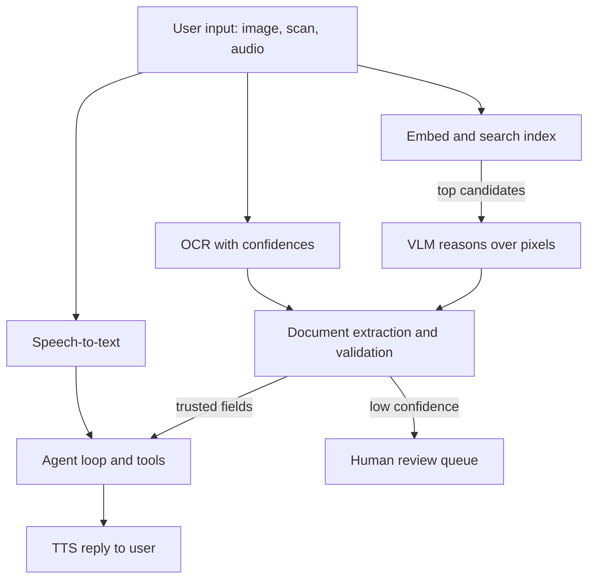

## Overview
This module covers how AI systems take in and produce things other than plain text: images, scanned
pages and audio. For an agent builder, these are the senses and the voice of the agent: how it sees a
screenshot, reads a scanned invoice, hears a caller and speaks back.

The lessons connect through one recurring decision. Convert the input to text early (OCR, ASR,
captions) and accept the loss, embed it for cheap comparison at scale, or hand the raw signal to a model
that reasons over it directly.

**What the lessons cover:**

- **Seeing:** vision-language models, the encoder-connector-LLM design that lets a language model attend over visual tokens. Underneath sits CLIP, the contrastive image-text training that produced the vision towers most VLMs reuse.
- **Searching:** image embeddings generalise that idea into vectors you can index, search, cluster and deduplicate. The encoder you choose decides what "similar" means.
- **Reading documents:** OCR and document understanding are the enterprise workhorse. They recover characters, positions and confidences from scans, then put layout back into the model so fields, tables and answers come out structured and verifiable.
- **Voice:** speech-to-text and TTS close the loop, from Whisper-style spectrogram transcription to neural synthesis built for time-to-first-audio.

**Core versus background for agent builders:**

- **Core (4 lessons):** vision-language-models, document-understanding, speech-to-text and tts. You use these directly in computer-use, document, back-office and voice agents.
- **Useful (3 lessons):** ocr, clip and image-embeddings. You meet them as the tools and indexes under those agents: the `ocr_page` tool, the image search tool, the multimodal RAG index.
- **Background:** none, though CLIP training and vocoder internals are marked as skippable detail inside their lessons.

**What you can build afterwards:**

- **Pick the pipeline:** choose the right modality pipeline for a task and estimate its token and latency cost.
- **Measure it:** use the right metric (recall@k, CER/WER, per-field accuracy, RTF) on your own data.
- **Route the unverifiable:** send what the system cannot verify to a human instead of acting on it.

It matters most for AI Engineers building these pipelines and for FDEs who meet scanned documents and
call recordings in nearly every enterprise deployment.

## Why it matters
- **Engineer:** You will wire OCR, VLM calls, embedding search and ASR/TTS into products and agent tools, and you need to know which stage is failing, what each image or second of audio costs in tokens and latency per agent step, and how to measure accuracy on your own data rather than trusting a benchmark.
- **Architect:** You decide whether an agent's workload converts to text early, embeds for search, or sends pixels and audio to a VLM, and that choice sets cost per request, the latency budget of each agent turn, auditability and how much human review the system needs at volume.
- **FDE:** Customer data arrives as skewed scans, image-only PDFs, phone-quality audio and screenshots; before an agent may act on it you must prove extraction accuracy on their own documents, explain confidence-based review routing to stakeholders, and pick the cheapest pipeline that meets their bar.

## Mental model
Picture every multimodal system as a funnel from a raw signal (pixels or a waveform) to a decision.
At each stage ask one question: how much information do I throw away, and when?

| Path | Lessons | Strength | Loss or risk |
|---|---|---|---|
| Convert early | ocr, speech-to-text | Cheap, per-word confidence, plugs into text tooling | Compresses before the question is known, so layout, tables, tone and visual detail can vanish |
| Embed | clip, image-embeddings | Fixed-length summary tuned for comparison, ideal for searching or filtering millions of items | Useless for a reasoned answer about one item |
| Raw signal to a VLM | vision-language-models, document-understanding | Keeps the most information and reasons jointly | Costs tokens per image, adds latency, hallucinates with confidence |
| Speak back | tts | Closes the voice loop | Time-to-first-audio and pronunciation decide the experience |

- **Real systems chain these:** embed to narrow, OCR to ground, VLM to reason, validate to trust, and speech models at either end when the user talks and listens.
- **Always measure where the loss happened:** an agent error is often an OCR misread or a mistranscribed entity upstream.
- **Text inside images and audio is untrusted input:** it reaches the agent's context as data, never as instructions.

Signals enter at the top and narrow toward the agent loop. Validation decides what the agent may act on
straight through, and the voice path wraps the loop at both ends.

## Suggested order
1. vision-language-models — agent core first: how screenshots, charts and scans become visual tokens an LLM reasons over, and what resolution costs per agent step.
2. ocr — the convert-to-text-early path, with positions and confidences, that grounds LLMs on scanned material and is the prerequisite for document understanding.
3. document-understanding — agent core: combines OCR, layout and VLMs with validation and review routing into structured, auditable extraction a back-office agent can act on.
4. speech-to-text — agent core: moves to audio, with Whisper's spectrogram encoder-decoder, WER measurement and the streaming problem of live voice agents.
5. tts — agent core: closes the voice loop with neural synthesis, text normalisation and the time-to-first-audio budget of voice agents.
6. clip — the contrastive image-text training that underpins both multimodal search and the vision tower of most VLMs.
7. image-embeddings — generalises CLIP into vectors for search, dedup and clustering, and shows how encoder choice defines similarity in an agent's retrieval layer.

## Capstone
### Brief
This is the module's major project, a multi-day build. The use case: a multimodal intake agent for an
insurance claims team, which turns a mixed claim packet into a verified claim record and decides what
goes straight through.

Claimants submit a mix of inputs:

- a scanned or photographed claim form;
- an invoice or repair estimate as an image-only PDF;
- a few photos of the damage;
- a short voice note describing what happened.

Your system works stage by stage:

- **Documents:** OCR and parse the form and invoice into a typed claim record with per-field confidence.
- **Voice:** transcribe the voice note with a Whisper-class model and extract the incident date and location from it.
- **Photos:** embed the damage photos with a CLIP-style encoder to flag near-duplicates of photos already in the claims archive, and use a VLM to check whether the photos are consistent with the described damage.
- **Decision:** cross-field validation (invoice total equals line items, dates agree between form, invoice and voice note) decides whether a claim goes straight through or to a reviewer queue with the reasons attached.
- **Read-back:** a TTS read-back confirms the extracted summary to the claimant over the phone.

Build it on a labelled set of at least 30 synthetic or public claim packets so every stage can be
measured independently.

### Deliverables
- A runnable pipeline (API or CLI), exposed as agent tools, that ingests a claim packet and returns a JSON claim record with field values, source page or audio span, per-field confidence and a straight-through or review decision with reasons.
- A labelled evaluation set of 30+ packets with ground-truth fields, transcripts and known duplicate photos, plus an evaluation script that reports metrics per stage rather than only end to end.
- A photo deduplication index built from image embeddings, with a tuned similarity threshold and a short note on why that encoder was chosen.
- A TTS read-back of the claim summary with measured time-to-first-audio and a pronunciation check on names, amounts and dates.
- A one-page design note covering where the pipeline converts to text versus sends raw pixels or audio, cost per packet in tokens and seconds, and the failure modes found during evaluation.

### Rubric
- The evaluation reports CER on OCR, WER on the voice notes, per-field extraction accuracy, recall@k and precision at threshold for duplicate photos, and straight-through rate, each computed on the labelled set.
- Every extracted field links back to its source region or audio timestamp, and low-confidence or validation-failing fields are routed to review instead of being silently accepted.
- At least three real failure cases are traced to the stage that caused them (for example OCR misread versus LLM extraction error) with a fix or mitigation, and re-running the evaluation shows the change.
- Cost and latency per packet are measured, including image tokens at the shipped resolution and ASR real-time factor, and the design note justifies the resolution and model choices against them.
- The TTS read-back pronounces currency amounts, dates and claimant names correctly on the test set, verified by an ASR round-trip or a listed manual check.
