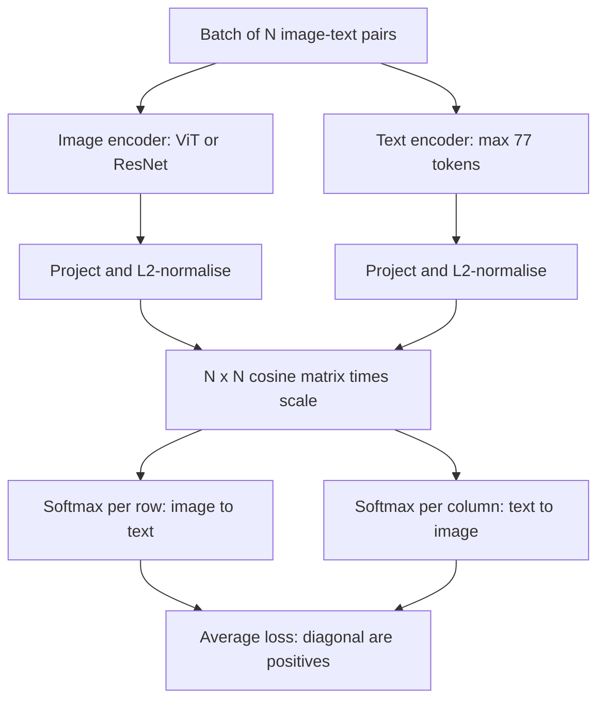

## TL;DR
CLIP aligns image and text encoders in one vector space, which gives your agent a cheap image-search and
zero-shot routing tool and supplies the vision tower inside most VLMs. Its scores are uncalibrated, so
thresholds decide whether the agent trusts a match.

## For agent builders
- **Why it matters for agents.** When an agent must find "the photo of the cracked bumper" among
  millions, or route an uploaded image to the right workflow, a CLIP-style embedding plus a nearest
  neighbour lookup costs milliseconds, while sending every candidate image to a VLM costs thousands of
  tokens each.
- **Where it shows up in your stack.** Multimodal RAG indexes, a `search_images(query)` style tool behind
  your agent, zero-shot classifiers for intake routing, and the vision encoder of the VLM you call.
- **What you control.** The checkpoint (pinned per index), prompt templates for labels, per-direction
  thresholds, a "no match" path the agent can act on, and how many candidates you pass to a VLM.
- **What you can skip.** Training CLIP yourself and the scaling details of the loss. Know the loss shape,
  the modality gap and why scores need per-task thresholds.

## Why it exists
- **Supervised classifiers have a closed vocabulary.** An ImageNet model knows 1,000 nouns and nothing
  else. Adding "forklift blocking a fire exit" means collecting and labelling thousands of images and
  retraining, and you still cannot ask about "a forklift blocking a *different* exit".
- **Labels are the bottleneck and the bias.** Labelling cost limits what you can learn, and the features
  skew toward whatever distinguishes the chosen classes.
- **The web has free, open-vocabulary labels.** Hundreds of millions of images sit next to alt text,
  captions and product titles: noisy, but free.
- **Predicting the caption's words is the wrong target.** A captioning model spends capacity on the
  *phrasing* ("a photo of", "stock image") rather than content; the CLIP authors found it learned far more
  slowly than a bag-of-words baseline.
- **Matching scales where generation and labelling did not.** Predict *which caption goes with which
  image* in a batch. That only needs content that distinguishes captions from each other, which is exactly
  the semantic content search and classification want.

## How it works
### Two encoders, one space
| Part | What it is | Output |
|---|---|---|
| Image encoder | ResNet or, in stronger variants, a ViT such as ViT-B/32 or ViT-L/14 | image vector |
| Text encoder | transformer over byte-pair-encoded text, maximum length 77 tokens | caption vector |
| Projection | linear layer to a common dimension: 512 for ViT-B/32, 768 for ViT-L/14 | shared-space vector |
| Normalise | L2-normalise both | unit vectors, so similarity is cosine (a dot product) |

### The contrastive objective
1. **Take a batch** of N (image, text) pairs.
2. **Score everything.** Compute all N × N cosine similarities, scaled by a learned temperature
   (initialised so logits are multiplied by about 1/0.07, clipped so the scale never exceeds 100).
3. **Label the matrix.** The N diagonal entries are true pairs; the N² − N off-diagonal entries are
   negatives.
4. **Symmetric cross-entropy.** For each image, a softmax over the N texts should pick its text; for each
   text, a softmax over the N images should pick its image. Average the two directions.

This is the InfoNCE loss, with unit vectors `x_i` (images), `y_j` (texts) and learned scale `s = 1/T`:

```
logits[i, j] = s · (x_i · y_j)                         # N × N matrix
L_img→txt    = −(1/N) Σ_i log( exp(logits[i,i]) / Σ_j exp(logits[i,j]) )
L_txt→img    = −(1/N) Σ_j log( exp(logits[j,j]) / Σ_i exp(logits[i,j]) )
L            = (L_img→txt + L_txt→img) / 2
```

- **In code** it is two `cross_entropy(logits, arange(N))` calls, one on the matrix and one on its
  transpose.
- **Why the temperature is learned.** The right sharpness changes during training: too soft and the
  gradient from hard negatives vanishes, too sharp and training is unstable.
- **The batch is the negative set.** Larger batches give harder, more informative negatives. CLIP used a
  batch of 32,768 pairs; the training data was about 400 million pairs.
- **The loss is relative.** It never says what absolute similarity a match should have, only that it must
  beat the others in the batch. That is why raw CLIP scores are not calibrated probabilities and why
  thresholds must be tuned per task.

### Zero-shot classification by prompting
1. Write each class as a sentence: "a photo of a {label}".
2. Encode all sentences and the image.
3. Take the softmax over the cosine similarities.
- **The text encoder builds the classifier.** It turns a class list into a weight matrix on the fly.
- **Prompt ensembling helps.** Averaging "a photo of a {}", "a blurry photo of a {}", "a drawing of a {}"
  improves accuracy because the training captions were varied too.
- **How good.** Reported zero-shot ImageNet top-1 for the largest CLIP variant was in the mid-70s
  percent, matching a supervised ResNet-50 without any ImageNet labels; the exact number is in the paper.

### Why this representation transfers
- **It learns what correlates with words:** objects, scenes, styles, text in the image, brands.
- **It does not learn counting or precise layout,** because captions rarely make those distinctions.
- **So:** excellent for retrieval and coarse classification, weak for compositional reasoning. That is
  why VLMs bolt an LLM on top of it rather than using it alone.

### The modality gap
- **"One shared space" is looser than it sounds.** Image and text embeddings occupy two separated regions
  of the sphere. A caption is closer to its own image than to other images, but almost any image is closer
  to other images than to any text.
- **Why.** The loss only requires the right ordering within each row, not that the two clouds overlap.
- **Practical effect.** Cross-modal cosines sit in a narrow low band; image-to-image cosines sit much
  higher. A threshold tuned for one direction is meaningless in the other.
- **Mixed indexes misrank.** Putting image and text vectors in one nearest-neighbour index without care
  ranks all same-modality items first.

### Zero-shot versus linear probe
- **Probe wins once labels exist.** With even a few labelled examples per class, a logistic-regression
  "linear probe" on frozen image embeddings usually beats zero-shot, because it learns which embedding
  directions matter for *your* classes instead of relying on how well a sentence describes them.
- **Caveat.** The CLIP paper notes that with very few examples per class a probe can underperform
  zero-shot.
- **Order of upgrades.** Once labels exist in modest numbers, the probe is the cheap upgrade to try before
  any fine-tuning.

### Successors and variants
- **OpenCLIP** reproduced and scaled the recipe on public data (LAION).
- **SigLIP** replaces the batch-wide softmax with an independent sigmoid loss per pair, a binary "match or
  not" decision: `−log σ(z_ij · (t · x_i·y_j + b))` with `z_ij = +1` for the true pair and `−1` otherwise.
- **SigLIP's bias.** A learned bias `b`, initialised strongly negative, offsets the fact that almost every
  pair is a negative.
- **Why SigLIP scales better.** No row is normalised across the whole batch, so the batch can be split
  across devices without gathering all embeddings for one softmax; memory scales better and it trains well
  at smaller batch sizes. Many recent VLMs use SigLIP encoders as their vision tower.
- **Same mechanism.** Two encoders aligned by positives-versus-negatives is unchanged.

## Diagram
A batch of pairs goes through two encoders into one space; the N × N similarity matrix is trained so the
diagonal wins in both directions. Your agent's search tool later reuses just the two encoders and the
cosine step.



## Misconceptions
- **"The zero-shot softmax is the probability that the label is right."** Softmax always sums to one
  over the labels you offered, so an image that matches none of them still gets a confident winner. Add
  background labels or a cosine floor tuned on labelled negatives.
- **"A cosine of 0.3 is a weak match."** Raw values carry no absolute meaning: correct text-to-image
  pairs typically sit around 0.2-0.35 for ViT-B/32 (illustrative), which is why a learned scale of roughly 100
  is applied before the softmax. Judge scores only against thresholds tuned on your pairs.
- **"One shared space means one threshold."** The modality gap puts image and text vectors in separate
  regions, so image-to-image cosines run far higher than cross-modal ones. A floor tuned for
  text-to-image search is meaningless for "find similar" and vice versa.
- **"CLIP understands the whole scene."** The loss rewards only what distinguishes captions in a batch,
  so it learns objects, scenes and styles but not counts or layout; "how many" and "left of" need a VLM
  or a detector.
- **"A longer, more detailed query retrieves more precisely."** The text encoder sees at most 77 tokens; with
  truncation on, as search code usually sets it, later constraints are silently dropped. Keep the tool's query a short visual description and move
  dates, SKUs or prices into structured filters.

## Examples
### Zero-shot classification, then the same by hand
The Hugging Face CLIP implementation first, then the raw embeddings so the cosine-similarity-and-softmax
mechanism is visible. The second form is what you reuse for search: encode once, compare many times.

```python
import torch
from PIL import Image
from transformers import CLIPModel, CLIPProcessor

name = "openai/clip-vit-base-patch32"
model = CLIPModel.from_pretrained(name).eval()
proc = CLIPProcessor.from_pretrained(name)

image = Image.open("warehouse.jpg").convert("RGB")
labels = ["a forklift", "a pallet of boxes", "an empty aisle", "a person in a hi-vis vest"]
prompts = [f"a photo of {l}" for l in labels]

with torch.no_grad():
    out = model(**proc(text=prompts, images=image, return_tensors="pt", padding=True))
    probs = out.logits_per_image.softmax(dim=-1)[0]        # scaled cosine sims -> softmax
for l, p in zip(labels, probs):
    print(f"{p:.3f}  {l}")

# Same mechanism by hand: unit vectors, dot product, temperature.
with torch.no_grad():
    img = model.get_image_features(**proc(images=image, return_tensors="pt"))
    txt = model.get_text_features(**proc(text=prompts, return_tensors="pt", padding=True))
img = img / img.norm(dim=-1, keepdim=True)                # [1, 512]
txt = txt / txt.norm(dim=-1, keepdim=True)                # [4, 512]
cos = img @ txt.T                                          # cosine similarities, typically 0.2-0.35
print(cos, (cos * model.logit_scale.exp()).softmax(-1))   # logit_scale.exp() is the learned 1/T
```

The hand-computed cosines are small and close together (the shared space is not spread out), which is
why the learned scale of roughly 100 is needed before the softmax produces a decisive distribution.

### The InfoNCE loss in plain Python
Runnable with no dependencies. Matched pairs drive the loss toward zero at scale 100; with scale 1 the
softmax is too soft and even matched pairs sit near log N, which is why the temperature matters.

```python
import math, random

def unit(v):
    n = math.sqrt(sum(x * x for x in v))
    return [x / n for x in v]

def info_nce(imgs, txts, scale=100.0):
    imgs, txts = [unit(v) for v in imgs], [unit(v) for v in txts]
    logits = [[scale * sum(a * b for a, b in zip(i, t)) for t in txts] for i in imgs]  # N x N
    def ce(rows):                       # cross-entropy where row k's target is column k
        loss = 0.0
        for k, row in enumerate(rows):
            m = max(row)
            loss -= row[k] - m - math.log(sum(math.exp(x - m) for x in row))
        return loss / len(rows)
    cols = [list(c) for c in zip(*logits)]                 # transpose: text -> image
    return (ce(logits) + ce(cols)) / 2

random.seed(0)
N, d = 16, 64
imgs = [[random.gauss(0, 1) for _ in range(d)] for _ in range(N)]
matched = [[x + random.gauss(0, 1) for x in v] for v in imgs]     # caption near its image
unrelated = [[random.gauss(0, 1) for _ in range(d)] for _ in range(N)]
print(round(info_nce(imgs, matched), 3), round(info_nce(imgs, unrelated), 3))   # 0.0 28.322
print(round(info_nce(imgs, matched, scale=1.0), 3), round(math.log(N), 3))      # 2.159 2.773
```

### Worked numbers: batch size and index size
| Quantity | Value |
|---|---|
| Negatives per batch, N = 256 | 256² − 256 = 65,280 |
| Negatives per batch, N = 32,768 (CLIP) | about 1.07 billion |
| One ViT-B/32 embedding, float32 | 512 × 4 = 2,048 bytes |
| 10 million images, ViT-B/32, float32 | ~20.5 GB of raw vectors |
| Same at float16, or ViT-L/14 at float32 | ~10.2 GB, or ~30.7 GB |

The first rows explain why CLIP needed huge batches; the last rows are the storage line in a catalogue
search plan, before any index overhead.

### Agent tool: text-to-image search with a "no match" answer
An agent's retrieval tool over a pre-embedded catalogue. It returns at most k candidates above a tuned
cosine floor, and an explicit empty result otherwise, so the agent asks a clarifying question instead of
describing an unrelated photo.

```python
import numpy as np, torch
from transformers import CLIPModel, CLIPProcessor

NAME = "openai/clip-vit-base-patch32"        # must match the checkpoint that built the index
model = CLIPModel.from_pretrained(NAME).eval()
proc = CLIPProcessor.from_pretrained(NAME)
index = np.load("catalogue_vecs.npy")         # [n_images, 512], L2-normalised at build time
ids = open("catalogue_ids.txt").read().split()
TEXT_TO_IMAGE_FLOOR = 0.24                    # illustrative; tune on labelled pairs, this direction only

def search_images(query: str, k: int = 5) -> dict:
    # Tool exposed to the agent: find catalogue photos matching a short visual description.
    with torch.no_grad():
        q = model.get_text_features(**proc(text=[f"a photo of {query}"], return_tensors="pt",
                                           padding=True, truncation=True))   # 77-token limit
    q = (q / q.norm(dim=-1, keepdim=True)).numpy()[0]
    sims = index @ q
    top = np.argsort(-sims)[:k]
    hits = [{"id": ids[i], "score": round(float(sims[i]), 3)} for i in top
            if sims[i] >= TEXT_TO_IMAGE_FLOOR]
    return {"hits": hits, "note": None if hits else "no confident match; ask the user to refine"}
```

- **The floor is per direction.** Cross-modal cosines sit in a narrow low band, so tune it on your own
  labelled pairs and never reuse it for image-to-image search.

## Production patterns
- **Pin the checkpoint as an index dependency.** When: any persisted embedding index. How: store the model
  name (for example `openai/clip-vit-base-patch32`) and preprocessing version beside every vector; a
  change means a planned re-embed into a new index, then an alias swap. Monitor: mixed-version vectors.
- **Tune thresholds per direction.** When: filtering or "no match" decisions. How: label a few hundred
  pairs, pick separate cut-offs for text-to-image and image-to-image from precision-recall curves.
  Monitor: precision on a weekly labelled sample.
- **Prompt-ensemble the class list.** When: zero-shot classification. How: encode several templates per
  label, average the normalised text vectors, renormalise, and cache them as a fixed weight matrix.
  Monitor: per-class confusion on a labelled set.
- **Add a "none of these" escape.** When: open-world inputs. How: include background labels or a
  similarity floor before the softmax, because softmax always sums to one over your list. Monitor: the
  share of images landing on the escape class.
- **Upgrade to a linear probe.** When: you have tens of labels per class. How: fit logistic regression on
  frozen embeddings and compare against zero-shot on the same split. Monitor: accuracy and drift.
- **Retrieve with CLIP, reason with a VLM.** When: an agent must answer a question about the right image
  among many. How: the search tool returns the top few candidates, and only those go to the VLM with the
  question. Monitor: recall@k of the search step and image tokens per agent run.

## Trade-offs
- **Open vocabulary vs fine-grained accuracy.** No labelling cost, but accuracy on fine-grained or
  domain-specific classes (medical, industrial parts) lags a supervised model trained on even a few
  thousand labels.
- **Sample-efficient vs data-hungry.** Contrastive training beats caption generation on efficiency, but
  needs very large batches and web-scale data, so training your own CLIP is rarely worth it versus
  fine-tuning OpenCLIP.
- **One space vs calibrated scores.** A shared space enables text-to-image and image-to-image search from
  one index, yet scores are uncalibrated, so each use direction needs its own threshold.
- **What vs how many and where.** Captions teach what is in an image; for counting, layout or spatial
  relations, a VLM or a detector is the right tool instead.

## Pitfalls
- **Treating softmax outputs as probabilities of correctness.** Symptom: high-confidence predictions for
  images that match none of the offered labels, because softmax must sum to one over your list.
- **Using bare labels instead of sentences.** Symptom: a measurable accuracy drop, since training text
  looked like captions, and "a photo of a dog" matches the distribution far better than "dog".
- **Expecting robustness to text in images.** Symptom: an object with a handwritten label classified as
  the label's word (the typographic-attack effect), which matters for moderation and retail.
- **Comparing scores across encoders or query directions.** Symptom: a threshold that works for
  text-to-image silently returns garbage for image-to-image.
- **Truncating long descriptions silently at 77 tokens.** Symptom: a detailed query's later constraints
  have no effect on the results. Fix: keep queries short or split constraints into filters.
- **Letting the agent write long search queries.** An LLM tends to pass a full paragraph to the search
  tool. Symptom: results ignore half the request. Fix: describe the tool as taking a short visual
  description and move dates, SKUs or prices into structured filter arguments.

## When to use
- **Use when** you need to search, filter, cluster or coarsely classify images by description without
  training data: moderation prefilters, product search, deduplication, labelling candidates for a
  dataset, or as the vision tower when assembling a VLM.
- **Avoid as the final decision maker** where errors are costly and fine-grained; use it to narrow
  candidates and let a supervised model or a VLM decide.
- **Measure:** recall@k on a labelled retrieval set and accuracy at a tuned threshold, not raw similarity
  values.
- **Interviews:** write the contrastive loss on a whiteboard, explain why batch size matters, and say why
  zero-shot works at all; those three answers cover the idea.

## Role lens
- **Engineer:** Encodes images and text with the same checkpoint, stores normalised vectors, and tunes
  per-direction thresholds on a labelled sample before exposing search or filtering.
- **Architect:** Chooses between a CLIP-style retrieval layer and a VLM per task, and fixes the encoder
  version as an index dependency so re-embedding is planned, not accidental.
- **FDE:** Builds a quick zero-shot classifier from a customer's taxonomy written as sentences, shows
  the accuracy ceiling on their images, and uses the gaps to justify labelling or fine-tuning.

## Check yourself
**Q:** You index a retailer's catalogue with CLIP so shoppers can type queries. Text-to-image search
works, but the "similar items" feature built on image-to-image similarity returns near-identical
colours and ignores category. Why, and what would you do?
**A:** The contrastive loss shapes the space around what captions distinguish, and image-to-image
distances are dominated by global appearance (colour, background, style) rather than by category,
because no caption ever told the model that two differently coloured jackets are the same product type.
Text and image embeddings also occupy different regions, so a threshold tuned on text queries does not
transfer. Options: compute similarity in the text space by first classifying each image into the catalogue
taxonomy with zero-shot prompts and restricting neighbours to the same class; fine-tune the encoder with
product pairs as positives; or combine CLIP similarity with structured attributes in a hybrid ranker and
evaluate recall@k on labelled "similar item" judgements.

## Interview questions
### Write CLIP's training loss and explain each term.
- **Similarity matrix.** Normalise image and text vectors, compute the N × N dot products, multiply by a
  learned scale (about 1/0.07 at init, capped at 100).
- **Two cross-entropies.** Rows (image to text) and columns (text to image), each with targets on the
  diagonal, averaged. The other pairs in the batch are the negatives.

### Why does batch size matter so much for CLIP, and how does SigLIP change that?
- **Negatives come from the batch.** N pairs give N² − N negatives, so bigger batches give harder
  negatives; CLIP used 32,768.
- **SigLIP decouples pairs.** A per-pair sigmoid with a learned negative bias needs no batch-wide softmax,
  so it shards across devices without gathering every embedding and trains well at smaller batches.

### Your zero-shot classifier confidently labels unrelated images. How do you fix it?
- **Diagnose the softmax.** It must sum to one over your labels, so an out-of-scope image still gets a
  winner with high probability.
- **Fix.** Add background or "other" prompts, apply a cosine floor tuned on labelled negatives before the
  softmax, and measure precision on images that match no class.

### When would you not use CLIP, even though it is cheap?
- **Counting and spatial questions.** Captions rarely encode "how many" or "left of", so the space does
  not represent them; use a detector or a VLM.
- **Fine-grained, costly decisions.** Medical or industrial parts need a supervised or probed model;
  CLIP can narrow candidates first.

### Your agent's image-search tool must cover a 10-million-image catalogue. What do you plan for?
- **Storage.** 512-dimensional float32 vectors are 2,048 bytes each, about 20.5 GB raw, roughly half in
  float16, before index overhead.
- **Versioning.** Pin the checkpoint and preprocessing; any change is a full re-embed into a new index,
  so budget GPU hours and an alias swap rather than mixing versions.

### Your support agent describes the wrong product photo with confidence. How do you debug retrieval?
- **Log the tool call.** Check the query the agent sent, the top-k scores and whether any hit cleared the
  tuned floor; a long query may have been truncated at 77 tokens.
- **Then fix the contract.** Return an explicit "no confident match" result the agent is instructed to
  act on, and measure recall@k on labelled queries before blaming the LLM.

## Quiz
### Q: In CLIP's contrastive loss, where do the negative examples come from?
- [ ] A separately curated set of mismatched captions written by annotators
- [x] The other pairs in the same training batch
- [ ] Random noise vectors added to the image embeddings
- [ ] Images with the same label from a classification dataset
> Every image is contrasted against all other captions in the batch and vice versa, so a batch of N
> pairs supplies N² − N negatives for free; this is why very large batches help.

### Q: Why can CLIP classify into categories it never saw during training?
- [ ] Its image encoder was pretrained on ImageNet with all possible labels
- [ ] The text encoder stores a lookup table of class names
- [x] Class names written as captions are encoded into the shared space and act as classifier weights
- [ ] It retrieves similar images from the training set at inference time
> Zero-shot classification is retrieval over text: encode "a photo of a {label}" for each class and pick
> the closest to the image embedding. No training-set images are stored or needed.

### Q: Which task is CLIP's representation least suited to on its own?
- [ ] Finding duplicate product photos across a catalogue
- [ ] Filtering out images that do not contain a logo
- [x] Reporting how many people stand to the left of a doorway
- [ ] Grouping stock photos by scene type
> Captions rarely encode counts or precise spatial relations, so the contrastive objective never rewarded
> learning them. Retrieval, filtering and scene grouping are exactly what caption matching teaches.

## Use cases & projects
### Use cases
- **Multimodal RAG for agents.** Text queries retrieve relevant photos, diagrams or slides that the
  agent then passes to a VLM for the actual answer.
- **Intake routing.** A zero-shot classifier sends uploaded images (receipt, damage photo, ID document,
  screenshot) to the right agent workflow before any expensive call.
- **Duplicate and fraud checks.** Image-to-image similarity flags a claim photo already seen in the
  archive, and the agent attaches the match to its review note.
- **Guardrail prefilters.** Cheap embedding filters screen uploads for off-topic content before an agent
  reasons over them.

### Mini project
**Build an image-search tool for an agent (2-3 hours).**
- **Goal:** give a tool-calling agent a `search_images` tool over a few thousand photos with a tuned
  "no match" result.
- **Steps:** embed the photos with one pinned CLIP checkpoint; label 100 query-image pairs plus 50
  queries with no correct image; pick a text-to-image cosine floor from the precision-recall curve; wire
  the tool into an agent loop and run 30 user requests.
- **Done when:** you report recall@5 on the labelled queries, the rate at which the agent correctly says
  nothing matches, and three failure cases with their cause.
