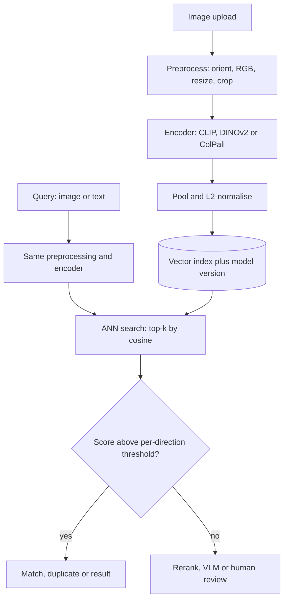

## TL;DR
An image embedding is a fixed-length vector from a neural encoder, placed so similar images sit close
under cosine similarity. It turns images into something a vector index can search, cluster and
deduplicate, and the encoder you pick decides what "similar" means.

## Why it exists
- **Pixels are not comparable.** Raw pixel distance says a photo and its slightly cropped copy are far
  apart, while a dark photo of a cat and a dark photo of a car are close.
- **Perceptual hashes only fix near-duplicates.** pHash and friends hash coarse frequency structure, so
  copies match, but a different photo of the same product hashes to something unrelated.
- **Tags do not scale.** They solve content search only if someone wrote them, and they miss what the
  tagger did not think of.
- **Networks already produce the right function.** Activations just before an ImageNet model's final
  classifier group dogs with dogs. Modern encoders are trained *for* this property with contrastive or
  self-distillation objectives, some jointly with text so sentences and images share a space.
- **Then every text-embedding tool works unchanged:** approximate nearest-neighbour indexes, clustering,
  outlier detection.

## How it works
### The encoder decides the geometry
Choosing the wrong family is the most common failure, because each gives a different notion of
similarity:

| Family | Examples | Trained to | Good at | Weak at |
|---|---|---|---|---|
| **Supervised classifier backbone** | ResNet or ViT on ImageNet, penultimate layer | predict labels | cheap, fast; images sharing a label cluster | distinctions the labels never made (brand, colour variant) |
| **Self-supervised visual** | DINO, DINOv2 | make augmentations of one image agree, no text or labels | strong *visual* similarity, dense per-patch features for localisation | cannot be queried with text |
| **Contrastive image-text** | CLIP, SigLIP, OpenCLIP | match images to captions | one index for "like this image" and "a red forklift" | purely visual detail, weaker than DINOv2 |
| **Document-screenshot (late interaction)** | ColPali | match page patches to query tokens | text-heavy page images | index size |

- **How DINO learns.** A student network sees small crops; a teacher (a moving average of the student's
  weights) sees larger crops of the same image; the student matches the teacher's output. The features must
  encode what survives cropping, colour jitter and scale changes: object identity and shape, not pixels.
- **Commercial multimodal embedding APIs** are usually contrastive image-text.
- **ColPali's trade.** It keeps one vector per patch and scores by late interaction (sum over query tokens
  of the best-matching patch): on the order of a thousand small vectors per page instead of one, for far
  better retrieval of page images than a single pooled vector.

### From pixels to one vector
1. **Resize and normalise** to the encoder's input size, often 224 or 336 pixels on a side. Many
   pipelines centre-crop, which silently discards the edges.
2. **Split into patches** and run the network.
3. **Pool** patch outputs into one vector: a dedicated CLS token, or the average of patches.
4. **Project** through a projection head.
5. **L2-normalise,** *because* the training loss compared directions, not magnitudes. Then cosine
   similarity equals the dot product and the index can use inner product directly.
- **Dimension is not quality.** Common models emit from a few hundred to a bit over a thousand
  dimensions; higher is not better by itself, it is only what the model was trained to emit.

### Similarity, thresholds and the modality gap
- **Ranking needs no threshold.** Nearest-neighbour search orders candidates correctly on its own.
- **Decisions do.** "Duplicate or not" and "on-topic or not" need a cut-off, and it is model-specific.
- **Illustrative ranges** (vary by checkpoint): CLIP image-image cosines for near-duplicates may sit above
  0.9, while a correct text-to-image match may score around 0.3.
- **Why: the modality gap.** In contrastive models all image vectors occupy one cone and all text vectors
  another, so cross-modal similarities are systematically lower than within-modal ones.
- **Rule.** Tune separate thresholds per query direction on labelled examples.

### When the off-the-shelf geometry is wrong
If your "similar" is not what any pretrained objective rewarded (same SKU across colourways, same defect
type across parts), no threshold helps, because the neighbours themselves are wrong. Escalate cheapest
first and measure recall@k on held-out pairs after each step:
1. **Re-rank** top-k candidates with metadata or a VLM.
2. **Train an adapter.** A small linear or MLP layer on frozen embeddings, from labelled positive and
   negative pairs. Cheap, and the base index can be re-projected without re-encoding images.
3. **Fine-tune the encoder** with a contrastive or triplet loss on your pairs. Moves the space most, but
   forces a full re-embed and risks forgetting general features.

### Where embeddings go
- **Index.** Each vector is stored with an identifier and metadata; an approximate nearest-neighbour
  structure (HNSW or IVF) makes search sublinear.
- **Version every vector.** Record model name and version, because vectors from two checkpoints are not
  comparable and a model upgrade means a full re-index.
- **Preprocessing is part of the model.** Keep resize, crop and colour conversion identical at index and
  query time.

Storage is simple arithmetic, `n_images × dim × bytes_per_value`:
- **Ten million 768-d float32 vectors** are 10⁷ × 768 × 4 ≈ 31 GB before index overhead.
- **Shrinking it.** float16 halves that, int8 scalar quantisation quarters it, and binary or product
  quantisation shrink it further at a recall cost you measure.
- **Recovering recall.** Re-score the top candidates with full-precision vectors.

## Diagram
The same preprocessing and encoder must sit on both the index path and the query path; the encoder family
chosen at the top decides what the neighbours mean.



## Examples
### One CLIP matrix for image and text queries
Embed a folder with a CLIP checkpoint via sentence-transformers, which accepts PIL images directly, then
answer an image query and a text query from the same matrix.
- The library normalises, so cosine similarity is a plain matrix product.
- Sizes are small enough for NumPy; swap in an ANN index once the matrix stops fitting in memory.

```python
import numpy as np
from pathlib import Path
from PIL import Image
from sentence_transformers import SentenceTransformer

model = SentenceTransformer("clip-ViT-B-32")               # image + text encoders, 512-d, normalised
paths = sorted(Path("catalog").glob("*.jpg"))
images = [Image.open(p).convert("RGB") for p in paths]
E = model.encode(images, batch_size=64, normalize_embeddings=True)   # shape [n_images, 512]
np.save("catalog_clip-ViT-B-32.npy", E)                    # name the file after the model version

def top_k(query_vec, k=5):
    sims = E @ query_vec                                    # cosine similarity, since both are unit length
    idx = np.argsort(-sims)[:k]
    return [(paths[i].name, float(sims[i])) for i in idx]

q_img = model.encode(Image.open("query.jpg").convert("RGB"), normalize_embeddings=True)
print("image->image", top_k(q_img))     # near-duplicates score high, e.g. > 0.9 (illustrative)

q_txt = model.encode("a red forklift in a warehouse", normalize_embeddings=True)
print("text->image ", top_k(q_txt))     # correct matches score lower, e.g. ~0.3 (modality gap)

# Duplicate sweep: pairwise sims above a tuned threshold within the catalogue itself.
S = E @ E.T
np.fill_diagonal(S, 0)
dupes = np.argwhere(np.triu(S) > 0.95)
print(len(dupes), "candidate duplicate pairs")
# memory: E is 10,000 x 512 x 4 bytes = ~20 MB, but S is 10,000 x 10,000 x 4 bytes = 400 MB;
# past ~10k images compute S in row blocks or ask an ANN index for each row's top-k instead.
```

### One preprocessing function for index and query
A production snippet: phone photos carry an EXIF orientation flag and some files are CMYK or have alpha,
so normalise both before encoding, and use this exact function at ingest and at query time.

```python
from PIL import Image, ImageOps

PREPROC_VERSION = "v2-exif-rgb"          # stored beside each vector with the model name

def load_for_embedding(path):
    img = Image.open(path)
    img = ImageOps.exif_transpose(img)    # apply the camera's rotation flag
    return img.convert("RGB")             # CMYK, palette and RGBA all become plain RGB
```

### Worked numbers: sizing a 10-million-image index
| Storage choice (768-d) | Bytes per image | 10M images |
|---|---|---|
| float32 | 3,072 | ~30.7 GB |
| float16 | 1,536 | ~15.4 GB |
| int8 scalar quantisation | 768 | ~7.7 GB |
| binary (1 bit per dimension) | 96 | ~0.96 GB, then re-score top candidates in full precision |
| late interaction, ~1,000 × 128-d at float16 per page | ~250 KB | why ColPali-style indexes suit pages, not whole photo catalogues |

Figures are raw vectors before index overhead; the recall cost of each quantisation step must be measured
on your own labelled pairs.

## Production patterns
- **Version the embedding space.** When: any persistent index. How: store model name and
  `PREPROC_VERSION` with every vector, build a new index on upgrade and switch an alias once recall@k on
  a golden set matches. Monitor: count of vectors per version.
- **Two-stage retrieval with full-precision re-score.** When: quantised or binary indexes. How: fetch a
  larger top-k (for example 100) from the compressed index, re-score with float vectors, return the top
  10. Monitor: recall@10 versus an exact-search baseline.
- **Blocked duplicate sweeps.** When: deduplicating more than about 10k images. How: compute similarity
  in row blocks or ask the ANN index for each item's top-k, never a full n × n matrix. Monitor: peak
  memory and duplicate-pair counts per run.
- **Adapter before fine-tune.** When: neighbours are wrong for your notion of similarity. How: train a
  linear projection on frozen embeddings from labelled pairs, re-project stored vectors. Monitor:
  recall@k on held-out pairs and general-query regressions.
- **Treat vectors as sensitive data.** When: user-uploaded or regulated images. How: apply the same
  access control, retention and deletion policy to the index as to the images. Monitor: deletion requests
  that reach both stores.

## Trade-offs
- **One shared index vs visual fidelity.** Contrastive image-text encoders serve text and image queries
  from one index, but their purely visual similarity is weaker than DINOv2's; pick the self-supervised
  encoder when queries are always images.
- **Pooled vs per-patch vectors.** One vector per image is compact and fast; late-interaction embeddings
  retrieve dense pages far better at roughly two orders of magnitude more storage per page (about a
  thousand 128-d vectors versus one) and a costlier scoring step.
- **Cheap encoding vs fine detail.** Centre-cropping and resizing to a small square drop edge content and
  fine print; when small details decide relevance, tile the image and index each tile.
- **Bigger model vs indexing cost.** A bigger model yields better neighbours but multiplies indexing cost
  over millions of images; for dedup or coarse grouping a small checkpoint usually suffices.

## Pitfalls
- **Mixing checkpoints or preprocessing in one index.** Symptom: retrieval quality collapses after a
  "minor" model upgrade without any error being raised.
- **Reusing a threshold across query directions.** Symptom: text queries return nothing at a threshold
  tuned for image-to-image, or everything at one tuned the other way.
- **Using a semantic encoder for exact-duplicate detection.** Symptom: "duplicates" that are merely
  similar products, or missed duplicates that differ by a watermark the model considers meaningful.
- **Skipping EXIF orientation and colour-space handling.** Symptom: phone photos embedded upside down or
  in CMYK garbage, so matches fail for a subset of uploads only.
- **Forgetting that the index stores content.** Embeddings of sensitive images are still sensitive data
  and can be inverted or matched. Symptom: a privacy review that blocks launch.

## When to use
- **Use when** the job is search, deduplication, clustering, recommendation or nearest-neighbour
  moderation over many images, where a per-image LLM call would be too slow or expensive.
- **Use something else:** a VLM for a reasoned answer about one image; OCR or a document parser when the
  content is text.
- **Pick the encoder by query type:** text queries need a contrastive image-text model; image-only
  queries favour self-supervised encoders; page images favour late-interaction document embedders.
- **Measure:** recall@k against labelled judgements and the precision at your chosen threshold.
- **Interviews:** expect why cosine similarity, why normalisation, and why text-to-image scores differ
  from image-to-image.

## Role lens
- **Engineer:** Owns the preprocessing-encode-normalise-store path, versions the embedding model in the
  index metadata, and keeps query-time preprocessing byte-identical to index-time preprocessing.
- **Architect:** Picks the encoder family per query type, sizes the index (vectors × dimension × bytes),
  and plans re-indexing as a scheduled migration rather than an emergency.
- **FDE:** Runs a labelled similarity study on the customer's own images to set thresholds, and shows
  them where embedding search ends and human or VLM review must begin.

## Check yourself
**Q:** A moderation team wants to block re-uploads of previously removed images, including recompressed,
resized and lightly cropped copies, with near-zero false positives. Which embedding approach and matching
policy would you propose, and why not a general CLIP index alone?
**A:** The task is near-duplicate detection, not semantic similarity. A CLIP space clusters by meaning,
so two different photos of a similar scene can score higher than a cropped copy of the banned image,
giving both false positives and misses. Propose a two-stage policy: a cheap perceptual hash or a
self-supervised visual encoder tuned for copy detection as the first filter, with a conservative
threshold set on a labelled set of true copies versus near-miss lookalikes, then a second check (pixel
alignment or human review) before blocking. Store the model version with each vector, keep preprocessing
identical at ingest and query, and measure false-positive rate on legitimate uploads because that is the
constraint the team stated.

## Interview questions
### What is an image embedding, and why do we normalise it?
- **Definition.** A fixed-length vector from an encoder where nearby vectors mean similar images, so a
  vector index can search and cluster them.
- **Why normalise.** Training losses compared directions, so unit length makes cosine similarity a plain
  dot product that ANN indexes compute fast.

### Retrieval quality dropped after a model upgrade with no errors. How do you debug it?
- **Suspect mixed spaces.** Check the model and preprocessing version stored with each vector; old and
  new vectors are not comparable.
- **Fix with a migration.** Re-embed everything into a new index, compare recall@k on a golden set, then
  switch an alias; never upsert new-model vectors into the old index.

### CLIP, DINOv2 or ColPali: how do you choose?
- **By query type.** Text queries need CLIP-style shared space; image-only "looks like this" favours
  DINOv2; scanned or text-heavy pages favour ColPali's per-patch late interaction.
- **Mind the cost.** ColPali stores about a thousand vectors per page, so it suits document corpora, not
  huge photo catalogues.

### How much memory does a 10-million-image index need, and how would you cut it?
- **Arithmetic.** 10⁷ × 768 × 4 bytes ≈ 31 GB of float32 vectors before index overhead.
- **Cuts.** float16 halves it, int8 quarters it, binary goes to about 1 GB; recover recall by
  re-scoring a larger top-k with full-precision vectors.

### When is no threshold going to fix your similarity search?
- **When the neighbours are wrong.** If "similar" means same SKU across colourways, no pretrained
  objective rewarded it, so the ranking itself is off.
- **Escalate.** Re-rank with metadata or a VLM, then train an adapter on frozen embeddings, and only then
  fine-tune the encoder, measuring recall@k at each step.

## Quiz
### Q: Why are image embeddings L2-normalised before they are stored in a vector index?
- [ ] Normalisation compresses the vectors so they take less disk space
- [x] The encoders were trained on direction, so cosine similarity is the meaningful metric and it becomes a plain dot product
- [ ] Vector databases cannot store values larger than one
- [ ] It removes the modality gap between text and image vectors
> Contrastive and self-supervised losses compare angles, not magnitudes. Unit vectors make inner product
> equal cosine similarity, which ANN indexes compute fast; normalisation does not change storage or the gap.

### Q: A team needs "find photos matching this sentence" and "find photos like this photo" from one index. Which encoder family fits?
- [ ] An ImageNet-supervised ResNet's penultimate layer
- [ ] A self-supervised encoder such as DINOv2
- [x] A contrastive image-text encoder such as CLIP or SigLIP
- [ ] A perceptual hash
> Only image-text contrastive models place text and images in one shared space, so both query types hit
> the same vectors. DINOv2 and ResNet features cannot be queried with text at all.

### Q: After tuning a similarity threshold of 0.85 on image-to-image matches, text queries return no results. What is the most likely cause?
- [ ] The text encoder was not loaded correctly
- [ ] Text embeddings have a different dimension from image embeddings
- [x] Cross-modal similarities are systematically lower than within-modal ones because of the modality gap
- [ ] The vector index only supports image vectors
> In contrastive models, image and text vectors occupy separate regions, so a correct text-to-image match
> scores well below a correct image-to-image match. Thresholds must be tuned per query direction.
