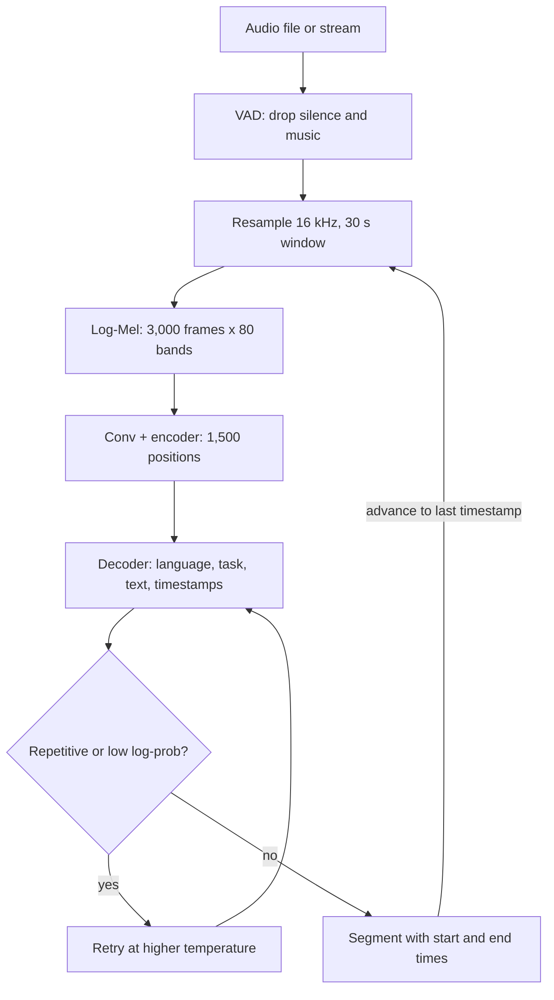

## TL;DR
Speech-to-text (ASR) is the ears of voice and call-analytics agents. Whisper reads 30-second log-Mel
spectrograms; trained on roughly 680,000 hours of weakly labelled audio, it is robust but batch-only, so
live agents need streaming ASR.

## For agent builders
- **Why it matters for agents.** In a voice agent every transcript error becomes a wrong tool argument
  (a misheard account number, a misspelled product), and ASR latency sits at the front of every turn.
  In batch agents that summarise calls, hallucinated text during silence becomes fake evidence.
- **Where it shows up in your stack.** faster-whisper or whisper.cpp for recordings, a streaming ASR API
  or streaming-native model for live turns, VAD and endpointing in the voice pipeline, and transcript
  text passed into the agent's context or tools.
- **What you control.** Batch versus streaming per surface, VAD settings, `initial_prompt` vocabulary,
  confidence flags passed to the agent, confirmation of entities before tools act on them, PII redaction.
- **What you can skip.** Mel filterbank maths and the conv stack details. Know the 30-second window, the
  hallucination guards, WER normalisation and real-time factor.

## Why it exists
- **Voice is useless to text systems until transcribed.** Call centres, meetings, dictation, voice agents
  and accessibility all start with audio.
- **Classic pipelines were brittle.** Acoustic model plus pronunciation lexicon plus language model
  (Kaldi-era systems) did well on tuned conditions and fell apart on a new microphone, accent or
  vocabulary; they needed phonetically aligned data and expert tuning per language.
- **Early end-to-end models overfit their benchmark.** CTC and RNN-transducer models removed the lexicon
  but trained on curated corpora of a few thousand hours. A model superb on read audiobook speech can
  double its error rate on a noisy phone call.
- **"Fine-tune on your domain" is circular.** It needs transcribed audio, which is exactly what you were
  trying to produce.
- **Whisper bet on weak supervision at scale.** Hundreds of thousands of hours of web audio with whatever
  transcripts existed, machine-generated ones filtered out, one model for transcription, translation to
  English and language identification. The pay-off: zero-shot robustness on datasets it never trained on.

## How it works
### Input: audio becomes a spectrogram
1. **Resample** to 16 kHz mono.
2. **Window** into 30-second chunks, padded with silence if shorter.
3. **Short-time Fourier transform** with 25 ms frames every 10 ms.
4. **Mel bands.** Map onto 80 Mel-scaled frequency bands (128 in large-v3), *because* the Mel scale mimics
  human frequency sensitivity.
5. **Log-compress and normalise,** so loud and quiet speech become comparable.
- **Result:** a 2-D array of 3,000 frames × 80 features, an "image" of the sound a transformer can read.

### Encoder-decoder
Two convolutional layers (the second with stride 2) shrink the time axis to 1,500 positions, then a
transformer encoder produces a contextual representation of the whole window. Follow the shapes:

```
30 s × 16,000 samples/s           = 480,000 samples
hop of 10 ms (160 samples)        → 3,000 spectrogram frames × 80 (or 128) Mel bands
conv stack, stride 2              → 1,500 encoder positions, each covering 20 ms
```

- **20 ms per position** is exactly the resolution of the timestamp tokens.
- **The window is fixed** by the encoder's positional embeddings, which is why audio cannot simply be fed
  longer.
- **The decoder** is a standard autoregressive text transformer that cross-attends to the encoder output
  and emits tokens from a byte-pair vocabulary.
- **Same shape as translation:** audio in one "language", text out in another. That is why Whisper can
  translate to English as a decoding task rather than a separate model.

### The multitask token format
Behaviour is controlled by special tokens in the decoder prompt rather than separate heads:
1. **Start token.**
2. **Language token,** predicted if not given; this is how language identification works.
3. **Task token:** transcribe or translate.
4. **Optional no-timestamps token.**
- **Timestamps.** During transcription the decoder can interleave timestamp tokens with text, quantised
  to 20 ms, giving segment start and end times.
- **No-speech.** A dedicated token lets the model declare the window is silence or music.
- **Why one checkpoint does it all.** Everything is one sequence-to-sequence problem, so one model serves
  many languages and tasks.

### Long-form audio and decoding heuristics
The encoder sees exactly 30 seconds, so longer audio is a sliding sequence of windows:
1. Transcribe a window.
2. Read the last predicted timestamp and advance the window to that point.
3. Carry the previous text as decoder context for consistency. The decoder's text context is small, so
   this carried prompt, like an `initial_prompt`, is truncated to roughly the last couple of hundred
   tokens.

Failures concentrate here, because the decoder is a language model: on silence, music or garbled audio it
can hallucinate fluent text or loop on a phrase. The reference implementation's guards:
- **Compression ratio too high** (repetition) or **average log-probability too low:** retry decoding at
  higher temperature.
- **No-speech probability high** (and, in the reference implementation, average log-probability also
  low): treat the window as silence and skip it.
- **Voice activity detection (VAD) first** removes most of the silence that triggers hallucinations.

### Model sizes and runtimes
| Item | Detail |
|---|---|
| Sizes | tiny (tens of millions of parameters) to large (about 1.5 billion) |
| Smaller models | several times faster, noticeably less accurate, especially on accents and non-English |
| faster-whisper (CTranslate2), whisper.cpp (CPUs, Apple silicon) | same weights, lower memory, higher throughput |
| WhisperX | forced alignment with a phoneme model for accurate word timestamps, plus speaker diarization, which Whisper itself does not do |

### Streaming is not native
- **Whisper is a batch model** because of its 30-second encoder window.
- **"Streaming" with it** means chunking audio into short overlapping pieces and re-decoding, which adds
  latency and can flicker.
- **Streaming-native models** (RNN-transducer or chunked-attention encoders, as in several managed ASR
  APIs) emit words as they arrive with sub-second delay.
- **For a live voice agent,** that difference drives the architecture more than the error rate does.

### ASR inside an agent turn
1. **Endpointing.** VAD or the streaming ASR decides the user has stopped speaking; too eager cuts them
  off, too patient adds dead air to every turn.
2. **Final transcript to the LLM.** The agent receives text, ideally with word confidences, and decides
  on a reply or a tool call.
3. **Confirm before acting.** Entities that feed tools (amounts, account numbers, names) are read back or
  validated, because a misheard digit is a wrong action, not just a typo.
- **Why partials matter.** Streaming partial transcripts let the agent start retrieval or warm a tool
  before the user finishes, hiding part of the latency.

### Measuring it
```
WER = (substitutions + deletions + insertions) / reference words     # after text normalisation
```
- **Normalise first** (casing, punctuation, number formats), otherwise "twenty five" versus "25" counts
  as two errors.
- **Track WER on your own audio by domain.**
- **Track entity accuracy separately** (names, product codes), which WER underweights but users notice
  most.

## Diagram
Follow one window from samples to text, then the loop that advances through long audio; the VAD and
fallback checks are where hallucinations are stopped.



## Examples
### Transcribing a call with faster-whisper
Transcribe a call recording with faster-whisper, using VAD to suppress silence hallucinations and word
timestamps for alignment, then write out segments. The `initial_prompt` seeds the decoder with domain
vocabulary so product names are spelled consistently.

```python
from faster_whisper import WhisperModel

model = WhisperModel("large-v3", device="cuda", compute_type="float16")  # or "int8" on CPU

segments, info = model.transcribe(
    "support_call.wav",
    beam_size=5,
    vad_filter=True,                       # drop silence before decoding: fewer hallucinations
    vad_parameters={"min_silence_duration_ms": 500},
    word_timestamps=True,
    initial_prompt="Acme Cloud, Kubernetes, Terraform, ticket ID, SLA.",  # vocabulary hint
    condition_on_previous_text=False,      # trade context for resistance to repetition loops
)
print(f"language={info.language} p={info.language_probability:.2f} duration={info.duration:.0f}s")

transcript = []
for seg in segments:                       # a generator: decoding happens as you iterate
    # Same signals the reference decoder uses for fallback: low avg log-prob or repetitive output.
    flag = " [low-conf]" if seg.avg_logprob < -1.0 or seg.compression_ratio > 2.4 else ""
    shaky = [w.word.strip() for w in (seg.words or []) if w.probability < 0.5]  # review candidates
    transcript.append(f"[{seg.start:7.2f} -> {seg.end:7.2f}]{flag} {seg.text.strip()}"
                      + (f"  (check: {', '.join(shaky)})" if shaky else ""))

open("support_call.txt", "w").write("\n".join(transcript))
print(len(transcript), "segments")
# Throughput: real-time factor = wall time / info.duration; at RTF 0.05 one GPU stream clears an hour of
# audio in ~3 minutes (illustrative), and that, times concurrency, is what you size hardware against.
# WER check (on a labelled sample): normalise both texts (case, punctuation, numerals) before scoring,
# e.g. with the jiwer package; report per-domain WER and separately the error rate on entity names.
```

### Normalised WER in plain Python
Runnable with no dependencies. The same transcript scores 0.6 on raw strings and 0.111 after
normalisation, which is why unnormalised WER misleads model comparisons.

```python
import re

SPOKEN = {"twenty five": "25", "per cent": "%"}      # extend with your domain's spoken forms

def normalise(text):
    text = text.lower()
    for spoken, written in SPOKEN.items():
        text = text.replace(spoken, written)
    return re.sub(r"[^\w\s%]", " ", text).split()    # drop punctuation, split on whitespace

def wer(ref_words, hyp_words):
    d = list(range(len(hyp_words) + 1))             # Levenshtein over words
    for i, r in enumerate(ref_words, 1):
        prev, d[0] = d[0], i
        for j, h in enumerate(hyp_words, 1):
            prev, d[j] = d[j], min(d[j] + 1, d[j - 1] + 1, prev + (r != h))
    return d[-1] / len(ref_words)

ref = "Your ticket ID is twenty five, raised against Acme Cloud."
hyp = "your ticket id is 25 raised against acne cloud"
print(round(wer(ref.split(), hyp.split()), 3))           # 0.6: casing, punctuation, numerals count
print(round(wer(normalise(ref), normalise(hyp)), 3))     # 0.111: 1 real error (acme -> acne) in 9 words
```

The remaining error is an entity, "Acme" heard as "acne": exactly what an entity-accuracy metric and an
`initial_prompt` with product names are for.

### Worked scenario: sizing GPUs for call analytics
Illustrative numbers; measure RTF on your own hardware and audio before committing.

| Quantity | Value |
|---|---|
| Recorded call audio per day | 2,000 hours |
| Real-time factor per stream | 0.05, so one hour of audio takes ~3 minutes |
| GPU-hours of decoding per day | 2,000 × 0.05 = 100 |
| GPUs at one stream each, running 24 hours | 100 ÷ 24 ≈ 4.2, so plan 5 plus headroom |
| Effect of VAD removing 30% hold and silence | 70 GPU-hours, ~3 GPUs |

VAD here is both a quality fix (fewer hallucinations) and a cost cut, because silence is decoded at the
same price as speech.

### Agent scenario: one voice-agent turn, batch versus streaming ASR
Illustrative latency budget for "what is the status of ticket 4471?"; measure each stage in your own
traces, since vendors and hardware vary widely.

| Stage | Pseudo-streaming Whisper (chunked) | Streaming-native ASR |
|---|---|---|
| End-of-speech detection (silence wait) | ~500 ms | ~500 ms |
| Final transcript after end of speech | ~1,000 ms (re-decode last chunk) | ~200 ms (partials already in) |
| LLM decides tool call, tool runs | ~800 ms | ~800 ms, retrieval started on partials |
| Time until the agent starts replying (before TTS) | ~2,300 ms | ~1,500 ms |

- **Read it as a budget.** ASR is the only stage here where switching architecture removes most of its
  share; the silence wait is a tuning choice, and LLM plus tool time is unchanged.
- **Then guard the action.** If the transcript says "ticket 4471" with a low-confidence word on "71", the
  agent should confirm the number before calling the ticket tool.

## Production patterns
- **VAD in front of every batch job.** When: recordings with hold music, silence or long pauses. How:
  `vad_filter=True` with `min_silence_duration_ms` tuned on sample calls. Monitor: share of audio removed
  and hallucination rate on known-silent clips.
- **Flag, do not trust, shaky segments.** When: transcripts feed search, summaries or compliance. How:
  mark segments with `avg_logprob < -1.0`, `compression_ratio > 2.4` or high `no_speech_prob`, and words
  with `probability < 0.5`, for review or exclusion. Monitor: flagged-segment rate per audio source.
- **Vocabulary prompt plus entity map.** When: product names and codes matter. How: an `initial_prompt`
  listing domain terms, then a post-transcription replacement map for known misspellings. Monitor:
  entity accuracy on a labelled sample.
- **Separate surfaces by latency.** When: the same company has call analytics and a live agent. How:
  Whisper-class batch models for recordings, a streaming-native model or managed streaming API for live
  turns. Monitor: WER per surface and partial-result latency for live audio.
- **Redact PII in transcripts before storage.** When: calls carry names, card or account details. How:
  run PII detection on transcript text with word timestamps, so the same spans can also be muted in the
  audio. Monitor: redaction recall on a labelled sample.
- **Confirm low-confidence entities before tool calls.** When: voice agents that act on numbers, names or
  dates. How: pass word probabilities with the transcript and instruct the agent to read back any entity
  below a threshold before calling the tool. Monitor: confirmations per session and wrong-action rate.

## Trade-offs
- **Zero-shot robustness vs domain fine-tuning.** Weak supervision at scale buys robustness, but a model
  fine-tuned on a few hundred hours of your domain's audio will still beat it on your jargon when you can
  afford the transcription work.
- **Large vs small checkpoints.** Larger ones cut error rate, especially off-English, at several times
  the compute; for clean English narration a small model is often indistinguishable and far cheaper.
- **Batch accuracy vs streaming latency.** The encoder-decoder design gives high accuracy with context,
  while native streaming models give sub-second partial results; a live agent needs the latter even at a
  slightly higher WER.
- **Context vs loops.** Conditioning on previous text improves consistency across windows but propagates
  repetition loops; turn it off when inputs contain long silences or music.

## Pitfalls
- **Transcribing without VAD.** Symptom: fluent sentences in silent stretches, often generic phrases that
  never occurred in the audio.
- **Language detection on the first 30 seconds only.** Symptom: a bilingual call transcribed in the wrong
  language, or a translation when you wanted a transcription. Fix: set the language explicitly.
- **Trusting segment timestamps for word-level alignment.** Symptom: subtitles or redactions offset by a
  second or more. Fix: forced alignment (WhisperX-style).
- **Scoring WER without normalisation.** Symptom: a model that reads better to humans "scores worse"
  because it wrote numerals and punctuation differently from the reference.
- **Feeding 8 kHz telephone audio without considering bandwidth.** Symptom: higher error on calls than on
  meetings with no code change, because half the spectrum the model expects is missing.
- **Treating a transcript as speaker-attributed.** Whisper emits one undifferentiated stream; diarization
  (who spoke when) is a separate model whose errors cluster at fast turn-taking and crosstalk. Symptom: a
  summary that credits the customer with the agent's promise.
- **Forgetting the transcript contains PII.** Symptom: a compliance finding over stored call text nobody
  classified, since the audio was treated as the sensitive asset and the text was not.
- **Letting a voice agent act on a misheard entity.** Symptom: the agent opens the wrong account or books
  the wrong date, and the trace shows a transcript error, not an LLM error. Fix: confirm low-confidence
  entities and validate them against the system of record before the tool runs.

## When to use
- **Use Whisper-class models** for offline or near-real-time transcription where accuracy across
  accents, noise and languages matters more than sub-second latency: call analytics, meeting notes, media
  indexing, voice memos, and as the first stage before an LLM summarises or extracts.
- **Choose a streaming-native model** or managed streaming API for live voice agents and captions.
- **Measure:** WER on your own normalised audio per domain, entity accuracy, hallucination rate on
  silence, and real-time factor (processing time divided by audio duration) at your target concurrency.
- **Interviews:** explain the spectrogram-encoder-decoder flow, why 30-second windows cause both the
  long-form heuristics and the streaming problem, and what weak supervision bought.

## Role lens
- **Engineer:** Wires VAD, chunking and decoding options, aligns timestamps for downstream features, and
  monitors WER and hallucination rate on sampled production audio.
- **Architect:** Picks batch versus streaming ASR per product surface, decides self-hosted versus managed
  on cost, latency and data residency, and sets the latency budget for voice flows.
- **FDE:** Collects a labelled sample of the customer's real calls, measures WER by accent and line
  quality, and tunes vocabulary prompts and thresholds before promising accuracy figures.

## Check yourself
**Q:** A team transcribes hour-long recorded support calls with Whisper and reports two problems:
sentences that were never spoken appear during hold music, and a product name is spelled three
different ways. How would you address each, and what metric would you add?
**A:** The phantom sentences are decoder hallucinations: the decoder is a language model and, given
music or silence, continues generating plausible text. Add voice activity detection so non-speech is
never decoded, keep the compression-ratio and log-probability fallbacks on, consider disabling
conditioning on previous text so a loop cannot propagate, and drop segments the model marks as
no-speech. The spelling drift comes from the decoder choosing among acoustically similar spellings with
no prior; seed the decoder with an initial prompt that contains the product name and other domain
terms, and apply a post-transcription normalisation map for known entities. Add entity accuracy on a
labelled sample as a metric beside normalised WER, because WER barely moves on a single misspelled
product name while users and search break on it.

## Interview questions
### Walk me through Whisper from audio samples to text tokens.
- **Spectrogram.** 16 kHz audio in 30-second windows becomes 3,000 log-Mel frames of 80 bands (25 ms
  frames every 10 ms).
- **Encoder-decoder.** A stride-2 conv stack gives 1,500 positions of 20 ms; the encoder contextualises
  them and an autoregressive decoder cross-attends to emit text, language, task and timestamp tokens.

### Why can't you use Whisper directly for a live voice agent?
- **The window is fixed at 30 seconds.** The model is batch by design, so pseudo-streaming means
  overlapping chunks and re-decoding, which adds latency and flickering partial results.
- **Use a streaming-native model** (RNN-transducer or chunked attention) for live turns, accepting
  slightly higher WER for sub-second partials.

### Transcripts contain sentences nobody said during hold music. What is happening and how do you fix it?
- **Decoder hallucination.** The decoder is a language model; given non-speech it keeps generating
  fluent text or loops.
- **Fixes.** VAD before decoding, keep compression-ratio and log-prob fallbacks, drop no-speech segments,
  and disable conditioning on previous text for audio with long silences.

### Your WER looks worse for the model users prefer. What is going on?
- **Normalisation.** Without lowercasing, stripping punctuation and mapping numerals, "twenty five" versus
  "25" counts as errors; the same transcript can score 0.6 raw and 0.111 normalised.
- **Add entity accuracy.** WER underweights names and product codes, which users notice most.

### How would you size hardware for 2,000 hours of calls a day?
- **Use real-time factor.** GPU-hours equal audio hours × RTF; at an illustrative RTF of 0.05 that is
  100 GPU-hours, about 4 to 5 GPUs running around the clock at one stream each.
- **Cut input first.** VAD removes silence that costs the same to decode as speech; measure RTF on your
  own audio and concurrency before buying.

### Your voice agent books appointments on the wrong day about 1 time in 50. How do you debug it?
- **Split ASR from reasoning.** Pull traces for the failures and compare audio, transcript and tool
  arguments; if the transcript already says the wrong day, it is an ASR error, not an LLM one.
- **Fix at the right layer.** Add date terms to the vocabulary prompt, pass word confidences to the
  agent, and require a spoken confirmation of the date before the booking tool runs.

## Quiz
### Q: Why does Whisper process audio in fixed 30-second windows?
- [ ] Audio files longer than 30 seconds cannot be stored as spectrograms
- [x] The encoder consumes a fixed-size spectrogram, so longer audio is handled by sliding windows guided by predicted timestamps
- [ ] Human speech naturally pauses every 30 seconds
- [ ] The decoder vocabulary only covers 30 seconds of text
> The encoder expects a fixed 3,000-frame input; long-form transcription advances a window using the
> last timestamp the decoder emitted. This design is also why streaming is not native.

### Q: What is the most effective first step against hallucinated text during silence or music?
- [ ] Switch to a larger Whisper checkpoint
- [ ] Increase the beam size
- [x] Run voice activity detection and skip non-speech regions before decoding
- [ ] Lower the sampling rate to 8 kHz
> Hallucinations occur because the decoder generates language even when the encoder saw no speech;
> removing non-speech input removes the trigger. Larger models and beams do not change this behaviour.

### Q: How did Whisper's training approach differ from earlier end-to-end ASR models, and what did it buy?
- [ ] It used a phonetic lexicon to improve pronunciation modelling
- [x] It trained on a very large, weakly labelled multilingual corpus, buying zero-shot robustness across domains
- [ ] It was trained only on a small curated audiobook dataset for maximum accuracy
- [ ] It replaced the transformer with a recurrent network for streaming
> Earlier models trained on curated thousands of hours and were brittle off-benchmark; Whisper scaled to
> hundreds of thousands of weakly supervised hours and generalised to unseen datasets without tuning.

## Use cases & projects
### Use cases
- **Live voice agents.** Phone support or booking agents use streaming ASR for each user turn, with
  entity confirmation before tool calls.
- **Call-analytics agents.** Recorded calls are transcribed in batch with VAD, then an agent summarises,
  tags intent and files follow-up tickets.
- **Meeting assistants.** Transcripts with timestamps and diarization feed an agent that extracts action
  items and links each to the moment it was said.
- **Voice input for existing agents.** A dictation layer lets field workers drive a text agent hands-free.

### Mini project
**Transcript-to-ticket agent with honest uncertainty (2-3 hours).**
- **Goal:** turn 10 recorded support calls into tickets, flagging anything the ASR was unsure of.
- **Steps:** transcribe with faster-whisper, VAD on, an `initial_prompt` of product names; pass segments
  with low-confidence flags to an agent that calls a `create_ticket` tool; hand-label two calls and
  compute normalised WER and entity accuracy.
- **Done when:** each call yields a ticket whose uncertain fields are marked, and you report WER, entity
  accuracy and RTF for the run.
