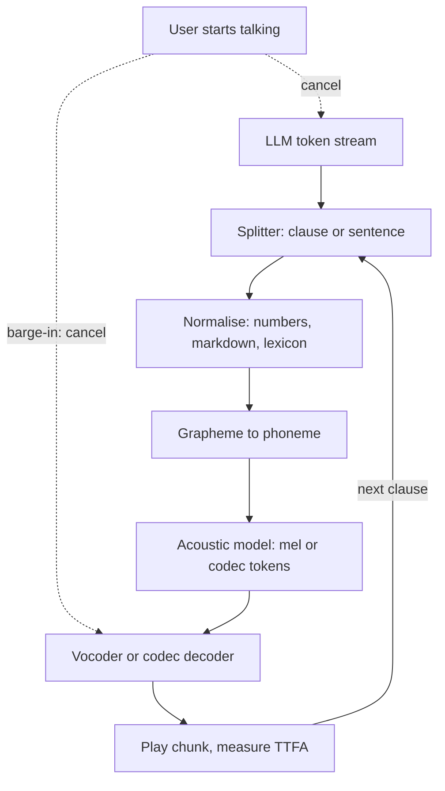

## TL;DR
Text-to-speech is the voice agent's mouth: normalise the LLM's text, predict mel-spectrogram or codec
tokens, decode to audio. Streaming by clause and cancelling on barge-in decide whether the agent feels
conversational.

## For agent builders
- **Why it matters for agents.** Users judge a voice agent by the silence before it speaks and by whether
  it says names and numbers right. Both are set by the pipeline around TTS (splitting, normalisation,
  cancellation), not by the LLM.
- **Where it shows up in your stack.** A managed or self-hosted TTS behind a WebSocket or telephony
  bridge, a splitter on the LLM token stream, SSML or a lexicon for names, and the barge-in handler.
- **What you control.** When the first chunk is released, text normalisation of LLM output, a reply style
  written for the ear, per-tenant pronunciation, phrase caching, and TTFA as the headline metric.
- **What you can skip.** Vocoder and flow-model internals. Know the three stages, why codec models
  generate few tokens autoregressively, and the latency budget.

## Why it exists
- **A voice agent that cannot speak is a chatbot.** Agents, accessibility, IVR and narration all need
  speech that is intelligible, natural and fast.
- **Old methods could not voice arbitrary text.** Concatenative synthesis glued recorded snippets: human
  on recorded phrases, seams badly between them. Formant synthesis simulated the vocal tract with rules:
  intelligible but unmistakably robotic. Neither can voice an LLM's unbounded fresh sentences.
- **Hard part one: text is ambiguous before it is spoken.** "read" has two sounds, "1/2" might be a date
  or a fraction, "St." might be street or saint.
- **Hard part two: prosody carries meaning.** Timing, pitch and loudness depend on the whole sentence,
  not the word.
- **Hard part three: raw audio is expensive.** 24,000 samples per second, each depending on the ones
  before; early sample-by-sample neural vocoders sounded excellent and were far too slow for interactive
  use. Neural TTS learns the first two from data and splits the third into a cheap sequence model plus a
  fast decoder. Time-to-first-audio and pronunciation errors make an agent feel broken, however good the
  LLM.

## How it works
### Stage 1: text normalisation and front end
1. **Rewrite into what should be *said*.** Expand numbers ("$1,250.50" to "one thousand two hundred fifty
   dollars and fifty cents"; "2024" as a year or a quantity depending on context), resolve abbreviations,
   remove symbols and markdown, find sentence boundaries.
2. **Grapheme-to-phoneme.** Convert words to phonemes with a lexicon plus a learned model for unseen
   words.
- **Where the bugs live.** This stage is rule-heavy and language-specific, and it is where most "the
  voice said something wrong" bugs live, *because* neural models downstream faithfully pronounce whatever
  the front end hands them.

### Stage 2: acoustic model
The phoneme (or character) sequence is mapped to an intermediate representation, classically a
mel-spectrogram:

| Property | Value |
|---|---|
| Bands per frame | roughly 80 |
| Frame rate | on the order of a hundred frames per second (a 10–12.5 ms hop) |
| Time steps vs 24 kHz waveform | a couple of hundred times fewer |
| Raw value count | only a few times smaller (each step is a vector of ~80 values) |

- **Why the saving matters.** Sequence length is what an attention or autoregressive model pays for, and
  the smooth spectral envelope is far easier to predict than individual samples with their phase.

| Design | Example | How | Gain | Cost |
|---|---|---|---|---|
| **Autoregressive** | Tacotron 2 | frames one at a time, attention over the input text | natural | slow; skips or repeats words when attention wanders |
| **Non-autoregressive** | FastSpeech 2 | predict each phoneme's *duration*, expand, predict pitch and energy per phoneme, generate all frames in parallel | fast, controllable, immune to skipping | slightly flatter delivery unless the prosody predictors are good |

### Stage 3: vocoder
- **Why it exists.** The spectrogram is an abstraction without phase; a vocoder reconstructs the
  waveform.
- **WaveNet** did it autoregressively per sample: superb quality, impractical latency.
- **GAN vocoders (HiFi-GAN)** upsample the spectrogram with convolutions in one pass, trained against a
  discriminator that judges realism. They run far faster than real time on a GPU and are the default in
  production pipelines.

### End-to-end and codec-language-model designs
- **VITS** trains acoustic model and vocoder jointly as one variational model with normalising flows,
  removing the spectrogram seam and the quality loss from mismatched stages.
- **Codec language models** (VALL-E and descendants, most "voice cloning" products) treat TTS as
  language modelling. A neural audio codec (EnCodec-style) compresses audio into discrete tokens at a low
  frame rate; a decoder-only transformer predicts audio tokens from text tokens plus a few seconds of
  reference audio; the codec decoder turns tokens back into waveform.
- **Zero-shot cloning, with LM risks.** The reference is just a prompt, so an unseen voice is cloned
  zero-shot, with the same hallucination and repetition risks as any autoregressive LM.

The token arithmetic explains the architectures:
- **Codec rate.** EnCodec at 24 kHz emits 75 frames per second. Residual vector quantisation stacks
  several codebooks per frame, each refining the residual error of the previous one: 8 codebooks of
  1,024 entries give 75 × 8 × 10 bits = 6 kbps.
- **Too many tokens.** Ten seconds of speech is 750 frames × 8 = 6,000 tokens, too many to generate one
  by one at conversational speed.
- **VALL-E's split.** It predicts only the first, coarsest codebook autoregressively (it carries most of
  the content and prosody) and fills in the other seven non-autoregressively in parallel; later models
  use interleaving or "delay" patterns across codebooks for the same reason.

### Streaming and latency
A conversational agent cannot wait for the whole reply to be synthesised, so streaming happens at two
levels:
1. **Across pieces.** The LLM's text is split at sentence or clause boundaries as it arrives; each piece
   is synthesised and played while the next is produced.
2. **Within a piece.** Chunked vocoding emits audio in small frames.
- **Metrics.** Time-to-first-audio (TTFA) and real-time factor (RTF = synthesis time / audio duration;
  below 1 means faster than real time, and the margin is your concurrency headroom).
- **Barge-in is a requirement.** Stopping playback and generation when the user starts talking means the
  architecture needs cancellable synthesis.

A worked budget (illustrative numbers) shows why sentence streaming is non-negotiable:

| Step | ms |
|---|---|
| End-of-speech detection | 300 |
| Final ASR | 200 |
| LLM first token | 400 |
| First clause of ~12 tokens at 50 tokens/s | 240 |
| TTS first chunk | 150 |
| Network and jitter buffer | 100 |
| **Time to first audio** | **roughly 1.4 s** |

- **Without streaming,** waiting for a 150-token reply makes the LLM alone add about 3 s before synthesis
  starts.
- **The biggest lever** is usually how early the splitter releases the first chunk (a clause boundary
  rather than a full sentence), not the vocoder.

### Quality and control
| What | How it is measured |
|---|---|
| Naturalness | mean opinion score (MOS): listeners rate 1 to 5 |
| Intelligibility | run ASR on the output, compute WER against the input text |
| Cloning fidelity | cosine similarity in a speaker-embedding space |

- **Control** comes from SSML-style markup (breaks, emphasis, say-as for digits and dates, explicit
  phonemes) or from style prompts in newer models.

### What the agent's LLM should hand to TTS
- **Write for the ear.** Instruct the agent to answer in short spoken sentences with no markdown, tables,
  URLs or JSON, because anything visual either gets read aloud or stripped.
- **Speak tool results, do not read them.** A tool returns structured data; the agent summarises it ("your
  order ships Tuesday") rather than voicing every field.
- **Fill tool-call gaps.** When a tool call will take a second or more, a short spoken filler or cached
  phrase keeps the line from going silent while the tool runs.

## Diagram
Text flows down through normalisation, an acoustic model and a decoder; in a voice agent this runs per
clause so the first chunk plays while later ones are still being made, and barge-in cancels it.



## Misconceptions
- **"A low real-time factor means the agent answers quickly."** RTF only says synthesis outruns playback
  once it starts; the silence users notice is sequencing. In the illustrative budget, waiting for a
  150-token reply gives about 4.15 s to first audio versus about 1.39 s when the first clause is
  released early.
- **"A faster vocoder is the main latency lever."** Halving the TTS first chunk in that budget saves only
  75 ms; when the splitter releases the first chunk saves seconds.
- **"Mispronounced names are the neural voice's fault."** The acoustic model faithfully says whatever the
  front end hands it, so the fix is a lexicon or SSML phoneme override, guarded by an ASR round-trip test
  in CI.
- **"The LLM's reply can go straight to the synthesiser."** Markdown, URLs, JSON and raw numbers get read
  aloud or mangled. Prompt the agent to write for the ear and keep a normaliser as the safety net.
- **"Barge-in just means stopping playback."** Generation must be cancelled too, and the agent's history
  must keep only the clauses actually played, or the next turn assumes the user heard things they did
  not.
- **"Codec models generate audio tokens one at a time, like text."** Ten seconds at 75 frames per second
  with 8 codebooks is 6,000 tokens, too slow to emit serially; VALL-E-style models predict the coarse
  codebook autoregressively and fill the rest in parallel.

## Examples
### Normalise, split and stream any synthesiser
The engineering around TTS matters as much as the model: normalise text an LLM produced (markdown,
currency, acronyms), chunk at sentence boundaries, and stream chunks through any synthesiser.
- Time-to-first-audio is then bounded by the first sentence, not the whole reply.
- `synthesize` is any function returning PCM bytes for a string; the timing code is what you would ship
  as metrics.

```python
import re, time
from num2words import num2words

def normalize(text: str) -> str:
    text = re.sub(r"[*_`#>]", "", text)                       # strip markdown an LLM may emit
    text = re.sub(r"\$(\d[\d,]*)(?:\.(\d{2}))?",                # "$1,250.50" -> spoken dollars/cents
                  lambda m: num2words(int(m.group(1).replace(",", ""))) + " dollars"
                  + (f" and {num2words(int(m.group(2)))} cents" if m.group(2) else ""), text)
    text = re.sub(r"\b(\d+)%", lambda m: num2words(int(m.group(1))) + " percent", text)
    text = text.replace("SLA", "S L A").replace("K8s", "kubernetes")   # per-domain lexicon
    return text

def sentences(text: str):
    return [s for s in re.split(r"(?<=[.!?])\s+", text.strip()) if s]

def stream_speech(reply: str, synthesize, sample_rate=24_000, bytes_per_sample=2):
    t0, first, audio_s = time.perf_counter(), None, 0.0
    for s in sentences(reply):
        pcm = synthesize(normalize(s))                         # any TTS backend: bytes of 16-bit PCM
        if first is None:
            first = time.perf_counter() - t0                   # time-to-first-audio
        audio_s += len(pcm) / (sample_rate * bytes_per_sample)
        yield pcm                                              # play/send while the next sentence renders
    rtf = (time.perf_counter() - t0) / max(audio_s, 1e-6)
    print(f"TTFA={first:.2f}s  audio={audio_s:.1f}s  RTF={rtf:.2f}")

reply = "Your **SLA** credit is $1,250.50. That is 12% of the invoice. K8s nodes are back."
for chunk in stream_speech(reply, synthesize=lambda s: b"\x00" * 48_000):   # stub: 1 s of silence
    pass   # in production: write chunk to the WebSocket / audio device
```

### Latency budget and codec token calculator
Pure Python, runnable as is. Change one stage at a time to see which lever moves time-to-first-audio,
and why codec models cannot generate every token autoregressively.

```python
def ttfa_ms(eos=300, asr=200, llm_first=400, first_chunk_tokens=12, tok_per_s=50,
            tts_first=150, network=100):
    gen = first_chunk_tokens / tok_per_s * 1000      # time to generate the first chunk's text
    return eos + asr + llm_first + gen + tts_first + network

def codec_tokens(seconds, frames_per_s=75, codebooks=8):
    return int(seconds * frames_per_s * codebooks)

print(ttfa_ms())                              # 1390.0: clause streaming, ~1.4 s
print(ttfa_ms(first_chunk_tokens=150))        # 4150.0: wait for the whole 150-token reply
print(ttfa_ms(tts_first=75))                  # 1315.0: halving TTS first chunk saves only 75 ms
print(codec_tokens(10), 75 * 8 * 10 / 1000)   # 6000 tokens, 6.0 kbps with 1,024-entry codebooks
```

### Agent turn with barge-in: cancel speech and generation together
A sketch of one voice-agent turn in `asyncio`. `llm_stream`, `synthesize` and `play` stand for your
LLM client, TTS backend and audio sink; the point is the shape: speak clause by clause, and on a VAD
speech-start event cancel both the speaking task and the LLM stream.

```python
import asyncio, re

CLAUSE_END = re.compile(r"[.!?,;:]\s")

async def speak_reply(llm_stream, synthesize, play, spoken, min_chars=25):
    buf = ""
    async for token in llm_stream:                 # llm_stream: an async generator of text
        buf += token
        m = CLAUSE_END.search(buf, min_chars)      # release the first clause early
        if m:
            clause, buf = buf[:m.end()], buf[m.end():]
            await play(await synthesize(normalize(clause)))   # normalize() from the example above
            spoken.append(clause)                  # record only clauses that finished playing
    if buf.strip():
        await play(await synthesize(normalize(buf)))
        spoken.append(buf)

async def agent_turn(llm_stream, synthesize, play, user_started_speaking: asyncio.Event):
    spoken = []
    speaking = asyncio.create_task(speak_reply(llm_stream, synthesize, play, spoken))
    barge_in = asyncio.create_task(user_started_speaking.wait())
    done, _ = await asyncio.wait({speaking, barge_in}, return_when=asyncio.FIRST_COMPLETED)
    if barge_in in done:
        speaking.cancel()                          # stop TTS and playback
        try:
            await speaking
        except asyncio.CancelledError:
            pass
        await llm_stream.aclose()                  # then close the stream so generation stops
        return "interrupted", "".join(spoken)      # store only what the user heard
    barge_in.cancel()
    return "completed", "".join(spoken)
```

- **Keep history honest.** After an interruption, store only the text actually spoken in the agent's
  transcript, otherwise the next turn assumes the user heard things they did not.

## Production patterns
- **Clause-level splitter on the LLM stream.** When: any conversational agent. How: release the first
  chunk at the first clause or sentence boundary past a minimum length, then sentence by sentence.
  Monitor: TTFA p50 and p95 from end of user speech, not from request start.
- **Cancellable synthesis for barge-in.** When: full-duplex voice. How: run synthesis and playback as
  cancellable tasks (for example an `asyncio` task you `cancel()` on a VAD speech-start event) and stop
  LLM generation too. Monitor: overlap seconds after user speech starts.
- **Pronunciation lexicon with ASR round-trip tests.** When: customer, product and people names. How:
  keep a per-tenant lexicon or SSML phoneme overrides, synthesise every entry in CI and run ASR to compute
  WER against the text. Monitor: mispronunciation rate on the entity list.
- **Match the transport format at the edge.** When: telephony. How: resample and encode once to what the
  line expects, for example 8 kHz μ-law (with ffmpeg, `-ar 8000 -acodec pcm_mulaw`). Monitor: sample-rate
  mismatches and audio duration versus expected.
- **Cache fixed phrases.** When: greetings, disclaimers and menu prompts repeat. How: key cached audio by
  normalised text, voice and model version; synthesise only dynamic parts. Monitor: cache hit rate and
  synthesis cost per call.
- **A spoken-style system prompt.** When: the same agent serves chat and voice. How: a voice-specific
  instruction block (short sentences, no markdown, numbers in words for amounts, summarise tool results)
  plus the normaliser as a safety net. Monitor: share of chunks the normaliser had to rewrite.

## Trade-offs
- **Non-autoregressive speed vs codec-LM richness.** Non-autoregressive acoustic models give fast,
  stable, controllable synthesis; autoregressive and codec-LM models give richer prosody and zero-shot
  cloning at higher latency and hallucination risk.
- **Sentence streaming vs cross-sentence prosody.** Streaming minimises time-to-first-audio but loses
  prosody across sentences; it flips for narration rather than dialogue, where whole-paragraph synthesis
  sounds better.
- **Managed API vs self-hosting.** Managed TTS delivers quality and voices without GPUs, but
  per-character pricing, data residency and vendor voice licensing push high-volume or regulated
  deployments toward self-hosting.
- **Voice cloning: feature vs liability.** Cloning from seconds of audio needs consent, verification and
  watermarking, engineering effort a fixed stock voice does not.

## Pitfalls
- **Sending raw LLM output to the synthesiser.** Symptom: the voice reads "asterisk asterisk" or spells
  out URLs and JSON keys that should never have reached speech.
- **Skipping number and date normalisation.** Symptom: "two thousand twenty-four" for a year, phone
  numbers read as large integers, "1/2" spoken as a date.
- **Synthesising the whole reply before playback.** Symptom: a multi-second pause before every answer
  that users read as the agent being broken, even though total synthesis time is fine.
- **Ignoring sample-rate and codec conversion.** Symptom: chipmunk or slowed audio on telephony paths
  that expect 8 kHz μ-law when the model emitted 24 kHz PCM.
- **No cancellation path for barge-in.** Symptom: the agent talks over the user for several seconds after
  being interrupted.
- **Evaluating only by listening to a few demos.** Symptom: mispronounced customer names and product
  terms in production that an ASR round-trip WER test on your own vocabulary would have caught.
- **Recording unspoken text in agent history after barge-in.** Symptom: the agent later refers to details
  the user never heard. Fix: truncate the stored reply to what was played before cancellation.

## When to use
- **Use neural TTS** whenever text must become speech for dynamic content: voice agents, IVR replacing
  recorded menus, accessibility read-aloud, generated narration and alerts.
- **Use recorded audio** when the phrase set is small and fixed and legal sign-off on exact wording
  matters.
- **Pick the model by surface:** a fast non-autoregressive or streaming-capable model for interactive
  use, a higher-quality, slower model for offline narration.
- **Measure:** time-to-first-audio, RTF at target concurrency, ASR round-trip WER on your own text, and
  mispronunciation rate on your entity list.
- **Interviews:** expect the three-stage pipeline, why vocoders exist, and how you would hit a
  conversational latency budget.

## Role lens
- **Engineer:** Owns text normalisation and the lexicon, streams at sentence boundaries, implements
  cancellation for barge-in, and tracks TTFA and RTF as service metrics.
- **Architect:** Sets the end-to-end voice latency budget across ASR, LLM and TTS, chooses managed
  versus self-hosted synthesis, and defines the consent and watermarking policy for cloned voices.
- **FDE:** Builds the customer's pronunciation lexicon from their product and people names, validates
  the voice on their telephony path, and demonstrates the latency budget on real calls.

## Check yourself
**Q:** A voice agent's users complain it "takes forever to answer" even though logs show LLM first
token at 400 ms and TTS synthesis running at RTF 0.3. What is the likely cause and how would you
restructure the pipeline?
**A:** RTF 0.3 only says synthesis is faster than playback once it starts; the delay is sequencing. The
pipeline most likely waits for the complete LLM reply, then synthesises the whole text, then plays,
so perceived latency is LLM generation time plus full synthesis time. Restructure so the LLM streams
tokens, a splitter emits the first sentence as soon as its boundary appears, TTS synthesises that
sentence while the LLM continues, and audio plays while the next sentence renders. Time-to-first-audio
then approximates first-sentence LLM latency plus one short synthesis. Add cancellation so barge-in
stops both generation and playback, normalise each chunk before synthesis, and instrument TTFA as the
metric that matches what users feel.

## Interview questions
### Describe a modern TTS pipeline and why it has a vocoder.
- **Three stages.** Text normalisation and grapheme-to-phoneme, an acoustic model that predicts a
  mel-spectrogram (or codec tokens), and a vocoder or codec decoder that produces the waveform.
- **Why the split.** A spectrogram at about 100 frames per second is a far shorter sequence than 24,000
  samples per second, so the expensive model runs on the short one and a one-pass vocoder like HiFi-GAN
  fills in the waveform.

### Your voice agent mispronounces customer names. How do you fix and prevent it?
- **Fix at the front end.** Add a lexicon or SSML phoneme overrides for those names, because the neural
  model pronounces whatever the front end hands it.
- **Prevent with a test.** Synthesise every lexicon entry in CI, run ASR on the audio and fail on WER
  regressions against the text.

### How would you get time-to-first-audio under 1.5 seconds?
- **Budget each stage.** End-of-speech detection, final ASR, LLM first token, first clause generation,
  TTS first chunk and network add up to about 1.4 s in an illustrative budget.
- **Stream by clause.** Releasing the first clause instead of the whole reply saves seconds; halving the
  TTS first chunk saves tens of milliseconds, so fix sequencing first.

### When would you pick FastSpeech-style TTS over a codec language model?
- **Interactive and reliability-critical surfaces.** Explicit durations make every phoneme render exactly
  once, so no skipped or repeated words, and parallel generation keeps latency low.
- **Pick the codec LM** for zero-shot voice cloning and richer prosody, accepting LM-style hallucination
  and repetition risk and higher latency.

### Why can't a codec LM generate every audio token autoregressively?
- **Token count.** At 75 frames per second with 8 codebooks, ten seconds of speech is 6,000 tokens, too
  slow to emit one by one at conversational speed.
- **The workaround.** Predict the coarse first codebook autoregressively and the rest in parallel, or use
  interleaving and delay patterns across codebooks.

### Your voice agent goes silent for two seconds whenever it calls a tool. What do you change?
- **Measure the gap.** Trace TTFA per turn and split it into LLM, tool and TTS time; tool latency often
  dominates turns that call an API.
- **Hide or cut it.** Speak a short cached filler before the tool call, start the tool on partial ASR
  where safe, and stream the answer clause by clause as soon as the tool returns.

## Quiz
### Q: Why do most TTS pipelines predict a mel-spectrogram first and then run a vocoder, instead of generating waveform samples directly from text?
- [ ] Waveforms cannot be produced by neural networks
- [x] The spectrogram is a compact representation that a sequence model can predict cheaply, and a fast vocoder reconstructs the waveform
- [ ] Vocoders perform the text normalisation step
- [ ] Spectrograms contain phase information that text lacks
> Raw audio is tens of thousands of samples per second; predicting a low-rate spectrogram then upsampling
> it with a one-pass vocoder keeps synthesis fast. End-to-end models exist but share this cost logic.

### Q: Which design choice most directly prevents the "skipped or repeated word" failure of attention-based autoregressive TTS?
- [ ] A larger vocoder
- [ ] Training on more speakers
- [x] Explicit per-phoneme duration prediction in a non-autoregressive acoustic model
- [ ] Higher output sample rate
> FastSpeech-style models decide how many frames each phoneme gets before generating, so every phoneme
> is rendered exactly once; attention drift in Tacotron-style models is what causes skips and repeats.

### Q: For a conversational agent, which metric best captures what users perceive as responsiveness?
- [ ] Real-time factor of the vocoder
- [ ] Mean opinion score of the voice
- [x] Time-to-first-audio measured from the end of the user's utterance
- [ ] Total synthesis time for the full reply
> Users judge the gap before the agent starts speaking. RTF and MOS matter for throughput and quality,
> but a low RTF with whole-reply synthesis still produces a long silent gap.

## Use cases & projects
### Use cases
- **Phone support and booking agents.** Streaming TTS with barge-in replaces IVR menus with an agent that
  answers and acts in one conversation.
- **In-car and hands-free assistants.** Short spoken replies and summarised tool results matter more than
  voice quality.
- **Outbound notification agents.** Cached fixed phrases plus synthesised dynamic parts (names, dates,
  amounts) keep cost and pronunciation risk low.
- **Accessibility read-aloud.** An agent turns documents or dashboards into spoken summaries rather than
  reading raw tables.

### Mini project
**Measure and cut time-to-first-audio (2-3 hours).**
- **Goal:** build a text-in, speech-out agent reply path and bring TTFA down with streaming and barge-in.
- **Steps:** stream an LLM reply into any TTS backend twice, once synthesising the whole reply and once
  clause by clause; add the normaliser; simulate barge-in with a timer that cancels the turn; log TTFA,
  RTF and the text actually spoken.
- **Done when:** you have TTFA for both runs, a barge-in that stops audio and generation within a few
  hundred milliseconds, and an agent history that stores only spoken text.
