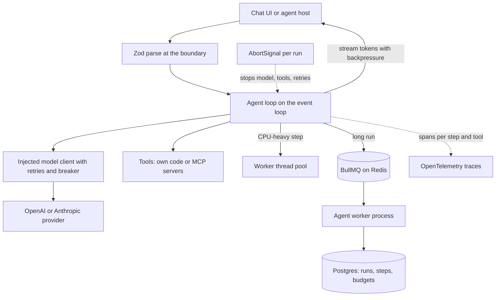

## Overview
This module is about building the backend of an AI product in Node.js and TypeScript to production
standard. Most of that backend is glue around slow, billed, non-deterministic model calls, and the
module is organised around what that glue needs.

For an agent builder this is the runtime your agent loop lives in. One agent run is a chain of model
calls, tool calls and state writes, so the process must validate what the model sends, stop work the
user abandoned, stream progress, survive provider outages and restarts, and show where each token went.

What the module gives you, in the order the ideas build:
- **Types and trust.** Strict TypeScript makes the compiler reject null and variant mistakes. Runtime schema validation with Zod checks the data the compiler cannot see, including model output and tool arguments.
- **The runtime.** The event loop explains why one process can hold thousands of open model streams and why one synchronous step stalls all of them. Promise error propagation, AbortController cancellation, streams with backpressure and worker threads are the tools for working with that single thread.
- **Talking to the outside world.** Dependency injection keeps clients swappable. The OpenAI and Anthropic SDKs, the Vercel AI SDK and resilient API clients with retries and circuit breakers handle model calls.
- **State and tools.** Postgres transactions, Redis and BullMQ hold state and durable jobs, and the MCP TypeScript SDK exposes tools to any agent host.
- **Running the service.** OpenTelemetry tracing, layered testing that keeps the real model out of the merge gate, graceful shutdown and a Docker and CI pipeline.

Core for agents (you use them directly in every TypeScript agent): strict types, runtime schema
validation, promises and async errors, AbortController, streams, dependency injection, the OpenAI and
Anthropic SDKs, resilient API clients, the Vercel AI SDK, BullMQ, the MCP TypeScript SDK and testing.

Useful background (you meet it when operating agents): the event loop, worker threads, Postgres
transactions and migrations, Redis, OpenTelemetry, graceful shutdown and Docker with CI/CD.

What you can build afterwards:
- A typed, observable, cancellable, streaming AI or agent service that survives deploys, provider outages and restarts without lost work or runaway token spend.
- An MCP tool server, typed with Zod, that any agent host such as an IDE can list and call.
- A durable agent worker whose runs resume at a step boundary instead of replaying tools.

It matters most for Engineers who write and operate these services day to day, and for FDEs who build
integrations at customer sites, often on a customer's Node stack.

## Why it matters
- **Engineer:** You write the agent handlers, workers and tool servers, so a floating promise that crashes the process, a stream that keeps billing after the client left, a pool transaction split across connections or a 300 ms tokenizer call on the main thread that freezes every other agent session is a bug in your code.
- **Architect:** You decide which layer owns retries for each model and tool call, where cancellation and deadlines propagate through an agent run, what runs in a request versus a BullMQ job or a worker thread, what lives in Redis versus Postgres, and whether to standardise on the Vercel AI SDK or the native provider SDKs.
- **FDE:** Customer agent integrations are often a TypeScript service or MCP server built in days against their APIs, and you answer for it with typed tool contracts, a trace of each agent run, safe secret handling and deploys that do not cut off users mid-answer.

## Mental model
Picture one Node process as a single cashier serving thousands of customers who are each waiting on a
slow kitchen, the model provider. Waiting costs almost nothing, so the cashier can juggle thousands of
open orders. Cooking at the counter, meaning any synchronous CPU work, makes everyone wait, so heavy
work goes to worker threads or to a queue.

Every agent request carries three things down its call tree:
- **A type parsed at the boundary**, rather than assumed, for request bodies, tool arguments and model output.
- **An AbortSignal** that can stop all of its work at once: model stream, tool calls and retries.
- **A trace context** that ties its spans together across awaits and services.

| Piece | Rule | Lessons |
|---|---|---|
| Outbound calls | Every call that leaves the process goes through an injected client with a timeout, a classified retry policy and a breaker | dependency injection, provider SDKs, Vercel AI SDK, resilient clients |
| Durable state | Every piece of state that must outlive the request goes to Postgres, Redis or a durable job | Postgres, Redis, BullMQ |
| Tools for other hosts | Tools are exposed over MCP with the same Zod schemas | MCP TypeScript SDK |
| Shutdown | The same picture in reverse: stop taking orders, finish or hand off the open ones, flush, then exit | graceful shutdown, Docker and CI/CD |

## Suggested order
1. typescript-strict-mode-and-advanced-types — the compiler settings and union types every later lesson's code relies on, including the tool registry and stream-event handlers.
2. runtime-schema-validation — fills the gap types leave at runtime and gives one Zod schema for types, parsing and tool definitions.
3. event-loop-and-microtask-queue — the execution model that explains concurrency, ordering and stalls in everything that follows, so it comes before the async lessons.
4. promises-and-async-error-propagation — how failures travel through awaits and combinators, needed before cancellation and retries.
5. abortcontroller-and-cancellation — makes abandoned and timed-out agent work actually stop, building on promise semantics.
6. streams-and-backpressure — token streaming to clients with bounded memory, wired to the request's abort signal.
7. dependency-injection — the explicit wiring pattern that makes provider clients, tool registries, stores and queues swappable and testable.
8. openai-anthropic-node-sdks — the native model clients, their retry, timeout, streaming and tool-call mechanics, injected behind an interface.
9. api-clients-with-retries-and-circuit-breakers — layers deadlines, classified retries and breakers over the SDKs' own retries without multiplying attempts.
10. vercel-ai-sdk — the provider-agnostic alternative and its built-in agent loop, best judged once the native SDKs and their trade-offs are familiar.
11. mcp-typescript-sdk — exposes the service's tools over MCP using the Zod schemas, transports and error handling covered earlier.
12. vitest-jest-and-integration-testing — layered tests with injected fakes and scripted model trajectories, so the agent pieces above are tested before the state layer grows.
13. worker-threads-for-cpu-bound-tasks — the answer to the event-loop stalls lesson 3 identified for sustained CPU work.
14. postgresql-transactions-and-migrations — durable run and budget state, including the pool-per-statement trap and safe schema changes.
15. redis — shared fast state across replicas for caches, rate limits and locks, and the store BullMQ needs.
16. bullmq-and-durable-jobs — moves long agent runs and batch work off the request, built on Redis and idempotent Postgres writes.
17. opentelemetry-instrumentation — traces one request across HTTP, model calls, Postgres, Redis and queue hops, so it comes after those pieces exist.
18. graceful-shutdown — the SIGTERM drain ordering across servers, workers, pools and exporters introduced above.
19. docker-ci-cd-deployment — packages and ships the service with a gated pipeline, depending on shutdown and tests being in place.

## Capstone
### Brief
This is the module's major project, built over about a week. The use case: a team needs a document
Q&A agent that answers questions over their PDFs with page citations, runs on several replicas, and
never loses work or overspends when a provider fails or a deploy lands.

Users upload PDFs and ask questions in a chat UI. The agent calls retrieval and citation tools in a
loop, and answers stream token by token and cite pages. The service runs as an API process and a
separate worker process.

- **Ingestion.** Uploads enqueue a BullMQ ingestion job. The worker parses and tokenizes each document in a worker-thread pool and embeds chunks through a provider client with timeouts, classified retries and a circuit breaker.
- **State.** The worker writes chunks, run records and a per-tenant token budget to Postgres in transactions, with schema managed by migrations.
- **Agent endpoint.** The chat endpoint validates requests with Zod and streams through either the Vercel AI SDK or a native SDK behind an injected interface, with a fallback provider when the breaker is open.
- **Cancellation and limits.** A single AbortSignal per request stops generation when the client disconnects. Redis holds a rate limiter and an answer cache.
- **Tools for other hosts.** The same retrieval and citation tools are also exposed as an MCP server over stdio and Streamable HTTP.
- **Operations.** Add OpenTelemetry traces across API, queue, worker and database, a layered test suite, graceful shutdown for both processes and a multi-stage Docker image with a CI pipeline.

### Deliverables
- A repository with the API, worker and MCP server under `strict` plus `noUncheckedIndexedAccess`, a single composition root per process, and Zod schemas used for request bodies, environment config, model tool definitions and MCP tool inputs.
- Postgres migrations for documents, chunks, runs and budgets, a transactional budget-charge path that pins one client, and a BullMQ ingestion queue with idempotent handlers, retries with backoff and a dead-letter inspection script.
- A test suite with unit tests against a fake model client that replays scripted tool-call trajectories, integration tests running real Postgres and Redis in containers plus intercepted provider HTTP, and a separate scored eval of 20+ questions with a pass threshold, run outside the merge gate.
- A multi-stage Dockerfile running Node as PID 1 in exec form, a CI workflow gating on typecheck, lint (`no-floating-promises`, `no-explicit-any`) and tests, and a short runbook covering the shutdown sequence, secrets injection and dashboards.
- An OpenTelemetry setup that exports one trace per question showing the HTTP span, retrieval, model call with token usage, Redis and Postgres spans, plus a linked trace for each ingestion job across the queue hop.

### Rubric
- Closing the browser tab mid-answer ends the upstream model stream within a second, shown by the span ending with an abort status and no further token usage recorded for that request.
- Ingesting a 200-page PDF while 50 chats stream keeps p99 event-loop lag under 50 ms, measured with `monitorEventLoopDelay` and compared with a run that parses on the main thread.
- With the primary provider forced to return 529, requests fail over to the fallback after the breaker opens, total attempts per request stay within the configured cap, and breaker state transitions appear in metrics.
- Sending SIGTERM to the API during 20 active streams and to the worker mid-job finishes or cleanly ends every stream, records zero 5xx at the load balancer, and leaves the job either completed or retried exactly once with no duplicate chunks.
- Two concurrent questions for a tenant with budget for only one result in exactly one being charged and the other rejected with a typed budget error, and the unit and integration suites run with no network access or provider keys.
- An MCP host such as an IDE lists and calls the retrieval tool over stdio, returns `isError` results for bad arguments rather than protocol errors, and nothing other than JSON-RPC is written to stdout.
