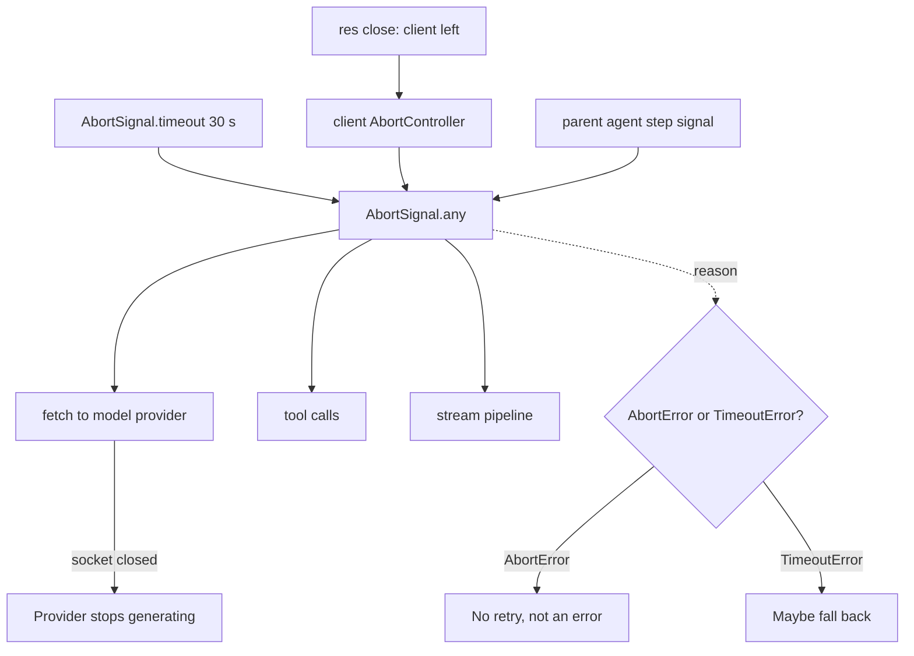

## TL;DR
Agent runs get abandoned: users hit stop, steps time out. Promises cannot be cancelled, so one
`AbortSignal` goes to every model call, tool call and stream of the run, making stop and a 30-second
timeout real stops.

## For agent builders
- **Why it matters for agents.** A run fans out into many paid, slow operations. Without one signal threaded
  through them, "stop" only stops the UI while the model keeps generating and tools keep running, and a
  timeout only stops waiting (if the provider stops on disconnect, aborting also stops the billing).
- **Where it shows up in your stack.** The `signal` option of the OpenAI and Anthropic Node SDKs,
  `abortSignal` in the Vercel AI SDK, `fetch` inside your tools, stream pipelines to the UI, and the stop
  button in your chat frontend.
- **What you control.** One root controller per run, child controllers per step or branch via
  `AbortSignal.any`, deadlines propagated across hops, and the rule that aborts are never retried.
- **What you can skip.** DOM-spec event details. Know `AbortSignal.timeout`, `AbortSignal.any`,
  `throwIfAborted` and how to tell `AbortError` from `TimeoutError`.

## Why it exists
- **Model calls are the most expensive thing a Node service does:** seconds of latency, tokens billed as they
  are produced, and a connection held open for the duration.
- **Work gets abandoned constantly.** Users close a tab, hit stop or re-send a prompt; agent loops decide
  half-way a tool result is no longer needed; timeouts must give up on a slow provider and fall back. The
  question is always how to make work *stop*, not just stop waiting for it.
- **Promises offer no answer.** A promise is a handle to a result, not to the work: `Promise.race` against a
  timer settles your await, but the HTTP request keeps streaming, the provider keeps generating, and the
  tokens keep costing money.
- **The old way was ad hoc.** Every API had its own `req.destroy()`, `stream.destroy()`, `clearTimeout()`, and
  composing them across a call tree meant threading callbacks by hand. `AbortController` and `AbortSignal`,
  borrowed from the browser, give one object every cancellable API understands.
- **Cooperative *because* JavaScript cannot preempt.** The runtime cannot safely unwind a function holding a
  database transaction or a half-written file. A signal is a broadcast each layer checks or subscribes to, so
  cancellation flows down the request's path and cleanup happens where resources were acquired.

## How it works
### The two objects
`const ac = new AbortController()` creates a controller with one `ac.signal`.

| Signal member | Meaning |
|---|---|
| `aborted` | Boolean |
| `reason` | Whatever `abort(reason)` was given; defaults to a `DOMException` named `AbortError` |
| `throwIfAborted()` | Throws the reason if already aborted |
| `'abort'` event | Fires once on abort |

- **The split is deliberate.** The controller stays with the owner who may cancel; the signal, which can only
  be observed, is handed to everyone else, so a callee cannot abort its caller's work by accident.

### How built-in APIs consume it
- **`fetch(url, { signal })`** rejects with `signal.reason` and closes the connection; with a streaming body,
  reading from `response.body` also rejects. The closed connection is how the provider learns to stop; most
  stop generating on disconnect, but confirm for yours.
- **Timers:** `setTimeout` from `node:timers/promises` takes `{ signal }` and rejects early when aborted (with
  an `AbortError` whose `cause` is the signal's reason).
- **Events:** `events.once(emitter, 'name', { signal })` stops waiting.
- **Streams:** `stream.addAbortSignal(signal, stream)` and `pipeline(..., { signal })` destroy the chain.
- **Others:** child processes, `fs` promises, `readline` and most newer APIs accept a signal.
- **Provider SDKs** pass it to the request: the OpenAI and Anthropic Node SDKs take a `signal` request option,
  the Vercel AI SDK calls it `abortSignal`.

### Composing signals
- **`AbortSignal.timeout(ms)`** returns a signal that aborts with a `TimeoutError` after the delay.
- **`AbortSignal.any([a, b])`** (Node 20.3 and later) aborts when any input aborts, carrying that input's
  reason.
- **Together, one line:** "stop when the client disconnects *or* after 30 s *or* when the parent agent step is
  cancelled". Before `any` existed, this was done by hand with listeners forwarding one abort to another
  controller.

### Making your own code cancellable
Three idioms cover nearly everything:

1. **Check at loop boundaries.** `signal.throwIfAborted()` at the top of each iteration of an agent loop or
   chunk-processing loop stops a long computation at the next safe point.
   - **It only works if the loop *yields*** between iterations (an `await` on real I/O, or `setImmediate`).
     `abort()` is itself called from a callback — the socket `'close'` handler, the timeout's timer — and no
     callback runs while a synchronous loop holds the thread, so a loop that never awaits sees
     `signal.aborted === false` until it finishes.
   - **CPU-bound work** that must be cancellable either yields in slices or runs in a worker that can be
     terminated.
2. **Subscribe for cleanup.** `signal.addEventListener('abort', () => conn.release(), { once: true })` when you
   hold a resource with no signal-aware API. Remove the listener when work finishes normally, otherwise a
   long-lived signal accumulates listeners for every call made with it and leaks.
3. **Pass it down.** Every async function that does I/O takes `signal` as a parameter and forwards it. The call
   tree becomes a cancellation tree, with one controller at the root per request.

### Distinguishing abort from failure
- **How an abort surfaces:** a rejection whose `name` is `'AbortError'` (or `'TimeoutError'` for the timeout
  signal), and `signal.reason` tells you *why*.
- **Only with the right reason.** That holds if you abort with the default reason or an `AbortError`-named
  `DOMException`: `fetch` and streams reject with whatever reason you pass, so `abort(new Error("bye"))`
  produces a rejection named plain `Error`.

| Outcome | Retry? |
|---|---|
| Provider 503 | Yes |
| Client disconnect | Never |
| Timeout | Maybe, against a different provider |

- **Why it matters.** Code that treats every rejection as a failure retries cancelled calls and bills tokens
  for a user who already left. Check `signal.aborted` (or `error.name`) before classifying.

### Deadlines across hops
- **A timeout is really a *deadline*:** the request must finish by time T.
- **Each hop gets the time remaining,** not its own fresh 30 s, or the inner call keeps working (and billing)
  after the outer caller has given up.
- **Mechanics:** compute `remaining = deadline - Date.now()` at each hop, create
  `AbortSignal.timeout(remaining - margin)` combined with the parent signal, and pass the deadline downstream
  explicitly (a header or a field such as gRPC's deadline).
- **Because a signal does not cross a process boundary** — only the closed connection does.

### Where the request-level controller comes from
1. **The root signal comes from the connection:** `res.on('close')` (or the framework's request abort event;
   in `fetch`-style handlers it is `request.signal`) fires when the client goes away.
2. **Create one controller per request** and abort it on close.
3. **Combine with a timeout.**
4. **Pass the result into** the model call, the tool calls and any streams. Cancelling the parent cancels
   everything underneath because they all share one signal.

## Diagram
One root signal per request, built from client disconnect and a deadline, fans out to every operation;
whichever fires first stops them all.



## Examples
### Request-scoped signal through a streaming model call
A request-scoped signal combining client disconnect and a hard timeout, passed through a streaming model
call, with the abort reason used to decide whether the error is retryable. An agent-step signal joins the
same way, as a third entry in the `AbortSignal.any` list.

The listener cleanup in `withResource` shows the
pattern for resources that have no signal-aware API.

```ts
import { setTimeout as sleep } from "node:timers/promises";
import type { IncomingMessage, ServerResponse } from "node:http";

function requestSignal(req: IncomingMessage, res: ServerResponse, timeoutMs: number) {
  const client = new AbortController();
  // fetch rejects with this exact reason, so keep its name "AbortError" (not a plain Error)
  res.once("close", () => client.abort(new DOMException("client disconnected", "AbortError")));
  return AbortSignal.any([client.signal, AbortSignal.timeout(timeoutMs)]);
}

async function streamModel(prompt: string, signal: AbortSignal, onToken: (t: string) => void) {
  const res = await fetch("https://provider.example/v1/stream", {
    method: "POST", body: JSON.stringify({ prompt, stream: true }), signal,
  });
  const dec = new TextDecoder();                  // stream: true keeps split UTF-8 characters intact
  for await (const chunk of res.body!) {          // rejects with signal.reason when the signal fires
    signal.throwIfAborted();                       // also stop between chunks if parsing is slow
    onToken(dec.decode(chunk, { stream: true }));
  }
}

async function withResource<T>(signal: AbortSignal, fn: () => Promise<T>): Promise<T> {
  const conn = { release() { console.log("released"); } };
  let released = false;                          // abort and finally both fire on cancellation
  const release = () => { if (!released) { released = true; conn.release(); } };
  signal.addEventListener("abort", release, { once: true });
  try { return await fn(); }
  finally { signal.removeEventListener("abort", release); release(); }
}

export async function handler(req: IncomingMessage, res: ServerResponse) {
  const signal = requestSignal(req, res, 30_000);
  try {
    await withResource(signal, () => streamModel("Explain backpressure", signal, (t) => res.write(t)));
    res.end();
  } catch (e: unknown) {
    const name = (e as { name?: string }).name;
    if (name === "AbortError") return;                       // user left: no retry, no error log
    if (name === "TimeoutError") {                          // headers may be sent once tokens flowed
      if (!res.headersSent) res.statusCode = 504;
      return res.end("\n[provider timeout]");
    }
    throw e;                                                 // genuine failure: let the error layer classify it
  }
}
void sleep;                                                  // sleep(ms, undefined, { signal }) for cancellable waits
```

### Agent scenario: a stoppable tool-calling loop
One run controller (the stop button), a per-step timeout, and a step cap. Every model and tool call gets
the combined signal, so stop or a slow step ends the work, not just the wait.

```ts
type Step = { done: boolean; toolCalls: Array<{ name: string; args: unknown }> };

export async function runAgent(
  callModel: (signal: AbortSignal) => Promise<Step>,
  runTool: (c: { name: string; args: unknown }, signal: AbortSignal) => Promise<string>,
  run: AbortSignal,                       // aborted by the stop button or client disconnect
  maxSteps = 10,
) {
  for (let i = 0; i < maxSteps; i++) {
    run.throwIfAborted();                 // safe point between steps
    const step = AbortSignal.any([run, AbortSignal.timeout(20_000)]);   // fresh per step
    const out = await callModel(step);
    if (out.done) return "done";
    // side-effecting tools should be idempotent: an abort may land mid-call
    await Promise.allSettled(out.toolCalls.map((c) => runTool(c, step)));   // results feed the next
    // model call through the transcript (omitted here)
  }
  return "step limit reached";
}
```

- **Why the timeout is per step:** `AbortSignal.timeout` counts from creation, so building it at the top of
  each step gives every step its own 20 s, while `run` still caps the whole run.

### `Promise.race` keeps billing; a signal stops it
Save as `race.mjs` and run `node race.mjs` (about 7 seconds). A fake provider bills one token every 100 ms.
The race "times out" at 1 s but the work runs on to all 50 tokens; the signal version stops at 9.

```js
import { setTimeout as sleep } from "node:timers/promises";

async function fakeProvider(signal, stats) {      // bills one token every 100 ms until stopped
  for (let i = 0; i < 50; i++) {
    await sleep(100, undefined, { signal });      // rejects once the signal aborts
    stats.tokens++;
  }
}

const raced = { tokens: 0 };
await Promise.race([fakeProvider(undefined, raced), sleep(1000)]);
console.log("race returned at 1 s, tokens:", raced.tokens);      // 9
await sleep(4500);
console.log("4.5 s later, still billing:", raced.tokens);        // 50

const stopped = { tokens: 0 };
await fakeProvider(AbortSignal.timeout(1000), stopped)
  .catch((e) => console.log("rejected:", e.name, "cause:", e.cause?.name)); // AbortError, cause TimeoutError
await sleep(1000);
console.log("signal version, 1 s later:", stopped.tokens);       // 9, no growth
```

- **Note the rejection shape.** `timers/promises` rejects with an `AbortError` whose `cause` is the
  `TimeoutError`, while `fetch` rejects with the `TimeoutError` itself. Classify from `signal.reason` when you
  have the signal, rather than trusting one error name.

### Worked scenario: one deadline across three hops
Gateway deadline 30 s; each hop subtracts elapsed time and a 500 ms margin (illustrative).

| Hop | Elapsed on arrival | Timeout it sets | Without propagation |
|---|---|---|---|
| Gateway → agent service | 0 s | 30 − 0.5 = 29.5 s | 30 s |
| Agent → tool service (after planning) | 6 s | 24 − 0.5 = 23.5 s | Fresh 30 s: could run to 36 s |
| Tool → model provider (after retrieval) | 10 s | 20 − 0.5 = 19.5 s | Fresh 30 s: could run to 40 s, billed after the user got a 504 |

## Production patterns
- **A controller per agent run, addressable by run id.** When the stop button arrives on a different request
  than the stream (a separate `POST /runs/:id/stop`), agent teams keep a map from run id to controller in the
  process running the run and abort it there; with several replicas, route the stop to the owning replica.
  Monitor time from stop to the last billed token.
- **One root controller per request.** In middleware, create the controller, abort it on `res` `'close'`
  (or use `request.signal` in `fetch`-style frameworks), combine with `AbortSignal.timeout`, and attach the
  result to the request context. Monitor sockets to providers still open after request end.
- **Signal parameter as a library contract.** Every internal client takes `{ signal }` and forwards it to
  `fetch` or the SDK's `signal`/`abortSignal` option; reviews reject I/O functions without one. Track aborts
  by reason (client, timeout, parent) as separate counters.
- **Propagate deadlines, not timeouts.** Send the absolute deadline downstream in a header or a gRPC deadline,
  and at each hop build `AbortSignal.timeout(remaining - margin)`. Monitor work completed after the caller's
  deadline.
- **Timeouts from measured latency.** Set per-route timeouts from provider p99 plus headroom, not round
  numbers, and review them when the model or prompt size changes. Watch the timeout rate per provider.
- **Abort-aware retry and logging.** The retry layer skips `AbortError`, may fall back on `TimeoutError`, and
  logs aborts at info level, not as errors. Monitor token spend on aborted requests.

## Trade-offs
- **Safe cleanup vs weakest link.** Cooperative cancellation is safe (cleanup runs where resources live) but
  one function that ignores the signal keeps the work alive, so coverage is a discipline, not a feature.
- **Output savings vs sunk cost.** Aborting a model stream stops further output tokens on providers that cancel
  on disconnect, but the full prompt and every token already generated are still billed; cancelling very
  early saves the most, very late saves almost nothing.
- **Stopping vs half-done side effects.** Aborting mid-tool-call can leave external state half-done (an email
  sent, a row inserted); for side-effecting tools cancel *before* the call or make the tool idempotent rather
  than cutting it off.
- **One signal vs per-branch control.** A single request-level signal is simple, but an agent may want to
  cancel one branch and keep the rest; child controllers combining the parent via `AbortSignal.any` give that
  granularity at the cost of more plumbing.
- **Real stop vs premature stop.** Timeouts as signals stop the work, unlike `Promise.race`, but a too-short
  timeout on a slow-but-fine provider turns success into waste; set them from measured p99 latency.

## Pitfalls
- **A stop button that only closes the UI stream.** Symptom: after "stop", the agent's tool calls still land
  (a ticket gets created) and the trace shows more model steps. Fix: the stop aborts the run's controller,
  which every step and tool receives.
- **`Promise.race` with a timer as a "timeout".** Symptom: the request returns 504 while the provider keeps
  streaming and the token bill keeps growing. Fix: pass `AbortSignal.timeout(ms)` to the call itself.
- **Not wiring `res.on('close')` to a controller.** Symptom: upstream connections and token spend continue for
  minutes after users closed their tabs, visible as open sockets outliving requests. Fix: one root
  controller per request, aborted on close.
- **Adding `'abort'` listeners to a long-lived signal without removing them.** Symptom:
  `MaxListenersExceededWarning` and memory growth proportional to calls made under that signal. Fix:
  `removeEventListener` in a `finally`.
- **Retrying on every rejection, including `AbortError`.** Symptom: duplicate model calls after cancellation
  and bills that do not match request counts. Fix: check `signal.aborted` or the error name first.
- **Using the response stream after `abort()`.** Symptom: confusing `ERR_STREAM_PREMATURE_CLOSE` errors
  reported as failures rather than expected cancellations. Fix: stop writing once the signal fires, and
  classify errors after an abort as cancellations.
- **Forgetting `AbortSignal.timeout` counts from creation.** Symptom: a timeout that fires early because the
  signal was created long before the request it guards. Fix: create it right where the guarded work starts.
- **`throwIfAborted()` in a synchronous loop that never awaits.** Symptom: cancellation "works" in tests with
  I/O but does nothing for a CPU-heavy step, which runs to completion after the client has left. Fix: yield
  with `setImmediate` between slices, or run it in a terminable worker.

## When to use
- **Always:** one controller per inbound request, its signal passed into every model call, tool call, stream
  and timer of that request, combined with a timeout.
- **In agent loops:** add a per-step controller so a planner can abandon a branch, and check
  `throwIfAborted` at the top of loops that do real work.
- **Treat `AbortError` as normal** in logs and metrics, separate from failures, and never retry it.
- **Skip the machinery** only for fire-and-forget work that must complete regardless, such as audit logging.
- **Measure:** aborts by reason (client, timeout, parent), token spend on aborted requests, and sockets open
  after request end.
- **Interviews:** usually probe why promises cannot be cancelled and how a signal propagates through a call
  tree.

## Role lens
- **Engineer:** Threads a `signal` parameter through every I/O function, wires client disconnect and
  timeouts into it, and classifies `AbortError` separately from provider failures in the retry layer.
- **Architect:** Sets the timeout budget per hop and the policy for cancelling side-effecting tools,
  and makes "accepts an AbortSignal" a requirement for internal client libraries.
- **FDE:** Finds the customer's gateway that keeps streaming after users hit stop, quantifies the wasted
  token spend, and adds disconnect-to-abort wiring as the first-day fix.

## Check yourself
**Q:** A team wraps every model call in `Promise.race([call(), timeoutAfter(20_000)])` and reports that
timeouts "work" because requests return in 20 seconds. Their token bill is higher than their request
volume predicts. Explain what is happening and how to fix it properly.
**A:** `Promise.race` settles the await when the timer fires, but it does nothing to the underlying HTTP
request: the socket stays open, the provider keeps generating, and every token is billed until the
response finishes on its own. The same applies to retries: the retry starts while the original call is
still running, so two calls are billed. The fix is to create an `AbortSignal.timeout(20_000)`, combine
it with the client-disconnect signal using `AbortSignal.any`, and pass the result to `fetch` or the SDK's
`signal` option, so the socket is destroyed when the deadline passes and generation stops. The error
surfaces as a `TimeoutError`, which the retry layer can handle deliberately. Measuring sockets open
after the deadline and token usage per request before and after will show the difference.

## Interview questions
### Why are `AbortController` and `AbortSignal` separate objects?
- **Capability split:** the controller can cancel, the signal can only observe, so the owner keeps the
  controller and hands signals to callees.
- **Why it matters:** a library cannot cancel its caller's other work by accident, and one signal can be
  shared safely across a whole call tree.

### Users hit stop, but provider usage keeps growing for minutes. How do you find and fix it?
- **Confirm:** count sockets to the provider that stay open after the request ended, and compare billed
  tokens with delivered tokens.
- **Find the gap:** usually `res.on('close')` is not wired to a controller, or one layer (an SDK wrapper, a
  retry helper) does not forward the signal.
- **Fix:** root controller per request, aborted on close and passed to every call; add a metric so it stays
  fixed.

### When should you not abort an in-flight operation?
- **Side-effecting tools mid-call:** cutting off an email send or a database write can leave external state
  half-done; cancel before the call, or make the tool idempotent and let it finish.
- **Must-complete work** such as audit logging should not take the request's signal at all.

### How do you set and propagate timeouts in a three-hop agent call chain?
- **Use one deadline:** set it at the edge from measured p99, then give each hop `remaining - margin`, not a
  fresh timeout.
- **Cross process boundaries explicitly:** send the deadline in a header or gRPC deadline, because a signal
  does not cross a process; only the closed connection does.

### How would you implement a stop button for an agent that has tool calls in flight?
- **One controller per run:** created when the run starts, its signal combined per step and passed to the
  model call and every tool call; the stop request aborts it.
- **Safe points:** `throwIfAborted()` between steps so no new step starts after stop.
- **Side effects:** make tools idempotent or let must-finish tools ignore the run signal, and record in the
  trace which tool calls completed before the abort.

### How does your retry layer tell a client cancellation from a timeout?
- **Read the reason:** `signal.reason` (or the rejection's `name`) is `AbortError` for a client disconnect and
  `TimeoutError` for `AbortSignal.timeout`.
- **Act differently:** never retry the first; the second may fall back to another provider within the
  remaining deadline. Beware wrappers such as `timers/promises`, which put the reason in `cause`.

## Quiz
### Q: Why does JavaScript use cooperative cancellation through `AbortSignal` instead of letting a promise be cancelled directly?
- [ ] Promises are immutable, so adding a cancel method would break the specification
- [x] The runtime cannot safely preempt running code that holds resources, so each layer must observe the signal and clean up where the resource was acquired
- [ ] Cancellation is handled by the operating system, not the language
- [ ] Direct cancellation would require every promise to run on a separate thread
> A promise is a handle to a result, not to the work. Forcibly unwinding a function mid-transaction or
> mid-write would corrupt state, so the signal is a broadcast that cooperating code checks or subscribes
> to. The cost is that an ignoring layer keeps work alive.

### Q: What is the difference between `Promise.race` with a timer and `AbortSignal.timeout` passed to `fetch`?
- [ ] There is none; both stop the request after the delay
- [ ] `Promise.race` is faster because it avoids creating a signal
- [x] `Promise.race` only stops waiting while the request continues; the signal destroys the request so upstream generation stops
- [ ] `AbortSignal.timeout` resolves with partial data instead of rejecting
> The race settles your promise but leaves the socket open and the provider generating billed tokens.
> A signal passed to `fetch` aborts the request, which closes the connection and makes the promise reject
> with a `TimeoutError` that can be handled explicitly.

### Q: An `AbortError` reaches a retry wrapper that retries any rejection. What is the correct behaviour?
- [ ] Retry once, since the abort may have been spurious
- [ ] Retry against a different provider, because the first was cancelled
- [x] Do not retry; the abort means the caller no longer wants the result
- [ ] Convert it to a 500 error so the client can decide
> An abort is a decision by the owner of the request (client disconnect, parent cancellation) that the
> work is no longer wanted. Retrying it spends tokens for nobody. Only a timeout signal, identified by
> its `TimeoutError` reason, may justify a fallback attempt.

## Use cases & projects
### Use cases
- **Stop buttons in chat and coding agents.** One run signal stops the model stream, pending tool calls and
  the UI stream together.
- **Per-step timeouts.** A slow tool or model step aborts after its budget and the loop can fall back or end
  the run cleanly.
- **Speculative branches.** A planner runs two approaches with child controllers and aborts the loser as
  soon as one succeeds.
- **Multi-hop agent systems.** A gateway deadline propagated to the agent service, tool services and the
  provider keeps inner hops from billing after the user got a 504.

### Mini project
**Make an agent run truly stoppable (1-2 hours).**
- **Goal:** prove that "stop" ends billing and tool side effects, not just the UI.
- **Steps:** build `runAgent` above with a fake model that "bills" a token every 100 ms and two fake tools
  that log when they complete; expose `POST /runs/:id/stop` that aborts the run's controller; add a 20 s
  per-step timeout; log aborts by reason.
- **Done when:** a test that hits stop mid-step shows token count stops growing within 200 ms, no tool logs
  completion after the stop, the abort is logged as `AbortError` (not an error), and a forced slow step
  produces a `TimeoutError`.
