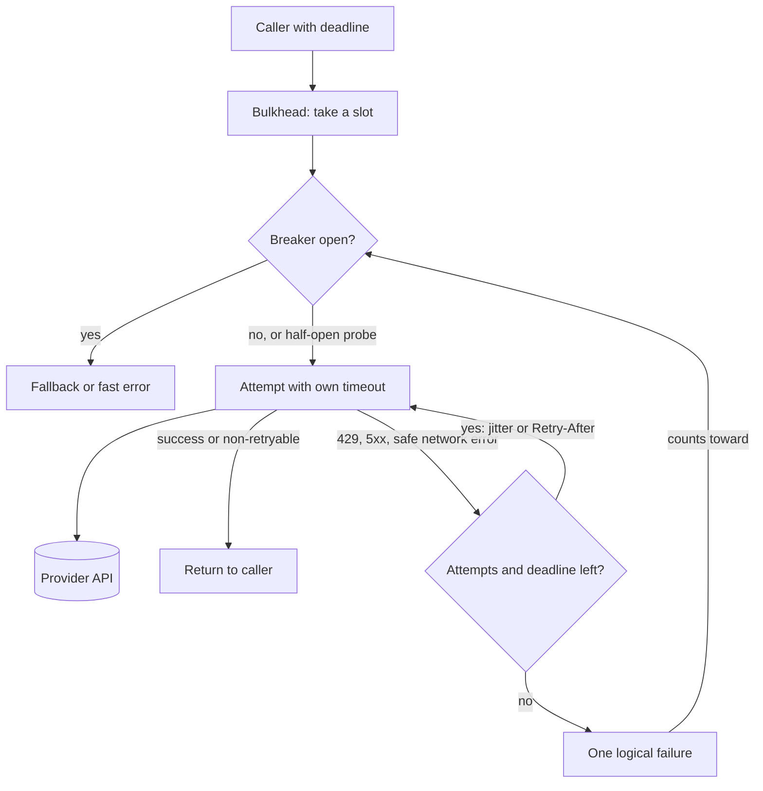

## TL;DR
LLM and tool APIs fail transiently (429, 5xx, resets), so every call needs a per-attempt timeout,
classified retries with jittered backoff, and a total deadline. A circuit breaker above that fails fast
while a provider is down. SDKs already retry; you add the rest.

## Why it exists
- **Unbounded latency.** A naive client does `await fetch(url)`. A provider that accepts the TCP
  connection and then stalls leaves the handler waiting until the socket gives up; for Node's built-in
  `fetch` (undici, with 300-second header and body timeouts) that is minutes by default. A few hundred of
  those hold every worker slot, pooled DB connection and queue lock.
- **Transient errors become user-facing failures.** A 429 from a shared quota or a 529
  `overloaded_error` from Anthropic often clears within seconds, so not retrying throws away a request
  that would have succeeded.
- **"Retry everything, immediately, five times" is worse.** During an incident a thousand clients
  retrying in lockstep multiply load five-fold at the wrong moment, synchronised by the same schedule,
  and non-idempotent calls (a tool that sends an email, a POST that creates a resource) execute more than
  once.
- **Each layer fixes one problem.** Timeouts fix the first; backoff with jitter fixes the second and
  defuses the third; idempotency keys make retries safe.
- **The breaker handles what backoff cannot.** When the dependency is down for minutes, the right
  behaviour is not "wait 30 s then fail" per request but "fail in a millisecond and try later", which
  protects your latency budget, frees resources and gives the provider room to recover.

## How it works
### Timeouts first
- **Every attempt gets an `AbortSignal`** with a per-attempt timeout (`AbortSignal.timeout(ms)` in
  current Node, or an `AbortController` you cancel), *because* a retry policy without a timeout retries
  nothing while the first attempt hangs.
- **Streaming needs two numbers.** Time-to-first-token differs from total completion time: time out the
  connection and first chunk, then use an idle timeout between chunks, not one giant budget that must
  cover a 90-second answer.
- **Carry a request-level deadline** through the call chain so attempt timeouts plus backoff never
  exceed what the caller can wait for.

### Classify before retrying
| Outcome | Retry? | Because |
|---|---|---|
| 408, 429, 500, 502, 503, 504, Anthropic's 529 | yes | transient: a later attempt can succeed |
| 400, 401, 403, 404, 422 | never | the request is wrong and will be wrong again |
| `ECONNREFUSED`, `UND_ERR_CONNECT_TIMEOUT` | always | the request never reached the server |
| `ECONNRESET`, read timeout, socket closed mid-body | only if idempotent | the server may have processed it and the reply was lost |

- **Ambiguous failures cost money.** The first attempt may have succeeded server-side after you stopped
  listening, and an LLM call that completed is billed whether or not you received it.

### Exponential backoff with full jitter
```
sleep(n) = random(0, min(cap, base × 2^n))      // attempt n
```
- **The exponential term** backs off fast enough to help a recovering provider.
- **The cap** keeps the wait sane.
- **The jitter** spreads clients out, *because* identical schedules re-synchronise the thundering herd on
  every attempt.
- **Honour `Retry-After`** (seconds or an HTTP date; the Anthropic and OpenAI SDKs also read a
  millisecond variant): the server knows its own recovery window better than your formula.
- **Bound both** attempt count and total elapsed time.

### Idempotency
- **A retried POST must be safe** when it creates a run, sends a message or charges a budget.
- **Pass an idempotency key** the server deduplicates on (many APIs accept an `Idempotency-Key` header),
  or make the operation naturally idempotent (PUT by id, upsert).
- **If neither is possible,** do not retry automatically; surface the ambiguity to the caller.

### The vendor SDKs
- **What the Anthropic TypeScript SDK retries:** connection errors, 408, 409, 429 and 5xx, with backoff,
  honouring `Retry-After`. The OpenAI Node SDK follows the same design with the same defaults.
- **Options:** `maxRetries` (default 2) and `timeout` (default 10 minutes, in milliseconds). For a
  non-streaming call whose `max_tokens` implies a longer generation, the SDK refuses and asks you to
  stream unless you set `timeout` explicitly.
- **Deadline arithmetic.** A timed-out attempt is itself retried, so wall-clock time can reach roughly
  `timeout × (maxRetries + 1)` plus backoff.
- **Typed errors.** `Anthropic.RateLimitError` for 429, `Anthropic.InternalServerError` for 5xx
  including 529, `Anthropic.APIConnectionError`, all subclasses of `Anthropic.APIError` with `.status`,
  `.headers`, the parsed body on `.error` and `.type` such as `overloaded_error`. Classification is an
  `instanceof` chain plus a status check, not string matching.
- **Configure, do not wrap.** Set those options rather than adding a second retry loop, *because* nested
  retries multiply: 3 × 3 = 9 attempts against a provider that is already overloaded.

### Circuit breaker
1. **Closed** (normal): calls pass through; failures are counted in a rolling window.
2. **Open**: once failures exceed a threshold (say, over half of at least 20 calls in 10 s), the breaker
   rejects calls immediately for a `resetTimeout` without touching the dependency.
3. **Half-open**: after the timeout, one trial call goes through; success closes the breaker, failure
   re-opens it.

- **Trips on rate over a minimum volume,** not one failure, *because* one bad response is noise.
- **Rejects fast** *because* a queued request that will fail anyway costs latency and a connection slot.
- **Probes instead of flipping back blindly** *because* you want evidence of recovery before releasing
  the full load.
- **Needs a fallback:** a smaller model, a cached answer, a degraded response, or a clear error with a
  `Retry-After` for your own callers.
- **Libraries:** `opossum` is the common Node breaker; `cockatiel` composes retry, timeout, breaker and
  bulkhead policies; `p-retry` covers retry alone.
- **State is per process.** With 20 replicas, each counts its own failures, trips on its own schedule and
  sends its own probe, so the provider sees up to 20 probes per reset period. Usually acceptable; sharing
  state through Redis makes the fleet trip together but puts a network call in front of every request
  to protect against a network failure.

### Bulkheads and retry budgets
- **Bulkhead:** limit concurrent in-flight calls per dependency (`p-limit` or a semaphore) so one slow
  provider cannot consume every worker slot. For LLM providers this also respects concurrency-based
  quotas, and backed by Redis it works across replicas.
- **Why a budget:** per-request limits do not bound fleet-wide amplification; if every request may make
  3 attempts, an outage can triple traffic.
- **Retry budget:** cap retries as a fraction of recent successful or total requests (for example, at most one retry per ten
  requests over the last minute, an illustrative ratio to tune). During a blip almost every failure gets
  its retry; during an outage the budget empties and failures surface immediately.
- **Prior art:** it is the per-client analogue of a breaker; some service meshes and gRPC clients
  implement it as retry throttling.

### Composing the layers
From the outside in:

| Order | Layer | Because |
|---|---|---|
| 1 | request deadline | it is the caller's promise; every inner wait must fit inside it |
| 2 | bulkhead | caps concurrency before any work starts |
| 3 | breaker | one exhausted retry sequence is one logical failure; inside, it would count each attempt and trip three times faster, and an open breaker should stop retries from starting |
| 4 | retry with backoff | acts on classified errors |
| 5 | per-attempt timeout | bounds a single attempt, so a hung attempt becomes a classifiable error |

## Diagram
The composed call path: the breaker sees one logical outcome per call, while the retry loop inside it
handles individual attempts within the deadline.



## Examples
### `fetchWithRetry` and a minimal breaker
A per-attempt timeout (combined with the caller's own signal), classification that retries ambiguous
failures (timeouts, resets) only for idempotent requests, full-jitter backoff and `Retry-After`, plus a
consecutive-failure breaker that lets exactly one probe through when half-open.

Production code uses the SDK's built-in retries and `opossum` or `cockatiel`, but the mechanics are
these. After the last retryable status the response is returned, not thrown, so the breaker's wrapped
function must turn 5xx and 429 into failures itself, as the usage line shows.

```ts
const RETRYABLE = new Set([408, 429, 500, 502, 503, 504, 529]);
const NEVER_SENT = ["ECONNREFUSED", "UND_ERR_CONNECT_TIMEOUT"];           // safe for any method
const MAYBE_SENT = ["ECONNRESET", "ETIMEDOUT", "UND_ERR_SOCKET"];         // idempotent requests only
const sleep = (ms: number) => new Promise((r) => setTimeout(r, ms));
const jitter = (n: number, base: number, cap: number) => Math.random() * Math.min(cap, base * 2 ** n);

export async function fetchWithRetry(url: string, init: RequestInit,
                                     o = { attempts: 4, baseMs: 500, capMs: 8_000, attemptTimeoutMs: 20_000 }) {
  const idempotent = ["GET", "HEAD", "PUT", "DELETE"].includes(init.method ?? "GET")
    || new Headers(init.headers).has("idempotency-key");
  for (let n = 0; ; n++) {
    const timeout = AbortSignal.timeout(o.attemptTimeoutMs);
    try {
      const res = await fetch(url, { ...init, signal: init.signal ? AbortSignal.any([init.signal, timeout]) : timeout });
      if (!RETRYABLE.has(res.status) || n + 1 >= o.attempts) return res;     // success, non-retryable, or out of attempts
      await res.body?.cancel();                                               // free the socket before retrying
      const retryAfter = Number(res.headers.get("retry-after"));             // seconds form; an HTTP date falls back to jitter
      await sleep(retryAfter > 0 ? retryAfter * 1000 : jitter(n, o.baseMs, o.capMs));
    } catch (err: any) {
      const code = err?.cause?.code;                                          // undici wraps socket errors in err.cause
      const transient = NEVER_SENT.includes(code) ||
        (idempotent && (err?.name === "TimeoutError" || MAYBE_SENT.includes(code)));
      if (!transient || n + 1 >= o.attempts) throw err;                       // caller aborts (AbortError) are never retried
      await sleep(jitter(n, o.baseMs, o.capMs));
    }
  }
}

export class CircuitBreaker {
  private failures = 0; private openedAt = 0; private state: "closed" | "open" | "half" = "closed";
  constructor(private threshold = 5, private resetMs = 30_000) {}
  async call<T>(fn: () => Promise<T>, fallback: () => T): Promise<T> {
    if (this.state !== "closed") {
      if (this.state === "half" || Date.now() - this.openedAt < this.resetMs) return fallback();  // fail fast; one probe at a time
      this.state = "half";                                                      // this caller is the probe
    }
    try {
      const out = await fn();
      this.failures = 0; this.state = "closed"; return out;
    } catch (e) {
      if (++this.failures >= this.threshold || this.state === "half") { this.state = "open"; this.openedAt = Date.now(); }
      throw e;
    }
  }
}
// await breaker.call(async () => { const r = await fetchWithRetry(url, init);
//   if (r.status >= 500 || r.status === 429) throw new Error(`upstream ${r.status}`); return r; }, () => degraded());
```

### Production snippet: SDK as the single retry owner, `opossum` above it
The SDK owns retries and per-attempt timeouts; the breaker counts one outcome per logical call and
ignores 400s, which reflect our bug rather than provider health.

```ts
import Anthropic from "@anthropic-ai/sdk";
import CircuitBreaker from "opossum";

const anthropic = new Anthropic({ maxRetries: 2, timeout: 20_000 });   // worst case ~60 s plus backoff

async function complete(prompt: string) {
  const msg = await anthropic.messages.create({
    model: process.env.MODEL!, max_tokens: 512,
    messages: [{ role: "user", content: prompt }],
  });
  return msg.content.flatMap((b) => (b.type === "text" ? [b.text] : [])).join("");
}

const breaker = new CircuitBreaker(complete, {
  timeout: false,                     // the SDK already bounds each attempt
  errorThresholdPercentage: 50,       // open when over half of calls fail...
  volumeThreshold: 20,                // ...once at least 20 calls were seen...
  rollingCountTimeout: 10_000,        // ...in a 10 s rolling window
  resetTimeout: 30_000,               // then allow a probe after 30 s
  errorFilter: (e: unknown) => e instanceof Anthropic.BadRequestError,   // 400s do not count
});
breaker.fallback(() => "The assistant is busy right now. Please try again in a minute.");
breaker.on("open", () => console.warn("breaker open: anthropic"));

export const answer = (prompt: string) => breaker.fire(prompt);
```

### Worked scenario: how nested retries amplify an outage
One user action during a provider incident, where every attempt fails slowly.

| Retry layout | Attempts per user action | Worst-case wait with 20 s attempt timeouts |
|---|---|---|
| SDK `maxRetries: 2` only | 3 | ~60 s plus backoff |
| SDK 3 attempts × handler loop of 4 | 12 | ~240 s plus backoff |
| Same, plus a queue that re-runs the job 3 times | 36 | ~12 minutes, much of it billed if attempts completed server-side |
| SDK only, under an open breaker | 0 after the trip | about a millisecond, served by the fallback |

Full-jitter sleeps for `fetchWithRetry` defaults (`baseMs: 500`, `capMs: 8_000`, 4 attempts) are drawn
from 0-500 ms, 0-1,000 ms and 0-2,000 ms before attempts 2, 3 and 4.

## Production patterns
- **One retry owner per call path.** Decide whether the SDK, the handler or the queue retries, and set
  the others to fail fast (for example SDK `maxRetries: 2` and a queue job with `attempts: 1` for that
  step). Monitor attempts per logical request and provider calls per user action during incidents.
- **Propagate the deadline.** Compute the remaining budget at each hop and pass it down as an
  `AbortSignal.timeout(remaining)` or a per-request `timeout` option, so inner retries never outlive the
  caller. Monitor deadline-exceeded counts per dependency.
- **Rate-based breaker with a fallback per provider.** Configure `opossum` with
  `errorThresholdPercentage`, `volumeThreshold` and `resetTimeout`, and route the fallback to a smaller
  model or cached answer. Alert on `open` events and track time spent open.
- **Bulkhead per dependency.** Wrap each provider in its own `p-limit(n)` sized to the quota; export
  `limit.activeCount` and `limit.pendingCount` as gauges. A growing pending count means the dependency,
  not your service, is the bottleneck.
- **Fault-injection tests.** Point the client at a stub server, or undici's `MockAgent`, that returns 429
  with `Retry-After`, 529, connection resets and stalls, and assert attempt counts, waits and fallbacks
  in CI. Monitor that the suite runs on every change to client code.

## Trade-offs
- **Success rate vs outage load.** Retries raise success during blips but multiply load during outages;
  with jitter and a total-time cap the amplification is bounded, without them a fleet-wide retry storm
  can keep a provider down.
- **Predictable latency vs long completions.** Aggressive per-attempt timeouts cut off slow-yet-successful
  long completions; for large outputs use a time-to-first-token timeout plus an idle timeout rather than
  one short total budget.
- **Protection vs false trips.** A breaker protects your latency and the provider, but a mis-tuned
  threshold trips on normal error noise and takes a healthy dependency offline; thresholds should be
  rate-based over a minimum call volume.
- **Availability vs quality.** Falling back to a cheaper model or cached answer keeps the product up at a
  quality cost users may notice; a chat assistant can degrade, a compliance extraction probably cannot.
- **Retry budget vs individual requests.** A budget bounds fleet-wide amplification, but denies retries
  to some requests during a genuine blip that a per-request policy would have saved; it becomes overhead
  when traffic is too low for amplification to hurt the provider.
- **SDK retry vs your policy.** The built-in retry is simpler and correct for its own error classes, but
  knows nothing about your deadline or breaker; integrate through `maxRetries` and `timeout`, not a
  wrapper loop.

## Pitfalls
- **Nested retry loops** (SDK retries inside your retries inside the queue's retries). Symptom: a single
  user action producing dozens of provider calls during an incident, visible as a cost spike in the same
  hour as the outage.
- **Retrying non-idempotent POSTs on timeout or `ECONNRESET`.** Symptom: duplicate runs, messages or
  charges that each carry a different request id but trace back to one user click.
- **No jitter.** Symptom: provider error rates oscillating in neat waves at your backoff intervals, as
  every client retries at the same instant.
- **Breaker without a minimum volume.** Symptom: the breaker opening at 03:00 because two of the night's
  three requests failed.
- **Ignoring `Retry-After`.** Symptom: 429s keep coming despite backoff, because the server told you its
  window and you retried earlier.
- **Replaying a stream that failed after the first tokens into the same response.** Symptom: clients
  receive an answer that restarts in the middle.

## When to use
- **Baseline, always:** every outbound call to an LLM, embedding, vector, search or SaaS API gets a
  timeout and a classified retry policy; this is not an optimisation.
- **Add a breaker** per dependency when the service has a meaningful fallback or when the dependency's
  failure would otherwise exhaust worker capacity.
- **Add a bulkhead** when one slow dependency can starve the others.
- **Avoid** retrying inside a request path when a queue above it already retries; pick the layer that
  owns retries and make the others fail fast.
- **Measure:** attempts per request, retry success rate, breaker state transitions, p99 latency with and
  without retries, and duplicate side effects.
- **Interviews:** derive the full-jitter formula, explain why breakers trip on rate, and say which layer
  should own retries.

## Role lens
- **Engineer:** Configures SDK `maxRetries` and `timeout`, wraps tool calls with `cockatiel` or `opossum`, passes `AbortSignal`s and idempotency keys, and writes tests that simulate 429s, 529s and timeouts.
- **Architect:** Assigns retry ownership per layer (client, service, queue), defines breaker thresholds and fallbacks per provider, and sets the latency budget each dependency is allowed to consume.
- **FDE:** Tunes timeouts and limits to a customer's negotiated quotas and their egress proxy's behaviour, and explains why their incident dashboard shows retry waves.

## Check yourself
**Q:** During a provider incident your service's p99 latency went from 3 s to 90 s and your bill
tripled for the hour, even though the provider was mostly returning errors. Explain the mechanics and
the fix.
**A:** Each attempt hung for tens of seconds on a provider that accepted connections but failed slowly
(the SDK's 10-minute default timeout never fired, so nothing cut the wait short), then the SDK retried
twice, then the handler's own loop retried three times, and the queue above re-enqueued failures: a
single user action became a dozen or more slow attempts (3 SDK attempts × 4 handler attempts before the
queue even acts), which explains the latency. The cost comes from the attempts that did complete
server-side, and are billed, after your client had already timed out or given up, plus work the queue
re-ran after it had in fact succeeded. The fix is layered: a
per-attempt timeout sized for the call, a single owner of retries (the SDK with `maxRetries` set and
nothing above it), full-jitter backoff honouring `Retry-After`, a total deadline per request, and a
circuit breaker per provider that opens on a high failure rate and fails fast with a fallback or a clear
error. Idempotency keys make any remaining retries safe to repeat.

## Interview questions
### Which errors should an LLM client retry, and which should it never retry?
- **Retry** 408, 429, 500, 502, 503, 504, Anthropic's 529, and connection errors where the request
  never left (`ECONNREFUSED`, connect timeouts).
- **Never retry** 400, 401, 403, 404 or 422, because the same request fails the same way.
- **Retry only if idempotent:** resets and read timeouts after sending, because the server may have
  completed and billed the call.

### Why put the circuit breaker outside the retry loop rather than inside it?
- **Outside,** one exhausted retry sequence counts as one logical failure, and an open breaker stops
  retries from starting at all.
- **Inside,** the breaker counts every attempt and trips about three times faster than its threshold
  implies, while the retry loop keeps hitting a breaker that is already open.
- **The deadline still wraps both,** so total time stays inside the caller's budget.

### A breaker keeps opening at night when traffic is low. What is wrong and how do you fix it?
- **It trips on counts without a minimum volume:** two failures out of three requests looks like a 67%
  error rate.
- **Fix:** trip on rate over a minimum call volume, for example `volumeThreshold` in `opossum`, and
  exclude caller bugs such as 400s from the failure count.
- **Then verify** with the history of breaker `open` events against request volume.

### When would you not add a circuit breaker to an outbound dependency?
- **No meaningful fallback and low traffic:** failing fast and failing slowly give the user the same
  error, and the breaker adds tuning burden.
- **A queue already owns failure handling:** background jobs can back off at the queue level instead.
- **Very low call volume,** where a rate threshold cannot gather enough signal to trip correctly.

### Your SDK has `maxRetries: 2` and `timeout: 20_000`. What is the worst-case wall-clock time, and how do you budget it?
- **Each timed-out attempt is retried,** so the worst case is about 20 s × 3 = 60 s plus backoff sleeps.
- **Budget from the caller's deadline:** if the endpoint promises 30 s, lower `timeout`, lower
  `maxRetries`, or pass a per-request signal derived from the remaining deadline.
- **For streaming,** use a first-token timeout plus an idle timeout instead of one total budget.

## Quiz
### Q: Why add random jitter to exponential backoff rather than retrying at fixed exponential intervals?
- [ ] Jitter makes individual retries succeed more often
- [x] Without jitter, clients that failed together retry together, so each wave of retries hits the provider at the same instant
- [ ] Jitter is required by the HTTP specification for 429 responses
- [ ] It reduces the total number of attempts per request
> Backoff alone keeps the schedule synchronised across clients; randomising each sleep spreads the retries over the window so the provider sees a smooth load instead of spikes that re-trigger the overload.

### Q: A circuit breaker is in the open state. What happens to a new call?
- [ ] It is queued until the dependency recovers
- [ ] It is retried with backoff until the reset timeout elapses
- [x] It is rejected immediately (or served a fallback) without contacting the dependency
- [ ] It is sent, and the breaker closes if it succeeds
> Open means "known bad": the breaker fails fast to protect latency and the dependency, and only after the reset timeout does it move to half-open and allow a single probe call.

### Q: Which response should a well-behaved client NOT retry automatically?
- [ ] 503 Service Unavailable with a `Retry-After` header
- [ ] A connection reset before any response bytes arrived
- [x] 400 Bad Request caused by an over-long prompt
- [ ] 429 Too Many Requests from a shared rate limit
> A 400 means the request itself is invalid and will fail identically on every attempt; retrying only adds load and latency, whereas 503, 429 and a reset before any response bytes are transient signals that a later attempt can succeed.
