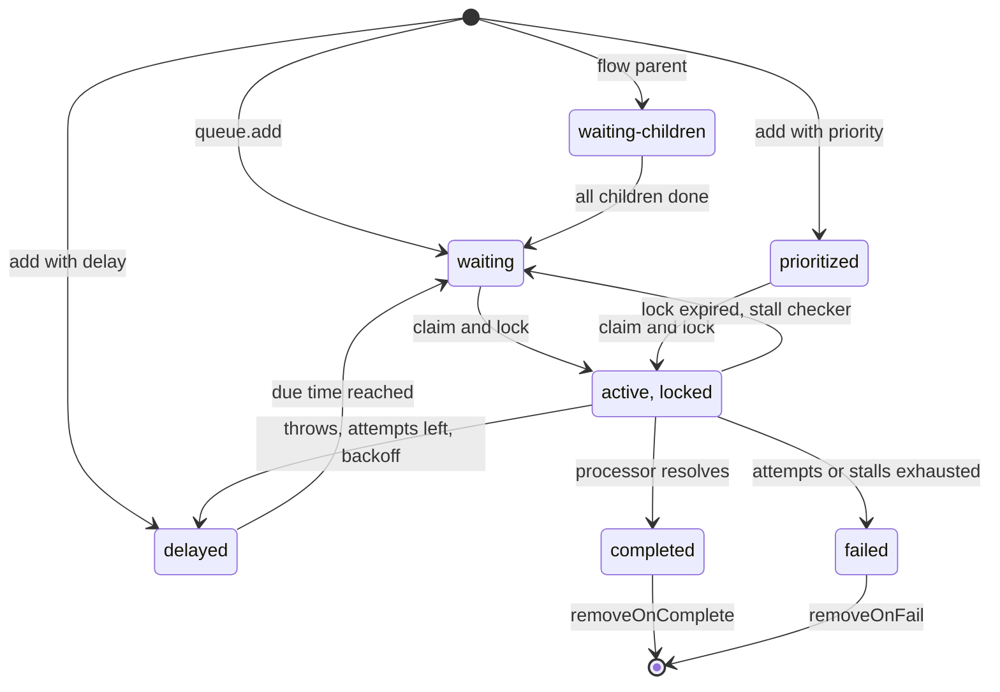

## TL;DR
BullMQ is the Redis-backed Node queue that runs agent work off the request path, with concurrency,
retries, backoff, provider rate limits, delays and flows. Delivery is at-least-once, so agent steps must
be idempotent, and durability equals Redis's.

## For agent builders
- **Why it matters for agents.** Agent runs last minutes, call the model many times and must survive
  deploys and provider 429s. A queue turns "run this agent" into a durable job with retries, a fleet-wide
  rate limit and visible state, instead of a fragile two-minute HTTP request.
- **Where it shows up in your stack.** The API enqueues a run and returns a run id; workers process one
  job per agent step; `QueueEvents` streams progress to the UI; flows fan out sub-agents or chunk
  embeddings; job schedulers run nightly evals.
- **What you control.** Job granularity (one per run vs one per step), deterministic job ids, `attempts`
  and backoff, `concurrency` and `limiter`, retention, and graceful `worker.close()` on deploy.
- **What you can skip.** The Lua scripts behind each state transition and BullMQ Pro features. Know the
  lifecycle, the stall mechanism and at-least-once delivery; that is what breaks agent runs.

## Why it exists
- **A request is the wrong unit for long work.** An agent run takes two minutes, calls the model eight
  times and calls three tools. Inside an HTTP handler, the client holds a connection for two minutes and
  a load balancer idle timeout (60 s is a common default) can kill it first.
- **Restarts and bursts hurt.** A deploy that restarts the process loses the run with no record, and a
  burst of 200 runs starts 200 concurrent model calls that hit the provider's rate limit together. The
  same shape appears for a 10,000-document embedding batch, nightly evals, document ingestion, webhook
  fan-out and scheduled re-indexing.
- **In-process queues fail on every axis.** `setImmediate(() => runAgent(...))` with a `Map` of
  in-flight runs dies with the process, cannot be shared across replicas, and has no retry policy and no
  visibility.
- **Postgres-as-queue is legitimate but DIY.** `SELECT ... FOR UPDATE SKIP LOCKED` keeps everything in
  one transactional store, but you write the polling, locking, retry, backoff, delay and dead-letter
  machinery yourself.
- **BullMQ packages that machinery on Redis.** Redis fits *because* the hot path (claim a job, renew its
  lock, move it between states) is a handful of atomic operations on lists, sorted sets and hashes,
  done in microseconds as Lua scripts so a claim is never half-done. The trade: snapshot-only
  persistence or an LRU eviction policy means lost jobs.

## How it works
### Objects
| Object | Role | Key detail |
|---|---|---|
| Queue | producer handle | `queue.add(name, data, opts)` writes a job hash and pushes its id onto the waiting list (or a delayed or prioritised sorted set) |
| Worker | consumer | takes a processor `(job) => Promise<result>` and a `concurrency`; each slot atomically moves a job from waiting to active. Many Workers on many replicas share one queue, which is how you scale |
| Job | the unit | `id`, `name`, `data` (JSON), `opts`, `attemptsMade`, `progress`, `returnvalue`, timestamps |
| QueueEvents | listener | Redis-streams based `completed`, `failed`, `progress`, so an API replica can stream progress without being the worker |
| FlowProducer | parent and children | the parent runs only after all children complete: "embed 500 chunks, then write the document summary" |

### Custom job ids and dedup
- **A custom `jobId` deduplicates.** Adding a job whose id already exists is a no-op while the earlier
  job is still stored: the simplest exactly-once-enqueue tool you have.
- **Format rules.** Custom ids must not be plain integers or contain `:` (BullMQ uses it as its key
  separator and throws on `add`), so use `embed-<docId>`, not `embed:<docId>`.
- **The dedup window is the job's lifetime in Redis.** Once `removeOnComplete` deletes the job, the same
  id can be added again; while a completed job is retained, a deliberate re-run with that id is silently
  ignored.
- **Explicit windows.** BullMQ 5 also offers a `deduplication` option with its own id and TTL.

### Job lifecycle
Each state is a Redis structure, and a job is in exactly one:

| State | Structure | Meaning when it grows |
|---|---|---|
| `waiting` | list | too few workers or a limiter that is too tight |
| `prioritized`, `delayed` | sorted sets by priority or due time | scheduled work piling up |
| `active` | list plus a per-job lock key | non-empty with nobody working means stalls |
| `waiting-children` | parent blocked on its flow | children are slow or failing |
| `completed`, `failed` | terminal sets | a growing `failed` means a bug or a dependency that is down |

- **Every transition is one Lua script** (claim, complete, fail and reschedule, promote a delayed job)
  *because* it touches several keys, and a crash between "remove from waiting" and "add to active"
  would otherwise lose or duplicate the job.

### Retries, backoff, delays
- **Exponential backoff.** `opts.attempts` with `opts.backoff: { type: 'exponential', delay: 1000 }`
  re-schedules a failed job after 1 s, 2 s, 4 s and so on until `attempts` is exhausted, then leaves it
  in the failed set for inspection or manual retry.
- **Delayed jobs** sit in a sorted set keyed by timestamp and are promoted when due, *because* polling a
  list for "is it time yet" would waste Redis round trips.
- **`priority`** orders waiting jobs.
- **Retention.** `removeOnComplete` and `removeOnFail` with a count or an age keep Redis from filling
  with history.
- **Recurring work** (nightly evals, hourly re-index) uses a job scheduler:
  `queue.upsertJobScheduler(id, { pattern: cron } or { every: ms }, template)` in recent BullMQ 5
  releases, which supersedes the older repeatable-job API. It keeps one upcoming delayed job per
  schedule, so several producer replicas do not multiply the runs.

### Locks and stalled jobs
1. **Claim:** the worker sets a lock with `lockDuration` and renews it on an interval while the processor
   runs.
2. **Failure:** the process dies, or the event loop is blocked long enough that renewal stops; the lock
   expires.
3. **Recovery:** a stall checker sees an active job with no lock and moves it back to waiting, up to
   `maxStalledCount` times before marking it failed.

- **This is the durability mechanism,** and also why a CPU-bound processor that blocks the event loop can
  get a job processed twice: the renewal timer never fires.
- **Sandboxed processors exist for that failure mode.** Pass a file path instead of a function; the job
  runs in a child process or a worker thread.

### Rate limiting for LLM providers
- **Fleet-wide cap.** `Worker` takes `limiter: { max, duration }` to cap jobs started per window across
  all workers of a queue.
- **Reacting to 429s.** A processor calls `await queue.rateLimit(ms)` (in BullMQ 5 this replaces the
  deprecated `worker.rateLimit`) and throws `Worker.RateLimitError()`; the job returns to the queue
  without consuming an attempt while the queue pauses for that window.
- **Per-tenant limits.** Per-group limits are a BullMQ Pro feature; the open-source approach is a queue
  per tenant tier, or a Redis token bucket checked inside the processor.

### Delivery semantics, and what BullMQ is not
- **At-least-once everywhere.** A job can run twice after a stall, after a crash between finishing the
  work and moving the job to completed, or after a manual retry.
- **So processors must be idempotent,** usually by keying side effects on `job.id` (a Postgres unique
  constraint, an idempotency key on a downstream API).
- **Not a workflow engine.** It does not checkpoint the middle of a processor. Split a ten-step agent run
  into one job per step with state in Postgres, or use a durable-execution engine (Temporal, Inngest,
  Restate and similar) for replayable history, long timers and human-in-the-loop waits.

## Diagram
The job lifecycle: every arrow is one atomic Lua script, and the stall arrow from active back to
waiting is what makes a crashed worker's job run again.



## Examples
### Embedding pipeline with dedup, limiter and checkpoints
The API enqueues one job per document with a deterministic id (a double-submit is harmless), a worker
with bounded concurrency and a provider rate limit processes it, and the processor is idempotent
because the vector write keys on document id and chunk index.

Each BullMQ object gets its own ioredis connection from a factory here; BullMQ also duplicates a
Worker's connection internally for its blocking commands, and refuses a Worker connection whose
`maxRetriesPerRequest` is not `null`.

```ts
import IORedis from "ioredis";
import { Queue, Worker, QueueEvents } from "bullmq";
const conn = () => new IORedis(process.env.REDIS_URL!, { maxRetriesPerRequest: null });  // required for Workers

export const embedQueue = new Queue("embed", { connection: conn(),
  defaultJobOptions: { attempts: 5, backoff: { type: "exponential", delay: 2_000 },
                       removeOnComplete: { count: 1_000 }, removeOnFail: { age: 7 * 24 * 3600 } } });

export async function enqueueEmbedding(docId: string, tenant: string) {
  await embedQueue.add("embed-doc", { docId, tenant }, { jobId: `embed-${docId}` });   // dedup by id (no ':' allowed)
}

// worker.ts — its own process; several replicas share the queue
const worker = new Worker("embed", async (job) => {
  const { docId } = job.data as { docId: string; tenant: string };
  const chunks = await loadChunks(docId);
  for (let i = 0; i < chunks.length; i++) {
    if (await embeddingExists(docId, i)) continue;                   // resume, do not redo, after a retry
    try {
      const vec = await embed(chunks[i].text);                       // provider call
      await upsertEmbedding(docId, i, vec);                           // idempotent: (docId, i) is unique
    } catch (e: any) {
      if (e.status === 429) { await embedQueue.rateLimit(30_000); throw Worker.RateLimitError(); }
      throw e;                                                       // anything else: retry with backoff
    }
    await job.updateProgress(Math.round(((i + 1) / chunks.length) * 100));
  }
  return { chunks: chunks.length };
}, { connection: conn(), concurrency: 4, limiter: { max: 50, duration: 60_000 } });

worker.on("failed", (job, err) => console.error("embed failed", job?.id, job?.attemptsMade, err.message));

// api.ts — stream progress to a client without being the worker
const events = new QueueEvents("embed", { connection: conn() });
events.on("progress", ({ jobId, data }) => notifyClient(jobId, data));
```

### Agent scenario: one job per agent step
Each job runs exactly one model turn plus its tool calls, checkpoints the step in Postgres, and enqueues
the next step with a deterministic id. A crash or retry repeats one step, never the whole run.

```ts
import { Queue, Worker } from "bullmq";
// conn() is the ioredis factory from the previous example; loadRun, saveStep, callModel, runTools are app code

const steps = new Queue("agent-steps", { connection: conn(),
  defaultJobOptions: { attempts: 4, backoff: { type: "exponential", delay: 2_000 }, removeOnComplete: { count: 5_000 } } });

export const startRun = (runId: string) =>
  steps.add("step", { runId, step: 0 }, { jobId: `run-${runId}-step-0` });

new Worker("agent-steps", async (job) => {
  const { runId, step } = job.data as { runId: string; step: number };
  const run = await loadRun(runId);                          // transcript and status from Postgres
  if (run.lastStep >= step) {                                // already committed: a redelivery
    if (run.lastStep === step && !run.done)                  // crashed before enqueuing the next step?
      await steps.add("step", { runId, step: step + 1 }, { jobId: `run-${runId}-step-${step + 1}` });  // no-op if it exists
    return { skipped: true };
  }
  if (step >= 20) { await saveStep(runId, step, { status: "budget-exhausted" }); return { done: true }; }
  const turn = await callModel(run.messages);                // model call outside any transaction
  const results = turn.toolCalls.length ? await runTools(turn.toolCalls, `run-${runId}-step-${step}`) : [];
  await saveStep(runId, step, { turn, results });            // one transaction, unique (runId, step)
  if (turn.toolCalls.length === 0) return { done: true };    // final answer
  await steps.add("step", { runId, step: step + 1 }, { jobId: `run-${runId}-step-${step + 1}` });
  return { next: step + 1 };
}, { connection: conn(), concurrency: 8, limiter: { max: 50, duration: 60_000 } });
```

- **Tool idempotency keys.** The job id string passed to `runTools` lets side-effecting tools dedupe a
  repeated step on their side.
- **Crash between `saveStep` and the next `add`.** The redelivered job finds its step committed and
  re-adds the next step under the same deterministic id, a no-op if it already exists. If the job is
  never redelivered (it exhausted `maxStalledCount` and failed), the run still stalls; the outbox pattern
  (write the next-step request in the same transaction as the step) closes that gap.

### Worked scenario: what the settings above mean in time
Using the queue defaults above (`attempts: 5`, exponential backoff with a 2-second base delay) and the
worker limiter of 50 jobs per 60 seconds.

| Question | Arithmetic | Result |
|---|---|---|
| Waits between the 5 attempts | 2 s, 4 s, 8 s, 16 s | 4 retries, ~30 s of backoff before the job lands in `failed` |
| Time to start 10,000 document jobs | 10,000 ÷ 50 per minute | ~200 minutes, however many workers you add |
| Jobs in flight per replica | `concurrency: 4` | 4 documents at once; 3 replicas give 12 |
| A 429 at chunk 300 of a 500-chunk document | `rateLimit(30_000)` then retry | queue pauses 30 s, job resumes at chunk 300 thanks to `embeddingExists` |

### Production snippet: nightly evals and clean shutdown
A scheduler registered by every producer replica still yields one run per night, and the worker drains
in-flight jobs on `SIGTERM` instead of leaving them to the stall checker.

```ts
import { Queue, Worker } from "bullmq";
// conn() is the ioredis factory from the previous example

const evalQueue = new Queue("evals", { connection: conn() });
await evalQueue.upsertJobScheduler("nightly-regression",
  { pattern: "0 2 * * *", tz: "UTC" },                               // 02:00 every day; set tz explicitly
  { name: "run-suite", data: { suite: "regression" }, opts: { attempts: 2 } });

const evalWorker = new Worker("evals", runSuite, { connection: conn(), concurrency: 1 });

process.on("SIGTERM", async () => {
  await evalWorker.close();                                         // stop claiming, wait for active jobs
  process.exit(0);
});
```

## Production patterns
- **One job per agent step, state in Postgres.** When agent runs take many steps, make each step a job
  with id `run-<runId>-step-<n>` and checkpoint the transcript after it, so retries and stalls repeat one
  step. Monitor steps per run, runs with no new step for several minutes, and duplicate-step skips.
- **Separate queues by agent workload.** Interactive chat agents, batch research agents and nightly evals
  get their own queues and limiters, so a 5,000-case eval cannot starve user-facing runs. Monitor start
  delay per queue.
- **Drain workers on deploy.** Handle `SIGTERM` with `await worker.close()` and set the orchestrator's
  grace period above your typical job duration, or make jobs resumable so a cut-off job restarts
  cheaply. Monitor `stalled` events and duplicate side effects right after deploys.
- **Alert on depth and age, not just failures.** Poll `queue.getJobCounts('waiting', 'active', 'delayed', 'failed')`
  into metrics, and record start delay as `job.processedOn - job.timestamp`. A rising start delay with
  idle workers points at the limiter; with busy workers, at capacity.
- **Enqueue through an outbox.** Write the job request into a Postgres outbox row in the business
  transaction; a relay calls `queue.add` with the outbox row id as `jobId`, so relay retries dedupe.
  Monitor the age of the oldest unrelayed outbox row.
- **Sandbox CPU-heavy processors.** Pass a processor file path to `Worker`, optionally with
  `useWorkerThreads: true`, for parsing, chunking or vector math, so the main event loop keeps renewing
  locks. Monitor event-loop lag and stalled counts per queue.
- **Run a dead-letter review loop.** Keep failures with `removeOnFail: { age: ... }`, inspect them in a
  dashboard such as Bull Board, and re-run fixed ones with `job.retry()`. Monitor failed counts grouped
  by error message and attempt.

## Trade-offs
- **Speed and sharing vs durability.** Redis makes claim, renew and move microsecond-fast and lets any
  number of replicas share a queue, but durability equals Redis's: AOF and `noeviction` are mandatory
  for work you cannot re-enqueue; a cache-style instance is fine for best-effort jobs.
- **Free retries vs repeated work.** Exponential backoff absorbs transient provider failures without
  code, but each retry re-runs the whole processor; a 500-chunk job failing at chunk 499 restarts at
  chunk 0 unless the processor checkpoints per chunk.
- **One limiter vs fairness.** A worker-level `limiter` keeps a fleet under a provider's quota with one
  setting, but it is per queue, not per tenant or model; fairness needs separate queues, BullMQ Pro
  groups, or an in-processor token bucket.
- **At-least-once vs exactly-once.** At-least-once is simple and robust and forces idempotent
  processors; the queue does not offer exactly-once, and chasing it with locks inside the processor
  usually costs more than a unique constraint.
- **Lightweight vs workflow engine.** BullMQ needs only Redis, but has no durable mid-job state; once runs
  need long waits, signals or replay, Temporal-style engines earn their operational cost.

## Pitfalls
- **A processor that blocks the event loop** (large synchronous JSON parse, vector math). Symptom:
  `stalled` events and jobs processed twice because the lock renewal timer could not fire. Fix: a
  sandboxed processor or a worker thread.
- **Non-idempotent side effects keyed on nothing** (send email, charge budget, append message). Symptom:
  duplicates after a deploy or a stall, with every attempt logging success.
- **An ioredis connection with `maxRetriesPerRequest` at its default (20).** Symptom: a Worker throwing at
  construction when handed that instance (BullMQ only warns and overrides it when given plain options),
  or blocking waits erroring out during a Redis reconnect.
- **Relying on `jobId` for dedup while also using `removeOnComplete`.** Symptom: the "duplicate" document
  is embedded again a few minutes after the first job finished, because the completed job (and its id)
  was already deleted.
- **`removeOnComplete` left off in a high-volume queue.** Symptom: Redis memory grows until eviction or
  out-of-memory, weeks after launch.
- **Treating `queue.add` as part of a database transaction.** Symptom: jobs for rows that rolled back, or
  committed rows with no job. Fix: an outbox table and a relay worker.
- **Exiting with `process.exit()` instead of `await worker.close()`.** Symptom: active jobs re-run after
  every deploy once the stall checker catches them.

## When to use
- **Use when:** work outlives a request, must survive restarts, needs retries with backoff, or must be
  throttled against an external quota: agent runs, ingestion, embedding, evaluation batches, webhook
  delivery, scheduled refreshes.
- **Avoid when:** work is synchronous and sub-second; keep it in the request.
- **Alternatives:** with Postgres already there and low volume, `SKIP LOCKED` polling can be enough; for
  durable multi-step state, timers of hours or days, or human approval steps, use a durable-execution
  engine and keep BullMQ for simple, idempotent units.
- **Measure:** waiting-queue depth, job age at start, failure rate by attempt, stalled count and worker
  concurrency utilisation.
- **Interviews:** expect "what happens when a worker dies mid-job" and "how do you keep the side effect
  from happening twice".

## Role lens
- **Engineer:** Designs job payloads and ids, writes idempotent processors with per-chunk checkpoints, configures attempts, backoff, concurrency and limiter, and closes workers gracefully on SIGTERM.
- **Architect:** Decides queue topology (per workload, per tenant tier), the Redis durability policy behind it, where the outbox sits, and when a workflow engine replaces the queue for long-running agent state.
- **FDE:** Deploys workers inside the customer's environment, checks their Redis eviction and persistence settings, and tunes limiter values to the customer's negotiated provider quotas.

## Check yourself
**Q:** A worker embedding 2,000-chunk documents dies during a deploy. On restart, some documents are
embedded twice and one job is marked failed after being "stalled" repeatedly. Explain what happened and
what you change.
**A:** When the process died, its jobs' locks expired, the stall checker moved them back to waiting and
other workers re-ran them from the first chunk; because the upsert was not keyed on (document, chunk
index), the second pass wrote duplicate vectors. The repeatedly stalled job is a processor that blocks
the event loop, probably synchronous parsing or vector math, so lock renewal stops even though the
process is alive; after `maxStalledCount` stalls BullMQ marks it failed. Changes: make the upsert
idempotent with a unique key, check for existing chunks at the start of each iteration so a retry
resumes instead of restarting, move CPU-heavy work to a sandboxed processor, and close workers with
`await worker.close()` on SIGTERM so in-flight jobs finish before the pod is killed.

## Interview questions
### Why use a job queue for an agent run instead of doing the work in the HTTP handler?
- **Lifetime:** a two-minute run outlives load-balancer idle timeouts and dies with the process on a
  deploy, leaving no record.
- **Control:** a queue adds retries with backoff, a fleet-wide rate limit against the provider, and
  visibility into waiting, active and failed work.
- **The API then returns a run id** and streams progress via `QueueEvents` or polling.

### Would you model a 15-step agent run as one job or as fifteen?
- **One job per step** when steps are long or side-effecting: a retry or stall repeats one step, progress
  is visible per step, and the limiter counts model turns more closely.
- **One job per run** for short runs of a few cheap steps, where the extra enqueue and checkpoint per step
  costs more than an occasional full rerun.
- **Either way,** the transcript lives in Postgres and tools with side effects take an idempotency key
  derived from run and step.

### Jobs are being processed twice even though no worker crashed. How do you debug it?
- **Suspect stalls:** a processor blocking the event loop stops lock renewal, so the stall checker
  hands the job to another worker while the first is still running.
- **Confirm** with `stalled` events, event-loop lag metrics and overlapping start times for one job id.
- **Fix** by moving CPU work to a sandboxed processor, and make side effects idempotent on `job.id`
  regardless, because at-least-once delivery will duplicate eventually.

### When would you not use BullMQ?
- **Low volume with Postgres already present:** `SKIP LOCKED` polling keeps jobs transactional with your
  data and removes a Redis dependency.
- **Long multi-step workflows:** runs needing durable mid-run state, timers of days or human approval
  belong in a durable-execution engine such as Temporal.
- **Redis you cannot make durable:** if the only instance is `allkeys-lru` with snapshots, important
  jobs will be lost.

### How do you keep a fleet of embedding workers under a provider quota of 50 requests per minute?
- **Use the Worker `limiter`,** `{ max: 50, duration: 60_000 }`, which is shared across all workers of
  the queue; adding replicas then adds no extra load on the provider.
- **On a 429 anyway,** call `queue.rateLimit(ms)` and throw `Worker.RateLimitError()` so the job waits
  without burning an attempt.
- **Caveat:** the limiter counts jobs, not provider calls; if one job makes many calls, size jobs or add
  a token bucket inside the processor.

### What does a deterministic `jobId` buy you, and where does it stop protecting you?
- **It makes enqueue idempotent:** a double-submit of `embed-<docId>` is a no-op while the first job is
  still stored.
- **It stops at retention:** once `removeOnComplete` deletes the job the id can be reused, so a late
  duplicate runs again; while it is retained, an intended re-run is silently ignored.
- **So** keep processor-side idempotency, or use BullMQ 5's `deduplication` option with an explicit TTL.

## Quiz
### Q: What makes a job survive a worker process crash in BullMQ?
- [ ] The processor's promise is serialised to disk by Node
- [x] Job state lives in Redis and the lock expires, so the stall checker moves the active job back to waiting
- [ ] Workers replicate in-flight jobs to each other over pub/sub
- [ ] BullMQ writes a write-ahead log in the worker's filesystem
> Durability comes from Redis holding the job and from the lock-and-stall mechanism: a dead worker stops renewing its lock, and once it expires the job is returned to the queue for another worker, which is why handlers must be idempotent.

### Q: Why does BullMQ require `maxRetriesPerRequest: null` on a worker's ioredis connection?
- [ ] To disable job retries, which BullMQ manages itself
- [ ] Because Redis Cluster does not support per-request retries
- [x] So that commands, including the worker's long blocking waits, queue until Redis reconnects instead of failing after a fixed number of reconnection attempts
- [ ] To allow the connection to be shared with pub/sub subscribers
> ioredis's `maxRetriesPerRequest` fails pending commands after N reconnection attempts (20 by default); a worker's loop is built around long blocking commands that must survive a reconnect rather than reject, so BullMQ insists on `null` (wait indefinitely) for worker connections.

### Q: Which design keeps a 500-chunk embedding job from restarting at chunk 0 after a transient failure at chunk 499?
- [ ] Increase `attempts` so the job eventually gets through
- [ ] Lower `concurrency` so fewer jobs fail at once
- [x] Make each chunk's write idempotent and check for existing chunks so a retry skips work already stored
- [ ] Use `priority: 1` so the job is retried first
> BullMQ retries re-run the whole processor; only application-level checkpoints (idempotent upserts plus an existence check at the start of each chunk) turn a retry into a resume. More attempts just repeat the same 499 calls.

## Use cases & projects
### Use cases
- **Background agent runs.** The API returns a run id at once, workers drive the agent, and the UI
  follows progress through `QueueEvents`.
- **Staying under provider quotas.** A Worker `limiter` caps model calls across every agent worker, and
  `queue.rateLimit` pauses the queue on a 429 without burning attempts.
- **Fan-out research or ingestion.** A flow runs sub-agent or embedding children in parallel and a parent
  job summarises once all of them finish.
- **Nightly agent evals.** A job scheduler runs the regression suite once per night however many producer
  replicas register it.

### Mini project
**Durable step-per-job agent (2-3 hours).**
- **Goal:** run a tool-calling agent as one BullMQ job per step that survives worker kills and deploys.
- **Steps:** create the `agent-steps` queue and worker from the example with a fake model that needs 5
  steps; store runs and steps in Postgres with a unique (run id, step); add an HTTP endpoint that starts a
  run and a `QueueEvents` listener that prints progress; kill the worker with `SIGKILL` mid-run and
  restart it; then send `SIGTERM` and confirm `worker.close()` drains.
- **Done when:** every run completes with exactly 5 step rows after random kills, no step's tool side
  effect is applied twice, and the start delay metric stays flat under a burst of 100 runs.
