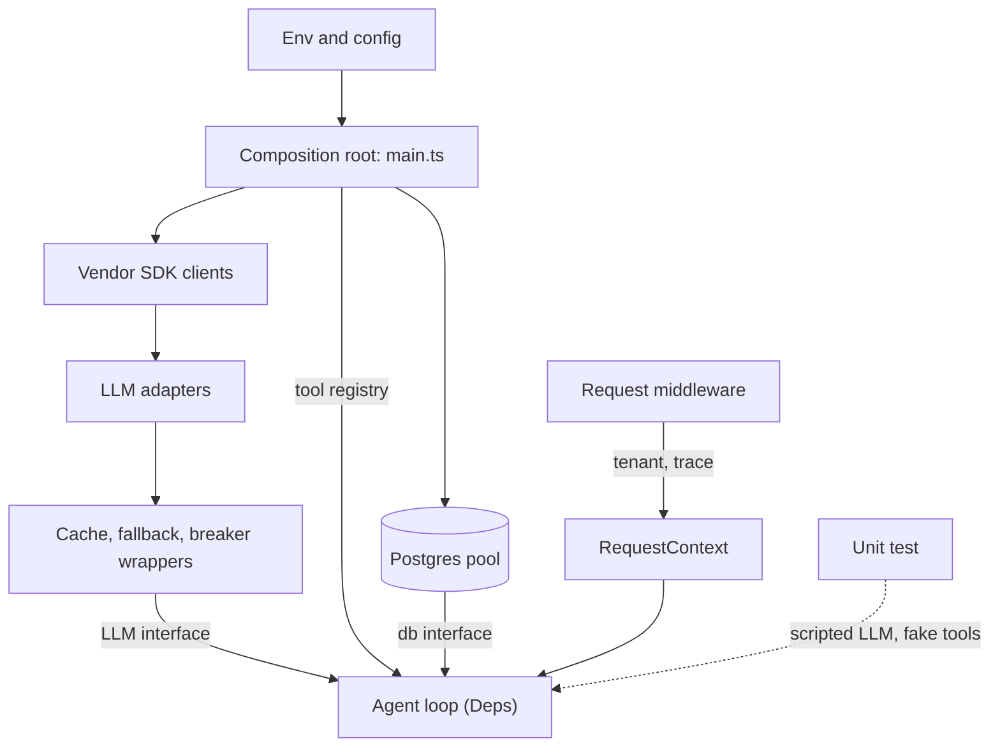

## TL;DR
An agent loop should receive its model client, tools, memory store, clock and config from the caller
instead of constructing them. A typed `Deps` object and one composition root let you test agents offline
with scripted models, swap providers and isolate tenants.

## For agent builders
- **Why it matters for agents.** An agent is a loop of model calls and tool calls, all slow, paid,
  non-deterministic and credentialed. Injecting the model and the tool registry is what lets you replay a
  20-step run deterministically in CI with a scripted fake model instead of paying for real calls.
- **Where it shows up in your stack.** The `LLM` interface your loop calls, the tool registry handed to
  the loop, per-tenant credentials for tools, and the decorators (cache, fallback, breaker) wrapped around
  the model at the root. Frameworks like the Vercel AI SDK take the model as a parameter for the same reason.
- **What you control.** Which capabilities the loop sees (a narrow `LLM` and `Tool` shape, not vendor
  types), where credentials live (only the root), and which objects are request-scoped (tenant, trace,
  remaining token budget).
- **What you can skip.** Deep container theory. A hand-written root plus a `Deps` type covers most agent
  services; learn NestJS or Awilix scopes only if your team already uses them.

## Lab
### Task
A first composition root for a multi-tenant support agent "optimises" by building its deps once, so
tenant `acme` (Azure, read-only tools) gets whatever the first tenant got, including `refund`.

You fix the root so each run gets its own provider, tool set and fallback policy, and you write
the fallback decorator the root wraps around providers.
- **Agent goal:** the loop never changes; every tenant difference lives in the root.
- **Time box:** 45-60 minutes.
- **Prerequisites:** this lesson's "Composing behaviour at the root" and "Scopes" sections, and the
  Vitest lesson if you have not run a TypeScript test before.
- **Needs:** Node 20+ with `npm i -D tsx vitest`; checked with Node 24.21, tsx 4.23 and vitest 5.0.5.
  Save the starter as `di-lab.ts` and the tests next to it as `di-lab.test.ts`.

### Starter code
```ts
// di-lab.ts: wire one agent loop for many tenants through a composition root
export type ToolCall = { name: string; args: Record<string, unknown> };
export type Turn = { text?: string; toolCalls: ToolCall[] };
export type Msg = { role: string; content: string };
export interface AgentLLM { name: string; next(messages: Msg[]): Promise<Turn> }
export interface Tool { name: string; run(args: Record<string, unknown>): Promise<string> }
export interface AgentDeps { llm: AgentLLM; tools: Map<string, Tool>; now: () => Date; maxSteps: number }
export type TenantConfig = { provider: "openai" | "azure"; tools: string[]; fallback: boolean };

export const TENANTS: Record<string, TenantConfig> = {
  acme: { provider: "azure", tools: ["lookup_order"], fallback: false },
  globex: { provider: "openai", tools: ["lookup_order", "refund"], fallback: true },
};

// The loop is finished: it sees only interfaces. Do not change it.
export async function runAgent({ llm, tools, now, maxSteps }: AgentDeps, task: string) {
  const messages: Msg[] = [{ role: "system", content: `Today is ${now().toISOString().slice(0, 10)}` },
                           { role: "user", content: task }];
  for (let step = 0; step < maxSteps; step++) {
    const turn = await llm.next(messages);
    if (turn.toolCalls.length === 0) return { answer: turn.text ?? "", steps: step + 1 };
    for (const c of turn.toolCalls) {
      const tool = tools.get(c.name);
      messages.push({ role: "tool", content: tool ? await tool.run(c.args) : `unknown tool ${c.name}` });
    }
  }
  throw new Error("step budget exhausted");
}

// Offline stand-ins for vendor adapters: call `wants` first, then answer with the last tool result.
export function scriptedProvider(name: string, wants = "lookup_order", failStatus?: number): AgentLLM {
  return {
    name,
    async next(messages) {
      if (failStatus) throw Object.assign(new Error(`${name} failed`), { status: failStatus });
      const last = messages[messages.length - 1];
      if (last.role !== "tool") return { toolCalls: [{ name: wants, args: { id: "A1" } }] };
      return { text: `[${name}] ${last.content}`, toolCalls: [] };
    },
  };
}

export const TOOLS: Tool[] = [
  { name: "lookup_order", run: async (a) => `order ${a.id} shipped` },
  { name: "refund", run: async (a) => `order ${a.id} refunded` },
];

// YOUR CODE 1: return an AgentLLM that calls primary and, only on a 429 or a 5xx, calls secondary.
// Anything else (400, 401, an error with no status) must surface unchanged.
export function withFallback(primary: AgentLLM, secondary: AgentLLM): AgentLLM {
  throw new Error("not implemented: withFallback");
}

// YOUR CODE 2: this first draft "optimises" by building deps once. Make depsFor build per-run deps:
// the tenant's provider (wrapped with withFallback to providers.anthropic when fallback is on),
// a fresh tool map holding only the tenant's tools, and an error for an unknown tenant.
export function createRoot(providers: Record<string, AgentLLM>, tools: Tool[], now: () => Date) {
  let cached: AgentDeps | undefined;
  return {
    depsFor(tenant: string): AgentDeps {
      const cfg = TENANTS[tenant];
      if (!cached) {
        cached = { llm: providers[cfg.provider], tools: new Map(tools.map((t) => [t.name, t])), now, maxSteps: 5 };
      }
      return cached;
    },
  };
}

if (import.meta.url === `file://${process.argv[1]}`) {
  const root = createRoot({ openai: scriptedProvider("openai", "lookup_order", 429),
                            azure: scriptedProvider("azure", "refund"),
                            anthropic: scriptedProvider("anthropic") }, TOOLS, () => new Date("2026-01-01"));
  for (const tenant of ["acme", "globex"]) {
    try { console.log(tenant, (await runAgent(root.depsFor(tenant), "where is A1?")).answer); }
    catch (e) { console.log(tenant, "error:", (e as Error).message); }
  }
}
```

Run it with `npx tsx di-lab.ts`. As given it prints `[azure] order A1 refunded` for both tenants: the
cached deps leaked acme's provider into globex and globex's `refund` tool into acme.

### Expected output
```
acme [azure] unknown tool refund
globex [anthropic] order A1 shipped
```

### Tests
```ts
// di-lab.test.ts: run with `npx vitest run`
import { describe, expect, it } from "vitest";
import { createRoot, runAgent, scriptedProvider, withFallback, TOOLS, type AgentLLM } from "./di-lab";

const failing = (status?: number): AgentLLM => ({
  name: "bad", next: async () => { throw Object.assign(new Error(`status ${status}`), { status }); },
});
const providers = () => ({ openai: scriptedProvider("openai"), azure: scriptedProvider("azure"),
                           anthropic: scriptedProvider("anthropic") });
const now = () => new Date("2026-01-01T00:00:00Z");

describe("withFallback", () => {
  it("falls back on 429 and 5xx", async () => {
    for (const s of [429, 500, 503]) {
      const deps = { llm: withFallback(failing(s), scriptedProvider("backup")),
                     tools: new Map(TOOLS.map((t) => [t.name, t])), now, maxSteps: 5 };
      expect((await runAgent(deps, "where is A1?")).answer).toBe("[backup] order A1 shipped");
    }
  });
  it("surfaces 400, 401 and status-less errors", async () => {
    for (const s of [400, 401, undefined]) {
      await expect(withFallback(failing(s), scriptedProvider("backup")).next([])).rejects.toThrow(`status ${s}`);
    }
  });
});

describe("composition root", () => {
  it("gives each tenant its own provider and tool set", () => {
    const root = createRoot(providers(), TOOLS, now);
    const acme = root.depsFor("acme");
    const globex = root.depsFor("globex");
    expect(acme.llm.name).toBe("azure");
    expect([...acme.tools.keys()]).toEqual(["lookup_order"]);
    expect([...globex.tools.keys()]).toEqual(["lookup_order", "refund"]);
  });
  it("builds a fresh tool map per run", () => {
    const root = createRoot(providers(), TOOLS, now);
    root.depsFor("globex").tools.delete("refund");
    expect(root.depsFor("globex").tools.has("refund")).toBe(true);
  });
  it("hides tools a tenant was not given, even when the model asks", async () => {
    const root = createRoot({ ...providers(), azure: scriptedProvider("azure", "refund") }, TOOLS, now);
    expect((await runAgent(root.depsFor("acme"), "refund A1")).answer).toBe("[azure] unknown tool refund");
  });
  it("routes a fallback tenant to anthropic when openai rate-limits", async () => {
    const root = createRoot({ ...providers(), openai: scriptedProvider("openai", "lookup_order", 429) }, TOOLS, now);
    expect((await runAgent(root.depsFor("globex"), "where is A1?")).answer).toBe("[anthropic] order A1 shipped");
  });
  it("rejects an unknown tenant", () => {
    expect(() => createRoot(providers(), TOOLS, now).depsFor("initech")).toThrow(/initech/);
  });
});
```

All 7 fail on the starter: the two `withFallback` tests with `Error: not implemented: withFallback`, the root
tests with `AssertionError` (the cached deps), the rate-limit test with `openai failed` (no fallback
wired), and the unknown tenant with a `TypeError` instead of an error naming `initech`.

### Failure scenarios
- **Inject `if (!cached || cached.llm.name !== cfg.provider)`,** a "smarter" cache keyed on provider.
  The provider test passes and the tool-set test still fails, because acme and a future Azure tenant
  with refunds would share one map. Debug by logging tenant id next to the identity of the tool map
  per run; anything shared across tenants must be immutable.
- **Inject a fallback predicate of `e instanceof Error`.** The 400 test fails: a malformed request is
  silently retried on a second paid provider and the bug hides. Print the status each fallback fired
  on; only 429 and 5xx belong there.
- **Inject the breaker or fallback inside `runAgent`** instead of at the root. Every tenant now gets
  fallback, and acme's answer changes provider. Grep the loop for provider names; it should contain
  none.

### Submission
- **Your `di-lab.ts`** with only `withFallback` and `createRoot` changed; the loop is untouched.
- **A `npx vitest run` log** showing 7 passed.
- **The `npx tsx di-lab.ts` output**, matching the expected lines.
- **A note of 3-5 sentences:** which objects in your root are singletons, which are per run, and why
  the draft's cache was a scope mismatch.
- **Evaluated on:** green tests, no tenant `if` outside the root, a fresh tool map per run, and
  fallback limited to 429 and 5xx.

## Why it exists
- **Agent handlers are glue around external calls.** A typical agent step does five things: load a
  tenant's config, fetch context from Postgres and a vector store, call an LLM through an SDK client,
  write the result plus usage numbers, and emit a trace. Those calls are expensive, non-deterministic and
  credentialed, and an agent repeats them every step.
- **The obvious wiring hurts by day ten.** `import { openai } from './clients'`, where `clients.ts` does
  `export const openai = new OpenAI()`, works on day one. Then tests either call the real API (slow,
  paid, flaky, secrets in CI) or use module mocking (`vi.mock('./clients')`), which couples tests to
  file paths and silently diverges from the real wiring.
- **Singletons cannot vary.** An enterprise customer wants an Azure endpoint with their own key, but a
  module-level singleton has exactly one key. "Use Anthropic when OpenAI keeps returning 429 or 5xx"
  cannot be expressed when the dependency is a fixed import.
- **Import-time construction makes startup order accidental.** The singleton is built at import time,
  before config is validated or the process knows it is a server, worker or script.
- **The naive fix is global mutable state.** "Export a `setClient()` setter" lets concurrent agent runs
  from different tenants race on it. DI instead makes the dependency an explicit parameter, decided once
  at the edge of the program, so a function's signature tells you everything it touches.

## How it works
### The shape of the pattern
1. **Define the dependency by capability, not library.** An interface
   `LLM { complete(req): Promise<Completion> }` is far narrower than the OpenAI SDK's surface. The agent
   loop depends on it *because* then a scripted fake, a caching wrapper or another vendor can satisfy it.
   Structural typing means no `implements` keyword is required: any object with the right shape works.
2. **Inject through the constructor or a factory argument.** `createChatService({ llm, db, clock })` or
   `class ChatService { constructor(private deps: Deps) {} }`. Setter and field injection are avoided
   *because* an object that can exist half-wired is a bug waiting for a code path.
3. **Inject tools the same way.** The loop takes a registry of tools (name, schema, `run`), so a test can
   hand it fakes and a tenant can get a smaller tool set without code changes.
4. **Compose at one root.** A `main.ts` (or `createApp()`) reads env, constructs the pool, the Redis
   client and the SDK client, then the services, then the HTTP routes. All `new` calls for
   infrastructure live here and nowhere else.
5. **Let the root own lifecycle.** It starts things in dependency order and shuts them down in reverse.
6. **Tests build a different graph.** `createChatService({ llm: fakeLLM, db: testDb, clock: fixed })`.
   No module mocks, no monkey-patching, no environment variables.

### Composing behaviour at the root
Every adapter satisfies the same `LLM` interface, so cross-cutting behaviour is added by wrapping one
implementation in another (the decorator pattern), only at the root:

```
llm = withCache(redis,                       // outermost: a hit skips everything below
        withFallback(                        // on failure or open breaker, try the next provider
          withBreaker(openaiAdapter),        // per provider, so one outage does not trip the other
          withBreaker(anthropicAdapter)))
```

| Layer | Position | Because |
|---|---|---|
| Cache | outermost | a hit should cost neither a retry nor a breaker slot |
| Breaker | wraps exactly one provider | its state describes that provider's health |
| Vendor SDK retries | innermost | a fallback is taken only after a provider has genuinely failed |

- **The agent loop sees none of it.** It still calls `llm.complete()`.
- **Tests can prove the fallback.** Wire the same stack around a fake that fails on demand.
- **Without injection** each of these behaviours ends up as an `if` inside the loop.

### Scopes
| Scope | Examples | Why |
|---|---|---|
| Singleton | pool, Redis, SDK client | expensive to construct and they own sockets |
| Request (one agent run) | tenant id, trace context, remaining budget, per-tenant model routing, tool credentials | built per run from singletons plus the request |

- **Request context in Node.** Create a `RequestContext` in middleware and pass it down, or use
  `AsyncLocalStorage` for ambient values such as the trace id.
- **`AsyncLocalStorage` is complementary, not a replacement.** Good for cross-cutting context you would
  otherwise thread through every signature; bad for real dependencies, *because* hidden ambient
  dependencies recreate the testability problem DI solves.
- **Containers differ on scope mismatches.** NestJS "bubbles" request scope up the chain: a provider
  that injects a request-scoped one silently becomes request-scoped itself (correct, but rebuilt on
  every request).
- **A hand-wired root has no such rule.** Neither does a container without it, so a singleton can
  capture the first request's object and keep it.

### Containers and decorators
- **NestJS** uses class decorators (`@Injectable()`) and constructor parameter types, resolved through
  `reflect-metadata`. It needs the `experimentalDecorators` and `emitDecoratorMetadata` compiler
  options.
- **Interfaces are erased at compile time,** so anything that is not a class must be registered under an
  explicit token (a string or a `Symbol`).
- **tsyringe and InversifyJS** work the same way. **Awilix** resolves by parameter name or an explicit
  registration map and needs no decorators.
- **A container buys** automatic graph construction, scoped lifetimes (request scope in NestJS,
  `createScope()` in Awilix) and lazy construction.
- **It costs** a runtime resolution step, errors that surface at boot instead of compile time, and a
  learning curve.
- **Rule of thumb:** for a dozen dependencies a hand-written root is usually clearer; past a few dozen with
  request scopes, a container pays for itself.

### What it is not
- **Not "make everything an interface".** Pure functions and value types (a prompt formatter, a tool
  argument parser) are not injected.
- **Inject what is slow, stateful, non-deterministic or credentialed:** model clients, tool backends,
  databases, caches, clocks, randomness, the file system.

## Diagram
Only the composition root knows vendors and env; the agent loop sees interfaces, each run adds scoped
context, and tests build a different graph around the same loop.



## Examples
### Agent scenario: a tool-calling loop tested with a scripted model
The loop takes the model and the tools as parameters. The test scripts the model's two turns (call a
tool, then answer), so the whole run is deterministic, free and offline.

```ts
// agent.ts — depends only on capabilities
type ToolCall = { name: string; args: unknown };
type Turn = { text?: string; toolCalls: ToolCall[]; inputTokens: number; outputTokens: number };
export interface AgentLLM { next(messages: unknown[]): Promise<Turn> }
export interface Tool { name: string; run(args: unknown): Promise<string> }
export interface AgentDeps { llm: AgentLLM; tools: Map<string, Tool>; now: () => Date; maxSteps: number }

export async function runAgent({ llm, tools, now, maxSteps }: AgentDeps, task: string) {
  const messages: unknown[] = [{ role: "system", content: `Today is ${now().toISOString()}` }, { role: "user", content: task }];
  for (let step = 0; step < maxSteps; step++) {
    const turn = await llm.next(messages);
    if (turn.toolCalls.length === 0) return { answer: turn.text ?? "", steps: step + 1 };
    for (const c of turn.toolCalls) {
      const tool = tools.get(c.name);
      const result = tool ? await tool.run(c.args) : `unknown tool ${c.name}`;
      messages.push({ role: "tool", name: c.name, content: result });
    }
  }
  throw new Error("step budget exhausted");
}

// agent.test.ts — scripted model, fake tool, fixed clock
const script: Turn[] = [
  { toolCalls: [{ name: "lookup_order", args: { id: "A1" } }], inputTokens: 120, outputTokens: 12 },
  { text: "Order A1 shipped.", toolCalls: [], inputTokens: 160, outputTokens: 6 },
];
const seen: unknown[] = [];
const deps: AgentDeps = {
  llm: { next: async () => script.shift()! },
  tools: new Map([["lookup_order", { name: "lookup_order", run: async (a) => { seen.push(a); return "shipped" } }]]),
  now: () => new Date("2026-01-01T00:00:00Z"),
  maxSteps: 5,
};
// expect(await runAgent(deps, "where is A1?")).toEqual({ answer: "Order A1 shipped.", steps: 2 });
// expect(seen).toEqual([{ id: "A1" }]);
```

### Interface, service, root and test
Three files compressed into one listing: a capability interface, a service that depends only on it, the
composition root that knows about vendors, and a test that swaps in a fake. The service never imports a
vendor SDK, so the test runs with no network and no API key.

```ts
// llm.ts — the capability, not the vendor
export interface LLM { complete(p: { system: string; user: string; maxTokens: number }): Promise<{ text: string; inputTokens: number; outputTokens: number }> }

// chat-service.ts — depends only on interfaces
export interface Deps { llm: LLM; db: { saveUsage(tenant: string, tokens: number): Promise<void> }; now: () => Date }
export function createChatService({ llm, db, now }: Deps) {
  return {
    async answer(tenant: string, question: string) {
      const r = await llm.complete({ system: `Today is ${now().toISOString()}`, user: question, maxTokens: 512 });
      await db.saveUsage(tenant, r.inputTokens + r.outputTokens);
      return r.text;
    },
  };
}

// main.ts — the composition root: the only place that knows about vendors
import OpenAI from "openai";
import { Pool } from "pg";
const pool = new Pool({ connectionString: process.env.DATABASE_URL });
const openai = new OpenAI();                                  // reads OPENAI_API_KEY here, nowhere else
const llm: LLM = {
  async complete({ system, user, maxTokens }) {
    const res = await openai.chat.completions.create({ model: process.env.MODEL ?? "gpt-4o-mini", max_completion_tokens: maxTokens,
      messages: [{ role: "system", content: system }, { role: "user", content: user }] });
    return { text: res.choices[0].message.content ?? "", inputTokens: res.usage?.prompt_tokens ?? 0, outputTokens: res.usage?.completion_tokens ?? 0 };
  },
};
const db = { saveUsage: async (t: string, n: number) => { await pool.query("insert into usage(tenant, tokens) values ($1, $2)", [t, n]); } };
export const chat = createChatService({ llm, db, now: () => new Date() });

// chat-service.test.ts — no network, no mocking of module paths
const calls: string[] = [];
const svc = createChatService({
  llm: { complete: async (p) => { calls.push(p.user); return { text: "42", inputTokens: 10, outputTokens: 1 }; } },
  db: { saveUsage: async () => {} },
  now: () => new Date("2026-01-01T00:00:00Z"),
});
// expect(await svc.answer("acme", "meaning?")).toBe("42"); expect(calls).toEqual(["meaning?"]);
```

### A fallback decorator and the test that proves it
The decorator satisfies `LLM`, so the agent cannot tell it apart from a single provider. Only rate limits
and server errors fall back; a 400 is the caller's bug and must surface.

- **Caveat on network errors.** SDK connection errors and timeouts carry no `.status`, so this predicate
  does not fall back on them; extend it if an unreachable provider should also trigger the secondary.

```ts
// with-fallback.ts — composes two LLMs behind one interface
import type { LLM } from "./llm";

const retryable = (e: unknown) => {
  const status = (e as { status?: number }).status;   // OpenAI and Anthropic SDK errors carry .status
  return status === 429 || (status !== undefined && status >= 500);
};

export function withFallback(primary: LLM, secondary: LLM, shouldFallBack = retryable): LLM {
  return {
    async complete(p) {
      try {
        return await primary.complete(p);
      } catch (e) {
        if (!shouldFallBack(e)) throw e;               // 400s, auth errors: do not hide them
        return secondary.complete(p);
      }
    },
  };
}

// with-fallback.test.ts — fakes that fail on demand, no network
const rateLimited: LLM = { complete: async () => { throw Object.assign(new Error("rate limited"), { status: 429 }); } };
const badRequest: LLM = { complete: async () => { throw Object.assign(new Error("bad"), { status: 400 }); } };
const backup: LLM = { complete: async () => ({ text: "from backup", inputTokens: 5, outputTokens: 2 }) };
const req = { system: "", user: "hi", maxTokens: 16 };
// expect((await withFallback(rateLimited, backup).complete(req)).text).toBe("from backup");
// await expect(withFallback(badRequest, backup).complete(req)).rejects.toThrow("bad");
```

### Worked scenario: one enterprise tenant needs Azure for its agent
The same change request, with and without injection.

| Step | Module singleton | Injected `LLM` |
|---|---|---|
| Add Azure endpoint and key for tenant `acme` | a second global client plus an `if (tenant === "acme")` in the agent loop | a new adapter built in the root |
| Route per tenant | branch inside business logic | a router chosen from tenant config at request time |
| Test the routing | mock `./clients` by path, hope it matches real wiring | pass two fakes, assert which one was called |
| Add Anthropic fallback | another `try/catch` in every handler | wrap adapters with `withFallback` once |
| Files touched in business code | every handler that calls the LLM | none |

## Production patterns
- **Record-and-replay agent tests.** Capture a real run's model turns once, then replay them through a
  scripted `AgentLLM` in CI so loop logic, tool dispatch and step limits are tested on every commit.
  Monitor how often recordings go stale after prompt or tool-schema changes.
- **Per-run tool registry.** Build the tool map per agent run from tenant config and permissions, so one
  tenant's agent cannot see another's tools or credentials. Monitor tools exposed per run and denied
  tool calls.
- **Validate config before building the graph.** When the root starts, parse env with a schema (for
  example zod) before constructing any client, so a missing key fails boot with a clear message
  instead of on the first request. Monitor boot failures in deploys.
- **Per-tenant adapter router.** When tenants bring their own endpoint or key, build adapters lazily
  from tenant config and cache them in a `Map` keyed by tenant id, rebuilding on config change.
  Monitor the number of cached adapters and error rate per tenant.
- **One contract suite for fakes and real adapters.** Run the same interface tests against the fake on
  every commit and against the real SDK (sandbox key or recorded responses) nightly, so the fake cannot
  drift. Monitor the nightly job; a red run means the fake lies.
- **Reverse-order shutdown from the root.** The root keeps a list of disposers registered as it builds
  the graph; on `SIGTERM` it closes the HTTP server, then agent workers, then `pool.end()` and the Redis
  client. Monitor shutdown duration against the orchestrator's grace period.
- **Ban infrastructure imports outside the root.** An ESLint `no-restricted-imports` rule that forbids
  `openai`, `@anthropic-ai/sdk` and `pg` in agent and service folders keeps the seam honest. Monitor CI
  lint failures.

## Trade-offs
- **Explicit wiring vs boilerplate.** Every dependency is visible and testable, but signatures and the
  composition root grow; past a few dozen services with request scopes, a container (NestJS, Awilix)
  becomes cheaper than hand-wiring.
- **Decorator containers vs compile-time safety.** They give automatic resolution and scoped lifetimes,
  but rely on `emitDecoratorMetadata`, need tokens for anything that is not a class, and move "missing
  dependency" errors from the compiler to boot time. In small services and libraries the trade flips
  back to manual wiring.
- **Narrow interfaces vs vendor features.** You can swap vendors and wrap caching or retry decorators
  around them, but every vendor feature your agent needs (tool calls, streaming, prompt caching) must be
  surfaced through the interface, so over-abstracting early costs real functionality.
- **Fakes vs realism.** Scripted fakes make agent tests fast and deterministic, but only prove the loop
  calls the interface correctly; a thin layer of integration tests against the real SDK (recorded or
  sandboxed) is still needed or the fake drifts from how real models emit tool calls.

## Pitfalls
- **Module-level singletons created at import time** (`export const openai = new OpenAI()`). Symptom:
  tests that fail with "missing API key" or make real calls, and startup crashes whose stack trace
  points at an import line. Fix: construct in the root.
- **Service locator in disguise.** Passing one giant `container` object and calling
  `container.get('llm')` inside business logic. Symptom: a signature no longer tells you what a
  function touches, and every test must build the whole container.
- **Mixing scopes.** Injecting a request-scoped object (tenant config, trace span, tool credentials) into
  a singleton. Symptom: one tenant's model, API key or tool token leaking into another tenant's agent run
  under concurrency.
- **Mocking by file path** (`vi.mock('../clients')`) instead of injecting. Symptom: tests that break
  when files move, and mocks that stay green after the real wiring changed.
- **Leaky capability interfaces** that return vendor types (`OpenAI.ChatCompletion`,
  `Anthropic.Message`). Symptom: fakes must construct vendor objects, and adding a second provider
  still forces edits in the agent loop. Fix: return your own small result type, including tool calls.
- **Circular dependencies between services.** Some containers paper over them with lazy proxies
  (NestJS `forwardRef`); hand-wiring cannot construct them at all. Symptom: `undefined` at runtime or a
  NestJS circular-dependency boot error. Fix: usually split an interface.

## When to use
- **Use when:** an agent talks to an LLM, a tool backend, a database or a queue, which is nearly all agent
  code. Ask "would I want to replace this in a test or per tenant?" If yes, inject it.
- **Avoid when:** it is a pure function or value type; injecting it only adds indirection.
- **Start simple:** a hand-written composition root and a `Deps` type. Move to a container when
  request-scoped lifetimes and the number of services make the root hard to read, or when the team has
  standardised on NestJS.
- **Measure:** unit tests run with no network and no env vars, a full agent run replays offline, and
  adding a second LLM provider touches only the root.
- **Interviews:** explain why module singletons break tests and multi-tenancy, how interface erasure
  affects containers, and where request scope lives.

## Role lens
- **Engineer:** Writes services against `LLM`, `Store` and `Clock` interfaces, wires concrete clients in one `createApp()`, and keeps unit tests free of network calls by passing fakes.
- **Architect:** Owns the capability interfaces and the composition root as the seam where provider fallback, per-tenant routing, caching and credential isolation are decided without touching business logic.
- **FDE:** Swaps the customer's private endpoint, proxy or on-prem model in at the root, and demonstrates the service against a fake LLM in the customer's CI before credentials are issued.

## Check yourself
**Q:** Your service imports a single OpenAI client at module scope. A customer now requires their
requests to go to an Azure OpenAI deployment with their own key, and the team wants automatic fallback
to Anthropic when OpenAI is rate-limiting or failing (429s and 5xx after retries). How would you restructure, and where does each decision live?
**A:** Introduce a narrow `LLM` interface covering only the operations the service uses, and make the
service take it as a constructor or factory argument. At the composition root build concrete adapters:
one wrapping the OpenAI SDK, one for Azure with the customer's endpoint and key, one for Anthropic.
Compose them: a `FallbackLLM` that tries the primary and, on a 429 or 5xx that survives the SDK's own
retries, calls the secondary, and a
router that picks a per-tenant adapter from config at request time. The business logic never changes;
tests inject a fake `LLM` and a fixed clock. Credentials stay in the root, tenant routing is
request-scoped, and the fallback policy is a decorator around the interface, which keeps retry and
circuit-breaker logic out of the handler.

## Interview questions
### What is dependency injection, and why does it matter more in agent services than in CRUD apps?
- **Definition:** a unit receives its collaborators as parameters instead of importing or constructing
  them, and one composition root builds the real graph.
- **Why agents make it urgent:** most of the work is slow, paid, non-deterministic, credentialed calls,
  repeated every step. Hard-wired clients mean tests hit the network, tenants cannot get their own
  endpoint, and provider fallback needs a rewrite.

### How would you test a 15-step tool-calling agent deterministically in CI?
- **Inject the model and tools:** the loop takes an `AgentLLM` and a tool registry, so a test passes a
  scripted model that returns recorded turns and fake tools that return fixed results.
- **Assert on behaviour:** which tools were called with which arguments, the step count, and that the
  step budget stops a looping script.
- **Keep it honest:** re-record turns from the real model when prompts or tool schemas change, and run a
  small nightly suite against the real provider.

### Tests pass locally but one tenant's agent runs occasionally use another tenant's model. How do you debug it?
- **Suspect a scope mismatch first:** a request-scoped object (tenant config, API key, span) captured
  by a singleton at first use, which only shows up under concurrency.
- **Confirm:** log tenant id alongside the adapter or config identity per request, and replay two
  tenants concurrently in a test.
- **Fix:** build tenant-specific objects per request from singletons, or let the container make the
  consumer request-scoped (NestJS bubbling), and add a concurrency test.

### When would you not use a DI container in a TypeScript service?
- **Small services and libraries:** a dozen dependencies read more clearly as a hand-written root, and
  missing wiring stays a compile error instead of a boot-time error.
- **When decorators are a cost:** containers like NestJS need `emitDecoratorMetadata` and tokens for
  interfaces, because interfaces are erased at runtime.
- **Flip point:** a few dozen services with request-scoped lifetimes, or a team already on NestJS.

### How would you order cache, retries, circuit breaker and fallback around an LLM client, and why?
- **Cache outermost,** because a hit should cost neither a retry nor a breaker slot.
- **Fallback next, breakers per provider inside it,** because each breaker's state should describe one
  provider's health and an outage at one must not trip the other.
- **SDK retries innermost,** so fallback happens only after a provider has genuinely failed.

### What exactly should and should not be injected?
- **Inject** network clients, databases, caches, clocks, randomness and the file system: anything slow,
  stateful, non-deterministic or credentialed.
- **Do not inject** pure functions and value types such as a prompt formatter; it adds indirection with
  no test or tenancy benefit.
- **Use `AsyncLocalStorage` only for ambient context** like trace ids, never for real dependencies,
  because hidden dependencies undo testability.

## Quiz
### Q: Why does TypeScript's type erasure matter for decorator-based DI containers?
- [ ] Because interfaces cannot be exported from modules that use decorators
- [x] Because an interface does not exist at runtime, so the container needs an explicit token or a class to know what to inject
- [ ] Because erased types make constructor parameters optional
- [ ] Because `emitDecoratorMetadata` only works with JavaScript files
> Containers resolve dependencies at runtime, and `emitDecoratorMetadata` can only record types that exist as values; an interface compiles to nothing, so a string or `Symbol` token (or a class) must stand in for it.

### Q: Which dependency is usually NOT worth injecting?
- [ ] A function returning the current time
- [ ] A Postgres connection pool
- [x] A pure function that formats a prompt template from its arguments
- [ ] A client for a vector database
> Injection pays off for collaborators that are slow, stateful, non-deterministic or credentialed. A pure function is deterministic and free to call, so injecting it only adds indirection; clocks look harmless but are non-deterministic and matter in tests.

### Q: A request-scoped tenant config object gets injected into a singleton LLM service. What is the likely symptom?
- [ ] Compile errors because scopes are checked by the TypeScript compiler
- [ ] Slower startup because the singleton is now rebuilt per request
- [x] Under concurrent traffic, one tenant's model routing or API key is used for another tenant's request
- [ ] The container refuses to start and logs a circular-dependency error
> A singleton is constructed once and shared, so it captures whichever request-scoped object it was first given; later requests from other tenants reuse that state, a correctness and security failure that only appears under concurrency. (NestJS avoids this by making the consumer request-scoped too, which trades the leak for per-request construction.)

## Use cases & projects
### Use cases
- **Offline agent regression tests.** A scripted model and fake tools let CI replay full agent runs on
  every commit without API keys or spend.
- **Bring-your-own-model tenants.** Enterprise customers point the same agent at their Azure or on-prem
  endpoint through a per-tenant adapter built at the root.
- **Provider fallback for agent loops.** A fallback decorator moves an agent to a second provider on 429
  or 5xx without any change to the loop.
- **Per-tenant tool permissions.** The registry handed to each run decides which tools and credentials an
  agent can use.

### Mini project
**Make an agent loop fully injectable (1-2 hours).**
- **Goal:** refactor a small tool-calling agent so every model, tool and clock dependency is injected,
  then test it offline.
- **Steps:** define `AgentLLM`, `Tool` and `AgentDeps`; write `runAgent(deps, task)`; build a composition
  root that wires a real provider and two real tools; write tests with a scripted model covering a
  two-step success, an unknown tool name and an exhausted step budget; wrap the real model in a
  `withFallback` decorator.
- **Done when:** the tests pass with no network and no env vars, and swapping the provider changes only
  the root file.
