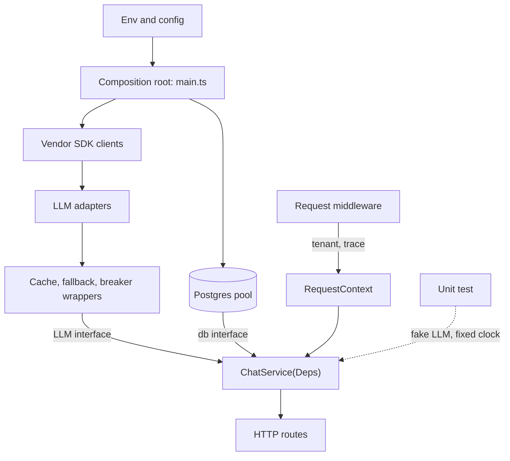

## TL;DR
A module receives its collaborators (LLM client, database pool, cache, clock, config) from the caller
instead of constructing them. In TypeScript a typed `Deps` object and one composition root make AI
services testable offline, per-tenant and provider-swappable, with no framework.

## Why it exists
- **AI handlers are glue around external calls.** A typical handler does five things: load a tenant's
  config, fetch context from Postgres and a vector store, call an LLM through an SDK client, write the
  result plus usage numbers, and emit a trace. Those calls are expensive, non-deterministic and
  credentialed.
- **The obvious wiring hurts by day ten.** `import { openai } from './clients'`, where `clients.ts` does
  `export const openai = new OpenAI()`, works on day one. Then tests either call the real API (slow,
  paid, flaky, secrets in CI) or use module mocking (`vi.mock('./clients')`), which couples tests to
  file paths and silently diverges from the real wiring.
- **Singletons cannot vary.** An enterprise customer wants an Azure endpoint with their own key, but a
  module-level singleton has exactly one key. "Use Anthropic when OpenAI keeps returning 429 or 5xx"
  cannot be expressed when the dependency is a fixed import. The singleton is also built at import
  time, before config is validated or the process knows it is a server, worker or script, so startup
  order becomes accidental.
- **The naive fix is global mutable state.** "Export a `setClient()` setter" lets concurrent requests
  from different tenants race on it.
- **DI makes the dependency an explicit parameter.** It is decided once at the edge of the program, so
  core logic is pure with respect to its collaborators. The key word is *explicit*: a function's
  signature tells you everything it touches.

## How it works
### The shape of the pattern
1. **Define the dependency by capability, not library.** An interface
   `LLM { complete(req): Promise<Completion> }` is far narrower than the OpenAI SDK's surface. The
   handler depends on it *because* then a fake, a caching wrapper or another vendor can satisfy it.
   Structural typing means no `implements` keyword is required: any object with the right shape works.
2. **Inject through the constructor or a factory argument.** `createChatService({ llm, db, clock })` or
   `class ChatService { constructor(private deps: Deps) {} }`. Setter and field injection are avoided
   *because* an object that can exist half-wired is a bug waiting for a code path.
3. **Compose at one root.** A `main.ts` (or `createApp()`) reads env, constructs the pool, the Redis
   client and the SDK client, then the services, then the HTTP routes. All `new` calls for
   infrastructure live here and nowhere else.
4. **Let the root own lifecycle.** It starts things in dependency order and shuts them down in reverse.
5. **Tests build a different graph.** `createChatService({ llm: fakeLLM, db: testDb, clock: fixed })`.
   No module mocks, no monkey-patching, no environment variables.

### Composing behaviour at the root
Every adapter satisfies the same `LLM` interface, so cross-cutting behaviour is added by wrapping one
implementation in another (the decorator pattern), only at the root:

```
llm = withCache(redis,                       // outermost: a hit skips everything below
        withFallback(                        // on failure or open breaker, try the next provider
          withBreaker(openaiAdapter),        // per provider, so one outage does not trip the other
          withBreaker(anthropicAdapter)))
```

| Layer | Position | Because |
|---|---|---|
| Cache | outermost | a hit should cost neither a retry nor a breaker slot |
| Breaker | wraps exactly one provider | its state describes that provider's health |
| Vendor SDK retries | innermost | a fallback is taken only after a provider has genuinely failed |

- **The handler sees none of it.** It still calls `llm.complete()`.
- **Tests can prove the fallback.** Wire the same stack around a fake that fails on demand.
- **Without injection** each of these behaviours ends up as an `if` inside business logic.

### Scopes
| Scope | Examples | Why |
|---|---|---|
| Singleton | pool, Redis, SDK client | expensive to construct and they own sockets |
| Request | tenant id, trace context, remaining budget, per-tenant model routing | built per request from singletons plus the request |

- **Request context in Node.** Create a `RequestContext` in middleware and pass it down, or use
  `AsyncLocalStorage` for ambient values such as the trace id.
- **`AsyncLocalStorage` is complementary, not a replacement.** Good for cross-cutting context you would
  otherwise thread through every signature; bad for real dependencies, *because* hidden ambient
  dependencies recreate the testability problem DI solves.
- **Containers differ on scope mismatches.** NestJS "bubbles" request scope up the chain: a provider
  that injects a request-scoped one silently becomes request-scoped itself (correct, but rebuilt on
  every request). A hand-wired root, or a container without that rule, lets a singleton capture the
  first request's object and keep it.

### Containers and decorators
- **NestJS** uses class decorators (`@Injectable()`) and constructor parameter types, resolved through
  `reflect-metadata`. It needs the `experimentalDecorators` and `emitDecoratorMetadata` compiler
  options.
- **Interfaces are erased at compile time,** so anything that is not a class must be registered under an
  explicit token (a string or a `Symbol`).
- **tsyringe and InversifyJS** work the same way. **Awilix** resolves by parameter name or an explicit
  registration map and needs no decorators.
- **A container buys** automatic graph construction, scoped lifetimes (request scope in NestJS,
  `createScope()` in Awilix) and lazy construction.
- **It costs** a runtime resolution step, errors that surface at boot instead of compile time, and a
  learning curve.
- **Rule of thumb:** for a dozen dependencies a hand-written root is usually clearer; past a few dozen with
  request scopes, a container pays for itself.

### What it is not
- **Not "make everything an interface".** Pure functions and value types are not injected.
- **Inject what is slow, stateful, non-deterministic or credentialed:** network clients, databases,
  caches, clocks, randomness, the file system.

## Diagram
Only the composition root knows vendors and env; services see interfaces, requests add scoped context,
and tests build a different graph around the same service.



## Examples
### Interface, service, root and test
Three files compressed into one listing: a capability interface, a service that depends only on it, the
composition root that knows about vendors, and a test that swaps in a fake. The service never imports a
vendor SDK, so the test runs with no network and no API key.

```ts
// llm.ts — the capability, not the vendor
export interface LLM { complete(p: { system: string; user: string; maxTokens: number }): Promise<{ text: string; inputTokens: number; outputTokens: number }> }

// chat-service.ts — depends only on interfaces
export interface Deps { llm: LLM; db: { saveUsage(tenant: string, tokens: number): Promise<void> }; now: () => Date }
export function createChatService({ llm, db, now }: Deps) {
  return {
    async answer(tenant: string, question: string) {
      const r = await llm.complete({ system: `Today is ${now().toISOString()}`, user: question, maxTokens: 512 });
      await db.saveUsage(tenant, r.inputTokens + r.outputTokens);
      return r.text;
    },
  };
}

// main.ts — the composition root: the only place that knows about vendors
import OpenAI from "openai";
import { Pool } from "pg";
const pool = new Pool({ connectionString: process.env.DATABASE_URL });
const openai = new OpenAI();                                  // reads OPENAI_API_KEY here, nowhere else
const llm: LLM = {
  async complete({ system, user, maxTokens }) {
    const res = await openai.chat.completions.create({ model: process.env.MODEL ?? "gpt-4o-mini", max_completion_tokens: maxTokens,
      messages: [{ role: "system", content: system }, { role: "user", content: user }] });
    return { text: res.choices[0].message.content ?? "", inputTokens: res.usage?.prompt_tokens ?? 0, outputTokens: res.usage?.completion_tokens ?? 0 };
  },
};
const db = { saveUsage: async (t: string, n: number) => { await pool.query("insert into usage(tenant, tokens) values ($1, $2)", [t, n]); } };
export const chat = createChatService({ llm, db, now: () => new Date() });

// chat-service.test.ts — no network, no mocking of module paths
const calls: string[] = [];
const svc = createChatService({
  llm: { complete: async (p) => { calls.push(p.user); return { text: "42", inputTokens: 10, outputTokens: 1 }; } },
  db: { saveUsage: async () => {} },
  now: () => new Date("2026-01-01T00:00:00Z"),
});
// expect(await svc.answer("acme", "meaning?")).toBe("42"); expect(calls).toEqual(["meaning?"]);
```

### A fallback decorator and the test that proves it
The decorator satisfies `LLM`, so the service cannot tell it apart from a single provider. Only
rate limits and server errors fall back; a 400 is the caller's bug and must surface. SDK connection
errors and timeouts carry no `.status`, so this predicate does not fall back on them; extend it if an
unreachable provider should also trigger the secondary.

```ts
// with-fallback.ts — composes two LLMs behind one interface
import type { LLM } from "./llm";

const retryable = (e: unknown) => {
  const status = (e as { status?: number }).status;   // OpenAI and Anthropic SDK errors carry .status
  return status === 429 || (status !== undefined && status >= 500);
};

export function withFallback(primary: LLM, secondary: LLM, shouldFallBack = retryable): LLM {
  return {
    async complete(p) {
      try {
        return await primary.complete(p);
      } catch (e) {
        if (!shouldFallBack(e)) throw e;               // 400s, auth errors: do not hide them
        return secondary.complete(p);
      }
    },
  };
}

// with-fallback.test.ts — fakes that fail on demand, no network
const rateLimited: LLM = { complete: async () => { throw Object.assign(new Error("rate limited"), { status: 429 }); } };
const badRequest: LLM = { complete: async () => { throw Object.assign(new Error("bad"), { status: 400 }); } };
const backup: LLM = { complete: async () => ({ text: "from backup", inputTokens: 5, outputTokens: 2 }) };
const req = { system: "", user: "hi", maxTokens: 16 };
// expect((await withFallback(rateLimited, backup).complete(req)).text).toBe("from backup");
// await expect(withFallback(badRequest, backup).complete(req)).rejects.toThrow("bad");
```

### Worked scenario: one enterprise tenant needs Azure
The same change request, with and without injection.

| Step | Module singleton | Injected `LLM` |
|---|---|---|
| Add Azure endpoint and key for tenant `acme` | a second global client plus an `if (tenant === "acme")` in the handler | a new adapter built in the root |
| Route per tenant | branch inside business logic | a router chosen from tenant config at request time |
| Test the routing | mock `./clients` by path, hope it matches real wiring | pass two fakes, assert which one was called |
| Add Anthropic fallback | another `try/catch` in every handler | wrap adapters with `withFallback` once |
| Files touched in business code | every handler that calls the LLM | none |

## Production patterns
- **Validate config before building the graph.** When the root starts, parse env with a schema (for
  example zod) before constructing any client, so a missing key fails boot with a clear message
  instead of on the first request. Monitor boot failures in deploys.
- **Per-tenant adapter router.** When tenants bring their own endpoint or key, build adapters lazily
  from tenant config and cache them in a `Map` keyed by tenant id, rebuilding on config change.
  Monitor the number of cached adapters and error rate per tenant.
- **One contract suite for fakes and real adapters.** Run the same interface tests against the fake on
  every commit and against the real SDK (sandbox key or recorded responses) nightly, so the fake cannot
  drift. Monitor the nightly job; a red run means the fake lies.
- **Reverse-order shutdown from the root.** The root keeps a list of disposers registered as it builds
  the graph; on `SIGTERM` it closes the HTTP server, then workers, then `pool.end()` and the Redis
  client. Monitor shutdown duration against the orchestrator's grace period.
- **Ban infrastructure imports outside the root.** An ESLint `no-restricted-imports` rule that
  forbids `openai`, `@anthropic-ai/sdk` and `pg` in service folders keeps the seam honest. Monitor CI
  lint failures.

## Trade-offs
- **Explicit wiring vs boilerplate.** Every dependency is visible and testable, but signatures and the
  composition root grow; past a few dozen services with request scopes, a container (NestJS, Awilix)
  becomes cheaper than hand-wiring.
- **Decorator containers vs compile-time safety.** They give automatic resolution and scoped lifetimes,
  but rely on `emitDecoratorMetadata`, need tokens for anything that is not a class, and move "missing
  dependency" errors from the compiler to boot time. In small services and libraries the trade flips
  back to manual wiring.
- **Narrow interfaces vs vendor features.** You can swap vendors and wrap caching or retry decorators
  around them, but every vendor feature you need (tool calls, streaming, prompt caching) must be
  surfaced through the interface, so over-abstracting early costs real functionality.
- **Fakes vs realism.** Fakes in unit tests are fast and deterministic, but only prove the service calls
  the interface correctly; a thin layer of integration tests against the real SDK (recorded or
  sandboxed) is still needed or the fake drifts from reality.

## Pitfalls
- **Module-level singletons created at import time** (`export const openai = new OpenAI()`). Symptom:
  tests that fail with "missing API key" or make real calls, and startup crashes whose stack trace
  points at an import line. Fix: construct in the root.
- **Service locator in disguise.** Passing one giant `container` object and calling
  `container.get('llm')` inside business logic. Symptom: a signature no longer tells you what a
  function touches, and every test must build the whole container.
- **Mixing scopes.** Injecting a request-scoped object (tenant config, trace span) into a singleton.
  Symptom: one tenant's model or API key leaking into another tenant's request under concurrency.
- **Mocking by file path** (`vi.mock('../clients')`) instead of injecting. Symptom: tests that break
  when files move, and mocks that stay green after the real wiring changed.
- **Leaky capability interfaces** that return vendor types (`OpenAI.ChatCompletion`,
  `Anthropic.Message`). Symptom: fakes must construct vendor objects, and adding a second provider
  still forces edits in business code. Fix: return your own small result type.
- **Circular dependencies between services.** Some containers paper over them with lazy proxies
  (NestJS `forwardRef`); hand-wiring cannot construct them at all. Symptom: `undefined` at runtime or a
  NestJS circular-dependency boot error. Fix: usually split an interface.

## When to use
- **Use when:** a service talks to an LLM, a database or a queue, which is nearly all AI backend code.
  Ask "would I want to replace this in a test or per tenant?" If yes, inject it.
- **Avoid when:** it is a pure function or value type; injecting it only adds indirection.
- **Start simple:** a hand-written composition root and a `Deps` type. Move to a container when
  request-scoped lifetimes and the number of services make the root hard to read, or when the team has
  standardised on NestJS.
- **Measure:** unit tests run with no network and no env vars, and adding a second LLM provider touches
  only the root.
- **Interviews:** explain why module singletons break tests and multi-tenancy, how interface erasure
  affects containers, and where request scope lives.

## Role lens
- **Engineer:** Writes services against `LLM`, `Store` and `Clock` interfaces, wires concrete clients in one `createApp()`, and keeps unit tests free of network calls by passing fakes.
- **Architect:** Owns the capability interfaces and the composition root as the seam where provider fallback, per-tenant routing, caching and credential isolation are decided without touching business logic.
- **FDE:** Swaps the customer's private endpoint, proxy or on-prem model in at the root, and demonstrates the service against a fake LLM in the customer's CI before credentials are issued.

## Check yourself
**Q:** Your service imports a single OpenAI client at module scope. A customer now requires their
requests to go to an Azure OpenAI deployment with their own key, and the team wants automatic fallback
to Anthropic when OpenAI is rate-limiting or failing (429s and 5xx after retries). How would you restructure, and where does each decision live?
**A:** Introduce a narrow `LLM` interface covering only the operations the service uses, and make the
service take it as a constructor or factory argument. At the composition root build concrete adapters:
one wrapping the OpenAI SDK, one for Azure with the customer's endpoint and key, one for Anthropic.
Compose them: a `FallbackLLM` that tries the primary and, on a 429 or 5xx that survives the SDK's own
retries, calls the secondary, and a
router that picks a per-tenant adapter from config at request time. The business logic never changes;
tests inject a fake `LLM` and a fixed clock. Credentials stay in the root, tenant routing is
request-scoped, and the fallback policy is a decorator around the interface, which keeps retry and
circuit-breaker logic out of the handler.

## Interview questions
### What is dependency injection, and why does it matter more in AI services than in CRUD apps?
- **Definition:** a unit receives its collaborators as parameters instead of importing or constructing
  them, and one composition root builds the real graph.
- **Why AI makes it urgent:** most of the work is slow, paid, non-deterministic, credentialed calls.
  Hard-wired clients mean tests hit the network, tenants cannot get their own endpoint, and provider
  fallback needs a rewrite.

### Tests pass locally but one tenant's requests occasionally use another tenant's model. How do you debug it?
- **Suspect a scope mismatch first:** a request-scoped object (tenant config, API key, span) captured
  by a singleton at first use, which only shows up under concurrency.
- **Confirm:** log tenant id alongside the adapter or config identity per request, and replay two
  tenants concurrently in a test.
- **Fix:** build tenant-specific objects per request from singletons, or let the container make the
  consumer request-scoped (NestJS bubbling), and add a concurrency test.

### When would you not use a DI container in a TypeScript service?
- **Small services and libraries:** a dozen dependencies read more clearly as a hand-written root, and
  missing wiring stays a compile error instead of a boot-time error.
- **When decorators are a cost:** containers like NestJS need `emitDecoratorMetadata` and tokens for
  interfaces, because interfaces are erased at runtime.
- **Flip point:** a few dozen services with request-scoped lifetimes, or a team already on NestJS.

### How would you order cache, retries, circuit breaker and fallback around an LLM client, and why?
- **Cache outermost,** because a hit should cost neither a retry nor a breaker slot.
- **Fallback next, breakers per provider inside it,** because each breaker's state should describe one
  provider's health and an outage at one must not trip the other.
- **SDK retries innermost,** so fallback happens only after a provider has genuinely failed.

### What exactly should and should not be injected?
- **Inject** network clients, databases, caches, clocks, randomness and the file system: anything slow,
  stateful, non-deterministic or credentialed.
- **Do not inject** pure functions and value types such as a prompt formatter; it adds indirection with
  no test or tenancy benefit.
- **Use `AsyncLocalStorage` only for ambient context** like trace ids, never for real dependencies,
  because hidden dependencies undo testability.

## Quiz
### Q: Why does TypeScript's type erasure matter for decorator-based DI containers?
- [ ] Because interfaces cannot be exported from modules that use decorators
- [x] Because an interface does not exist at runtime, so the container needs an explicit token or a class to know what to inject
- [ ] Because erased types make constructor parameters optional
- [ ] Because `emitDecoratorMetadata` only works with JavaScript files
> Containers resolve dependencies at runtime, and `emitDecoratorMetadata` can only record types that exist as values; an interface compiles to nothing, so a string or `Symbol` token (or a class) must stand in for it.

### Q: Which dependency is usually NOT worth injecting?
- [ ] A function returning the current time
- [ ] A Postgres connection pool
- [x] A pure function that formats a prompt template from its arguments
- [ ] A client for a vector database
> Injection pays off for collaborators that are slow, stateful, non-deterministic or credentialed. A pure function is deterministic and free to call, so injecting it only adds indirection; clocks look harmless but are non-deterministic and matter in tests.

### Q: A request-scoped tenant config object gets injected into a singleton LLM service. What is the likely symptom?
- [ ] Compile errors because scopes are checked by the TypeScript compiler
- [ ] Slower startup because the singleton is now rebuilt per request
- [x] Under concurrent traffic, one tenant's model routing or API key is used for another tenant's request
- [ ] The container refuses to start and logs a circular-dependency error
> A singleton is constructed once and shared, so it captures whichever request-scoped object it was first given; later requests from other tenants reuse that state, a correctness and security failure that only appears under concurrency. (NestJS avoids this by making the consumer request-scoped too, which trades the leak for per-request construction.)
