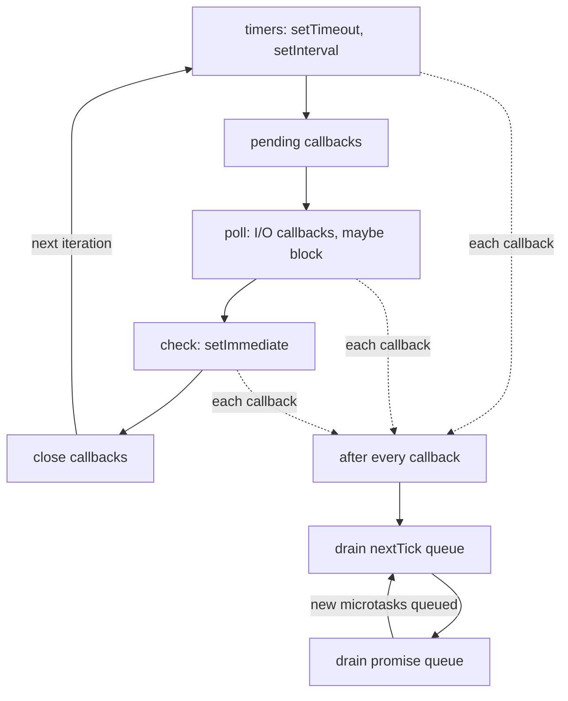

## TL;DR
A Node agent server runs all sessions' JavaScript on one thread, with a phased event loop that drains
microtask queues after each callback. It holds 5,000 open model streams cheaply, and one 200 ms
synchronous step stalls them all.

## For agent builders
- **Why it matters for agents.** An agent run is mostly waiting (model calls, tool HTTP calls), which the
  loop makes cheap, plus occasional CPU bursts (parsing a big tool result, local reranking, tokenizing for
  context packing) that freeze every other session's stream on that process.
- **Where it shows up in your stack.** Your agent server or gateway (Express, Fastify, Next.js route
  handlers), parallel tool calls via `Promise.all`, SSE token streaming to the UI, and the timeouts you set
  on tools.
- **What you control.** Which agent steps run inline versus in a worker thread, how big a tool result you
  accept, chunking with `setImmediate`, and a loop-lag gauge with load shedding.
- **What you can skip.** libuv internals and the pending/close phases in depth. Know the ordering rule
  (sync, `nextTick`, promises, macrotasks) and how to measure lag.

## Lab
### Task
Fix an agent's reranking step that freezes every other session: make `topK` yield to the loop between
slices, stop at a safe point when the run is aborted, and build the loop-lag gauge that would have caught
it. Time box: 45-60 minutes.
- **Prerequisites:** this lesson's microtask, chunking and lag sections; the AbortController lesson helps
  for step 2.
- **Setup:** an empty folder with `"type": "module"` in `package.json`, `npm i -D vitest @types/node`
  (add `typescript` for `tsc`). Checked with Node 24.21 and Vitest 5.0; Node 24 runs `lab.ts` directly
  by stripping types.
- **Save** the starter as `lab.ts` and the tests as `lab.test.ts`, then run `node lab.ts` and
  `npx vitest run`.
- **The probe:** `otherSession()` stands in for another user's token stream. It counts how many loop turns
  it gets while your step runs; inline compute gives it zero.

### Starter code
```ts
// Lab: make an agent's reranking step share the event loop, stop on abort, and show up in a lag gauge.
// Run: node lab.ts   Test: npx vitest run
import { monitorEventLoopDelay } from "node:perf_hooks";
import { pathToFileURL } from "node:url";

export type Hit = { index: number; score: number };
export type Opts = { slice?: number; signal?: AbortSignal };

// LAB 1: yield to the event loop after every `slice` vectors with a MACROTASK
// (setImmediate from node:timers/promises), so other sessions' callbacks run between slices.
// `await Promise.resolve()` does not count: microtasks drain before the poll phase.
// LAB 2: after each yield, stop at the safe point with signal?.throwIfAborted().
export async function topK(query: Float32Array, vectors: Float32Array[], k: number, opts: Opts = {}): Promise<Hit[]> {
  const hits: Hit[] = [];
  for (let i = 0; i < vectors.length; i++) {
    const v = vectors[i]!;
    let dot = 0;
    for (let d = 0; d < query.length; d++) dot += query[d]! * v[d]!;
    hits.push({ index: i, score: dot });
  }
  return hits.sort((a, b) => b.score - a.score).slice(0, k);
}

// LAB 3: start a monitorEventLoopDelay histogram (resolution 10 ms) and return stop(), which
// disables it and reports { p99Ms, maxMs } (the histogram is in nanoseconds).
export function lagGauge(): { stop: () => { p99Ms: number; maxMs: number } } {
  void monitorEventLoopDelay;
  throw new Error("not implemented: lab step 3 (lagGauge)");
}

// Another session on the same process: counts how many loop turns it got.
export function otherSession() {
  let ticks = 0, on = true;
  const tick = () => { if (on) { ticks++; setImmediate(tick); } };
  setImmediate(tick);
  return { stop: () => { on = false; return ticks; } };
}

export function randomVectors(n: number, dim: number, seed = 1): Float32Array[] {
  let s = seed;
  const rnd = () => ((s = (s * 1103515245 + 12345) % 2147483648) / 2147483648) - 0.5;
  return Array.from({ length: n }, () => Float32Array.from({ length: dim }, rnd));
}

if (import.meta.url === pathToFileURL(process.argv[1] ?? "").href) {
  const vectors = randomVectors(10_000, 256);
  const query = vectors[42]!;
  for (const slice of [Infinity, 500]) {
    const other = otherSession();
    const hits = await topK(query, vectors, 3, { slice });
    console.log(`slice ${slice}: top hit ${hits[0]?.index}, other session got ${other.stop()} turns`);
  }
  const ac = new AbortController();
  setImmediate(() => ac.abort());                 // the stop button lands after the first slice
  await topK(query, vectors, 3, { slice: 500, signal: ac.signal })
    .then(() => console.log("cancel: ran to completion"), (e: Error) => console.log("cancel:", e.name));
  try {
    const gauge = lagGauge();
    setTimeout(() => { const end = performance.now() + 150; while (performance.now() < end) {} }, 20);
    await new Promise((r) => setTimeout(r, 300));
    const { maxMs } = gauge.stop();
    console.log("150 ms block visible in gauge:", maxMs >= 100);
  } catch (e) { console.log((e as Error).message); }
}
```

### Expected output
`node lab.ts` with a correct solution prints:

```
slice Infinity: top hit 42, other session got 0 turns
slice 500: top hit 42, other session got 20 turns
cancel: AbortError
150 ms block visible in gauge: true
```

The starter prints `0 turns` for both slice sizes, `cancel: ran to completion`, and
`not implemented: lab step 3 (lagGauge)`.

### Tests
```ts
import { expect, test } from "vitest";
import { lagGauge, otherSession, randomVectors, topK } from "./lab.ts";

const vectors = randomVectors(10_000, 64);
const query = vectors[7]!;

test("results are unchanged by slicing", async () => {
  const whole = await topK(query, vectors, 5, { slice: Infinity });
  expect(whole[0]?.index).toBe(7);
  expect(await topK(query, vectors, 5, { slice: 500 })).toEqual(whole);
});

test("another session gets a loop turn between slices", async () => {
  const other = otherSession();
  await topK(query, vectors, 5, { slice: 500 });        // 20 slices
  expect(other.stop()).toBeGreaterThanOrEqual(19);
});

test("abort stops the step at the next safe point", async () => {
  const ac = new AbortController();
  setImmediate(() => ac.abort());                        // runs after the first slice yields
  await expect(topK(query, vectors, 5, { slice: 500, signal: ac.signal }))
    .rejects.toMatchObject({ name: "AbortError" });
});

test("the gauge sees a 150 ms synchronous block", async () => {
  const gauge = lagGauge();
  setTimeout(() => { const end = performance.now() + 150; while (performance.now() < end) {} }, 20);
  await new Promise((r) => setTimeout(r, 300));
  const { p99Ms, maxMs } = gauge.stop();
  expect(maxMs).toBeGreaterThanOrEqual(100);
  expect(p99Ms).toBeGreaterThan(0);
});
```

On the starter three tests fail: `expected 0 to be greater than or equal to 19`, `promise resolved ...
instead of rejecting`, and `not implemented`. The slicing test already passes, since the starter's ranking
is correct; a correct solution passes all four.

### Failure scenarios
- **Yield with `await Promise.resolve()` instead of `setImmediate`.** Ranking stays correct, but the probe
  still gets 0 turns and the abort test resolves, because microtasks drain before the loop reaches poll
  or check. Debug by logging the probe's turn count per slice: zero means you never left the microtask
  queue.
- **Check `throwIfAborted()` before the yield, not after.** The abort lands during the yield, so one extra
  slice runs. That is harmless here and costly when a slice is a paid call. Put the check right after each
  `await`, where new information can arrive.
- **Read `h.max` without dividing by `1e6`.** The gauge reports 150,000,000 "ms": the histogram is in
  nanoseconds. A unit test with a known 150 ms block catches it.
- **Slice too large.** With `slice: 5000` the probe gets 2 turns and each stall is 10 times longer. Time one
  slice on production CPU and size it to the stall budget (for example under 10 ms).

### Submission
- **Your `lab.ts`** with the three LAB steps done, and a passing `npx vitest run` (four tests).
- **A table** of probe turns and gauge `maxMs` for `slice` values `Infinity`, 5000, 500 and 50, from your
  machine.
- **A note** (3-5 sentences) saying which slice size you would ship for an agent server with a 10 ms stall
  budget and when you would move the step to a worker thread instead.
- **Evaluated on:** tests passing, a macrotask yield (not a microtask), an abort check at the safe point,
  and a slice choice justified by measured numbers.

## Why it exists
- **LLM services mostly wait.** A model request might take 2–30 seconds, during which the CPU does nothing
  useful for that request.
- **Thread-per-request wastes the wait.** One blocked OS thread per call spends a stack and a kernel thread
  on every idle wait. It works at hundreds of concurrent calls, but overhead grows with *waiting* requests,
  not with the work done.
- **Node's bet: one thread, non-blocking I/O.** A loop runs the callback for whichever operation just
  completed, so a pending HTTP response costs a few kilobytes of heap, not a thread.
- **The price: the thread is shared by everything.** No scheduler preempts a long computation. If a handler
  spends 300 ms synchronously tokenizing a 2 MB document or `JSON.parse`-ing a huge tool result, no other
  callback runs for 300 ms: tokens stop flowing to every client, health checks time out, timers fire late.
- **"Async runs in parallel" is wrong.** Only the *waiting* is concurrent; the JavaScript is strictly
  sequential. Knowing the phases and microtask queues explains ordering (why a promise callback runs before
  a `setTimeout(0)`), starvation (a recursive `nextTick` that never lets I/O run), and when to offload.

## How it works
### One thread, a loop, and libuv
- **Two engines.** Node embeds V8 for JavaScript and libuv for the event loop and asynchronous I/O.
- **Sockets use OS readiness** (epoll, kqueue, IOCP), so waiting on 10,000 sockets is one system call, not
  10,000 threads.
- **Blocking OS work goes to a pool.** Most filesystem calls, DNS lookups via `getaddrinfo` and some crypto
  run on libuv's small thread pool (four threads by default, tunable with `UV_THREADPOOL_SIZE`); results are
  posted back to the loop as events.
- **Your JavaScript never runs on those threads.**

### The phases
Each iteration ("tick") visits phases in a fixed order, running the callbacks queued for each:

1. **timers** — callbacks of `setTimeout`/`setInterval` whose threshold has elapsed. A timer is a *minimum*
   delay, not a schedule; it runs when the loop gets here.
2. **pending callbacks** — deferred I/O callbacks from the previous iteration (some system errors). libuv
   then runs internal idle/prepare hooks; nothing in user code schedules there.
3. **poll** — the heart of the loop: run callbacks for completed I/O (socket data, HTTP responses, file
   reads), then, if nothing else is due, block in the OS waiting for more. The block's timeout comes from the
   nearest timer, and it does not block at all if `setImmediate` callbacks are queued. An idle Node process
   sits here, asleep in `epoll_wait`, using no CPU.
4. **check** — `setImmediate` callbacks, so code can say "run right after the I/O I just handled" without
   competing with timers.
5. **close callbacks** — `'close'` events for destroyed sockets and handles.

- **Microtasks run between every callback.** Since Node 11 the drain happens after each individual timer or
  immediate, not once per phase as in older versions.
- **The loop exits** when there are no pending timers, handles or requests, which is why a script "just
  ends" when its work is done.

### Microtasks: `process.nextTick` and promise jobs
Two queues that are not phases at all:

| Queue | What lands there | Drained |
|---|---|---|
| `nextTick` queue | `process.nextTick` callbacks | First, completely |
| Promise microtask queue (the ECMAScript "job queue") | `.then` callbacks, `await` continuations, `queueMicrotask` | Second, completely |

After each callback returns, Node drains the `nextTick` queue, then the promise queue, repeating until both
are empty, *then* moves on. Microtasks queued while draining run in the same drain. Two consequences:

- **Ordering is deterministic.** Synchronous code first, then every `nextTick`, then every promise
  continuation, then the next macrotask (timer, I/O or immediate). An `await` on an already-resolved value
  still yields to the microtask queue: enough to let other promise continuations run, *not* enough to let
  I/O run.
- **Starvation is possible.** A function that re-queues itself with `nextTick` or a resolved promise keeps
  the drain going forever, so poll never gets a turn. Symptom: a process that is busy but handles no
  requests. `setImmediate` is the safe way to yield to I/O.

### Two ordering traps
- **ES module top level.** It is evaluated inside a promise job, so code queued there sees the promise queue
  drained *before* the `nextTick` queue (`.then` prints before `nextTick`). The "nextTick first" rule holds
  in CommonJS modules and inside ordinary callbacks such as a request handler, which is where it usually
  matters.
- **`setTimeout(fn, 0)` vs `setImmediate(fn)`.** From the main module the order is non-deterministic (it
  depends on whether 1 ms has elapsed when the timers phase is checked). Inside an I/O callback,
  `setImmediate` always runs first, because check comes before the next timers phase.

### What "blocking the loop" looks like in an agent service
- **Anything not awaiting I/O runs to completion on the loop thread:** `JSON.parse` of a multi-megabyte
  response, a regex over a long transcript, cosine similarity across 100k embeddings in plain JS, synchronous
  `zlib`/`crypto` calls, or a tight loop building a prompt from a large document.
- **Every open SSE stream freezes meanwhile,** because the `write()` calls that would flush their next tokens
  are callbacks waiting for the loop.
- **Lag is the first metric.** `perf_hooks.monitorEventLoopDelay()` samples how late the loop is; p99 lag
  above tens of milliseconds means a handler is doing CPU work inline.
- **Utilization is its companion.** `performance.eventLoopUtilization()` reports the fraction of time the
  loop was busy rather than idle in poll.

| Signal | Meaning | Action |
|---|---|---|
| Utilization near 1, lag rising smoothly | Saturated by many short callbacks | Scale out |
| Lag spikes at moderate utilization | A few long callbacks | Find and offload them |

Remedies, in order: make it async in chunks (`await setImmediate`-style yielding), move it to a worker
thread, or move it out of the process.

### Why chunk size is a latency budget
- **Yielding bounds waiting, it does not speed work up.** If one slice takes *s* ms of synchronous time,
  every other callback can wait up to *s* ms per slice, and the yielding request takes longer in total
  because others run between its slices.
- **Pick the slice from tolerable latency.** If other streams must never stall more than ~10 ms, a slice
  must be measured to run under 10 ms on the production CPU.
- **The yield must be a *macrotask* (`setImmediate`).** `await Promise.resolve()` or `await` on any
  already-resolved value only re-enters the microtask queue, drained before poll, so it yields to nothing
  that matters.

## Diagram
One loop iteration: each phase runs its callbacks, and after every single callback both microtask queues
drain before the loop moves on.



## Examples
### Ordering rules, a lag monitor and cooperative CPU work
The ordering rules and a lag monitor in one script. Run it as CommonJS (for example compile with `tsc` to
`module: commonjs`, or run with `tsx` in a package without `"type": "module"`); as an ES module lines 3 and
4 swap, for the reason given above.

```ts
import { monitorEventLoopDelay } from "node:perf_hooks";
import { setImmediate as yieldToLoop } from "node:timers/promises";

console.log("1 sync");
setTimeout(() => console.log("5 timeout (timers phase)"), 0);
setImmediate(() => console.log("6 immediate (check phase)"));
Promise.resolve().then(() => console.log("4 promise microtask"));
process.nextTick(() => console.log("3 nextTick (drained before promises)"));
console.log("2 sync");
// CommonJS: 1,2,3,4 then 5,6 (5/6 may swap from the main module; never from an I/O callback).
// ESM top level: 1,2,4,3 then 5,6, because module evaluation itself runs inside a promise job.

// Event-loop lag: sample the histogram and alert when p99 is high.
const h = monitorEventLoopDelay({ resolution: 10 });
h.enable();
setInterval(() => {
  console.log(`loop lag p99 ${(h.percentile(99) / 1e6).toFixed(1)} ms`);
  h.reset();
}, 5_000).unref();

// A CPU-heavy scoring loop made cooperative: yield to I/O every 500 vectors so
// streaming responses to other clients keep flowing while this request computes.
// At 1536 dims, 500 vectors is ~768k multiply-adds per slice: measure it, it is
// the worst-case stall every other client sees. 100k vectors = 200 slices.
async function topK(query: Float32Array, vectors: Float32Array[], k: number) {
  const scores: Array<[number, number]> = [];
  for (let i = 0; i < vectors.length; i++) {
    let dot = 0;
    for (let d = 0; d < query.length; d++) dot += query[d]! * vectors[i]![d]!;
    scores.push([dot, i]);
    if (i % 500 === 499) await yieldToLoop();   // setImmediate: lets the poll phase run
  }
  return scores.sort((a, b) => b[0] - a[0]).slice(0, k);
}
void topK;
```

### Seeing a stall: a timer that fires late
Save as `stall.mjs` and run with `node stall.mjs`. A 10 ms ticker should print about every 10 ms; a 300 ms
synchronous loop makes one tick arrive roughly 300 ms late, exactly what every SSE stream would feel.

```js
let last = performance.now();
const ticker = setInterval(() => {
  const now = performance.now();
  const gap = now - last;
  if (gap > 50) console.log(`tick late: ${gap.toFixed(0)} ms since previous`);
  last = now;
}, 10);

setTimeout(() => {
  const end = performance.now() + 300;     // simulate a big JSON.parse or tokenizer pass
  while (performance.now() < end) {}       // blocks the only JS thread
  console.log("blocking work done");
}, 100);

setTimeout(() => clearInterval(ticker), 1000);
```

### Agent scenario: parallel tool calls on one thread
A research agent fires three tool calls with `Promise.all`. The waits overlap; the CPU steps do not.

| Step | Time | Runs on the loop thread? |
|---|---|---|
| 3 HTTP tool calls (search, docs, CRM), awaited together | ~1.2 s wall, overlapping | No: only short callbacks as bytes arrive |
| Parse the 3 results (small JSON) | ~2 ms | Yes, sequentially |
| Rerank 100k cached embeddings in plain JS, unchunked | ~300 ms | Yes: every other session's stream pauses ~300 ms |
| Same rerank chunked every 500 vectors | ~300 ms total spread over 200 slices | Yes, but other sessions wait at most one slice |

Illustrative timings. The lesson: `Promise.all` gives concurrency for waiting, never parallelism for
compute, so the rerank step belongs in a worker thread once it runs on every turn.

### Worked scenario: one handler, every stream paused
A gateway holds 2,000 SSE streams. One route parses tool results of up to 20 MB inline.

| Observation | Reading |
|---|---|
| All streams pause ~500 ms at once, several times a minute | One callback holds the thread; per-stream causes would not be synchronized |
| One core at 100%, provider latency normal, memory flat | CPU work inside the process, not upstream |
| `monitorEventLoopDelay` p99 ≈ 500 ms, utilization moderate | A few long callbacks, not saturation |
| CPU profile: `JSON.parse` under the tool-result handler | The culprit |
| Fix: cap tool-result size, parse and trim in a worker thread so only the needed fields come back | p99 lag back under 10 ms (illustrative) |

- **Why "and trim":** `postMessage` structured-clones the reply, and the main thread pays to deserialize it,
  so sending the whole 20 MB parsed object back would move much of the stall rather than remove it.

## Production patterns
- **Keep the agent loop thin; offload heavy steps.** Agent teams keep orchestration (model calls, tool
  dispatch, streaming) on the loop and push tokenizing, reranking and large-result parsing to a worker pool.
  Cap tool-result size before parsing. Monitor loop lag per agent step type in traces.
- **Ship a loop-lag gauge with every service.** Enable `monitorEventLoopDelay({ resolution: 10 })` at
  startup, export p50/p99 every few seconds to your metrics system, and reset the histogram after each read.
  Alert on p99 lag next to the latency SLO.
- **Shed load on loop pressure.** Return 503 from new requests when lag or `eventLoopUtilization()` crosses
  a threshold, so the process protects its in-flight streams; Fastify's `@fastify/under-pressure` plugin
  packages this. Monitor the shed rate and its correlation with deploys.
- **Profile before guessing.** Reproduce under load with `node --cpu-prof` (writes a `.cpuprofile` you open
  in Chrome DevTools) or a `clinic`-style tool, and look for long synchronous frames under request handlers.
- **Size the libuv pool for filesystem- or DNS-heavy services.** Set `UV_THREADPOOL_SIZE` in the
  environment before the process starts, because the pool is created on first use. Watch for latency on
  `fs` and `dns.lookup` calls queuing behind each other.
- **Ban sync APIs in hot paths.** Lint or review away `fs.readFileSync`, `child_process.execSync` and sync
  `zlib` outside startup code, since their small stalls multiply across every in-flight request.

## Trade-offs
- **Cheap concurrency vs no CPU parallelism.** One thread with non-blocking I/O is very cheap for I/O-bound
  work like proxying model calls, but gives zero parallelism for CPU work. Once handlers do real
  computation the model flips and you need worker threads or separate processes.
- **Determinism vs starvation.** Deterministic microtask ordering makes promise code predictable and easy to
  test, but the same rule lets a promise loop starve I/O, which thread-based runtimes would have preempted.
- **Chunking vs simplicity.** `setImmediate` chunking keeps the process responsive without threads, at the
  cost of longer total time for that request and harder-to-read code. It wins for occasional medium jobs and
  loses for sustained heavy compute.
- **Thread pool convenience vs queuing.** The libuv pool hides blocking syscalls, but with four threads by
  default a burst of file reads or DNS lookups queues; raising `UV_THREADPOOL_SIZE` helps until memory and
  contention bite.

## Pitfalls
- **Assuming `Promise.all` parallelizes an agent's CPU steps.** Symptom: running three local scorers "in
  parallel" takes the sum of their times and stalls other sessions. Fix: parallel waits are fine; parallel
  compute needs worker threads.
- **CPU-heavy work inline in a handler** (tokenizing, big `JSON.parse`, similarity search). Symptom: every
  concurrent stream stalls at once and p99 spikes while one core sits at 100%. Fix: offload to a worker
  thread, or chunk with `setImmediate` if the job is occasional.
- **Recursive `process.nextTick` or resolved promises to "spread work out".** Symptom: a process alive and
  busy that accepts no new connections, because poll never runs. Fix: re-schedule with `setImmediate`.
- **Assuming `setTimeout(fn, 100)` fires at 100 ms.** Symptom: timers drift by seconds under load, because
  they fire only when the timers phase is reached. Fix: treat timers as minimums and keep the loop unblocked.
- **Sync APIs in a hot path** (`fs.readFileSync`, `child_process.execSync`, sync `zlib`) because "it is just a
  small file". Symptom: appears only under concurrency, when the small stall multiplies across requests.
  Fix: use the async or promise versions outside startup code.
- **Not watching event-loop lag.** Symptom: latency incidents with no CPU, memory or upstream signal to
  explain them, because the delay is inside the process. Fix: export `monitorEventLoopDelay` p99 and alert.
- **"Yielding" with `await Promise.resolve()` or `await null`** in a hot loop. Symptom: loop lag unchanged,
  because microtasks are drained before the loop reaches poll. Fix: yield with `setImmediate`.

## When to use
- **You do not opt in; you design around it.** Use plain async I/O for everything that waits on a network or
  a model, and expect thousands of concurrent requests per process.
- **The decision point is CPU.** More than a few milliseconds of synchronous work per request: chunk with
  `setImmediate` yielding when occasional, move to a worker thread or separate service when sustained.
- **Measure:** `monitorEventLoopDelay` in production with a p99 lag alert next to the latency SLO; add
  `--cpu-prof` or `clinic`-style profiling when lag is high.
- **Interviews:** predict the output order of a snippet mixing `setTimeout`, `setImmediate`, `nextTick` and
  promises, and explain why one slow handler hurts unrelated users.

## Role lens
- **Engineer:** Keeps request handlers free of synchronous heavy work, yields or offloads CPU-bound steps,
  and ships an event-loop-lag gauge with every service so stalls are visible.
- **Architect:** Decides which workloads belong on the loop (model proxying, streaming, orchestration)
  and which must live in workers or separate services (parsing, embedding math, batch jobs).
- **FDE:** Diagnoses "the assistant freezes for everyone at once" at a customer by checking loop lag
  before blaming the model provider, and explains why a bigger VM will not fix a single-thread stall.

## Check yourself
**Q:** A streaming chat gateway shows all active streams pausing for about half a second several times
a minute. CPU is at 100% on one core, the model provider's latency is normal, and memory is flat. What is
happening and how would you confirm and fix it?
**A:** The pattern points to event-loop blocking: some handler runs roughly 500 ms of synchronous
JavaScript, and because every stream's next `write()` is a callback queued on the same loop, all streams
freeze together. Confirm by sampling `monitorEventLoopDelay` (p99 lag will match the pause) and taking a
CPU profile to find the hot function; likely candidates are parsing a large tool result, tokenizing
documents for context packing, or a similarity search over embeddings in plain JS. Fix by moving that
work to a worker thread (or a separate service) if it is sustained, or by chunking it with `setImmediate`
yields if it is occasional, and keep a loop-lag alert so regressions are caught before users notice.

## Interview questions
### Why can a single Node process hold thousands of open model streams?
- **Waiting is cheap:** libuv watches sockets with the OS readiness API, so a pending response costs a few
  kilobytes of heap, not an OS thread and stack.
- **Work is short:** each stream only needs a brief callback when a chunk arrives, so one thread can serve
  them all as long as no callback runs long.

### What is the difference between `process.nextTick`, a promise `.then` and `setImmediate`?
- **`nextTick`** runs in the first microtask queue, drained right after the current callback.
- **`.then`** runs in the promise queue, drained after `nextTick` (except at ES module top level).
- **`setImmediate`** is a macrotask in the check phase, after poll, so it is the only one of the three that
  lets I/O run first; use it to yield.

### When would chunking with `setImmediate` be the wrong fix?
- **Sustained heavy compute:** chunking only spreads the cost on the same core, so total throughput does not
  improve and the request gets slower.
- **Use a worker thread or separate service** when the CPU work is frequent or large, and keep chunking for
  occasional medium jobs.

### How would you set an alert threshold for event-loop lag?
- **Derive it from the streaming budget:** if users notice token pauses over roughly a few tens of
  milliseconds, alert when p99 lag exceeds that for several minutes.
- **Pair it with utilization:** high lag at moderate utilization means long callbacks to offload; high lag
  at utilization near 1 means saturation and a scale-out.

### An agent step counts tokens over the whole transcript before every model call. Inline, chunked or worker?
- **Measure first:** time the step on production CPU and multiply by how often it runs across concurrent
  sessions; if p99 `monitorEventLoopDelay` tracks transcript length, it is hurting other sessions.
- **Decide by size and frequency:** a few milliseconds stays inline; an occasional tens-of-ms job can be
  chunked with `setImmediate`; work that repeats every turn for every session goes to a worker pool.
- **Or shrink the work:** count only the newly appended messages and cache the running total per session.

### Does raising `UV_THREADPOOL_SIZE` help a handler that blocks on a large `JSON.parse`?
- **No:** the pool runs native operations such as filesystem calls and `getaddrinfo`, never your JavaScript.
- **`JSON.parse` runs on the loop thread,** so the fix is a worker thread, a size cap, or a streaming parser.

## Quiz
### Q: In what order do these run: a `setTimeout(fn, 0)`, a resolved promise's `.then`, and a `process.nextTick` callback queued from the same synchronous block inside an HTTP request handler?
- [ ] setTimeout, then nextTick, then the promise callback
- [ ] promise callback, then nextTick, then setTimeout
- [x] nextTick, then the promise callback, then setTimeout
- [ ] All three run in the order they were queued
> After the synchronous block finishes, Node drains the nextTick queue, then the promise microtask queue,
> and only then advances the loop to the timers phase where the setTimeout fires. Queue order matters
> only within a single queue. (At the top level of an ES module the promise callback runs first, because
> module evaluation is itself a promise job; inside a handler callback the nextTick-first rule holds.)

### Q: Why does a loop that re-queues itself with `process.nextTick` prevent the server from accepting connections?
- [ ] nextTick callbacks run on the libuv thread pool, which fills up
- [x] The nextTick queue is drained completely before the loop reaches the poll phase, so I/O callbacks never run
- [ ] nextTick disables the timers phase until the queue is empty
- [ ] Each nextTick call opens a file descriptor that is never closed
> Microtask queues are drained to empty after every callback, and work queued during the drain is included.
> A self-re-queuing nextTick is never empty, so the loop never gets to poll for socket events. Using
> setImmediate instead schedules in the check phase and lets I/O interleave.

### Q: Which change most directly fixes a handler that stalls all concurrent streams for 300 ms while computing embeddings similarity in JavaScript?
- [ ] Increase `UV_THREADPOOL_SIZE` so the computation runs on more threads
- [ ] Wrap the computation in `async` and `await` its result
- [x] Move the computation to a worker thread or yield with `setImmediate` between chunks
- [ ] Replace `setTimeout` calls in the handler with `setImmediate`
> Marking a function `async` does not move its synchronous body off the loop, and the libuv pool only
> serves native operations, not your JavaScript. Only a worker thread gives true parallelism, and chunked
> yielding at least lets other callbacks run between slices.

## Use cases & projects
### Use cases
- **Agent gateways streaming to many users.** One Node process holds thousands of SSE streams because each
  waiting model call costs heap, not a thread.
- **Parallel tool calls.** `Promise.all` over independent tool calls overlaps their network waits, cutting
  a step's latency to the slowest call.
- **Diagnosing "everyone freezes at once".** Loop lag explains synchronized stalls across agent sessions
  that provider dashboards cannot.
- **Placing local compute.** Deciding whether reranking, tokenizing or result parsing stays inline, gets
  chunked, or moves to a worker.

### Mini project
**Make one agent's CPU step visible to every other session (1-2 hours).**
- **Goal:** show and then remove the cross-session stall caused by inline compute in an agent server.
- **Steps:** build a small Node server that streams fake tokens over SSE for 50 concurrent sessions; add an
  agent step that scores 100k random vectors inline; export `monitorEventLoopDelay` p99; then chunk the
  scoring with `setImmediate` and finally move it to a worker thread.
- **Done when:** you have a table of p99 loop lag and the longest token gap per session for inline,
  chunked and worker versions, with a short note on which you would ship and why.
