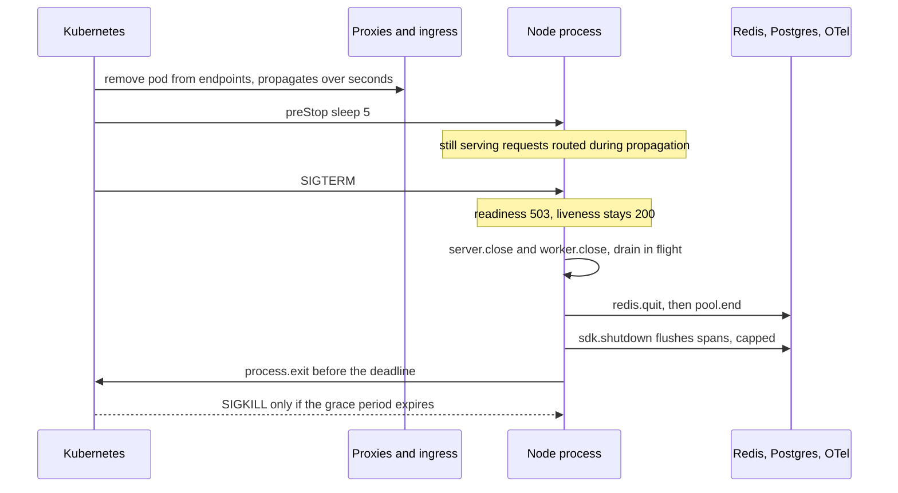

## TL;DR
On SIGTERM an agent API or worker must fail readiness, stop intake, checkpoint in-flight steps before a
deadline shorter than the grace period, close queues and pools, flush telemetry and exit. Otherwise
deploys truncate streams, re-run tool calls and lose traces.

## For agent builders
- **Why it matters for agents.** Agent runs outlive deploys: a run may be mid-way through step 7 of 15,
  streaming tokens to a user and holding a BullMQ job lock. Shutdown decides whether that run resumes
  cleanly at step 8 or replays tools, double-charges and leaves the user with a cut-off answer.
- **Where it shows up in your stack.** `process.on('SIGTERM')` in agent APIs, BullMQ workers and MCP
  servers; `worker.close()`; `AbortController` on in-flight model calls; Kubernetes
  `terminationGracePeriodSeconds` and `preStop`; `sdk.shutdown()` for the run's final spans.
- **What you control.** Where a run may stop (a step boundary), the drain deadline per workload, what a
  streaming client is told, and the close order of worker, Redis, pool and telemetry.
- **What you can skip.** Kernel signal details beyond "PID 1 needs a handler or `tini`", and Kubernetes
  internals past the SIGTERM-to-SIGKILL timeline.

## Lab
### Task
Replace the naive `server.close(() => process.exit(0))` handler of an agent API that also runs an
agent worker. With the draft, requests that arrive during endpoint propagation are refused, an agent run
in flight keeps going through all 10 steps, and Redis, the pool and the exporter are never closed.

You write the orchestrator and make the worker yield at a step boundary.
- **Agent goal:** a deploy costs no repeated step, no refused request and no lost spans, and the
  process exits before SIGKILL even when something hangs.
- **Time box:** 45-75 minutes.
- **Prerequisites:** this lesson's "The sequence inside Node", "Agent runs: stop at a step boundary"
  and "Close order and exit"; BullMQ & durable jobs for what `worker.close()` waits for.
- **Needs:** Node 20+ and `npm init -y && npm pkg set type=module && npm i -D tsx vitest` (ESM, for
  the top-level `await`). The HTTP server is real `node:http`; the worker,
  Redis, pool and exporter are small fakes, and `exit` is injected so tests can read the code.
  Checked with Node 24.21, tsx 4.23 and vitest 5.0.5.

### Starter code
```ts
// shutdown-lab.ts: drain an agent API plus worker on SIGTERM, in order, under a deadline
// A real node:http server; Redis, the pool and telemetry are fakes that log when they close.
import http from "node:http";
import type { AddressInfo } from "node:net";

const sleep = (ms: number) => new Promise((r) => setTimeout(r, ms));
export type Resource = { close(): Promise<void> };
export type Deps = {
  server: http.Server; setReady(ready: boolean): void;
  worker: Resource; redis: Resource; pool: Resource; telemetry: Resource;
  exit(code: number): void; log: string[];
  drainDelayMs: number; deadlineMs: number; telemetryCapMs: number;
};

// YOUR CODE 1: the first draft is the naive handler from "Why it exists". Make it:
// 1. on a second call: log "second signal" and exit(1) at once;
// 2. setReady(false), log `${signal}: draining`, wait drainDelayMs while still serving;
// 3. start a deadline timer (unref'd) that logs "drain timeout" and exits 1;
// 4. close the HTTP server and the worker in parallel and log "closed http+worker", then redis, then
//    the pool, then telemetry capped at telemetryCapMs (those three log their own lines when they close);
// 5. clear the deadline and exit(0); on any error log "shutdown error" and exit(1).
export function createShutdown(d: Deps) {
  return async (signal: string) => {
    d.server.close(() => d.exit(0));
  };
}

// An agent worker: each run is a list of steps; checkpoint() records a finished step.
export class AgentWorker implements Resource {
  stopping = new AbortController();
  active = new Set<Promise<unknown>>();
  checkpoints: string[] = [];
  requeued: string[] = [];
  constructor(private stepMs = 40) {}
  start(runId: string, steps: number, from = 0) {
    const p = this.runSteps(runId, steps, from).finally(() => this.active.delete(p));
    this.active.add(p);
    return p;
  }
  // YOUR CODE 2: the first draft runs every step to the end. Check this.stopping.signal between steps:
  // when it is aborted, push `${runId}@${next step}` to this.requeued and return "yielded".
  async runSteps(runId: string, steps: number, from: number): Promise<"done" | "yielded"> {
    for (let s = from; s < steps; s++) {
      await sleep(this.stepMs);                        // one model turn plus its tool calls
      this.checkpoints.push(`${runId}#${s}`);
    }
    return "done";
  }
  async close() { this.stopping.abort(); await Promise.all(this.active); }   // like worker.close(): wait for active jobs
}

export const fake = (log: string[], name: string, ms = 5): Resource => ({ close: async () => { await sleep(ms); log.push(`closed ${name}`); } });

if (import.meta.url === `file://${process.argv[1]}`) {
  let ready = true;
  const server = http.createServer(async (req, res) => {
    if (req.url === "/ready") { res.writeHead(ready ? 200 : 503); return res.end(); }
    if (req.url === "/live") { res.writeHead(200); return res.end(); }
    await sleep(100); res.writeHead(200); res.end("slow answer");          // an in-flight request
  });
  await new Promise<void>((r) => server.listen(0, r));
  const base = `http://127.0.0.1:${(server.address() as AddressInfo).port}`;
  const log: string[] = [];
  const worker = new AgentWorker();
  const exits: number[] = [];
  const shutdown = createShutdown({ server, setReady: (v) => { ready = v; }, worker,
    redis: fake(log, "redis"), pool: fake(log, "pool"),
    telemetry: { close: async () => { await sleep(500); log.push("flushed telemetry"); } },   // a slow exporter
    exit: (c) => { if (!exits.length) { exits.push(c); log.push(`exit ${c}`); } },
    log, drainDelayMs: 150, deadlineMs: 1_000, telemetryCapMs: 100 });

  console.log("ready before:", (await fetch(`${base}/ready`)).status);
  const run = worker.start("r1", 10);
  const slow = fetch(`${base}/slow`).then((r) => r.status);
  await sleep(60);
  const done = shutdown("SIGTERM");
  await sleep(10);
  const status = (path: string) => fetch(`${base}${path}`).then((x) => x.status, (e) => e.cause?.code ?? e.message);
  console.log("during drain: ready", await status("/ready"), "| live", await status("/live"));
  console.log("slow request:", await slow, "| run r1:", await run, "| requeued:", worker.requeued.length === 1);
  await done;
  await sleep(600);                                    // anything still running would log now
  console.log(log.join("\n"));
}
```

Run it with `npx tsx shutdown-lab.ts`. As given, `/ready` and `/live` both get `ECONNREFUSED` during
the drain, run `r1` finishes all 10 steps (`done`, nothing requeued), and the log is empty: nothing
was closed, and `exit 0` fires seconds later, once the client drops the slow request's idle socket.

### Expected output
```
ready before: 200
during drain: ready 503 | live 200
slow request: 200 | run r1: yielded | requeued: true
SIGTERM: draining
closed http+worker
closed redis
closed pool
exit 0
flushed telemetry
```

The last line is the slow exporter finishing after the 100 ms cap; in a real process `exit 0` has
already ended it, which is the point of the cap.

### Tests
```ts
// shutdown-lab.test.ts: run with `npx vitest run`
import { describe, expect, it } from "vitest";
import http from "node:http";
import type { AddressInfo } from "node:net";
import { AgentWorker, createShutdown, fake, type Deps, type Resource } from "./shutdown-lab";

const sleep = (ms: number) => new Promise<void>((r) => setTimeout(r, ms));
async function setup(over: Partial<Deps> = {}) {
  let ready = true;
  const server = http.createServer((req, res) => { res.writeHead(req.url === "/ready" && !ready ? 503 : 200); res.end(); });
  await new Promise<void>((r) => server.listen(0, r));
  const url = `http://127.0.0.1:${(server.address() as AddressInfo).port}`;
  const log: string[] = [], exits: number[] = [];
  const d: Deps = { server, setReady: (v) => { ready = v; }, worker: fake(log, "worker-internal", 1),
    redis: fake(log, "redis"), pool: fake(log, "pool"), telemetry: { close: async () => { log.push("flushed telemetry"); } },
    exit: (c) => { if (!exits.length) { exits.push(c); log.push(`exit ${c}`); } },
    log, drainDelayMs: 30, deadlineMs: 1_000, telemetryCapMs: 50, ...over };
  return { d, log, exits, url, shutdown: createShutdown(d), isReady: () => ready };
}

describe("createShutdown", () => {
  it("closes in order and exits 0", async () => {
    const { log, shutdown } = await setup();
    await shutdown("SIGTERM");
    expect(log.filter((l) => l !== "closed worker-internal")).toEqual(
      ["SIGTERM: draining", "closed http+worker", "closed redis", "closed pool", "flushed telemetry", "exit 0"]);
  });
  it("fails readiness first but keeps serving during the drain delay", async () => {
    const { shutdown, url, isReady } = await setup({ drainDelayMs: 100 });
    const done = shutdown("SIGTERM");
    expect(isReady()).toBe(false);
    expect((await fetch(`${url}/ready`)).status).toBe(503);
    expect((await fetch(`${url}/live`)).status).toBe(200);
    await done;
  });
  it("caps a slow telemetry flush", async () => {
    const slow: Resource = { close: () => sleep(500) };
    const { shutdown, exits } = await setup({ telemetry: slow });
    const t0 = Date.now();
    await shutdown("SIGTERM");
    expect(exits).toEqual([0]);
    expect(Date.now() - t0).toBeLessThan(300);
  });
  it("exits 1 when draining outlives the deadline", async () => {
    const stuck: Resource = { close: () => new Promise(() => {}) };
    const { shutdown, log, exits } = await setup({ worker: stuck, deadlineMs: 100 });
    void shutdown("SIGTERM");
    await sleep(250);
    expect(exits).toEqual([1]);
    expect(log).toContain("drain timeout");
  });
  it("forces exit on a second signal", async () => {
    const stuck: Resource = { close: () => new Promise(() => {}) };
    const { shutdown, log, exits } = await setup({ worker: stuck });
    void shutdown("SIGTERM");
    await shutdown("SIGINT");
    expect(exits).toEqual([1]);
    expect(log).toContain("second signal");
  });
  it("exits 1 when a close step fails", async () => {
    const broken: Resource = { close: async () => { throw new Error("pool already ended"); } };
    const { shutdown, log, exits } = await setup({ pool: broken });
    await shutdown("SIGTERM");
    expect(exits).toEqual([1]);
    expect(log).toContain("shutdown error");
  });
});

describe("AgentWorker", () => {
  it("yields at the next step boundary and resumes without repeating a step", async () => {
    const w = new AgentWorker(20);
    const run = w.start("r1", 10);
    await sleep(50);
    const t0 = Date.now();
    await w.close();
    expect(Date.now() - t0).toBeLessThan(60);                    // one step, not the whole run
    expect(await run).toBe("yielded");
    const next = w.checkpoints.length;
    expect(next).toBeLessThan(10);
    expect(w.requeued).toEqual([`r1@${next}`]);
    const resumed = new AgentWorker(1);
    await resumed.start("r1", 10, next);
    expect(new Set([...w.checkpoints, ...resumed.checkpoints]).size).toBe(10);
  });
});
```

All 7 fail on the starter with `AssertionError`: an empty log, readiness still `true`, no exit code
recorded, `exit 0` instead of 1 when the worker hangs (the HTTP close finished and nothing else was
awaited), and a worker `close()` that waited about 160 ms for the whole run instead of one step.

### Failure scenarios
- **Inject `await d.pool.close()` before the worker closes.** The order test fails; in production
  the step finishing during drain cannot checkpoint and its transaction errors with a closed pool, so
  the step re-runs after the deploy. Log each close with a timestamp and compare against in-flight work.
- **Inject `await d.telemetry.close()` without the race.** The cap test fails: exit waits the full
  500 ms. With an unreachable collector the exporter's own timeout can eat the grace period. Record
  shutdown duration per deploy and how much of it the flush took.
- **Inject `server.close()` with no drain delay and no `preStop` sleep.** The readiness test's
  fetch gets `ECONNREFUSED`, the 502 window from "Closing the 502 window". Count refused connections
  at the balancer during a rolling deploy; it should be zero.
- **Inject a slow request that is still in flight when `close()` runs.** With Node's `fetch` as the
  client, `close()` waits after the response until the client drops its idle keep-alive socket
  (seconds in this demo). Keep `keepAliveTimeout` short or call `server.closeIdleConnections()` once
  in-flight requests finish.

### Submission
- **Your `shutdown-lab.ts`** with both `YOUR CODE` parts done; the demo and fakes unchanged.
- **A `npx vitest run` log** showing 7 passed, run three times in a row.
- **The `npx tsx shutdown-lab.ts` output**, matching the expected lines.
- **A note of 3-5 sentences:** your `deadlineMs`, `drainDelayMs` and telemetry cap for a 30 s grace
  period with a 5 s `preStop`, and why each fits.
- **Evaluated on:** readiness before intake, parallel intake close, reverse dependency order,
  a capped flush, an unref'd deadline, a second-signal force exit, and a worker that yields at a step.

## Why it exists
- **Processes are killed constantly:** deploys, autoscaling, node drains, out-of-memory kills.
  Kubernetes sends SIGTERM and, after `terminationGracePeriodSeconds` (30 s by default), SIGKILL;
  `docker stop` does the same with a 10 s default.
- **Node without a handler does not drain.** SIGTERM either terminates it immediately or, when Node is
  PID 1 in the container, is ignored outright (the kernel drops signals PID 1 has no handler for), so
  the pod sits until SIGKILL.
- **Every in-flight thing breaks.** An SSE stream halfway through a 2,000-token answer closes without a
  final event; a BullMQ worker mid-way through a 500-chunk embedding loses its place and the job stalls
  and re-runs; the server rolls back a Postgres transaction when the socket drops; the last batch of
  OpenTelemetry spans, covering the deploy itself, is never exported.
- **The naive fix is still wrong three ways.**
  `process.on('SIGTERM', () => server.close(() => process.exit(0)))` refuses requests that still
  arrive during endpoint propagation, can hang on idle keep-alive connections on older Node, and ignores
  the worker, pool, Redis client and telemetry exporter.
- **Graceful shutdown is choreography against a deadline:** each resource has its own flush and close
  semantics and must close in the right order.

## How it works
### What the orchestrator does
1. **Pod marked terminating** and removed from the Service's ready endpoints straight away, whatever its
   readiness probe says. That removal propagates to kube-proxy rules and ingress controllers with a
   delay of typically a few seconds, during which they still route to the pod.
2. **`preStop` hook runs,** if any. A common one is `sleep 5` to let endpoint removal propagate before
   the signal arrives. The exec form needs a `sleep` binary in the image; recent Kubernetes versions
   also offer a built-in `sleep` preStop action. The hook's time counts against the grace period.
3. **SIGTERM** goes to PID 1 of the container.
4. **SIGKILL** after the grace period.

- **The process must receive the signal.** Use the exec form `CMD ["node", "dist/server.js"]`; the shell
  form `CMD npm start` leaves a shell as PID 1 that does not forward signals. `docker run --init` or
  `tini` is the safe default.
- **The app's deadline must be shorter than the grace period minus the `preStop` sleep,** *because*
  otherwise SIGKILL wins and the work is lost anyway.

### The sequence inside Node
1. **Flip readiness, then keep serving briefly.** `/ready` returns 503 immediately so any balancer that
   health-checks the pod directly stops routing. Keep `/live` healthy, *because* a failing liveness
   probe during shutdown makes the orchestrator restart the container mid-drain.
2. **Stop intake.** `server.close()` stops accepting connections; for BullMQ, `await worker.close()`
   stops taking new jobs and waits for active ones (`worker.pause()` is the softer form). Cancel
   scheduled timers and polling loops.
3. **Drain in flight.** Requests complete naturally. Streaming responses need a product decision (see
   below).
4. **Close resources in reverse dependency order.** Queue and Redis clients first, then `pool.end()`,
   then telemetry last.
5. **Exit explicitly,** under a deadline timer.
6. **Second signal means force.** A second SIGTERM or SIGINT during draining exits immediately;
   operators expect it.

### Closing the 502 window
- **Readiness is not what removes the pod** in Kubernetes; termination already did.
- **What closes the window** is continuing to accept requests for a few seconds while endpoint removal
  propagates.
- **Do it once:** a `preStop` sleep, or, if you cannot change the manifest, an in-app delay before
  `server.close()`, but not both, since each costs grace period.

### HTTP connections
| Situation | Behaviour | Action |
|---|---|---|
| Node 19 and later | `close()` also closes idle keep-alive connections | nothing extra |
| Older Node | idle keep-alive sockets keep `close()` waiting | call `server.closeIdleConnections()` |
| Balancer keep-alive | long-lived idle sockets | keep `keepAliveTimeout` short so balancers reconnect elsewhere |
| Open SSE streams | never idle, so `close()` waits for each to end | track open streams and end them deliberately |
| Deadline near | something still open | `server.closeAllConnections()` as the last resort |

### Streams and model calls
- **Finish them** if they will end within the deadline.
- **Otherwise send a final event** that tells the client to resume or retry.
- **Abort the upstream model call** with an `AbortController`, so you stop paying for tokens nobody will
  receive.

### Agent runs: stop at a step boundary
- **A step is the unit to finish.** A model turn plus its tool calls usually fits in the deadline; a
  whole 15-step run usually does not.
- **Check a shutdown flag between steps.** When it is set, checkpoint the transcript, enqueue the next
  step as a new job, and return, so another worker resumes the run after the deploy.
- **Abort mid-step only when the deadline is close.** Cancel the model call with its `AbortController`;
  the step re-runs later, which is safe only if its tool side effects carry idempotency keys.

### Close order and exit
- **Redis:** `queue.close()` and `redis.quit()`, which waits for pending replies, unlike `disconnect()`.
- **Postgres:** `pool.end()` must come after every worker and request that might still query.
- **Telemetry last:** `sdk.shutdown()` flushes the batch span processor. The exporter depends on none of
  the other resources, and flushing last also exports the spans and errors of the close steps. Give the
  flush its own short timeout.
- **Exit is your job.** Once a SIGTERM listener is registered, Node no longer exits on the signal by
  default, so call `process.exit(0)` at the end (or set `process.exitCode` and let the loop drain).
- **Deadline timer.** `setTimeout(..., 20_000).unref()` for a 30 s grace period with a 5 s `preStop`
  exits non-zero if draining hangs, *because* a hung shutdown wastes the whole grace period and still
  ends in SIGKILL.

### Crashes
- **`uncaughtException` and `unhandledRejection` leave the process in an unknown state.**
- **Two acceptable responses:** log, then flush telemetry and exit non-zero within a second or two; or
  run the normal drain under a short deadline (as the example does).
- **Either way** stop accepting work and exit non-zero; never keep serving.
- **Recovery is external.** The orchestrator starts a fresh instance and the queue's stall detection
  re-runs the job, which is why jobs must be idempotent in the first place.

### What "done" looks like
Deploys produce zero 5xx at the load balancer, zero stalled jobs, no truncated streams in client logs,
and the last trace before shutdown is present in the backend.

## Diagram
The SIGTERM-to-SIGKILL timeline: the `preStop` sleep covers endpoint propagation, and everything inside
Node must finish before the grace period ends.



## Examples
### Shutdown orchestrator for an API plus BullMQ worker
Readiness fails first, HTTP intake and the worker close in parallel, then Redis and Postgres close, and
telemetry is flushed last under its own 3-second cap.

The 20-second deadline leaves margin under a 30-second grace period minus a 5-second `preStop` sleep;
the timer is `unref()`'d so it cannot keep an otherwise-finished process alive, and a second signal
forces exit.

```ts
import http from "node:http";
import { Pool } from "pg";
import { Worker } from "bullmq";
import { sdk } from "./instrumentation";          // the OpenTelemetry NodeSDK instance
import { redis } from "./redis";                  // an ioredis client

let ready = true;
const pool = new Pool({ connectionString: process.env.DATABASE_URL });
const server = http.createServer((req, res) => {
  if (req.url === "/ready") { res.writeHead(ready ? 200 : 503); return res.end(); }
  if (req.url === "/live")  { res.writeHead(200); return res.end(); }
  handle(req, res);                                 // normal routing
});
server.keepAliveTimeout = 5_000;
const workerConn = redis.duplicate({ maxRetriesPerRequest: null });   // BullMQ workers require null
const worker = new Worker("embed", processEmbed, { connection: workerConn, concurrency: 4 });
server.listen(8080);

let shuttingDown = false;
async function shutdown(signal: string, code = 0) {
  if (shuttingDown) { console.warn("second signal, forcing exit"); process.exit(1); }
  shuttingDown = true; ready = false;               // 1. fail readiness first
  await new Promise((r) => setTimeout(r, Number(process.env.DRAIN_DELAY_MS ?? 0)));  // keep serving while endpoints update; 0 if preStop sleeps
  const deadline = setTimeout(() => { console.error("drain timeout"); process.exit(1); }, 20_000).unref();
  console.log(`${signal}: draining`);
  try {
    await Promise.all([
      new Promise<void>((resolve) => server.close(() => resolve())),  // 2. stop intake (closes idle keep-alive on Node 19+)
      worker.close(),                                                   //    stop taking jobs, wait for active ones
    ]);
    await Promise.all([redis.quit(), workerConn.quit()]);              // 3. waits for pending replies
    await pool.end();                                                   //    only after nothing can still query
    await Promise.race([sdk.shutdown(), new Promise((r) => setTimeout(r, 3_000))]);  // 4. flush spans last, capped
    clearTimeout(deadline);
    process.exit(code);
  } catch (err) {
    console.error("shutdown error", err); process.exit(1);
  }
}
process.on("SIGTERM", () => void shutdown("SIGTERM"));
process.on("SIGINT",  () => void shutdown("SIGINT"));
process.on("unhandledRejection", (e) => { console.error(e); void shutdown("unhandledRejection", 1); });
```

### Agent scenario: an agent worker that yields at step boundaries
The processor runs steps until the run finishes or shutdown starts. On shutdown it checkpoints, hands the
next step back to the queue and returns, so `worker.close()` completes quickly instead of waiting for a
whole run.

```ts
import { Queue, Worker } from "bullmq";
// conn() is an ioredis factory with maxRetriesPerRequest: null; loadRun, runStep, saveStep are app code
const stopping = new AbortController();               // shutdown began: finish the current step, then yield
const hardStop = new AbortController();               // deadline near: cut the in-flight model call
const steps = new Queue("agent-steps", { connection: conn() });

const agentWorker = new Worker("agent-steps", async (job) => {
  const { runId } = job.data as { runId: string };
  let { nextStep, done } = await loadRun(runId);
  while (!done) {
    if (stopping.signal.aborted) {                     // yield: another worker resumes after the deploy
      await steps.add("step", { runId }, { jobId: `run-${runId}-from-${nextStep}` });
      return { yielded: nextStep };
    }
    try {
      const r = await runStep(runId, nextStep, hardStop.signal);  // only the hard stop cuts a step short
      await saveStep(runId, nextStep, r);              // checkpoint before the next step starts
      done = r.final; nextStep++;
    } catch (e) {
      if (!hardStop.signal.aborted) throw e;           // a real failure: let BullMQ retry the job
    }                                                  // cut off: loop round and yield; the step re-runs elsewhere
  }
  return { done: true };
}, { connection: conn(), concurrency: 4 });

export async function drainAgents(hardStopAfterMs = 15_000) {
  stopping.abort();                                    // running steps finish, then yield
  const t = setTimeout(() => hardStop.abort(), hardStopAfterMs);   // inside the 20 s deadline
  await agentWorker.close();                           // waits for active jobs, which now return fast
  clearTimeout(t);
}
```

- **Two signals, two meanings.** `stopping` lets the current step finish, so a deploy usually costs no
  repeated work. `hardStop` fires 15 s into the drain and aborts the in-flight model call, so that step
  re-runs on another worker, which is safe only if its tool side effects carry idempotency keys.

Illustrative timeline, assuming each step takes under 10 seconds:

| Moment (30 s grace, 5 s `preStop`) | Without step-boundary yield | With yield |
|---|---|---|
| SIGTERM, 4 runs active at steps 3, 7, 9, 12 of 15 | `worker.close()` waits for whole runs | each run finishes its current step |
| ~10 s later | still running, minutes left | 4 runs checkpointed, next steps re-enqueued |
| 25 s deadline | `process.exit(1)`, locks expire, runs replay from their last checkpoint | already exited cleanly |
| After deploy | stall checker re-runs 4 jobs | new pods resume at steps 4, 8, 10, 13 |

### Production snippet: the container and manifest side
The code above only works if the signal reaches Node and the timings line up. Exec-form `CMD` behind
`tini` makes Node receive SIGTERM; the manifest sets the grace period, the `preStop` sleep and separate
probes.

```dockerfile
FROM node:22-slim
RUN apt-get update && apt-get install -y --no-install-recommends tini && rm -rf /var/lib/apt/lists/*
ENTRYPOINT ["/usr/bin/tini", "--"]
CMD ["node", "dist/server.js"]
```

```yaml
spec:
  terminationGracePeriodSeconds: 30
  containers:
    - name: agent-api
      image: registry.example.com/agent-api:1.4.2
      lifecycle:
        preStop:
          exec:
            command: ["sleep", "5"]      # covers endpoint propagation; set DRAIN_DELAY_MS to 0
      readinessProbe:
        httpGet: { path: /ready, port: 8080 }
        periodSeconds: 2
      livenessProbe:
        httpGet: { path: /live, port: 8080 }
        periodSeconds: 10
```

### Worked scenario: budgeting a 30-second grace period
How the numbers in the example fit together, measured from the moment the pod is marked terminating.
The 22-second split between draining and closing is illustrative; only the 5 s hook, the 20 s deadline
and the 3 s flush cap come from the configuration.

| Time | Event | Budget used |
|---|---|---|
| 0 s | endpoints removal starts propagating; `preStop` sleep begins | 0 of 30 s |
| 5 s | SIGTERM; readiness 503; deadline timer set for 20 s | 5 s |
| 5-22 s | `server.close()` and `worker.close()` drain; a 4-job worker finishes its active jobs | up to 22 s |
| 22-25 s | `redis.quit()`, `pool.end()`, `sdk.shutdown()` capped at 3 s | up to 25 s |
| 25 s | latest point the deadline timer forces `process.exit(1)` | 25 s |
| 30 s | SIGKILL, never reached if the above held | 30 s |

If a worker's jobs routinely take longer than about 15 seconds, raise `terminationGracePeriodSeconds`
for the worker deployment and the deadline with it, or add per-chunk checkpoints so a cut-off job
resumes cheaply.

## Production patterns
- **Yield agent runs at step boundaries.** When agent runs are longer than any grace period, have the
  worker check a shutdown signal between steps, checkpoint, and re-enqueue the next step, so a deploy
  costs at most one step per run. Monitor yielded runs per deploy and runs that resumed successfully.
- **Zero-error rollouts as a test.** Run a steady load against a staging deployment while triggering a
  rollout restart, and fail the check if the load balancer logs any 5xx or connection resets. Monitor
  5xx and stalled-job counts per rollout in production too.
- **Grace period per workload.** Keep API pods near the default 30 s, and give worker deployments a
  `terminationGracePeriodSeconds` sized to the longest acceptable job plus margin, with the in-app
  deadline derived from it. Monitor stalled jobs and drain-timeout exits after deploys.
- **Stream handoff on shutdown.** When draining, send a final SSE event telling the client to reconnect
  (with a resume token or the run id) and abort the upstream model call with its `AbortController`.
  Monitor aborted streams and client reconnect success.
- **One structured log line per shutdown step.** Log each step with its duration and alert on
  `drain timeout` or non-zero exit codes, so a slow close (often the telemetry flush or a pool still in
  use) is visible. Monitor the distribution of total shutdown time.
- **PodDisruptionBudget for voluntary evictions.** For node drains and cluster upgrades, a
  PodDisruptionBudget (`minAvailable` or `maxUnavailable`) limits how many replicas drain at once, so
  graceful shutdown never takes out the whole fleet. Monitor evictions blocked by the budget during
  upgrades.

## Trade-offs
- **No lost work vs rollout speed.** Draining in-flight work avoids lost requests and duplicate jobs, but
  every second of drain delays the rollout; with long LLM streams the deadline is a product decision
  (finish, or cut with a resume token), not just a timeout value.
- **No 502s vs grace period.** Keeping the listener open for a few seconds after SIGTERM (a `preStop`
  sleep or an in-app delay) removes propagation-window 502s, but those seconds come out of the grace
  period and slow every rollout. Size the delay from how long your ingress actually takes to drop an
  endpoint, and drop it where the balancer deregisters targets before the signal arrives.
- **Guaranteed exit vs cut work.** A hard internal deadline guarantees exit before SIGKILL with a
  non-zero code, but cuts whatever is still running; keep it below the grace period and raise the grace
  period for worker pods rather than removing the deadline.
- **Graceful workers vs long jobs.** Closing BullMQ workers gracefully prevents stalls on every deploy,
  but with `concurrency: 10` and ten-minute jobs no sensible grace period suffices; the fix is per-chunk
  checkpoints so a re-run resumes, not a longer wait.
- **Telemetry completeness vs deadline.** Flushing on shutdown preserves the most interesting spans, but
  a slow or unreachable collector can eat the whole deadline; give the flush its own short timeout.

## Pitfalls
- **Shell-form `CMD npm start` or a wrapper script as PID 1.** Symptom: containers always take the full
  grace period and die by SIGKILL, with no shutdown log line ever appearing.
- **A SIGTERM handler that never calls `process.exit`.** Symptom: the process lingers after draining
  because an open handle (a timer, a Redis socket) keeps the event loop alive.
- **`server.close()` on Node 18 or older without `closeIdleConnections()`.** Symptom: shutdown hangs
  until SIGKILL while the balancer holds idle keep-alive sockets.
- **Liveness probe wired to the same flag as readiness.** Symptom: the orchestrator restarts the
  container in the middle of its own drain.
- **Closing the Postgres pool before the worker finishes.** Symptom: "Cannot use a pool after calling
  end on the pool" errors in the last jobs of every deploy.
- **Deadline timer not `unref()`'d.** Symptom: a process that finished draining but waits the full
  timeout before exiting.

## When to use
- **Use in every long-running Node process:** API servers, BullMQ workers, MCP servers, schedulers.
- **Do it on day one of containerising,** because the symptoms (5xx spikes, duplicate jobs, truncated
  streams, missing traces) are easy to blame on everything else.
- **Set the deadline** from the orchestrator's grace period and the longest acceptable in-flight unit;
  raise `terminationGracePeriodSeconds` for worker deployments with long jobs, and add checkpoints
  where that is not enough.
- **Measure:** 5xx and connection errors during rollouts, stalled job counts, and whether shutdown logs
  show the sequence completing.
- **Interviews:** walk through the SIGTERM-to-SIGKILL timeline and the order of readiness, intake,
  drain, flush, close, exit.

## Role lens
- **Engineer:** Implements the shutdown orchestrator, wires readiness to it, closes the worker, telemetry, Redis and pool in order, and tests it by sending SIGTERM to a loaded local process.
- **Architect:** Sets grace periods, `preStop` policy and the rule for in-flight streams across services, and makes idempotent, checkpointed jobs a requirement so shutdown can afford to be strict.
- **FDE:** Verifies the customer's cluster settings (grace period, probe intervals, PID 1 handling in their base image) and demonstrates a deploy with zero dropped requests in their environment.

## Check yourself
**Q:** After every deploy your Node API shows a burst of 502s at the load balancer and BullMQ reports a
handful of stalled jobs, even though you added `process.on('SIGTERM', () => server.close(() =>
process.exit(0)))`. Explain both symptoms and the full fix.
**A:** The 502s come from the window between SIGTERM and the balancer learning the pod is gone: the
server stopped accepting instantly while proxies were still routing to it. Kubernetes has already
removed the pod from the endpoints, so the fix is to keep serving for a few seconds while that
propagates (a short `preStop` sleep, or an in-app delay before `server.close()`); fail readiness too
for any balancer that probes the pod directly, and keep the liveness probe passing.
The stalled jobs come from the worker never being closed: `server.close` only drains HTTP, so
`process.exit` killed active jobs whose locks then expired and were re-run by the stall checker. The
full sequence is: readiness to 503, a short delay, `server.close()` (closing idle keep-alive connections) in parallel
with `await worker.close()`, `redis.quit()`, `pool.end()`, flush OpenTelemetry, then `process.exit(0)`,
all under a deadline below the grace period, with a non-zero exit if the deadline fires. Verify the
signal reaches Node at all: exec-form `CMD` so Node (or a forwarding init such as `tini`) is PID 1,
not a shell.

## Interview questions
### What happens between Kubernetes deciding to stop a pod and the process disappearing?
- **The pod is marked terminating** and removed from endpoints at once, but proxies learn about it over
  a few seconds.
- **The `preStop` hook runs,** then SIGTERM reaches PID 1, and SIGKILL follows after
  `terminationGracePeriodSeconds` (30 s by default).
- **So the app must** keep serving through propagation, drain, close and exit before the grace period
  ends.

### A deploy starts while 40 agent runs are mid-flight, some streaming to users. What should happen?
- **Workers:** stop claiming jobs, let each run finish its current step, checkpoint, re-enqueue the next
  step and exit; new pods resume the runs.
- **Streaming API pods:** finish streams that end within the deadline, otherwise send a final event with
  the run id so the client reconnects, and abort the upstream model call.
- **Safety net:** tool side effects carry idempotency keys, because any step cut off by the deadline will
  run again.

### Your containers always take exactly 30 seconds to stop and never log a shutdown line. What is wrong?
- **The signal never reaches Node:** a shell-form `CMD npm start` or wrapper script is PID 1 and does not
  forward SIGTERM, or Node is PID 1 with no handler and the kernel ignores the signal.
- **Fix:** exec-form `CMD ["node", "dist/server.js"]` behind `tini` or `docker run --init`, plus an
  explicit SIGTERM handler.
- **Verify** by sending SIGTERM locally and checking the log line and exit code.

### Why must the Postgres pool close after the HTTP server and worker, and telemetry after everything?
- **The pool must outlive every request and job** that may still query; ending it first produces "pool
  after end" errors in the last jobs.
- **Telemetry goes last** because the exporter depends on nothing else, and flushing last also exports
  the spans and errors of the close steps.
- **Each step still needs a cap** so one slow close cannot consume the whole deadline.

### When is a longer grace period the wrong fix for agent runs and jobs that get cut off during deploys?
- **When the work is long by nature:** with `concurrency: 10` and ten-minute agent runs or embedding
  jobs, no sensible grace period lets every active job finish.
- **Better:** step-level or per-chunk checkpoints and idempotent writes, so a run re-started after a yield
  or a stall resumes where it left off.
- **Keep the grace period** sized to a reasonable unit of work, and treat re-runs as normal.

### How do you size the in-app deadline for a 30-second grace period with a 5-second `preStop` sleep?
- **Subtract the hook:** only about 25 seconds remain after SIGTERM, and you want margin before SIGKILL.
- **So pick about 20 seconds** for the whole drain, with sub-caps such as 3 seconds for the telemetry
  flush, and exit non-zero when it fires.
- **Then verify** with shutdown logs: if drains routinely approach the deadline, raise the grace period
  or shorten units of work.

## Quiz
### Q: A Kubernetes pod calls `server.close()` the instant it receives SIGTERM and the load balancer logs a burst of 502s on every deploy. What removes the burst?
- [ ] Making `server.close()` asynchronous so it does not block the event loop
- [x] Continuing to serve for a few seconds, via a `preStop` sleep or an in-app delay, while endpoint removal propagates to the proxies
- [ ] Failing the readiness probe first, because Kubernetes only removes a pod from endpoints after readiness fails
- [ ] Calling `process.exit(0)` immediately so the pod disappears from endpoints faster
> A terminating pod is removed from endpoints regardless of readiness, but proxies and ingress learn that asynchronously, so traffic keeps arriving for a few seconds; staying up through that window is the fix. Failing readiness helps only balancers that probe the pod directly.

### Q: Once you register a `process.on('SIGTERM', ...)` handler in Node, what changes?
- [ ] Node forwards the signal to child processes automatically
- [ ] The grace period is extended by the orchestrator
- [x] The default exit on SIGTERM is disabled, so the process keeps running until you exit explicitly or the event loop empties
- [ ] Subsequent SIGTERMs are ignored
> Installing a signal listener replaces the default behaviour; if the handler drains but never calls `process.exit` and some handle keeps the loop alive, the process lingers until SIGKILL.

### Q: After readiness has been flipped to 503, which shutdown order is right?
- [ ] End the Postgres pool so no new writes can start, then close the worker, then flush telemetry, then exit
- [x] Close the HTTP server and the worker, then Redis and the Postgres pool, then flush telemetry, then exit
- [ ] Flush telemetry, then exit and let the orchestrator close the remaining sockets
- [ ] Close the worker, then exit, because the stall checker will finish any remaining jobs
> The pool must outlive every request and job that may still query, so it closes only after the server and worker have drained; ending it first produces "pool after end" errors in the last jobs. Telemetry goes last, under a short cap, so the close steps' own spans are exported before exit.

## Use cases & projects
### Use cases
- **Deploying agent workers during the day.** Step-boundary yields let you roll out new prompts or tools
  without killing long research or coding runs.
- **Streaming chat agents.** A final "reconnect" event with the run id keeps users from seeing a
  truncated answer during a rollout.
- **MCP servers in containers.** A SIGTERM handler closes transports and in-flight tool calls before the
  orchestrator kills the server.
- **Complete traces of the last runs.** Flushing OpenTelemetry last keeps the spans of runs that were
  interrupted by the deploy.

### Mini project
**Deploy-safe agent worker (2 hours).**
- **Goal:** prove a deploy costs at most one repeated step per active agent run.
- **Steps:** build a BullMQ agent worker with a fake 10-step agent (each step sleeps 3 s and calls a
  fake side-effecting tool with an idempotency key); add the shutdown orchestrator and step-boundary
  yield; start 5 runs; send SIGTERM while they are mid-run; start a fresh worker; repeat 10 times.
- **Done when:** every run completes with 10 checkpointed steps, no tool side effect is applied twice,
  the old worker always exits before its 20-second deadline, and shutdown logs show each close step with
  its duration.
