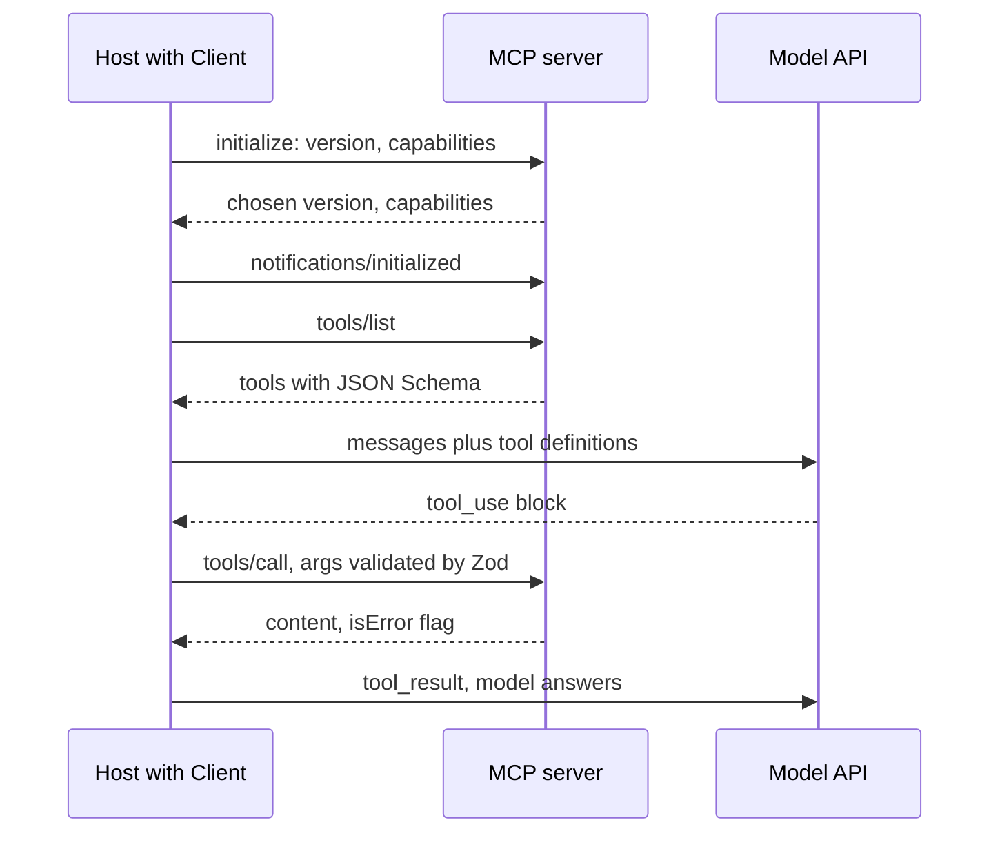

## TL;DR
`@modelcontextprotocol/sdk` is the reference TypeScript MCP implementation: servers turn Zod-typed handlers
into JSON-RPC tool, resource and prompt endpoints; clients connect, discover and call them, over stdio or
Streamable HTTP. It never calls a model.

## Why it exists
- **MCP is a real wire protocol.** JSON-RPC 2.0 messages with an `initialize` handshake, capability
  negotiation, a fixed set of request methods and notifications, and two transport bindings with their own
  framing and session rules. The agents module's protocol lesson explains *why* MCP exists; this one covers
  what the SDK does and where it bites.
- **Hand-rolling it is a week plus a long bug tail.** A missing `initialized` notification, a tool whose
  JSON Schema the host rejects, an HTTP endpoint ignoring the session header, a stdout log line that
  corrupts the stream. Every server author would repeat the work and every host would find different mistakes.
- **The SDK splits the work.** Server authors write handlers and schemas; host authors write `connect`,
  `listTools` and `callTool`. Protocol machinery, versioning and transports are shared code maintained
  alongside the specification.
- **The naive alternatives lose.** A bespoke HTTP API per tool set reintroduces the per-framework connector
  problem MCP removed and offers nothing for resources, prompts or server-initiated requests. A framework's
  proprietary tool format works only inside that framework.
- **Schemas are single-source values.** Zod values become JSON Schema on the wire and TypeScript types in the
  handler, the schema-validation lesson's idea at a protocol boundary: the model sees the schema the handler
  enforces, and the host can validate what it sends.

## How it works
### What happens on connect
Every session, on either transport, starts with three messages that the SDK sends and checks:
1. **`initialize`.** The client sends the newest protocol version it supports, its capabilities (for
   example `sampling`, `roots`, `elicitation`) and its name and version.
2. **Server reply.** The version it will speak (the client's if supported, otherwise one it does; a client
   that cannot speak it disconnects) and its capabilities (`tools`, `resources`, `prompts`, `logging`, each
   possibly with `listChanged`).
3. **`notifications/initialized`.** Only then do ordinary requests such as `tools/list` flow.

- **Why negotiate:** hosts and servers upgrade independently, and each side may only use features the other
  advertised, so an old host and a new server still interoperate on the common subset.
- **Requests vs notifications.** Every request carries a JSON-RPC `id` and gets exactly one response;
  notifications (progress, log messages, `notifications/cancelled`, list-changed) carry none.
- **Client timeout.** The client enforces a per-request timeout (60 seconds by default in 1.x) and rejects
  with a request-timeout `McpError`, which matters for slow tools.

### Server side: two levels
**`McpServer`** (from `@modelcontextprotocol/sdk/server/mcp.js`) is the high-level API. Construct it with a
name and version, then register:

| Method | Registers |
|---|---|
| `registerTool(name, { description, inputSchema, outputSchema? }, handler)` | A tool |
| `registerResource(name, uriOrTemplate, metadata, reader)` | A resource |
| `registerPrompt(name, { argsSchema }, builder)` | A prompt |

- **`inputSchema` is a Zod shape** (recent 1.x releases also accept a full Zod object schema). The SDK
  converts it to JSON Schema for `tools/list` and validates `tools/call` arguments before your handler runs,
  so the handler receives a typed object.
- **Handler result:** `{ content: [...] }` with `text`, `image`, `audio`, resource links or embedded
  resources; optionally `structuredContent` (required, and validated, when an `outputSchema` is declared);
  optionally `isError: true`.

**Two kinds of failure**, per the spec:

| Failure | Example | Sent as | Who reads it |
|---|---|---|---|
| Tool execution | order not found, business rule violated, upstream API down | normal result with `isError: true` | the model, which can adapt |
| Protocol | unknown method, malformed request | JSON-RPC error | the host, which treats it as a broken call |

- **Throwing in `McpServer` "works" but leaks.** It is caught and converted into an `isError` result whose
  text is the raw exception message, so you lose control of what the model reads and may leak stack-level
  detail into its context. Return `isError` results deliberately, written for the model.
- **Throwing in the low-level `Server` is worse.** It becomes a JSON-RPC error, so the host treats a routine
  "not found" as an outage and the model never learns why the call failed.

**`Server`** (the low level) exposes `setRequestHandler(RequestSchema, handler)` for every method in the
spec, and is what `McpServer` is built on.
- **Drop to it** for custom capabilities, fully dynamic tool lists computed per request, or to intercept raw
  requests. (`McpServer` already sends `tools/list_changed` when you enable, disable or remove a tool.)
- **Both levels** implement the handshake, capability advertisement, progress and logging notifications
  and cancellation for you.

### Transports
A transport moves JSON-RPC messages; the server object is transport-agnostic.

**`StdioServerTransport`** reads requests from `stdin` and writes responses to `stdout`.
- **Never `console.log` in a stdio server:** anything on stdout that is not a JSON-RPC message corrupts the
  stream. Log to `stderr` or via the protocol's logging notification.
- **Right for local tools** launched by an IDE or desktop host, *because* the host owns the process, its
  environment and lifetime, and no network, authentication or multi-tenancy question arises.

**`StreamableHTTPServerTransport`** serves remote clients from one endpoint, conventionally `/mcp`.
- **Flow:** the client POSTs JSON-RPC requests; the server replies with a JSON body or a server-sent event
  stream (for slow responses or notifications); an optional GET opens a long-lived stream for
  server-initiated messages.
- **Sessions** are identified by an `Mcp-Session-Id` header issued during `initialize`.
- **The older HTTP+SSE transport** is still shipped for compatibility but is superseded.

| Mode | Setup | Gains | Costs |
|---|---|---|---|
| Stateful | a `sessionIdGenerator`, one transport instance per session, kept in a map | server-initiated requests, resumable streams | a session pins a client to the replica holding its transport |
| Stateless | no session id, every request self-contained | scales across replicas behind a load balancer | no server-initiated requests or resumable streams |

- **Validate `Origin`.** Over HTTP the specification requires it, *because* a server listening on localhost
  is otherwise reachable from any web page the user opens (DNS rebinding). Bind local servers to `127.0.0.1`
  and turn on the SDK transport's host and origin checks.
- **Authenticate remote servers** with OAuth 2.1 per the specification's authorization section. The SDK
  ships helpers for both sides; the dedicated security lesson covers the trust decisions.

### Client side
- **`Client`** (from `@modelcontextprotocol/sdk/client/index.js`) is constructed with a name and version and
  connected to a transport.
- **Transports:** `StdioClientTransport({ command, args, env })` spawns the server as a child process;
  `StreamableHTTPClientTransport(url)` talks to a remote one.
- **`connect`** performs the handshake and records the server's capabilities.
- **One-to-one methods:** `listTools()`, `callTool({ name, arguments })`, `listResources()`,
  `readResource({ uri })`, `listPrompts()` and `getPrompt()` map onto protocol methods and return typed results.
- **Server-initiated requests are handled here,** each opt-in through capability declarations: sampling
  (the server asks the host's model for a completion), roots (the host says which directories the server
  may touch) and elicitation (the server asks the user for input).

### Bridging to a model
Nothing in the SDK calls a language model. The host does the mapping:
1. **Each tool from `listTools()` becomes a provider tool definition.** `inputSchema` is already JSON Schema,
   so it drops into Anthropic's `input_schema` or OpenAI's `parameters`.
2. **A `tool_use` or `tool_calls` entry** in the model's reply becomes `callTool`.
3. **The returned `content`** becomes the tool result sent back.

- **Name collisions across servers are the host's problem**, usually solved with a server prefix.
- **Anthropic's server-side MCP connector** does this bridging for remote servers inside the request. It
  removes the loop from your code but also per-call inspection and approval (you keep only the static tool
  allow-list its configuration offers), so it suits trusted servers and simple hosts.
- **Keep the exposed tool set small.** A host forwarding forty tools from three servers pays in tokens and
  tool-selection accuracy on every turn.

## Diagram
The host drives everything: the handshake, discovery, and every tool call the model asks for. The SDK
handles the protocol on both ends; the model only ever talks to the host.



## Examples
### Stdio server plus a host that bridges to Claude
- **Server:** one tool with a Zod-typed input, logging to stderr because stdout is the wire.
- **Host:** discovers the tool, hands it to Claude, and routes the resulting `tool_use` back through `callTool`.
- **Versions:** written against the 1.x `registerTool` API; older minors used `tool()`, and the maintainers
  have been preparing a v2 line that splits client and server into separate packages, so import paths
  depend on which line you install.
- **Content mapping:** MCP `text` items map directly onto Anthropic text blocks, while images would need
  re-encoding into Anthropic's `source` shape.

```ts
// server.ts — one tool over stdio. Nothing but JSON-RPC may touch stdout.
import { McpServer } from "@modelcontextprotocol/sdk/server/mcp.js";
import { StdioServerTransport } from "@modelcontextprotocol/sdk/server/stdio.js";
import { z } from "zod";
import { db } from "./db";

const server = new McpServer({ name: "orders", version: "1.0.0" });
server.registerTool(
  "lookup_order",
  { description: "Fetch an order by id", inputSchema: { orderId: z.string().regex(/^ord_\w+$/) } },
  async ({ orderId }) => {                                    // typed from the Zod shape, already validated
    const order = await db.orders.find(orderId);
    if (!order) return { isError: true, content: [{ type: "text", text: `no order ${orderId}` }] };
    return { content: [{ type: "text", text: JSON.stringify(order) }] };
  },
);
console.error("orders server starting");                      // stderr, never console.log
await server.connect(new StdioServerTransport());

// host.ts — discover tools, give them to the model, route tool_use back to the server.
import { Client } from "@modelcontextprotocol/sdk/client/index.js";
import { StdioClientTransport } from "@modelcontextprotocol/sdk/client/stdio.js";
import Anthropic from "@anthropic-ai/sdk";

const mcp = new Client({ name: "host", version: "1.0.0" });
await mcp.connect(new StdioClientTransport({ command: "node", args: ["dist/server.js"] }));
const { tools } = await mcp.listTools();
const claudeTools: Anthropic.Tool[] = tools.map((t) => ({
  name: t.name, description: t.description ?? "", input_schema: t.inputSchema as Anthropic.Tool.InputSchema,
}));
const anthropic = new Anthropic();
const ask = (messages: Anthropic.MessageParam[]) =>
  anthropic.messages.create({ model: "claude-opus-5-5", max_tokens: 1024, tools: claudeTools, messages });
const messages: Anthropic.MessageParam[] = [{ role: "user", content: "What is the status of ord_42?" }];
const reply = await ask(messages);
const results: Anthropic.ToolResultBlockParam[] = [];
for (const block of reply.content) {
  if (block.type !== "tool_use") continue;
  const r = await mcp.callTool({ name: block.name, arguments: block.input as Record<string, unknown> });
  const text = (r.content as { type: string; text?: string }[])        // keep text items only here
    .flatMap((c) => (c.type === "text" ? [{ type: "text" as const, text: c.text ?? "" }] : []));
  results.push({ type: "tool_result", tool_use_id: block.id, is_error: r.isError === true, content: text });
}
messages.push({ role: "assistant", content: reply.content }, { role: "user", content: results });
const final = await ask(messages);                 // the model now answers from the tool result
```

### Stateless Streamable HTTP behind a load balancer
The same server object served over HTTP, one fresh transport per request and no session id, so any replica
can answer any request. `buildServer()` is assumed to create the `McpServer` and register its tools as above.

```ts
import express from "express";
import { StreamableHTTPServerTransport } from "@modelcontextprotocol/sdk/server/streamableHttp.js";
import { buildServer } from "./server";

const app = express();
app.use(express.json());

app.post("/mcp", async (req, res) => {
  const server = buildServer();
  const transport = new StreamableHTTPServerTransport({ sessionIdGenerator: undefined });  // stateless
  res.on("close", () => { transport.close(); server.close(); });                           // free per-request state
  await server.connect(transport);
  await transport.handleRequest(req, res, req.body);
});

app.listen(3000, "127.0.0.1");   // put authentication (OAuth) and Origin checks in front before exposing it
```

### Worked scenario: the cost of forwarding every tool
A host connects to three servers and forwards all forty of their tools. Token figures are illustrative
orders of magnitude, not measurements; count your own with the provider's token counter.

| Setup | Tools sent per turn | Definition tokens per turn (illustrative) | Effect |
|---|---|---|---|
| Forward everything | 40 | ~40 × 150 = ~6,000 | paid on every turn, more similar names to confuse |
| Curated per host, prefixed | 8 | ~8 × 150 = ~1,200 | cheaper turns, clearer tool choice |

- **Collisions:** two servers each exposing `search` collide unless the host prefixes them, for example
  `docs_search` and `tickets_search`.

## Production patterns
- **Stateless by default for remote servers.** Construct `StreamableHTTPServerTransport` with
  `sessionIdGenerator: undefined` and a fresh transport per request when you run several replicas and use
  neither sampling nor elicitation. Monitor "session not found" errors, which should be zero.
- **Per-call timeouts and progress for slow tools.** On the client, pass request options as the third
  argument, `mcp.callTool(params, undefined, { timeout: 300_000, resetTimeoutOnProgress: true })`, and have
  the server send progress notifications. Track p95 tool latency against the timeout.
- **Curated, prefixed tool sets per host.** Map each server's tools to `${server}_${tool}` names and forward
  only the allow-listed subset each agent needs. Monitor tools exposed per host, tokens per turn and
  wrong-tool calls in traces.
- **Model-facing error messages.** Catch expected failures in handlers and return
  `{ isError: true, content: [{ type: "text", text: "..." }] }` written for the model, with internal detail
  only in server logs on stderr. Split the error rate by `isError` versus protocol error.
- **Lock down local HTTP servers.** Bind to `127.0.0.1`, enable the transport's host and origin checks, and
  require OAuth before any non-local exposure. Alert on rejected origins and unauthenticated requests.
- **Clean child-process lifecycle.** Call `await mcp.close()` from the host's shutdown handler so stdio
  servers exit with it, and run the host with an init process if it spawns many. Watch for orphaned server
  processes on developer machines and CI runners.

## Trade-offs
- **Shared protocol code vs release cadence.** The SDK handles handshake, schemas and transports so a
  server is a few dozen lines, but the high-level API has been renamed between minors (`tool()` to
  `registerTool`) and error handling has shifted too; pin versions and read release notes on upgrade.
- **Stdio vs Streamable HTTP.** Stdio is simple and secure by construction, yet ties the server's lifetime
  to one host process; once two hosts or a remote user need it, Streamable HTTP and auth are required.
- **Stateful vs stateless sessions.** Stateful enables server-initiated requests and stream resumption;
  stateless scales horizontally with no affinity. Choose stateless unless you actually use sampling or
  elicitation.
- **`isError` results vs leakage.** They keep the model in the loop on failures, but can leak internal
  detail into model context, and an uncaught throw in `McpServer` does so automatically with the raw
  exception message. Format tool errors for the model, not from stack traces.
- **Server-side connector vs host control.** It removes the bridging loop, at the cost of the host's
  ability to filter, approve or rate-limit calls; use it for trusted servers only.
- **Cheap to expose vs expensive per turn.** Many tools cost little to build and a lot in tokens and
  selection accuracy every turn; curate per host rather than forwarding everything.

## Pitfalls
- **A `console.log` in a stdio server.** Symptom: the host reports a JSON parse error or hangs at
  `initialize` while the server appears to run fine.
- **Throwing from a tool handler for expected failures.** With `McpServer`, the model reads raw exception
  text (a driver error, an internal hostname) instead of a useful message; with the low-level `Server`, the
  agent loop aborts on a protocol error instead of the model reading "not found" and trying something else.
- **A stateful Streamable HTTP server behind a round-robin balancer.** Symptom: intermittent "session not
  found" errors after the first request.
- **Vague descriptions or untyped `z.any()` inputs.** Symptom: the model calls the wrong tool or passes
  arguments the handler cannot use.
- **Unprefixed tool names across several servers.** Symptom: one server's `search` silently shadows another's.
- **A public HTTP server with no authentication** because the local stdio version needed none. Symptom:
  anyone with the URL can call your tools.
- **A tool that outlives the client's default request timeout.** Symptom: a request-timeout `McpError` at
  about a minute while the server keeps working. Pass a longer `timeout` in the request options, or send
  progress notifications and set `resetTimeoutOnProgress`.
- **Leaving the child process running when the host exits.** Symptom: orphaned server processes accumulate
  on developer machines.

## When to use
- **Write an MCP server** when a system should be usable by more than one host or agent framework, a
  customer or vendor already speaks MCP, or you want tools, resources and prompts described once, typed.
- **Pick the transport:** stdio for local developer tooling and anything an IDE launches; Streamable HTTP,
  stateless where possible, with OAuth, for shared or remote servers.
- **Write a client** when your own agent must consume third-party servers.
- **Avoid MCP** for a single in-process tool used by one service; a plain function with a Zod schema is
  less code.
- **Measure** tools exposed per host, tool-call error rate split by `isError` versus protocol error, and p95
  call latency.
- **Interviews** ask what the SDK does and does not do (it never calls a model), the tool-error-versus-
  protocol-error distinction, and why stdout is sacred.

## Role lens
- **Engineer:** Registers tools with Zod shapes and useful descriptions, returns `isError` results for
  expected failures, picks the transport, and writes the host loop that bridges tools to the model.
- **Architect:** Decides which systems get MCP servers, stateful versus stateless HTTP, how servers
  are authenticated and versioned, and which hosts may see which tools.
- **FDE:** Wraps a customer's internal API as an MCP server so their existing hosts can use it, and
  audits the servers they already run for stdout logging, missing auth and oversized tool sets.

## Check yourself
**Q:** A team ported their stdio MCP server to Streamable HTTP, deployed three replicas behind a load
balancer, and now see intermittent failures after the first request. What is wrong and what are their
options?
**A:** The server runs in stateful mode: `initialize` creates a session on one replica and returns an
`Mcp-Session-Id`, and the next request carrying that id lands on a different replica that has no such
transport, so it fails. Options: switch to stateless mode (no session id generator), which makes each
request self-contained and scales freely at the cost of server-initiated requests and resumable
streams; keep stateful mode and enable session affinity at the balancer, accepting uneven load and
session loss on replica restarts; or externalise session state so any replica can serve it, which the
SDK does not do for you and is rarely worth it. Most tool servers use neither sampling nor
elicitation, so stateless is the usual answer, together with OAuth now that the server is reachable.

## Interview questions
### What does the MCP SDK give a server author that a hand-written JSON-RPC endpoint does not?
- **Protocol machinery:** the `initialize` handshake, version and capability negotiation, notifications,
  cancellation and both transports, maintained alongside the spec.
- **One schema, three uses:** a Zod shape becomes JSON Schema in `tools/list`, validation on `tools/call`,
  and the handler's TypeScript types.

### A host hangs at `initialize` with a stdio server that seems to run fine. How do you debug it?
- **Suspect stdout first:** any `console.log` or library banner on stdout corrupts the JSON-RPC stream.
- **Confirm** by running the server by hand and looking for non-JSON lines on stdout.
- **Fix:** log to stderr or through protocol logging notifications, and check dependencies that print on import.

### When should a tool return `isError: true`, and when is a JSON-RPC error correct?
- **`isError` for execution failures** such as not found or upstream down, with a message written for the
  model so it can adapt.
- **JSON-RPC errors for protocol faults** such as an unknown method or malformed request, which the host
  treats as a broken call.
- **Do not throw for routine failures:** `McpServer` forwards raw exception text, and the low-level
  `Server` turns it into a protocol error.

### Would you use Anthropic's server-side MCP connector or bridge tools in your own host?
- **Connector:** less code, fine for trusted remote servers and simple hosts.
- **Own host loop:** needed when you must inspect, approve, filter or rate-limit each call, since the
  connector only offers a static tool allow-list.

### A slow report tool fails at about 60 seconds while the server keeps working. What is happening?
- **Cause:** the client's default per-request timeout (60 seconds in 1.x) expired and raised a
  request-timeout `McpError`.
- **Fix:** pass a longer `timeout` in the request options, or send progress notifications from the server
  and set `resetTimeoutOnProgress` so progress extends the deadline.

## Quiz
### Q: Why must an MCP server using the stdio transport never write logs with `console.log`?
- [ ] Because the SDK disables `console` for performance reasons
- [x] Because stdout is the JSON-RPC channel to the host, so any non-protocol output corrupts the message stream
- [ ] Because logs would be visible to the model and leak information
- [ ] Because stdio servers run without a TTY and `console.log` throws
> The transport frames messages on stdout; a stray line breaks parsing on the host side, often showing
> up as a hang during `initialize`. Logs go to stderr or to the protocol's logging notifications. The
> model never sees server logs unless a tool returns them.

### Q: A tool handler cannot find the requested record. What should it do?
- [ ] Throw an error and let the SDK report the failure to the host
- [ ] Return an empty `content` array and let the model infer the failure
- [x] Return a normal result with `isError: true` and a message, so the model sees why the call failed and can adapt
- [ ] Call `process.exit(1)` to signal the failure unambiguously
> `isError` marks a tool-level failure the model is expected to handle, with a message you control.
> Throwing is the tempting option but is wrong either way: `McpServer` catches it and forwards the raw
> exception text as an `isError` result, while a low-level `Server` turns it into a JSON-RPC error that
> typically aborts the agent step. An empty result hides the cause. Exiting kills the server for every
> other call.

### Q: What does the MCP TypeScript SDK not do for a host application?
- [ ] Perform the `initialize` handshake and capability negotiation
- [ ] Convert a server's Zod schemas into JSON Schema for `tools/list`
- [x] Call a language model and decide which tool to invoke
- [ ] Spawn a stdio server as a child process and talk to it
> The SDK implements the protocol on both sides and manages transports. Bridging to a model, mapping
> tool definitions into the provider's format, sending the model's tool call to `callTool` and
> returning the result, is the host's code, or a provider-side connector if one is used.
