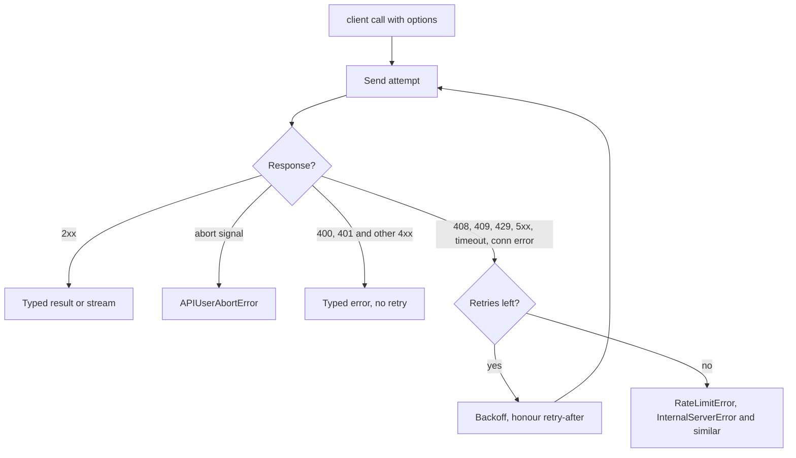

## TL;DR
Every step of a TypeScript agent is one call through `openai` or `@anthropic-ai/sdk`: typed clients with
retries, millisecond timeouts, `AbortSignal`, streams and typed errors. They differ in tool-call shapes and
in explicit versus automatic prompt caching.

## For agent builders
- **Why it matters for agents.** The agent loop is "call the model, run the tools it asked for, append the
  results, call again". The SDK call is that loop's only model-facing line, so its retries, timeouts,
  cancellation and tool-call shape decide how a 10-step run behaves under a provider incident.
- **Where it shows up in your stack.** `client.messages.create` or `.stream()` with `tools`,
  `client.chat.completions.create` or `client.responses.create` with `tools`, `stop_reason` and
  `tool_calls` as the loop's branch points, and `usage` for per-step cost.
- **What you control.** Retry layer and timeouts per step, the `signal` that stops a run when the user
  leaves, a byte-stable prefix (system prompt plus tool list) for caching, and the step budget around
  the loop.
- **What you can skip.** Writing your own SSE parser or argument-fragment reassembly; `.finalMessage()` and
  the stream helpers do it. Tool runners are optional once you understand the loop they hide.

## Why it exists
- **A hand-rolled `fetch` fails in predictable ways.** Under load the provider returns 429 or 529, and the
  call either gives up or retries immediately and worsens the overload. Timeouts, request IDs for support
  tickets, rate-limit headers, pagination of file and batch endpoints and the error taxonomy are left to
  every caller to rediscover.
- **Streams are harder than they look.** Server-sent events carry several event types that must be parsed,
  re-assembled into content blocks and matched to a stop reason. A hand-written parser handles text and
  silently drops tool calls.
- **Tool arguments arrive with a JSON schema contract TypeScript cannot see**, so they get cast rather
  than checked.
- **The SDKs make these behaviours uniform and typed.** Both are generated from the provider's API
  specification, *which is why* every request and response type matches the wire exactly and changes when
  the API does. A thin wrapper of your own re-implements a worse version of this.
- **Their defaults interact with yours.** An outer retry loop multiplies attempts; a proxy timeout shorter
  than the SDK's hides its retries; a stream not aborted on client disconnect keeps billing.

## How it works
### Shared client mechanics
| Setting | Behaviour |
|---|---|
| API key | `new OpenAI()` reads `OPENAI_API_KEY`; `new Anthropic()` reads `ANTHROPIC_API_KEY`; or pass `apiKey` |
| Other options | `baseURL`, `timeout`, `maxRetries`, `defaultHeaders`, a custom `fetch` |
| `timeout` | Milliseconds (unlike the Python SDKs' seconds); default 10 minutes |
| `maxRetries` | Default 2, so up to three attempts |
| Retries on | Connection errors and 408, 409, 429 and 5xx, with exponential backoff that honours `retry-after` |
| Runtimes | Supported Node LTS releases (check the `engines` field of your version), Bun, Deno and edge runtimes, because they use the global `fetch` |
| Per request | Optional second argument `{ timeout, maxRetries, signal, headers }` |

- **Cancellation is a plain `AbortSignal`.** Aborting rejects with `APIUserAbortError` and closes the socket,
  stopping further generation; tokens already produced are still billed.
- **Worst-case wall clock is `timeout × (maxRetries + 1)` plus backoff sleeps**, because retries are counted
  per request and a timeout is retried. Size proxy and handler timeouts from that, not from `timeout` alone.
- **Anthropic asymmetry.** For non-streaming requests with a large `max_tokens`, the Anthropic SDK raises
  its default timeout itself, and very large output caps effectively require streaming, *because* an HTTP
  response that takes many minutes is exactly what proxies and load balancers kill.

### Typed errors and request IDs
- **Hierarchy under the default export:** `APIError` with a numeric `status`, and subclasses such as
  `BadRequestError` (400), `AuthenticationError` (401), `RateLimitError` (429), `InternalServerError` (5xx),
  `APIConnectionError` and `APIConnectionTimeoutError`.
- **Check with `instanceof`, most specific first**, never by matching message text.
- **Request IDs** for support tickets: `_request_id` on objects returned by non-streaming calls,
  `request_id` on Anthropic's `MessageStream` helper.
- **Raw response:** `.withResponse()` returns `{ data, response }` so you can read rate-limit headers.

### Requests and responses
| | OpenAI Chat Completions | OpenAI Responses API | Anthropic Messages |
|---|---|---|---|
| Call | `client.chat.completions.create` | `client.responses.create` | `client.messages.create` |
| Input | `messages` with `system`, `user`, `assistant`, `tool` roles | `input` | top-level `system` string or blocks, `messages` of `user` / `assistant` turns, required `max_tokens` |
| Output | `choices[0].message` with `content` and optional `tool_calls` | typed `output` items, `output_text` convenience | `content` array of blocks (`text`, `tool_use`, `thinking`) plus `stop_reason` |
| Usage | `prompt_tokens` / `completion_tokens` | `input_tokens` / `output_tokens` | `input_tokens` / `output_tokens` plus cache read and creation counts |

- **Responses API state.** It can keep conversation state server-side: pass `previous_response_id` instead
  of resending history. Responses are stored by default unless you set `store: false`, a data-retention
  decision, not just a convenience.
- **Anthropic stop reasons:** `end_turn`, `tool_use`, `max_tokens`, `stop_sequence`, `pause_turn`,
  `refusal`, and new values as the API grows, so keep a default branch.
- **The structural difference to internalise.** Anthropic responses are always lists, so code narrows on
  `block.type`; Chat Completions returns a single message with optional fields.
- **Normalise usage early** if you log cost.

### Streaming
- **OpenAI Chat Completions** returns a stream when `stream: true` is set. Concatenate
  `choices[0].delta.content`; usage arrives in a final chunk when `stream_options: { include_usage: true }`
  is set.
- **OpenAI tool calls in a stream** arrive as `delta.tool_calls[]` fragments keyed by `index`; concatenate
  each index's `function.arguments` strings before parsing, or use the `client.chat.completions.stream()`
  helper, whose `finalChatCompletion()` does it for you.
- **OpenAI Responses API** yields named events such as `response.output_text.delta`.
- **Anthropic `client.messages.stream()`** returns a helper that is both an iterable of raw events
  (`content_block_start`, `content_block_delta` with `text_delta` or `input_json_delta`, `message_delta`,
  `message_stop`) and an emitter with `.on("text", …)`.
- **`.finalMessage()`** resolves the complete, typed `Message` once the stream ends, so one call feeds the
  user and your logs. The helper exists *because* tool-call arguments arrive as JSON fragments across many
  events, which is exactly the code you do not want to write per service.

### Tools and structured output: the two wire shapes
- **OpenAI.** Chat Completions defines a tool as `{ type: "function", function: { name, description, parameters, strict } }`;
  the model answers with `tool_calls[]`, each carrying an `id` and `function.arguments` as a JSON *string*
  you must `JSON.parse`. The result goes back as a message with `role: "tool"` and `tool_call_id`.
- **Anthropic.** It defines `{ name, description, input_schema }`; the model answers with `tool_use` content
  blocks whose `input` is already an object. Results go back inside a `user` message as `tool_result` blocks
  keyed by `tool_use_id`, all results for one turn in one message.
- **Zod helpers.** OpenAI has `zodFunction` and `zodResponseFormat` from `openai/helpers/zod`, with a
  `parse` method that returns `message.parsed`. Anthropic has `betaZodTool` with
  `client.beta.messages.toolRunner`, which also runs the call-tool-append-repeat loop for you.
- **Structured output.** OpenAI: `response_format` with a JSON schema and `strict: true` (`text.format` on
  the Responses API). Anthropic: an `output_config.format` JSON schema in current SDK versions. In both, keep
  your own `safeParse` on the result, as the schema-validation lesson argues.

### The agent loop on a native SDK
Each iteration is one ordinary SDK call; the loop is your code (or `toolRunner` on Anthropic's beta surface):
1. **Call** with the stable prefix first: `system`, then `tools`, then the growing `messages`.
2. **Branch on the stop signal.** Anthropic: `stop_reason` of `tool_use` means run tools; `end_turn` means
   done; `max_tokens`, `pause_turn` and `refusal` each need their own branch. OpenAI Chat Completions:
   `tool_calls` present on the message means run tools.
3. **Echo the assistant turn unchanged, run every requested tool, validate inputs with the tool's schema,
   and send all results for that turn back together.**
4. **Repeat under a budget:** a maximum step count, a token or cost ceiling summed from `usage`, and the
   run's `AbortSignal` passed to every call.

- **Every step is a new request that resends the transcript,** so input tokens grow per step; caching the
  prefix is what keeps step 10 cheap.
- **Per-step retries compound.** The SDK's `maxRetries` applies to each step's call, so a run's worst-case
  wall clock is the per-call worst case times the number of steps.

### Caching, batching, platforms
- **Anthropic caching is opt-in.** Place `cache_control: { type: "ephemeral" }` on the last stable block
  (system prompt, tool list), or in recent API versions set a top-level `cache_control` that marks the last
  cacheable block for you. Verify with `usage.cache_read_input_tokens`.
- **It is fragile by design.** Any byte change before the breakpoint invalidates it, and a prefix below the
  model's minimum cacheable length is not cached at all.
- **OpenAI caches long, repeated prefixes automatically** and reports it in
  `usage.prompt_tokens_details.cached_tokens`, so the lever is prompt ordering, not annotations.
- **Batch and files.** Both offer a batch endpoint for offline work at a discount and a files API.
- **Token counting.** Anthropic has `messages.countTokens`; OpenAI estimates usually come from a tokenizer
  library such as `tiktoken` (check whether your API version also offers a counting endpoint).
- **Cloud platforms.** OpenAI ships an `AzureOpenAI` client; Anthropic ships `@anthropic-ai/bedrock-sdk` and
  `@anthropic-ai/vertex-sdk` with the same `messages` surface behind platform credentials.

## Diagram
What one SDK call does on failure: retryable errors back off and retry until `maxRetries` is spent, then
surface as a typed error; aborts and 4xx errors surface at once.



## Examples
### Two adapters behind one interface
One narrow `ModelClient` interface with two adapters. Each streams tokens to stdout, returns the full text
with normalised usage, relies on the SDK's retries rather than its own, and accepts an `AbortSignal` so a
disconnected client stops generation. `isRetryable` is what an outer circuit breaker would consult, using
typed errors instead of message text.

```ts
import Anthropic from "@anthropic-ai/sdk";
import OpenAI from "openai";

export interface Completion { text: string; inputTokens: number; outputTokens: number; requestId?: string }
export interface ModelClient { complete(system: string, user: string, signal?: AbortSignal): Promise<Completion> }

export function anthropicClient(model = "claude-opus-5-5"): ModelClient {
  const client = new Anthropic({ maxRetries: 3, timeout: 60_000 });      // ms; retries 408/409/429/5xx
  return {
    async complete(system, user, signal) {
      const stream = client.messages.stream(
        { model, max_tokens: 2048, system, messages: [{ role: "user", content: user }] },
        { signal },
      );
      stream.on("text", (delta) => process.stdout.write(delta));
      const msg = await stream.finalMessage();                             // typed Message, after the stream
      const text = msg.content.flatMap((b) => (b.type === "text" ? [b.text] : [])).join("");
      return { text, inputTokens: msg.usage.input_tokens, outputTokens: msg.usage.output_tokens,
               requestId: stream.request_id ?? undefined };                // from the response header
    },
  };
}

export function openaiClient(model = process.env.OPENAI_MODEL ?? "set-a-current-model-id"): ModelClient {
  const client = new OpenAI({ maxRetries: 3, timeout: 60_000 });
  return {
    async complete(system, user, signal) {
      const stream = await client.chat.completions.create(
        { model, stream: true, stream_options: { include_usage: true },
          messages: [{ role: "system", content: system }, { role: "user", content: user }] },
        { signal },
      );
      let text = "", usage: OpenAI.CompletionUsage | undefined;
      for await (const chunk of stream) {
        const delta = chunk.choices[0]?.delta?.content ?? "";
        process.stdout.write(delta); text += delta;
        if (chunk.usage) usage = chunk.usage;                               // arrives in the final chunk
      }
      return { text, inputTokens: usage?.prompt_tokens ?? 0, outputTokens: usage?.completion_tokens ?? 0 };
    },
  };
}

export function isRetryable(err: unknown): boolean {      // abort and 4xx errors are not retryable
  if (err instanceof Anthropic.APIConnectionError || err instanceof OpenAI.APIConnectionError) return true;
  const e = err instanceof Anthropic.APIError || err instanceof OpenAI.APIError ? err : undefined;
  return e !== undefined && (e.status === 429 || (e.status ?? 0) >= 500);
}
```

### The tool-call round trip on the wire
The one thing the adapters hide: the four objects of a tool round trip, in each shape.

```jsonc
// OpenAI Chat Completions: the model's turn, then yours. arguments is a STRING.
{ "role": "assistant", "content": null, "tool_calls": [{ "id": "call_1", "type": "function",
    "function": { "name": "lookup_order", "arguments": "{\"orderId\":\"ord_42\"}" } }] }
{ "role": "tool", "tool_call_id": "call_1", "content": "{\"status\":\"shipped\"}" }

// Anthropic Messages: content is a list of blocks; input is an OBJECT; the result rides in a user turn.
{ "role": "assistant", "content": [
    { "type": "text", "text": "Let me check that order." },
    { "type": "tool_use", "id": "toolu_1", "name": "lookup_order", "input": { "orderId": "ord_42" } }] }
{ "role": "user", "content": [
    { "type": "tool_result", "tool_use_id": "toolu_1", "content": "{\"status\":\"shipped\"}" }] }
```

- **Everything a tool adapter does follows from these four objects:** parse or do not parse the arguments,
  echo the assistant turn back unchanged, and key the result by the call's id.
- **Two calls in one turn:** OpenAI expects two `tool` messages; Anthropic expects both `tool_result`
  blocks in the same single user message.

### A budgeted agent loop on the Anthropic SDK
The round trip above, repeated until the model finishes. Budgets are explicit, the run's `signal` reaches
every call, tool inputs are validated with Zod before a handler runs, and a failed tool goes back to the
model as `is_error` instead of crashing the run.

```ts
import Anthropic from "@anthropic-ai/sdk";
import { z } from "zod";
import { db } from "./db";

const client = new Anthropic({ maxRetries: 2, timeout: 60_000 });
const SYSTEM = "You are a support agent. Use tools for order data; never guess.";
const tools: Anthropic.Tool[] = [{ name: "lookup_order", description: "Fetch an order by id",
  input_schema: { type: "object", properties: { orderId: { type: "string" } }, required: ["orderId"] } }];
const LookupOrder = z.object({ orderId: z.string().regex(/^ord_\w+$/) });
const handlers: Record<string, (input: unknown) => Promise<string>> = {
  lookup_order: async (input) => JSON.stringify(await db.orders.find(LookupOrder.parse(input).orderId)),
};

export async function runAgent(task: string, signal: AbortSignal, maxSteps = 6, maxInputTokens = 100_000) {
  const messages: Anthropic.MessageParam[] = [{ role: "user", content: task }];
  let inputTokens = 0;
  for (let step = 1; step <= maxSteps; step++) {
    const msg = await client.messages.create(
      { model: "claude-opus-5-5", max_tokens: 2048, system: SYSTEM, tools, messages }, { signal });
    inputTokens += msg.usage.input_tokens + (msg.usage.cache_read_input_tokens ?? 0);  // cached reads too
    messages.push({ role: "assistant", content: msg.content });            // echo the turn unchanged
    if (msg.stop_reason === "end_turn")
      return { text: msg.content.flatMap((b) => (b.type === "text" ? [b.text] : [])).join(""), step, inputTokens };
    if (msg.stop_reason !== "tool_use") throw new Error(`stopped: ${msg.stop_reason}`); // max_tokens, refusal...
    if (inputTokens > maxInputTokens) throw new Error("token budget exhausted");
    const results: Anthropic.ToolResultBlockParam[] = [];
    for (const b of msg.content) {
      if (b.type !== "tool_use") continue;
      try {
        const run = handlers[b.name];
        if (!run) throw new Error(`unknown tool ${b.name}`);
        results.push({ type: "tool_result", tool_use_id: b.id, content: await run(b.input) });
      } catch (e) {                                                         // message written for the model
        results.push({ type: "tool_result", tool_use_id: b.id, is_error: true,
                       content: e instanceof Error ? e.message : "tool failed" });
      }
    }
    messages.push({ role: "user", content: results });                     // all results, one user message
  }
  throw new Error("step budget exhausted");
}
```

- **The default branch matters.** `pause_turn` (used with server-side tools) and future stop reasons land in
  the `throw`; handle the ones your configuration can produce instead of looping on them.

### Worked scenario: worst-case latency of one call
With the adapters' settings, `timeout: 60_000` and `maxRetries: 3`, during a provider outage where every
attempt times out:

| Quantity | Value |
|---|---|
| Attempts | `maxRetries + 1` = 4 |
| Time in attempts | 4 × 60 s = 240 s |
| Plus backoff sleeps | a few seconds more, longer if `retry-after` says so |
| A 60 s proxy timeout in front | the user sees a 504 after the first attempt while the SDK keeps retrying |
| Outer retry loop of 3 attempts on top | up to 12 requests and about 12 minutes for one click |
| A 6-step agent run with only the SDK layer | each step can take 240 s, so up to 24 minutes for one run |

- **Fix:** pick one retry layer, set the proxy and handler timeouts above `timeout × (maxRetries + 1)`, and
  pass the request's `AbortSignal` so a user who gives up also stops the chain.
- **For agents, add a run deadline.** Per-call settings cannot bound a multi-step run; give the run its own
  wall-clock budget (an `AbortSignal` that fires at the deadline) and lower `timeout` per step.

### Reading request IDs and rate-limit headers
`.withResponse()` exposes the raw `Response`, which carries the provider's rate-limit headers.

```ts
import Anthropic from "@anthropic-ai/sdk";

const client = new Anthropic();
const { data: msg, response } = await client.messages
  .create({ model: "claude-opus-5-5", max_tokens: 256, messages: [{ role: "user", content: "ping" }] })
  .withResponse();
console.log({
  requestId: msg._request_id,                                               // quote this in support tickets
  requestsRemaining: response.headers.get("anthropic-ratelimit-requests-remaining"),
});
```

## Production patterns
- **One retry layer only.** When the call already runs inside a queue with redelivery or your own retry
  and breaker, construct the client with `maxRetries: 0`; otherwise keep the SDK's retries and remove the
  outer loop. Monitor requests per user action and retry counts during provider incidents.
- **Timeouts sized from the retry budget.** Set handler and proxy timeouts above `timeout × (maxRetries + 1)`
  plus backoff, and stream any generation with a large `max_tokens`. Watch for 504s and
  `APIConnectionTimeoutError` that appear only on long answers.
- **Verify caching with counters.** For Anthropic, alert when `usage.cache_read_input_tokens` is zero on a
  route that sets `cache_control`; for OpenAI, track `usage.prompt_tokens_details.cached_tokens`. Keep
  timestamps and per-user data after the stable prefix, and keep the agent transcript append-only so every
  step after the first reads the cached system prompt and tool list.
- **Back off from rate-limit headers.** Read the provider's remaining-request and remaining-token headers via
  `.withResponse()` (for OpenAI, the `x-ratelimit-remaining-requests` family) and slow a worker pool before
  hitting 429s. Monitor the 429 rate per API key.
- **Budgeted, traced agent runs.** Wrap the loop with a step cap, a summed-`usage` token ceiling and a run
  deadline signal. Log one structured line per step: step number, `stop_reason`, tools called, normalised
  input and output tokens, cache counts and `_request_id` (or `stream.request_id`), so support tickets can
  be traced. Monitor steps per run, runs ending on a budget, and cost per route and per completed task.
- **Same surface on cloud platforms.** When a customer must stay inside their cloud, swap the client for
  `AzureOpenAI`, `@anthropic-ai/bedrock-sdk` or `@anthropic-ai/vertex-sdk` behind the same `ModelClient`
  interface. Monitor per-platform latency and error rates separately.

## Trade-offs
- **Built-in retries vs multiplied attempts.** Transient failures become invisible, which is what you want
  until you wrap the call in your own retry or a queue with redelivery; then attempts multiply and you should
  set `maxRetries: 0` in one of the layers.
- **Generated types vs upgrade churn.** Types track the API exactly, so upgrades surface breaking changes at
  compile time; the flip side is that a minor SDK bump can rename a type and force a same-day fix across
  the codebase.
- **Streaming helpers vs memory.** They accumulate tool arguments and expose the final message for free,
  but buffer the whole response in memory; for very long outputs you may prefer the raw event iterable.
- **Explicit vs automatic caching.** Anthropic's breakpoints give control and a verifiable hit counter at the
  cost of discipline about prompt ordering; OpenAI's automatic caching needs no annotations but gives less
  control over what is cached.
- **Provider Zod helpers vs portability.** They couple tool definitions to that SDK; a shared schema module
  converted per provider keeps the option of a second provider open.

## Pitfalls
- **Matching on `error.message` strings instead of `instanceof` and `status`.** Symptom: retry logic stops
  working after an SDK or API wording change. Fix: branch on the error class, most specific first, then `status`.
- **Passing the timeout in seconds as in Python.** Symptom: every request times out after a few
  milliseconds and is retried twice (three attempts) before failing. Fix: pass milliseconds (`60_000`).
- **Forgetting the `signal` on streaming calls.** Symptom: completions keep running, and billing, long after
  the HTTP client disconnected. Fix: abort a request-scoped `AbortController` on disconnect and pass its
  `signal` as a request option.
- **Treating `function.arguments` as an object on OpenAI, or `input` as a string on Anthropic.** Symptom: a
  `TypeError` or `[object Object]` inside a tool. Fix: `JSON.parse` OpenAI arguments, use Anthropic's
  `input` as is, and validate both with the tool's schema.
- **Text before the `tool_result` blocks, the wrong role, or another turn between the `tool_use` and its
  result.** Symptom: a 400 saying `tool_use` ids were found without `tool_result` blocks immediately after.
  Fix: echo the assistant turn unchanged, then send one `user` message that starts with every `tool_result`
  block for that turn. Splitting parallel results across messages is a quieter mistake that discourages
  the model from making parallel tool calls.
- **Reading `response.content[0].text` on Anthropic without narrowing.** Symptom: a compile error at best,
  and at worst a runtime `undefined` when the first block is `tool_use` or `thinking`. Fix: filter or narrow
  on `block.type === "text"`.
- **Omitting `max_tokens` on Anthropic or setting it too low.** Symptom: a 400 on the former and truncated
  JSON with `stop_reason: "max_tokens"` on the latter. Fix: always set it, size it for the longest valid
  answer, and treat `max_tokens` as a failure branch.
- **A non-streaming request with a very large `max_tokens` through a proxy with a short idle timeout.**
  Symptom: 504s or `APIConnectionTimeoutError` on long answers only, then retries that may pay for the same
  long generation again. Stream long generations.
- **An agent loop with no step or token budget.** Symptom: a run that calls the same tool repeatedly until a
  proxy timeout or the monthly bill stops it. Fix: a step cap, a token ceiling summed from `usage`, and a
  log line when either ends a run.
- **Verifying caching by vibes.** Symptom: a system prompt with a timestamp in it, a cache hit rate of zero
  and a bill that never drops. Fix: move variable content after the breakpoint and alert on
  `cache_read_input_tokens`.

## When to use
- **Use the native SDK** whenever you commit to a provider and want its full surface: streaming helpers,
  tool runners, batch and files endpoints, explicit caching, platform clients for Azure, Bedrock or Vertex.
- **Write your own agent loop on it** when you need per-step control: approvals, custom stop rules, exact
  request bodies for caching and audit, or traces per step.
- **Wrap it behind a narrow interface** so tests can inject a fake and a second provider can be added
  later. Keep the SDK's retries while deciding explicitly where your own retries, queue redelivery and
  circuit breaker sit.
- **Reach for a unification layer** such as the Vercel AI SDK when multi-provider or browser streaming is
  the primary requirement.
- **Measure** tokens and cost per request from `usage`, p95 time to first token, retry counts, and cache
  hit rate.
- **Interviews** probe the tool-call round trip in both shapes, what the SDK retries and what it does not,
  and how a cancelled request actually stops.

## Role lens
- **Engineer:** Configures clients with explicit timeouts and retries, writes adapters that normalise
  usage and errors, narrows content blocks correctly, and propagates `AbortSignal` into every call.
- **Architect:** Decides the provider boundary (native SDK behind an interface versus a unification
  layer), where retries and breakers live across layers, and how cost telemetry is normalised.
- **FDE:** Reads a customer's integration for the classic faults (string-matched errors, missing
  signals, doubled retries, unverified caching) and converts it to typed, cancellable, observable calls.

## Check yourself
**Q:** A service wraps `client.messages.create` in its own retry loop of three attempts with backoff,
and the SDK keeps its default retries. Under a provider outage, how many requests can one user action
generate, how long can it take, and what would you change?
**A:** The SDK retries twice by default, so each outer attempt can send three requests; three outer
attempts give up to nine requests, each waiting up to the SDK timeout plus backoff, so one click can
hold a connection for many minutes and amplify load on an already failing provider. The fix is to pick
one layer. Either set `maxRetries: 0` and own retries, jitter and a circuit breaker in your client
wrapper, or keep the SDK's retries and remove the outer loop, treating a thrown `RateLimitError` or
`InternalServerError` as a signal to shed load or fail fast. Whichever you choose, set the handler and
proxy timeouts from `timeout × (retries + 1)`, pass an `AbortSignal` so a disconnected user stops the
chain, and record the request ID from the response for the inevitable support ticket.

## Interview questions
### Why use the provider SDK instead of a plain `fetch` to the API?
- **The SDK carries production defaults:** retries on connection errors and 408, 409, 429 and 5xx with
  backoff honouring `retry-after`, timeouts, request IDs and a typed error hierarchy.
- **Generated types match the wire**, so an API change shows up at compile time.
- **Streaming helpers** reassemble tool-call fragments into a final typed message, the part hand-written
  parsers usually drop.

### A tool-calling request to Anthropic returns a 400 about `tool_use` ids without `tool_result` blocks. How do you debug it?
- **Check the turn after the assistant's `tool_use`:** it must be a `user` message whose content starts with
  the `tool_result` blocks, keyed by `tool_use_id`.
- **Common causes:** text placed before the results, a result sent with the wrong role, another turn in
  between, or parallel results split across messages.
- **Also check** that the assistant turn was echoed back unchanged, including its text block.

### How does cancellation actually stop a streamed completion, and what is still billed?
- **Mechanism:** passing `signal` as a request option; aborting rejects with `APIUserAbortError` and closes
  the socket, so the provider stops generating.
- **Billing:** tokens already produced are still billed, so abort promptly on client disconnect.
- **Wiring:** create an `AbortController` per request, abort it when the incoming HTTP request closes, and
  pass the same signal to every model call that request makes.

### When would you choose OpenAI's Responses API over Chat Completions?
- **Choose Responses** for typed `output` items, named stream events and server-side state via
  `previous_response_id` instead of resending history.
- **Mind retention:** responses are stored by default unless `store: false`, a data-retention decision.
- **Keep Chat Completions** when existing code and tooling depend on the `messages` / `choices` shape.

### Your Anthropic bill did not drop after adding prompt caching. What do you check?
- **The counter first:** `usage.cache_read_input_tokens` near zero means no hits.
- **Then the prefix:** any byte change before the breakpoint, such as a timestamp in the system prompt,
  invalidates it, and a prefix below the minimum cacheable length is never cached.
- **Fix:** move variable content after the `cache_control` breakpoint and alert on the hit rate.

### Walk me through the agent loop you would write on the native SDK, and how it stops.
- **Loop:** call with a stable `system` and `tools` prefix, echo the assistant turn, run every requested
  tool with schema-validated inputs, and return all results for the turn in one message.
- **Stop rules:** `end_turn` (or no `tool_calls`) ends the run; `max_tokens`, `refusal` and unknown stop
  reasons get their own branch; a step cap, token ceiling and run deadline end runaway loops.
- **Operate it:** one log line per step with tokens and request ID, and the user's `AbortSignal` on every call.

## Quiz
### Q: What is the key structural difference between a tool call in OpenAI Chat Completions and in Anthropic Messages?
- [ ] OpenAI requires a JSON schema while Anthropic infers parameters from the description
- [x] OpenAI returns `tool_calls` with `arguments` as a JSON string and takes results as `role: "tool"` messages; Anthropic returns `tool_use` content blocks with a parsed `input` and takes results as `tool_result` blocks in a user message
- [ ] Anthropic executes tools server-side, so no result needs to be returned
- [ ] OpenAI allows only one tool call per response while Anthropic allows many
> Both require a JSON schema and both can return several calls in one turn. The difference is the
> envelope: a string to parse and a `tool` role on one side, a parsed object inside a content block and a
> `tool_result` block on the other. Neither executes your custom tool for you.

### Q: The TypeScript SDKs take `timeout: 30`. What happens, and why?
- [ ] Requests time out after 30 seconds, matching the Python SDK
- [x] Requests time out after 30 milliseconds and are retried `maxRetries` times, because the TypeScript SDKs take milliseconds
- [ ] The value is ignored because timeouts are set per request only
- [ ] The SDK throws at construction because the minimum timeout is one second
> Unit mismatch is a common port-from-Python bug. The TypeScript clients take milliseconds, and because
> timeouts count as retryable, the 30 ms failure repeats up to the retry limit before the typed
> `APIConnectionTimeoutError` surfaces.

### Q: Why should error handling use `instanceof OpenAI.RateLimitError` rather than inspecting `error.message`?
- [ ] Because `error.message` is always empty in the SDKs
- [ ] Because `instanceof` is faster than string comparison
- [x] Because the typed classes map to HTTP status and error type stably, while message text can change with any SDK or API release
- [ ] Because `error.message` contains the API key and must not be read
> The SDKs expose a class per status (and a `status` field) precisely so callers can branch on a stable
> contract. Message wording is informational and may change; code that depends on it breaks silently
> when it does.

## Use cases & projects
### Use cases
- **Hand-written agent loops.** Teams that need approvals, custom stop rules or per-step traces write the
  loop directly on `messages.create` or `chat.completions.create`.
- **Cost-controlled long runs.** A cached system prompt and tool list, verified with the cache counters,
  keeps step 10 of a research agent close to the price of step 1.
- **Provider fallback for agents.** Two adapters behind one interface let a run fail over when the breaker
  for one provider opens, with typed errors deciding what is retryable.
- **Agents inside a customer's cloud.** The Bedrock, Vertex or Azure clients keep the same loop code while
  traffic stays in the customer's account.

### Mini project
**Write a budgeted tool-calling agent on both SDKs (2-3 hours).**
- **Goal:** one agent loop with two tools that runs on Anthropic and OpenAI behind a shared interface, with
  budgets and cancellation.
- **Steps:** define `lookup_order` and `refund_order` with one Zod schema each; write the loop for Anthropic
  (`tool_use` blocks) and for OpenAI Chat Completions (`tool_calls` with string arguments); add a step cap
  of 6, a token ceiling and an `AbortSignal`; put `cache_control` on the Anthropic system prompt and pad the
  stable prefix above the model's minimum cacheable length; log one line per step with tokens and the
  request ID.
- **Done when:** the same task succeeds on both providers, a forced bad argument comes back as an error
  result the model recovers from, aborting mid-run stops further calls, and the logs show cache-read tokens
  on every step after the first.

### Major project
This lesson feeds the module Capstone (see the module guide): the document Q&A service streams answers
through a native SDK behind an injected interface, with timeouts, classified retries, a circuit breaker and
a fallback provider.
