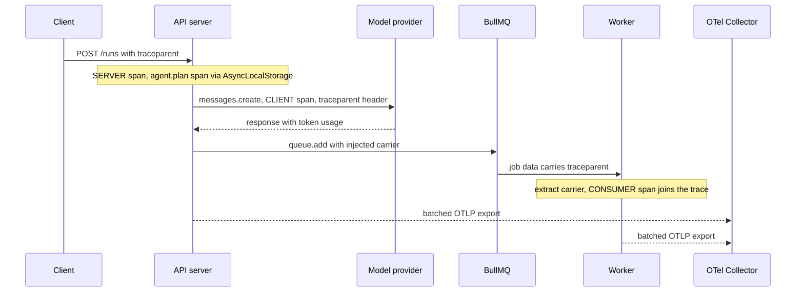

## TL;DR
OpenTelemetry (OTel) is the vendor-neutral standard for traces, metrics and logs, and how you see what an
agent run actually did. In Node, load the SDK first, auto-instrument HTTP and databases, and add spans per
agent step and tool call.

## For agent builders
- **Why it matters for agents.** An agent run is a tree of model calls, tool calls, retrievals and queue
  hops. When a run takes 40 s, loops or burns 60,000 tokens, a trace with one span per step and tool is
  how you find which step, which tool and which prompt version did it.
- **Where it shows up in your stack.** `instrumentation.ts` loaded before the app, the Anthropic SDK's own
  model-call spans with `gen_ai.*` usage, your `agent.run`, `agent.step` and `tool.*` spans, BullMQ
  context propagation, and an LLM observability tool (Langfuse, Phoenix) fed over OTLP.
- **What you control.** Span names and attributes (tenant, run id, step, prompt version, tool name),
  whether prompt content is recorded, sampling (keep every failed run), and flushing on shutdown.
- **What you can skip.** Collector internals and writing your own exporters. Use the Node SDK,
  auto-instrumentation and a collector config someone else maintains.

## Why it exists
- **Agent requests fan out across processes.** An HTTP handler calls a planner model, which calls three
  tools; two hit Postgres and one enqueues a BullMQ job that calls an embedding API on another replica.
- **Logs say *that*, not *why*.** When that request takes 40 s or costs 60,000 tokens, logs from six
  processes show it happened, but nothing ties the lines together or records durations as a tree.
- **Hand-rolled tracing breaks.** A `requestId` threaded through every function and `console.time` pairs
  break at the first `await` you forgot, do not cross the queue, and produce data no tool can draw as a
  waterfall.
- **Node has no thread to hang context on.** "Which request is this log line from" must travel along the
  async continuation chain; OTel's Node SDK does that with `AsyncLocalStorage` and propagates context
  across processes with standard headers.
- **Vendor neutrality pays off.** Every backend (Jaeger, Tempo, Honeycomb, Datadog, Langfuse and others
  via OTLP) accepts the format, which matters *because* the backend you pick in year one is rarely the
  one you have in year three, and enterprise customers want your spans in *their* collector. The
  observability module covers concepts; this lesson is the Node mechanics.

## How it works
### API, SDK and the split between them
- **Your code calls the API** (`@opentelemetry/api`): `trace.getTracer(name).startActiveSpan(...)`,
  `metrics.getMeter(...)`.
- **The SDK decides what happens** (`@opentelemetry/sdk-node`, or `NodeTracerProvider` directly):
  sampling, batching, exporting. It is configured once.
- **Libraries depend only on the API** *because* then they can be instrumented without forcing an SDK or
  exporter on their users; with no SDK registered, API calls are no-ops.

### Startup order and auto-instrumentation
1. **Instrumentation patches modules as they load:** `http`, `undici`/`fetch`, `pg`, `ioredis`,
   `express`, `fastify`, `pino` and others.
2. **So it must be installed before they are imported.** The SDK lives in its own `instrumentation.ts`,
   loaded with `node --require` (CommonJS) or `node --import` (ESM), or via `NODE_OPTIONS`.
3. **ESM needs a loader hook.** `import` statements bypass the CommonJS `require` hook, so the file must
   register OTel's ESM hook (`module.register("@opentelemetry/instrumentation/hook.mjs", ...)`). The
   zero-code entry point `@opentelemetry/auto-instrumentations-node/register` does this for you.
4. **The classic silent failure:** importing it from `app.ts` after your framework. No error, no spans.

### Spans, kinds and the tree
- **A span** is a named, timed operation with a trace id (shared by the whole request), its own span id,
  a parent span id, attributes, events (timestamped points such as "first token") and a status.
- **The backend rebuilds the tree from parent ids alone,** so a missing parent link produces an orphan
  root rather than an error.

| Kind | Used for |
|---|---|
| `SERVER` | handling an inbound request |
| `CLIENT` | an outbound call |
| `PRODUCER` / `CONSUMER` | the two ends of a queue |
| `INTERNAL` | in-process work such as an agent step |

- **Kinds matter** *because* backends derive service maps and latency breakdowns from them: a `CLIENT`
  span with no matching `SERVER` child is time spent waiting on something you do not instrument, such as
  a model provider.

### Context propagation in a process
- **The SDK installs an `AsyncLocalStorage` context manager,** so the active span follows `await`,
  promises, timers and callbacks.
- **The rule:** `AsyncLocalStorage` captures the current store whenever Node creates an async resource (a
  promise, a timer, a socket callback) and restores it when that continuation runs. "The active span" is
  whatever was active when the continuation was *scheduled*.
- **Where context gets lost.** A library that queues callbacks and invokes them later from a different
  continuation (a hand-rolled connection pool, a batching client) runs them in the wrong context. An
  `EventEmitter` listener runs in the context of whoever called `emit()`, not whoever registered it.
- **The fix:** bind explicitly with `context.bind(context.active(), fn)` (or `AsyncResource.bind`) where
  the callback is handed over.

### Context propagation across processes
- **HTTP is automatic.** The `http` and `fetch` instrumentations inject and extract `traceparent` and
  `tracestate` (W3C Trace Context) on every outbound and inbound request.
- **Queues are not, unless the library supports it.** BullMQ 5 has an opt-in `telemetry` option,
  provided by the `bullmq-otel` package.
- **Otherwise do it by hand:** serialise context into job data on the producer
  (`propagation.inject(context.active(), carrier)`) and restore it in the worker
  (`propagation.extract(...)`) so the job's spans link to the originating request.

### Spans for model calls
- **The Anthropic TypeScript SDK emits its own span** per request, `anthropic.messages.create` (kind
  `CLIENT`), through whatever tracer provider the application registered.
- **Its attributes:** `gen_ai.provider.name`, `gen_ai.usage.input_tokens` (cache reads and writes
  included), `gen_ai.usage.output_tokens`, the cache read and write counts, and `anthropic.request.id`.
  Its tool runner adds a parent span plus one span per tool. The feature is in beta, so pin the SDK
  version.
- **Rule 1: wrap the call in your own span** (`agent.plan`, `tool.search_docs`) with app attributes
  (tenant, run id, prompt version); the SDK span nests under it. The SDK sends its span's `traceparent`
  to the API, so server-side spans (if API tracing is configured) join the same trace.
- **Rule 2: one instrumentation per SDK.** If a third-party instrumentation already patches the SDK, turn
  one off (`openTelemetry: false` or `ANTHROPIC_OPEN_TELEMETRY=false`) or every request appears twice.
- **Other providers:** if the SDK emits nothing, set the GenAI semantic-convention attributes yourself
  (`gen_ai.provider.name`, the request model, `gen_ai.usage.*`). The conventions are still experimental,
  so expect renames.

### Prompt content in spans
- **Off by default.** The SDK's content mode is `metadata_only`.
- **`content` mode is an explicit opt-in** *because* reading conversations from traces is useful but
  makes your tracing backend a store of customer data under its own retention rules.
- **Size limit:** content beyond a per-span limit (0.75 MB by default) is truncated.
- **Alternative:** send content to an LLM-specific tool (Langfuse, Phoenix) built for it.

### Streaming
- **A streaming call's span ends when the stream is fully read or closed,** so close a stream you abandon
  or its span never ends.
- **Spans started while reading chunks are siblings** of the SDK span, not children. Start one span of
  your own around both the call and the read loop, and add an event at the first token so
  time-to-first-token is queryable.

### Metrics and logs
- **Metrics:** a histogram for model latency and a counter for tokens by model and tenant; these
  aggregate cheaply where traces are sampled.
- **Logs:** Pino or Winston with the OTel log instrumentation puts `trace_id` and `span_id` on every
  line, which lets you jump from a log to the trace.

### Export and batching
- **Pipeline:** spans go through a `BatchSpanProcessor` to an OTLP exporter (HTTP or gRPC), usually to an
  OpenTelemetry Collector sidecar or gateway that fans out to backends, redacts and tail-samples.
- **Why batch:** exporting each span synchronously would put a network call on every operation.

| Setting | Default | Behaviour |
|---|---|---|
| In-memory queue | 2,048 spans | when full, new spans are dropped, not blocked |
| Batch size | up to 512 spans | exported when a batch fills |
| Schedule | every 5 seconds | exports whatever is queued |

- **Dropping protects latency** at the cost of silently missing data; tune `OTEL_BSP_MAX_QUEUE_SIZE` and
  watch the dropped count.
- **`SimpleSpanProcessor`** (export on end) is for tests only.
- **Flush on exit.** On shutdown call `sdk.shutdown()` so the batch processor flushes; otherwise the last
  spans of every deploy vanish.

### Sampling and configuration
- **Head sampling** in the SDK (`parentbased_traceidratio` at, say, 10%) cuts cost.
- **`parentbased` follows the caller:** a service obeys the sampled flag in the incoming `traceparent` and
  applies its own ratio only at the root, *because* independent coin flips per service would produce
  traces with random holes.
- **Head sampling decides before anything has gone wrong,** so it throws away 90% of the rare slow or
  failed traces along with the boring ones.
- **Tail sampling in the collector** keeps errors and slow traces *because* it decides after seeing the
  whole trace.
- **Config is environment-driven:** `OTEL_SERVICE_NAME`, `OTEL_EXPORTER_OTLP_ENDPOINT`,
  `OTEL_TRACES_SAMPLER`, `OTEL_RESOURCE_ATTRIBUTES`.

## Diagram
One trace across an API, a model call and a queue hop. HTTP propagation is automatic; the queue hop
only joins the trace because the producer injects context into the job and the worker extracts it.



## Examples
### SDK setup and an application span around a model call
`instrumentation.ts` configures the SDK and is loaded before the app with
`node --import ./instrumentation.js app.js` (for a CommonJS build, use `--require` and drop the two
`register` lines, which only an ES module can run).

The second block shows an application span around a model call; the Anthropic SDK's own
`anthropic.messages.create` span, with token usage, nests under it automatically because the SDK uses
the registered provider.

```ts
// instrumentation.ts — loaded first, never imported by application code except for shutdown
import { register } from "node:module";
register("@opentelemetry/instrumentation/hook.mjs", import.meta.url);  // ESM only: lets patches reach `import`ed modules
import { NodeSDK } from "@opentelemetry/sdk-node";
import { getNodeAutoInstrumentations } from "@opentelemetry/auto-instrumentations-node";
import { OTLPTraceExporter } from "@opentelemetry/exporter-trace-otlp-http";

export const sdk = new NodeSDK({
  traceExporter: new OTLPTraceExporter(),            // endpoint from OTEL_EXPORTER_OTLP_ENDPOINT
  instrumentations: [getNodeAutoInstrumentations({ "@opentelemetry/instrumentation-fs": { enabled: false } })],
});
sdk.start();                                          // registers the provider and the AsyncLocalStorage context manager

// llm.ts — your span carries app semantics; the SDK span carries gen_ai.* usage
import { trace, SpanStatusCode } from "@opentelemetry/api";
import Anthropic from "@anthropic-ai/sdk";
const tracer = trace.getTracer("agent-api");
const client = new Anthropic();                       // SDK tracing on by default, metadata only: no prompt text exported

export async function plan(tenant: string, runId: string, prompt: string) {
  return tracer.startActiveSpan("agent.plan", async (span) => {
    span.setAttributes({ "app.tenant": tenant, "app.run_id": runId, "app.prompt_version": "planner-v7" });
    try {
      const res = await client.messages.create(
        { model: process.env.MODEL ?? "claude-opus-5-5", max_tokens: 16000, messages: [{ role: "user", content: prompt }] },
        { openTelemetry: { conversationId: runId } },   // written to gen_ai.conversation.id on the SDK span
      );
      span.setAttribute("app.stop_reason", res.stop_reason ?? "unknown");
      return res.content.flatMap((b) => (b.type === "text" ? [b.text] : [])).join("");
    } catch (e: any) {
      span.recordException(e); span.setStatus({ code: SpanStatusCode.ERROR, message: e.message });
      throw e;
    } finally {
      span.end();                                     // always end, or the span never exports
    }
  });
}
```

### Agent scenario: one span per run, step and tool call
The run span holds totals; each step span holds that step's tokens and tool count; each tool span holds
the tool name and whether it returned an error. A slow or looping run then reads as a waterfall.

```ts
import { trace, SpanStatusCode, type Span } from "@opentelemetry/api";
const tracer = trace.getTracer("agent-loop");

async function inSpan<T>(name: string, attrs: Record<string, string | number>, fn: (s: Span) => Promise<T>) {
  return tracer.startActiveSpan(name, { attributes: attrs }, async (span) => {
    try { return await fn(span); }
    catch (e: any) { span.recordException(e); span.setStatus({ code: SpanStatusCode.ERROR }); throw e; }
    finally { span.end(); }
  });
}

export function runAgent(runId: string, tenant: string, task: string) {
  return inSpan("agent.run", { "app.run_id": runId, "app.tenant": tenant, "app.prompt_version": "agent-v3" }, async (run) => {
    let tokens = 0;
    for (let step = 0; step < 20; step++) {
      const turn = await inSpan("agent.step", { "app.step": step }, async (s) => {
        const t = await callModel(runId, step);                  // SDK model-call span nests here
        s.setAttributes({ "app.tool_calls": t.toolCalls.length, "app.step_tokens": t.inputTokens + t.outputTokens });
        for (const c of t.toolCalls) {
          await inSpan(`tool.${c.name}`, { "app.tool": c.name }, async (ts) => {
            const r = await callTool(c);                         // returns { content, isError }
            ts.setAttribute("app.tool_error", r.isError ? 1 : 0);
          });
        }
        return t;
      });
      tokens += turn.inputTokens + turn.outputTokens;
      if (turn.toolCalls.length === 0) break;
    }
    run.setAttribute("app.total_tokens", tokens);
  });
}
```

- **Span names stay low-cardinality.** Tool names are a small fixed set, so `tool.<name>` is fine; never
  put run ids or arguments in span names.

### Carrying trace context through a BullMQ job by hand
Without the opt-in `telemetry` option, the producer writes `traceparent` into the job data and the
worker restores it, so the worker's `CONSUMER` span becomes a child of the API request.

```ts
import { context, propagation, trace, SpanKind, SpanStatusCode } from "@opentelemetry/api";
import { Queue, Worker } from "bullmq";
const tracer = trace.getTracer("agent-worker");

// producer (API process)
export async function enqueueRun(queue: Queue, runId: string) {
  const carrier: Record<string, string> = {};
  propagation.inject(context.active(), carrier);          // writes traceparent (and tracestate if set)
  await queue.add("run", { runId, otel: carrier }, { jobId: `run-${runId}` });
}

// consumer (worker process)
export const worker = new Worker("runs", async (job) => {
  const parent = propagation.extract(context.active(), job.data.otel ?? {});
  return context.with(parent, () =>
    tracer.startActiveSpan("run.process", { kind: SpanKind.CONSUMER, attributes: { "app.run_id": job.data.runId } },
      async (span) => {
        try { return await processRun(job.data.runId); }
        catch (e: any) { span.recordException(e); span.setStatus({ code: SpanStatusCode.ERROR }); throw e; }
        finally { span.end(); }
      }));
}, { connection });                                         // connection: your ioredis instance or options
```

### Worked scenario: what head sampling keeps
Illustrative traffic: 200 requests per second, about 40 spans per request, 1% of requests fail.

| Policy | Spans per second | Spans per day | Failed traces kept per second |
|---|---|---|---|
| No sampling | 8,000 | ~691 million | all 2 |
| Head sampling at 10% | 800 | ~69 million | ~0.2: 90% of failures discarded |
| SDK at 100%, collector tail sampling keeps every error plus 10% of the rest | ~872 stored (792 from 10% of 198 OK traces, 80 from 2 error traces) | ~75 million stored | all 2 |

The tail-sampling row only works because the SDK exports every span: a 10% head sampler in front of it
would already have discarded 90% of the failures before the collector saw them. The collector still
receives all 8,000 spans per second and buffers whole traces, so the cost moves from the backend bill
to collector capacity.

## Production patterns
- **A fixed span schema for agent runs.** When several teams build agents, agree on `agent.run`,
  `agent.step` and `tool.<name>` spans with run id, step, prompt version and token attributes, so one
  dashboard answers "slowest tool" and "steps per run" for every agent. Monitor steps-per-run and
  error-tool-result rate by prompt version.
- **Keep every failed or long agent run.** Tail-sample on error status and on run duration or step count
  above a threshold, because the runs you need to debug are the rare loops and failures. Monitor how many
  failed runs lack a stored trace.
- **Collector gateway with tail sampling.** When errors and slow traces matter more than volume, run the
  Collector's `tail_sampling` processor with policies for error status and high latency, and route all
  spans of a trace to the same collector instance (a trace-id-aware load-balancing exporter). Monitor
  collector memory, refused spans and the decision-wait backlog.
- **Redact in the pipeline, not in every service.** Use a Collector `attributes` processor to delete or
  hash sensitive keys (user emails, raw prompts if a team enabled content mode) before export. Monitor
  by sampling exported spans for forbidden keys in a scheduled check.
- **Flush on shutdown.** On `SIGTERM` close the HTTP server, drain workers, then `await sdk.shutdown()`
  before exit, within the orchestrator's grace period. Monitor span counts around deploy times for gaps.
- **Cost and latency as metrics, not trace queries.** Record token counts and model latency as
  histograms with model and tenant attributes (the GenAI conventions name
  `gen_ai.client.token.usage` and `gen_ai.client.operation.duration`), so dashboards stay correct under
  sampling. Watch attribute cardinality: tenant ids are fine, run ids are not.
- **Correlate logs automatically.** Enable the Pino instrumentation (`@opentelemetry/instrumentation-pino`)
  so every line carries `trace_id` and `span_id`. Monitor the share of error logs that have a trace id.

## Trade-offs
- **Zero-code coverage vs control.** Auto-instrumentation gives HTTP, DB and Redis spans with no code
  changes, but patches modules and must load first; it also instruments noisy things (`fs`, DNS) you
  will want to disable to control volume.
- **Head vs tail sampling.** Head sampling at the SDK is cheap and predictable but drops rare slow or
  failed traces; tail sampling in a collector keeps them at the cost of running and sizing the
  collector.
- **Rich attributes vs bill and liability.** Tenant, model, tokens and prompt version make traces
  queryable for cost and quality, but most vendors bill attributes per byte, and prompt content in spans
  is a data-protection liability that needs an explicit decision.
- **End-to-end traces vs discipline.** Linking queue jobs through injected context gives full traces,
  but every producer and consumer must carry the carrier; one unlinked hop breaks the tree into orphans.
- **LLM tools vs generic tracing.** Langfuse, Phoenix and LangSmith understand prompts, evals and
  sessions in ways generic tracing does not, while OTel is the common wire; sending OTel spans to such a
  tool via OTLP avoids instrumenting twice.

## Pitfalls
- **SDK initialised after the framework or `pg` is imported.** Symptom: a trace with only your manual
  spans, no HTTP or DB children, and no error anywhere.
- **ESM app started with `--require`.** Symptom: auto-instrumentation silently does nothing because ESM
  modules bypass the CommonJS hook. Fix: `--import` with the register entry.
- **Spans never ended on an error path** (missing `finally`), or an abandoned stream never closed.
  Symptom: traces that look incomplete or never export, and memory growing with open spans.
- **No `sdk.shutdown()` on SIGTERM.** Symptom: the last few seconds of spans missing before every deploy,
  which is exactly when errors happen.
- **Vendor SDK tracing and a third-party instrumentation of that SDK both active.** Symptom: every model
  call appears twice in the trace with identical timing.
- **Context lost across a callback queue or an `EventEmitter`.** Symptom: DB or tool spans attach to the
  wrong request's trace, or start new roots, only under concurrency, because the callback ran in
  whichever context was active when it was invoked.
- **Trace context not propagated into BullMQ jobs.** Symptom: worker spans form their own root traces,
  unlinked from the API request that caused them.

## When to use
- **Use from the first deployment** in every service that calls a model; retrofitting traces during an
  incident is the worst time.
- **Split the work:** auto-instrumentation for transport and storage, the vendor SDK's spans for model
  calls, manual spans for semantically meaningful work (agent step, tool call, retrieval), metrics for
  cost and latency aggregates, logs with trace ids for detail.
- **Add an LLM-specific tool** when you need prompt versioning, evals and human review, and feed it
  through OTLP.
- **Measure:** spans per request, export errors, dropped spans from the batch processor, and whether
  every error trace is kept.
- **Interviews:** how context crosses `await` in Node, why auto-instrumentation must load first, and what
  you would put on a model-call span.

## Role lens
- **Engineer:** Owns `instrumentation.ts`, wraps agent steps and tool calls in spans with tenant and run attributes, propagates context into jobs, and ensures spans end and flush on every path.
- **Architect:** Chooses the collector topology, sampling policy, attribute and content-mode rules, and whether an LLM observability product sits beside or behind the OTel pipeline.
- **FDE:** Points the exporter at the customer's collector, negotiates which attributes may leave their environment, and uses traces to show where latency and tokens go in their workflow.

## Check yourself
**Q:** Traces from your Node agent API show the HTTP server span and your manual spans, but no
Postgres or Redis spans, and worker-side spans appear as separate traces. What is wrong and how do you
fix both?
**A:** Missing `pg` and `ioredis` spans almost always mean the SDK was initialised after those modules
were loaded, so the patches never applied; the fix is a separate instrumentation file loaded via
`--require` or, for ESM, `--import` with the auto-instrumentation register hook, before any
application import. The worker traces are orphans because queue hops do not propagate context on their
own: on the producer, call `propagation.inject(context.active(), carrier)` and store the carrier in the
job data; in the worker, `propagation.extract` it and start the processing span inside that context so
it becomes a child (or a linked span) of the API request. Verify with one request and confirm a single
trace spans API, database, Redis and worker.

## Interview questions
### What is the difference between the OpenTelemetry API and SDK, and why does a library only depend on the API?
- **The API** is what code calls to create spans and metrics; without a registered SDK every call is a
  cheap no-op.
- **The SDK** decides sampling, batching and export, and is configured once by the application.
- **Libraries use only the API** so they can ship instrumentation without forcing an exporter or backend
  on their users.

### An agent run took 40 s and 60,000 tokens. How would your tracing let you explain why?
- **Span tree per run:** `agent.run` with total tokens, one `agent.step` per model turn with its tokens
  and tool count, one `tool.<name>` span per call, and the SDK's model-call span nested inside each step.
- **Read the waterfall:** find the longest spans (a slow tool, a retried model call) and the step count
  (a loop re-calling one tool), and compare prompt versions on the run span.
- **Make sure it was kept:** tail sampling that keeps slow and failed runs, and context carried through
  the queue so worker steps join the run's trace.

### Tool and DB spans from one agent run attach to another run's trace, but only under load. What is happening?
- **Context follows scheduling, not registration:** `AsyncLocalStorage` restores the context active when
  a continuation was scheduled, so a pool or batching client (a batched embedding or vector-search
  client, say) that runs queued callbacks later runs them in another run's context.
- **`EventEmitter` listeners** run in the context of the `emit()` caller.
- **Fix:** bind callbacks with `context.bind(context.active(), fn)` or `AsyncResource.bind` where they are
  handed over, then verify with a concurrent load test.

### What would you put on a span for an LLM call, and what would you keep off it?
- **On it:** model, provider, input and output tokens including cache reads, stop reason, tenant, run id
  and prompt version, plus a first-token event for streaming.
- **Off it by default:** prompt and completion text, because it turns the tracing backend into a store
  of customer data with its own retention, and attributes are billed per byte.
- **If content is needed,** opt in deliberately or send it to an LLM observability tool.

### Head sampling at 10% means you rarely find traces for failed requests. How do you fix that without tracing everything at full cost?
- **Move the decision to the collector:** export every span from the SDK to a collector running tail
  sampling that keeps all error and slow traces plus a small share of the rest.
- **Keep `parentbased` sampling** in services so a trace is never half-sampled.
- **Cost moves** from backend storage to collector capacity, which must buffer whole traces before
  deciding.

### Spans from the last seconds before each deploy are missing. Why, and how do you fix it?
- **The `BatchSpanProcessor` holds spans in memory** (up to 2,048 by default) and exports every 5 seconds
  or when a batch of 512 fills; a killed process loses what is queued.
- **Fix:** on `SIGTERM`, stop accepting work, finish in-flight requests, then `await sdk.shutdown()` to
  flush before exit.
- **Also watch the dropped-span count,** since a full queue drops spans silently.

## Quiz
### Q: Why must the OpenTelemetry SDK be loaded before importing your web framework and database client?
- [ ] Because the SDK reserves port 4318 before the server starts
- [x] Auto-instrumentation patches modules when they are first loaded, so modules imported earlier are never wrapped
- [ ] Because spans need a root span created at process start
- [ ] Because the exporter needs the framework's config to resolve the endpoint
> Instrumentations hook the module loader; anything required before the hook is installed is the original, unpatched module, which is why the SDK lives in a file passed via `--require` or `--import`.

### Q: How does the active span follow an `await` in Node when there is no thread to attach it to?
- [ ] Spans are stored in a global variable that the SDK resets per request
- [ ] The event loop tags each callback with the span id
- [x] The SDK uses `AsyncLocalStorage` so context flows along the async continuation chain
- [ ] Each promise carries the span in its prototype
> OTel's Node context manager stores the active context in `AsyncLocalStorage`, which Node propagates through promises, timers and callbacks, so code after an `await` still sees the right parent span.

### Q: Which is the best default for recording model calls in spans?
- [ ] Store full prompt and completion text as attributes on every span
- [x] Record model, token usage, finish reason and tenant as attributes, and keep content out unless explicitly opted in
- [ ] Record only the HTTP status, since the auto-instrumented span already exists
- [ ] Skip spans for model calls and rely on provider dashboards
> Token and model attributes make cost and latency queryable at low volume; prompt text is large, sensitive and billed per byte, so it belongs behind an opt-in content mode or in a purpose-built LLM observability store.

## Use cases & projects
### Use cases
- **Debugging looping agents.** A step-and-tool span tree shows an agent calling the same tool ten times
  with near-identical arguments.
- **Cost attribution per agent and tenant.** Token metrics with model and tenant attributes show which
  agent, prompt version or customer drives spend.
- **End-to-end traces across queued steps.** Context injected into BullMQ jobs keeps API request, worker
  steps and tool calls in one trace.
- **Feeding LLM observability tools.** OTLP export sends the same spans to Langfuse or Phoenix for prompt
  and eval review without a second instrumentation.

### Mini project
**Trace a tool-calling agent end to end (2 hours).**
- **Goal:** see a full agent run, API request to last tool call, as one trace with tokens per step.
- **Steps:** run Jaeger or another OTLP backend locally; add `instrumentation.ts` loaded with `--import`;
  wrap a small agent with `agent.run`, `agent.step` and `tool.*` spans; enqueue the run through BullMQ
  with an injected carrier; add a deliberately slow tool and a tool that errors; send `SIGTERM` mid-run
  and check that `sdk.shutdown()` flushed.
- **Done when:** one trace shows API, queue hop, every step and tool with token attributes, the slow tool
  is obvious in the waterfall, and the error tool span carries an error attribute.
