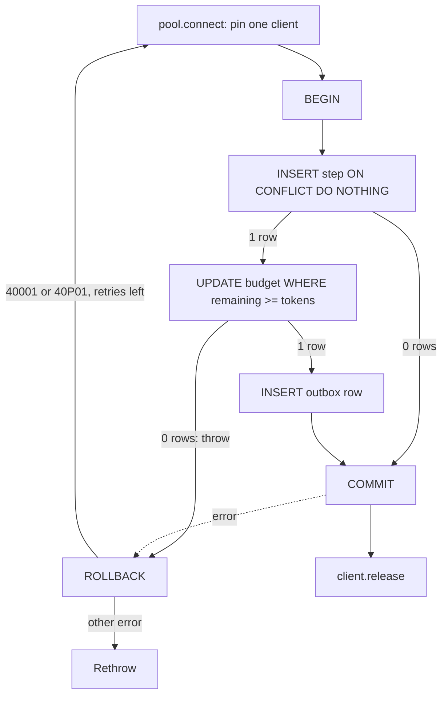

## TL;DR
An agent's durable state (steps, tool results, token budgets, outbox rows) must change atomically; a Node
pool hands out a connection per query, so a transaction must pin one client. Migrations evolve that schema
as ordered, forward-only scripts that avoid locking live tables.

## For agent builders
- **Why it matters for agents.** Each agent step is a group of writes: tool result, assistant message,
  budget charge, next-step job. If they are not one transaction, a crash or a redelivered job leaves a
  run that double-charged, skipped a step or cannot be resumed.
- **Where it shows up in your stack.** The run and step tables your agent checkpoints into, the
  per-tenant budget counter, the outbox that triggers the next step, and pgvector tables whose indexes
  migrations must build without blocking writes.
- **What you control.** Keep model and tool calls outside transactions, make every step write idempotent
  on a step id, charge budgets with an atomic predicate update, and review each migration's lock footprint.
- **What you can skip.** MVCC internals and every isolation anomaly. Know READ COMMITTED, the predicate
  update, the `40001` retry and expand/contract; that covers almost all agent bookkeeping.

## Why it exists
- **Agent bookkeeping changes in groups.** Finishing one step means: insert the tool result, append the
  assistant message, decrement the tenant's monthly token budget, enqueue the next step. If the process
  dies between the second and third statement, the budget is never charged.
- **Concurrent runs race.** Two parallel runs for one tenant both check "1,200 tokens left", both pass,
  and both run `remaining = remaining - 1000`: the tenant ends at minus 800. If each instead writes back
  a value computed in JavaScript (`remaining = 200`), one charge is silently lost. Without transactions
  you write compensating code for every interleaving and still miss some.
- **The Node pool trap is silent.** `pg`'s `Pool.query()` borrows a connection per call, so
  `await pool.query('BEGIN'); await pool.query('INSERT ...'); await pool.query('COMMIT')` can use three
  different connections. It passes single-user tests (the pool often returns the same connection) and
  is non-atomic in production, with no error.
- **Hand-run schema changes drift.** Running `ALTER TABLE` by hand on production means staging and
  local disagree, nobody can reproduce last month's schema for a bug report, and a replica starting
  mid-deploy sees columns its code does not know.
- **Migrations make schema a versioned artifact.** It moves through environments with the code, and
  each change's operational cost (locks, rewrites, index builds on million-row embedding tables) is
  explicit before it hits production.

## How it works
### What goes wrong with `pool.query('BEGIN')`
1. `BEGIN` runs on connection A, which returns to the pool still inside an open transaction.
2. The INSERT autocommits on connection B.
3. Connection A either sits idle in transaction or silently absorbs another request's statements until
   a stray `COMMIT` lands on it.
4. The idle-in-transaction connection holds its locks until it blocks a migration.

### Transactions on one client
- **Pin, run, finish, release.** Check a client out of the pool, run `BEGIN`, execute every statement
  on that same client, then `COMMIT` or `ROLLBACK`, and release the client in `finally`, *because* a
  leaked client is a leaked connection: the pool silently shrinks until requests hang on `connect()`.
- **Libraries wrap this.** `pg` leaves it to you; Drizzle exposes `db.transaction(async (tx) => { ... })`;
  Prisma has interactive `$transaction(async (tx) => { ... })`; Kysely and Knex have equivalents. The
  callback form exists *because* it makes rollback-on-throw and release impossible to forget.
- **Use `tx`, never the outer `db`, inside the callback.** The outer handle goes back to the pool and
  escapes the transaction.
- **No true nesting.** A nested `tx.transaction(...)` in Drizzle or Knex becomes a `SAVEPOINT`, so an
  inner failure can roll back to the savepoint while the outer transaction continues.
- **Destroy broken clients.** On a socket-level error, release with `client.release(err)` so the pool
  destroys it instead of handing a broken connection to the next caller.

### Isolation and contention
Postgres defaults to READ COMMITTED: each statement sees data committed before it started. Enough for
most inserts, not for read-modify-write on a shared row such as a budget counter.

| Tool | How it works | Use for |
|---|---|---|
| `SELECT ... FOR UPDATE` | locks the row, concurrent transactions queue behind you | counters, "claim this job" |
| Atomic predicate update | condition and write in one statement, check row count | hot counters, no lock to reason about |
| REPEATABLE READ | one snapshot per transaction; updating a row changed after the snapshot aborts with `40001` | preventing lost updates (not write skew) |
| SERIALIZABLE | database detects anomalies and aborts one transaction with SQLSTATE `40001` | invariants spanning several rows |

- **Why the predicate update is safe at READ COMMITTED.**
  `UPDATE budgets SET remaining = remaining - $1 WHERE tenant = $2 AND remaining >= $1`: when two hit
  the same row, the second blocks on the row lock until the first commits, then re-evaluates its `WHERE`
  against the newly committed row version.
- **Worked through.** With 1,200 remaining and two charges of 1,000, the first leaves 200; the second
  re-checks `200 >= 1000`, matches zero rows, and the caller sees "exhausted".
- **The buggy version has no re-check.** A `SELECT`, a JavaScript check and an
  `UPDATE ... SET remaining = $computed` is exactly the lost-update bug.
- **Retry is the mechanism.** Retry the whole transaction on `40001` (and on `40P01`, deadlock) in a
  small bounded loop, *because* the abort is how the database protects you, not a bug.

### Keep transactions short
- **Never hold one open across an LLM call.** A 20-second completion inside a transaction pins a
  connection, holds locks and blocks the next migration. Do the model call, then open a transaction for
  the writes.
- **Server-side safety nets.** `idle_in_transaction_session_timeout` kills a session sitting inside an
  open transaction doing nothing (the leaked-client case); `statement_timeout` bounds any single query.
- **Set them per role or connection,** so the application role can be strict while the migration role
  is not.

### Idempotency and the outbox
- **Retries deliver the same write twice.** A unique constraint plus `INSERT ... ON CONFLICT DO NOTHING`
  (or `DO UPDATE`) turns the second arrival into a no-op inside the same transaction.
- **Side effects go through an outbox.** Insert an outbox row in the same transaction and let a relay
  worker publish it, *because* "commit, then enqueue" can lose the enqueue and "enqueue, then commit" can
  run the job before the data exists.

### Migrations
A migration tool (Drizzle Kit, Prisma Migrate, Knex, node-pg-migrate, or SQL-first tools such as dbmate
and Flyway) keeps ordered files plus a table of applied ones. `migrate` applies the missing ones in
order, usually inside a transaction; tools differ: some wrap each file, some the whole batch, and some
need an explicit opt-out per file.

- **Forward-only, expand/contract.** Renaming a column: add the new column; deploy code that writes both
  and reads new-or-old; backfill in batches; deploy code that uses only the new one; drop the old. Each
  step is compatible with the versions before and after *because* both run at once during a rolling
  deploy.
- **Down migrations are rarely the rollback.** Once new code has written data in the new shape,
  reversing the schema destroys it, so roll back the *code* (which the expand step keeps compatible) and
  fix forward.
- **Backfill in batches, outside the DDL.** `UPDATE ... WHERE id BETWEEN $1 AND $2` in chunks of a few
  thousand rows, each its own short transaction, *because* one giant `UPDATE` holds row locks on every
  touched row until commit, bursts WAL that replicas must replay, and leaves dead tuples vacuum cannot
  reclaim while it is open.
- **Indexes concurrently.** `CREATE INDEX CONCURRENTLY` does not block writes but cannot run inside a
  transaction block, so the file must opt out of the tool's wrapping transaction. This matters for
  pgvector HNSW or IVFFlat indexes on large embedding tables, which can take minutes to hours depending
  on row count, dimensions and `maintenance_work_mem`.
- **`lock_timeout`.** Put `SET lock_timeout = '5s'` at the top of a migration: a DDL statement waiting
  for a lock queues *every* later query behind it, so failing fast and retrying off-peak is safer.

### Which statements lock
| Change | Cost | Safer path |
|---|---|---|
| `ADD COLUMN` with a constant (non-volatile) default | metadata-only since Postgres 11 | just do it |
| `ALTER COLUMN ... SET NOT NULL` on an existing column | scans the table under a write-blocking lock | add `CHECK (col IS NOT NULL) NOT VALID`, validate, then `SET NOT NULL` (since Postgres 12 it uses the validated check instead of rescanning) |
| Adding a CHECK or foreign key | scans under a write-blocking lock | `ADD CONSTRAINT ... NOT VALID`, then `VALIDATE CONSTRAINT` in a later step under a weaker lock |
| Index on a live table | plain `CREATE INDEX` blocks writes | `CREATE INDEX CONCURRENTLY`, outside a transaction |

### Running migrations
- **A separate step,** a CI job or init container, not inside every replica's startup.
- **Guarded by `pg_advisory_lock`,** so two runners cannot apply the same file concurrently. Many tools
  take one automatically; check yours rather than assuming.
- **Directly to Postgres, not through a transaction-mode pooler** such as PgBouncer: session-level
  advisory locks and `SET lock_timeout` belong to a server connection the pooler may swap between
  statements.

## Diagram
One pinned client carries the whole step: idempotent insert, atomic budget charge, outbox row. Any
error rolls everything back, and only serialization failures or deadlocks are retried.



## Examples
### Transaction helper and idempotent step recorder
A `withTransaction` helper on raw `pg` that pins one client, releases it on every path and retries
transient aborts, plus a step recorder that is idempotent (unique step id) and charges the budget with
an atomic predicate update so no explicit row lock is needed.

The SQL file shows an expand step with a concurrent index, which must run outside the tool's
transaction.

```ts
import { Pool, PoolClient } from "pg";
const pool = new Pool({ connectionString: process.env.DATABASE_URL, max: 10 });

export async function withTransaction<T>(fn: (tx: PoolClient) => Promise<T>, retries = 3): Promise<T> {
  for (let attempt = 0; ; attempt++) {
    const client = await pool.connect();                // one connection for the whole transaction
    let broken = false;
    try {
      await client.query("BEGIN");                      // add "ISOLATION LEVEL SERIALIZABLE" if you rely on it
      const result = await fn(client);
      await client.query("COMMIT");
      return result;
    } catch (err: any) {
      await client.query("ROLLBACK").catch(() => { broken = true; });   // socket gone: do not reuse
      const transient = err.code === "40001" || err.code === "40P01";   // serialization failure / deadlock
      if (!transient || attempt >= retries) throw err;
    } finally {
      client.release(broken);                           // always release; `true` destroys a broken client
    }
  }
}

export async function recordStep(tenant: string, runId: string, stepId: string, tokens: number, content: string) {
  return withTransaction(async (tx) => {
    const inserted = await tx.query(                    // idempotent: a redelivered job hits the unique key
      "INSERT INTO run_steps (run_id, step_id, content) VALUES ($1, $2, $3) ON CONFLICT (step_id) DO NOTHING",
      [runId, stepId, content]);
    if (inserted.rowCount === 0) return "duplicate";
    const charged = await tx.query(                     // atomic read-modify-write, no FOR UPDATE needed
      "UPDATE budgets SET remaining = remaining - $1 WHERE tenant = $2 AND remaining >= $1", [tokens, tenant]);
    if (charged.rowCount === 0) throw new Error("budget exhausted");    // rolls the insert back too
    await tx.query("INSERT INTO outbox (topic, payload) VALUES ('step.completed', $1)", [{ runId, stepId }]);
    return "recorded";
  });
}
```

```sql
-- 0007_add_embedding.sql  (expand step; tool configured NOT to wrap this file in a transaction)
SET lock_timeout = '5s';
ALTER TABLE documents ADD COLUMN embedding vector(1536);        -- nullable: metadata-only change
CREATE INDEX CONCURRENTLY documents_embedding_hnsw ON documents USING hnsw (embedding vector_cosine_ops);
```

### Worked scenario: three ways to charge 1,000 tokens twice
Two runs for the same tenant charge 1,000 tokens each, at the same moment, with 1,200 remaining.

| Approach | Run 1 | Run 2 | Final `remaining` | Outcome |
|---|---|---|---|---|
| `SELECT`, check in JS, `SET remaining = remaining - 1000` | reads 1,200, passes | reads 1,200, passes | -800 | overspent |
| `SELECT`, check in JS, `SET remaining = $computed` | writes 200 | writes 200 | 200 | one charge lost |
| Predicate update `... AND remaining >= $1` | 1 row, leaves 200 | waits, re-checks `200 >= 1000`, 0 rows | 200 | run 2 sees "exhausted" |

### Agent scenario: a worker crashes mid-run and the job is redelivered
A 6-step research agent checkpoints each step with `recordStep`. The worker dies after step 4's model
call returned but before its transaction committed; the queue redelivers the job.

| Moment | Without step transactions | With `recordStep` per step |
|---|---|---|
| Crash during step 4 writes | tool result saved, budget not charged, next step not enqueued | step 4 transaction rolls back as a whole |
| Redelivered job starts | replays from step 1, re-runs tools 1-3 | reads the last committed step (3) and resumes at 4 |
| Steps 1-3 written again | duplicate rows, budget charged twice for them | `ON CONFLICT DO NOTHING` returns "duplicate", no charge |
| Final state | 10 step rows (steps 1-4 twice), budget wrong | 6 step rows, budget charged once per step |

- **The cost of resume.** Step 4's model call is paid twice (once before the crash, once after), because
  the transaction deliberately excludes the model call; that is the price of not holding a connection
  across it.

### Production snippet: NOT NULL on a live table, in steps
Each file is its own migration, so the brief strong lock of `ADD CONSTRAINT ... NOT VALID` is not held
during the validation scan. The backfill runs as a batched job between the first two files.

Code that writes `tenant_id` on every insert must be deployed before the backfill, because a `NOT VALID`
check is still enforced on new and updated rows and `VALIDATE` fails on any null left behind.

```sql
-- 0010_expand.sql: nullable column, metadata-only
ALTER TABLE messages ADD COLUMN tenant_id uuid;

-- backfill job (not a migration): repeat per id range, each batch its own short transaction
UPDATE messages m SET tenant_id = c.tenant_id FROM conversations c
 WHERE m.conversation_id = c.id AND m.id BETWEEN $1 AND $2 AND m.tenant_id IS NULL;

-- 0011_add_check.sql: brief lock, no scan
SET lock_timeout = '5s';
ALTER TABLE messages ADD CONSTRAINT messages_tenant_nn CHECK (tenant_id IS NOT NULL) NOT VALID;

-- 0012_validate.sql: scans under a lock that still allows writes
ALTER TABLE messages VALIDATE CONSTRAINT messages_tenant_nn;

-- 0013_set_not_null.sql: Postgres 12+ uses the validated check instead of rescanning
SET lock_timeout = '5s';
ALTER TABLE messages ALTER COLUMN tenant_id SET NOT NULL;
ALTER TABLE messages DROP CONSTRAINT messages_tenant_nn;
```

## Production patterns
- **Checkpoint every agent step in one transaction.** When agent runs span many steps or workers, write
  each step's result, budget charge and next-step outbox row together, keyed by a deterministic step id
  (run id plus step index), so a resumed run skips committed steps. Monitor duplicate-step counts and runs
  stuck without a new step.
- **Strict timeouts on the application role.** When any code path might leak a client, set
  `ALTER ROLE app SET idle_in_transaction_session_timeout = '30s'` and a `statement_timeout`, leaving
  the migration role looser (values illustrative). Monitor `pg_stat_activity` for sessions in state
  `idle in transaction` and their age.
- **Pool saturation alerts.** node-postgres exposes `pool.totalCount`, `pool.idleCount` and
  `pool.waitingCount`; export them as gauges. A sustained non-zero waiting count with total at `max`
  means leaked clients or transactions held across slow calls.
- **Outbox relay with `SKIP LOCKED`.** When writes must trigger jobs, a relay opens a transaction,
  runs `SELECT ... FROM outbox ORDER BY id LIMIT 100 FOR UPDATE SKIP LOCKED`, publishes, then deletes or
  marks the rows and commits, so several relays never double-claim. A crash between publish and commit
  republishes the batch, so consumers must still be idempotent. Monitor the age of the oldest
  unpublished row.
- **Fail-fast migrations, retried by the pipeline.** Every migration starts with `SET lock_timeout`, runs
  as a gated CI or init-container step before rollout, and the job retries off-peak on timeout. Monitor
  lock waits and migration duration per deploy.
- **Post-build index check.** After any `CREATE INDEX CONCURRENTLY`, query
  `SELECT indexrelid::regclass FROM pg_index WHERE NOT indisvalid` and drop or rebuild what it returns,
  because a failed concurrent build leaves an INVALID index that still slows writes.

## Trade-offs
- **Atomicity vs pool capacity.** Pinning a client per transaction holds a pooled connection for its
  lifetime; with `max: 10` and 20-second LLM calls inside transactions the pool becomes the bottleneck,
  so keep model calls outside.
- **SERIALIZABLE vs retries.** It removes whole classes of anomalies without hand-placed locks, but
  aborts under contention and forces retry loops. At low contention it is nearly free; on hot rows
  `FOR UPDATE` or atomic predicate updates perform better.
- **ORM convenience vs lock awareness.** Prisma, Drizzle and Kysely make transaction scoping hard to get
  wrong and generate migrations from a schema file, but generated migrations know nothing about locks,
  concurrency or backfills; large tables need hand-edited SQL.
- **Expand/contract safety vs deploy count.** Safe under rolling deploys but takes several deploys
  instead of one. For a table of a few thousand rows on a single replica a direct change is fine; the
  discipline pays off once the table is large or replicas overlap.
- **Separate migration step vs ordering.** It avoids races between replicas, but code and schema can
  then deploy out of order, so every migration must be compatible with the previous code version.

## Pitfalls
- **Holding a transaction open across a model or tool call.** Symptom: pool waiting count climbs during
  slow completions and migrations time out on locks. Fix: call the model or tool first, then open a short
  transaction for the step's writes.
- **Using `pool.query('BEGIN')`.** Statements land on different connections. Symptom: non-atomic data
  with no error, plus connections stuck `idle in transaction` in `pg_stat_activity`.
- **Outer `db` instead of `tx` inside a Drizzle or Prisma transaction callback.** Symptom: a write that
  persists although the transaction rolled back, or a deadlock when the outer query waits on a lock the
  transaction holds.
- **Forgetting `client.release()` on an error path.** Symptom: the service hangs on `pool.connect()`
  after exactly `max` failures.
- **`CREATE INDEX CONCURRENTLY` inside the tool's transaction.** Symptom:
  `cannot run inside a transaction block`. A failed concurrent build leaves an INVALID index that must
  be dropped by hand.
- **NOT NULL column with an inline backfill in one statement on a large table.** Symptom: a deploy that
  holds an exclusive lock for minutes while every API request queues behind it.
- **Migrations through PgBouncer in transaction mode.** Symptom: `lock_timeout` apparently ignored or an
  advisory lock that never seems held, because consecutive statements ran on different server
  connections.
- **Migrations on container start with several replicas and no advisory lock.** Symptom: duplicate-apply
  errors or two runners racing on the same `ALTER`.

## When to use
- **Use a transaction when:** two or more writes must succeed together or a read must be consistent with
  a following write: run bookkeeping, budget charges, message plus embedding inserts, outbox rows.
- **Avoid:** wrapping LLM or HTTP calls in one.
- **Pick the contention tool:** atomic predicate updates and `FOR UPDATE` for hot counters; SERIALIZABLE
  for invariants that span several rows.
- **Schema:** every change goes through a migration file reviewed for its lock footprint; tables beyond a
  few hundred thousand rows get expand/contract and concurrent index builds.
- **Measure:** idle-in-transaction sessions in `pg_stat_activity`, transaction duration and lock waits.
- **Interviews:** expect the pool-per-statement trap, the retry on `40001`, and how to add a NOT NULL
  column to a live table.

## Role lens
- **Engineer:** Writes the `withTransaction` helper, keeps model calls outside it, handles `40001` retries, and reviews each generated migration for lock and backfill behaviour before merging.
- **Architect:** Sets the policy: which invariants are transactional, where idempotency keys and the outbox live, the default isolation level, and that migrations run as a gated pipeline step with expand/contract.
- **FDE:** Applies migrations inside a customer's VPC where a DBA controls maintenance windows, and explains why an embedding index must be built concurrently rather than during a deploy.

## Check yourself
**Q:** A worker charges a tenant's token budget and records an agent step. Under load, budgets
occasionally go negative and some steps appear twice. Diagnose the two bugs and fix them without
changing the isolation level.
**A:** Negative budgets mean a check-then-act race: the code reads `remaining`, checks it in JavaScript,
then decrements, so two transactions both pass the check against the same value and both subtract.
(Writing back a value computed in JavaScript would instead lose a charge, which is the same race with a
different symptom.) Replace it with a single predicate
update, `UPDATE budgets SET remaining = remaining - $1 WHERE tenant = $2 AND remaining >= $1`, and treat
a zero row count as "exhausted"; or lock with `SELECT ... FOR UPDATE` first. Duplicate steps mean
at-least-once delivery from the queue with no idempotency: add a unique constraint on the step id, use
`INSERT ... ON CONFLICT DO NOTHING`, and only charge when the insert actually inserted a row. Both must
run on one pinned client inside one transaction so a failure after the charge rolls the charge back.
Finally confirm the code is not calling `pool.query('BEGIN')`, which would scatter the statements across
connections.

## Interview questions
### Why can't you run a transaction with `pool.query` in node-postgres, and what do you do instead?
- **Transactions belong to one connection,** and `Pool.query()` borrows a connection per call, so
  `BEGIN`, the writes and `COMMIT` can land on different connections with no error.
- **Instead,** check out one client with `pool.connect()`, run every statement on it, and release it in
  `finally`, or use a library callback such as Drizzle's `db.transaction` and only touch `tx` inside.

### An agent step holds a transaction open while it calls the model, and migrations now time out. What is happening and how do you fix it?
- **Diagnosis:** a 20-second completion inside a transaction pins a connection and holds row locks; a
  migration's DDL waits for those locks, and every later query queues behind the DDL.
- **Fix:** call the model first, then open a short transaction for the writes.
- **Safety nets:** `SET lock_timeout` in migrations, and `idle_in_transaction_session_timeout` plus
  `statement_timeout` on the application role.

### How would you make a multi-step agent run resumable after a worker crash?
- **Checkpoint per step:** each step's writes (result, message, budget charge, outbox row for the next
  step) commit in one transaction keyed by a deterministic step id.
- **Resume from the last committed step:** on redelivery, read the run's latest step and continue; earlier
  writes hit the unique key and become no-ops.
- **Accept re-paid work:** a model or tool call that finished before the crash runs again, so tools with
  side effects need their own idempotency keys.

### When would you choose SERIALIZABLE over `FOR UPDATE` or a predicate update?
- **SERIALIZABLE** when an invariant spans several rows (write skew) and hand-placing locks is error
  prone; it requires retrying on `40001`.
- **Predicate update or `FOR UPDATE`** for a single hot row such as a budget counter, because under
  contention SERIALIZABLE aborts often and retry loops cost throughput.

### How do you add a NOT NULL column to a 50-million-row table without downtime?
- **Expand:** add the column nullable (metadata-only), deploy code that writes it, and backfill in
  batches of a few thousand rows, each in its own transaction.
- **Constrain cheaply:** add `CHECK (col IS NOT NULL) NOT VALID`, then `VALIDATE CONSTRAINT` in a later
  migration under a weaker lock, then `SET NOT NULL`, which since Postgres 12 skips the rescan.
- **Guard each step** with `SET lock_timeout` so a blocked DDL fails fast instead of queueing traffic.

### Why put migrations in a separate pipeline step instead of running them at app startup?
- **Several replicas would race** to apply the same file unless an advisory lock guards the run.
- **Startup would block** on long index builds, and a failed migration would crash-loop every pod.
- **The cost:** code and schema deploy separately, so each migration must work with the previous code
  version, which expand/contract guarantees.

## Quiz
### Q: Why is `await pool.query('BEGIN'); await pool.query('INSERT ...'); await pool.query('COMMIT')` wrong with node-postgres?
- [ ] `BEGIN` must be uppercase and parameterised to be recognised
- [x] Each `pool.query` may use a different connection, so the INSERT can run outside the transaction
- [ ] The pool rejects `COMMIT` unless autocommit is disabled
- [ ] Transactions require the `pg-transaction` extension
> Transactions are a property of a single connection. The pool borrows a connection per call, so the INSERT can autocommit on another connection while the first sits idle in transaction, and no error is raised.

### Q: You need an HNSW index on a 5-million-row embeddings table in production. Which approach avoids blocking writes?
- [ ] `CREATE INDEX` inside the migration's transaction so it can roll back
- [ ] Drop and recreate the table with the index defined inline
- [x] `CREATE INDEX CONCURRENTLY` in a migration configured to run outside a transaction block
- [ ] Add the index at application startup with a retry loop
> Concurrent index builds allow reads and writes during the build but cannot run inside a transaction block, so the migration tool's wrapping transaction must be disabled for that file; a failed build leaves an invalid index to drop.

### Q: Your transaction retry helper catches SQLSTATE 40001. When does that error actually occur?
- [ ] Whenever a unique constraint is violated
- [ ] When the pool has no free connections
- [x] When Postgres aborts a transaction under REPEATABLE READ or SERIALIZABLE because a concurrent commit made it unserializable
- [ ] When a statement exceeds `statement_timeout`
> `40001` is `serialization_failure`: the database detects that the transaction's reads are inconsistent with a concurrent commit and aborts it, expecting the application to retry; unique violations are `23505` and timeouts are `57014`.

## Use cases & projects
### Use cases
- **Resumable agent runs.** Per-step transactions with idempotent step ids let a redelivered job pick up
  at the last committed step instead of replaying tools.
- **Per-tenant token budgets.** An atomic predicate update stops parallel agent runs from overspending a
  shared monthly budget.
- **Triggering the next agent step.** An outbox row written with the step guarantees the next job is
  enqueued only if the step committed.
- **Adding embeddings to a live RAG corpus.** Expand migrations plus `CREATE INDEX CONCURRENTLY` add a
  vector column and HNSW index without blocking ingestion.

### Mini project
**Crash-proof agent step recorder (2-3 hours).**
- **Goal:** prove that an agent run survives a worker crash with no duplicate steps and no budget drift.
- **Steps:** create `runs`, `run_steps`, `budgets` and `outbox` tables through migrations; implement
  `withTransaction` and `recordStep`; write a fake 5-step agent that calls `recordStep` after each fake
  model call; kill the process at a random step, restart it, and resume from the last committed step;
  run two runs in parallel against one budget.
- **Done when:** after 20 crash-and-resume trials every run has exactly 5 step rows, the budget equals
  the sum of charged steps, and parallel runs never drive it negative.
