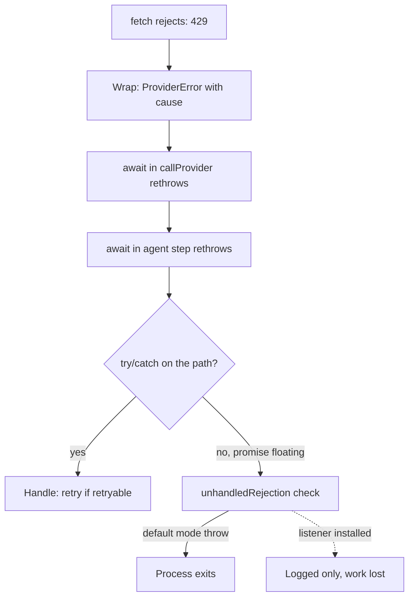

## TL;DR
An agent step is a bundle of concurrent promises: model call, tool calls, logging. `await` re-throws a
rejection where you wait, so errors travel up like sync ones; floating promises, lossy combinators and lost
causes make agents crash or retry the wrong thing.

## For agent builders
- **Why it matters for agents.** Each step fans out (parallel tool calls, multi-provider fallback, trace
  writes). How you combine and classify those promises decides whether one failed tool becomes a message
  the model can react to, a correct retry, a duplicated side effect, or a crash that kills every session.
- **Where it shows up in your stack.** Parallel tool execution, provider SDK calls, retry wrappers,
  fire-and-forget trace and audit sinks, and the process-level `'unhandledRejection'` behaviour of your
  agent server.
- **What you control.** `allSettled` versus `all` per fan-out, error classes with `status`, `retryable` and
  `cause`, lint for floating promises, and which errors go back to the model versus end the run.
- **What you can skip.** The spec's job-queue internals; know that handlers run as microtasks and that a
  rejection needs a handler attached before it happens.

## Lab
### Task
Make an agent's parallel tool step survive any mix of failures: classify transport errors without losing
their cause, retry only what is retryable, settle the batch so each tool call gets one result, and make a
fire-and-forget trace write unable to crash the process. Time box: 45-75 minutes.
- **Prerequisites:** this lesson's combinator, unhandled-rejection and cause sections; the AbortController
  lesson for the cancelled-run case.
- **Setup:** an empty folder with `"type": "module"` in `package.json`, `npm i -D vitest @types/node`.
  Checked with Node 24.21 and Vitest 5.0; Node 24 runs `lab.ts` directly by stripping types.
- **Fakes, no network:** `fakeExec` stands in for five tools. `lookup` returns a permanent 400, `crm` a 503
  once, `docs` a transport failure once (Node's `fetch` rejects with `TypeError("fetch failed")` and a
  `cause`), and `buggy` has a bug in our own code.
- **Save** the starter as `lab.ts` and the tests as `lab.test.ts`, then run `node lab.ts` and
  `npx vitest run`.

### Starter code
```ts
// Lab: a crash-proof tool batch for an agent loop. Run: node lab.ts   Test: npx vitest run
import { pathToFileURL } from "node:url";
import { setTimeout as sleep } from "node:timers/promises";

export class ProviderError extends Error {
  readonly status: number;
  readonly retryable: boolean;
  constructor(msg: string, status: number, retryable: boolean, opts?: { cause?: unknown }) {
    super(msg, opts);
    this.name = "ProviderError"; this.status = status; this.retryable = retryable;
  }
}

export type ToolCall = { id: string; name: string; args: unknown };
export type ToolResult = { toolCallId: string; content: string; isError: boolean };
export type Exec = (c: ToolCall, signal: AbortSignal) => Promise<string>;

// LAB 1: Node's fetch rejects with TypeError("fetch failed") on a transport failure. Wrap that as
// ProviderError("<tool> transport failure", 0, retryable true) keeping the original as `cause`.
// Return ProviderErrors, aborts (signal.aborted) and anything else (our own bugs) unchanged.
export function classify(e: unknown, tool: string, signal: AbortSignal): unknown {
  return new Error("tool call failed");             // loses the status, the cause and retryability
}

// LAB 2: retry `fn` only for retryable ProviderErrors, at most `retries` extra times, waiting
// `delayMs` between attempts with an abortable sleep. Never retry once the signal has aborted.
export async function withRetry<T>(fn: () => Promise<T>, signal: AbortSignal, retries = 1, delayMs = 10): Promise<T> {
  void sleep;
  return fn();
}

// LAB 3: settle every call (not Promise.all) and return one result per call, in order:
// fulfilled -> content; non-retryable ProviderError -> `error <status>: <message>`;
// retryable ProviderError -> "temporary failure after retries"; anything else -> "internal tool error".
// If the run was aborted, rethrow instead of returning results.
export async function runToolBatch(calls: ToolCall[], exec: Exec, signal: AbortSignal): Promise<ToolResult[]> {
  const attempt = (c: ToolCall) => exec(c, signal).catch((e: unknown) => { throw classify(e, c.name, signal); });
  const values = await Promise.all(calls.map((c) => withRetry(() => attempt(c), signal)));
  return values.map((v, i) => ({ toolCallId: calls[i]!.id, content: v, isError: false }));
}

// LAB 4: fire-and-forget that can never become an unhandled rejection: attach a handler that
// passes the error to onError. Return nothing.
export function fireAndForget(p: Promise<unknown>, onError: (e: unknown) => void): void {
  void p;
}

// Fake tools: search is slow, lookup gets a permanent 400, crm a 503 once, docs a transport
// failure once, and buggy has a bug in our own code.
export function fakeExec(attempts: Map<string, number>): Exec {
  return async (c, signal) => {
    const n = (attempts.get(c.name) ?? 0) + 1;
    attempts.set(c.name, n);
    await sleep(c.name === "search" ? 50 : 5, undefined, { signal });
    if (c.name === "lookup") throw new ProviderError("order not found", 400, false);
    if (c.name === "crm" && n === 1) throw new ProviderError("crm unavailable", 503, true);
    if (c.name === "docs" && n === 1) throw new TypeError("fetch failed", { cause: new Error("ECONNRESET") });
    if (c.name === "buggy") throw new TypeError("Cannot read properties of undefined (reading 'id')");
    return `${c.name} ok`;
  };
}

if (import.meta.url === pathToFileURL(process.argv[1] ?? "").href) {
  const attempts = new Map<string, number>();
  const calls = ["search", "lookup", "crm", "docs", "buggy"].map((name, i) => ({ id: `c${i + 1}`, name, args: {} }));
  try {
    const results = await runToolBatch(calls, fakeExec(attempts), new AbortController().signal);
    for (const r of results) console.log(r.toolCallId, r.isError ? "error" : "ok", r.content);
  } catch (e) {
    console.log("batch threw:", (e as Error).message);
  }
  console.log("attempts:", JSON.stringify(Object.fromEntries(attempts)));
  fireAndForget(Promise.reject(new Error("trace sink down")), (e) => console.log("trace write failed:", (e as Error).message));
}
```

### Expected output
`node lab.ts` with a correct solution prints:

```
c1 ok search ok
c2 error error 400: order not found
c3 ok crm ok
c4 ok docs ok
c5 error internal tool error
attempts: {"search":1,"lookup":1,"crm":2,"docs":2,"buggy":1}
trace write failed: trace sink down
```

The starter prints `batch threw: tool call failed`, one attempt per tool, and then the process exits with
code 1 on the unhandled `trace sink down` rejection: the two failures this lab removes.

### Tests
```ts
import { expect, test } from "vitest";
import { ProviderError, classify, fakeExec, fireAndForget, runToolBatch, withRetry } from "./lab.ts";

const live = () => new AbortController().signal;
const calls = (...names: string[]) => names.map((name, i) => ({ id: `c${i + 1}`, name, args: {} }));

test("transport failures are wrapped with their cause; bugs are not", () => {
  const net = new TypeError("fetch failed");
  const wrapped = classify(net, "docs", live());
  expect(wrapped).toBeInstanceOf(ProviderError);
  expect(wrapped).toMatchObject({ status: 0, retryable: true, cause: net });
  const bug = new TypeError("Cannot read properties of undefined");
  expect(classify(bug, "x", live())).toBe(bug);
  const p400 = new ProviderError("bad", 400, false);
  expect(classify(p400, "x", live())).toBe(p400);
});

test("only retryable errors are retried", async () => {
  let n = 0;
  await expect(withRetry(async () => { n++; throw new ProviderError("bad", 400, false); }, live(), 3, 1)).rejects.toThrow("bad");
  expect(n).toBe(1);
  n = 0;
  expect(await withRetry(async () => { if (++n < 3) throw new ProviderError("busy", 503, true); return "ok"; }, live(), 3, 1)).toBe("ok");
  expect(n).toBe(3);
});

test("an aborted run is never retried", async () => {
  const ac = new AbortController();
  let n = 0;
  const p = withRetry(async () => { n++; ac.abort(); throw new ProviderError("busy", 503, true); }, ac.signal, 3, 1);
  await expect(p).rejects.toBeDefined();
  expect(n).toBe(1);
});

test("one result per call, in order, whatever fails", async () => {
  const attempts = new Map<string, number>();
  const out = await runToolBatch(calls("search", "lookup", "crm", "docs", "buggy"), fakeExec(attempts), live());
  expect(out).toEqual([
    { toolCallId: "c1", content: "search ok", isError: false },
    { toolCallId: "c2", content: "error 400: order not found", isError: true },
    { toolCallId: "c3", content: "crm ok", isError: false },
    { toolCallId: "c4", content: "docs ok", isError: false },
    { toolCallId: "c5", content: "internal tool error", isError: true },
  ]);
  expect(Object.fromEntries(attempts)).toEqual({ search: 1, lookup: 1, crm: 2, docs: 2, buggy: 1 });
});

test("a cancelled run rethrows instead of reporting tool errors", async () => {
  const ac = new AbortController();
  setTimeout(() => ac.abort(), 10);
  await expect(runToolBatch(calls("search"), fakeExec(new Map()), ac.signal)).rejects.toMatchObject({ name: "AbortError" });
});

test("fire-and-forget failures reach onError, not the process", async () => {
  const seen: unknown[] = [];
  fireAndForget(Promise.reject(new Error("trace sink down")), (e) => seen.push(e));
  await new Promise((r) => setTimeout(r, 5));
  expect(seen).toHaveLength(1);
});
```

Five of the six fail on the starter; the last one also shows up in Vitest's "Unhandled Rejection" report.
The abort-retry test passes trivially, since the starter never retries. A correct solution passes all six
with no unhandled errors.

### Failure scenarios
- **Wrap every unknown error as retryable** (the `callProvider` habit from the first example). The `buggy`
  call is retried and reported as `temporary failure after retries`, hiding a bug in your code behind a
  transient-looking message. Debug by logging `err.cause` chains: a `TypeError` that is not `fetch failed`
  is yours.
- **Keep `Promise.all` and retry the whole batch on failure.** `search` and `crm` run twice, and in a real
  agent a sent email is sent twice. The attempts assertion (`search: 1`) catches it; fix with
  `allSettled` and per-call retry.
- **Await the calls one by one after starting them all.** If `lookup` rejects while you are still awaiting
  `search`, nobody is listening yet: Node reports an unhandled rejection. Debug by running with
  `--unhandled-rejections=strict` in tests so the window cannot hide.
- **Retry inside the abort.** Drop the `signal.aborted` check and wait with a plain `sleep(delayMs)`, and a
  cancelled run retries the 503 and bills more calls for a user who left. The abort-retry test counts
  attempts and fails with `expected 4 to be 1`. An abortable sleep alone also stops it, so keep both.

### Submission
- **Your `lab.ts`** with the four LAB steps done, and a passing `npx vitest run` (six tests, no unhandled
  errors).
- **The `node lab.ts` output**, matching the expected output.
- **One log line** for the `docs` failure that prints the `cause` chain (`fetch failed` then the
  `ECONNRESET` cause).
- **A note** (3-5 sentences) on which of the five results the model should see as errors, which ones it
  should not see at all, and why.
- **Evaluated on:** tests passing, no `Promise.all` left on the tool path, causes kept, and retries limited
  to retryable, non-aborted errors.

## Why it exists
- **Callbacks made errors easy to forget.** Callback-style Node passed errors as the first argument, so a
  forgotten `if (err)` meant silent corruption, and five dependent I/O calls meant five levels of nesting
  with five separate error paths.
- **Promises made the result a value.** A chain of `.then` calls has one `.catch` at the end, and a
  rejection anywhere skips straight to it. `async`/`await` made control flow readable again, with
  `try`/`catch` working across awaits.
- **What promises did not fix: ownership of a failure.** An agent loop makes dozens of concurrent calls (the
  model, three tool executions, an embedding lookup, a logging sink). A started-but-never-awaited one has no
  handler; modern Node treats that as fatal and exits, taking every other in-flight request with it.
- **Combinators and wrappers hide detail.** With `Promise.all` the first rejection wins and the others keep
  running unobserved. Rethrowing a `fetch` error as `new Error("model call failed")` loses the status code
  and the provider's error body before it reaches a log.
- **AI failures demand precision.** Failures are dominated by upstream timeouts, rate limits and malformed
  outputs, so the difference between a retryable 429 and a permanent 400 must survive the trip up the stack.

## How it works
### States and chaining
- **Settles exactly once.** A promise is pending, then fulfilled (with a value) or rejected (with a reason,
  conventionally an `Error`).
- **`.then(onFulfilled, onRejected)` returns a *new* promise** whose outcome is whatever the handler returns
  or throws; a returned promise is adopted (flattened).
- **That is why chains propagate.** A throw in any step rejects that step's promise, every following
  `.then` without a rejection handler passes it through unchanged, and the first `.catch` receives it.
- **Handlers always run as microtasks,** never synchronously, even when the promise is already settled,
  which keeps ordering consistent (see the event-loop lesson).

### What `async`/`await` desugars to
1. **An `async` function always returns a promise.** `return x` fulfils it.
2. **A thrown exception rejects it,** including one thrown synchronously before the first `await`; it does
   not escape to the caller.
3. **`await p` suspends the function;** when `p` rejects, the rejection is re-thrown at the `await`
   expression, so an enclosing `try`/`catch` catches it.
4. **The single rule:** errors cross `await` boundaries as exceptions, so a stack of async functions behaves
   like a stack of sync ones.

- **The `return await` subtlety.** `return fetchModel()` inside a `try` block does **not** catch a rejection
  of `fetchModel()`, because the promise is returned before it settles; `return await fetchModel()` does.
  Outside a `try`, the two are equivalent apart from a stack frame.

### Unhandled rejections
- **The trigger.** A rejected promise with no handler attached by the end of the current microtask drain
  fires `'unhandledRejection'`.
- **Default since Node 15: `throw`.** The rejection is raised as an uncaught exception and the process exits,
  unless an `'unhandledRejection'` listener is installed, which suppresses the throw.
- **What the crash shows.** The original error and stack when the reason is an `Error`; only a non-Error
  reason (a thrown string, say) is wrapped in an error with code `ERR_UNHANDLED_REJECTION`, which carries no
  useful stack.
- **The usual cause: a *floating promise*.** `logToSink(event)` called without `await` or `.catch`, or a
  `.then` with no rejection branch.
- **Fix the cause, not the symptom.** Every promise must be awaited, returned, passed to a combinator, or
  given an explicit `.catch` that decides what to do. Lint for it (`@typescript-eslint/no-floating-promises`).
- **A log-only global handler is not a strategy.** A `process.on('unhandledRejection')` handler that only logs
  turns a crash into silent data loss; it is acceptable as a last-resort reporter only.

### The handler-attachment window
"Unhandled" is judged per promise at the moment it rejects, not at the end of the function. That makes a
tempting concurrency pattern dangerous:

```
const a = callModel(p1);   // both start now: good
const b = callTool(t1);
const x = await a;         // while suspended here, b rejects -> nobody is listening yet
const y = await b;         // too late: the process may already have crashed
```

- **What goes wrong.** If `b` rejects while the function is still suspended on `a`, `b` has no handler, the
  `'unhandledRejection'` check fires, and in the default mode the process exits. Attaching a handler later
  only triggers the `'rejectionHandled'` event.
- **The fix.** `await Promise.all([a, b])` (or `allSettled`) attaches handlers to both immediately, which is
  the reason to use a combinator for concurrent work rather than staggered awaits.

### Where propagation stops
`await` carries errors only along promise edges. Four places break the chain:

- **Callbacks scheduled from async code.** A `throw` inside `setTimeout(() => ...)`, an event-emitter
  listener or a stream `'data'` handler is not inside your `try`; the async function has already moved on, so
  it becomes an uncaught exception. Wrap the callback API in a promise (or use `events.once`,
  `timers/promises`, `stream/promises`) so the error re-enters the chain.
- **Emitter `'error'` events.** An `EventEmitter` that emits `'error'` with no listener throws. Streams and
  SDK clients that expose events need a listener, or a promise-returning wrapper.
- **Non-async functions that return promises.** `function call() { validate(x); return fetch(...) }` throws
  *synchronously* if `validate` fails, so `call().catch(...)` never sees it. Marking it `async` converts the
  throw into a rejection, making error handling uniform.
- **Floating promises,** covered above: no edge means no propagation.

### Combinators and their error semantics
| Combinator | Fulfils | Rejects | Use when |
|---|---|---|---|
| `Promise.all(ps)` | With an array when all fulfil | With the **first** rejection; the rest run to completion unobserved, not cancelled | Any failure makes the whole result useless |
| `Promise.allSettled(ps)` | Always, with one status object per input (below) | Never | Partial results are useful: fan-out to providers or tools where you want every outcome |
| `Promise.any(ps)` | With the first fulfilment | Only when all reject, with an `AggregateError` whose `.errors` holds each reason | Racing equivalent providers |
| `Promise.race(ps)` | Whichever settles first | Whichever settles first | Mostly timeouts, which `AbortSignal.timeout` does more cleanly because it also stops the work |

- **`allSettled` result shape:** one `{status, value|reason}` object per input, in input order.
- **Combinators do not cancel losers,** so pair them with an `AbortController` when the losing calls are
  expensive (every model call is).

### Keeping the cause
- **Wrap, do not replace.** `new Error("tool failed", { cause: err })` adds context; the `cause` option
  (ES2022) keeps the chain; a custom error class keeps classification too.
- **Carry classification.** A custom `class ProviderError extends Error` can carry `status`, `retryable` and
  the provider's error body.
- **Narrow before reading.** `catch (e: unknown)` forces narrowing with `instanceof` before reading fields.
- **Prefer `await` for stack traces.** Node links async stack frames across `await`, but only when the
  promise is awaited directly; a `.then` chain hides the originating frame.

## Diagram
How a rejection travels: through every `await`, until a `catch` handles it, or out to the process-level
check that crashes Node when nothing is listening.



## Examples
### Provider fan-out with classified errors
Fan-out to three providers with `allSettled` so every outcome is known, classify each failure with a status
and a retryable flag, preserve the original cause when wrapping, abort the losers once a winner arrives,
and give the fire-and-forget audit call an explicit `.catch` so it can never become an unhandled rejection.

```ts
class ProviderError extends Error {
  constructor(msg: string, readonly status: number, readonly retryable: boolean, opts?: { cause?: unknown }) {
    super(msg, opts); this.name = "ProviderError";
  }
}

async function callProvider(name: string, prompt: string, signal: AbortSignal): Promise<string> {
  try {
    const res = await fetch(`https://${name}.example/v1/complete`, {
      method: "POST", body: JSON.stringify({ prompt }), signal,
    });
    if (!res.ok) {
      const body = await res.text();
      throw new ProviderError(`${name} returned ${res.status}: ${body.slice(0, 200)}`,
        res.status, res.status === 429 || res.status >= 500);
    }
    return await res.text();                 // `return await` so the try block sees a rejection
  } catch (e: unknown) {
    if (e instanceof ProviderError || signal.aborted) throw e; // classified, or a cancellation: not retryable
    throw new ProviderError(`${name} transport failure`, 0, true, { cause: e });
  }
}

async function bestEffort(prompt: string) {
  const ac = new AbortController();
  const names = ["alpha", "beta", "gamma"];
  let winner: string | undefined;
  const calls = names.map((n) => callProvider(n, prompt, ac.signal).then((text) => {
    winner ??= text; ac.abort(); return text;   // first success aborts the losers mid-flight
  }));
  const results = await Promise.allSettled(calls); // losers now settle quickly with AbortError
  if (winner !== undefined) return winner;
  const reasons = results.map((r) => (r as PromiseRejectedResult).reason);
  const retryable = reasons.every((r) => r instanceof ProviderError && r.retryable);
  throw new AggregateError(reasons, retryable ? "all providers failed (retryable)" : "all providers failed");
}

// Fire-and-forget logging is still a promise: attach a handler or the rejection becomes fatal.
void (async () => { /* audit sink */ })().catch((e) => console.error("audit sink failed", e));
```

### Watching the attachment window crash a process
Save as `window.mjs`. `node window.mjs` prints the caught error; `node window.mjs staggered` crashes,
because the fast tool rejects at 50 ms while the function is still suspended on the 200 ms model call.

```js
const delay = (ms, fail) => new Promise((resolve, reject) =>
  setTimeout(() => (fail ? reject(new Error(`tool failed at ${ms} ms`)) : resolve(ms)), ms));

async function staggered() {
  const a = delay(200);          // slow model call
  const b = delay(50, true);     // fast tool call that fails
  try {
    await a;                     // b rejects while we wait here: no handler yet
    await b;
  } catch (e) { console.log("caught", e.message); }   // never reached
}

async function combined() {
  try { await Promise.all([delay(200), delay(50, true)]); }
  catch (e) { console.log("caught", e.message); }     // caught tool failed at 50 ms
}

await (process.argv[2] === "staggered" ? staggered() : combined());
```

### Agent scenario: tool failures become tool results
In a tool-calling loop, a failed tool should usually be reported to the model, not thrown out of the loop.
`allSettled` gives one outcome per call, and classification decides what the model sees.

```ts
// ProviderError is the class from the first example; exec retries transient failures itself.
type ToolCall = { id: string; name: string; args: unknown };
type ToolResult = { toolCallId: string; content: string; isError: boolean };

async function runToolBatch(
  calls: ToolCall[],
  exec: (c: ToolCall, signal: AbortSignal) => Promise<string>,
  signal: AbortSignal,
): Promise<ToolResult[]> {
  const settled = await Promise.allSettled(calls.map((c) => exec(c, signal)));
  return settled.map((r, i) => {
    const id = calls[i]!.id;
    if (r.status === "fulfilled") return { toolCallId: id, content: r.value, isError: false };
    const e: unknown = r.reason;
    if (signal.aborted) throw e;                         // the run was cancelled: stop the loop
    if (e instanceof ProviderError && !e.retryable) {    // permanent: tell the model, let it adapt
      return { toolCallId: id, content: `error ${e.status}: ${e.message}`, isError: true };
    }
    if (e instanceof ProviderError) {                    // retryable, but exec's retries ran out
      return { toolCallId: id, content: "temporary failure after retries", isError: true };
    }
    console.error("tool bug", calls[i]!.name, e);        // not classified: likely our own code
    return { toolCallId: id, content: "internal tool error", isError: true };
  });
}
```

- **Why this shape:** one tool's rejection cannot lose the other results, cancellation still ends the run,
  and the model gets a message per tool call it made (most tool-calling APIs expect one result per call).

### Worked scenario: sequential vs concurrent latency
An agent step needs a model call, a tool call and an embedding lookup that do not depend on each other
(illustrative timings).

| Pattern | Latency | Failure behaviour |
|---|---|---|
| `await` each in turn (1.2 s + 0.8 s + 0.3 s) | 2.3 s, the sum | Safe, but slow |
| Start all, await one by one (model first) | 1.2 s, the max | Crashes (default mode) if the 0.8 s or 0.3 s call rejects during the 1.2 s wait |
| Start all, `await Promise.allSettled([...])` | 1.2 s, the max | Every outcome known; retry only what failed |

## Production patterns
- **Errors as tool results, cancellations as stops.** Agent teams settle each tool batch with `allSettled`,
  return permanent tool errors to the model as error tool results, retry transient ones within a budget,
  and rethrow only aborts and loop-level failures. Monitor error-result rate per tool and runs ended by
  errors versus by the model.
- **Lint floating promises in CI.** Enable `@typescript-eslint/no-floating-promises` (it needs type
  information) as an error, and require an explicit `void` plus `.catch` for intentional fire-and-forget.
  By default the rule accepts a bare `void p` (`ignoreVoid`), which still crashes if `p` rejects, so review
  that every `void` carries a `.catch`. Track disables per file in review.
- **Crash loudly, report first.** Keep Node's default `--unhandled-rejections=throw` (or use `strict`), and
  if you add a `process.on('unhandledRejection')` listener, make it log with the request context and then
  exit so the orchestrator restarts the process. Alert on restart count and on any such log line.
- **One error class per boundary.** Provider, tool and validation errors each carry `status`, `retryable`
  and `cause`; retry logic reads `retryable` instead of parsing messages. Monitor the share of logged errors
  that lack a cause chain.
- **Serialize the cause chain in logs.** Have the logger walk `err.cause` recursively and redact provider
  bodies at that boundary, rather than dropping the cause. Monitor log size per error event.
- **Fan-out with `allSettled` plus abort.** Use `Promise.allSettled` with one `AbortController` per batch, and
  give side-effecting tools idempotency keys so a retry of one failed call cannot duplicate an email or
  charge. Monitor duplicate-side-effect reports and per-provider failure rates.

## Trade-offs
- **`Promise.all`: simple vs lossy.** Fastest to fail, but discards the other outcomes and leaves them
  running; right only when a single failure invalidates the whole batch.
- **`allSettled`: complete vs more code.** Full information at the cost of handling every outcome yourself,
  which is what you want for provider fan-out, tool batches and anything partially useful.
- **`cause` chains: diagnostics vs exposure.** Wrapping keeps diagnostics but makes error objects larger and
  may carry sensitive provider bodies into logs; redact at the logging boundary rather than dropping the
  cause.
- **Crash vs swallow.** Crashing on unhandled rejections loses in-flight requests but surfaces bugs
  immediately; swallowing keeps the process up while silently losing work, worse in anything that bills
  tokens.
- **`await` vs `.then`.** Prefer `await` for readable stack traces, accepting that sequential awaits can
  serialize concurrent work. For concurrency, start the promises and await them through one combinator, not
  one by one, so every rejection has a handler from the start.

## Pitfalls
- **Letting one tool rejection end the agent run.** Symptom: a whole conversation fails because a search
  tool returned 404, and the other tool results are lost. Fix: settle the batch and send the error to the
  model as that call's tool result.
- **Forgetting `await` on a call whose result you ignore** (logging, metrics, cache writes). Symptom: a crash
  whose stack points into a logging or cache helper rather than the request that started it (or
  `ERR_UNHANDLED_REJECTION` with no stack when a non-Error was thrown), or data that never arrives. Fix:
  await it, or attach an explicit `.catch`.
- **`return promise` inside `try` instead of `return await promise`.** Symptom: a `catch` block that "never
  runs" while the error surfaces in the caller. Fix: `return await` inside `try`.
- **Awaiting sequentially what could run concurrently** (`const a = await x(); const b = await y();`).
  Symptom: latency equal to the sum of calls instead of the max. Fix: run independent calls concurrently
  through a combinator.
- **"Fixing" that with staggered awaits.** Symptom: an intermittent unhandled-rejection crash that only
  happens when the second call fails while the first is slow. Fix: start both, then await one combinator.
- **Throwing inside a `setTimeout` or event-listener callback** and expecting the surrounding `try` to catch
  it. Symptom: an `uncaughtException` crash whose stack has no request-handler frames. Fix: use the promise
  API (`timers/promises`, `events.once`) so the error re-enters the chain.
- **Rethrowing as a fresh `new Error(msg)` without `cause`.** Symptom: logs saying "model call failed" with
  no status code, no request id and no stack from the real failure. Fix: pass `{ cause: err }`.
- **Retrying the whole batch on `Promise.all` rejection.** Symptom: duplicated tool side effects, because
  the calls that had succeeded are run again. Fix: `allSettled`, retry only failures, idempotency keys.

## When to use
- **Default:** `async`/`await` with `try`/`catch` for all I/O.
- **At explicit fan-out points:** `all` for all-or-nothing, `allSettled` for partial results, `any` for
  racing equivalent providers, always paired with an `AbortController` so losers stop consuming resources
  (whether a provider stops generating, and billing, when the client disconnects is vendor-dependent).
- **Errors:** one error class per boundary (provider, tool, validation) carrying status and retryability,
  wrapped with `cause`.
- **Guardrails:** enforce `no-floating-promises` in lint and keep the default crash-on-unhandled-rejection
  behaviour so bugs surface in staging.
- **Measure:** the rate of unhandled rejections and of errors without a cause chain in logs.
- **Interviews:** explain why `return await` differs inside `try`, what `all` does with the losers, and how
  an unhandled rejection becomes a crash.

## Role lens
- **Engineer:** Writes provider and tool clients that classify errors, preserve causes, and never leave a
  promise floating, and runs with lint rules that catch missing awaits.
- **Architect:** Defines the error taxonomy that crosses service boundaries (retryable vs permanent,
  provider vs validation) and the fan-out policy for multi-provider calls.
- **FDE:** Traces a customer's "random crash every few hours" to an unawaited promise in a webhook
  handler, and shows how `cause` chains would have pointed at the upstream 429 immediately.

## Check yourself
**Q:** An agent service calls three tools concurrently with `Promise.all`. One tool rejects, the handler
catches it and retries the whole batch. Users report duplicated emails. Explain the bug and the fix.
**A:** `Promise.all` rejects as soon as one promise rejects, but the other two keep running and in this
case one of them already sent an email. Retrying the batch re-runs that tool and sends a second email.
The fix has three parts: use `Promise.allSettled` so each outcome is known and only the failed tool is
retried; give side-effecting tools an idempotency key so a retry cannot duplicate the effect; and pass an
`AbortSignal` so that when the batch is genuinely abandoned, still-running tools are cancelled instead of
completing unobserved. The error should also carry the original cause and a retryable flag so the loop
can decide whether a retry is even appropriate.

## Interview questions
### What happens, step by step, when an awaited promise rejects inside a nested async call?
- **At the innermost `await`:** the rejection is re-thrown as an exception at that expression.
- **Up the stack:** each `async` function without a matching `catch` rejects its own returned promise, and
  the next caller's `await` re-throws it, so it propagates like a synchronous exception.
- **At the top:** if nothing catches it and the outermost promise has no handler, `'unhandledRejection'`
  fires and, by default, the process exits.

### A service crashes every few hours with an unhandled rejection pointing at a metrics helper. How do you debug it?
- **Find the floating call:** search for the helper's call sites without `await`, `.catch` or a combinator;
  turn on `no-floating-promises` to list them all.
- **Fix the edge:** await it, or make fire-and-forget explicit with `.catch` that logs and drops.
- **Check the timing:** the crash appears only when the metrics backend fails, which explains the
  every-few-hours pattern.

### When would you use `Promise.any` instead of `allSettled` for a multi-provider call?
- **`any` when providers are equivalent** and you only need the first success; it rejects with an
  `AggregateError` only if all fail.
- **`allSettled` when every outcome matters,** for example to compare answers or to log every failure.
- **Either way, abort the losers,** because neither combinator cancels them and each still costs tokens.

### How do you decide whether a provider error should be retried, and keep that decision intact through the stack?
- **Classify at the boundary:** 429 and 5xx are retryable, other 4xx (such as 400) are permanent, and
  transport failures are usually retryable; record it on a `ProviderError` with `status` and `retryable`.
- **Wrap with `cause`** at each higher layer instead of creating a fresh error, so the retry loop and the
  logs still see the original status and body.

### In an agent loop, which tool failures go back to the model and which end the run?
- **Back to the model:** permanent, argument-related errors (a 400, not-found, a validation failure), as an
  error tool result, so it can fix arguments or pick another tool.
- **Retry first:** retryable ones (429, 5xx, transport) within a budget, with idempotency keys for side
  effects.
- **End the run:** cancellation, budget exhaustion and failures of the loop itself (the model call), which
  the model cannot act on.

### Your fan-out of five tool calls takes as long as their sum. What changed, and how do you fix it safely?
- **Likely cause:** someone wrote sequential `await`s, so latency is the sum rather than the max.
- **Safe fix:** start all five, then `await Promise.allSettled(...)` so every rejection has a handler from the
  start; staggered awaits would reintroduce the crash window.

## Quiz
### Q: Why does `return fetchModel()` inside a `try` block fail to catch a rejection from `fetchModel()`, while `return await fetchModel()` catches it?
- [ ] `return` exits the try block synchronously before any promise is created
- [x] Without `await` the promise is returned still pending, so its rejection happens after the function has already left the try block
- [ ] `await` converts the rejection into a return value of `undefined`
- [ ] The two forms are identical; the difference is only in stack trace depth
> `try`/`catch` only sees exceptions thrown while control is inside the block. A returned pending promise
> settles later, outside the block, so the rejection propagates to the caller. `return await` suspends
> inside the block and re-throws there. Outside a try, the forms behave the same.

### Q: What happens to the other promises when `Promise.all` rejects because one input rejected?
- [ ] They are cancelled and their rejections are suppressed
- [ ] They are cancelled and their pending work is rolled back
- [x] They keep running to completion and their results are ignored
- [ ] They are converted into unhandled rejections and crash the process
> Promises cannot be cancelled by the combinator; it only stops listening. The remaining work, including
> paid model calls and side effects, continues. Cancellation must be done cooperatively through an
> `AbortSignal` passed into each call.

### Q: A service crashes on an unhandled promise rejection even though every `await` is inside a `try`. What is the most likely cause?
- [ ] A `catch` block rethrew the error
- [x] A promise was created without being awaited, returned, or given a `.catch`, and it rejected
- [ ] `Promise.allSettled` rejected because all inputs rejected
- [ ] The error object was not an instance of `Error`
> A rejection with no handler attached by the end of the microtask drain is unhandled, and Node's default
> is to raise it as a fatal exception. Floating promises from fire-and-forget calls are the usual source.
> `allSettled` never rejects, and a non-Error reason only changes how the crash is reported
> (`ERR_UNHANDLED_REJECTION` without a stack), not whether it happens.

## Use cases & projects
### Use cases
- **Parallel tool calls.** When a model requests several tools in one turn, `allSettled` runs them together
  and returns one result per call, failed or not.
- **Multi-provider fallback.** `Promise.any` plus an `AbortController` races equivalent models and stops the
  losers from burning tokens.
- **Safe retries of side-effecting tools.** Classified errors and idempotency keys let an agent retry the one
  failed email or charge without repeating the ones that worked.
- **Trace and audit sinks.** Fire-and-forget writes with an explicit `.catch` keep an observability outage
  from crashing the agent server.

### Mini project
**Build a crash-proof tool batch for an agent loop (1-2 hours).**
- **Goal:** an agent step that runs three tools concurrently and survives any mix of failures correctly.
- **Steps:** write three fake tools (one slow, one that returns a 400, one that fails with a 503 on its first
  attempt); implement `runToolBatch` with `allSettled`, a `ProviderError` with `retryable` and `cause`, and
  one retry for retryable errors; add a fire-and-forget trace write that sometimes rejects; enable
  `no-floating-promises`.
- **Done when:** a test run shows the 400 returned to the model as an error result, the 503 retried once
  and succeeding, the trace failure logged without a crash, and lint passing with zero floating promises.
