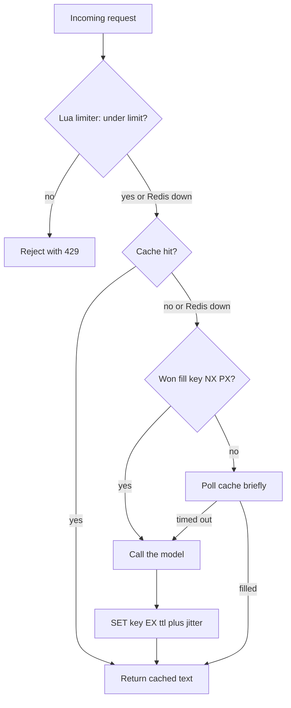

## TL;DR
Redis is an in-memory data-structure server that runs commands one at a time, so each is atomic and
sub-millisecond. For replicated Node AI services it holds shared, expiring state: completion cache,
rate limits, locks, cross-replica streaming and BullMQ's store.

## Why it exists
- **In-process state breaks at two replicas.** Every `Map` becomes a bug: the rate limiter counts half
  the traffic, the response cache misses whenever the balancer picks the other replica, the "run already
  in progress" flag is wrong half the time, and a reconnecting streaming client lands on a replica that
  knows nothing about its stream.
- **Postgres is the wrong tool for it.** A token-bucket check on every request, with disk-backed
  transactions and MVCC overhead, costs milliseconds and connections you want for real queries, and
  TTL-based expiry needs a cron job.
- **Redis fills the gap.** It is a network-attached data-structure library: `INCR`, `SET ... NX PX`,
  `ZADD` and `XADD` are single atomic operations measured in microseconds server-side, keys expire on
  their own, and memory is the only limit.
- **Single-threaded execution is the design choice.** No locks, no partial updates, and a Lua script or
  `MULTI` block runs as one unit *because* nothing else can interleave.
- **Its cost is equally clear.** One slow command (a `KEYS *`, a huge `SMEMBERS`, a long script) stalls
  every client, and data that must survive a crash needs persistence configured deliberately.
- **Scope of this lesson.** The fundamentals live in the backend module; this covers Node usage and what
  goes wrong.

## How it works
### Why one thread is enough
- **Data is in RAM** and almost every command is O(1) or O(log n).
- **An event loop multiplexes** thousands of client sockets, so the server spends its time executing
  commands rather than waiting.
- **Redis 6 added optional I/O threads** for reading and writing sockets, but command execution itself
  stays serial.

### Data structures, picked by access pattern
| Structure | Commands | AI-service use |
|---|---|---|
| Strings | `SET key value EX ttl`, `SET ... NX` | cached completions, feature flags, idempotency markers |
| Hashes | `HSET` field by field | one conversation's metadata or a session, expired as a whole |
| Lists | `LPUSH` plus `LTRIM` | simple queues, recent-messages windows |
| Sets, sorted sets | `ZADD`, `ZREMRANGEBYSCORE`, `ZCARD` | membership, ranking, sliding-window rate limits (timestamps as scores) |
| Streams | `XADD`, consumer groups | relaying token streams between replicas, BullMQ's event log |
| Pub/Sub | publish, subscribe | fire-and-forget broadcast of streamed tokens to the replica holding the SSE connection |

- **Per-field TTLs are new.** Redis 7.4 added `HEXPIRE`; older servers and many managed offerings only
  expire whole keys.
- **Pub/Sub stores nothing.** An offline subscriber misses messages; use Streams when that matters.

### Atomicity: single thread, MULTI, Lua
- **Each command is atomic.** Compound logic ("increment, and if first hit set the expiry") needs more.
- **`MULTI`/`EXEC`** queues commands and executes them without interleaving, but has no server-side
  branching.
- **Lua via `EVAL`/`EVALSHA`** runs atomically and can branch.
- **Rate limiters, token buckets and lock release are Lua scripts** ("delete only if the value is still
  my token") *because* a get-then-set from the client is a race between two round trips.

### Persistence and eviction
| Role | Persistence | Eviction | Because |
|---|---|---|---|
| Cache | none, or RDB snapshots (periodic, cheap, can lose the last minutes) | `maxmemory-policy allkeys-lru` | everything is rebuildable |
| Queue or lock store | AOF with `appendfsync everysec` (loses at most about a second) | `noeviction` | evicting a job key under memory pressure silently loses work |

- **Decide per instance,** and do not share one instance between the two roles.

### From Node
- **Two mainstream clients.** `ioredis` (long the de-facto standard and what BullMQ uses) and `redis`
  (node-redis, the official client). Both are promise-based and support Lua scripts, Cluster and
  Sentinel.
- **Pipelining.** node-redis batches un-awaited commands automatically; ioredis does it with
  `enableAutoPipelining` or an explicit `pipeline()`.
- **Dedicated connections for subscribers and blocking commands.** A connection in subscriber mode or
  running `BLPOP` / `XREAD BLOCK` cannot issue other commands. BullMQ workers open a separate blocking
  connection for the same reason and require `maxRetriesPerRequest: null` on it.
- **Configure failure behaviour explicitly.** ioredis's `maxRetriesPerRequest` and `enableOfflineQueue`
  decide whether a command waits for reconnection or fails fast. On a request path you usually want
  fail-fast *because* a hung Redis should degrade the cache, not take down the API.
- **Namespace keys per tenant and purpose** (`t:{tenantId}:cache:{hash}`). Hash tags in braces keep
  related keys on one Cluster slot. That matters for atomicity: in Redis Cluster a `MULTI` block or Lua
  script may touch only one slot and fails with `CROSSSLOT` otherwise, which is why BullMQ asks you to
  wrap a queue prefix in braces on Cluster.
- **Keep values small.** Never block the event loop building huge payloads; values beyond a few hundred
  kilobytes belong in object storage with a Redis pointer.

### Typical AI-service uses
- **Completion cache.** Key = SHA-256 of (model, system prompt, messages, parameters), serialised with
  stable key order. Cache only requests where one canonical answer is acceptable (temperature 0 or
  explicitly marked cacheable), and store usage alongside so cost dashboards stay honest.
- **Temperature 0 is not deterministic.** On hosted APIs it is not bit-for-bit reproducible, so the cache
  *chooses* an answer rather than reproducing one.
- **Stampede protection.** When a hot entry expires, or after a deploy with a cold cache, many identical
  requests miss at once and each calls the model: one expiry can cost N paid completions.
- **Single-flight fixes it.** The first miss takes `SET llm:fill:{hash} 1 NX PX 30000` and calls the
  model; the others poll the cache key briefly (or wait on a pub/sub message) before falling back to
  their own call. Add random TTL jitter so entries written together do not expire together. Within one
  replica, a `Map` of in-flight promises keyed by hash deduplicates for free.
- **Provider rate limit / semaphore.** A token bucket in Lua keyed by provider and model, so N replicas
  together stay under the vendor's requests-per-minute and tokens-per-minute limits.
- **Run state and locks.** `SET run:{id}:lock token NX PX 30000` ensures one worker per run, released by
  a check-and-delete script; refresh the TTL while working. A TTL lock can still expire under a paused
  process, so writes that must never happen twice also need a fencing token or a unique constraint
  downstream.
- **Short-term memory.** Last-N turns for a conversation with a TTL; long-term memory lives in Postgres
  or a vector store.

## Diagram
One request through the limiter and a single-flight completion cache. Only the request that wins the
`NX` fill key calls the model; every Redis failure falls through rather than failing the request.



## Examples
### Completion cache and fixed-window rate limiter
A completion cache and a fixed-window rate limiter using ioredis. The limiter is a Lua script so the
increment and the expiry are set atomically; the cache key hashes the fields that affect the output in a
fixed order.

Every Redis failure on the hot path degrades rather than failing the request: the limiter fails open,
the cache falls through to the provider. Fixed windows allow up to twice the limit across a window
boundary; use a sliding window or token bucket when that matters.

```ts
import Redis from "ioredis";
import { createHash } from "node:crypto";

const redis = new Redis(process.env.REDIS_URL!, { maxRetriesPerRequest: 1, enableOfflineQueue: false });
redis.on("error", (e) => console.error("redis", e.message));   // an unhandled 'error' event would crash the process

// Atomic fixed-window limiter: the first hit in a window sets the TTL.
redis.defineCommand("hitWindow", {
  numberOfKeys: 1,
  lua: `local n = redis.call('INCR', KEYS[1])
        if n == 1 then redis.call('PEXPIRE', KEYS[1], ARGV[1]) end
        return n`,
});
export async function allow(tenant: string, limit = 60, windowMs = 60_000): Promise<boolean> {
  const bucket = Math.floor(Date.now() / windowMs);
  try {
    const n: number = await (redis as any).hitWindow(`rl:${tenant}:${bucket}`, windowMs);
    return n <= limit;
  } catch { return true; }                                          // Redis down: fail open (a policy choice)
}

// Cache-aside for deterministic completions.
export async function cachedComplete(req: { model: string; system: string; messages: unknown[]; temperature: number; maxTokens: number },
                                     call: () => Promise<string>, ttlSec = 3600): Promise<string> {
  if (req.temperature !== 0) return call();                      // sampled output: do not cache
  const material = JSON.stringify([req.model, req.system, req.messages, req.temperature, req.maxTokens]);  // fixed field order
  const key = "llm:" + createHash("sha256").update(material).digest("hex");
  try {
    const hit = await redis.get(key);
    if (hit !== null) return hit;
  } catch { /* Redis down: fall through to the provider */ }
  const out = await call();
  redis.set(key, out, "EX", ttlSec).catch(() => {});             // best effort, never awaited on the hot path
  return out;
}
```

### A run lock with safe release and refresh
One worker per agent run. The token proves ownership, so a worker whose lock expired during a long LLM
call cannot delete or extend the lock another worker now holds.

```ts
import Redis from "ioredis";
import { randomUUID } from "node:crypto";

const redis = new Redis(process.env.REDIS_URL!);
const RELEASE = `if redis.call('GET', KEYS[1]) == ARGV[1] then return redis.call('DEL', KEYS[1]) else return 0 end`;
const REFRESH = `if redis.call('GET', KEYS[1]) == ARGV[1] then return redis.call('PEXPIRE', KEYS[1], ARGV[2]) else return 0 end`;

export async function withRunLock<T>(runId: string, work: () => Promise<T>, ttlMs = 30_000): Promise<T | "busy"> {
  const key = `run:${runId}:lock`;
  const token = randomUUID();
  const ok = await redis.set(key, token, "PX", ttlMs, "NX");       // "OK" or null
  if (ok !== "OK") return "busy";
  const timer = setInterval(() => { redis.eval(REFRESH, 1, key, token, ttlMs).catch(() => {}); }, ttlMs / 3);
  try {
    return await work();
  } finally {
    clearInterval(timer);
    await redis.eval(RELEASE, 1, key, token);                      // never a plain DEL
  }
}
```

### Worked scenario: sizing and a stampede
Illustrative numbers for a completion cache, using the entry size from the trade-offs below.

| Question | Arithmetic | Result |
|---|---|---|
| Memory for a million cached prompts at 20 KB each | 1,000,000 × 20 KB | ~20 GB of RAM, before overhead |
| Same traffic with a 1-hour TTL, if only 100,000 distinct prompts arrive per hour | 100,000 × 20 KB | ~2 GB resident |
| A popular entry expires while 200 identical requests are in flight | no single-flight: each misses | 200 paid completions |
| Same expiry with the `NX` fill key | 1 caller fills, 199 poll | 1 paid completion |

## Production patterns
- **Separate instances by role.** Run the cache with `maxmemory-policy allkeys-lru` and no persistence,
  and the BullMQ / lock instance with `noeviction` and `appendonly yes` plus `appendfsync everysec`.
  Monitor `evicted_keys` from `INFO stats`: it must stay zero on the queue instance.
- **Fail-fast clients on request paths.** Set `maxRetriesPerRequest: 1`, `enableOfflineQueue: false` and
  ioredis's `commandTimeout`, wrap calls in `try/catch`, and count fall-throughs. Monitor the
  fall-through rate and provider spend, which jumps when the cache is down.
- **Watch the slow log.** Set `slowlog-log-slower-than` (microseconds) and read `SLOWLOG GET` from a
  dashboard job, because one slow command stalls every client. Alert on new entries and on p99 command
  latency.
- **Find big keys without blocking.** Use `redis-cli --bigkeys` (it walks the keyspace with `SCAN`) and
  `MEMORY USAGE <key>` instead of `KEYS`. Monitor `used_memory` against `maxmemory`.
- **Jittered TTLs plus single-flight on expensive entries.** Set the TTL to the base plus a random
  fraction (for example up to 10%) and guard fills with an `NX` key. Monitor provider calls per minute
  right after deploys and cache flushes.

## Trade-offs
- **Speed and expiry vs RAM.** Microsecond atomic operations and built-in expiry, but everything lives in
  RAM; a completion cache holding 20 KB responses for a million prompts is 20 GB, so entry size and TTL
  must be budgeted, not assumed.
- **Free atomicity vs head-of-line stalls.** Single-threaded execution gives atomicity for free, but one
  slow command stalls all clients; once anyone needs scans over large keyspaces or long Lua loops, split
  the instance by role.
- **Pub/Sub simplicity vs durability.** The simplest way to relay streamed tokens across replicas, but it
  drops messages for absent subscribers; when a reconnecting client must resume, Streams with consumer
  groups cost more code and keep the data.
- **Cache config vs queue config.** `allkeys-lru` with no persistence is cheap and safe to lose for a
  cache; under a queue or lock store it silently discards work, so durability costs money (AOF,
  replicas) and a separate instance.
- **Managed vs latency.** Managed Redis (or Valkey, the Linux Foundation fork) removes operations work
  but adds network hops; another availability zone turns sub-millisecond calls into milliseconds on
  every request.

## Pitfalls
- **One connection for pub/sub or blocking commands and normal commands.** Symptom: an error that only
  subscriber commands may be used, or requests that hang behind a `BLPOP`.
- **No `error` listener on the client.** Symptom: the whole Node process exits on the first network blip
  with an unhandled `'error'` event.
- **Caching non-deterministic completions, or hashing an object with unstable key order.** Symptom:
  stale or wrong answers served as hits, or a hit rate far below what the traffic suggests.
- **No stampede protection on an expensive cache.** Symptom: a burst of identical provider calls (and a
  token-cost spike) when a popular entry expires or after a cache flush, though steady-state hit rate
  looks healthy.
- **`KEYS pattern` in production to find a tenant's keys.** Symptom: latency spikes on every client
  while it runs. Use `SCAN` with a cursor or maintain an index set.
- **Lock release with a plain `DEL`.** Symptom: worker A, whose lock expired during a long LLM call,
  deletes the lock worker B now holds, so two workers process one run.
- **BullMQ or locks on an `allkeys-lru` instance.** Symptom: jobs vanish under memory pressure with no
  error anywhere.

## When to use
- **Use when:** state must be shared across replicas, must be fast, and is either rebuildable (cache) or
  short-lived (rate windows, locks, run state, recent turns).
- **Avoid when:** you cannot afford to lose it, unless you have configured AOF, replicas and
  `noeviction` and understand what each costs.
- **Not the primary store** for conversations or evaluation results; that is Postgres.
- **Measure:** hit rate, p99 command latency, memory against `maxmemory`, evicted keys and connected
  clients per replica.
- **Interviews:** explain why rate limiting needs a Lua script, why pub/sub loses messages, and why a
  cache and a queue should not share an instance.

## Role lens
- **Engineer:** Writes the cache-aside and token-bucket helpers, keeps separate connections for subscribers, and makes every Redis call on the request path fail open or fail fast.
- **Architect:** Decides which state is allowed in Redis, the persistence and eviction policy per instance, key namespacing for tenants, and whether Streams or a queue carry cross-replica events.
- **FDE:** Works with whatever managed Redis or Valkey the customer runs, checks eviction policy and version before wiring BullMQ to it, and sizes memory from entry size and TTL.

## Check yourself
**Q:** Your agent API runs four replicas. A streaming response is produced by the replica that called
the model, but the client's SSE connection may be on another replica, and clients sometimes reconnect
mid-stream. Design the Redis part and explain the trade-offs.
**A:** The producing replica appends each token chunk to a Redis Stream keyed by run id with a TTL, and
the replica holding the SSE connection reads it with `XREAD BLOCK` from the last id the client
acknowledged, which makes reconnects resumable because the chunks are stored, not merely broadcast.
Pub/Sub would be simpler and lower latency, but a client reconnecting would miss everything published
while it was away. Each blocking reader needs its own connection, and the stream must be trimmed or
expired so memory does not grow with every run. The instance should run `noeviction` so chunks are not
dropped under pressure, and the final entry should be a sentinel so the consumer knows the stream is
complete rather than stalled.

## Interview questions
### Redis is single-threaded. Why is it still fast, and what does that design cost you?
- **Fast because** data is in RAM, nearly every command is O(1) or O(log n), and one event loop
  multiplexes thousands of sockets; Redis 6 I/O threads help with socket work only.
- **The benefit:** each command, `MULTI` block and Lua script is atomic with no locks.
- **The cost:** one slow command such as `KEYS *` or a long script stalls every client.

### A cache hit rate looks healthy, yet provider spend spikes after every deploy. What is going on?
- **A stampede:** a cold or flushed cache makes many identical requests miss at once, and each pays for
  its own completion.
- **Fix:** single-flight with `SET ... NX PX` on a fill key so one caller fills while others poll, an
  in-process `Map` of in-flight promises per replica, and jittered TTLs.
- **Verify** by graphing provider calls per minute around deploys.

### Would you put BullMQ on the same Redis instance as your completion cache?
- **No:** the cache wants `allkeys-lru` and no persistence; the queue needs `noeviction` and AOF,
  because an evicted job key is silently lost work.
- **Also,** a cache scan or big value can stall the queue's commands on the shared thread.
- **When it is fine:** tiny deployments that run `noeviction` everywhere and accept that the cache can
  fill memory and start erroring writes.

### Why do Lua scripts and `MULTI` fail with `CROSSSLOT` on Redis Cluster, and how do you design keys for it?
- **Cluster shards keys across hash slots,** and an atomic block or script may only touch keys in one
  slot.
- **Hash tags** in braces, such as `t:{tenantId}:...`, make Redis hash only the braced part, so a
  tenant's related keys share a slot.
- **That is why BullMQ asks** for a braced queue prefix on Cluster.

### How do you make a Redis lock safe for an agent run that may take minutes?
- **Acquire** with `SET key token NX PX ttl` using a random token, and refresh the TTL periodically
  with a script that checks the token.
- **Release** with a check-and-delete Lua script, never a plain `DEL`, so an expired holder cannot
  delete someone else's lock.
- **Still add a fencing token or unique constraint** downstream, because a paused process can outlive
  its TTL.

## Quiz
### Q: Why is a rate limiter implemented as a Lua script instead of `GET` then `SET` from Node?
- [ ] Lua runs faster than JavaScript on the Redis server
- [x] The read and the write from Node are separate round trips, so two replicas can both read the same count and both allow a request past the limit
- [ ] Redis rejects `SET` from clients that have recently called `GET`
- [ ] Lua scripts are the only way to set a TTL on a key
> Redis executes each command atomically, but a client-side get-then-set is two commands with a gap; a script (or `MULTI`) runs as one unit on the single-threaded server, which closes the race.

### Q: BullMQ jobs are disappearing from a shared Redis instance under load, with no errors logged. What is the most likely cause?
- [ ] The jobs exceeded Redis's maximum value size
- [ ] Workers are running with too much concurrency
- [x] The instance uses an `allkeys-lru` eviction policy and job keys are evicted when memory fills
- [ ] Pub/Sub messages were dropped because no subscriber was connected
> A cache-style eviction policy treats job state like any other key and silently removes it at `maxmemory`; queue and lock workloads need `noeviction` and ideally their own instance.

### Q: Which client setup is correct for a Node service that both caches completions and subscribes to a channel?
- [ ] One connection for everything, because ioredis multiplexes commands
- [x] Two connections: one for normal commands and a dedicated one in subscriber mode
- [ ] A new connection per request to avoid head-of-line blocking
- [ ] A connection pool of at least one per CPU core
> A connection that has issued `SUBSCRIBE` can only run subscriber commands, so `GET`/`SET` on it fail; a separate subscriber connection is required, while normal commands pipeline fine on one shared connection.
