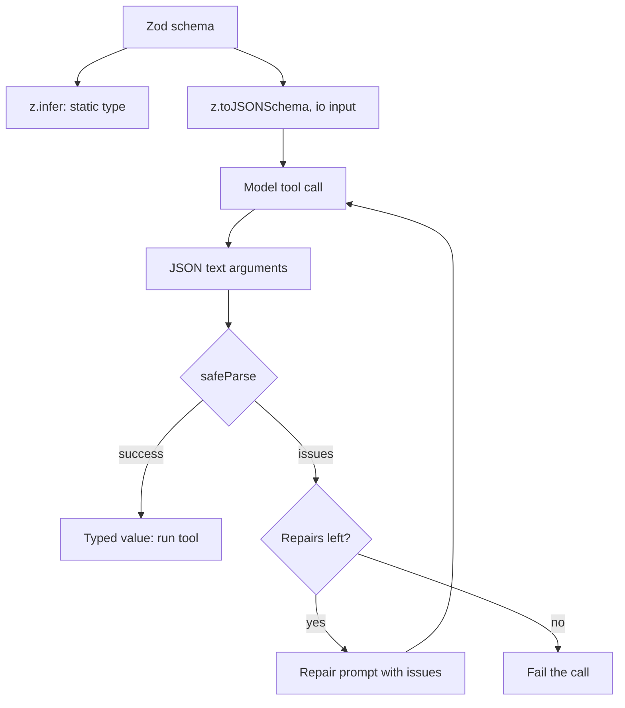

## TL;DR
Agents act on JSON the model invented, and TypeScript types are erased, so nothing checks it unless you
parse. One Zod schema derives the type, parses tool arguments and becomes the tool's JSON Schema, so the
model follows the contract you enforce.

## For agent builders
- **Why it matters for agents.** Tool calling is a contract: the model reads a JSON Schema, sends arguments,
  and your code acts on them, sometimes with side effects. A schema-derived parse is the gate between "the
  model said so" and "the tool ran", and its issues are the feedback the model needs to fix a bad call.
- **Where it shows up in your stack.** Tool definitions (`parameters` generated with `z.toJSONSchema`),
  structured final answers, the OpenAI SDK's Zod helpers and the Vercel AI SDK's Zod-based tools, plus HTTP
  bodies, queue messages and env config of the agent service.
- **What you control.** `.strict()` on tool arguments, `.describe()` text the model reads, the input-side
  schema sent to the model, the repair bound, and per-tool failure metrics.
- **What you can skip.** Comparing every validation library in depth. Pick one (Zod here), keep one schema
  per boundary, and never cast model output with `as`.

## Why it exists
- **Every interesting input is untrusted.** A request body can be anything the client sent. A model's "JSON"
  can be a markdown-fenced blob with a trailing comment, a number where a string was asked for, or a field
  the tool never defined. An environment variable is a string even when the code needs a port number.
- **A compile-time type here is a comment, not a check.** `JSON.parse(body) as ChatRequest` tells the
  compiler to trust you; the first missing field becomes `undefined` deep in business logic, usually a
  `TypeError` after the model call was billed.
- **Hand-written checks drift.** `if (typeof x.messages !== "object")` checks diverge from the type the rest of
  the code uses and are never complete.
- **Two definitions disagree.** A TypeScript interface *and* a separate JSON Schema for the model doubles the
  surface, so the model is told one shape and the code checks another. Validating only at HTTP misses queue
  messages, model outputs and tool results.
- **One definition, three uses.** The static type (`z.infer`), the runtime parser (`schema.parse`) and the
  model contract (JSON Schema). The principle is "parse, don't validate": a parse returns a *new* value of a
  narrower type, so later code cannot forget the check happened.

## How it works
### Schema as a value
- **Built by composition:** `z.object({ model: z.string(), temperature: z.number().min(0).max(2).default(1),
  messages: z.array(Message).min(1) })`.
- **Each combinator carries both** the runtime checks and a phantom static type, which
  `z.infer<typeof Schema>` extracts.
- **Type from schema, not the reverse,** *because* a type cannot be inspected at runtime, while a value can be
  both executed and reflected on.

### Input type vs output type
| Type | What it describes | Use for |
|---|---|---|
| `z.input<typeof S>` | What the producer may send | Whoever constructs the payload, including the model |
| `z.output<typeof S>` | What `parse` gives back | The code that consumes it |

- **`z.infer` is the output side:** it returns `z.output<typeof S>`, the type `parse` gives back.
- **They differ** whenever a field has a `.default()` (optional on input, required on output) or a
  `.transform()` (a string in, a `Date` out).

### `parse` versus `safeParse`
| Call | Returns | Use where |
|---|---|---|
| `Schema.parse(input)` | The typed value, or throws a `ZodError` | Boundaries where failure becomes an HTTP 400 through a central error handler |
| `Schema.safeParse(input)` | `{ success: true, data }` or `{ success: false, error }`, never throws | Failure is an expected branch, such as a model output you intend to repair |

- **`error.issues`** is an array of `{ path, code, message }`: what you return to a client and what you feed
  back to a model.

### Transform, refine, coerce
- **Change the value while parsing:** `z.string().transform((s) => s.trim())`, `z.coerce.number()` for a port
  read from `process.env`, `.refine((v) => v.end > v.start, { message })` for cross-field rules, `.pipe()` to
  chain a transform into a further schema.
- **Transforms are the point of `parse`:** the output type differs from the input type, so the result is a
  domain value, not the wire shape.
- **Async refinements cost a round trip.** Checks that need I/O (does this `customerId` exist?) can be async,
  but then only `parseAsync`/`safeParseAsync` run them; keep them few, because they turn a cheap pure parse
  into a database round trip at every boundary.
- **Brand the output.** `.brand<"CustomerId">()` makes it a branded type, so code requiring a `CustomerId`
  cannot be handed an unparsed string.

### Objects: strict, strip, passthrough
| Mode | Unknown keys | Use for |
|---|---|---|
| Default (*strip*) | Silently removed | General parsing |
| `.strict()` | Rejected | Tool arguments (an unexpected key usually means the model misread the schema) and request bodies, where dropping a typo'd field hides a client bug |
| `.passthrough()` | Kept | Forwarding provider payloads you do not fully model |

- **Zod 4 naming.** It keeps these methods but prefers the equivalent `z.strictObject()` and `z.looseObject()`
  constructors.
- **Tagged variants.** `z.discriminatedUnion("type", [...])` validates stream events and similar, and gives
  the compiler the same narrowing as a hand-written union.

### From schema to the model, and back
The round trip is: schema → JSON Schema → model → JSON text → `safeParse` → typed value.

1. **Generate the JSON Schema from Zod.** Zod 4 ships `z.toJSONSchema`; earlier versions use the
   `zod-to-json-schema` package; the OpenAI Node SDK has Zod helpers and the Vercel AI SDK accepts Zod schemas
   directly. `.describe()` strings become the field descriptions the model reads.
2. **Generate the *input* schema** (`{ io: "input" }` in Zod 4), because a field with `.default()` is optional
   on input but present on output.
3. **Check your provider's subset.** Strict structured-output modes accept only part of JSON Schema: some
   reject or ignore keywords such as `format` or length bounds, and some require every property to be listed
   as required.
4. **Always parse the reply,** even with provider-side constrained decoding: it is the only check for
   `refine` rules, it guards against provider bugs, and a failed parse becomes a repair prompt ("the field
   `due_date` must be ISO 8601; you returned `tomorrow`").

### Alternatives in the ecosystem
| Library | Style | Suits |
|---|---|---|
| Valibot | Same model as Zod | Smaller bundles |
| TypeBox, Ajv | JSON-Schema-first | Teams whose source of truth is an OpenAPI document |
| ArkType | A type-syntax string instead of chaining | Preference for TS-like syntax |

- **The discipline matters more than the library:** one schema per boundary, the type derived from it, and no
  `as` casts on untrusted data.

## Diagram
One schema feeds the model's contract and the parser that checks the model's reply; invalid replies loop back
as repair prompts, a bounded number of times.



## Examples
### Agent scenario: tool schema, JSON Schema and a repair loop
A tool definition whose Zod schema produces both the TypeScript argument type and the JSON Schema sent to the
model, with a repair loop that feeds validation issues back when the model's arguments do not parse. Unknown
keys are rejected because an extra key from a model usually means it misread the schema.

```ts
import { z } from "zod";

const ScheduleArgs = z.object({
  title: z.string().min(1).describe("Short title for the calendar event"),
  start: z.iso.datetime({ offset: true })                 // without offset: only a trailing "Z"
    .describe("ISO 8601 start time with timezone offset"),
  durationMinutes: z.number().int().min(5).max(480).default(30),
  attendees: z.array(z.email()).max(20).default([]),
}).strict();
type ScheduleArgs = z.infer<typeof ScheduleArgs>;       // output: durationMinutes: number (required)
type ScheduleInput = z.input<typeof ScheduleArgs>;      // input: durationMinutes?: number

export const scheduleTool = {
  name: "schedule_event",
  description: "Create a calendar event",
  // Zod 4 APIs throughout (on Zod 3: z.string().datetime(), z.string().email(), zod-to-json-schema).
  // io "input" describes ScheduleInput: defaulted fields are optional for the model.
  parameters: z.toJSONSchema(ScheduleArgs, { io: "input" }),
  run: async (args: ScheduleArgs) => ({ id: "evt_123", ...args }),
};

type ModelCall = (messages: Array<{ role: string; content: string }>) => Promise<string>;

export async function callToolWithRepair(rawArgs: string, model: ModelCall, maxRepairs = 2) {
  let text = rawArgs;
  for (let attempt = 0; attempt <= maxRepairs; attempt++) {
    let json: unknown = undefined;
    try { json = JSON.parse(text); } catch { /* reported as a syntax problem below */ }
    const result = ScheduleArgs.safeParse(json);
    if (result.success) return scheduleTool.run(result.data);   // result.data is typed and trusted
    const issues = json === undefined ? "(root): not valid JSON" : result.error.issues
      .map((i) => `${i.path.join(".") || "(root)"}: ${i.message}`).join("\n");
    if (attempt === maxRepairs) throw new Error(`tool args invalid after repairs:\n${issues}`);
    text = await model([
      { role: "system", content: "Return only JSON matching the schema; fix the listed problems." },
      { role: "user", content: `Previous arguments:\n${text}\n\nProblems:\n${issues}` },
    ]);
  }
  throw new Error("unreachable");
}

const port = z.coerce.number().int().min(1).max(65535).parse(process.env.PORT ?? "3000");
void port;
```

### Boot-time config and a request body that returns 400
Zod 4. Config is parsed once at startup so a bad deploy crashes immediately, not on the first request. The
request parser returns path and message only, never the raw input, so client responses cannot leak payloads.

```ts
import { z } from "zod";

const Env = z.object({
  PORT: z.coerce.number().int().min(1).max(65535).default(3000),
  MODEL_API_KEY: z.string().min(1),
  ENABLE_TOOLS: z.stringbool().default(false),           // "false" -> false, unlike z.coerce.boolean()
  LOG_LEVEL: z.enum(["debug", "info", "warn", "error"]).default("info"),
});
export const env = Env.parse(process.env);                // throws at boot with every bad variable listed

const ChatRequest = z.strictObject({
  model: z.enum(["fast", "smart"]),
  messages: z.array(z.strictObject({
    role: z.enum(["user", "assistant"]),
    content: z.string().min(1).max(32_000),
  })).min(1).max(100),
  temperature: z.number().min(0).max(2).default(1),
});
export type ChatRequest = z.output<typeof ChatRequest>;

export function parseChatRequest(body: unknown) {
  const r = ChatRequest.safeParse(body);
  if (r.success) return { ok: true as const, data: r.data };   // temperature filled in: 1
  return {
    ok: false as const,
    status: 400,
    issues: r.error.issues.map((i) => ({ path: i.path.join(".") || "(root)", message: i.message })),
  };
}
// parseChatRequest({ model: "gpt-x", messages: [], temprature: 0.2 }) yields three issues:
// model (invalid option), messages (too small), (root) (unrecognized key "temprature")
```

### Worked scenario: a model upgrade raises tool-argument failures
A team tracks `safeParse` failures per tool after switching model versions (illustrative numbers).

| Metric for `schedule_event` | Before | After upgrade | Reading |
|---|---|---|---|
| Argument parse failure rate | 0.5% | 6% | The model's behaviour changed, not the code |
| Top issue path | mixed | `start` (invalid ISO datetime) | It now sends local times without an offset |
| Repair success within 2 attempts | 90% | 70% | Repairs cost an extra call each; fix the root cause |
| Fix | — | `.describe()` text gives an example with offset; failures back near baseline | The schema description is part of the prompt |

## Production patterns
- **Parse tool results before they re-enter the transcript.** Agent teams also give third-party tool
  responses a schema (often `passthrough` or `strip`, since you forward them) and cap their size, so a
  changed upstream API produces a clear error tool result instead of garbage the model reasons over.
  Monitor result-parse failures per tool alongside argument failures.
- **Validate config at boot.** Parse `process.env` with one schema in the entry module, using
  `z.coerce.number()` for ports and `z.stringbool()` or an enum transform for flags, so a bad deploy fails its
  readiness check instead of serving errors. Monitor crash-on-start in deploy dashboards.
- **Central `ZodError` → 400 mapping.** Route handlers call `parse`; one error handler converts `ZodError` to
  a 400 with `path` and `message` only (Zod 4's `z.flattenError` helps), never raw input. Monitor 400 rate per
  route and per issue path to spot client bugs.
- **Shared contracts package.** Tool, request and event schemas live in one package consumed by every service,
  with types derived via `z.infer`, so producers and consumers cannot drift. Track schema changes in review
  like API changes.
- **Additive schema evolution.** Add new fields as optional with `.default()`, deploy all producers (including
  queued messages and prompts), then tighten. Monitor validation failures by producer version during
  rollouts.
- **Bounded repair with metrics.** `safeParse` model output, send `issues` back at most two times, then fail
  explicitly. Emit failure rate, repair success rate and extra tokens per tool; a rising failure rate usually
  means a prompt or model change.

## Trade-offs
- **One schema vs coupling.** One schema gives type, parser and model contract together, but couples the wire
  format to the domain type; when they must diverge, add a `transform` or a second schema rather than casting.
- **Safety vs CPU.** Validating every boundary costs CPU proportional to payload size, negligible against a
  model call but noticeable on hot internal paths with large arrays; validate at the edge, trust inside.
- **`.strict()` vs forward compatibility.** Strict catches model and client mistakes early, yet breaks when a
  provider adds a harmless field; use `strip` for payloads you forward and `strict` for arguments you act on.
- **Repair vs latency and cost.** A repair prompt improves success rates at the cost of another model call and
  latency; bound the attempts and prefer provider structured-output modes that reduce failures in the first
  place.
- **JSON-Schema-first vs TypeScript-first.** TypeBox and Ajv align with OpenAPI-driven teams; Zod is more
  ergonomic for application code. Mixing both in one service is where contracts drift.
- **Tighter schemas vs old producers.** A new required field or narrower enum protects consumers but breaks
  producers still sending the old shape (queued messages written before a deploy, a prompt not yet updated).
  Add fields as optional with a default first, and tighten only once every producer has moved.

## Pitfalls
- **Repairing forever, or repairing side-effecting calls blindly.** Symptom: a run burns several extra model
  calls per step on a tool the model cannot satisfy. Fix: bound repairs (two is typical), then return a
  final error tool result and let the model choose another path.
- **Casting untrusted JSON with `as` instead of parsing.** Symptom: a `TypeError` on an `undefined` field deep
  in business logic, after the model call was billed. Fix: `safeParse` into a schema-derived type.
- **A TypeScript interface and a hand-written JSON Schema kept separately.** Symptom: the model returns a field
  the code rejects, or the code expects a field the model was never told about. Fix: generate both from one
  Zod schema.
- **Default `strip` on tool arguments.** Symptom: a hallucinated extra parameter is silently dropped, so the
  tool runs with half of what the model intended. Fix: `.strict()` (or `z.strictObject`) on tool arguments.
- **Returning raw `ZodError` messages to end users or logging full payloads in issues.** Symptom: leaked
  internal field names or PII in client responses and logs. Fix: map issues to `path` and `message` only.
- **Skipping the parse because the provider "guarantees" the schema.** Symptom: `refine` rules never run, and a
  provider-side change or bug reaches production unchecked. Fix: always `safeParse` the reply.
- **Reading `process.env` without coercion.** Symptom: `"3000" + 1` style bugs and a port compared as a string.
  Fix: parse env once at boot with `z.coerce.number()`.
- **`z.coerce.boolean()` for env flags.** It applies JavaScript truthiness, so `FEATURE_X=false` turns the
  feature *on* because `"false"` is a non-empty string. Parse with an enum
  (`z.enum(["true", "false"]).transform((v) => v === "true")`) or Zod 4's `z.stringbool()` instead.

## When to use
- **Parse at every boundary where data enters the process:** HTTP bodies and query strings, webhook payloads,
  queue messages, environment configuration, model outputs and tool-call arguments, and responses from
  third-party APIs you depend on.
- **Derive types from schemas,** generate the model's JSON Schema from the same source, and use `safeParse`
  with a bounded repair loop where the model is the producer.
- **Avoid when** calls are internal between already-typed modules; that is what the compiler is for.
- **Measure:** the validation failure rate per boundary (a rising rate on model outputs usually means a prompt
  or model change) and the repair success rate.
- **Interviews:** why types alone are insufficient, how a Zod schema becomes a tool definition, and how to
  handle invalid model output.

## Role lens
- **Engineer:** Defines one Zod schema per tool and per endpoint, derives types with `z.infer`, generates
  the tool's JSON Schema from it, and routes `ZodError` issues into 400 responses or repair prompts.
- **Architect:** Decides where the schemas live (a shared contracts package), which boundaries are
  strict versus permissive, and how schema versions evolve alongside prompts and tool definitions.
- **FDE:** Audits a customer's agent for `as` casts on model output, replaces them with parsed schemas,
  and uses the validation failure rate to show which tools the model misuses most.

## Check yourself
**Q:** A team argues that since their provider supports structured outputs with constrained decoding,
validating the model's JSON with Zod on their side is redundant work. What do you tell them?
**A:** Constrained decoding makes the output syntactically match the JSON Schema, which removes most
failures, but it does not remove the need to parse. First, the JSON Schema cannot express everything the
Zod schema checks: cross-field `refine` rules, date validity, semantic ranges; and providers' strict
modes support only a subset of JSON Schema, so some keywords you did write may not be enforced. Output
cut off by the max-token limit, or a refusal, can still arrive as invalid JSON. Second, the parse is what
produces a typed value; without it the code is still operating on `unknown` or on an `as` cast, so the
compiler cannot help. Third, the provider is an external system that can change or have bugs, and the
parse is the only place that failure is caught before a tool runs with bad arguments. Finally, the
schema is already written, so the validation is a single `safeParse` call whose cost is negligible next
to the model call. The constrained mode reduces repairs; it does not replace the boundary check.

## Interview questions
### What does "parse, don't validate" mean, and why does it matter for AI services?
- **Definition:** a parse turns `unknown` input into a new value of a narrower type, or fails; a validator only
  answers yes or no and leaves the original untyped value in circulation.
- **Why here:** model outputs, tool arguments and webhooks are untrusted, and a parsed value means every later
  line can rely on the shape without re-checking or casting.

### A tool keeps running with missing parameters although the model "sent them". How do you debug it?
- **Suspect stripping:** the default object mode drops unknown keys, so a misspelled or extra key from the
  model vanishes silently; log the raw arguments next to the parsed ones.
- **Fix:** make tool-argument schemas `.strict()` so the mismatch becomes an issue fed back into a repair
  prompt, and improve `.describe()` text if the model keeps misnaming the field.

### When would you not validate with a runtime schema?
- **Between already-typed internal modules:** the compiler already checks those calls, and re-parsing adds CPU
  and code with no new safety.
- **On hot paths with large arrays you produced yourself,** validate once at the edge and trust inside.

### How do you change a schema that queued messages and prompts already depend on?
- **Additive first:** add the new field as optional with `.default()`, so old producers still parse.
- **Then migrate producers:** deploy writers, drain or reprocess queued messages, update prompts and tool
  descriptions.
- **Tighten last,** and watch validation failure rates by producer version during the rollout.

### In an agent, which payloads besides tool arguments should you parse, and how strictly?
- **Structured final answers:** the run's output that downstream code consumes gets a strict schema and the
  same bounded repair.
- **Tool results from third-party APIs:** a forgiving (`strip` or `passthrough`) schema plus a size cap, because
  you forward them to the model and a provider adding fields is harmless.
- **Memory and queue records:** schemas with additive evolution, since records written by an older agent
  version must still parse.

### What do you monitor around schema validation in production?
- **Failure rate per boundary and per issue path:** a jump on model outputs after a deploy usually means a
  prompt or model change; on HTTP, a client bug.
- **Repair metrics:** repair success within the attempt bound and extra tokens spent, since each repair is
  another model call.

## Quiz
### Q: Why derive the TypeScript type from the Zod schema with `z.infer` rather than writing the interface first and the schema to match?
- [ ] `z.infer` produces faster code because it skips type checking
- [x] A schema is a runtime value that can both validate and be reflected into JSON Schema, while a type is erased, so the schema must be the single source of truth
- [ ] Interfaces cannot describe optional fields, but schemas can
- [ ] Zod refuses to compile when an interface exists for the same shape
> Types exist only at compile time; nothing can execute or inspect them. Making the schema primary means
> the type, the parser and the model-facing JSON Schema cannot drift apart. Interfaces describe optional
> fields fine; they simply cannot check anything at runtime.

### Q: When should a tool-argument schema use `.strict()` instead of Zod's default of stripping unknown keys?
- [ ] Never; stripping is always safer because it avoids rejecting valid calls
- [ ] Only when the tool has no optional parameters
- [x] When an unexpected key likely means the model misread the contract, so rejecting and repairing is better than silently dropping it
- [ ] When the JSON Schema is generated by the provider instead of the code
> A model that adds an undefined parameter has misunderstood the tool, and stripping it would run the tool
> with a different intent than the model had. Strict mode surfaces the mismatch so the issue can be fed
> back for repair. Stripping remains appropriate for payloads you merely forward.

### Q: A model's tool arguments fail `safeParse`. What is the most robust next step?
- [ ] Run the tool with whatever fields parsed correctly
- [ ] Cast the raw JSON to the argument type and continue
- [x] Send the parse issues back to the model in a bounded repair loop, and fail the call if it still does not parse
- [ ] Retry the identical prompt until the output parses
> The issues carry the path and reason for each failure, which is exactly the feedback a model needs to
> correct its output. Bounding the attempts prevents runaway cost, and failing explicitly beats running a
> side-effecting tool with partial or unchecked arguments.

## Use cases & projects
### Use cases
- **Tool definitions for tool-calling agents.** One Zod schema per tool gives the handler's argument type, the
  model-facing JSON Schema and the runtime gate.
- **Structured outputs.** Extraction or classification agents parse the final answer into a typed value
  before anything downstream uses it, even with provider constrained decoding.
- **Self-correcting tool calls.** `safeParse` issues become a bounded repair prompt, which recovers most bad
  calls without a human.
- **Watching model upgrades.** Parse-failure rate per tool is the earliest signal that a new model version
  or prompt changed how it calls tools.

### Mini project
**Schema-first tools with repair metrics (1-2 hours).**
- **Goal:** an agent with three Zod-defined tools whose arguments are always parsed, with measured repair
  behaviour.
- **Steps:** define three tools with `.strict()` schemas and `.describe()` text; generate `parameters` with
  `z.toJSONSchema(..., { io: "input" })`; wire `callToolWithRepair` into a loop against a real or mocked
  model; run 50 prompts and record parse failures, repairs and extra tokens per tool; improve one
  `.describe()` and rerun.
- **Done when:** no tool handler ever receives unparsed input, you have a before/after table of failure and
  repair rates per tool, and a failed repair produces an explicit error result rather than a crash.
