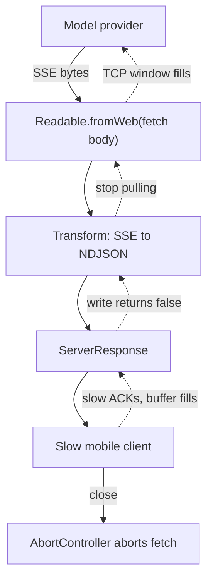

## TL;DR
Agents stream: model tokens, tool-progress events and voice reach the user chunk by chunk, with
sub-second first-token latency. Backpressure pauses a fast producer when the consumer lags, keeping memory
bounded; `pipeline` and `pipeTo` keep errors and aborts wired.

## For agent builders
- **Why it matters for agents.** A multi-step agent run can take a minute; streaming tokens and step events
  ("calling search", "reading 3 docs") is what makes it feel alive. Every open run is a stream, so a
  backpressure bug multiplies by the number of concurrent sessions.
- **Where it shows up in your stack.** Provider SDK streams (Web `ReadableStream` from `fetch`), your SSE or
  NDJSON endpoint to the UI, voice and TTS pipelines, and bulk ingestion for RAG (chunking and embedding
  large files).
- **What you control.** `pipeline` versus manual wiring, `highWaterMark` per stage, aborting upstream on
  client close, and turning off proxy buffering for streamed routes.
- **What you can skip.** Writing custom `Duplex` streams and the internals of `_read`. Know the
  `write()`/`'drain'` contract, `for await`, and `Readable.fromWeb`.

## Lab
### Task
Fix the streaming path between a model provider and a slow agent UI: an SSE-to-NDJSON Transform that
survives arbitrary chunk splits, an event writer that honours `'drain'` and stops when the client leaves,
and a proxy whose failing client tears down the upstream. Time box: 60-90 minutes.
- **Prerequisites:** this lesson's backpressure protocol, `pipe` versus `pipeline` and SSE framing
  sections; the AbortController lesson for the signal.
- **Setup:** an empty folder with `"type": "module"` in `package.json`, `npm i -D vitest @types/node`.
  Checked with Node 24.21 and Vitest 5.0; Node 24 runs `lab.ts` directly by stripping types.
- **No provider needed:** `sse()` builds a recorded provider stream and `slowClient()` is a Writable that
  acknowledges one chunk per millisecond.
- **Save** the starter as `lab.ts` and the tests as `lab.test.ts`, then run `node lab.ts` and
  `npx vitest run`.

### Starter code
```ts
// Lab: stream an agent run to a slow client without unbounded buffers or leaked upstreams.
// Run: node lab.ts   Test: npx vitest run
import { Readable, Transform, Writable, type TransformCallback } from "node:stream";
import { once } from "node:events";
import { pathToFileURL } from "node:url";

// LAB 1: reframe provider SSE into NDJSON lines {"t": delta}. Chunks split anywhere: inside an
// event, inside a line, inside a multi-byte UTF-8 character. Buffer partial events across chunks,
// decode with one StringDecoder, skip [DONE], and fail in _flush if a partial event is left.
export class SseToNdjson extends Transform {
  override _transform(chunk: Buffer, _enc: BufferEncoding, cb: TransformCallback) {
    for (const event of chunk.toString().split("\n\n")) {      // assumes whole events per chunk
      const line = event.trim();
      if (!line.startsWith("data:") || line.endsWith("[DONE]")) continue;
      this.push(JSON.stringify({ t: JSON.parse(line.slice(5)).delta ?? "" }) + "\n");
    }
    cb();
  }
}

// LAB 2: write each event as an NDJSON line and honour backpressure: when write() returns false,
// await once(dest, "drain", { signal }) so a client that leaves mid-wait ends the loop.
// Return the peak dest.writableLength you observed.
export async function writeEvents(events: AsyncIterable<object>, dest: Writable, signal: AbortSignal): Promise<number> {
  let peak = 0;
  for await (const ev of events) {
    dest.write(JSON.stringify(ev) + "\n");
    peak = Math.max(peak, dest.writableLength);
  }
  void once; void signal;
  return peak;
}

// LAB 3: connect upstream -> SseToNdjson -> dest so an error or close on dest destroys upstream
// (pipeline from node:stream/promises), and resolve when the chain finishes.
export async function proxy(upstream: Readable, dest: Writable): Promise<void> {
  upstream.pipe(new SseToNdjson()).pipe(dest);
  await once(dest, "finish");
}

export function sse(deltas: string[]): Buffer {
  return Buffer.from(deltas.map((d) => `data: ${JSON.stringify({ delta: d })}\n\n`).join("") + "data: [DONE]\n\n");
}

export function slowClient(msPerChunk: number, highWaterMark = 1024) {
  const got: string[] = [];
  const w = new Writable({ highWaterMark, write(c, _e, cb) { got.push(String(c)); setTimeout(cb, msPerChunk); } });
  return { w, got };
}

if (import.meta.url === pathToFileURL(process.argv[1] ?? "").href) {
  const bytes = sse(["Hel", "lo ", "wörld ", "🙂"]);
  const cuts = [0, 7, bytes.indexOf("ö") + 1, bytes.indexOf("🙂") + 2, bytes.length];   // mid-character splits
  const chunks = cuts.slice(1).map((end, i) => bytes.subarray(cuts[i], end));
  const out: string[] = [];
  try {
    for await (const line of Readable.from(chunks).pipe(new SseToNdjson())) out.push(String(line));
    console.log("ndjson:", out.join("").trim().split("\n").map((l) => JSON.parse(l).t).join(""));
  } catch (e) { console.log("transform failed:", (e as Error).message); }

  async function* run() { for (let i = 0; i < 200; i++) yield { type: "token", text: "x".repeat(80), i }; }
  const { w } = slowClient(1);
  console.log("peak buffered bytes:", await writeEvents(run(), w, new AbortController().signal));
}
```

### Expected output
`node lab.ts` with a correct solution prints:

```
ndjson: Hello wörld 🙂
peak buffered bytes: 1130
```

The starter prints `transform failed: Expected property name or '}' in JSON at position 2 (line 1 column 3)`
and `peak buffered bytes: 22890`: every one of the 200 lines buffered at once instead of about ten.

### Tests
```ts
import { expect, test } from "vitest";
import { Readable, Writable } from "node:stream";
import { setTimeout as sleep } from "node:timers/promises";
import { SseToNdjson, proxy, slowClient, sse, writeEvents } from "./lab.ts";

async function collect(chunks: Buffer[]) {
  let out = "";
  for await (const c of Readable.from(chunks).pipe(new SseToNdjson())) out += String(c);
  return out;
}

test("events split across chunks and inside characters survive", async () => {
  const bytes = sse(["Hel", "lo ", "wörld ", "🙂"]);
  const cuts = [0, 3, 7, bytes.indexOf("ö") + 1, bytes.indexOf("🙂") + 1, bytes.indexOf("🙂") + 3, bytes.length];
  const out = await collect(cuts.slice(1).map((end, i) => bytes.subarray(cuts[i], end)));
  expect(out).toBe(['{"t":"Hel"}', '{"t":"lo "}', '{"t":"wörld "}', '{"t":"🙂"}', ""].join("\n"));
});

test("upstream ending mid-event is an error, not a silent truncation", async () => {
  const bytes = sse(["complete"]);
  await expect(collect([bytes, Buffer.from('data: {"delta":"cut')])).rejects.toThrow("stream ended mid-event");
});

test("writes wait for drain, so the buffer stays near highWaterMark", async () => {
  async function* run() { for (let i = 0; i < 200; i++) yield { type: "token", text: "x".repeat(80), i }; }
  const { w, got } = slowClient(1, 1024);
  const peak = await writeEvents(run(), w, new AbortController().signal);
  expect(peak).toBeLessThanOrEqual(1024 + 120);       // threshold plus one line
  await new Promise((r) => w.end(r));
  expect(got.length).toBe(200);
});

test("a client that leaves mid-drain ends the loop instead of hanging", async () => {
  const stuck = new Writable({ highWaterMark: 64, write() { /* never acknowledges */ } });
  const ac = new AbortController();
  async function* forever() { while (!ac.signal.aborted) { yield { type: "token", text: "y".repeat(50) }; await sleep(1); } }
  setTimeout(() => ac.abort(), 20);
  await expect(writeEvents(forever(), stuck, ac.signal)).rejects.toMatchObject({ name: "AbortError" });
});

test("a failing client destroys the upstream", async () => {
  const upstream = Readable.from((async function* () { for (;;) { yield sse(["tok"]); await sleep(1); } })());
  let writes = 0;
  const client = new Writable({ write(_c, _e, cb) { cb(++writes === 3 ? new Error("client reset") : null); } });
  await expect(proxy(upstream, client)).rejects.toThrow("client reset");
  await sleep(5);
  expect(upstream.destroyed).toBe(true);
});
```

All five fail on the starter: a JSON `SyntaxError` on split events, `expected 22890 to be less than or
equal to 1144`, `promise resolved ... instead of rejecting` for the departed client, and
`expected false to be true` because `pipe` leaves the upstream open. A correct solution passes all five.

### Failure scenarios
- **Buffer events but decode with `chunk.toString()`.** Split JSON now parses, but the test that cuts
  inside `ö` and `🙂` gets `�` replacement characters. Debug by logging `chunk.length` and the last
  bytes of each chunk; a chunk ending in a lead byte (0xC3, 0xF0) is the split.
- **Await `'drain'` without the signal.** The bounded-buffer test passes, but with a client that stops
  acknowledging, the loop hangs forever, holding the generator and its model call. The departed-client
  test times out; pass `{ signal }` to `once`.
- **Keep `pipe` and add a `dest.on("error")` handler.** The proxy promise now rejects cleanly, yet
  `upstream.destroyed` stays `false`, which in production is a provider socket still streaming billed
  tokens. Debug by counting open upstream sockets after client resets.
- **Forget `_flush`.** A provider cut mid-event ends the stream "successfully" with a truncated answer.
  The mid-event test catches it; the UI would show a half sentence with no error.

### Submission
- **Your `lab.ts`** with the three LAB steps done, and a passing `npx vitest run` (five tests).
- **The `node lab.ts` output**, with the peak you measured and a line explaining why it is
  `highWaterMark` plus about one line.
- **A memory estimate** for 1,000 concurrent slow clients with your settings, using stages × threshold ×
  concurrency.
- **A note** (3-5 sentences) on where in a real agent server you would create the `AbortController` whose
  signal `writeEvents` receives.
- **Evaluated on:** tests passing, `pipeline` (not `pipe`) on the proxy path, and a memory estimate whose
  arithmetic checks out.

## Why it exists
- **Users should not wait for the whole answer.** An 800-token answer takes on the order of ten seconds at
  typical decode rates of tens of tokens per second. Streaming turns that into a visibly "typing" response
  with time-to-first-token in hundreds of milliseconds.
- **Inputs are often unbounded.** A 300 MB PDF corpus to chunk and embed, a JSONL export of a million rows to
  score, audio frames to transcribe. Loading them first means memory proportional to input size, and one
  large input takes the process down.
- **The two ends rarely match speed.** A model API pushes tokens faster than a phone on a poor connection can
  acknowledge them; a file reader produces 64 KiB chunks far faster than an embedding call consumes them.
  Without a rule, the fast side's output piles up in your process.
- **Size it honestly.** Text chat is small (800 tokens is a few KB, perhaps tens of KB as SSE JSON events), so
  there an unbounded buffer is a latent bug more than an outage.
- **Bulk payloads are different.** Raw 24 kHz 16-bit mono speech is 48,000 bytes per second: a 60-second
  answer is about 2.9 MB, and a thousand stalled mobile clients is about 2.9 GB of heap. The process dies of
  memory pressure while every request looks healthy. The same arithmetic applies to file downloads, exports
  and proxied uploads.
- **Backpressure is the actual fix.** "Make the consumer faster" does not exist for a network you do not
  control. The consumer's capacity propagates backwards so the producer stops reading its source until there
  is room; Node's stream abstractions make that, plus error and early-termination propagation, automatic.

## How it works
### The classic `node:stream` types
| Type | Role | Examples |
|---|---|---|
| **Readable** | A source you pull from | `fs.createReadStream`, an HTTP request body, a socket |
| **Writable** | A sink you push into | An HTTP response, a file, a socket |
| **Duplex** | Both, independently | A TCP socket |
| **Transform** | A Duplex whose output is computed from input | gzip, a line splitter, an SSE parser |

- **Each has a buffer bounded by `highWaterMark`:** bytes for byte streams, item count in `objectMode` (where
  the default is 16 objects). The byte default is tens of KiB and was raised in recent Node versions, so set
  it explicitly when it matters.
- **It is a *threshold*, not a hard cap.** The stream accepts a write beyond it but reports that it would
  rather you stopped.
- **Memory becomes budgetable.** Worst case per stream is roughly the sum of the `highWaterMark`s along the
  chain plus one chunk per stage; per process, that figure times maximum concurrency.

### The backpressure protocol
1. **`writable.write(chunk)` returns `false`** when the internal buffer has reached `highWaterMark`.
2. **The producer stops writing** and waits for the `'drain'` event, then resumes.
3. **The readable stops calling `_read`** when nobody consumes it (the destination said stop), so the OS
   socket buffer fills.
4. **TCP flow control** then tells the remote server to slow down.

- **End to end:** from a slow browser, through your process, back to the model provider's socket.
- **Every link must honour the signal.** Hand-written `on('data', chunk => res.write(chunk))` loops are the
  classic bug: they ignore the `false` return and buffer without bound.

### `pipe` versus `pipeline`
| | `readable.pipe(writable)` | `stream.pipeline(src, ...transforms, dest, cb)` |
|---|---|---|
| Pause/drain | Yes | Yes |
| Destination errors or closes | Source merely unpiped and left paused, never destroyed: its file descriptor or upstream HTTP connection stays open | Every stream in the chain destroyed |
| Source errors | Destination not closed | Callback receives the error |
| Verdict | Both directions leak | Backpressure *and* error propagation *and* cleanup |

- **Promise form** lives in `node:stream/promises`. There is almost no reason to use `pipe` in a server.

### Async iteration
- **Readables are async iterables.** `for await (const chunk of readable)` pulls one chunk at a time and
  applies backpressure naturally, because the loop body must finish before the next chunk is requested.
- **The other direction:** `Readable.from(asyncGenerator)`.
- **Often clearest for tokens:** an async generator yielding parsed events, consumed by a loop that writes to
  the response and awaits `drain` when needed.
- **The agent shape.** An agent run is naturally an async generator: it yields token deltas while the model
  speaks, a step event when a tool starts, and the tool result when it lands, so one loop can stream the
  whole run.

### Web Streams
- **What `fetch` returns.** In Node, `response.body` is a WHATWG `ReadableStream`, the same API as browsers and
  the one many AI SDKs expose.
- **Same ideas, different names:** a queuing strategy with a `highWaterMark`, `pipeThrough(transformStream)`,
  `pipeTo(writable)` with error and abort propagation, and `reader.read()` for manual pulling.
- **Pull-based backpressure.** A `ReadableStream`'s source `pull()` is called only while the queue's
  `desiredSize` (high-water mark minus queued size) is positive.
- **The `'drain'` equivalent:** `writer.ready`, a promise that resolves when there is room.
- **Bridging.** `Readable.fromWeb()` and `Readable.toWeb()` convert between the two worlds, needed when a
  provider SDK hands you a Web stream and your framework wants a Node stream (or the reverse). Both kinds are
  async-iterable, so `for await` works on either.

### Framing on the wire: SSE and chunked bodies
- **TCP has no event boundaries;** a chunk may contain half a JSON event.
- **Providers frame events with Server-Sent Events** (`data: {...}\n\n`), so your Transform must buffer partial
  lines until a blank line arrives.
- **Decode with a `StringDecoder`** (or `TextDecoderStream`), because a chunk boundary can fall inside a
  multi-byte UTF-8 character.
- **A `Transform` enforces backpressure per chunk.** It does not call `_transform` with the next chunk until
  its readable side drains below `highWaterMark`. One chunk that expands into fifty events overshoots by that
  one chunk's output, which is bounded.
- **Where backpressure truly breaks:** a hand-written `Readable` or event-driven producer that keeps calling
  `push()` after it has returned `false`; that buffer has no bound.

## Diagram
Data flows down the solid arrows; the dotted arrows are the backpressure signal flowing back from the slow
client to the provider's socket. `pipeline` carries errors and aborts along the same chain.



## Examples
### SSE-to-NDJSON proxy with `pipeline`
A Transform that reframes a provider's SSE stream into newline-delimited JSON for the browser, wired with
`pipeline` so a client disconnect or upstream error tears down the whole chain.

On client disconnect the `AbortSignal` cancels the upstream `fetch` and closes that connection; most
providers stop generating when the connection drops, but whether partial output is still billed is
vendor-specific.

```ts
import { Transform, Readable, type TransformCallback } from "node:stream";
import { pipeline } from "node:stream/promises";
import { StringDecoder } from "node:string_decoder";
import type { ReadableStream as WebStream } from "node:stream/web";
import type { IncomingMessage, ServerResponse } from "node:http";

class SseToNdjson extends Transform {
  private buf = "";
  private dec = new StringDecoder("utf8");   // never splits a multi-byte character across chunks
  override _transform(chunk: Buffer, _enc: BufferEncoding, cb: TransformCallback) {
    this.buf += this.dec.write(chunk).replace(/\r\n/g, "\n");   // SSE also allows CRLF
    let idx: number;
    try {
      while ((idx = this.buf.indexOf("\n\n")) !== -1) {           // one complete SSE event
        const event = this.buf.slice(0, idx); this.buf = this.buf.slice(idx + 2);
        for (const line of event.split("\n")) {
          if (!line.startsWith("data:")) continue;
          const data = line.slice(5).trim();
          if (data === "[DONE]") continue;                         // stream ends when upstream ends
          this.push(JSON.stringify({ t: JSON.parse(data).delta ?? "" }) + "\n");
        }
      }
    } catch (e) { return cb(e as Error); }  // report parse errors to pipeline instead of throwing
    cb();                                    // Transform waits for the reader before the next chunk
  }
  override _flush(cb: TransformCallback) {  // upstream ended: anything left is an incomplete event
    this.buf += this.dec.end();
    cb(this.buf.trim() ? new Error("stream ended mid-event") : null);
  }
}

export async function proxy(req: IncomingMessage, res: ServerResponse) {
  const ac = new AbortController();
  res.on("close", () => ac.abort());          // client went away -> stop upstream (no-op if finished)
  const upstream = await fetch("https://provider.example/v1/stream", {
    method: "POST", body: JSON.stringify({ prompt: "hi", stream: true }), signal: ac.signal,
  });
  if (!upstream.ok || !upstream.body) { res.statusCode = 502; return res.end(); }
  res.writeHead(200, { "content-type": "application/x-ndjson", "x-accel-buffering": "no" });
  try {
    const body = upstream.body as unknown as WebStream<Uint8Array>; // DOM vs node:stream/web typing only
    await pipeline(Readable.fromWeb(body), new SseToNdjson(), res, { signal: ac.signal });
  } catch (e) {
    if (!ac.signal.aborted) console.error("stream failed", e);   // disconnect is normal
  }
}
```

### Agent scenario: streaming a multi-step run to the UI
The run is an async generator of events; the HTTP loop writes NDJSON and honours `'drain'`, and a client
disconnect aborts the run (and its model and tool calls) through one signal.

```ts
import { once } from "node:events";
import type { ServerResponse } from "node:http";

type AgentEvent =
  | { type: "token"; text: string }
  | { type: "tool_start"; name: string }
  | { type: "tool_result"; name: string; ok: boolean }
  | { type: "done" };

export async function streamRun(
  run: (signal: AbortSignal) => AsyncGenerator<AgentEvent>,
  res: ServerResponse,
) {
  const ac = new AbortController();
  res.on("close", () => ac.abort());            // user left: stop the model and tools
  res.writeHead(200, { "content-type": "application/x-ndjson", "x-accel-buffering": "no" });
  try {
    for await (const ev of run(ac.signal)) {
      if (!res.write(JSON.stringify(ev) + "\n")) {
        await once(res, "drain", { signal: ac.signal });   // backpressure; rejects if the client leaves
      }
    }
  } catch (e) {
    if (!ac.signal.aborted) console.error("agent run failed", e);
  } finally {
    res.end();
  }
}
```

- **Tool calls are not streamed raw.** The generator assembles a tool call's argument fragments and parses
  them whole before running the tool; only the human-facing events are streamed.
- **Why the signal on `once`:** a client that disconnects mid-wait never emits `'drain'`, so without it the
  loop would hang holding the generator and its open model call.

### Seeing `write()` return `false`
Save as `bp.mjs` and run `node bp.mjs`. A slow sink takes 5 ms per 4 KiB frame. Honouring `'drain'` keeps the
buffer at the 16 KiB threshold; delete the `await` line and the same loop buffers all 200 frames.

```js
import { Writable } from "node:stream";
import { once } from "node:events";

const slow = new Writable({
  highWaterMark: 16 * 1024,                         // 16 KiB threshold
  write(_chunk, _enc, cb) { setTimeout(cb, 5); },   // a slow client: 5 ms per chunk
});

let peak = 0;
for (let i = 0; i < 200; i++) {
  const ok = slow.write(Buffer.alloc(4096));        // one 4 KiB audio frame
  peak = Math.max(peak, slow.writableLength);
  if (!ok) await once(slow, "drain");               // honour backpressure
}
slow.end();
console.log(`peak buffered: ${peak} bytes`);         // 16384 with the await, 819200 without
```

### Worked scenario: memory budget for a TTS gateway
Raw 24 kHz 16-bit mono PCM is 48,000 bytes per second, streamed to mobile clients.

| Design | Per stalled client | 1,000 stalled clients |
|---|---|---|
| Manual `'data'` → `res.write`, 60-second answer | ~2.9 MB (whole answer buffered) | ~2.9 GB heap: process killed |
| `pipeline` with an explicit 64 KiB `highWaterMark` at each of 3 stages | ~192 KiB plus one chunk per stage | ~190 MiB, budgetable |
| Same, plus abort upstream on client `'close'` | Freed when the client leaves | Abandoned streams stop costing memory and tokens |

## Production patterns
- **Stream typed run events, not just tokens.** Agent teams stream a small union of events (token, tool
  start, tool result, done) as NDJSON or SSE, so the UI can show progress during slow tool steps. Monitor
  time-to-first-event per run and the longest gap between events.
- **`pipeline` everywhere, with the request's signal.** Use `pipeline(src, ...transforms, res, { signal })`
  from `node:stream/promises` for every proxied stream, and treat errors after an abort as normal. Monitor
  open file descriptors and upstream sockets after client disconnects.
- **Abort upstream on client close.** Register `res.on("close", () => ac.abort())` and pass `ac.signal` to the
  provider `fetch` or SDK call. Monitor upstream streams still open after disconnect and tokens billed for
  aborted requests.
- **Turn off buffering in the path.** Send `X-Accel-Buffering: no` (or set `proxy_buffering off` in nginx, or
  the equivalent in your load balancer) and exclude streamed routes from compression middleware. Monitor
  time-to-first-token as measured at the client, not the server.
- **Per-stream buffered-bytes metric and slow-client policy.** Sample `res.writableLength` across open
  responses; for small text answers, drain upstream into a bounded buffer and disconnect clients that stay
  over a cap. Alert on the p99 of buffered bytes per stream.
- **Explicit `highWaterMark` for bulk data.** Set it per stage for audio, file and export streams, then
  compute worst-case memory as stages × threshold × max concurrency and size the container from that.

## Trade-offs
- **Low latency vs whole-output checks.** Streaming gives low time-to-first-token and bounded memory, but you
  cannot validate or moderate the complete output before the user sees it; add a trailing check or stream
  through a guard stage when the use case demands it.
- **Strict backpressure vs upstream hold time.** A slow client slows the upstream read and holds a provider
  connection open longer. When the response is small (a text chat answer of tens of KB), draining upstream
  promptly into a bounded per-stream buffer and disconnecting clients that exceed it is often better. For
  audio and files, strict backpressure wins.
- **`objectMode` convenience vs allocation.** Parsed-event streams let `highWaterMark` count events, but each
  object is a heap allocation; for bulk byte processing stay in `Buffer` mode.
- **Web Streams portability vs Node tooling.** Web Streams are portable across runtimes (Node, browsers, edge)
  and match AI SDK surfaces; Node streams have richer tooling and wider framework support. Converting is cheap
  but easy to get wrong around error propagation.
- **Bigger `highWaterMark` vs memory.** It smooths bursty producers and reduces pause/resume churn, at the cost
  of more memory per stream, which multiplies by concurrency.

## Pitfalls
- **Streaming nothing during tool steps.** Symptom: users abandon runs that are actually working, because
  the UI is silent for 20 seconds while tools execute. Fix: emit a step event when each tool starts and
  finishes.
- **Ignoring the `false` return of `write()`** in a manual `'data'` handler. Symptom: heap growth proportional
  to the number of slow clients and eventual out-of-memory under load. Fix: `pipeline`, or `await
  once(res, "drain")` when `write()` returns `false`.
- **Using `pipe` instead of `pipeline`,** so an error on the response does not destroy the upstream body.
  Symptom: leaked file descriptors and upstream connections held open after users disconnect. Fix:
  `pipeline` with the request's signal.
- **A custom `Readable` that keeps calling `push()` after it returns `false`** (for example, one fed by an SDK's
  event callbacks). Symptom: backpressure that "works in tests" but buffers unboundedly with real slow
  clients. Fix: pause the source until `_read` is called again, or wrap it in an async generator.
- **Decoding each chunk with `chunk.toString()`** in a streaming parser. Symptom: occasional `\uFFFD`
  replacement characters in non-English or emoji output where a character straddled two chunks. Fix: one
  `StringDecoder` or `TextDecoderStream` per stream.
- **Buffering the whole stream (`await res.text()`) before streaming it on.** Symptom: time-to-first-token
  equal to total generation time. Fix: parse incrementally in a Transform.
- **Proxies or compression middleware buffering the response.** Symptom: tokens arrive in one burst at the end
  although the server wrote them incrementally. Fix: nginx's `X-Accel-Buffering: no` header or the equivalent
  proxy setting, and no compression on streamed routes.
- **Not aborting upstream on client disconnect.** Symptom: token spend on responses nobody receives. Fix:
  `res.on("close", () => ac.abort())` with `ac.signal` passed to the upstream call.

## When to use
- **Stream when output is incremental and a human is waiting** (chat completions, voice, progress of long agent
  runs), and whenever input size is unbounded (files, exports, logs).
- **Wire with `pipeline` or `pipeTo`,** not manual events; keep one `AbortController` per request tied to
  client disconnect; build Transforms that respect chunk boundaries.
- **Do not stream** when the consumer needs the complete result to act (a JSON tool call must be parsed whole)
  or when the response is small and fast.
- **Measure:** time-to-first-token, per-stream heap, and the count of upstream streams still open after client
  disconnect.
- **Interviews:** explain what `write()` returning `false` means, why `pipeline` beats `pipe`, and how a slow
  browser ends up throttling a model provider.

## Role lens
- **Engineer:** Builds the SSE-to-client proxy with `pipeline`, respects `drain`, converts between Web
  and Node streams at SDK boundaries, and aborts upstream on disconnect.
- **Architect:** Decides where streaming is exposed in the API, sets buffer and concurrency budgets per
  process, and ensures proxies and gateways in the path do not buffer streamed routes.
- **FDE:** Fixes "the answer appears all at once" at a customer by finding the buffering load balancer
  or compression layer, and explains why their memory alerts correlate with slow mobile clients.

## Check yourself
**Q:** A voice assistant gateway streams synthesized speech (raw 24 kHz 16-bit PCM) from a TTS provider
to mobile clients. Memory climbs steadily during the evening commute and the process is eventually
killed. Provider latency is normal and request counts are flat. Walk through how streams could cause
this and how you would prove and fix it.
**A:** The likely cause is missing backpressure between the provider stream and slow clients: the
handler reads audio as fast as the provider sends it and writes it to each response, ignoring
`write()` returning `false`, so bytes for slow connections accumulate in the response's internal buffer.
At 48 KB per second of audio, a minute-long answer to a client on a stalled cellular link buffers about
2.9 MB, so memory scales with the number of slow clients (commuters in tunnels), not with request
count. The same bug in a text chat gateway would barely show, because the whole answer is tens of KB;
that is why it survived testing. Prove it with a heap
snapshot showing large `Writable` buffers, or by correlating memory with the count of long-lived
responses. Fix by replacing manual wiring with `pipeline` (or `pipeTo`), which pauses the upstream read
when the response buffer is full, and by aborting the upstream request on client `'close'` so abandoned
streams stop consuming memory and tokens. Add a per-stream buffered-bytes metric (`res.writableLength`
sampled across open responses) so a regression is visible.

## Interview questions
### What is backpressure, and why does streaming need it?
- **Definition:** the consumer's capacity propagating back to the producer, so the producer pauses instead of
  piling output into buffers.
- **Why:** producers (model APIs, file readers) are usually faster than consumers (slow networks, embedding
  calls), and without the signal memory grows with the number of slow consumers.

### Users say answers appear all at once although the server streams tokens. How do you debug it?
- **Check the path, not the code:** a reverse proxy, load balancer or compression middleware is buffering the
  response; compare timing with `curl -N` direct to the service and through the proxy.
- **Fix:** send `X-Accel-Buffering: no` or disable proxy buffering for the route, and exclude streamed routes
  from compression.

### When would you not apply strict end-to-end backpressure?
- **Small text answers:** holding a provider connection open for a slow phone costs more than buffering tens of
  KB, so drain upstream into a bounded buffer and disconnect clients that exceed it.
- **Keep it strict for audio, files and exports,** where per-client buffers reach megabytes.

### How would you stream a multi-step agent run to a web UI?
- **Model the run as an async generator** of typed events (tokens, tool start, tool result, done) and write
  them as NDJSON or SSE, awaiting `'drain'` when `write()` returns `false`.
- **Parse tool calls whole** inside the run; stream only user-facing events.
- **Tie one `AbortController` to client close** so a closed tab stops the model and every pending tool call.

### How do you estimate worst-case stream memory for a service?
- **Per stream:** the sum of `highWaterMark`s along the chain plus one chunk per stage.
- **Per process:** that figure times maximum concurrent streams; for example 3 stages × 64 KiB × 1,000 streams
  is about 190 MiB before chunk overshoot.
- **Verify:** sample `res.writableLength` in production and compare with the budget.

### Why can `chunk.toString()` corrupt streamed text, and what is the fix?
- **Cause:** a chunk boundary can split a multi-byte UTF-8 character, so each half decodes to a replacement
  character.
- **Fix:** keep a `StringDecoder` (or `TextDecoderStream`) per stream, which holds incomplete bytes until the
  next chunk arrives.

## Quiz
### Q: What does `writable.write(chunk)` returning `false` mean?
- [ ] The chunk was rejected and must be written again
- [ ] The stream has ended and further writes will throw
- [x] The chunk was buffered but the buffer is at or above `highWaterMark`, so the producer should pause until `'drain'`
- [ ] The underlying socket is closed and the data was lost
> The write still succeeds; `false` is a request to stop producing. Ignoring it does not lose data, it
> grows the buffer without bound. Waiting for `'drain'` before writing again is the backpressure
> contract that `pipeline` implements for you.

### Q: Why is `stream.pipeline` preferred over `readable.pipe(writable)` in a server?
- [ ] `pipeline` is faster because it skips the internal buffer
- [x] `pipeline` propagates errors and early closes to every stream in the chain and destroys them, while `pipe` leaves the source open
- [ ] `pipe` does not implement backpressure
- [ ] `pipeline` works with Web Streams and `pipe` does not
> `pipe` handles pause and drain correctly but does not forward errors or destroy the source when the
> destination fails, which leaves the source paused but open and leaks upstream connections. `pipeline` ties
> the lifetimes together and reports a single error.

### Q: A provider SDK returns a WHATWG `ReadableStream`, and the HTTP framework expects a Node `Readable`. What is the right bridge?
- [ ] Read the whole stream with `await response.text()` and write the string
- [x] `Readable.fromWeb(stream)` and then `pipeline` into the response
- [ ] Wrap each `reader.read()` result in `process.nextTick`
- [ ] Use `JSON.parse` on the stream object directly
> `Readable.fromWeb` adapts the Web stream to a Node `Readable` while keeping backpressure and
> cancellation semantics, so `pipeline` can manage the chain. Buffering with `text()` destroys the
> streaming benefit, and the other options do not produce a stream at all.

## Use cases & projects
### Use cases
- **Chat and coding agents in a web UI.** Tokens and step events stream as NDJSON or SSE so a long run shows
  progress instead of a spinner.
- **Voice agents.** TTS audio is bulk data (48,000 bytes per second raw), so strict backpressure keeps slow
  mobile clients from exhausting memory.
- **RAG ingestion.** Large files are read, chunked and embedded as a stream, so memory stays flat however big
  the corpus.
- **Gateways in front of providers.** A proxy re-frames provider SSE for clients and aborts upstream when a
  user leaves, so abandoned runs stop costing tokens.

### Mini project
**Stream an agent run with progress events (1-2 hours).**
- **Goal:** a Node endpoint that streams a fake two-tool agent run to the browser with correct backpressure
  and cancellation.
- **Steps:** write an async generator that yields token events, then `tool_start` and `tool_result` around two
  slow fake tools; serve it with `streamRun`; consume it with `fetch` and a reader in a small page; test a
  throttled client and a closed tab.
- **Done when:** the page shows step events during tool calls, `res.writableLength` stays bounded with a
  throttled client, and closing the tab logs that the generator and fake tools were aborted.
