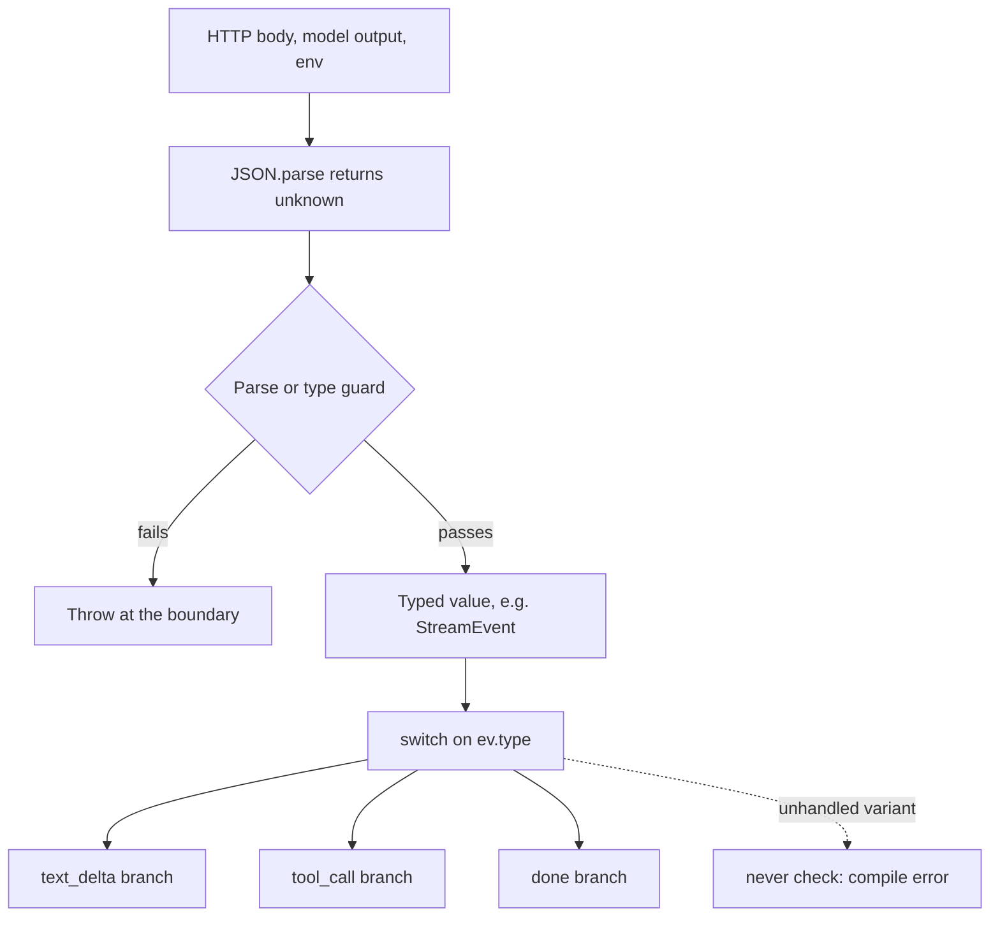

## TL;DR
An agent loop is glue between shapeless data: model output, invented tool arguments, stream events.
TypeScript types are erased at runtime, so under `strict` with discriminated unions, generics, `satisfies`
and `unknown` they make contract mismatches fail at compile time, not mid-run.

## For agent builders
- **Why it matters for agents.** Every agent step crosses a boundary: the model emits tool-call arguments
  it made up, your tool returns a result, the provider streams several event variants. Strict types plus
  an `unknown`-first boundary are what keep a 20-step run from dying on step 14 with `undefined`.
- **Where it shows up in your stack.** The tool registry (each tool's parser tied to its handler), the
  stream-event handler for provider SDKs, the model/config table, and the shared types package that the
  agent server, workers and evals all import.
- **What you control.** The `tsconfig.json` baseline (`strict`, `noUncheckedIndexedAccess`), lint bans on
  `any` and `as`, and the rule that tool arguments are `unknown` until parsed.
- **What you can skip.** Writing deep conditional or template-literal types from memory. Know they exist
  for SDK wrappers and tool registries; spend your effort on unions, narrowing and the parse boundary.

## Lab
### Task
Build the typed core of a tool-calling agent turn: a generic `defineTool` that ties each parser to its
handler, an `unknown`-to-`StreamEvent` boundary written without `as`, and a `dispatch` that turns bad
model arguments into error tool results instead of crashes. Time box: 45-75 minutes.
- **Prerequisites:** this lesson's narrowing, generics and discriminated-union sections; the runtime
  schema validation lesson is useful but not required.
- **Setup:** an empty folder with `"type": "module"` in `package.json`, then
  `npm i -D typescript vitest @types/node`. Checked with Node 24.21, TypeScript 7.0 and Vitest 5.0.
- **tsconfig.json:** `"strict": true`, `noUncheckedIndexedAccess`, `exactOptionalPropertyTypes`,
  `"module": "nodenext"`, `"noEmit": true`, `allowImportingTsExtensions`, `verbatimModuleSyntax`,
  `erasableSyntaxOnly` and `"types": ["node"]`. The last three let Node 24 run `.ts` files directly.
- **Save** the starter as `lab.ts` and the tests as `lab.test.ts`. The type tests run under `npx tsc --noEmit`,
  the behaviour tests under `npx vitest run`.

### Starter code
```ts
// Lab: a strictly typed tool registry and event boundary for an agent loop.
// Run: node lab.ts   Check: npx tsc --noEmit && npx vitest run
import { pathToFileURL } from "node:url";

export type Usage = { inputTokens: number; outputTokens: number };
export type StreamEvent =
  | { type: "text_delta"; text: string }
  | { type: "tool_call"; id: string; name: string; args: unknown }
  | { type: "done"; usage: Usage };

export type Tool<A, R> = { name: string; parse: (x: unknown) => A; run: (args: A) => Promise<R> };
export type Runner = (rawArgs: unknown) => Promise<unknown>;
export type ToolResult = { toolCallId: string; content: string; isError: boolean };

// LAB 1: make defineTool generic so parse's output type must equal run's input type.
// `any` lets a mismatched pair compile (the @ts-expect-error lines in the tests catch it).
export function defineTool(spec: Tool<any, any>): Tool<any, any> {
  return spec;
}

export function isRecord(x: unknown): x is Record<string, unknown> {
  return typeof x === "object" && x !== null && !Array.isArray(x);
}

export const getWeather = defineTool({
  name: "get_weather",
  parse: (x) => {
    if (!isRecord(x) || typeof x.city !== "string" || !x.city.trim()) throw new Error("city must be a non-empty string");
    return { city: x.city };
  },
  run: async (args) => `Sunny in ${args.city}`,
});

export const lookupOrder = defineTool({
  name: "lookup_order",
  parse: (x) => {
    if (!isRecord(x) || typeof x.orderId !== "string" || !/^ord_\d+$/.test(x.orderId)) {
      throw new Error("orderId must be a string like ord_123");
    }
    return { orderId: x.orderId };
  },
  run: async (args) => ({ orderId: args.orderId, status: "shipped" }),
});

export function runnerOf<A, R>(tool: Tool<A, R>): Runner {
  return async (raw) => tool.run(tool.parse(raw)); // the pair stays together; the map hides A
}

export const registry: ReadonlyMap<string, Runner> = new Map([
  [getWeather.name, runnerOf(getWeather)],
  [lookupOrder.name, runnerOf(lookupOrder)],
]);

// LAB 2: narrow an unknown wire value into a StreamEvent without `as`. Check every field the
// variant claims; throw Error(`bad event: ${JSON.stringify(x)}`) for anything else.
export function parseEvent(x: unknown): StreamEvent {
  throw new Error("not implemented: lab step 2 (parseEvent)");
}

// LAB 3: run one tool call and never throw. Unknown tool -> content `unknown tool <name>`;
// a parse or run error -> its message; success -> the value (JSON.stringify unless a string).
export async function dispatch(tools: ReadonlyMap<string, Runner>, call: { id: string; name: string; args: unknown }): Promise<ToolResult> {
  throw new Error("not implemented: lab step 3 (dispatch)");
}

export function assertNever(x: never): never {
  throw new Error(`unhandled event: ${JSON.stringify(x)}`);
}

export async function runTurn(wire: unknown[], tools: ReadonlyMap<string, Runner>) {
  let text = "";
  const results: ToolResult[] = [];
  let usage: Usage | undefined;
  for (const raw of wire) {
    const ev = parseEvent(raw);
    switch (ev.type) {
      case "text_delta": text += ev.text; break;
      case "tool_call": results.push(await dispatch(tools, ev)); break;
      case "done": usage = ev.usage; break;
      default: assertNever(ev); // compile error the day a variant is added and not handled
    }
  }
  return { text, results, usage };
}

if (import.meta.url === pathToFileURL(process.argv[1] ?? "").href) {
  const wire: unknown[] = JSON.parse(`[
    {"type":"text_delta","text":"Checking "},
    {"type":"text_delta","text":"that for you."},
    {"type":"tool_call","id":"c1","name":"get_weather","args":{"city":"Oslo"}},
    {"type":"tool_call","id":"c2","name":"lookup_order","args":{"orderId":42}},
    {"type":"tool_call","id":"c3","name":"send_email","args":{}},
    {"type":"done","usage":{"inputTokens":812,"outputTokens":64}}
  ]`);
  try {
    const out = await runTurn(wire, registry);
    console.log("text:", out.text);
    for (const r of out.results) console.log(r.toolCallId, r.isError ? "error" : "ok", r.content);
    console.log("usage:", out.usage?.outputTokens);
  } catch (e) {
    console.log(e instanceof Error ? e.message : e);
  }
}
```

### Expected output
`node lab.ts` with a correct solution prints:

```
text: Checking that for you.
c1 ok Sunny in Oslo
c2 error orderId must be a string like ord_123
c3 error unknown tool send_email
usage: 64
```

The starter prints `not implemented: lab step 2 (parseEvent)`, and `npx tsc --noEmit` reports two
`Unused '@ts-expect-error' directive` errors, because `any` lets the mismatched tool compile.

### Tests
```ts
import { describe, expect, test } from "vitest";
import { defineTool, dispatch, getWeather, parseEvent, registry, runTurn } from "./lab.ts";

describe("types (checked by npx tsc --noEmit)", () => {
  test("a mismatched parse/run pair and wrong args do not compile", () => {
    const typeOnly = () => {
      // @ts-expect-error run expects { orderId } but parse produces { city }
      defineTool({ name: "bad", parse: () => ({ city: "x" }), run: async (a: { orderId: string }) => a.orderId });
      // @ts-expect-error get_weather takes { city: string }
      void getWeather.run({ town: "Oslo" });
    };
    expect(typeof typeOnly).toBe("function"); // never called: these lines exist for tsc
  });
});

describe("parseEvent", () => {
  test("accepts each valid variant", () => {
    expect(parseEvent({ type: "text_delta", text: "hi" })).toEqual({ type: "text_delta", text: "hi" });
    expect(parseEvent({ type: "tool_call", id: "c1", name: "get_weather", args: { city: "Oslo" } }).type).toBe("tool_call");
    expect(parseEvent({ type: "done", usage: { inputTokens: 1, outputTokens: 2 } }).type).toBe("done");
  });
  test("rejects unknown variants and missing fields", () => {
    expect(() => parseEvent({ type: "citation", url: "x" })).toThrow(/bad event/);
    expect(() => parseEvent({ type: "text_delta" })).toThrow(/bad event/);
    expect(() => parseEvent({ type: "done", usage: { inputTokens: "1", outputTokens: 2 } })).toThrow(/bad event/);
    expect(() => parseEvent(null)).toThrow(/bad event/);
  });
});

describe("dispatch", () => {
  test("bad arguments and unknown tools become error results, not crashes", async () => {
    expect(await dispatch(registry, { id: "a", name: "get_weather", args: { city: "Oslo" } }))
      .toEqual({ toolCallId: "a", content: "Sunny in Oslo", isError: false });
    expect(await dispatch(registry, { id: "b", name: "lookup_order", args: { orderId: 42 } }))
      .toEqual({ toolCallId: "b", content: "orderId must be a string like ord_123", isError: true });
    expect(await dispatch(registry, { id: "c", name: "send_email", args: {} }))
      .toEqual({ toolCallId: "c", content: "unknown tool send_email", isError: true });
  });
  test("non-string results are JSON", async () => {
    const r = await dispatch(registry, { id: "d", name: "lookup_order", args: { orderId: "ord_7" } });
    expect(JSON.parse(r.content)).toEqual({ orderId: "ord_7", status: "shipped" });
  });
});

test("a full turn survives a malformed tool call", async () => {
  const out = await runTurn([
    { type: "text_delta", text: "ok" },
    { type: "tool_call", id: "x", name: "get_weather", args: {} },
    { type: "done", usage: { inputTokens: 5, outputTokens: 1 } },
  ], registry);
  expect(out.text).toBe("ok");
  expect(out.results[0]?.isError).toBe(true);
  expect(out.usage?.outputTokens).toBe(1);
});
```

On the starter, five Vitest tests fail with `not implemented` (or the wrong error message) and `tsc` fails
on the two unused directives. A correct solution passes `tsc --noEmit` with zero errors and all six tests.

### Failure scenarios
- **Write `parseEvent` as `return x as StreamEvent`.** Everything compiles, but the `citation` and missing-
  `text` tests fail, and in a real loop the `default` branch throws `unhandled event` mid-run. Debug by
  grepping for ` as ` in boundary code: a cast is the one place the compiler stopped checking.
- **Store tools as `Map<string, Tool<unknown, unknown>>`.** Under `strictFunctionTypes` a
  `Tool<{ city: string }, string>` does not fit, because its `run` cannot accept `unknown`. Reaching for
  `as` breaks the guarantee; `runnerOf` closes over each pair instead, so the map never sees `A`.
- **Let `dispatch` rethrow parse errors.** The malformed `lookup_order` call kills the whole turn and the
  other results are lost. The full-turn test fails; fix by returning the message as an error result.
- **Guard checks less than it claims** (only `typeof x.usage === "object"`). The string `inputTokens`
  test fails; reading `usage.inputTokens + 1` later would concatenate strings.

### Submission
- **Your `lab.ts`** with all three LAB steps done and no `any` or `as` left, apart from the starter's
  provided helpers.
- **A clean `npx tsc --noEmit`** run (zero errors, so both `@ts-expect-error` lines are used).
- **The `npx vitest run` output** showing six passing tests.
- **One added variant:** add `{ type: "error"; message: string }` to `StreamEvent`, paste the compile error
  `tsc` gives in `runTurn`, then handle it.
- **A short note** (3-5 sentences) on why `runnerOf` is type-safe without a cast.
- **Evaluated on:** tests and `tsc` passing, no casts at the boundary, and a correct explanation in the note.

## Why it exists
- **Agent services are glue between shapeless data.** JSON from a model, tool-call arguments the model
  invented, server-sent events in four or five variants, SDK objects with deeply optional fields. In
  OpenAI's Chat Completions shape, `choices[0]?.message?.content` is legitimately `null` when the model
  returned a tool call instead of text.
- **JavaScript lets you read anything.** The natural failure is `TypeError: Cannot read properties of
  undefined` thrown halfway through a request, after tokens have been billed and partially streamed.
- **"Write tests" is not enough.** Tests exercise the paths you thought of; a type checker exercises every
  call site on every change, including the SDK upgrade that silently made a field optional.
- **Default TypeScript catches almost nothing.** Without `strict`, untyped parameters become `any`, `null`
  is a member of every type, and `JSON.parse` returns `any` that flows unchecked into domain objects. Worse,
  it creates a false sense that shapes are checked.
- **What strictness buys.** The compiler says *no* exactly where a dynamic language says *maybe*: null
  handling, variant handling, and the boundary where untrusted data becomes typed data.

## How it works
### What `strict` actually switches on
`"strict": true` is an umbrella for a family of flags, each closing a specific hole.

| Flag | What it does | Because |
|---|---|---|
| **`noImplicitAny`** | An untyped parameter or variable is an error, not silently `any` | `any` is viral: one untyped parameter turns everything derived from it into `any` |
| **`strictNullChecks`** | `null` and `undefined` are their own types; a `string \| null` must be narrowed before `.trim()` | Turns "Cannot read properties of undefined" from a runtime surprise into a compile error |
| **`strictFunctionTypes`** | Parameters of function-typed values are checked contravariantly, so a handler typed to accept only `TextEvent` cannot be passed where a handler of `StreamEvent` is expected | It would receive events it cannot handle |
| **`strictPropertyInitialization`** | Class fields must be initialised at declaration or in the constructor | No half-built objects |
| **`strictBindCallApply`** | `.call/.apply` are type-checked | Dynamic calls stay checked |
| **`noImplicitThis`** | `this` must have a known type | No accidental global `this` |
| **`alwaysStrict`** | `"use strict"` is emitted | JS strict semantics everywhere |
| **`useUnknownInCatchVariables`** | `catch (e)` makes `e: unknown`; narrow before reading `e.message` | Anything can be thrown in JS, including strings and `undefined` |

- **Method vs property syntax.** Parameters declared with method syntax (`onEvent(e: T): void` in an
  interface) stay bivariant for compatibility, so prefer property syntax (`onEvent: (e: T) => void`) for
  callback contracts.
- **The family grows.** New TypeScript releases occasionally add flags to `strict` (5.6 added
  `strictBuiltinIteratorReturn`), so upgrading the compiler can surface new errors; that is the point.

### Three flags worth adding beyond `strict`
- **`noUncheckedIndexedAccess`.** `arr[i]` and `record[key]` become `T | undefined`, which is the truth:
  `choices[0]` can be missing.
- **`exactOptionalPropertyTypes`.** An optional property may be absent but may not be explicitly
  `undefined`. It matters because `{ ...defaults, ...overrides }` with `temperature: undefined`
  *overwrites* the default, and `"temperature" in opts` is true for a present-but-undefined key.
- **`noFallthroughCasesInSwitch`.** A `case` that falls into the next without `break` is an error.

### How narrowing works
Strictness is livable only because of *control-flow analysis*: the checker tracks, per code path, what a
variable can be. After `if (x === null) return;` the type of `x` below is `T`, not `T | null`.

- **Built-in narrowing:** `typeof x === "string"`, `x instanceof Error`, `"tool_calls" in msg`, equality on
  a literal field (`ev.type === "done"`), and truthiness.
- **Type predicate:** `function isToolCall(x: unknown): x is ToolCall` narrows in the caller's `if`.
- **Assertion function:** `function assertDefined<T>(x: T): asserts x is NonNullable<T>` narrows everything
  after the call, or throws.
- **Both are trusted blindly.** If a guard's body is wrong, the compiler believes the lie, so keep guards
  tiny or generate them from a schema.

### `unknown` versus `any`
- **`any` switches the checker off** for that value.
- **`unknown` is the honest top type.** You can hold it, but cannot call, index or dereference it until you
  narrow it with `typeof`, `instanceof`, a user-defined type guard
  (`function isToolCall(x: unknown): x is ToolCall`), or a runtime validator.
- **The rule that follows.** Wrap `JSON.parse` so it returns `unknown`, and make every boundary (HTTP body,
  model output, env var, webhook) go through a parse step that yields a typed value or throws. Types
  inside the boundary can then be trusted *because* nothing crosses it unvalidated.

### Discriminated unions and exhaustiveness
An agent loop is a switch over what the model just did (text, tool call, done), so this is the pattern
you use most.

1. **Model the stream as a union** of object types sharing a literal `type` field:
   `{ type: "text_delta"; text: string } | { type: "tool_call"; name: string; args: unknown } |
   { type: "done"; usage: Usage }`.
2. **Switch on the tag.** `switch (ev.type)` narrows `ev` in each branch, and a `default` branch that
   assigns `ev` to a variable of type `never` fails to compile the day a provider adds a new variant.
3. **Why unions beat class hierarchies** for protocol data: the compiler enumerates the call sites you must
   update.

### Generics with constraints
- **Tie parser to handler.**
  `function defineTool<A, R>(spec: { parse: (x: unknown) => A; run: (args: A) => Promise<R> })` means a
  handler cannot be registered with a parser that produces a different shape.
- **`extends` constrains** what a type parameter may be (`K extends keyof T`).
- **Inference from arguments** means callers rarely write type parameters by hand.

### Conditional, mapped and template-literal types
| Kind | Examples | Notes |
|---|---|---|
| **Mapped** | `Partial<T>`, `Readonly<T>`, `Record<K, V>`, or a custom nullable map (below) | Transform every property |
| **Conditional** | `T extends Promise<infer U> ? U : T` | A simplified `Awaited`; the built-in also recurses and unwraps any thenable. `ReturnType` and `Parameters` are built the same way with `infer` |
| **Template-literal** | `` `${Provider}:${Model}` `` | Build string unions |

- **Custom mapped type:** `{ [P in keyof T]: T[P] | null }` makes every property nullable.
- **Where they belong.** Library and contract code (an SDK wrapper, a tool registry), not everyday
  application logic, where they cost readability.

### Branded types
- **The problem: TypeScript is structural.** Any `string` fits any `string` parameter, so an unvalidated
  user string and a sanitized SQL fragment, or a token count and a dollar amount, are interchangeable.
- **The fix: a phantom property** only one function can produce:
  `type ValidatedPrompt = string & { readonly __brand: "ValidatedPrompt" }`. Only
  `validatePrompt(s: string): ValidatedPrompt` returns one (via a single internal
  cast), so `callModel(p: ValidatedPrompt)` cannot be handed raw input by mistake.
- **Zero runtime cost** because the brand is erased; it encodes "this check already happened" in the type,
  the same idea as parsing at the boundary.

### `as const` and `satisfies`
- **`as const`** makes a literal deeply readonly and keeps literal types (`"gpt-4o"` instead of `string`).
- **`satisfies`** checks a value against a type *without* widening it, so a model table can be validated as
  `Record<string, ModelSpec>` while `keyof typeof table` still yields the literal model names.
- **A plain annotation** would widen the keys to `string` and lose that.

### What the compiler cannot do
- **`tsc` erases every type;** no check runs at runtime.
- **A cast is untyped JS.** A strict program that casts `JSON.parse(body) as Request` is exactly as unsafe
  as untyped JS.
- **Pair with runtime validation** at the edges, the subject of the schema-validation lesson.

## Diagram
Model output and tool arguments enter as `unknown`, are parsed once at the boundary, and from then on
strict checking and exhaustive switches guard every step of the agent loop.



## Examples
### Typed stream handler, model table and brand
A typed stream handler, an exhaustiveness check, a model table that keeps literal keys, and a branded
type that makes "validated" visible to the compiler. Compile with `"strict": true` and
`"noUncheckedIndexedAccess": true` in `tsconfig.json`.

```ts
type Usage = { inputTokens: number; outputTokens: number };
type StreamEvent =
  | { type: "text_delta"; text: string }
  | { type: "tool_call"; name: string; args: unknown }
  | { type: "done"; usage: Usage };

const models = {
  fast: { id: "small-model", maxOutput: 4096 },
  smart: { id: "large-model", maxOutput: 16384 },
} as const satisfies Record<string, { id: string; maxOutput: number }>;
type ModelKey = keyof typeof models;            // "fast" | "smart", not string

function parseJson(text: string): unknown {      // never let `any` escape JSON.parse
  return JSON.parse(text);
}

function handle(ev: StreamEvent, out: string[], tools: Map<string, (a: unknown) => void>) {
  switch (ev.type) {
    case "text_delta": out.push(ev.text); break;          // ev narrowed: .text exists
    case "tool_call": {
      const fn = tools.get(ev.name);                        // Map.get is T | undefined
      if (!fn) throw new Error(`unknown tool ${ev.name}`);
      fn(ev.args); break;
    }
    case "done": console.log(ev.usage.outputTokens); break;
    default: { const never: never = ev; return never; }   // compile error if a variant is added
  }
}

function pick(key: ModelKey) { return models[key].id; }    // models["typo"] is a compile error

type ValidatedPrompt = string & { readonly __brand: "ValidatedPrompt" };
function validatePrompt(s: string): ValidatedPrompt {
  if (!s.trim() || s.length > 32_000) throw new Error("bad prompt");
  return s as ValidatedPrompt;                              // the one sanctioned cast
}
declare function callModel(p: ValidatedPrompt): Promise<string>;
// callModel(rawInput) fails to compile; callModel(validatePrompt(rawInput)) compiles
const first = ["a", "b"][0];                                // string | undefined under noUncheckedIndexedAccess
try { parseJson("{"); } catch (e) {                        // e: unknown
  if (e instanceof SyntaxError) console.error(e.message);
}
```

### Agent scenario: a typed tool registry with a constrained generic
This is the core of a tool-calling agent: the model names a tool and sends arguments, and `dispatch`
runs it. `defineTool` ties each tool's parser to its handler, so the registry cannot hold a mismatched
pair. The type guard here is deliberately tiny, as the narrowing section advises.

```ts
type Tool<A, R> = { name: string; parse: (x: unknown) => A; run: (args: A) => Promise<R> };

function defineTool<A, R>(spec: Tool<A, R>): Tool<A, R> { return spec; }

function isRecord(x: unknown): x is Record<string, unknown> {
  return typeof x === "object" && x !== null && !Array.isArray(x);
}

const getWeather = defineTool({
  name: "get_weather",
  parse: (x) => {
    if (!isRecord(x) || typeof x.city !== "string") throw new Error("city must be a string");
    return { city: x.city };                 // A inferred as { city: string }
  },
  run: async (args) => `Sunny in ${args.city}`,   // args is { city: string }, no annotation needed
});

async function dispatch<A, R>(tool: Tool<A, R>, rawArgs: unknown): Promise<R> {
  return tool.run(tool.parse(rawArgs));      // model-invented args are parsed before use
}
// dispatch(getWeather, JSON.parse('{"city":"Oslo"}')) resolves to "Sunny in Oslo"
```

- **In the loop,** catch the parse error and send its message back to the model as the tool result, so the
  model can retry with corrected arguments instead of the run crashing.

### Worked scenario: a support agent's tool-argument failures
An illustrative 1,000-run eval of a support agent with 6 tools, before and after typing the registry.

| Setting | Bad arguments reaching a handler | Runs that crashed |
|---|---|---|
| Args cast with `as ToolArgs` | every malformed call (for example a missing `orderId`) | every call that dereferenced the missing field threw `TypeError` inside the tool; the rest ran on `undefined` |
| Args `unknown`, parsed per tool | none: parse fails first | 0; the parse message went back to the model, which retried |

### Worked scenario: an SDK upgrade that made a field nullable
A team upgraded a provider SDK; the response field holding text became `string | null` because tool calls
now return no text.

| Codebase setting | What happened |
|---|---|
| `strict: false`, result cast with `as` | Compiled cleanly; `content.trim()` threw `TypeError` in production on every tool-call turn |
| `strict: true` | `tsc` flagged each `.trim()` call site on the upgrade PR; fixed before merge |
| `strict` plus `never` default in the event switch | The new `tool_call` variant also failed to compile in the handler until a case was added |

## Production patterns
- **Tool arguments are `unknown` until parsed.** Agent teams type the registry as
  `Tool<A, R>` with a `parse: (x: unknown) => A` per tool, and return parse errors to the model as the tool
  result. Monitor parse-failure rate per tool; a spike after a prompt change means the model's arguments
  drifted.
- **Strict baseline in a shared tsconfig.** Every service extends one base config with `"strict": true`,
  `noUncheckedIndexedAccess` and `exactOptionalPropertyTypes`, and CI runs `tsc --noEmit` on every PR.
  Monitor the error count when bumping the TypeScript version, since new releases can add strict flags.
- **Lint bans on escape hatches.** Enable `@typescript-eslint/no-explicit-any` and
  `@typescript-eslint/consistent-type-assertions` with `assertionStyle: "never"` as errors (the rule's
  default only enforces `as` syntax, it does not ban casts), with reviewed per-line disables. Track the count
  of `any` and `as` over time as a debt metric.
- **`unknown` at the edge, parse once.** Wrap `JSON.parse`, request bodies, webhook payloads and model tool
  arguments so they return `unknown`, then run one schema parse that yields a typed value. Monitor
  boundary validation-failure rates per source.
- **Exhaustive switches on provider events.** Model each provider's stream as a discriminated union with a
  `never` default branch, so an SDK bump that adds a variant breaks the build, not the stream. Watch for
  "stream ended early" reports after upgrades.
- **Ratcheted migration for legacy code.** Turn flags on one at a time, fix or explicitly suppress the
  errors, and set a deadline, because a half-strict codebase leaves types that lie.

## Trade-offs
- **Safety vs up-front work.** Strict mode front-loads work: every `null` must be handled explicitly, which
  costs time on a fresh codebase but pays back the first time a provider makes a field optional. It flips
  against you only on throwaway scripts where no second reader exists.
- **Precision vs readability.** Advanced types (conditional, mapped, template-literal) make contracts
  precise but raise compile times and reading cost. They pay off when many call sites consume one contract
  (an SDK wrapper, a tool registry) and cost more than they save when a type has one or two users.
- **Honesty vs boilerplate.** `unknown` at every boundary forces a parse step, extra code and a small
  runtime cost, but the alternative is trusting casts. It only flips for data your own process produced and
  never serialized, where the compiler already knows the shape.
- **Brands vs friction.** Branded types prevent mixing up same-shaped values (raw vs validated input, tokens
  vs dollars), but every construction site needs the brand's factory. Worth it where a mix-up is a
  security or billing bug, noise where it is merely a naming issue.
- **Unions vs classes.** Discriminated unions give exhaustiveness checks, class hierarchies give
  polymorphic dispatch. Unions win for protocol data that crosses the wire; classes win when behaviour
  outweighs shape.
- **Gradual vs big-bang adoption.** `strict` off with flags turned on one by one keeps a migration
  shippable but leaves types that lie; set a deadline or the migration never finishes.

## Pitfalls
- **Typing tool arguments as the shape you asked for.** Symptom: a handler crashes on a field the model
  omitted, killing the whole agent run. Fix: the model's arguments are `unknown`; parse per tool and feed
  failures back as a tool result.
- **Casting with `as` to silence an error** (`JSON.parse(x) as Response`). Symptom: a runtime `TypeError` on
  a field the type said was present, usually after an upstream API change. Fix: return `unknown` and parse.
- **Leaving `strict: false` and trusting the red squiggles.** Symptom: implicit `any` everywhere, so renaming
  a field breaks nothing at compile time and everything at runtime. Fix: enable `strict`.
- **Forgetting the `never` default branch** in a `switch` over a union. Symptom: a new event type silently
  dropped, often noticed as "the stream ends early for tool calls". Fix: add the `never` assignment in
  `default` so the next variant breaks the build.
- **Annotating instead of using `satisfies`,** so a config map loses its literal keys. Symptom:
  `keyof typeof config` becomes `string` and typos in model names compile cleanly. Fix:
  `as const satisfies Record<string, Spec>`.
- **Treating `catch (e: any)` as harmless.** Symptom: `e.message` is `undefined` because a library threw a
  string or non-Error object, hiding the real failure in logs. Fix: keep `e: unknown` and narrow.
- **A guard that checks less than it claims** (`x is ToolCall` after only checking `typeof x === "object"`).
  Symptom: a crash on a field the guard "proved" existed, with no cast anywhere to grep for. Fix: check
  every field the predicate claims, or derive the guard from a schema.

## When to use
- **Day one:** turn on `strict` in any Node agent service and add `noUncheckedIndexedAccess`; the cost of
  retrofitting grows with every file.
- **Use discriminated unions** whenever data has variants (stream events, tool results, provider error
  shapes), and **constrained generics** when a registry or SDK wrapper must tie an input type to a handler.
- **Use conditional and mapped types** only when a plain type would have to be repeated or kept in sync by
  hand.
- **Measure:** the share of `any` and `as` in the codebase (lint with `@typescript-eslint/no-explicit-any`
  and `consistent-type-assertions`) and how often runtime `TypeError`s reach production.
- **Interviews:** explaining *why* `strictNullChecks` matters, what `unknown` buys over `any`, and how
  exhaustiveness checking works is the expected depth; writing a mapped type from memory is not.

## Role lens
- **Engineer:** Models provider stream events and tool contracts as discriminated unions, keeps
  `JSON.parse` behind an `unknown`-returning wrapper, and fixes compile errors instead of casting past them.
- **Architect:** Sets the compiler baseline (`strict`, index-access checks, lint bans on `any`) as a
  repository standard and decides which shared packages own the cross-service type contracts.
- **FDE:** Reads a customer's `tsconfig.json` first when debugging "random undefined" incidents, and
  frames turning on `strict` as the cheapest reliability fix available in their stack.

## Check yourself
**Q:** A teammate argues that since TypeScript types are erased at runtime, enabling `strict` is
cosmetic and runtime validation with a schema library is all that matters. How do you respond?
**A:** Both are needed because they catch different failures. Runtime validation guards the boundary:
it turns untrusted JSON into a value you can trust, but it only runs where someone remembered to call
it. Strict typing guards everything inside the boundary: once a value is typed, every call site is
checked on every change, including the SDK upgrade that made a field nullable or the new stream
variant nobody handled. Without `strict`, a validated value can still be dereferenced as `any` two
functions later. The right design is `unknown` at the edge, a schema parse that produces a typed value,
and strict checking everywhere after that, so a mismatch surfaces either at compile time or at the
boundary, never mid-request.

## Interview questions
### What does `strictNullChecks` change, and why is it the most valuable strict flag for AI services?
- **Definition:** `null` and `undefined` stop being members of every type, so a `string | null` must be
  narrowed before you call methods on it.
- **Why it matters here:** provider responses are full of legitimately missing fields, such as message
  content being `null` on a tool-call turn, and this flag turns those runtime crashes into compile errors.

### A provider added a new stream event type and users report answers ending early. How do you debug and prevent it?
- **Diagnose:** the handler's `switch` has no case for the new variant, so the event falls through and is
  dropped silently; log unknown `type` values at the boundary to confirm.
- **Prevent:** model events as a discriminated union and add a `default` that assigns `ev` to `never`, so
  the next variant breaks the build on the upgrade PR instead of in production.

### How would you type an agent's tool registry so model-invented arguments never reach a handler unchecked?
- **Generic per tool:** `Tool<A, R>` pairs `parse: (x: unknown) => A` with `run: (args: A) => Promise<R>`, and
  `defineTool` infers `A`, so a handler cannot be registered with the wrong parser.
- **Boundary:** arguments arrive as `unknown`; `dispatch` always calls `parse` first.
- **Loop behaviour:** a parse failure becomes a tool-result message the model can correct, not a crash.

### When would you not reach for conditional and mapped types?
- **In application code with one or two users of a type,** where a plain type is clearer and the compile-time
  and reading cost outweigh the precision.
- **Use them in shared contracts** such as an SDK wrapper or tool registry, where one precise type is
  consumed by many call sites and keeping hand-written copies in sync would be the bigger risk.

### How would you migrate a 200-file service from `strict: false` to strict?
- **Ratchet flag by flag:** start with `noImplicitAny` and `strictNullChecks`, fix or explicitly suppress
  errors, and block new violations in CI.
- **Track the debt:** count `any`, `as` and suppressions per release, and set a deadline, because a
  half-migrated codebase has types that lie.
- **Fix boundaries first:** wrap `JSON.parse` and SDK calls to return `unknown`, since that is where most
  runtime `TypeError`s originate.

### What is a branded type and where would you use one?
- **Definition:** an intersection like `string & { readonly __brand: "ValidatedPrompt" }` that only one
  factory function can produce, erased at runtime so it costs nothing.
- **Where:** places where mixing same-shaped values is a security or billing bug, such as raw vs validated
  prompt text, or token counts vs dollar amounts.

## Quiz
### Q: Why is `unknown` preferred over `any` for the result of `JSON.parse`?
- [ ] `unknown` is faster because the engine skips property lookups
- [x] `unknown` cannot be used until narrowed, so the compiler forces a check before the value spreads through typed code
- [ ] `any` cannot hold `null`, so parsed JSON with nulls would fail
- [ ] `unknown` automatically validates the JSON against an interface
> `any` disables checking and propagates silently through every assignment. `unknown` holds the value
> but refuses every operation until a type guard or validator narrows it, which is exactly the discipline
> a boundary needs. Neither type performs any runtime validation.

### Q: What does a `default: const never: never = ev` branch in a switch over a discriminated union achieve?
- [ ] It throws at runtime if an unexpected event arrives
- [ ] It tells the bundler the branch is dead code and removes it
- [x] It makes the code fail to compile when a new union member is added but not handled
- [ ] It converts the union into an enum for faster dispatch
> If every variant is handled, `ev` has type `never` in the default branch and the assignment type-checks.
> Add a variant without a case and `ev` is no longer `never`, so the compiler reports every switch that
> needs updating. It provides no runtime behaviour on its own.

### Q: Why use `satisfies` instead of a type annotation for a constant config table?
- [ ] `satisfies` performs runtime validation of the object
- [ ] Annotations are not allowed on `const` declarations
- [x] `satisfies` checks the value against the type while keeping its literal keys and values, so `keyof typeof table` stays precise
- [ ] `satisfies` makes the object deeply immutable
> An annotation widens the value to the declared type, turning literal keys into `string`. `satisfies`
> only verifies compatibility, so the inferred type keeps `"fast" | "smart"` as keys and the compiler
> can reject typos in model names. Immutability comes from `as const`, not `satisfies`.

## Use cases & projects
### Use cases
- **Tool registries for tool-calling agents.** A generic `Tool<A, R>` ties each tool's parser to its handler,
  so adding a tool cannot ship a mismatched pair.
- **Provider stream handlers.** A discriminated union with a `never` default makes an SDK upgrade that adds
  an event variant break the build instead of silently ending agent turns early.
- **Shared contracts across agent services.** One types package imported by the agent server, background
  workers and eval harness keeps tool results and trace records in sync.
- **Model routing tables.** `as const satisfies` keeps model keys literal, so a typo in a routing rule is a
  compile error.

### Mini project
**Type a three-tool agent loop end to end (1-2 hours).**
- **Goal:** a tool-calling loop where no model-produced value is used before it is parsed.
- **Steps:** enable `strict`, `noUncheckedIndexedAccess` and `exactOptionalPropertyTypes`; model the
  provider's events as a `StreamEvent` union with a `never` default; register three tools with `defineTool`;
  run the loop against a mocked model that sometimes sends malformed arguments; return parse errors to the
  model as tool results.
- **Done when:** `tsc --noEmit` passes with zero `any` and zero `as` casts (the `as const` idiom aside), adding a fourth
  event variant fails to compile, and malformed arguments produce a retry rather than a crash in your test
  run.
