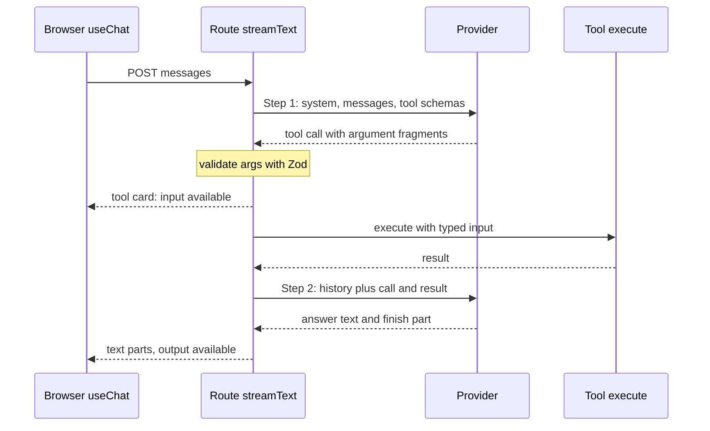

## TL;DR
The Vercel AI SDK (`ai` on npm) runs a TypeScript agent's tool loop across providers with one call shape,
and streams its steps to a `useChat` UI. Swapping models is one line; provider-specific features sit behind
an escape hatch.

## For agent builders
- **Why it matters for agents.** `streamText` with tools and `stopWhen` *is* a small agent loop: call the
  model, validate tool input, run `execute`, append the result, call again. Knowing what it does per step
  is how you budget, trace and debug a TypeScript agent built on it.
- **Where it shows up in your stack.** Route handlers that call `streamText` or `generateText` with `tool()`
  definitions, `useChat` in the browser showing tool cards, `generateObject` for typed planner or router
  outputs, and `wrapLanguageModel` middleware for cross-cutting policy.
- **What you control.** The step budget (`stepCountIs(n)`), which tools have `execute` (server-run) and
  which do not (client-run or approval-gated), `abortSignal`, per-provider `providerOptions` for caching,
  and telemetry per step.
- **What you can skip.** The UI stream protocol's wire format and the provider packages' internals; know
  only that client and server versions must match.

## Why it exists
- **Every provider has its own shape.** OpenAI returns `choices[0].message.content` and tool calls with
  JSON-string arguments; Anthropic returns an array of content blocks with parsed `input`; Google differs
  again, and each streams a different event vocabulary. Comparing models, keeping a fallback or letting a
  customer bring their own key means an adapter per provider and a normalised stream type of your own.
- **The browser needs a protocol.** A chat UI needs tokens as they arrive, tool-call progress, partial
  structured objects, stop buttons and history. The naive `fetch` plus `TextDecoder` loop grows into a
  protocol with no name that only one engineer understands.
- **Native SDKs and frameworks miss the middle.** Native SDKs are right for one provider and its full
  surface, but they are what the adapter would wrap. A heavyweight agent framework solves both problems at
  the cost of owning its abstractions for everything else.
- **The design bet: standardise the call and the UI stream, then stop.** The unified call covers the large
  common core (messages, tools, structured output, streaming, usage); the provider-specific long tail is
  reached through typed provider options. Whether that bet holds for you is this lesson's decision.

## How it works
### The provider abstraction
- **One specification, many packages.** `@ai-sdk/openai`, `@ai-sdk/anthropic`, `@ai-sdk/google` and
  community packages implement the SDK's language-model specification: a small interface with `doGenerate`
  and `doStream`.
- **Unified input and output.** Both take the unified prompt (system, messages with typed parts, tool
  definitions, settings) and return a result or a stream of unified parts: text deltas, reasoning deltas,
  tool-call deltas, tool results, and a finish part with `finishReason` and `usage`.
- **Why models are interchangeable.** The core functions are written once against that interface, so
  `anthropic("...")` and `openai("...")` swap at the call site; the wire-format mapping lives in the
  provider package, not your code.
- **The escape hatch.** Provider-only features (Anthropic's `cache_control` breakpoints or thinking settings,
  OpenAI's reasoning effort, a Google safety setting) go through `providerOptions` keyed by provider. They
  simply do nothing on a provider that lacks them.

### Core functions
| Function | Takes | Returns / does |
|---|---|---|
| `generateText`, `streamText` | `model`, `system`, `messages` (or `prompt`), optional `tools`, settings such as `temperature`, `maxOutputTokens`, `abortSignal` | Streaming variant: `textStream` and `fullStream` async iterables, plus `text`, `usage` and `steps` promises that resolve at the end, so one call serves the response body and your logging |
| `tool({ description, inputSchema, execute })` | A Zod (or JSON) schema | Becomes the provider's tool definition; arguments are validated before `execute` runs (contract-as-value, as in the schema-validation lesson) |
| `generateObject`, `streamObject` | A Zod schema | Typed, validated object (or partial objects); a non-conforming answer is an error (`NoObjectGeneratedError`), not a mis-typed value |
| `embed`, `embedMany` | Embedding model and values | Same unification for embeddings |

- **Tool execution and the loop.** With `execute` present the SDK runs the tool and records its result. With
  `stopWhen` (for example `stepCountIs(n)`) it appends the result and calls the model again until the
  condition holds or the model stops calling tools.
- **The default is a single step** (`stepCountIs(1)`) for `generateText` / `streamText`. Without `stopWhen`
  the tool runs but the model never sees its result and never writes the final answer.
- **Omit `execute`** to receive the tool call and run it yourself, for approvals or client-side tools.
- **How `generateObject` constrains output.** The provider package picks its best mechanism (a JSON schema
  response format, a forced tool call, or an instruction) and the SDK validates the result against the schema.

### One request through the tool loop
With `tools` that have `execute` and `stopWhen: stepCountIs(4)`, a single `streamText` call runs:
1. **Step 1.** The SDK maps `system`, `messages` and the tool schemas to the provider's request and streams
   the reply. The model emits a tool call; the SDK accumulates argument fragments and validates the parsed
   input against the tool's Zod schema.
2. **Execute.** `execute` runs with the typed input. The SDK appends the assistant message holding the tool
   call and a tool message holding the result. (In v5 a failed execution is recorded as a tool-error part
   rather than thrown, so the model can read it; check how your version treats errors.)
3. **Check the stop condition.** The loop continues only if the last step ended in tool calls and `stopWhen`
   is not yet satisfied. Otherwise the finish part is emitted.
4. **Step 2.** A *new* provider request is sent with the original prompt plus the appended messages. The
   model now writes the answer.

Two consequences of step 4:
- **Each step is a separate billed request that resends the whole history**, so input tokens grow every
  round. That is *why* `totalUsage` (summed over steps) can be several times the first request's input, and
  why a step limit is a cost control, not only a loop guard.
- **`steps` is your trace.** Each step carries its own text, tool calls, results and usage; log them to see
  where a slow or expensive answer spent its rounds.

### The UI half and its protocol
- **Client.** `useChat` (from `@ai-sdk/react` in v5; Vue and Svelte packages exist too) keeps the message
  list, sends it to your route on submit, and appends parts as they stream: text, tool invocations with their
  state, and custom data.
- **Server.** The route returns the result's response helper, which encodes unified stream parts into the
  UI message stream. In v5 that is JSON parts sent as server-sent events and marked by a protocol-version
  header; v4 used a line-prefixed "data stream" format. A plain text alternative exists when you only need tokens.
- **What it buys.** A tool call started on the server renders as a progress card in the browser without you
  writing the protocol.
- **The coupling.** Client and server packages must agree on the protocol version, which is why the two
  sides are upgraded together.

### Middleware and telemetry
- **`wrapLanguageModel`** wraps any model with middleware that can transform the prompt, intercept the
  result or short-circuit the call. Logging, caching, guardrails and default settings live here instead of
  at every call site.
- **OpenTelemetry**, switched on per call with the `experimental_telemetry` option, emits spans for each
  call and step with token usage, into the same tracing pipeline as the rest of the service.

### Runtime fit and versions
- **Runs anywhere `fetch` exists:** Node, Bun, Deno, edge runtimes, and inside Express, Fastify, Hono or
  Next.js route handlers. Nothing requires Vercel's platform; the UI hooks need a framework only on the client.
- **Names shift across majors.** In v5 tool `parameters` became `inputSchema`, `maxTokens` became
  `maxOutputTokens`, `maxSteps` became `stopWhen`, and `convertToCoreMessages` became `convertToModelMessages`.
- **v6 moved again.** It deprecated `generateObject` / `streamObject` in favour of `generateText` /
  `streamText` with an `output` setting, added an agent abstraction, and its migration guide lists further
  signature changes. Check the version you install against its docs rather than copying old snippets.

## Diagram
One `streamText` call with a tool is two billed provider requests; the second resends the history plus the
tool call and result.



## Examples
### Streaming tool route plus typed classification
A route handler that streams a tool-using answer to a `useChat` client, and a separate function that
classifies text into a typed object. The model line is the only provider-specific code; written against
AI SDK 5 naming.

```ts
import { streamText, generateObject, tool, stepCountIs, convertToModelMessages } from "ai";
import { anthropic } from "@ai-sdk/anthropic";
import { z } from "zod";
import { db } from "./db";

const model = anthropic(process.env.MODEL_ID ?? "claude-opus-5-5");   // swap for openai("...") to compare

export async function chatHandler(req: Request): Promise<Response> {
  const { messages } = await req.json();                             // UI messages from useChat
  const result = streamText({
    model,
    system: "You are a support assistant. Look orders up with the tool; never guess order data.",
    messages: convertToModelMessages(messages),
    tools: {
      lookupOrder: tool({
        description: "Fetch an order by its id",
        inputSchema: z.object({ orderId: z.string().regex(/^ord_\w+$/) }),
        execute: async ({ orderId }) => (await db.orders.find(orderId)) ?? { error: "not found" },
      }),
    },
    stopWhen: stepCountIs(4),          // at most 4 model/tool rounds per request
    abortSignal: req.signal,           // client disconnect stops generation and further billing
    onFinish: ({ totalUsage, steps }) =>   // `usage` here is the last step only; totalUsage sums all
      console.log({ totalUsage, steps: steps.length, toolCalls: steps.flatMap((s) => s.toolCalls).length }),
  });
  return result.toUIMessageStreamResponse();   // tokens, tool state and data to the browser
}

const Intent = z.object({
  intent: z.enum(["refund", "shipping", "other"]),
  confidence: z.number().min(0).max(1),
});

export async function classify(text: string) {
  const { object } = await generateObject({ model, schema: Intent, prompt: `Classify:\n${text}` });
  return object;                       // typed { intent, confidence }, validated against Intent
}
```

### Worked trace: "Where is ord_42?"
| Moment | What happens |
|---|---|
| Step 1 request | System prompt, one user message and the `lookupOrder` schema are sent |
| Step 1 reply | Tool call `{ orderId: "ord_42" }`; the regex passes; `execute` reads the database |
| Browser | A tool card moves from "input available" to "output available" before any answer text |
| Step 2 request | Everything resent plus the call and its result; the model writes the answer |
| `onFinish` | `steps.length` is 2; `totalUsage.inputTokens` counts the system prompt twice, because it was sent twice |

- **Bad input never reaches the tool.** Had the model asked for `"42"`, the Zod regex would have rejected
  the input before `execute` ran.
- **A provider swap changes only the wire.** Swapping `anthropic(...)` for `openai(...)` changes the bytes
  (a `tool_calls` entry with string arguments instead of a `tool_use` block) and nothing in this file.

### Worked scenario: what the step budget costs a research agent
A research agent starts each request with ~3,000 tokens of system prompt and tool schemas, and each round
appends ~1,000 tokens of tool call plus result. Illustrative numbers, not a measurement.

| Budget | Steps actually run | Input tokens per step | `totalUsage` input |
|---|---|---|---|
| `stepCountIs(1)` (default) | 1 | 3,000 | 3,000, but no answer after the tool runs |
| `stepCountIs(4)`, model finishes at step 4 | 4 | 3,000, 4,000, 5,000, 6,000 | 18,000 (6x the first request) |
| `stepCountIs(10)`, model loops on one tool | 10 | 3,000 up to 12,000 | 75,000 for a question that needed 4 rounds |

- **The budget is the cost ceiling.** Growth is quadratic-ish in steps because every step resends the
  history, so a loose limit costs far more than its step count suggests.
- **Provider caching** of the stable 3,000-token prefix cuts the price of the resent part, not the
  token count the model reads.

### Handling a structured-output failure explicitly
`generateObject` can still fail when the model's answer does not match the schema. Catch that error type,
log what the model wrote, and return an explicit fallback that your metrics count as a failure.

```ts
import { NoObjectGeneratedError } from "ai";

export async function classifySafe(text: string) {
  try {
    return await classify(text);                       // from the example above
  } catch (e) {
    if (NoObjectGeneratedError.isInstance(e)) {
      console.warn({ msg: "intent schema failure", raw: e.text, finishReason: e.finishReason });
      return { intent: "other" as const, confidence: 0 };   // explicit fallback, never silent
    }
    throw e;                                            // network, auth, abort: let the caller decide
  }
}
```

## Production patterns
- **Budgeted, cancellable tool loops.** On every route with tools, set `stopWhen: stepCountIs(n)` with a
  small `n` and pass `abortSignal: req.signal`, so a looping model or a closed tab stops billing. Monitor
  steps per request and `totalUsage` per conversation from `onFinish`, and alert on the tail.
- **Upgrade client and server together.** Pin `ai`, the provider packages and `@ai-sdk/react` to exact
  versions and bump them in one PR, because the UI stream protocol version must match on both sides. After
  deploy, watch for client render errors or empty messages on the chat page.
- **Cross-cutting policy in middleware.** Wrap the shared model once with `wrapLanguageModel` for logging,
  default settings or a guardrail, and export that wrapped model to every route. Monitor latency added by
  the middleware and keep per-route exceptions out of it.
- **Per-call tracing.** Pass `experimental_telemetry: { isEnabled: true }` on production calls so each call and step emits an
  OpenTelemetry span with token usage. Track p95 time to first token, tool-call counts and cost per route
  in the same dashboards as the HTTP spans.
- **Provider comparison as an eval job.** Run the golden set through the same code with the model line set
  to each candidate (`anthropic(...)`, `openai(...)`) in a scheduled job, and record quality, latency and
  cost side by side. Also run the tool schemas against each provider, since some reject schemas others accept.
- **Per-step agent traces.** Use the `onStepFinish` callback (or the `steps` array in `onFinish`) to log
  each step's tool calls, results, finish reason and usage under one run id. Monitor steps per run, tool
  error rate per tool, and runs that hit the step budget instead of finishing.

## Trade-offs
- **One call shape vs newest features.** Comparisons and fallbacks get cheap, but the newest
  provider-specific feature usually arrives behind `providerOptions` or not at all for a while. If your
  product is built on such a feature, the native SDK is the better primary interface.
- **Built-in loop vs request control.** The tool loop and `generateObject` remove boilerplate, yet they
  decide the mechanism (forced tool versus JSON mode) for you. When you need deterministic control over
  every request body, for caching or auditing, drop to the native SDK for that path.
- **UI protocol vs ownership.** Streaming tool and data parts come free, at the cost of coupling client and
  server versions and a wire format you do not own. A plain text stream is simpler when the client is not yours.
- **Middleware vs hidden behaviour.** It centralises logging, caching and guardrails, but a stack of
  middlewares is a second place behaviour hides. It pays while every call site needs the same policy, and
  stops once middlewares need per-route exceptions; then explicit calls are clearer.
- **Following majors vs stability.** Renamed core options are cheap to follow in a small codebase and painful
  in a large one; pin the version and schedule upgrades rather than floating.

## Pitfalls
- **Assuming `generateObject` removes failure handling.** Symptom: an unhandled schema validation error in
  production when the model returns a value outside the enum. Fix: catch `NoObjectGeneratedError`, log the
  raw text and return a counted fallback.
- **A generous `stopWhen` limit, or an agent abstraction with a high default, with no budget.** Symptom: a
  request makes a dozen tool calls, times out at the proxy and bills for every round. Fix: a small
  `stepCountIs(n)` and an alert on steps per request.
- **Omitting `stopWhen` entirely (the opposite mistake).** Symptom: the tool runs but the reply ends with no
  answer text. Fix: set `stopWhen` on every call that passes executable tools.
- **Forgetting to pass `abortSignal` from the request.** Symptom: server logs show completions finishing
  minutes after users closed the tab. Fix: `abortSignal: req.signal` on every streaming call.
- **Upgrading `ai` on the server without the client package.** Symptom: the UI renders nothing or shows raw
  protocol lines because the stream format changed. Fix: bump `ai` and the UI package in the same PR.
- **Reaching for `providerOptions` without checking the provider.** Symptom: a cache or thinking setting is
  silently ignored after switching models, and cost and latency change unexpectedly. Fix: set options for
  each provider you route to and check cache or reasoning token counts in `usage`.
- **Treating the model string as configuration-free.** Symptom: a provider swap passes tests with the fake
  and fails on tool schemas the new provider rejects. Fix: run the tool schemas against each candidate
  provider before switching.

## When to use
- **Use when** you want to compare or switch providers, a browser UI needs streamed text, tool state or
  partial objects, or a small team wants typed tools and structured output without owning an agent framework.
- **Agent fit:** short tool loops (a handful of steps) behind a chat UI are its sweet spot; long-running or
  durable agents that must survive restarts need a job queue and your own state around it.
- **Prefer the native SDK when** you commit to one provider and lean on its specific features (explicit
  prompt caching, batch APIs, server-side tools), need byte-level control over requests, or are writing a
  library others will consume.
- **Measure** the same things as with a native client: tokens and cost per request, p95 time to first token,
  tool-call counts per conversation, and schema validation failure rate.
- **Interviews:** explain what the abstraction normalises, what it cannot, and when you would step outside it.

## Role lens
- **Engineer:** Writes route handlers with `streamText`, defines tools with Zod, sets step limits and
  abort signals, and uses `providerOptions` for caching or reasoning settings per provider.
- **Architect:** Decides whether the unified layer or a native SDK is the primary interface, how
  provider switching is exercised in CI, and where middleware for logging and guardrails sits.
- **FDE:** Uses the provider swap to run a customer's prompts across models with one codebase and
  shows them the cost, latency and quality differences before they commit to a vendor.

## Check yourself
**Q:** A team built their product on the AI SDK and now wants Anthropic prompt caching on a 40k-token
system prompt and a batch job that classifies a million records overnight. What do you advise?
**A:** Split the two. Prompt caching is reachable without leaving the SDK: pass the cache breakpoint
through `providerOptions` for the Anthropic provider on the system message or tool definitions, then
verify by reading cache-read token counts in `usage` or provider metadata; if the breakpoint is not
exposed in their version, that single path can use the native SDK while the rest stays unified. The
batch job is a different story: a million offline classifications belong on the provider's batch API,
which trades latency for a lower price and is not something the unified call models. Write that job
directly against the native SDK, reuse the same Zod schema for validation, and keep the interactive
paths on the AI SDK. The rule is: unified layer for the common interactive surface, native SDK for
provider-specific economics.

## Interview questions
### What does the AI SDK actually normalise across providers, and what does it leave to you?
- **Normalised:** the call shape (system, messages, tools, settings), the stream parts (text, reasoning and
  tool-call deltas, finish with `usage`), tool validation and the structured-output path.
- **Left to you:** provider-only features via `providerOptions`, endpoints it does not model such as batch
  APIs, and checking that each provider accepts your tool schemas.

### A user reports that the assistant "looked up the order and then said nothing." What happened?
- **Likely cause:** no `stopWhen`, so the default single step (`stepCountIs(1)`) ran the tool but never sent
  its result back for a second model request.
- **Confirm:** `steps.length` is 1 and the last step ended in tool calls.
- **Fix:** set `stopWhen: stepCountIs(n)` with a small budget and log steps per request.

### Why can a tool-using request cost several times its first request's input tokens?
- **Each step is a new billed request** that resends the full history plus the appended tool call and result.
- **So input grows every round:** with two steps the system prompt is counted twice in `totalUsage`.
- **Control it** with a step limit, a short system prompt or provider caching, and monitor `totalUsage`, not `usage`.

### When would you not use the AI SDK?
- **One provider, deep features:** batch jobs, server-side tools or a new feature not yet exposed through
  `providerOptions` favour the native SDK.
- **Byte-level control:** auditing or caching that needs the exact request body.
- **Writing a library:** consumers should not inherit your abstraction and its version churn.

### How would you roll out an upgrade from AI SDK v4 to v5 safely?
- **Upgrade server and client packages together**, because v4 used a line-prefixed data stream and v5 uses
  server-sent JSON parts with a protocol-version header.
- **Apply the renames:** `parameters` to `inputSchema`, `maxTokens` to `maxOutputTokens`, `maxSteps` to `stopWhen`.
- **Verify** with an interception test of the route and a canary, watching empty-message and render errors.

### How would you put a human approval step in front of a refund tool in an AI SDK agent?
- **Omit `execute` on that tool,** so the SDK returns the tool call instead of running it and the loop
  stops there.
- **Render it in the UI** as a confirmation card from the streamed tool part; on approval, run the refund
  on the server and send the result back as the tool's output so the next request continues the loop.
- **Keep read tools server-run** with `execute`, so only consequential actions pause, and log approvals
  and denials per tool.
- **Check your major:** v6 adds a built-in approval flag on tools (`needsApproval`), which replaces the
  hand-rolled pattern above; confirm it in the docs for the version you install.

## Quiz
### Q: What makes `anthropic("...")` and `openai("...")` interchangeable in a `streamText` call?
- [ ] The SDK translates prompts into a provider-neutral language the models all understand
- [x] Each provider package implements the same language-model specification, mapping the unified prompt and stream parts to its own wire format
- [ ] Both providers expose an identical REST API, so no mapping is needed
- [ ] The SDK proxies every request through Vercel's servers, which normalise the response
> The core functions are written against one interface; the provider packages do the translation in
> both directions. The provider APIs differ substantially, and nothing is routed through Vercel; the
> package runs wherever `fetch` runs.

### Q: When should a team step outside the AI SDK and call a provider's native SDK directly?
- [ ] Whenever they stream responses to a browser
- [ ] Whenever they use tools, since the SDK cannot run a tool loop
- [x] When they depend on provider-specific features or endpoints the unified layer does not model, such as a batch API or byte-level request control
- [ ] Never; the SDK exposes every provider feature through its core functions
> Streaming and tool loops are the SDK's core strengths. Its limits are the features it chose not to
> unify; `providerOptions` covers many, but batch processing, exact request bodies and the newest
> provider capabilities are reasons to use the native client for that path.

### Q: What does `generateObject` with a Zod schema do that `JSON.parse` on the model's text does not?
- [ ] It guarantees the model cannot produce an invalid answer, so no error handling is needed
- [ ] It caches the result so repeated prompts are free
- [x] It sends the schema to the provider using its structured-output mechanism and validates the result, so the returned value is typed and conforming or an error is raised
- [ ] It streams the object to the client automatically
> `JSON.parse` gives you `unknown` from whatever the model wrote. `generateObject` constrains the
> generation where the provider supports it and validates against the schema, so a non-conforming
> value becomes an explicit error you must handle rather than a silently wrong object. It does not guarantee success, cache results or stream to the client.

## Use cases & projects
### Use cases
- **Support and ops agents in a web app.** A `streamText` route with a few Zod-typed tools and a small step
  budget, rendered by `useChat` as text plus tool cards.
- **Provider bake-offs for an agent.** The same agent code runs against several models in a scheduled eval,
  comparing task success, steps per run and cost.
- **Typed routing and planning steps.** `generateObject` classifies intent or produces a plan object that
  decides which tools or sub-agent run next.
- **Approval-gated actions.** Tools without `execute` pause the loop so a user confirms refunds, emails or
  deletes in the UI.

### Mini project
**Ship a streaming support agent with a tool card and an approval gate (2-3 hours).**
- **Goal:** a chat page where an agent looks orders up with a server-run tool and asks the user before a
  refund tool runs.
- **Steps:** write a `streamText` route with `lookupOrder` (with `execute`) and `refundOrder` (without);
  set `stopWhen: stepCountIs(4)` and `abortSignal: req.signal`; render tool parts in `useChat`; log
  `totalUsage` and steps from `onFinish`; swap the model line to a second provider and rerun.
- **Done when:** "Refund ord_42" shows a lookup card, then a confirmation card; approving completes the
  refund and the answer; closing the tab mid-run stops generation; both providers pass the same three
  scripted conversations.

### Major project
This lesson feeds the module Capstone (see the module guide): the document Q&A chat endpoint validates
requests with Zod and streams cited answers through the Vercel AI SDK or a native SDK behind an injected
interface, with a fallback provider when the breaker is open.
