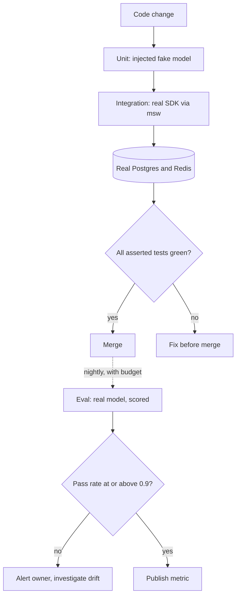

## TL;DR
Agent code around the model (loop, tool dispatch, budgets, parsing) is deterministic once the model is
faked. Test it in three layers: injected fakes, the real SDK over intercepted HTTP plus real databases,
and scored evals against the real model.

## For agent builders
- **Why it matters for agents.** Most agent bugs are not "the model was dumb": a tool result keyed to the
  wrong call id, a loop that ignores its step budget, a stream that never aborts. A scripted fake model
  replays a whole trajectory (tool call, tool call, answer) and catches them in milliseconds.
- **Where it shows up in your stack.** Vitest or Jest for the runner, an injected `ModelClient` for the
  agent, `msw` for provider HTTP, Testcontainers or CI service containers for the agent's Postgres and
  Redis, and a separate eval suite for task success.
- **What you control.** The interface boundary (inject the model and tools), the scripted trajectories,
  `maxRetries: 0` on test clients, fail-closed networking, and the threshold that gates promotion.
- **What you can skip.** Snapshotting model text and deep Jest-versus-Vitest comparisons; pick one runner
  and spend the effort on fakes and fixtures.

## Lab
### Task
Build the bottom layer of the test pyramid for an agent loop: a scripted fake model, and the loop fixes its
tests demand. The starter's loop has no step budget and crashes on a failing or unknown tool, the two bugs
an eval would only show as a vague drop in task success.
- **Time box:** 45-60 minutes.
- **Prerequisites:** this lesson's "Three kinds of double" section and the scripted-trajectory example;
  Dependency injection.
- **Runs offline:** no SDK, no key, no network. Checked with Node 24.21 (it runs `.ts` files directly) and
  Vitest 5.0.5; on older Node run the starter with `npx tsx agent.ts`.
- **Setup:** `npm init -y && npm pkg set type=module && npm i -D vitest`, then save the two files below.

### Starter code
```ts
// agent.ts: a tool-calling loop with an injected model, plus the scripted fake its tests use
import { fileURLToPath } from "node:url";

export type ToolCall = { id: string; name: string; input: unknown };
export type ToolResult = { id: string; isError: boolean; content: string };
export type Turn = { toolCalls: ToolCall[] } | { text: string };
export type HistoryItem = { task: string } | Turn | { toolResults: ToolResult[] };
export interface Model { next(history: HistoryItem[]): Promise<Turn> }
export type Tools = Record<string, (input: any) => Promise<unknown>>;

const SAFETY_CAP = 50;   // a hard stop so the starter cannot hang a test run; not the step budget

export async function runAgent(task: string, opts: { model: Model; tools: Tools; maxSteps: number }) {
  const history: HistoryItem[] = [{ task }];
  for (let step = 1; step <= SAFETY_CAP; step++) {
    // YOUR CODE 1: enforce opts.maxSteps. A model that keeps calling tools must make the run
    // reject with an Error whose message contains "step budget" after exactly maxSteps model calls.
    const turn = await opts.model.next(history);
    history.push(turn);
    if ("text" in turn) return { text: turn.text, steps: step };
    const toolResults: ToolResult[] = [];
    for (const call of turn.toolCalls) {
      // YOUR CODE 2: an unknown tool name or a tool that throws must become
      // { id: call.id, isError: true, content: <message for the model> } instead of crashing the run.
      const out = await opts.tools[call.name](call.input);
      toolResults.push({ id: call.id, isError: false, content: JSON.stringify(out) });
    }
    history.push({ toolResults });   // every result for this turn, keyed by the call id
  }
  return { text: "", steps: SAFETY_CAP };
}

// A scripted fake model: returns the given turns in order and records a COPY of each history it saw,
// because runAgent keeps mutating the same array.
export function scripted(...turns: Turn[]) {
  const seen: HistoryItem[][] = [];
  // YOUR CODE 3: implement next(history): push structuredClone(history) to `seen`, then return the
  // next scripted turn, or { text: "done" } once the script is used up. Also count calls in `calls`.
  const model = {
    calls: 0,
    async next(_history: HistoryItem[]): Promise<Turn> { throw new Error("not implemented: scripted fake"); },
  };
  return { model, seen };
}

if (process.argv[1] === fileURLToPath(import.meta.url)) {
  const { model, seen } = scripted(
    { toolCalls: [{ id: "c1", name: "lookup_order", input: { orderId: "ord_42" } },
                  { id: "c2", name: "refund_order", input: { orderId: "ord_42" } }] },
    { text: "Order ord_42 has shipped; I could not start the refund." },
  );
  const tools: Tools = { lookup_order: async ({ orderId }) => ({ orderId, status: "shipped" }) };
  const out = await runAgent("where is ord_42, and refund it", { model, tools, maxSteps: 4 });
  console.log(out);
  console.log("step 2 saw:", JSON.stringify(seen[1].at(-1)));
}
```

As given, `node agent.ts` stops with `Error: not implemented: scripted fake`. Do YOUR CODE 3 first; the remaining
failures then point at the loop itself.

### Expected output
```
{
  text: 'Order ord_42 has shipped; I could not start the refund.',
  steps: 2
}
step 2 saw: {"toolResults":[{"id":"c1","isError":false,"content":"{\"orderId\":\"ord_42\",\"status\":\"shipped\"}"},{"id":"c2","isError":true,"content":"unknown tool refund_order"}]}
```

The error text for `c2` is yours to word; the tests only require that it names the tool.

### Tests
```ts
// agent.test.ts: run with `npx vitest run`
import { describe, it, expect, vi } from "vitest";
import { runAgent, scripted } from "./agent";

const lookup = async ({ orderId }: { orderId: string }) => ({ orderId, status: "shipped" });

describe("scripted fake", () => {
  it("replays turns in order and records copies of each history", async () => {
    const { model, seen } = scripted({ text: "a" }, { text: "b" });
    const h = [{ task: "x" }];
    expect(await model.next(h)).toEqual({ text: "a" });
    h.push({ task: "mutated later" });
    expect(await model.next(h)).toEqual({ text: "b" });
    expect(await model.next(h)).toEqual({ text: "done" });
    expect(seen[0]).toEqual([{ task: "x" }]);          // a copy, not the live array
    expect(model.calls).toBe(3);
  });
});

describe("runAgent", () => {
  it("dispatches the tool, keys the result by call id, then answers", async () => {
    const { model, seen } = scripted(
      { toolCalls: [{ id: "c1", name: "lookup_order", input: { orderId: "ord_42" } }] },
      { text: "Order ord_42 has shipped." },
    );
    const tool = vi.fn(lookup);
    const out = await runAgent("where is ord_42?", { model, tools: { lookup_order: tool }, maxSteps: 4 });
    expect(tool).toHaveBeenCalledWith({ orderId: "ord_42" });
    expect(out).toEqual({ text: "Order ord_42 has shipped.", steps: 2 });
    expect(seen[1].at(-1)).toMatchObject({ toolResults: [{ id: "c1", isError: false }] });
  });

  it("stops at the step budget when the model keeps calling tools", async () => {
    const loop = { next: vi.fn(async () => ({ toolCalls: [{ id: "c", name: "search", input: {} }] })) };
    await expect(runAgent("x", { model: loop, tools: { search: async () => [] }, maxSteps: 3 }))
      .rejects.toThrow(/step budget/);
    expect(loop.next).toHaveBeenCalledTimes(3);
  });

  it("feeds a throwing tool back to the model as an error result", async () => {
    const { model, seen } = scripted({ toolCalls: [{ id: "c1", name: "lookup_order", input: {} }] }, { text: "Sorry" });
    const failing = async () => { throw new Error("upstream down"); };
    await expect(runAgent("x", { model, tools: { lookup_order: failing }, maxSteps: 4 })).resolves.toMatchObject({ text: "Sorry" });
    expect(seen[1].at(-1)).toMatchObject({ toolResults: [{ id: "c1", isError: true, content: expect.stringContaining("upstream down") }] });
  });

  it("turns an unknown tool name into an error result, keeping parallel results in order", async () => {
    const { model, seen } = scripted(
      { toolCalls: [{ id: "a", name: "lookup_order", input: { orderId: "ord_1" } }, { id: "b", name: "refund_order", input: {} }] },
      { text: "ok" },
    );
    await runAgent("x", { model, tools: { lookup_order: lookup }, maxSteps: 4 });
    expect(seen[1].at(-1)).toMatchObject({ toolResults: [
      { id: "a", isError: false }, { id: "b", isError: true, content: expect.stringContaining("refund_order") }] });
  });
});
```

On the starter all five fail: four with `not implemented: scripted fake`, and the budget test with
`promise resolved "{ text: '', steps: 50 }" instead of rejecting`. After YOUR CODE 3 alone, three
still fail: the budget test the same way, and the two error-result tests on the crash (`upstream down`,
and `opts.tools[call.name] is not a function`).

### Failure scenarios
- **Inject a live-array fake:** push `history` instead of `structuredClone(history)` into `seen`. The
  first test fails because `seen[0]` now contains the later item. Print `seen` after a run; identical
  entries for every step mean the fake recorded references, which is why the lesson's example copies.
- **Inject an off-by-one budget:** check `step >= opts.maxSteps` before the call. The budget test sees 2
  calls instead of 3. Read the `toHaveBeenCalledTimes` diff, then decide whether `maxSteps` counts model
  calls or tool rounds and write that down in the function's comment.
- **Inject a swallowed error:** catch the tool error but push `isError: false`. The model would read a
  failure as data. The `toMatchObject` diff shows `isError` flipped; grep your loop for every place that
  builds a `ToolResult`.
- **Inject a real-network leak:** construct an SDK client at module scope in `agent.ts` (for example
  `new OpenAI()`). The suite still passes on a laptop with a key set, but importing the file now needs one:
  run it with no provider key in the environment and the OpenAI constructor throws at import time (some
  SDKs, such as Anthropic's, only fail at the first request). Either way the model is no longer injected.

### Submission
- **Your `agent.ts`** with the three `YOUR CODE` parts done and the file's exports unchanged.
- **A `npx vitest run` log** showing 5 passed, and the `node agent.ts` output matching the expected lines.
- **One extra scripted trajectory test** of your own, built from a real or imagined production trace
  (for example two parallel tool calls where one throws), and red before your fix.
- **A short note** (3-5 lines) on what this suite cannot catch and which layer of this lesson catches it.
- **Evaluated on:** green tests with no network or key, results keyed by call id, the budget counted in
  model calls, and failures returned to the model rather than thrown.

## Why it exists
- **The model call breaks every test assumption.** It takes seconds, costs money per token, needs a
  secret, and returns different text for the same input. A suite that hits it is too slow for every push,
  too expensive to parallelise, leaks a production key into CI logs, and fails whenever the provider is
  degraded or rephrases. Teams that start this way end up with `it.skip` everywhere and no safety net.
- **"Mock everything" fails more quietly.** A `vi.mock("@anthropic-ai/sdk")` returning a canned object
  tests only your own branches. The bugs that bite (a renamed field, a tool schema the provider rejects, a
  stream event type you forgot) live in the serialization and parsing layer that a module mock skips.
- **In-memory databases lie the same way.** They do not enforce unique constraints, JSON column semantics
  or transaction isolation, so the test passes and production throws.
- **The skill is separating assert from measure.** Logic around the model (prompt assembly, retries,
  parsing, tool dispatch, persistence) is deterministic once the model is faked, so assert it. Output
  quality is statistical, so measure it in a scheduled eval with a threshold, not a merge gate. The runner
  is secondary.

## How it works
### The runners
Vitest and Jest share `describe` / `it` / `expect`, the `beforeAll` / `afterEach` hooks, module mocking,
fake timers, snapshots and coverage, deliberately: Vitest was built to be largely Jest-compatible. They
differ in how code reaches the test.

| | Jest | Vitest |
|---|---|---|
| TypeScript | Transform you configure: `ts-jest`, `babel-jest` or an swc plugin | Vite's transformer (esbuild, or Oxc in recent Vite) strips types without type-checking, so run `tsc --noEmit` separately |
| ESM | Long behind an experimental flag, so projects accumulate `moduleNameMapper` and `transformIgnorePatterns` | Default; `vite.config.ts` aliases apply to tests too |
| Workers | Child processes | `pool: "forks"` (child processes, default since v2) or `"threads"` (lighter, cannot use `process.chdir`, fragile with some native addons) |
| Serialise files (when a shared resource forces it) | `--runInBand` | `fileParallelism: false` |
| Watch | Re-runs related tests | Re-runs only files whose import graph changed |

- **Default choice.** For a TypeScript-first AI service started today, Vitest. Jest stays right when the
  repo already runs on it, because migrating a large suite buys little.
- **Isolated module registry per file** (Vitest's default `isolate: true`), *because* module state (a
  cached client, a memoised config) would otherwise leak between files.
- **Parallelism is per file, not per test.** Tests inside one file run sequentially unless marked
  concurrent.
- **Mocks are hoisted.** `vi.mock` / `jest.mock` calls are moved above imports by the transform, because
  ESM imports resolve before any statement runs, so a mock in normal source order would arrive too late.
- **Native ESM Jest is different.** Jest's hoisting is a Babel/ts-jest transform for CommonJS output;
  under native ESM you need `jest.unstable_mockModule` plus a dynamic `import()` instead.

### Three kinds of double for the model
1. **An injected fake.** Define the narrowest interface your code needs (`complete(prompt): Promise<string>`,
   or a stream of events) and pass an implementation in rather than importing the SDK at module scope.
   Tests hand in a function returning scripted answers, including malformed ones, in a known order. It
   tests parsing, repair loops, budgets and persistence, in microseconds.
2. **HTTP interception.** Construct the real SDK and intercept at the network layer with `msw`
   (`setupServer` from `msw/node`), `nock`, or undici's `MockAgent`.
   - The request body you assert on is the exact JSON the provider would receive, and the response is
     parsed by real SDK code. This catches a wrong field name or a stream handler that never fires.
   - Set `maxRetries: 0` on the client, so a deliberate 500 does not trigger the SDK's default two retries
     (three attempts) with backoff.
   - Streams: the handler returns `new HttpResponse(body, { headers: { "content-type": "text/event-stream" } })`,
     where `body` is a `ReadableStream` emitting recorded `event: …\ndata: {…}\n\n` frames, so the SDK's
     real SSE parser runs.
   - Splitting a frame across two chunks, or ending before `message_stop`, tests the reassembly and
     early-termination paths that hand-written fakes never exercise.
3. **Recorded fixtures.** Capture a handful of real responses once (including tool-call turns and a full
   stream transcript), store them as JSON, and replay them through the interceptor. They are the only
   cheap way to test the provider's real response shape, and to notice that an SDK upgrade changed a type.
   Refresh them deliberately, not on every run.

**For agents, the fake scripts a trajectory, not one answer.** Each call to the fake returns the next
scripted turn (a tool call, another tool call, then a final answer). A test then walks the whole loop:
- dispatch to the right tool, with results keyed to the right call id;
- the step budget, and error results fed back after a tool throws.

**Each layer catches what the one below cannot see.** The fake cannot see serialization bugs; the
interceptor cannot see output-quality drift; evals cannot see a bug in your retry logic because they are
too noisy to attribute a failure to it.

### Integration tests with real dependencies
- **Keep Postgres, Redis and the queue real**, *because* the behaviours you depend on (constraint
  violations, `SELECT … FOR UPDATE`, JSONB queries, Redis expiry, BullMQ retries) are what fakes get wrong.
- **Two ways to start them.** A `globalSetup` that starts containers with Testcontainers and exports
  connection strings, or a service started by CI (a GitHub Actions `services:` block, a compose file locally).
- **Design isolation, since the runner is parallel.** Pick one:
  - each worker gets its own database or schema, named from `VITEST_POOL_ID` / `JEST_WORKER_ID`;
  - every test runs inside a transaction rolled back in `afterEach`;
  - truncate between tests and run those files serially.
- **The rollback trick's precondition.** The code under test must run on the *same connection* as the
  test's transaction. If it takes its own pooled client, it neither sees the uncommitted fixtures nor gets
  rolled back. Inject the transaction-bound client (dependency injection again), and map the code's own
  transactions to savepoints.
- **Shared mutable state across workers** is the most common source of flaky integration suites.

### Async, streams, time and cancellation
- **Fakes must be async too.** An `async function*` is a perfect fake stream; a fake that waits on a
  `signal` lets you assert that aborting the request stops iteration.
- **Backoff runs under fake timers.** `vi.useFakeTimers()` plus `vi.advanceTimersByTimeAsync` makes a
  30-second backoff test finish in milliseconds. Forgetting to await the async advance is the usual reason
  a retry test hangs.
- **Eventually consistent assertions.** `expect.poll` and `vi.waitFor` cover assertions against a queue.

### Snapshots: prompts yes, completions no
- **Snapshot the rendered prompt.** Inline snapshots of system text plus serialized tool definitions are
  cheap regression tests: a prompt edit shows up as a diff in review, not a silent behaviour change.
- **Never snapshot model output.** It fails every run or gets updated blindly with `-u`, which trains
  people to ignore it.

### Where the real model lives
- **A separate suite**, selected by tag or directory, run on a schedule or on demand with a budget.
- **Scored against a threshold** (pass rate ≥ 0.9 on a golden set, judge score above a floor).
- **It publishes a metric**; it does not block a merge on one bad sample. The evals module covers how to
  build the set and harness.

## Diagram
Each change flows through the fast deterministic layers on every PR; the real model is only touched by
the scheduled, scored suite.



## Examples
### Fake model plus real SDK over msw
A `summarize` service depends on a narrow `ModelClient` interface,
`{ complete(prompt: string): Promise<string> }`.
- It calls `complete`, tries to parse `{"bullets": string[]}`, and on failure calls once more with a
  repair prompt that quotes the bad output.
- `anthropicAdapter(client)` implements `complete` with `client.messages.create` and joins the text blocks.
- Test one drives the repair loop with a scripted fake. Test two constructs the real Anthropic SDK and
  intercepts the HTTP call with `msw`, so the request body and response parsing are real.
- **The handler *captures* the body; the assertion runs in the test.** An `expect` thrown inside an msw
  handler becomes a 500, which surfaces as the SDK's `InternalServerError`, not the assertion message.

```ts
import { describe, it, expect, vi, beforeAll, afterAll, afterEach } from "vitest";
import { http, HttpResponse } from "msw";
import { setupServer } from "msw/node";
import Anthropic from "@anthropic-ai/sdk";
import { summarize, anthropicAdapter } from "../src/summarize";

describe("summarize (unit, injected fake)", () => {
  it("feeds a malformed answer back once, then returns parsed bullets", async () => {
    const complete = vi.fn()
      .mockResolvedValueOnce("not json")
      .mockResolvedValueOnce('{"bullets":["a","b"]}');
    const out = await summarize("long text", { complete });
    expect(out.bullets).toEqual(["a", "b"]);
    expect(complete).toHaveBeenCalledTimes(2);
    expect(complete.mock.calls[1][0]).toContain("not json");   // repair prompt quotes the bad output
  });
});

let sent: { max_tokens: number; messages: unknown[] } | undefined;   // the exact JSON on the wire
const server = setupServer(
  http.post("https://api.anthropic.com/v1/messages", async ({ request }) => {
    sent = (await request.json()) as typeof sent;
    return HttpResponse.json({
      id: "msg_test", type: "message", role: "assistant", model: "test",
      content: [{ type: "text", text: '{"bullets":["x"]}' }],
      stop_reason: "end_turn", usage: { input_tokens: 12, output_tokens: 6 },
    });
  }),
);
beforeAll(() => server.listen({ onUnhandledRequest: "error" }));  // any other network call fails loudly
afterEach(() => { server.resetHandlers(); sent = undefined; });
afterAll(() => server.close());

describe("summarize (integration, real SDK over intercepted HTTP)", () => {
  it("builds a request the API accepts and parses the response", async () => {
    const client = new Anthropic({ apiKey: "test-key", maxRetries: 0 });
    const out = await summarize("long text", anthropicAdapter(client));
    expect(out.bullets).toEqual(["x"]);
    expect(sent?.max_tokens).toBeGreaterThan(0);    // required field present in the real request
    expect(sent?.messages).toHaveLength(1);
  });
});
```

### Agent loop against a scripted trajectory
`runAgent(task, { model, tools, maxSteps })` is the code under test. `model.next(history)` returns either
`{ toolCalls: [...] }` or `{ text }`; `tools` maps names to async handlers; after each tool round the loop
appends a `{ toolResults }` entry to the history.

The fake model is a queue of scripted turns that also records a copy of each history it was shown,
because the loop keeps mutating the same array.

```ts
import { it, expect, vi } from "vitest";
import { runAgent, type Turn } from "../src/agent";

const scripted = (...turns: Turn[]) => {
  const seen: unknown[][] = [];                                   // copies: what the model saw per step
  const next = vi.fn(async (history: unknown[]) => {
    seen.push(structuredClone(history));
    return turns.shift() ?? { text: "done" };
  });
  return { next, seen };
};

it("dispatches the tool, keys the result by call id, then answers", async () => {
  const lookup = vi.fn(async () => ({ status: "shipped" }));
  const model = scripted(
    { toolCalls: [{ id: "c1", name: "lookup_order", input: { orderId: "ord_42" } }] },
    { text: "Order ord_42 has shipped." },
  );
  const out = await runAgent("where is ord_42?", { model, tools: { lookup_order: lookup }, maxSteps: 4 });
  expect(lookup).toHaveBeenCalledWith({ orderId: "ord_42" });
  expect(out.text).toContain("shipped");
  expect(model.seen[1].at(-1)).toMatchObject({ toolResults: [{ id: "c1", isError: false }] });  // step 2 input
});

it("stops at the step budget when the model keeps calling tools", async () => {
  const loop = { next: vi.fn(async () => ({ toolCalls: [{ id: "c", name: "search", input: {} }] })) };
  await expect(runAgent("x", { model: loop, tools: { search: async () => [] }, maxSteps: 3 }))
    .rejects.toThrow(/step budget/);
  expect(loop.next).toHaveBeenCalledTimes(3);
});

it("feeds a tool failure back to the model instead of crashing the run", async () => {
  const model = scripted({ toolCalls: [{ id: "c1", name: "lookup_order", input: {} }] }, { text: "Sorry" });
  const failing = async () => { throw new Error("upstream down"); };
  await runAgent("x", { model, tools: { lookup_order: failing }, maxSteps: 4 });
  expect(model.seen[1].at(-1)).toMatchObject({ toolResults: [{ id: "c1", isError: true }] });
});
```

- **What these three tests pin down:** routing, the budget and error handling, which are exactly the
  behaviours an eval would only show as a vague drop in task success.

### Backoff under fake timers
A self-contained retry helper that sleeps 1 s, then 2 s. Under fake timers the test runs in
milliseconds; each `advanceTimersByTimeAsync` is awaited so the promise chain between timers settles.

```ts
import { it, expect, vi, afterEach } from "vitest";

async function withRetry<T>(fn: () => Promise<T>, attempts = 3, baseMs = 1000): Promise<T> {
  for (let n = 0; ; n++) {
    try { return await fn(); }
    catch (e) {
      if (n + 1 >= attempts) throw e;
      await new Promise((r) => setTimeout(r, baseMs * 2 ** n));   // 1000 ms, then 2000 ms
    }
  }
}

afterEach(() => { vi.useRealTimers(); });

it("retries twice with exponential backoff and no real waiting", async () => {
  vi.useFakeTimers();
  const fn = vi.fn()
    .mockRejectedValueOnce(new Error("429"))
    .mockRejectedValueOnce(new Error("429"))
    .mockResolvedValueOnce("ok");
  const p = withRetry(fn);
  await vi.advanceTimersByTimeAsync(1000);
  expect(fn).toHaveBeenCalledTimes(2);
  await vi.advanceTimersByTimeAsync(2000);
  await expect(p).resolves.toBe("ok");
  expect(fn).toHaveBeenCalledTimes(3);
});
```

### Worked scenario: restructuring a suite of twenty real-model tests
Illustrative orders of magnitude for the Check yourself situation, not a benchmark.

| Layer after the split | Tests | What it asserts | Runs |
|---|---|---|---|
| Unit, injected fake | 20 rewritten | parsing, retries, tool dispatch, persistence | every push, seconds |
| Interception, real SDK + msw | 1 per provider adapter | request body, response and stream parsing | every push |
| Integration, Testcontainers | per repository module | constraints, `SELECT … FOR UPDATE`, expiry | every push, per-worker schema |
| Eval, real model | golden set | pass rate ≥ 0.9 | nightly, with a budget |

- **Before:** each PR paid twenty model calls of seconds each, plus random red builds when the provider
  was degraded.
- **After:** the merge gate makes zero model calls and needs no provider key; quality is a tracked number.

## Production patterns
- **Fail closed on network.** Whenever the suite uses msw, call `server.listen({ onUnhandledRequest: "error" })`
  so an unmatched URL fails the test instead of reaching the real provider. Pair it with CI jobs that
  have no provider key at all, and monitor for any test that needs one.
- **Per-worker schema.** When integration files run in parallel, derive a schema name such as
  `` `test_${process.env.VITEST_POOL_ID}` `` (or `JEST_WORKER_ID`) in a setup file and run migrations into
  it once per worker. Monitor flake rate per file; tests passing alone but failing together mean shared state.
- **Separate type-check job.** Because Vitest strips types without checking them, run `tsc --noEmit` as
  its own CI step next to the test run, so a type error cannot pass the suite. Watch that step's duration
  as the repo grows.
- **Fixture refresh on SDK upgrade.** When a dependency bot bumps `@anthropic-ai/sdk` or `openai`, re-record
  the fixture set with a dedicated script and review the JSON diff in the same PR. Monitor the age of the
  fixtures against the installed SDK version.
- **Split suites by config.** Keep the scored real-model suite in its own config or directory and run it
  from a scheduled CI workflow with `vitest run --config <eval config>`, never from the PR workflow.
  Track its pass rate and spend per run as metrics with an owner.
- **Production traces become scripted trajectories.** When an agent misbehaves in production, turn its
  trace (model turns and tool results) into a scripted fake plus tool stubs and add it to the unit suite,
  so the fix stays fixed. Track how many incidents gained a regression trajectory.

## Trade-offs
- **Injected fake: speed vs drift.** Fast and deterministic, but it can drift from the real client's
  behaviour. The interception layer keeps it honest, so you need both, not one.
- **Real containers: fidelity vs startup cost.** They catch database semantics fakes miss, at the cost of
  slower startup and CI complexity. An in-memory repository is acceptable only while the code relies on no
  constraint, isolation or JSON semantics, and stops being acceptable the day it does.
- **Recorded fixtures: pinned shape vs staleness.** Pinning the provider's response shape is the point,
  but fixtures go stale when the provider adds fields. Refresh on SDK upgrades rather than letting them rot
  or auto-updating.
- **Vitest vs Jest: setup speed vs maturity.** Vitest's Vite pipeline gives fast TS/ESM with little config;
  Jest's maturity and ecosystem win in large existing suites. Switching an established Jest repo rarely
  pays for itself.
- **Real model out of the merge gate: velocity vs blind spots.** It protects velocity only if the scheduled
  eval actually runs and someone owns its threshold; otherwise quality regressions go unnoticed.

## Pitfalls
- **Calling the real model in the PR suite.** Symptom: intermittent red builds, a growing list of
  `it.skip`, and a provider key visible in CI logs. Fix: inject a fake and move real calls to the eval suite.
- **Mocking the SDK module instead of the network.** Symptom: a green suite and a 400 from the provider in
  production because a field was renamed or a tool schema was invalid. Fix: intercept HTTP with msw.
- **Sharing one database between parallel workers.** Symptom: tests pass alone and fail in the full run,
  with unique-constraint or "row not found" errors that depend on ordering. Fix: per-worker schemas.
- **Testing backoff with real timers.** Symptom: a retry test takes a minute or hits the default test
  timeout, which then gets raised instead of fixed. Fix: fake timers with awaited async advances.
- **Forgetting `maxRetries: 0` on the client under test.** Symptom: a test of a 500 response is slowed by
  real backoff sleeps and sees three requests where it expected one. Fix: construct the test client with
  `maxRetries: 0`, and test retry behaviour explicitly where you mean to.
- **Snapshotting model text.** Symptom: the snapshot file is updated with `-u` on every change, so the test
  no longer tests anything. Fix: snapshot the prompt, score the output.
- **Rollback isolation while the code takes its own pooled connection.** Symptom: "row not found" for
  fixtures the test just inserted, and rows that survive between tests. Fix: inject the transaction client.
- **Testing only the happy path of the agent loop.** Symptom: production runs that loop forever, crash on
  a tool exception or send a result for the wrong call id. Fix: scripted trajectories for budget exhaustion,
  tool failure, unknown tool names and parallel calls in one turn.
- **Leaving `onUnhandledRequest` at its default (`"warn"`).** Symptom: a test hit the real network because
  a URL did not match the handler, with only a warning buried in the output. Fix: set it to `"error"` in
  the shared setup file.

## When to use
- **Injected fake:** whenever logic surrounds the model: prompt assembly, parsing, repair loops, budgets,
  tool dispatch, persistence.
- **Interception layer:** for each provider adapter and any stream-handling code, since that is where
  wire-format bugs live.
- **Real dependencies:** in integration tests for anything touching SQL, Redis or a queue; design worker
  isolation before the suite grows.
- **Real model:** a separate scored suite with a budget.
- **Measure:** suite wall-clock time, flake rate, and how many bugs reach production in the serialization
  layer; those three numbers tell you which layer is missing.
- **Interviews:** expect "how do you test non-deterministic code" and "what can a fake not catch"; the
  layered answer, with the merge-gate versus eval distinction, is what they listen for.

## Role lens
- **Engineer:** Writes the `ModelClient` interface, the fakes and the msw handlers, keeps the unit
  suite under a few seconds, and owns the Testcontainers setup for Postgres and Redis.
- **Architect:** Decides the boundary between asserted tests and scored evals, which dependencies must
  be real in CI, and the budget and cadence of the real-model suite.
- **FDE:** Builds a replayable fixture set from the customer's real traffic so their team can change
  prompts and upgrade SDKs with a safety net, without spending their model budget on CI.

## Check yourself
**Q:** Your team's suite calls the real model in twenty tests. It is slow, flaky and costs money, but
the lead argues that mocks would make the tests meaningless. How do you restructure it, and what does
each layer guarantee?
**A:** Split by what each layer can observe. Inject the model behind a narrow interface and rewrite the
twenty tests as unit tests with scripted fakes; they now assert parsing, retries, tool dispatch and
persistence deterministically. Add one interception test per provider adapter using the real SDK over
msw, asserting the request body and feeding back recorded responses; this catches the wire-format bugs
the lead is worried about. Keep real dependencies (Postgres, Redis) in integration tests with
per-worker isolation. Move the real-model cases into a scored eval with a golden set and a pass-rate
threshold, run on a schedule with a budget, so quality drift is measured rather than asserted. The
merge gate becomes fast and deterministic without pretending the model is deterministic.

## Interview questions
### Why is `vi.mock` of the provider SDK not enough to test a model integration?
- **Definition:** a module mock replaces the SDK with a canned object, so only your own branches run.
- **Why it falls short:** serialization and parsing are skipped, so a renamed field, an invalid tool schema
  or an unhandled stream event type passes the test and fails in production with a 400.
- **Better:** keep the real SDK and intercept HTTP with msw, asserting the captured body in the test.

### Your integration suite passes file by file but fails in the full parallel run. How do you debug it?
- **Suspect shared state first:** parallel workers writing to one database cause ordering-dependent
  unique-constraint and "row not found" errors.
- **Confirm:** rerun with `fileParallelism: false` (or `--runInBand` in Jest); if it goes green, isolation is the bug.
- **Fix:** a schema per worker from `VITEST_POOL_ID`, or rollback per test with the transaction client injected.

### When would you keep Jest instead of moving to Vitest?
- **Keep Jest** when a large suite already runs on it, because migration buys little and Jest's ecosystem
  is mature.
- **Choose Vitest** for a new TypeScript-first service: ESM by default, Vite aliases, little config.
- **Either way** run `tsc --noEmit` separately if the transform strips types without checking them.

### How would you test that cancelling a request stops a streamed model response?
- **Fake stream:** an `async function*` that checks an `AbortSignal` before each yield, injected behind the
  model interface.
- **Assert:** abort mid-stream and check iteration stopped and no further chunks were persisted.
- **Wire level:** with msw, return a `ReadableStream` that ends before `message_stop` to test the SDK path.

### How do you keep real-model quality in check without making merges flaky?
- **Separate scored suite** on a golden set, run nightly or on demand with a spend budget.
- **Threshold, not assertion:** for example pass rate ≥ 0.9 or a judge score floor, published as a metric.
- **Ownership:** someone owns the threshold and the alert, or regressions go unnoticed.

### How do you unit-test an agent's tool loop when the model is non-deterministic?
- **Inject the model** behind a `next(history)` interface and script a trajectory: tool call, tool call,
  final answer.
- **Assert the loop's own behaviour:** the right tool gets the right input, results carry the right call
  id, a throwing tool becomes an error result, and a model that never stops hits the step budget.
- **Leave quality to evals:** whether the model picks good tools is measured on a golden set, not asserted.

## Quiz
### Q: What does an HTTP-interception test with the real SDK catch that an injected fake model cannot?
- [ ] Non-deterministic differences in the model's wording
- [x] Errors in the request the SDK actually sends and in parsing the real response shape
- [ ] Database constraint violations in the persistence layer
- [ ] Slow backoff logic that should run under fake timers
> The fake replaces everything below your interface, so a renamed field or an invalid tool schema never
> reaches a test. Running the real SDK against intercepted HTTP exercises serialization and parsing
> while remaining deterministic. Model wording belongs to evals, not either test layer.

### Q: Why are `vi.mock` and `jest.mock` hoisted above the import statements in a test file?
- [ ] To make the mock apply to every file in the worker pool
- [ ] Because mocks must be registered before the test runner starts its timers
- [x] Because ES module imports resolve before any statement runs, so a mock in source order would register too late
- [ ] To allow the mocked module to be type-checked by TypeScript
> Imports are evaluated before the module body executes. If the mock registration ran in normal order,
> the module under test would already hold the real dependency. Hoisting the mock call fixes the
> ordering; it does not change scope across files or affect type checking.

### Q: Where should tests that call the real model live, and how should they report?
- [ ] In the PR suite, retried three times to absorb non-determinism
- [ ] In the PR suite, with snapshots of the model's text updated when they change
- [x] In a separate scheduled, budgeted suite that scores results against a threshold rather than asserting each case
- [ ] Nowhere; faked tests plus interception tests are sufficient
> Model output is statistical, so a single failing case is not a regression and a single passing one is
> not proof. A scored suite with a golden set and a pass-rate floor measures quality drift without
> making every merge depend on provider latency, cost and randomness.

## Use cases & projects
### Use cases
- **Agent loop regression suites.** Scripted trajectories pin tool routing, budgets and error handling, so a
  refactor of the loop cannot silently break them.
- **Provider adapter checks.** One msw test per adapter catches a renamed field or a tool schema the
  provider rejects before an SDK upgrade ships.
- **Agent memory and state stores.** Integration tests against real Postgres and Redis check run records,
  token budgets and memory writes under parallel workers.
- **Prompt and tool-definition review.** Inline snapshots of the rendered system prompt and tool schemas
  turn every prompt edit into a reviewable diff.

### Mini project
**Build a three-layer test suite for a small agent (2-3 hours).**
- **Goal:** a two-tool agent whose loop, provider adapter and quality are each tested at the right layer.
- **Steps:** inject the model behind `next(history)`; write scripted trajectories for success, budget
  exhaustion and a failing tool; add one msw test that runs the real Anthropic or OpenAI SDK with
  `maxRetries: 0` and `onUnhandledRequest: "error"`; snapshot the rendered tool definitions; put a
  ten-question eval with a pass-rate threshold in its own config.
- **Done when:** the PR suite runs in seconds with no provider key, breaking the step budget in code turns
  a test red, and the eval prints a pass rate from a separate command.

### Major project
This lesson feeds the module Capstone (see the module guide): a test suite with unit tests against a fake
model client, integration tests running real Postgres and Redis in containers plus intercepted provider
HTTP, and a separate scored eval of 20+ questions run outside the merge gate.
