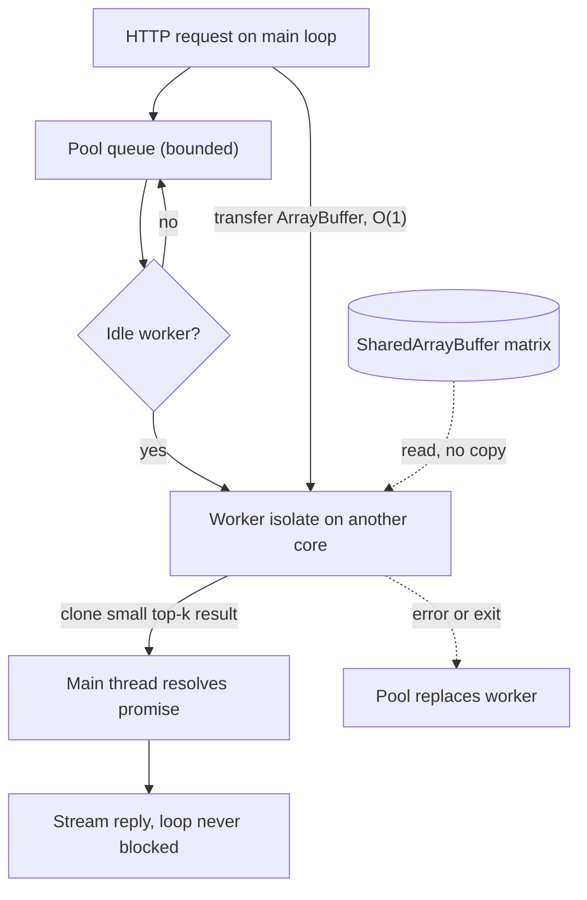

## TL;DR
Agent servers occasionally compute: token counting for context budgets, parsing uploaded documents,
in-memory reranking. `worker_threads` run that JavaScript in separate V8 isolates so the loop keeps
streaming; pool them and transfer or share large data.

## For agent builders
- **Why it matters for agents.** Agent loops are mostly I/O, but the CPU steps they do take (counting tokens
  before every model call, chunking a PDF a user just dropped in, scoring retrieved candidates) run on the
  same thread that streams every other session. A worker pool is how those steps stop freezing the server.
- **Where it shows up in your stack.** Context packing and compaction, RAG ingestion inside the agent
  server, local rerankers or similarity over cached embeddings, and `piscina` or a hand-rolled pool.
- **What you control.** Which agent steps move to the pool, pool size against the container CPU quota, the
  per-worker heap cap, and transfer versus clone for buffers.
- **What you can skip.** `Atomics.wait` protocols and lock-free designs. Know clone, transfer and
  `SharedArrayBuffer`, and that model and tool HTTP calls never need a worker.

## Why it exists
- **Some AI steps are genuinely compute.** Counting tokens with a BPE tokenizer over a 200-page document,
  parsing a 50 MB PDF, cosine similarity against a few hundred thousand in-memory embeddings, hashing files
  for deduplication, decompressing a large export.
- **On one thread they stall everyone.** Each can take hundreds of milliseconds to seconds of pure
  JavaScript, during which streamed tokens for every other user stop and health checks fail.
- **`async` does nothing.** It only yields at `await`, and there is nothing to await in a tight loop.
- **Chunking and child processes fall short.** `setImmediate` chunking keeps the loop responsive but slows the
  job and still spends the one core; two heavy requests halve each other's throughput. A child process per
  job costs a whole Node runtime (tens of megabytes and tens of milliseconds, illustrative) and serializes
  everything through pipes.
- **Workers changed the trade.** The old advice was "Node is not for CPU work; call another service". A
  worker is a second V8 isolate in the same process: far cheaper to start than a process, able to share
  memory, and running real parallel work on other cores while the main loop keeps streaming.

## How it works
### Isolates, not shared heaps
- **`new Worker(file, { workerData })`** starts an OS thread with its own V8 isolate and its own event loop.
- **Nothing is shared by default:** separate heap and global scope, so no variables, module instances or open
  sockets are shared with the parent.
- **Why:** heaps are isolated *because* V8's heap is not thread-safe. Isolation is what makes parallel
  JavaScript possible at all, and it is why you cannot "just call a function on another thread".
- **Cost:** each worker has its own heap and copies of loaded modules, and pays startup time to load and
  compile its script, which is why workers are pooled and reused rather than created per request.

### Message passing and structured clone
- **Channels are `MessagePort`s:** `worker.postMessage(value)` on one side, `parentPort.on('message', ...)` on
  the other.
- **Values are copied by structured clone,** which handles plain objects, arrays, `Map`, `Set`, `Date`, typed
  arrays and `Error`s.
- **What does not survive.** Functions and symbols throw a `DataCloneError`; class instances arrive as plain
  objects with prototype and methods gone, so a `Tokenizer` object cannot be sent, only the data to rebuild
  one.
- **Cloning is O(size) on the sender.** Sending a 100 MB string copies 100 MB, and the copy blocks the sending
  thread.
- **Design consequence:** the message is a job description (a file path, an id, a small payload); large data
  is transferred or shared, not cloned.

### Transfer and shared memory
| Mechanism | Cost | Semantics | Use for |
|---|---|---|---|
| Structured clone | O(size), on sender | Independent copies | Small job descriptions and results |
| Transfer: `postMessage(value, [arrayBuffer])` | O(1) | Ownership moves; sender's view becomes detached (length 0) | A `Float32Array` of embeddings or a `Buffer` of file bytes, and the result buffer back |
| `SharedArrayBuffer` | No copy | Genuinely shared memory; `Atomics` for sync (`Atomics.add`, `Atomics.wait`/`notify`) | Data both sides read concurrently |

- **Shared memory is fast and dangerous in the usual ways:** no structural locking, so keep it to numeric
  arrays and a clear protocol.

### Pooling
- **Shape.** A pool keeps N workers alive (typically the CPU count, minus one for the main thread), queues
  jobs, dispatches each to an idle worker, and resolves a promise with the result.
- **Build or borrow.** Writing one is about forty lines; `piscina` (created by Node.js core contributors) is
  the common library and adds idle timeouts, cancellation and `AbortSignal` support.
- **The pool is your concurrency limit.** With a queue in front, a burst of 1,000 tokenization requests
  becomes N parallel jobs and a bounded wait, instead of 1,000 threads.
- **Check the CPU count against the container quota.** On older Node versions and some orchestrators
  `availableParallelism()` reflects the host, and a pool sized to 64 host cores inside a 2-CPU container just
  thrashes.

### Parallelism across jobs versus within one job
- **A pool parallelises *across* jobs.** Eight queries on eight workers can finish in about the time of one,
  if there are eight free cores and the work is compute-bound.
- **Memory bandwidth can cap it.** A brute-force scan of a 1.2 GB matrix is often bandwidth-limited, so eight
  concurrent scans share that bandwidth and the speed-up is smaller; measure rather than assume linear
  scaling.
- **It does nothing for one query's latency,** which still scans every vector on one thread.
- **To cut one job's latency, split the data.** Give each of N workers a range of rows in the shared matrix,
  have each return a local top-k, and merge the N small lists on the main thread.
- **Cost of splitting.** Up to N× faster (less when memory bandwidth is the limit), at the cost of N messages
  and a merge per query; it occupies the whole pool for one request, so it fits low-concurrency,
  latency-sensitive paths, not high-throughput ones.

### Cancelling work inside a worker
- **A busy worker cannot hear "stop".** In a tight synchronous loop its own event loop is blocked, so a
  `'message'` is never handled; an `AbortSignal` does not help either, since the abort is a callback the busy
  worker never runs.

| Option | How | Cost |
|---|---|---|
| `worker.terminate()` | Stops the thread at the next safe point regardless of what it is doing | Reliable, but throws away the worker; the pool must spawn a replacement and pay startup again |
| Shared cancel flag | Job checks a flag in a `SharedArrayBuffer` with `Atomics.load` every few thousand iterations; main thread sets it with `Atomics.store` | Keeps the worker alive, but the job must cooperate |

- **Libraries such as `piscina`** map an `AbortSignal` onto these mechanisms for you.

### Memory limits per worker
- **Each worker has its own V8 heap limits.**
- **Cap them:** `new Worker(file, { resourceLimits: { maxOldGenerationSizeMb } })` makes one runaway document
  parse kill that worker (an `'error'` the pool can handle) instead of pushing the process into the
  container's out-of-memory killer.
- **Budget:** container memory = main heap + N × worker heap + shared buffers. The cap covers the old
  generation only (young generation, code and native buffers come on top), so leave headroom.

### Workers versus `cluster` and child processes
| Option | What it scales | Isolation | Cost |
|---|---|---|---|
| `cluster` or replicas behind a load balancer | N copies of the whole server use N cores for I/O-bound traffic; each still blocks on its own CPU work | Per process | N full runtimes |
| Worker threads | One server, CPU work moved aside | Shared process | One heap per worker |
| Child processes | Separate programs | Strong: a crash or native-module segfault does not take down the server | Higher memory and IPC |

- **Common combination:** replicas for I/O scale, plus a worker pool inside each replica for CPU steps.

### What workers are not for
- **I/O-bound work gains nothing:** a worker waiting on an HTTP call is a wasted thread.
- **Native code already off the loop** (the async `crypto` and `zlib` APIs use libuv's pool) does not need a
  worker.
- **Multi-machine or crash-durable work** belongs in a job queue (see the BullMQ lesson), not in threads.
- **Observability gets harder:** logs, traces and metrics from inside a worker need to be forwarded or tagged,
  because the worker has its own globals.

## Diagram
The main thread keeps serving I/O while jobs queue for a fixed pool; large inputs are transferred or shared,
and only small results are cloned back.



## Examples
### A minimal pool for top-k similarity
A minimal pool that dispatches top-k cosine-similarity jobs to workers, transferring the query vector instead
of cloning it.

The embedding matrix lives in a `SharedArrayBuffer`: passing an ordinary `Float32Array` as
`workerData` would structured-clone the whole ~1.2 GB matrix into every worker. The worker file and the pool
live in separate modules; this listing shows both with the worker guarded by `isMainThread`.

The idle workers keep the process alive after the result prints, so a real pool needs a `close()` that
calls `worker.terminate()` on shutdown.

```ts
import { Worker, isMainThread, parentPort, workerData } from "node:worker_threads";
import { availableParallelism } from "node:os";

type Job = { query: Float32Array; k: number };
type Hit = { index: number; score: number };

if (!isMainThread) {
  const vectors = workerData.vectors as Float32Array;      // flattened [n, dim], L2-normalised, shared
  const dim = workerData.dim as number;
  parentPort!.on("message", ({ query, k }: Job) => {
    const hits: Hit[] = [];
    for (let i = 0, n = vectors.length / dim; i < n; i++) {
      let dot = 0;                                          // dot of unit vectors = cosine
      for (let d = 0; d < dim; d++) dot += query[d]! * vectors[i * dim + d]!;
      hits.push({ index: i, score: dot });
    }
    hits.sort((a, b) => b.score - a.score);
    parentPort!.postMessage(hits.slice(0, k));             // small result: cloning is fine
  });
} else {
  class Pool {                                              // minimal: no crash replacement
    private idle: Worker[] = []; private queue: Array<() => void> = [];
    constructor(file: URL, data: unknown, size = Math.max(1, availableParallelism() - 1)) {
      for (let i = 0; i < size; i++) this.idle.push(new Worker(file, { workerData: data }));
    }
    run(job: Job): Promise<Hit[]> {
      return new Promise((resolve, reject) => {
        const start = () => {
          const w = this.idle.pop()!;
          const onError = (e: Error) => { w.off("message", onMsg); reject(e); };
          const onMsg = (hits: Hit[]) => {
            w.off("error", onError); this.idle.push(w); this.queue.shift()?.(); resolve(hits);
          };
          w.once("message", onMsg).once("error", onError);
          w.postMessage(job, [job.query.buffer as ArrayBuffer]); // transfer: O(1), query detached here
        };
        this.idle.length ? start() : this.queue.push(start);
      });
    }
  }
  const dim = 1536, n = 200_000;                            // 200k x 1536 x 4 B = ~1.2 GB
  const vectors = new Float32Array(new SharedArrayBuffer(n * dim * 4)); // shared, not cloned per worker
  const pool = new Pool(new URL(import.meta.url), { vectors, dim });
  const hits = await pool.run({ query: new Float32Array(dim).fill(0.01), k: 5 });
  console.log(hits[0]);                                    // main loop stayed free to serve streams
}
```

### Cooperative cancellation with a shared flag
Save as `cancel.mjs` and run `node cancel.mjs`. The worker polls a shared `Int32Array` every 100,000
iterations, so the main thread can stop it after 200 ms without `terminate()` and without a worker restart.

```js
import { Worker, isMainThread, workerData, parentPort } from "node:worker_threads";

if (!isMainThread) {
  const flag = new Int32Array(workerData.flag);
  let i = 0;
  while (true) {
    i++;                                                   // stand-in for a long scoring or parse loop
    if (i % 100_000 === 0 && Atomics.load(flag, 0) === 1) break;   // cheap poll, not every iteration
  }
  parentPort.postMessage(`stopped after ${i} iterations`);
} else {
  const flag = new Int32Array(new SharedArrayBuffer(4));
  const w = new Worker(new URL(import.meta.url), { workerData: { flag: flag.buffer } });
  w.once("message", (m) => console.log(m));
  setTimeout(() => Atomics.store(flag, 0, 1), 200);       // user abandoned the request after 200 ms
}
```

### Agent scenario: which agent steps go to the pool
One turn of a document-QA agent, with illustrative timings on one core.

| Step | Kind | Typical time | Where it runs |
|---|---|---|---|
| Model call and two tool HTTP calls | I/O | ~2 s wall | Main loop: awaiting costs nothing |
| Count tokens of the packed context (40k tokens) | CPU | tens of ms per turn | Worker pool, since it runs every turn for every session |
| Parse and chunk a 50 MB PDF the user uploaded | CPU | seconds | Worker pool with a heap cap, or a job queue if it must survive restarts |
| Rerank 200 retrieved chunks by cosine against the query | CPU | a few ms | Inline is fine; measure before moving |
| Brute-force top-k over 200k cached embeddings | CPU | hundreds of ms | Worker pool, matrix in a `SharedArrayBuffer` |

- **The rule:** move a step when it is synchronous, repeats, and its time times concurrent sessions shows up
  as event-loop lag; leave I/O and tiny steps alone.

### Worked scenario: sizing a pool in a 4-CPU, 4 GB container
Illustrative numbers for an ingestion service that also answers chat.

| Item | Choice | Memory |
|---|---|---|
| Main thread heap (HTTP, streaming) | 1 thread | ~0.5 GB |
| Worker pool | 4 CPUs − 1 = 3 workers, `maxOldGenerationSizeMb: 512` each | ≤ 1.5 GB old generation, plus per-worker overhead |
| Shared embedding matrix | 200k × 1536 × 4 B in a `SharedArrayBuffer` | ~1.2 GB, once |
| Total budget | main + 3 × worker + shared | ~3.2 GB, leaving headroom under 4 GB |
| If the pool were sized from 64 host cores | 63 workers | Thrashing, and up to ~32 GB of worker heap allowed |

## Production patterns
- **One CPU pool per agent server, fed by step type.** Agent teams route token counting, document chunking
  and local similarity to a shared pool and keep orchestration on the loop. Pass the run's `AbortSignal`
  into the pool job so a cancelled agent run frees its slot. Monitor queue wait per step type in run traces.
- **Use a maintained pool library.** `piscina` with `maxThreads` set from the container CPU quota, a bounded
  `maxQueue`, an `idleTimeout`, and `run(task, { signal })` for cancellation. Monitor queue size, wait time
  and run time per job.
- **Size from the quota, not the host.** Read the CPU limit from an environment variable set by the deploy
  (or verify `availableParallelism()` inside the container) and keep one core for the main loop. Monitor
  event-loop lag on the main thread and CPU throttling on the container.
- **Cap every worker's heap.** Pass `resourceLimits: { maxOldGenerationSizeMb }` so one malformed document
  kills a worker, not the pod; replace workers on `'error'` and `'exit'`. Alert on worker restart rate and
  pool size dropping below target.
- **Transfer in, clone out.** Send file bytes and vectors in the transfer list and return small results;
  keep read-mostly matrices in a `SharedArrayBuffer`. Watch main-thread lag around `postMessage` calls for
  accidental large clones.
- **Tag worker telemetry.** Include the worker's `threadId` and the job id in every log line, and propagate the
  trace id in the job message, since workers have their own globals.

## Trade-offs
- **Parallelism vs memory.** Workers give true parallelism for JavaScript on multi-core machines, but every
  worker is a separate heap, so memory scales with pool size; on a small container two workers may be all you
  can afford.
- **Clone vs transfer.** Structured clone is convenient and safe; transfer is O(1) but detaches the sender's
  buffer. Choose transfer for large payloads and accept the discipline of not touching them afterwards.
- **Shared memory vs races.** `SharedArrayBuffer` avoids copying entirely and suits read-mostly data like an
  embedding matrix, but reintroduces data races JavaScript otherwise never has; keep it to numeric arrays
  with `Atomics` guarding writes.
- **Bounded pool vs slot blocking.** A pool bounds concurrency and amortizes startup, but a job that blocks a
  worker for seconds blocks that slot; give long jobs their own pool or move them to a queue.
- **`terminate()` vs cancel flag.** `terminate()` cancels instantly but costs a worker restart; a shared-memory
  flag is cheap but needs the job to poll it. Terminate wins for rare cancellations of untrusted or
  third-party code; the flag wins when cancellation is routine (users abandoning requests).
- **Workers vs a separate service.** Workers are simpler to deploy and share the process's memory, yet they
  die with the process and cannot scale beyond one machine; durable or horizontally scaled work belongs in a
  job queue.

## Pitfalls
- **Counting tokens inline before every model call.** Symptom: loop lag that grows with the number of active
  agent sessions and the length of their transcripts. Fix: count in the pool, or count only the appended
  delta and cache the running total.
- **A new `Worker` per request.** Symptom: latency dominated by worker startup and memory spikes under load,
  often worse than running the job inline. Fix: a long-lived pool created at startup.
- **Large buffers without the transfer list.** Symptom: the main thread stalls on the copy, the very problem
  the worker was meant to solve. Fix: `postMessage(job, [buf.buffer])`.
- **Reading a `TypedArray` after transferring its buffer.** Symptom: zero-length arrays or `TypeError`s about
  detached buffers far from the `postMessage` call. Fix: copy what you still need first, or use the result.
- **Workers for I/O-bound steps** like calling the model API. Symptom: no throughput gain plus extra memory and
  harder debugging. Fix: keep I/O on the main loop.
- **Forgetting workers have their own globals.** Symptom: missing logs and traces, or a database client
  initialized twice because the module was loaded again in the worker. Fix: keep worker modules free of
  side-effecting imports and forward telemetry with `threadId`.
- **Not handling `'error'` and `'exit'`.** Symptom: a pool that silently shrinks after a worker crashes and
  eventually hangs with all jobs queued. Fix: reject the job and spawn a replacement on both events.
- **Expecting a timeout or abort to stop a worker mid-computation.** Symptom: the request returns an error
  while the worker's CPU stays at 100% and its pool slot stays busy until the job finishes. Fix: a shared
  cancel flag, or `terminate()`.

## When to use
- **Use when** a code path does sustained synchronous computation (more than a few tens of milliseconds,
  repeatedly) that must not stall the event loop and fits in one machine's memory: tokenization at scale,
  document parsing, embedding math in JS, compression and hashing of large payloads.
- **Prefer instead:** `setImmediate` chunking for rare, medium-sized jobs; native or WASM libraries that
  release the thread when they exist; a job queue for anything durable or spread across machines.
- **Measure:** event-loop lag before and after, per-job time inside the worker, pool queue depth, and process
  RSS.
- **Interviews:** why `async` does not help, how data crosses to a worker, and when a worker is the wrong tool;
  be ready to compare with Python's multiprocessing and the GIL.

## Role lens
- **Engineer:** Moves tokenization and parsing into a pooled worker, transfers buffers instead of
  cloning them, and forwards worker logs and errors so failures are visible.
- **Architect:** Sets the rule for what runs on the loop, in workers, or in a separate job service, and
  sizes pools against container CPU and memory limits.
- **FDE:** Spots a customer's chunking pipeline parsing PDFs on the request thread, demonstrates the
  loop-lag fix with a pool, and explains why their 2-core container caps the gain.

## Check yourself
**Q:** A document-ingestion endpoint parses uploaded PDFs and tokenizes them in the request handler.
During bulk uploads the chat endpoint in the same process becomes unresponsive. A colleague proposes
wrapping the parsing in an `async` function and calling it without `await`. Evaluate the proposal and
give a better design.
**A:** The proposal does nothing: `async` only yields at `await` points, and parsing is a synchronous
loop, so it still runs to completion on the event-loop thread and the chat streams still freeze. The
real fix is to move parsing and tokenization into a pool of worker threads sized to the container's
CPUs, send each job the file bytes as a transferred `ArrayBuffer` (not a clone), and return the chunked
text as the result. The pool also bounds concurrency so a bulk upload becomes a queue rather than a
thundering herd. If uploads can exceed the memory of one process or must survive restarts, push jobs
into a durable queue with separate worker processes instead, and keep the API process for I/O only.
Measure event-loop lag to confirm the chat path no longer stalls.

## Interview questions
### How do worker threads differ from threads in Java or Go?
- **No shared heap:** each worker is a separate V8 isolate with its own heap, globals and module instances,
  because V8's heap is not thread-safe.
- **Communication is by message:** structured clone copies, transfer moves `ArrayBuffer` ownership, and only
  `SharedArrayBuffer` gives shared memory, guarded by `Atomics`.

### After adding a worker pool, the main thread still lags during big uploads. What do you check?
- **Accidental clones:** a large `Buffer` or string posted without the transfer list is copied on the main
  thread, blocking it for the copy.
- **Work still inline:** parsing or `JSON.parse` of the result may still run on the main thread; profile with
  `--cpu-prof`.
- **Oversized pool:** more workers than container CPUs starves the main thread of a core.

### When would you choose a child process or a separate service over a worker thread?
- **Isolation:** native modules that can segfault, or untrusted code, are safer in a process whose crash does
  not take down the server.
- **Durability and scale:** work that must survive restarts or exceed one machine belongs in a job queue with
  separate worker processes.

### How would you size a worker pool and its memory for a 4-CPU container?
- **Threads:** about CPU quota minus one, so 3 workers, verified against what the runtime reports inside the
  container.
- **Memory:** main heap + 3 × per-worker `maxOldGenerationSizeMb` + shared buffers must fit under the
  container limit with headroom.
- **Validate under load:** watch queue depth, per-job time and RSS, and adjust.

### Your agent server streams to 300 sessions and also parses user uploads. Which steps go in workers, and how do you prove it helped?
- **Classify steps:** model and tool calls are I/O and stay on the loop; PDF parsing, token counting over long
  transcripts and brute-force similarity are repeated CPU work and go to a pool sized to the CPU quota.
- **Protect runs:** cap worker heaps so a bad upload kills a worker, not every session, and pass the run's
  abort signal so cancelled runs free their slot.
- **Prove it:** event-loop lag p99 and longest token gap per session before and after.

### How do you cancel a job that is already running in a worker?
- **`terminate()`** is reliable but discards the worker, so the pool pays startup for a replacement.
- **A shared cancel flag** polled with `Atomics.load` keeps the worker alive but needs the job to cooperate;
  prefer it when users routinely abandon requests.

## Quiz
### Q: Why does moving a CPU-heavy function into an `async` function not stop it from blocking the event loop?
- [ ] `async` functions run on the libuv thread pool but return to the main thread for results
- [x] `async` only yields control at `await`, and a synchronous loop has no await, so it still runs to completion on the main thread
- [ ] `async` functions are compiled to generators that are slower, making the block worse
- [ ] The event loop pauses microtasks while an async function runs
> `async` changes the return type to a promise and allows `await` inside; it does not move code to
> another thread. Only an actual `await` on a pending promise suspends the function. True parallelism
> for JavaScript requires a worker thread.

### Q: What happens to a `Float32Array` on the main thread after its buffer is listed in the transfer list of `postMessage`?
- [ ] It is copied, and both sides hold independent data
- [ ] It becomes read-only on the main thread
- [x] Its buffer is detached, so the main-thread view has length 0 and the worker owns the memory
- [ ] It is shared, so writes on either side are visible to both
> Transfer moves ownership without copying, which is why it is O(1), and the sender's view is detached
> to prevent two threads touching the same memory. Shared visibility requires a `SharedArrayBuffer`;
> structured clone without a transfer list copies the data.

### Q: Which workload benefits least from a worker-thread pool?
- [ ] Tokenizing thousands of documents for chunking
- [x] Making concurrent HTTP requests to a model provider
- [ ] Computing cosine similarity across an in-memory embedding matrix
- [ ] Parsing large PDF uploads into text
> HTTP requests are I/O-bound and already non-blocking on the main thread; a worker waiting on a socket
> adds memory and complexity with no throughput gain. Workers pay off for sustained synchronous
> computation that would otherwise stall the loop.

## Use cases & projects
### Use cases
- **Context budgeting.** Token counting for context packing and compaction runs in a pool so long transcripts
  do not stall other sessions.
- **Upload-to-RAG inside the agent server.** Parsing and chunking a user's PDF in a capped worker keeps chat
  streaming while the document is indexed.
- **Local retrieval and reranking.** Brute-force similarity over an in-memory embedding matrix, shared once
  via `SharedArrayBuffer`, for small corpora that do not justify a vector database.
- **Cancellable heavy steps.** A user who stops a run frees its worker slot through a shared cancel flag or
  the pool's `AbortSignal` support.

### Mini project
**Move an agent's CPU steps into a pool (1-2 hours).**
- **Goal:** keep token streaming smooth for many sessions while each turn counts tokens and scores cached
  embeddings.
- **Steps:** simulate 50 agent sessions streaming fake tokens; on each turn run a token count over a long
  transcript and a top-k scan over 50k random vectors inline; then move both to a 3-worker pool (the
  `Pool` above or `piscina`) with the matrix in a `SharedArrayBuffer`; add a cancel path for abandoned runs.
- **Done when:** a table shows loop-lag p99 and per-turn latency for inline versus pooled, and cancelling a
  run frees its slot within one poll interval.
