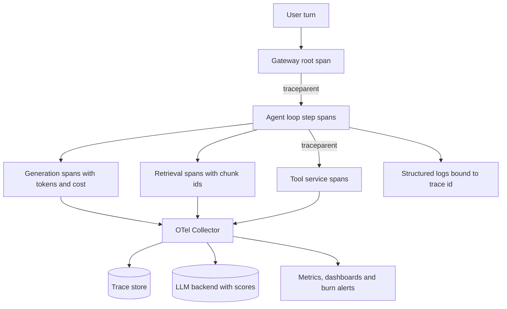

## Overview
This module is about seeing what an LLM system or agent actually did, why it did it, how long it took
and what it cost. The failures that matter most return HTTP 200 with plausible text, so an agent with
no telemetry fails silently: a wrong tool pick, a looping run or a stale index looks like success.

It starts with tracing, the timed tree of one request, and spans, the nodes of that tree. The real
skill is choosing boundaries and attributes (model, tokens, chunk ids, tool arguments) that match the
questions you will ask later.

Distributed tracing carries that tree across the gateway, retrieval
service, tool servers and queues a single turn crosses, using W3C `traceparent` propagation.

Logging records the discrete events and payloads that traces should not hold: rendered prompts, raw
completions, tool results and guardrail decisions, structured, bound to trace ids and redacted by
policy. Monitoring compresses all of it into aggregate signals and alerts, adding LLM quality proxies
to the golden signals.

Latency percentiles and token cost tracking are the two measurements every LLM dashboard is built on,
and both are easy to compute wrongly. OpenTelemetry is the vendor-neutral plumbing that produces this
telemetry once, and Langfuse, LangSmith and Arize Phoenix are the LLM-aware backends that add prompts,
costs, scores, datasets and evaluation on top.

- **What it gives an agent builder:** a per-run record of every model call, tool call, retrieval and
  retry, with the payloads, tokens, cost and timing needed to explain any bad answer, slow turn or bill.
- **Core for agents (use directly):** tracing, spans, distributed-tracing-across-services,
  token-cost-tracking, logging, monitoring, latency-percentiles.
- **Useful (pick one backend, know the plumbing):** opentelemetry, langfuse, langsmith, arize-phoenix.
- **Background:** collector internals, OTLP wire format, sketch maths and time-series database
  internals; the lessons tell you what to know and what to skip.
- **What you can build afterwards:** instrument a RAG or agent service end to end, debug a single bad
  answer from its trace, build dashboards and burn-rate alerts that catch silent regressions, attribute
  spend to features and tenants, enforce per-run budgets, and choose a backend on the merits.

It matters most for AI Engineers who ship and operate these systems, and for FDEs who must explain a
customer's bad answer or bill within the hour.

## Why it matters
- **Engineer:** You instrument every agent step, model call, retrieval and tool call as spans with the right attributes, propagate context through gateways, MCP or tool servers and queues, and use the resulting traces, logs and cost records to find which step of an agent run produced a wrong answer, a loop or a slow turn.
- **Architect:** You choose the telemetry pipeline for your agents (OTel SDKs, Collector, sampling policy, retention and redaction) and the LLM backend, deciding what gets stored where, what it costs to keep, where per-run budgets are enforced, and whether prompts containing customer data can leave your infrastructure.
- **FDE:** When a customer forwards a bad agent answer or questions the bill, you need to pull up that conversation's trace, show exactly what the model saw and which tool it chose, attribute cost to their tenant, and stand up dashboards and alerts in their environment without rebuilding their stack.

## Mental model
Hold one picture: every user turn is a tree of timed spans, and everything else in observability is a
view onto that tree.

- **The tree:** the root is the turn; beneath it sit retrieval, reranking, each generation, each tool
  call and each retry, stitched together across processes by a propagated trace id.
- **Spans:** carry the structure and timing of each agent step.
- **Logs:** hang payloads and decisions off the same ids, and outlive sampled traces.
- **Metrics:** the tree aggregated over millions of requests into rates, latency histograms and token
  counters.
- **Two kinds of question:** ask "what happened on this request" and you read one tree; ask "how often,
  how slow, how expensive" and you query the aggregates, using percentiles from merged histograms and
  cost from usage times the price in force.
- **Production and storage:** OpenTelemetry is how the tree is produced in a standard shape; Langfuse,
  LangSmith and Phoenix are places to store it and attach quality scores to its nodes.
- **The rule:** if the tree is incomplete, every view built on it lies.

The agent loop sits in the middle: every step emits spans, logs and usage under one trace id, and the
Collector fans that one tree out to the views you debug, score and alert on.

## Suggested order
1. tracing — establishes why LLM systems and agents need a per-request causal record and what a trace must capture, the frame for everything else.
2. spans — teaches the unit traces are built from and how to choose span boundaries and attributes for agent steps, generations, retrievals and tools.
3. distributed-tracing-across-services — extends the span tree across gateways, tool servers, sub-agents and queues so traces do not break at the first hop.
4. logging — adds the durable, structured event and payload record that complements sampled, lightweight traces.
5. token-cost-tracking — records usage per span and attributes spend by feature, tenant and run, and puts budgets inside the agent loop, the LLM-specific metric beside latency.
6. latency-percentiles — gives the correct way to measure and aggregate TTFT and end-to-end latency, per phase and per step, before building dashboards on it.
7. monitoring — combines golden signals, quality proxies, latency and cost into dashboards, SLOs and burn-rate alerts that catch silent failures.
8. opentelemetry — shows the standard API, SDK, OTLP and propagation format that produce traces, metrics and logs once for any backend.
9. langfuse — the open-source, self-hostable backend that closes the trace, score, dataset and prompt-version loop in one tool.
10. langsmith — the hosted platform most integrated with LangChain and LangGraph, best compared once the Langfuse data model is familiar.
11. arize-phoenix — the OpenTelemetry-native, evaluation-heavy option, which makes the most sense after OTel and the other two backends.

## Capstone
### Brief
Use case: a support team runs a multi-service RAG support assistant that answers order questions and
calls tools, and it wants any bad answer, slow turn or cost spike to be explainable from telemetry
alone. This is the module's major project, a multi-day build.

The system has at least three processes: an API gateway, an orchestrator that rewrites the query,
retrieves and reranks chunks and calls a model, and a separate tool service (for example an
order-status lookup) reached over HTTP or through a queue.

- Instrument all of them with OpenTelemetry, propagating `traceparent` across every hop including the
  queue.
- Record generation spans with model, parameters, token usage and computed cost, retrieval spans with
  chunk ids and scores, and tool spans with arguments and outcomes.
- Emit structured logs bound to trace ids, with rendered prompts and raw completions redacted at INFO
  and kept in a sampled payload stream.
- Send the traces through an OTel Collector to both a general trace store (Jaeger or Tempo) and one LLM
  backend (Langfuse, LangSmith or Phoenix), and attach an LLM-as-a-judge relevance or faithfulness score
  to a sample of production traces.
- Build a dashboard of TTFT and end-to-end latency percentiles from histograms, error, parse-failure
  and refusal rates, and cost per tenant and per successful task, with a burn-rate alert on a TTFT SLO
  and a per-run cost budget.

Then inject three faults (a slow tool, a prompt change that inflates input tokens, and a stale
retrieval index) and show that telemetry catches and localises each one.

### Deliverables
- The instrumented services and an OTel Collector configuration (Docker Compose is fine) that fans traces out to a general trace store and an LLM backend, with propagation working across HTTP and the queue.
- A dashboard with p50/p95/p99 TTFT and end-to-end latency computed from merged histograms, error, parse-failure and refusal rates, and token cost by feature, tenant and model.
- Alert definitions for a TTFT SLO burn rate and a per-agent-run or per-tenant cost budget, plus a short runbook for each alert.
- A structured logging schema listing the correlation fields on every line, the per-event fields, and the redaction and sampling rules for prompts and completions.
- A fault-injection report covering the three injected faults: the alert or dashboard signal that fired, the trace that localised the cause, and the time from injection to diagnosis.
- A one-page backend comparison note justifying the chosen LLM backend (Langfuse, LangSmith or Phoenix) on data residency, framework fit, evaluation workflow and cost.

### Rubric
- At least 99% of sampled turns produce a single connected trace from the gateway root to the provider call and the tool service, measured by a completeness query rather than asserted.
- Every generation span carries model, input, output and cached token counts and a computed cost, and the summed computed cost for a test run matches the provider's reported usage within a few percent.
- Latency percentiles are computed from histograms with bucket edges at the SLO thresholds, and the dashboard never shows an averaged percentile or a mean latency as the headline number.
- Each of the three injected faults is detected by a dashboard signal or alert and traced to the responsible span, including the stale index, which produces no errors and is caught only by a quality proxy or judge score.
- A grep of the default log stream for a planted secret or email address in a test prompt finds nothing, while the sampled payload stream still lets a reviewer reproduce the exact prompt for a given trace id.
